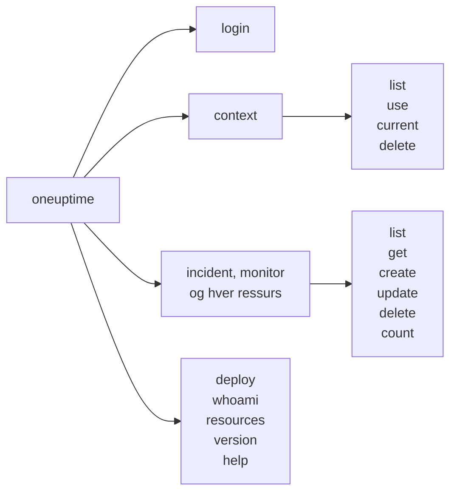

# Kommandoreferanse

Hver kommando i CLI-en `oneuptime`, med argumentene, alternativene og standardverdiene sine. Legg `--help` til en hvilken som helst kommando for å se det samme i terminalen din.

:::cards
- [Globale alternativer](#globale-alternativer): Alternativene hver kommando tar.
- [Innlogging og kontekster](#innlogging-og-kontekster): login og context-kommandoene.
- [Ressurskommandoer](#ressurskommandoer): list, get, create, update, delete og count.
- [Andre kommandoer](#andre-kommandoer): deploy, whoami, resources, version og help.
:::

## Kommandoene



## Globale alternativer

| Alternativ | Hva det gjør | Standard |
| --- | --- | --- |
| `--api-key <key>` | API-nøkkelen for denne kommandoen | `ONEUPTIME_API_KEY`, så kontekstens nøkkel |
| `--url <url>` | Adressen til OneUptime-en din for denne kommandoen | `ONEUPTIME_URL`, så kontekstens URL |
| `--context <name>` | Den lagrede konteksten som brukes for denne kommandoen | Den gjeldende konteksten |
| `-o, --output <format>` | `json`, `table` eller `wide` | `table` i en terminal, `json` i en pipe |
| `--no-color` | Skriver ut uten farger | Farger, med mindre `NO_COLOR` er satt |
| `-V, --version` | Skriver ut CLI-ens versjon | |
| `-h, --help` | Viser hjelpen til en kommando | |

Alternativene står før eller etter kommandoen: `oneuptime --context staging incident list` og `oneuptime incident list --context staging` gjør det samme.

## Innlogging og kontekster

### `oneuptime login`

Lagrer en API-nøkkel og en adresse som en kontekst, og gjør den til den gjeldende. Se [Logg inn](/docs/cli/authentication#logg-inn).

```bash
oneuptime login <api-key> <instance-url> [--context-name <name>]
```

| Argument eller alternativ | Påkrevd | Hva det er | Standard |
| --- | --- | --- | --- |
| `<api-key>` | Ja | En API-nøkkel til prosjektet ditt | |
| `<instance-url>` | Ja | Adressen til OneUptime-en din, for eksempel `https://oneuptime.com` | |
| `--context-name <name>` | Nei | Navnet konteksten lagres under | `default` |

### `oneuptime context list`

Lister de lagrede kontekstene; `*` markerer den gjeldende. API-nøkler listes aldri.

```bash
oneuptime context list [-o <format>]
```

| Alternativ | Påkrevd | Hva det er |
| --- | --- | --- |
| `-o, --output <format>` | Nei | `json`, `table` eller `wide`. JSON gir hver konteksts `name`, `apiUrl` og `isCurrent` |

### `oneuptime context use`

Gjør en lagret kontekst til den gjeldende.

```bash
oneuptime context use <name>
```

| Argument | Påkrevd | Hva det er |
| --- | --- | --- |
| `<name>` | Ja | Navnet på en lagret kontekst |

### `oneuptime context current`

Viser navnet og URL-en til den gjeldende konteksten, og API-nøkkelen dens skjult bortsett fra de fire første og fire siste tegnene.

```bash
oneuptime context current
```

### `oneuptime context delete`

Sletter en lagret kontekst. Var det den gjeldende, blir den første gjenværende konteksten gjeldende.

```bash
oneuptime context delete <name>
```

| Argument | Påkrevd | Hva det er |
| --- | --- | --- |
| `<name>` | Ja | Navnet på en lagret kontekst |

## Ressurskommandoer

`<resource>` er kommandoen for en type post, fra tabellene under [Ressurser](#ressurser), for eksempel `incident` eller `monitor`. Se [Ressursoperasjoner](/docs/cli/resource-operations) for eksempler.

### `oneuptime <resource> list`

Lister poster, de nyeste først. Etiketter listes i stedet etter navn, nummererte etiketter først (`2. Team` før `10. Owner`).

```bash
oneuptime <resource> list [--query <json>] [--limit <n>] [--skip <n>] [--sort <json>] [-o <format>]
```

| Alternativ | Hva det gjør | Standard |
| --- | --- | --- |
| `--query <json>` | Et filter, som JSON | Hver post nøkkelen kan lese |
| `--limit <n>` | Det høyeste antallet poster som returneres, opptil 10 000 | `10` |
| `--skip <n>` | Hvor mange poster som hoppes over først | `0` |
| `--sort <json>` | Rekkefølgen, som JSON: `{"<field>":"ASC"}` eller `{"<field>":"DESC"}` | De nyeste først |
| `-o, --output <format>` | `json`, `table` eller `wide` | `table` i en terminal, `json` i en pipe |

### `oneuptime <resource> get`

Leser én post. Bare poster: telemetri har ingen `get`.

```bash
oneuptime <resource> get <id> [-o <format>]
```

| Argument eller alternativ | Påkrevd | Hva det er |
| --- | --- | --- |
| `<id>` | Ja | Postens ID, en UUID |
| `-o, --output <format>` | Nei | `json`, `table` eller `wide` |

### `oneuptime <resource> create`

Oppretter en post og skriver den ut.

```bash
oneuptime <resource> create (--data <json> | --file <path>) [-o <format>]
```

| Alternativ | Påkrevd | Hva det er |
| --- | --- | --- |
| `--data <json>` | Én av de to | Posten, som JSON |
| `--file <path>` | Én av de to | En JSON-fil med posten. Oppgitt sammen med `--data` brukes filen |
| `-o, --output <format>` | Nei | `json`, `table` eller `wide` |

### `oneuptime <resource> update`

Endrer feltene du oppgir. Bare poster: telemetri har ingen `update`.

```bash
oneuptime <resource> update <id> --data <json> [-o <format>]
```

| Argument eller alternativ | Påkrevd | Hva det er |
| --- | --- | --- |
| `<id>` | Ja | Postens ID |
| `--data <json>` | Ja | Feltene som skal endres, som JSON |
| `-o, --output <format>` | Nei | `json`, `table` eller `wide` |

### `oneuptime <resource> delete`

Sletter en post med en gang, uten å spørre. Bare poster: telemetri har ingen `delete`.

```bash
oneuptime <resource> delete <id> [--force]
```

| Argument eller alternativ | Påkrevd | Hva det er |
| --- | --- | --- |
| `<id>` | Ja | Postens ID |
| `--force` | Nei | Godtas og endrer ingenting: `delete` ber aldri om bekreftelse |

### `oneuptime <resource> count`

Teller poster og skriver ut tallet.

```bash
oneuptime <resource> count [--query <json>] [-o <format>]
```

| Alternativ | Påkrevd | Hva det er |
| --- | --- | --- |
| `--query <json>` | Nei | Et filter, som JSON. Uten filter hver post nøkkelen kan lese |
| `-o, --output <format>` | Nei | `json`, `table` eller `wide` |

### Ressurser

Poster tar `list`, `get`, `create`, `update`, `delete` og `count`:

| Område | Kommandoer |
| --- | --- |
| Overvåking | `monitor`, `monitor-status`, `monitor-status-event` |
| Hendelser | `incident`, `incident-state`, `incident-severity`, `incident-state-timeline`, `incident-public-note`, `incident-internal-note`, `incident-alert`, `postmortem-status` |
| Varsler | `alert`, `alert-state`, `alert-severity`, `alert-state-timeline`, `alert-internal-note` |
| Statussider | `status-page`, `status-page-announcement` |
| Planlagt vedlikehold | `scheduled-maintenance-event`, `scheduled-maintenance-state`, `scheduled-maintenance-state-timeline` |
| Team og vakt | `team`, `on-call-policy` |
| Sikkerhet | `security-case`, `security-case-evidence`, `security-case-note`, `security-case-priority`, `security-case-status`, `security-case-task`, `security-detection`, `security-playbook` |
| Etiketter | `label` |

Telemetri tar `list`, `create` og `count`:

| Område | Kommandoer |
| --- | --- |
| Observerbarhet | `log`, `metric`, `span`, `exception-instance`, `monitor-log` |
| Sikkerhet | `security-event`, `threat-intel-indicator` |
| Endringer og kostnader | `change-event`, `kubernetes-cost-allocation` |

CLI-en utgis sammen med OneUptime, så `oneuptime resources` lister kommandoene i versjonen du har installert.

### API-forespørsler

Hver operasjon er én forespørsel til API-et, med nøkkelen i headeren `APIKey`. `<path>` er ressursens API-sti, fra `oneuptime resources`: `/incident` for `incident`, `/on-call-duty-policy` for `on-call-policy`.

| Operasjon | Forespørsel | Body |
| --- | --- | --- |
| `list` | `POST /api/<path>/get-list` | `query`, `select`, `skip`, `limit` og `sort` |
| `get` | `POST /api/<path>/<id>/get-item` | `select` |
| `create` | `POST /api/<path>` | `{"data": ...}` |
| `update` | `PUT /api/<path>/<id>/` | `{"data": ...}` |
| `delete` | `DELETE /api/<path>/<id>/` | Ingen |
| `count` | `POST /api/<path>/count` | `query` |

## Andre kommandoer

### `oneuptime deploy`

Registrerer en utrulling, eller en annen endring, fra en pipeline: den tegnes på tjenestens diagrammer og leses av OneUptime AI når den undersøker en hendelse. Den skriver med en telemetri-inntaksnøkkel, ikke en API-nøkkel. Se [Utrullinger og endringer](/docs/telemetry/change-events).

```bash
oneuptime deploy [--service <name>] [--service-version <version>] [--previous-version <version>] [--commit <sha>] [--repository <url>] [--branch <name>] [--pull-request <number>] [--environment <name>] [--title <title>] [--description <text>] [--type <type>] [--time <time>] [--attribute <key=value...>] [--ingestion-key <key>]
```

| Alternativ | Påkrevd | Hva det er | Standard |
| --- | --- | --- | --- |
| `--service <name>` | Nei | Tjenesten som ble rullet ut | En endring for hele prosjektet |
| `--service-version <version>` | Nei | Versjonen som ble rullet ut | |
| `--previous-version <version>` | Nei | Versjonen den erstattet | |
| `--commit <sha>` | Nei | Commiten som ble rullet ut | |
| `--repository <url>` | Nei | Repositoriet commiten ligger i | |
| `--branch <name>` | Nei | Branchen som ble rullet ut | |
| `--pull-request <number>` | Nei | Pull requesten som ble rullet ut | |
| `--environment <name>` | Nei | Miljøet det ble rullet ut til | |
| `--title <title>` | Nei | Endringens tittel; en annen type enn en utrulling trenger en | `Deploy <version>` |
| `--description <text>` | Nei | Detaljer om endringen | |
| `--type <type>` | Nei | Typen endring, for eksempel `config-change` eller `rollback` | `deployment` |
| `--time <time>` | Nei | Når det skjedde, for eksempel `2026-10-19T10:00:00Z` | Nå |
| `--attribute <key=value...>` | Nei | Flere attributter, som `key=value`, ett eller flere | |
| `--ingestion-key <key>` | Nei | En telemetri-inntaksnøkkel til prosjektet | `ONEUPTIME_TELEMETRY_INGESTION_KEY` |

### `oneuptime whoami`

Viser URL-en og API-nøkkelen som neste kommando vil bruke, med nøkkelen maskert, og konteksten de kommer fra. Den kaller ikke OneUptime. Se [Sjekk hva CLI-en vil bruke](/docs/cli/authentication#sjekk-hva-cli-en-vil-bruke).

```bash
oneuptime whoami
```

### `oneuptime resources`

Lister hver type post CLI-en har en kommando for: kommandoen, navnene i entall og flertall, typen og API-stien, og totalen.

```bash
oneuptime resources [--type <type>] [-o <format>]
```

| Alternativ | Påkrevd | Hva det er | Standard |
| --- | --- | --- | --- |
| `--type <type>` | Nei | `database` for poster, `analytics` for telemetri | Begge |
| `-o, --output <format>` | Nei | `json`, `table` eller `wide`. JSON gir hver enkelts `name`, `singularName`, `pluralName`, `modelType` og `apiPath` | `table` i en terminal, `json` i en pipe |

### `oneuptime version`

Skriver ut CLI-ens versjon, slik `oneuptime --version` gjør.

```bash
oneuptime version
```

### `oneuptime help`

Viser hjelpen til CLI-en, eller til en kommando.

```bash
oneuptime help [command]
```

## Miljøvariabler

| Variabel | Hva den gjør |
| --- | --- |
| `ONEUPTIME_API_KEY` | API-nøkkelen, når ingen `--api-key`-flagg gir en |
| `ONEUPTIME_URL` | Adressen til OneUptime-en din, når ingen `--url`-flagg gir en |
| `ONEUPTIME_TELEMETRY_INGESTION_KEY` | Telemetri-inntaksnøkkelen `oneuptime deploy` skriver med, når ingen `--ingestion-key`-flagg gir en |
| `NO_COLOR` | Satt til en hvilken som helst verdi slår den av farger |

## Filer

| Fil | Hva den inneholder |
| --- | --- |
| `~/.oneuptime/config.json` | De lagrede kontekstene, API-nøklene deres og den gjeldende konteksten |

## Avslutningskoder

| Kode | Betydning |
| --- | --- |
| `0` | Det virket |
| `1` | Det mislyktes: OneUptime avviste forespørselen, eller kommandoen var feil |
| `2` | Ingen brukbar API-nøkkel: ingen funnet, ugyldig eller under abonnementet sitt |
| `3` | Ikke funnet: OneUptime svarte `404` |

Se [Avslutningskoder](/docs/cli/scripting#avslutningskoder) for eksempler.

## Neste steg

:::cards
- [CLI – Oversikt](/docs/cli/index): Installer CLI-en og kjør de første kommandoene.
- [Ressursoperasjoner](/docs/cli/resource-operations): Eksempler på hver operasjon.
- [Skripting og CI/CD](/docs/cli/scripting): CLI-en i skript og pipelines.
:::
