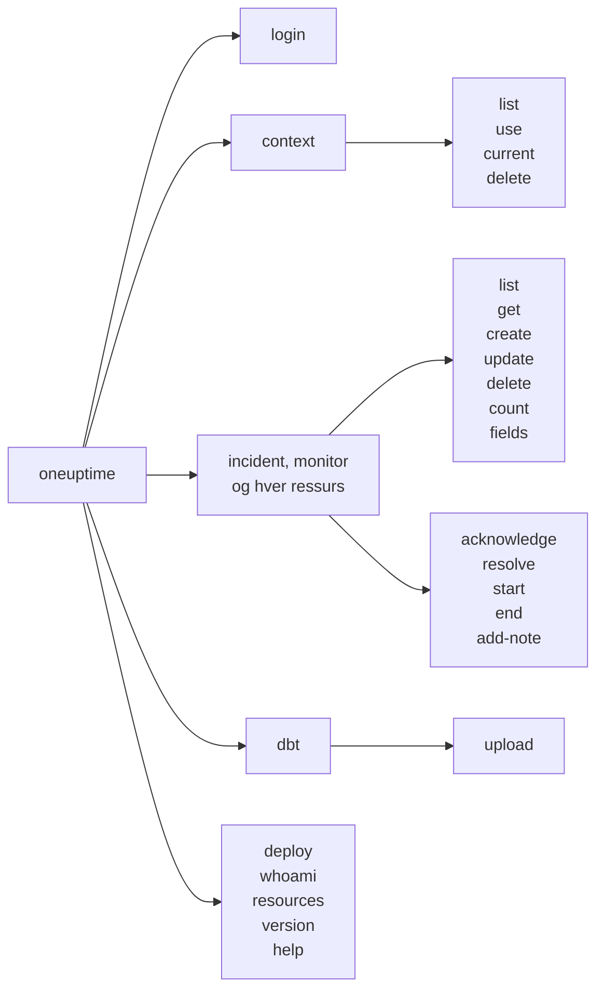

# Kommandoreferanse

Hver kommando i CLI-en `oneuptime`, med argumentene, alternativene og standardverdiene sine. Legg `--help` til en hvilken som helst kommando for å se det samme i terminalen din.

:::cards
- [Globale alternativer](#globale-alternativer): Alternativene hver kommando tar.
- [Innlogging og kontekster](#innlogging-og-kontekster): login og context-kommandoene.
- [Ressurskommandoer](#ressurskommandoer): Operasjonene, feltene og handlingene til hver ressurs.
- [Andre kommandoer](#andre-kommandoer): deploy, dbt upload, data-checks apply, whoami, resources, version og help.
:::

## Kommandoene



## Globale alternativer

| Alternativ | Hva det gjør | Standard |
| --- | --- | --- |
| `--api-key <key>` | API-nøkkelen for denne kommandoen | `ONEUPTIME_API_KEY`, så kontekstens nøkkel |
| `--url <url>` | Adressen til OneUptime-en din for denne kommandoen | `ONEUPTIME_URL`, så kontekstens URL |
| `--context <name>` | Den lagrede konteksten som brukes for denne kommandoen | Den gjeldende konteksten |
| `-o, --output <format>` | `json`, `table` eller `wide` | `table` i en terminal, `json` i en pipe |
| `--json` | Det samme som `-o json` | |
| `--no-color` | Skriver ut uten farger | Farger, med mindre `NO_COLOR` er satt |
| `-V, --version` | Skriver ut CLI-ens versjon | |
| `-h, --help` | Viser hjelpen til en kommando | |

Alternativene står før eller etter kommandoen: `oneuptime --context staging incident list` og `oneuptime incident list --context staging` gjør det samme.

Hver kommando tar `-o` og `--json`, så tabellene nedenfor utelater dem. En kommando der svaret er en setning, for eksempel `delete`, skriver ut setningen med mindre `-o json` eller `--json` ber om JSON: se [Utdataformater](/docs/cli/output-formats#json).

## Innlogging og kontekster

### `oneuptime login`

Lagrer en API-nøkkel og en adresse som en kontekst, og gjør den til den gjeldende. Se [Logg inn](/docs/cli/authentication#logg-inn).

```bash
oneuptime login <api-key> <instance-url> [--context-name <name>]
```

| Argument eller alternativ | Påkrevd | Hva det er | Standard |
| --- | --- | --- | --- |
| `<api-key>` | Ja | En API-nøkkel til prosjektet ditt | |
| `<instance-url>` | Ja | Adressen til OneUptime-en din, for eksempel `https://oneuptime.com` | |
| `--context-name <name>` | Nei | Navnet konteksten lagres under | `default` |

### `oneuptime context list`

Lister de lagrede kontekstene; `*` markerer den gjeldende. API-nøkler listes aldri: JSON gir `name`, `apiUrl` og `isCurrent` for hver kontekst.

```bash
oneuptime context list
```

### `oneuptime context use`

Gjør en lagret kontekst til den gjeldende.

```bash
oneuptime context use <name>
```

| Argument | Påkrevd | Hva det er |
| --- | --- | --- |
| `<name>` | Ja | Navnet på en lagret kontekst |

### `oneuptime context current`

Viser navnet og URL-en til den gjeldende konteksten, og API-nøkkelen dens skjult bortsett fra de fire første og fire siste tegnene.

```bash
oneuptime context current
```

### `oneuptime context delete`

Sletter en lagret kontekst. Var det den gjeldende, blir den første gjenværende konteksten gjeldende.

```bash
oneuptime context delete <name>
```

| Argument | Påkrevd | Hva det er |
| --- | --- | --- |
| `<name>` | Ja | Navnet på en lagret kontekst |

## Ressurskommandoer

`<resource>` er kommandoen for en type post, fra tabellen under [Ressurser](#ressurser), for eksempel `incident` eller `monitor`. En ressurs har operasjonene API-et tar for den, de fleste alle seks, og `oneuptime <resource> --help` lister dens egne. Se [Ressursoperasjoner](/docs/cli/resource-operations) for eksempler.

### `oneuptime <resource> list`

Lister poster, de nyeste først. Etiketter listes i stedet etter navn, nummererte etiketter først (`2. Team` før `10. Owner`).

```bash
oneuptime <resource> list [--query <json>] [--limit <n>] [--skip <n>] [--sort <json>] [--fields <names>] [--all]
```

| Alternativ | Hva det gjør | Standard |
| --- | --- | --- |
| `--query <json>` | Et filter, som JSON | Hver post nøkkelen kan lese |
| `--limit <n>` | Det høyeste antallet poster som returneres, opptil 10 000 | `10` |
| `--skip <n>` | Hvor mange poster som hoppes over først | `0` |
| `--sort <json>` | Rekkefølgen, som JSON: `{"<field>":"ASC"}` eller `{"<field>":"DESC"}` | De nyeste først |
| `--fields <names>` | Feltene som skal returneres, skilt med komma; et felt i en tilknyttet post etter et punktum, som i `currentIncidentState.name` | Hvert felt nøkkelen kan lese |
| `--all` | Hver post som samsvarer, 100 om gangen, opptil 100 000, i stedet for `--limit` og `--skip`. Bare poster: telemetri har ingen `--all` | |

### `oneuptime <resource> get`

Leser én post.

```bash
oneuptime <resource> get <id> [--fields <names>]
```

| Argument eller alternativ | Påkrevd | Hva det er |
| --- | --- | --- |
| `<id>` | Ja | Postens ID, en UUID |
| `--fields <names>` | Nei | Feltene som skal returneres, skilt med komma. Standard: hvert felt nøkkelen kan lese |

### `oneuptime <resource> create`

Oppretter en post og skriver den ut.

```bash
oneuptime <resource> create [--<field> <value>]... [--data <json>] [--file <path>]
```

| Alternativ | Påkrevd | Hva det er |
| --- | --- | --- |
| `--<field> <value>` | Feltene en opprettelse må oppgi | Verdien til et felt: `--title <text>`, `--incident-severity-id <id>`, `--labels <ids>`. `oneuptime <resource> create --help` lister dem. Bare poster |
| `--data <json>` | Nei | Posten som JSON |
| `--file <path>` | Nei | En JSON-fil med posten. Oppgitt sammen med `--data` brukes filen |

Flaggene legges oppå `--data` eller `--file`. Et felt som nevner en person med bruker-ID, har også et flagg som nevner personen med e-postadresse: `--user-email` ved siden av `--user-id`.

### `oneuptime <resource> update`

Endrer feltene du oppgir.

```bash
oneuptime <resource> update <id> [--<field> <value>]... [--data <json>] [--file <path>]
```

| Argument eller alternativ | Påkrevd | Hva det er |
| --- | --- | --- |
| `<id>` | Ja | Postens ID |
| `--<field> <value>` | Nei | Et felt som skal endres: `oneuptime <resource> update --help` lister dem. Bare poster |
| `--data <json>` | Nei | Feltene som skal endres, som JSON |
| `--file <path>` | Nei | En JSON-fil med feltene som skal endres. Oppgitt sammen med `--data` brukes filen |

### `oneuptime <resource> delete`

Sletter en post med en gang, uten å spørre.

```bash
oneuptime <resource> delete <id> [--force]
```

| Argument eller alternativ | Påkrevd | Hva det er |
| --- | --- | --- |
| `<id>` | Ja | Postens ID |
| `--force` | Nei | Godtas og endrer ingenting: `delete` ber aldri om bekreftelse |

### `oneuptime <resource> count`

Teller poster og skriver ut tallet.

```bash
oneuptime <resource> count [--query <json>]
```

| Alternativ | Påkrevd | Hva det er |
| --- | --- | --- |
| `--query <json>` | Nei | Et filter, som JSON. Uten filter hver post nøkkelen kan lese |

### `oneuptime <resource> fields`

Lister feltene til ressursen: hva hvert er til, typen, om en opprettelse må oppgi det, og flagget som setter det. Den leser dem fra selve CLI-en, uten API-nøkkel og uten forespørsel.

```bash
oneuptime <resource> fields
```

### `oneuptime <resource> acknowledge`

Flytter en hendelse, et varsel eller en episode av en av dem til prosjektets bekreftet-tilstand, slik knappen i dashbordet gjør. En post som allerede er bekreftet, eller forbi det, blir stående som den er.

```bash
oneuptime <resource> acknowledge <id>
```

| Argument | Påkrevd | Hva det er |
| --- | --- | --- |
| `<id>` | Ja | Postens ID |

### `oneuptime <resource> resolve`

Flytter en hendelse, et varsel eller en episode av en av dem til prosjektets løst-tilstand.

```bash
oneuptime <resource> resolve <id>
```

| Argument | Påkrevd | Hva det er |
| --- | --- | --- |
| `<id>` | Ja | Postens ID |

### `oneuptime <resource> start`

Flytter en vedlikeholdshendelse til prosjektets pågående tilstand.

```bash
oneuptime <resource> start <id>
```

| Argument | Påkrevd | Hva det er |
| --- | --- | --- |
| `<id>` | Ja | ID-en til hendelsen |

### `oneuptime <resource> end`

Flytter en vedlikeholdshendelse til prosjektets avsluttet-tilstand.

```bash
oneuptime <resource> end <id>
```

| Argument | Påkrevd | Hva det er |
| --- | --- | --- |
| `<id>` | Ja | ID-en til hendelsen |

### `oneuptime <resource> add-note`

Legger til et notat på en hendelse, et varsel, en episode av en av dem eller en vedlikeholdshendelse.

```bash
oneuptime <resource> add-note <id> --note <markdown> [--public]
```

| Argument eller alternativ | Påkrevd | Hva det er |
| --- | --- | --- |
| `<id>` | Ja | Postens ID |
| `--note <markdown>` | Ja | Notatet i Markdown |
| `--public` | Nei | Publiserer det på statussidene til posten, der abonnentene får beskjed. Bare hendelser, episodene deres og planlagt vedlikehold |

### Ressurser

Hver ressurs i OneUptime-API-et er en kommando, med operasjonene API-et tar for den, `fields` og handlingene til postene som har dem:

{{CLI_RESOURCE_COMMANDS}}

CLI-en utgis sammen med OneUptime, så `oneuptime resources` lister kommandoene i versjonen du har installert.

### API-forespørsler

Hver operasjon er én forespørsel til API-et, med nøkkelen i headeren `APIKey`. `<path>` er ressursens API-sti, fra `oneuptime resources`: `/incident` for `incident`, `/on-call-duty-policy` for `on-call-policy`.

| Operasjon | Forespørsel | Body |
| --- | --- | --- |
| `list` | `POST /api/<path>/get-list` | `query`, `select`, `skip`, `limit` og `sort` |
| `get` | `POST /api/<path>/<id>/get-item` | `select` |
| `create` | `POST /api/<path>` | `{"data": ...}` |
| `update` | `PUT /api/<path>/<id>/` | `{"data": ...}` |
| `delete` | `DELETE /api/<path>/<id>/` | Ingen |
| `count` | `POST /api/<path>/count` | `query` |

En handling leser prosjektets tilstander og posten, og oppretter så en rad i tilstandstidslinjen til posten, slik knappen i dashbordet gjør: `acknowledge` på en hendelse oppretter en `incident-state-timeline`. `add-note` oppretter en `incident-internal-note`, eller med `--public` en `incident-public-note`. Et e-postflagg lister først prosjektets teammedlemmer med den adressen. Når OneUptime avviser et felt nøkkelen ikke kan lese, spør en liste eller en lesing på nytt uten feltet.

## Andre kommandoer

### `oneuptime deploy`

Registrerer en utrulling, eller en annen endring, fra en pipeline: den tegnes på tjenestens diagrammer og leses av OneUptime AI når den undersøker en hendelse. Den skriver med en telemetri-inntaksnøkkel, ikke en API-nøkkel. Se [Utrullinger og endringer](/docs/telemetry/change-events).

```bash
oneuptime deploy [--service <name>] [--service-version <version>] [--previous-version <version>] [--commit <sha>] [--repository <url>] [--branch <name>] [--pull-request <number>] [--environment <name>] [--title <title>] [--description <text>] [--type <type>] [--time <time>] [--attribute <key=value...>] [--ingestion-key <key>]
```

| Alternativ | Påkrevd | Hva det er | Standard |
| --- | --- | --- | --- |
| `--service <name>` | Nei | Tjenesten som ble rullet ut | En endring for hele prosjektet |
| `--service-version <version>` | Nei | Versjonen som ble rullet ut | |
| `--previous-version <version>` | Nei | Versjonen den erstattet | |
| `--commit <sha>` | Nei | Commiten som ble rullet ut | |
| `--repository <url>` | Nei | Repositoriet commiten ligger i | |
| `--branch <name>` | Nei | Branchen som ble rullet ut | |
| `--pull-request <number>` | Nei | Pull requesten som ble rullet ut | |
| `--environment <name>` | Nei | Miljøet det ble rullet ut til | |
| `--title <title>` | Nei | Endringens tittel; en annen type enn en utrulling trenger en | `Deploy <version>` |
| `--description <text>` | Nei | Detaljer om endringen | |
| `--type <type>` | Nei | Typen endring, for eksempel `config-change` eller `rollback` | `deployment` |
| `--time <time>` | Nei | Når det skjedde, for eksempel `2026-10-19T10:00:00Z` | Nå |
| `--attribute <key=value...>` | Nei | Flere attributter, som `key=value`, ett eller flere | |
| `--ingestion-key <key>` | Nei | En telemetri-inntaksnøkkel til prosjektet | `ONEUPTIME_TELEMETRY_INGESTION_KEY` |

### `oneuptime dbt upload`

Sender artefaktene til et dbt-prosjekt etter et bygg, fra CI eller en dbt Cloud-jobb, til Dataobserverbarhet. Modellene vises på tabellene de bygger, med opphavet sitt, testene vises ved siden av OneUptimes sjekker og kan utløse varsler, og hvert bygg er en kjøring av prosjektets pipeline. Den leser `manifest.json` og `run_results.json` fra målmappen til dbt, sender bare det Dataobserverbarhet leser av dem, og skriver med en telemetri-inntaksnøkkel, ikke en API-nøkkel. Siden Dokumentasjon under Dataobserverbarhet i dashbordet ditt viser den i en CI-jobb.

```bash
oneuptime dbt upload [--target-path <dir>] [--manifest <file>] [--run-results <file>] [--project <name>] [--ingestion-key <key>]
```

| Alternativ | Påkrevd | Hva det er | Standard |
| --- | --- | --- | --- |
| `--target-path <dir>` | Nei | Mappen dbt skrev artefaktene sine til | `target` |
| `--manifest <file>` | Nei | Manifestet som sendes | `manifest.json` i målmappen |
| `--run-results <file>` | Nei | Kjøringsresultatene som sendes | `run_results.json` i målmappen |
| `--project <name>` | Nei | Navnet på dbt-prosjektet, bare nødvendig når ikke noe manifest sendes | Manifestets prosjekt |
| `--ingestion-key <key>` | Nei | En telemetri-inntaksnøkkel til prosjektet | `ONEUPTIME_TELEMETRY_INGESTION_KEY` |

### `oneuptime data-checks apply`

Får prosjektets datasjekker til å samsvare med en YAML-fil, slik at de ligger i et repositorium og gjennomgås som kode. En feil et sted i filen gjør at ingenting brukes, og kommandoen avsluttes med en feil. Formatet på filen står i [Kontroller og avstemminger](/docs/data-observability/checks).

```bash
oneuptime data-checks apply <file> [--dry-run] [--prune]
```

| Alternativ | Påkrevd | Hva det er | Standard |
| --- | --- | --- | --- |
| `--dry-run` | Nei | Sier hva som ville endret seg, og endrer ingenting | Av |
| `--prune` | Nei | Sletter sjekker en tidligere kjøring opprettet som filen ikke lenger nevner | Av |

### `oneuptime whoami`

Viser URL-en og API-nøkkelen som neste kommando vil bruke, med nøkkelen maskert, og konteksten de kommer fra. Uten `--check` kaller den ikke OneUptime. Se [Sjekk hva CLI-en vil bruke](/docs/cli/authentication#sjekk-hva-cli-en-vil-bruke).

```bash
oneuptime whoami [--check]
```

| Alternativ | Påkrevd | Hva det er |
| --- | --- | --- |
| `--check` | Nei | Spør OneUptime om den godtar nøkkelen, og viser prosjektet til nøkkelen, versjonen av OneUptime-en din og CLI-ens |

### `oneuptime resources`

Lister hver type post CLI-en har en kommando for: kommandoen, navnene i entall og flertall, typen og API-banen, og totalen. JSON gir `name`, `singularName`, `pluralName`, `modelType`, `apiPath`, `operations` og `actions` for hver.

```bash
oneuptime resources [--type <type>]
```

| Alternativ | Påkrevd | Hva det er | Standard |
| --- | --- | --- | --- |
| `--type <type>` | Nei | `database` for poster, `analytics` for telemetri | Begge |

### `oneuptime version`

Skriver ut CLI-ens versjon, slik `oneuptime --version` gjør.

```bash
oneuptime version
```

### `oneuptime help`

Viser hjelpen til CLI-en, eller til en kommando.

```bash
oneuptime help [command]
```

## Miljøvariabler

| Variabel | Hva den gjør |
| --- | --- |
| `ONEUPTIME_API_KEY` | API-nøkkelen, når ingen `--api-key`-flagg gir en |
| `ONEUPTIME_URL` | Adressen til OneUptime-en din, når ingen `--url`-flagg gir en |
| `ONEUPTIME_TELEMETRY_INGESTION_KEY` | Telemetri-inntaksnøkkelen `oneuptime deploy` skriver med, når ingen `--ingestion-key`-flagg gir en |
| `NO_COLOR` | Satt til en hvilken som helst verdi slår den av farger |

## Filer

| Fil | Hva den inneholder |
| --- | --- |
| `~/.oneuptime/config.json` | De lagrede kontekstene, API-nøklene deres og den gjeldende konteksten |

## Avslutningskoder

| Kode | Betydning |
| --- | --- |
| `0` | Det virket |
| `1` | Det mislyktes: OneUptime avviste forespørselen, eller kommandoen var feil |
| `2` | Ingen brukbar API-nøkkel: ingen funnet, ugyldig eller under abonnementet sitt |
| `3` | Ikke funnet: OneUptime svarte `404` |

Se [Avslutningskoder](/docs/cli/scripting#avslutningskoder) for eksempler.

## Neste steg

:::cards
- [CLI – Oversikt](/docs/cli/index): Installer CLI-en og kjør de første kommandoene.
- [Ressursoperasjoner](/docs/cli/resource-operations): Eksempler på hver operasjon.
- [Skripting og CI/CD](/docs/cli/scripting): CLI-en i skript og pipelines.
:::
