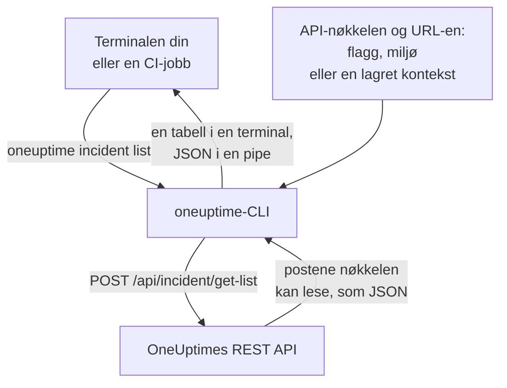

# CLI – Oversikt

OneUptime-CLI-en, `oneuptime`, administrerer OneUptime-prosjektet ditt fra en terminal eller et skript. Den lister, leser, oppretter, endrer, sletter og teller monitorer, hendelser, varsler, statussider og de andre postene som OneUptime-API-et tilbyr, med en API-nøkkel til prosjektet ditt.

:::cards
- [Slik virker CLI-en](#slik-virker-cli-en): Én kommando, én API-forespørsel, ett svar.
- [Installer CLI-en](#installer-cli-en): Én npm-kommando, og hvilken versjon du skal velge.
- [Kjør de første kommandoene](#kjør-de-første-kommandoene): Lagre API-nøkkelen din, og list så hendelsene dine.
- [Kommandoene i korte trekk](#kommandoene-i-korte-trekk): Hver kommando, og siden som forklarer den.
:::

## Slik virker CLI-en

Hver kommando sender én forespørsel til OneUptimes REST API og skriver ut svaret. CLI-en henter API-nøkkelen og adressen til OneUptime-en din fra flagg, miljøvariabler eller en kontekst som `oneuptime login` har lagret. Nøkkelen avgjør hva en kommando kan lese og endre, nøyaktig som for API-et.



Kommandoene for poster følger med CLI-en: hver type post som OneUptime-API-et åpner for verktøy, har én, de samme postene som [MCP-serveren](/docs/ai/mcp-server) har verktøy for. Kjør `oneuptime resources` for å liste dem.

## Før du begynner

- **Node.js og npm**, i en aktuell LTS-versjon, for å installere CLI-en.
- **En API-nøkkel til prosjektet ditt.** Opprett en under **Prosjektinnstillinger → Avansert → API-nøkler** med **Opprett API-nøkkel**: se [Opprett en API-nøkkel](/docs/api-reference/api-reference#opprett-en-api-nøkkel).
- **På OneUptime Cloud abonnementet Growth eller høyere.** Et prosjekts API-nøkler virker bare på det: se [API-nøkler og SCIM under abonnementet sitt](/docs/api-reference/api-reference#api-nøkler-og-scim-under-abonnementet-sitt).

## Installer CLI-en

Installer pakken `@oneuptime/cli` fra npm. Den legger til kommandoen `oneuptime`, og `--version` skriver ut versjonen du har installert:

```bash
npm install -g @oneuptime/cli
oneuptime --version
```

CLI-en utgis sammen med OneUptime og har samme versjonsnummer. På en selvhostet OneUptime installerer du CLI-en i versjonen til OneUptime-en din, slik at kommandoene passer til postene serveren din har:

```bash
npm install -g @oneuptime/cli@<your-oneuptime-version>
```

> [!WARNING]
> CLI-versjoner før 14.0.64 stopper så snart de starter, med en feil som `Cannot find module 'Common/Models/DatabaseModels/Index'`. Installer 14.0.64 eller nyere med `npm install -g @oneuptime/cli@latest`. På en selvhostet OneUptime som er eldre enn 14.0.64, [oppgraderer du først OneUptime](/docs/installation/upgrading#slik-oppgraderer-du) og installerer deretter CLI-en i versjonen du oppgraderte til.

## Kjør de første kommandoene

:::steps
### Lagre API-nøkkelen din

Logg inn med nøkkelen og adressen til OneUptime-en din. CLI-en lagrer dem som en kontekst med navnet `default` og bruker den fra nå av:

```bash
oneuptime login <your-api-key> https://oneuptime.com
```

Den svarer `Logged in successfully. Context "default" is now active.` På en selvhostet OneUptime bruker du adressen dens i stedet for `https://oneuptime.com`.

### List hendelsene dine

```bash
oneuptime incident list
```

De ti nyeste hendelsene vises som en tabell. `login` lagrer nøkkelen uten å sjekke den, så dette er den første kommandoen som viser at nøkkelen virker: blir den avvist, se [Feilsøking](/docs/cli/authentication#feilsøking).

### Se hva mer du kan administrere

```bash
oneuptime resources
```

Listen viser hver type post du kan jobbe med, og kommandoen dens, for eksempel `monitor`, `status-page` eller `on-call-policy`.
:::

## Kommandoene i korte trekk

| Kommando | Hva den gjør | Les mer |
| --- | --- | --- |
| `oneuptime login <api-key> <instance-url>` | Lagrer en API-nøkkel og en adresse som en kontekst | [Autentisering](/docs/cli/authentication#logg-inn) |
| `oneuptime context list`, `use`, `current`, `delete` | Lister, bytter, viser og sletter lagrede kontekster | [Autentisering](/docs/cli/authentication#kontekster) |
| `oneuptime whoami` | Viser URL-en og API-nøkkelen som neste kommando vil bruke | [Autentisering](/docs/cli/authentication#sjekk-hva-cli-en-vil-bruke) |
| `oneuptime deploy` | Registrerer en utrulling, eller en annen endring, for diagrammer og OneUptime AI | [Utrullinger og endringer](/docs/telemetry/change-events) |
| `oneuptime <resource> list`, `get`, `create`, `update`, `delete`, `count` | Jobber med én type post | [Ressursoperasjoner](/docs/cli/resource-operations) |
| `oneuptime resources` | Lister typene poster med kommandoene deres | [Kommandoreferanse](/docs/cli/command-reference#oneuptime-resources) |
| `oneuptime version` | Skriver ut CLI-ens versjon | [Kommandoreferanse](/docs/cli/command-reference#oneuptime-version) |
| `oneuptime help [command]` | Viser hjelpen til en kommando | [Få hjelp](#få-hjelp) |

## Globale alternativer

Disse alternativene virker med hver kommando, før eller etter den:

| Alternativ | Hva det gjør |
| --- | --- |
| `--api-key <key>` | API-nøkkelen for denne kommandoen, i stedet for den lagrede |
| `--url <url>` | Adressen til OneUptime-en din for denne kommandoen |
| `--context <name>` | En lagret kontekst for denne kommandoen, i stedet for den gjeldende |
| `-o, --output <format>` | `table`, `json` eller `wide`: se [Utdataformater](/docs/cli/output-formats) |
| `--no-color` | Skriver ut uten farger |
| `-V, --version` | Skriver ut CLI-ens versjon |
| `-h, --help` | Viser hjelpen til kommandoen |

## Få hjelp

Hver kommando har sin egen hjelp, med argumentene, alternativene og standardverdiene sine:

```bash
oneuptime --help
oneuptime help incident
oneuptime incident list --help
```

## Neste steg

:::cards
- [Autentisering](/docs/cli/authentication): Kontekster for hvert miljø, og hvilken nøkkel en kommando bruker.
- [Ressursoperasjoner](/docs/cli/resource-operations): List, les, opprett, endre, slett og tell poster.
- [Utdataformater](/docs/cli/output-formats): Tabeller for mennesker, JSON for skript.
- [Skripting og CI/CD](/docs/cli/scripting): Avslutningskoder, jq og pipelines.
- [Kommandoreferanse](/docs/cli/command-reference): Hver kommando, hvert alternativ og hver standardverdi.
:::
