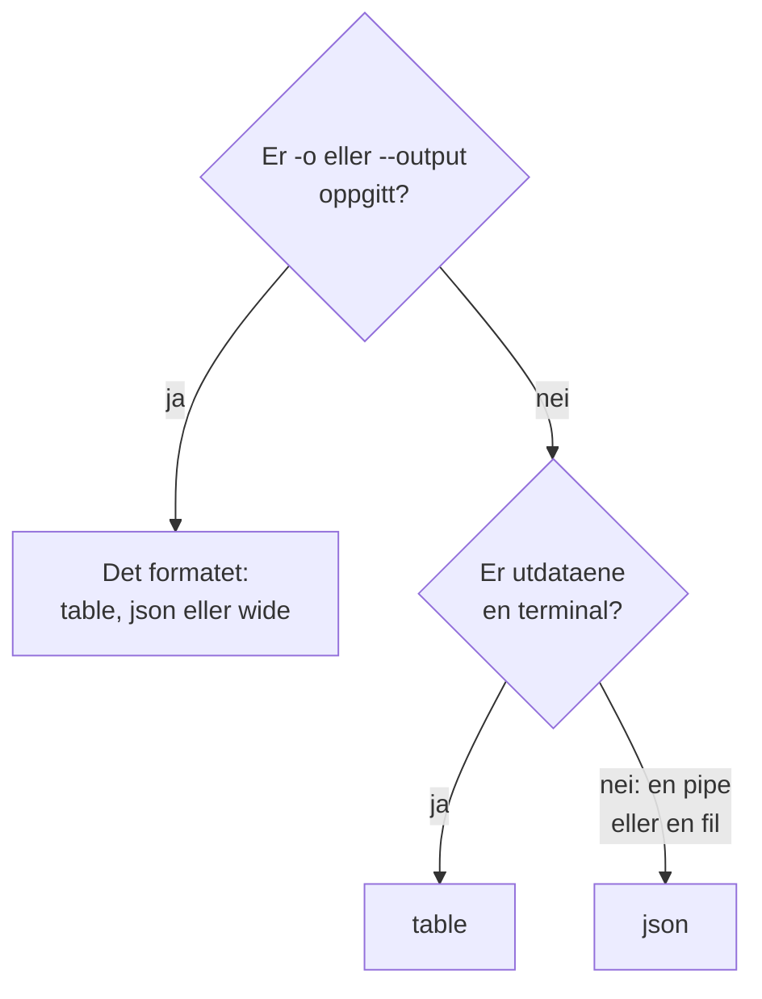

# Utdataformater

CLI-en skriver ut en tabell når du leser svaret i en terminal, og JSON når et skript eller et annet program leser det. Velg formatet for en hvilken som helst kommando med `-o` eller `--output`.

:::cards
- [Slik velges formatet](#slik-velges-formatet): En terminal får en tabell, en pipe får JSON.
- [Tabell](#tabell): Seks kolonner, hver verdi kuttet ved 60 tegn.
- [JSON](#json): Hvert felt, helt, for skript og jq.
- [Bred](#bred): En tabell med alle kolonner.
:::

## Slik velges formatet



| Format | Hva det skriver ut | Best for |
| --- | --- | --- |
| `table` | En tabell med opptil seks kolonner; én post som én rad per felt | Å lese i en terminal |
| `json` | Svaret slik OneUptime sendte det, rykket inn med to mellomrom | Skript, `jq` og filer |
| `wide` | En tabell med en kolonne for hvert felt | Å sammenligne mange felt på et øyeblikk |

`-o` virker på hver kommando som skriver ut poster: `list`, `get`, `create`, `update` og `count` for en ressurs, `oneuptime resources` og `oneuptime context list`. Det kan stå hvor som helst på kommandolinjen. Enhver annen verdi avvises før en forespørsel sendes:

```text
error: option '-o, --output <format>' argument 'yaml' is invalid. Allowed choices are json, table, wide.
```

## Tabell

En tabell er standard i en terminal. `oneuptime resources --type analytics` skriver for eksempel ut denne:

```text
┌────────────────────────────┬────────────────────────────┬─────────────────────────────┬───────────┬─────────────────────────────┐
│ Command                    │ Singular                   │ Plural                      │ Type      │ API Path                    │
├────────────────────────────┼────────────────────────────┼─────────────────────────────┼───────────┼─────────────────────────────┤
│ log                        │ Log                        │ Logs                        │ analytics │ /logs                       │
├────────────────────────────┼────────────────────────────┼─────────────────────────────┼───────────┼─────────────────────────────┤
│ span                       │ Span                       │ Spans                       │ analytics │ /span                       │
├────────────────────────────┼────────────────────────────┼─────────────────────────────┼───────────┼─────────────────────────────┤
│ metric                     │ Metric                     │ Metrics                     │ analytics │ /metrics                    │
├────────────────────────────┼────────────────────────────┼─────────────────────────────┼───────────┼─────────────────────────────┤
│ exception-instance         │ Exception Instance         │ Exception Instances         │ analytics │ /exceptions                 │
├────────────────────────────┼────────────────────────────┼─────────────────────────────┼───────────┼─────────────────────────────┤
│ monitor-log                │ Monitor Log                │ Monitor Logs                │ analytics │ /monitor-log                │
├────────────────────────────┼────────────────────────────┼─────────────────────────────┼───────────┼─────────────────────────────┤
│ kubernetes-cost-allocation │ Kubernetes Cost Allocation │ Kubernetes Cost Allocations │ analytics │ /kubernetes-cost-allocation │
├────────────────────────────┼────────────────────────────┼─────────────────────────────┼───────────┼─────────────────────────────┤
│ security-event             │ Security Event             │ Security Events             │ analytics │ /security-events            │
├────────────────────────────┼────────────────────────────┼─────────────────────────────┼───────────┼─────────────────────────────┤
│ change-event               │ Change Event               │ Change Events               │ analytics │ /change-events              │
├────────────────────────────┼────────────────────────────┼─────────────────────────────┼───────────┼─────────────────────────────┤
│ threat-intel-indicator     │ Threat Intel Indicator     │ Threat Intel Indicators     │ analytics │ /threat-intel-indicators    │
└────────────────────────────┴────────────────────────────┴─────────────────────────────┴───────────┴─────────────────────────────┘

Total: 9 resources
```

For en liste med poster viser en tabell opptil seks kolonner: først `_id`, `name`, `title`, `status`, `createdAt` og `updatedAt`, de av dem postene har, så postenes neste felt i rekkefølge. Kolonnene hentes fra den første posten. En verdi som er lengre enn 60 tegn, kuttes til de første 57, etterfulgt av `...`.

Én post, slik `get` og `create` skriver den ut, er en tabell med to kolonner: feltets navn og verdien, én rad per felt.

OneUptime sender datoer og ID-ene til andre poster som objekter, for eksempel `{"_type":"DateTime","value":"2026-10-14T09:12:44.000Z"}`, og en tabell viser dem som den teksten. Verdien deres står i `value`: se [JSON](#json).

## JSON

JSON er svaret slik OneUptime sendte det, rykket inn med to mellomrom: en liste er et array med poster, og én post er et objekt.

```bash
oneuptime incident list --limit 1 -o json
```

```json
[
  {
    "_id": "6f1c2a40-3b1e-4c55-9a0b-3e2f8d7c1a11",
    "createdAt": {
      "_type": "DateTime",
      "value": "2026-10-14T09:12:44.000Z"
    },
    "title": "Checkout API is down",
    "currentIncidentStateId": {
      "_type": "ObjectID",
      "value": "0b7d5e2c-8f4a-4d1b-9c3e-5a6f7b8c9d0e"
    }
  }
]
```

En post har hvert felt nøkkelen kan lese; denne er kuttet ned til fire. En posts egen `_id` er tekst, og de andre ID-ene og datoene er objekter der `value` inneholder dem:

```bash
oneuptime incident list -o json | jq -r '.[] | "\(.createdAt.value)  \(.title)"'
```

Når utdataene ikke er en terminal, som i `oneuptime incident list | jq '.[].title'`, skriver CLI-en ut JSON uten `-o json`. Skriv likevel `-o json` i skript, så de ikke er avhengige av det.

## Bred

`-o wide` er en tabell med en kolonne for hvert felt i postene. Hver verdi kuttes fortsatt ved 60 tegn, og poster har mange felt, så en bred tabell er svært bred: bla gjennom den med `less -S`.

```bash
oneuptime incident list -o wide | less -S
```

## Farger

Tabelloverskrifter er cyan; meldinger er grønne når noe lyktes, blå for informasjon og røde for feil. Slå av farger med `--no-color`, eller ved å sette `NO_COLOR` til en hvilken som helst verdi:

```bash
oneuptime incident list --no-color
NO_COLOR=1 oneuptime incident list
```

## Hva hver kommando skriver ut

Poster og antall går til standard utdata, og feil til standard feil, så en pipe leser bare svaret.

| Kommando | I en tabell | I JSON |
| --- | --- | --- |
| En `list` som ikke finner noe | `No results found.` | `[]` |
| En `get` eller en `create` | En rad per felt | Posten |
| En `count` | Tallet | Tallet |
| En `update` | En tom linje | `{}` |
| En `delete` | `Monitor <id> deleted successfully.` | Den samme linjen |

## Neste steg

:::cards
- [Skripting og CI/CD](/docs/cli/scripting): Les JSON-en med jq i skript og pipelines.
- [Ressursoperasjoner](/docs/cli/resource-operations): Operasjonene som dette er svarene fra.
- [Kommandoreferanse](/docs/cli/command-reference): Hver kommando og hvert alternativ.
:::
