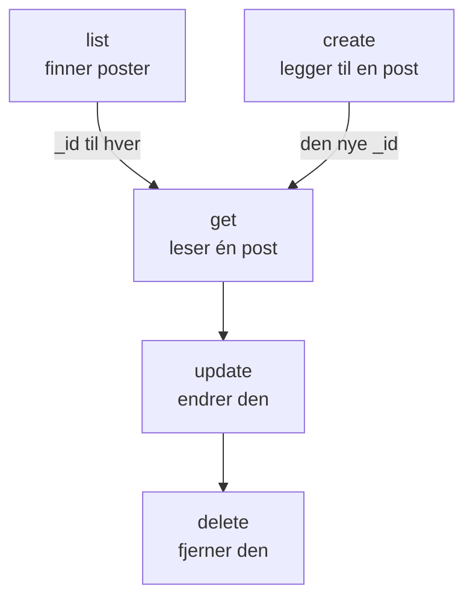

# Ressursoperasjoner

Hver type post er en egen kommando, for eksempel `incident`, `monitor` eller `status-page`, med operasjonene API-et tar for den: for de fleste `list`, `get`, `create`, `update`, `delete` og `count`. Denne siden viser hver operasjon, med filtre, sider og flaggene en post skrives med, og kommandoene som gjør det knappene i dashbordet gjør.

:::cards
- [Finn kommandoen for en post](#finn-kommandoen-for-en-post): oneuptime resources lister dem alle.
- [List poster](#list-poster): Filtrer, sorter og bla.
- [Opprett en post](#opprett-en-post): Et flagg for hvert felt, eller posten som JSON.
- [Bekreft, løs og legg til notater](#bekreft-løs-og-legg-til-notater): Knappene i dashbordet som kommandoer.
- [Slett en post](#slett-en-post): Med en gang, uten angring.
:::

## Slik henger operasjonene sammen

Å lese, endre og slette en post krever ID-en dens. Å liste, telle og opprette krever ingen, og en liste eller en opprettelse gir deg ID-ene de andre tar:



En ID er en UUID, for eksempel `6f1c2a40-3b1e-4c55-9a0b-3e2f8d7c1a11`. Du kan også kopiere en fra postens side i OneUptime: se [Finn ID-en til en ressurs](/docs/api-reference/api-reference#finn-id-en-til-en-ressurs).

## Finn kommandoen for en post

```bash
oneuptime resources
```

Listen viser hver type post med kommandoen, navnene, typen og API-stien sin. Det finnes to typer:

| Type | Hva den inneholder |
| --- | --- |
| `database` | Poster du administrerer: monitorer, hendelser, varsler, statussider, team og mer |
| `analytics` | Telemetri: logger, spenn, metrikker, unntak og andre hendelser |

Vis én type med `oneuptime resources --type database` eller `--type analytics`. [Kommandoreferanse](/docs/cli/command-reference#ressurser) lister hver kommando.

En ressurs tar operasjonene API-et tar for den. De fleste tar alle seks; en som OneUptime skriver selv, for eksempel en e-postlogg, kan bare leses. `oneuptime <resource> --help` lister underkommandoene til en ressurs.

## Se feltene til en ressurs

`fields` lister feltene til en ressurs fra selve CLI-en, uten API-nøkkel og uten forespørsel:

```bash
oneuptime incident fields
```

Hvert felt har sin type, hva det er til, om en opprettelse må oppgi det, og flagget som setter det. Et felt som inneholder en ID, nevner ressursen ID-en hører til: `incidentSeverityId` tar én fra `oneuptime incident-severity list`. Med `-o json` leser et skript eller en AI-agent det samme, med de samme nøklene for hvert felt: `name`, `title`, `type`, `description`, `required`, `create`, `update`, `read`, `flag`, `emailFlag` og `relatedResource`.

## List poster

```bash
oneuptime <resource> list [--query <json>] [--limit <n>] [--skip <n>] [--sort <json>] [--fields <names>] [--all] [-o <format>]
```

| Alternativ | Hva det gjør | Standard |
| --- | --- | --- |
| `--query <json>` | Returnerer bare postene som samsvarer: se [Filtrer en liste](#filtrer-en-liste) | Hver post nøkkelen kan lese |
| `--limit <n>` | Det høyeste antallet poster som returneres, opptil 10 000 | `10` |
| `--skip <n>` | Hvor mange samsvarende poster som hoppes over først | `0` |
| `--sort <json>` | Rekkefølgen, for eksempel `{"createdAt":"ASC"}`, eller `"DESC"` for de nyeste først | De nyeste først |
| `--fields <names>` | Feltene som skal returneres, skilt med komma, for eksempel `title,createdAt` | Hvert felt nøkkelen kan lese |
| `--all` | Hver post som samsvarer, side etter side, i stedet for `--limit` og `--skip`. Bare poster | |
| `-o, --output <format>` | `table`, `json` eller `wide` | `table` i en terminal, `json` i en pipe |

```bash
# The ten newest incidents
oneuptime incident list

# The oldest monitors first, 50 at a time: the second page
oneuptime monitor list --sort '{"createdAt":"ASC"}' --limit 50 --skip 50

# Every field of each incident, as JSON
oneuptime incident list -o json

# The title, the state and the creation date of every incident
oneuptime incident list --all --fields title,currentIncidentState.name,createdAt -o json
```

En liste ber OneUptime om hvert felt i hver post nøkkelen kan lese. `--fields` ber i stedet om dem den nevner, og etter et punktum om et felt i en tilknyttet post, som i `currentIncidentState.name`. En tabell viser seks felter; JSON viser alle (se [Utdataformater](/docs/cli/output-formats)). `--all` leser hver side, 100 poster om gangen, opptil 100 000; `count` sier hvor mange det er.

Etiketter listes etter navn i stedet for de nyeste først: etiketter der navnet begynner med et tall, kommer først, i rekkefølgen til tallet (`2. Team` før `10. Owner`), deretter de andre alfabetisk. Vil du ha dem i en annen rekkefølge, oppgir du `--sort`.

### Filtrer en liste

`--query` tar det samme filteret som API-et: et felt med en verdi samsvarer med den verdien, og et objekt med en `_type` sammenligner.

| Filter | Samsvarer med |
| --- | --- |
| `{"title":"Checkout API is down"}` | Poster med nøyaktig den verdien |
| `{"title":{"_type":"Search","value":"checkout"}}` | Tekst som inneholder verdien |
| `{"createdAt":{"_type":"GreaterThan","value":"2026-10-01T00:00:00.000Z"}}` | Senere datoer eller større tall |
| `{"currentIncidentState":{"isResolvedState":false}}` | Et felt i en post som ressursen nevner: her hendelser som ikke er løst |

```bash
oneuptime incident list --query '{"title":{"_type":"Search","value":"checkout"}}'
```

[Filtrer, sorter og bla](/docs/api-reference/api-reference#filtrer-sorter-og-bla) i API-referansen lister hver `_type`.

## Les en post

```bash
oneuptime <resource> get <id> [--fields <names>] [-o <format>]
```

```bash
oneuptime incident get 6f1c2a40-3b1e-4c55-9a0b-3e2f8d7c1a11
```

En tabell viser én rad for hvert felt i posten, med hver verdi kuttet ved 60 tegn; `-o json` viser verdiene hele. En ID som ikke nevner noen post nøkkelen din kan lese, får svaret `Not found`, og kommandoen avslutter med koden `3`.

## Opprett en post

```bash
oneuptime <resource> create [--<field> <value>]... [--data <json>] [--file <path>] [-o <format>]
```

Hvert felt en opprettelse tar, har et flagg: `--title <text>`, `--incident-severity-id <id>`, `--labels <ids>` for ID-er skilt med komma, `--is-visible-on-status-page [true|false]` for et ja-eller-nei-felt, sant når det oppgis alene, og `--monitor-steps <json>` for et felt som inneholder JSON. `oneuptime <resource> create --help` lister dem, og [`fields`](#se-feltene-til-en-ressurs) sier hva hvert er til. Prosjektet kommer fra API-nøkkelen, så en post nevner det aldri.

```bash
# A manual monitor
oneuptime monitor create --name "Checkout API" --monitor-type Manual

# An incident with one of your severities
oneuptime incident create --title "Checkout API is down" --incident-severity-id <severity-id>

# The same incident, from a file
oneuptime incident create --file incident.json
```

`--data` tar posten som JSON, og `--file` leser den fra en JSON-fil, med API-ets felter: [API-referansen](/reference) lister feltene til hver ressurs. Oppgir du begge, brukes filen, og flagg legges oppå hvilken som helst av dem.

Et felt som nevner en person med bruker-ID, har et andre flagg som nevner personen med e-postadresse: `--user-email` ved siden av `--user-id`, `--owner-user-emails` ved siden av `--owner-users`. CLI-en finner personen blant medlemmene i prosjektet til API-nøkkelen og personene som er invitert til det. Et teammedlem som nevnes med en adresse ingen i prosjektet har, blir invitert til det, slik som når du inviterer fra dashbordet:

```bash
oneuptime team-member create --team-id <team-id> --user-email alice@example.com
```

CLI-en skriver ut den nye posten, med `_id`-en sin. En hendelse starter i prosjektets opprettet-tilstand, med mindre `currentIncidentStateId` nevner en annen: se [Tilstanden en ny post starter i](/docs/api-reference/api-reference#tilstanden-en-ny-post-starter-i). Slik finner du ID-ene til alvorlighetsgradene dine:

```bash
oneuptime incident-severity list -o json | jq -r '.[] | "\(._id)  \(.name)"'
```

> [!TIP]
> På Windows oppgir du feltene med flaggene deres, eller legger JSON-en i en fil og bruker `--file`: PowerShell og ledeteksten setter anførselstegn rundt JSON på kommandolinjen på en annen måte enn Bash.

## Oppdater en post

```bash
oneuptime <resource> update <id> [--<field> <value>]... [--data <json>] [--file <path>] [-o <format>]
```

Oppgi bare feltene som skal endres, med flaggene deres eller som JSON:

```bash
# Rename a monitor
oneuptime monitor update <monitor-id> --name "Checkout API (EU)"

# Record an incident's root cause
oneuptime incident update <incident-id> --root-cause "A full disk on the primary database"
```

OneUptime svarer på en oppdatering med et tomt objekt: CLI-en skriver ut en tom linje, eller `{}` med `-o json`. Kjør `get` for å se posten slik den er nå. For å flytte en hendelse til en annen tilstand oppgir du `--current-incident-state-id`: endringen registreres på tidslinjen dens, slik dashbordet gjør, og en tilstand før den gjeldende avvises. [`acknowledge` og `resolve`](#bekreft-løs-og-legg-til-notater) finner tilstanden for deg. Slik finner du ID-en til løst-tilstanden, den første i rekkefølgen til prosjektet ditt:

```bash
oneuptime incident-state list --query '{"isResolvedState":true}' --sort '{"order":"ASC"}' --limit 1 -o json | jq -r '.[0]._id'
```

## Bekreft, løs og legg til notater

Hendelser, varsler, episodene deres og vedlikeholdshendelser har kommandoer for det knappene i dashbordet gjør på dem:

| Kommando | Hva den gjør | Ressurser |
| --- | --- | --- |
| `acknowledge <id>` | Flytter posten til prosjektets bekreftet-tilstand | `incident`, `alert`, `incident-episode`, `alert-episode` |
| `resolve <id>` | Flytter den til prosjektets løst-tilstand | De samme fire |
| `start <id>` | Flytter hendelsen til prosjektets pågående tilstand | `scheduled-maintenance-event` |
| `end <id>` | Flytter den til prosjektets avsluttet-tilstand | `scheduled-maintenance-event` |
| `add-note <id> --note <markdown>` | Legger til et notat bare de som kan se posten, kan lese, eller med `--public` ett på statussidene til posten | Alle fem |

```bash
oneuptime incident acknowledge 6f1c2a40-3b1e-4c55-9a0b-3e2f8d7c1a11
oneuptime incident add-note 6f1c2a40-3b1e-4c55-9a0b-3e2f8d7c1a11 --note "Rolled back the 14:05 deploy."
oneuptime incident resolve 6f1c2a40-3b1e-4c55-9a0b-3e2f8d7c1a11
```

`acknowledge` svarer `Incident 6f1c2a40-3b1e-4c55-9a0b-3e2f8d7c1a11 acknowledged: it is in Acknowledged now.` En post som allerede er i den tilstanden, eller forbi den, blir stående som den er: kommandoen sier det og avslutter med `0`. Med `-o json` svarer den med `_id` til posten, `action`, om noe ble endret (`changed`), og tilstanden `state` posten er i. Varsler og varselepisoder tar bare interne notater.

## Slett en post

```bash
oneuptime <resource> delete <id>
```

```bash
oneuptime monitor delete 6f1c2a40-3b1e-4c55-9a0b-3e2f8d7c1a11
```

Den svarer `Monitor 6f1c2a40-3b1e-4c55-9a0b-3e2f8d7c1a11 deleted successfully.` Med `-o json` svarer den med `_id` til posten og `"deleted": true`.

> [!CAUTION]
> `delete` fjerner posten med en gang. CLI-en ber deg ikke bekrefte, og det kan ikke angres. Den godtar `--force`, for skript som er skrevet med det, og `--force` endrer ingenting.

## Tell poster

```bash
oneuptime <resource> count [--query <json>]
```

```bash
# Every incident
oneuptime incident count

# Incidents that are not resolved
oneuptime incident count --query '{"currentIncidentState":{"isResolvedState":false}}'
```

CLI-en skriver ut ett tall, det samme i en tabell og i JSON, så et skript kan lese det som det er.

## Feilsøking

:::details Meldingen «Not found: API error (404)»
Posten finnes ikke, ligger i et annet prosjekt, eller nøkkelen kan ikke lese den: OneUptime svarer det samme i hvert tilfelle. Sjekk ID-en med `list`, og nøkkelens tillatelser. Kommandoen avslutter med koden `3`.
:::

:::details Meldingen «Left out fields this API key may not read»
En liste eller en lesing ber om hvert felt i posten, og OneUptime avviser et felt nøkkelen ikke kan lese: CLI-en spør på nytt uten feltet og nevner feltene den utelot, på standard feil. Gi nøkkelen en tillatelse som leser dem, eller nevn feltene du trenger, med `--fields`: et nevnt felt som nøkkelen ikke kan lese, stopper kommandoen med `API error (422)`.
:::

:::details Meldingen «Error: Invalid JSON»
Verdien av `--query`, `--sort` eller `--data` er ikke JSON. I Bash og zsh setter du den i enkle anførselstegn; på Windows oppgir du feltene med flaggene deres, eller legger en post i en fil og bruker `--file`.
:::

:::details API error (400) ved en opprettelse eller en oppdatering
OneUptime avviste et felt: meldingen nevner det, og `oneuptime <resource> fields` lister feltene med flaggene som setter dem. En kommando som ikke oppgir noe felt i det hele tatt, avvises før den sendes, med flaggene som skal oppgis.
:::

:::details Meldingen «No one in this project, or invited to it, has the email address»
Et e-postflagg nevner noen som verken er medlem av prosjektet til API-nøkkelen eller invitert til det. Inviter personen med `oneuptime team-member create --team-id <team-id> --user-email <email>`, eller nevn personen med bruker-ID.
:::

## Neste steg

:::cards
- [Utdataformater](/docs/cli/output-formats): Les svarene som tabeller eller som JSON.
- [Skripting og CI/CD](/docs/cli/scripting): Bruk disse operasjonene i skript og pipelines.
- [Kommandoreferanse](/docs/cli/command-reference): Hver kommando, hvert alternativ og hver standardverdi.
:::
