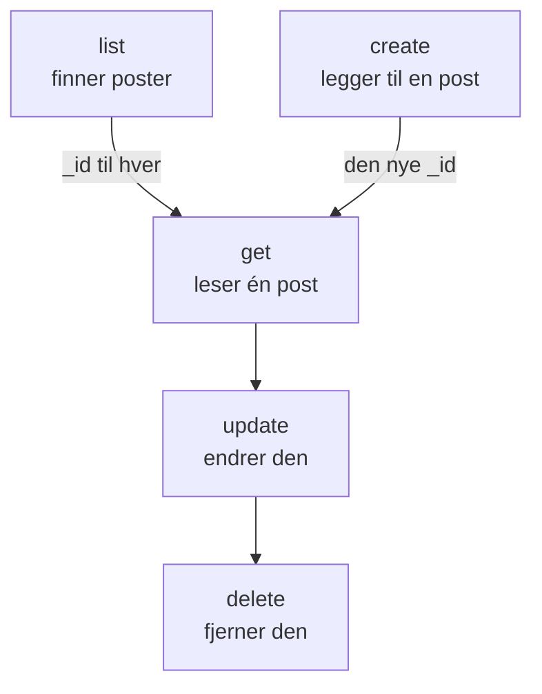

# Ressursoperasjoner

Hver type post er en egen kommando, for eksempel `incident`, `monitor` eller `status-page`, og hver tar de samme operasjonene: `list`, `get`, `create`, `update`, `delete` og `count`. Denne siden viser hver operasjon, med filtre, sider og JSON-en en post skrives i.

:::cards
- [Finn kommandoen for en post](#finn-kommandoen-for-en-post): oneuptime resources lister dem alle.
- [List poster](#list-poster): Filtrer, sorter og bla.
- [Opprett en post](#opprett-en-post): Fra JSON på kommandolinjen eller i en fil.
- [Slett en post](#slett-en-post): Med en gang, uten angring.
:::

## Slik henger operasjonene sammen

Å lese, endre og slette en post krever ID-en dens. Å liste, telle og opprette krever ingen, og en liste eller en opprettelse gir deg ID-ene de andre tar:



En ID er en UUID, for eksempel `6f1c2a40-3b1e-4c55-9a0b-3e2f8d7c1a11`. Du kan også kopiere en fra postens side i OneUptime: se [Finn ID-en til en ressurs](/docs/api-reference/api-reference#finn-id-en-til-en-ressurs).

## Finn kommandoen for en post

```bash
oneuptime resources
```

Listen viser hver type post med kommandoen, navnene, typen og API-stien sin. Det finnes to typer:

| Type | Hva den inneholder | Operasjoner |
| --- | --- | --- |
| `database` | Poster du administrerer: monitorer, hendelser, varsler, statussider, team og mer | `list`, `get`, `create`, `update`, `delete`, `count` |
| `analytics` | Telemetri: logger, spans, målinger, unntak og andre hendelser | `list`, `create`, `count` |

Vis én type med `oneuptime resources --type database` eller `--type analytics`. [Kommandoreferanse](/docs/cli/command-reference#ressurser) lister hver kommando.

## List poster

```bash
oneuptime <resource> list [--query <json>] [--limit <n>] [--skip <n>] [--sort <json>] [-o <format>]
```

| Alternativ | Hva det gjør | Standard |
| --- | --- | --- |
| `--query <json>` | Returnerer bare postene som samsvarer: se [Filtrer en liste](#filtrer-en-liste) | Hver post nøkkelen kan lese |
| `--limit <n>` | Det høyeste antallet poster som returneres, opptil 10 000 | `10` |
| `--skip <n>` | Hvor mange samsvarende poster som hoppes over først | `0` |
| `--sort <json>` | Rekkefølgen, for eksempel `{"createdAt":"ASC"}`, eller `"DESC"` for de nyeste først | De nyeste først |
| `-o, --output <format>` | `table`, `json` eller `wide` | `table` i en terminal, `json` i en pipe |

```bash
# The ten newest incidents
oneuptime incident list

# The oldest monitors first, 50 at a time: the second page
oneuptime monitor list --sort '{"createdAt":"ASC"}' --limit 50 --skip 50

# Every field of each incident, as JSON
oneuptime incident list -o json
```

En liste ber OneUptime om hvert felt i hver post nøkkelen kan lese. En tabell viser seks av dem; JSON viser alle (se [Utdataformater](/docs/cli/output-formats)). For å bla gjennom alle postene øker du `--skip` med `--limit` til en side kommer tom tilbake; `count` sier hvor mange det er.

Etiketter listes etter navn i stedet for de nyeste først: etiketter der navnet begynner med et tall, kommer først, i rekkefølgen til tallet (`2. Team` før `10. Owner`), deretter de andre alfabetisk. Vil du ha dem i en annen rekkefølge, oppgir du `--sort`.

### Filtrer en liste

`--query` tar det samme filteret som API-et: et felt med en verdi samsvarer med den verdien, og et objekt med en `_type` sammenligner.

| Filter | Samsvarer med |
| --- | --- |
| `{"title":"Checkout API is down"}` | Poster med nøyaktig den verdien |
| `{"title":{"_type":"Search","value":"checkout"}}` | Tekst som inneholder verdien |
| `{"createdAt":{"_type":"GreaterThan","value":"2026-10-01T00:00:00.000Z"}}` | Senere datoer eller større tall |
| `{"currentIncidentState":{"isResolvedState":false}}` | Et felt i en post som ressursen nevner: her hendelser som ikke er løst |

```bash
oneuptime incident list --query '{"title":{"_type":"Search","value":"checkout"}}'
```

[Filtrer, sorter og bla](/docs/api-reference/api-reference#filtrer-sorter-og-bla) i API-referansen lister hver `_type`.

## Les en post

```bash
oneuptime <resource> get <id> [-o <format>]
```

```bash
oneuptime incident get 6f1c2a40-3b1e-4c55-9a0b-3e2f8d7c1a11
```

En tabell viser én rad for hvert felt i posten, med hver verdi kuttet ved 60 tegn; `-o json` viser verdiene hele. En ID som ikke nevner noen post nøkkelen din kan lese, får svaret `Not found`, og kommandoen avslutter med koden `3`.

## Opprett en post

```bash
oneuptime <resource> create --data <json> [-o <format>]
oneuptime <resource> create --file <path> [-o <format>]
```

`--data` tar posten som JSON, og `--file` leser den fra en JSON-fil. Oppgi én av de to; oppgir du begge, brukes filen. Feltene er API-ets, og [API-referansen](/reference) lister feltene til hver ressurs. Prosjektet kommer fra API-nøkkelen, så en post nevner det aldri.

```bash
# A manual monitor
oneuptime monitor create --data '{"name":"Checkout API","monitorType":"Manual"}'

# An incident with one of your severities
oneuptime incident create --data '{"title":"Checkout API is down","incidentSeverityId":"<severity-id>"}'

# The same incident, from a file
oneuptime incident create --file incident.json
```

CLI-en skriver ut den nye posten, med `_id`-en sin. En hendelse starter i prosjektets opprettet-tilstand, med mindre `currentIncidentStateId` nevner en annen: se [Tilstanden en ny post starter i](/docs/api-reference/api-reference#tilstanden-en-ny-post-starter-i). Slik finner du ID-ene til alvorlighetsgradene dine:

```bash
oneuptime incident-severity list -o json | jq -r '.[] | "\(._id)  \(.name)"'
```

> [!TIP]
> På Windows legger du JSON-en i en fil og bruker `--file`: PowerShell og ledeteksten setter anførselstegn rundt JSON på kommandolinjen på en annen måte enn Bash.

## Oppdater en post

```bash
oneuptime <resource> update <id> --data <json> [-o <format>]
```

`--data` er påkrevd og inneholder bare feltene som skal endres:

```bash
# Rename a monitor
oneuptime monitor update <monitor-id> --data '{"name":"Checkout API (EU)"}'

# Move an incident to your resolved state
oneuptime incident update <incident-id> --data '{"currentIncidentStateId":"<resolved-state-id>"}'
```

OneUptime svarer på en oppdatering med et tomt objekt: CLI-en skriver ut en tom linje, eller `{}` med `-o json`. Kjør `get` for å se posten slik den er nå. Flytter du en hendelse til en annen tilstand på denne måten, registreres endringen på tidslinjen dens, slik dashbordet gjør, og en tilstand før den gjeldende avvises. Slik finner du ID-en til den løste tilstanden, den første i prosjektets rekkefølge:

```bash
oneuptime incident-state list --query '{"isResolvedState":true}' --sort '{"order":"ASC"}' --limit 1 -o json | jq -r '.[0]._id'
```

## Slett en post

```bash
oneuptime <resource> delete <id>
```

```bash
oneuptime monitor delete 6f1c2a40-3b1e-4c55-9a0b-3e2f8d7c1a11
```

Den svarer `Monitor 6f1c2a40-3b1e-4c55-9a0b-3e2f8d7c1a11 deleted successfully.`

> [!CAUTION]
> `delete` fjerner posten med en gang. CLI-en ber deg ikke bekrefte, og det kan ikke angres. Den godtar `--force`, for skript som er skrevet med det, og `--force` endrer ingenting.

## Tell poster

```bash
oneuptime <resource> count [--query <json>]
```

```bash
# Every incident
oneuptime incident count

# Incidents that are not resolved
oneuptime incident count --query '{"currentIncidentState":{"isResolvedState":false}}'
```

CLI-en skriver ut ett tall, det samme i en tabell og i JSON, så et skript kan lese det som det er.

## Hva hver type kan

| Operasjon | `database` | `analytics` |
| --- | --- | --- |
| `list` | Ja | Ja |
| `get` | Ja | Nei |
| `create` | Ja | Ja |
| `update` | Ja | Nei |
| `delete` | Ja | Nei |
| `count` | Ja | Ja |

## Feilsøking

:::details Meldingen «Not found: API error (404)»
Posten finnes ikke, ligger i et annet prosjekt, eller nøkkelen kan ikke lese den: OneUptime svarer det samme i hvert tilfelle. Sjekk ID-en med `list`, og nøkkelens tillatelser. Kommandoen avslutter med koden `3`.
:::

:::details Meldingen «API error (422): You do not have permissions to select on»
En liste eller en lesing ber om hvert felt i posten, og nøkkelen kan ikke lese ett av dem: meldingen nevner feltet og tillatelsene som kan lese det. Gi nøkkelen én av de tillatelsene.
:::

:::details Meldingen «Error: Invalid JSON»
Verdien av `--query`, `--sort` eller `--data` er ikke JSON. I Bash og zsh setter du den i enkle anførselstegn; på Windows legger du en post i en fil og bruker `--file`.
:::

:::details API error (400) ved en opprettelse eller en oppdatering
OneUptime avviste et felt: meldingen nevner det. `No fields to update` betyr at `--data` ikke inneholdt noe felt å endre.
:::

## Neste steg

:::cards
- [Utdataformater](/docs/cli/output-formats): Les svarene som tabeller eller som JSON.
- [Skripting og CI/CD](/docs/cli/scripting): Bruk disse operasjonene i skript og pipelines.
- [Kommandoreferanse](/docs/cli/command-reference): Hver kommando, hvert alternativ og hver standardverdi.
:::
