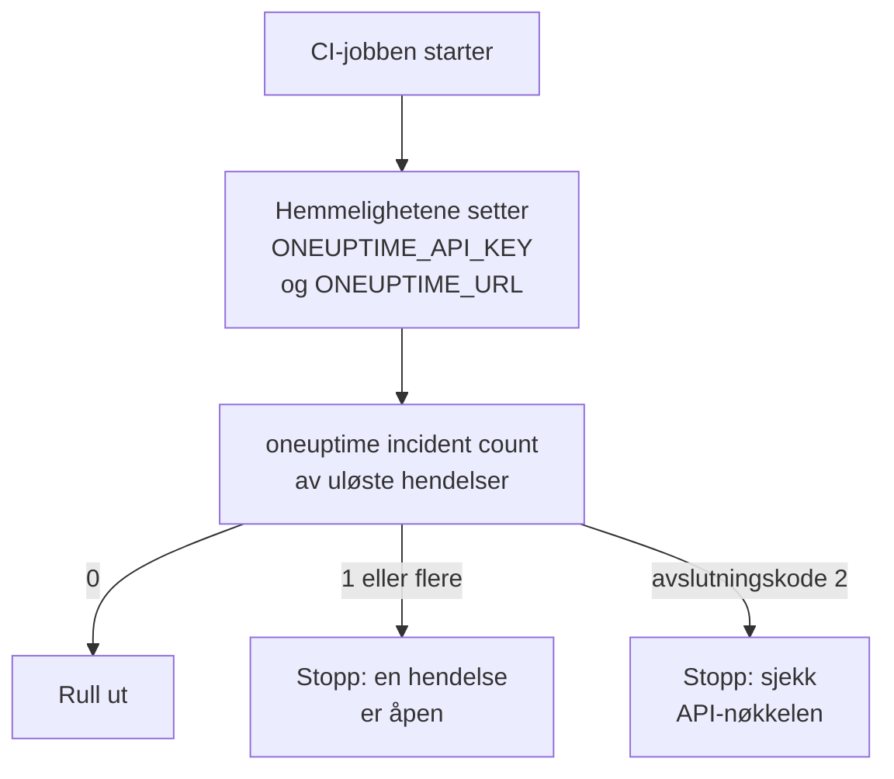

# Skripting og CI/CD

CLI-en virker på samme måte i et skript som i en terminal. Gi den en API-nøkkel i miljøvariabler, les svarene som JSON, og la avslutningskoden fortelle skriptet hva som skjedde. Denne siden viser hver av delene, og komplette pipelines for GitHub Actions, GitLab CI og Docker.

:::cards
- [Gi et skript API-nøkkelen sin](#gi-et-skript-api-nøkkelen-sin): To miljøvariabler, ingen lagret kontekst.
- [Avslutningskoder](#avslutningskoder): 0 når det virket, og hvorfor det ellers ikke gjorde det.
- [Les svar med jq](#les-svar-med-jq): ID-er, titler og datoer ut av JSON-en.
- [Eksempler på pipelines](#eksempler-på-pipelines): GitHub Actions, GitLab CI og Docker.
:::

## Slik bruker et skript CLI-en

En utrulling kan først spørre OneUptime om en hendelse er åpen, og stoppe hvis det er en:



## Gi et skript API-nøkkelen sin

Sett `ONEUPTIME_API_KEY` og `ONEUPTIME_URL` fra hemmelighetene i CI-systemet ditt. CLI-en trenger da verken `login` eller en konfigurasjonsfil. Et flagg går fortsatt foran dem for én kommando, og de går foran lagrede kontekster.

```bash
export ONEUPTIME_API_KEY="$CI_ONEUPTIME_API_KEY"
export ONEUPTIME_URL="https://oneuptime.com"
oneuptime incident count
```

> [!TIP]
> Gi hver pipeline sin egen API-nøkkel med bare tilgangen den trenger: en sjekk som bare leser, trenger en nøkkel som bare leser. Slett nøkkelen i OneUptime når pipelinen legges ned.

Kjører én maskin jobber for flere prosjekter, lagrer du en kontekst for hvert og nevner den i hver kommando, slik at en jobb aldri bruker en annens gjeldende kontekst:

```bash
oneuptime --context production incident count
oneuptime --context staging monitor count
```

## Avslutningskoder

| Kode | Betydning | For eksempel |
| --- | --- | --- |
| `0` | Det virket | En liste, også en som ikke finner noe |
| `1` | Det mislyktes | OneUptime avviste forespørselen, for eksempel `API error (422)`; ugyldig JSON; et manglende eller ukjent alternativ; en kontekst som ikke er lagret |
| `2` | Ingen brukbar API-nøkkel | Ingen legitimasjon funnet; en ugyldig API-nøkkel; en nøkkel under abonnementet sitt (`402`); `401` |
| `3` | Ikke funnet | OneUptime svarte `404`: posten finnes ikke, ligger i et annet prosjekt, eller nøkkelen kan ikke lese den |

`whoami` og `context current` avslutter med `0` selv når ingenting er lagret: de rapporterer hva som er satt, de sjekker det ikke. Et skript skiller tilfellene på koden:

```bash
oneuptime incident get "$INCIDENT_ID" -o json > incident.json
case $? in
  0) echo "Saved the incident to incident.json" ;;
  2) echo "Check ONEUPTIME_API_KEY and ONEUPTIME_URL" >&2; exit 1 ;;
  3) echo "There is no incident $INCIDENT_ID" >&2; exit 1 ;;
  *) echo "OneUptime refused the request" >&2; exit 1 ;;
esac
```

Feilmeldinger går til standard feil, så `incident.json` inneholder bare svaret.

## Les svar med jq

Skriv `-o json` i skript. I en pipe skriver CLI-en ut JSON uansett, men flagget holder skriptet i gang uansett hvor det kjører:

```bash
# The title of each incident
oneuptime incident list -o json | jq -r '.[].title'

# The ID of a new monitor
MONITOR_ID=$(oneuptime monitor create --data '{"name":"Checkout API","monitorType":"Manual"}' -o json | jq -r '._id')

# When each incident was created: dates come as objects
oneuptime incident list -o json | jq -r '.[] | "\(.createdAt.value)  \(.title)"'

# The newest 100 incidents as CSV
oneuptime incident list --limit 100 -o json | jq -r '.[] | [._id, .title, .createdAt.value] | @csv'
```

En telling skriver ut ett tall, klart til å sammenligne:

```bash
OPEN=$(oneuptime incident count --query '{"currentIncidentState":{"isResolvedState":false}}')
echo "$OPEN incidents are open"
```

## Opprett poster fra filer

Hold poster som JSON-filer ved siden av koden din, og opprett dem derfra:

```json title="monitors/checkout-api.json"
{
  "name": "Checkout API",
  "monitorType": "Manual"
}
```

```bash
oneuptime monitor create --file monitors/checkout-api.json
```

Mange poster fra ett JSON-array, én opprettelse for hver:

```bash
jq -c '.[]' monitors.json | while IFS= read -r monitor; do
  oneuptime monitor create --data "$monitor" -o json | jq -r '._id'
done
```

> [!NOTE]
> Hver kjøring oppretter nye poster. For å holde monitorer og statussider i takt med filer, bare endre det som er endret og fjerne det som er borte, bruker du [Terraform-leverandøren](/docs/terraform/index).

## Eksempler på pipelines

:::tabs
@tab GitHub Actions
```yaml title=".github/workflows/deploy.yml"
name: Deploy
on:
  push:
    branches: [main]

jobs:
  deploy:
    runs-on: ubuntu-latest
    steps:
      - uses: actions/checkout@v4
      - uses: actions/setup-node@v4
        with:
          node-version: lts/*
      - name: Install the OneUptime CLI
        run: npm install -g @oneuptime/cli
      - name: Stop while an incident is open
        env:
          ONEUPTIME_API_KEY: ${{ secrets.ONEUPTIME_API_KEY }}
          ONEUPTIME_URL: https://oneuptime.com
        run: |
          OPEN=$(oneuptime incident count --query '{"currentIncidentState":{"isResolvedState":false}}')
          if [ "$OPEN" -gt 0 ]; then
            echo "$OPEN incidents are open: not deploying."
            exit 1
          fi
      - name: Deploy
        run: ./deploy.sh
```
@tab GitLab CI
```yaml title=".gitlab-ci.yml"
check-incidents:
  stage: test
  image: node:lts
  variables:
    ONEUPTIME_URL: https://oneuptime.com
  script:
    - npm install -g @oneuptime/cli
    - OPEN=$(oneuptime incident count --query '{"currentIncidentState":{"isResolvedState":false}}')
    - echo "$OPEN incidents are open"
    - test "$OPEN" -eq 0
```
@tab Docker
```dockerfile title="Dockerfile"
FROM node:lts-slim
RUN npm install -g @oneuptime/cli
ENTRYPOINT ["oneuptime"]
```
:::

I GitHub Actions legger du til `ONEUPTIME_API_KEY` under repositoriets **Settings → Secrets and variables → Actions**; i GitLab legger du den til som en maskert CI/CD-variabel. Med Docker-bildet sender du variablene med til hver kjøring:

```bash
docker build -t oneuptime-cli .
docker run --rm -e ONEUPTIME_API_KEY -e ONEUPTIME_URL oneuptime-cli incident count
```

## Neste steg

:::cards
- [Autentisering](/docs/cli/authentication): Hvilken nøkkel en kommando bruker når flere er satt.
- [Utdataformater](/docs/cli/output-formats): JSON-en skriptene dine leser.
- [Ressursoperasjoner](/docs/cli/resource-operations): Filtre, sider og feltene i en post.
- [Terraform-leverandør](/docs/terraform/index): Hold OneUptimes konfigurasjon i filer.
:::
