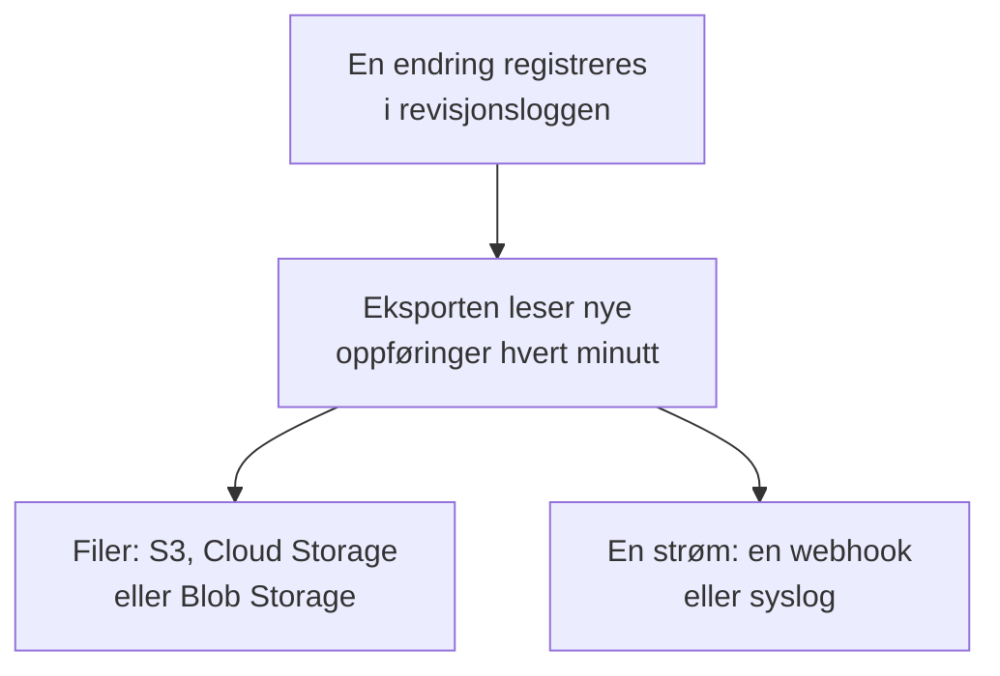

# Eksport av revisjonslogg

Send revisjonsloggen, etter hvert som den registreres, til lagring eller en tjeneste du velger: Amazon S3 eller S3-kompatibel lagring, Google Cloud Storage, Azure Blob Storage, en webhook eller syslog. Behold oppføringene der så lenge compliance-gjennomgangene dine krever, og søk i dem i ditt SIEM. Et prosjekts eiere og administratorer eksporterer revisjonsloggen fra prosjektinnstillingene, og master-admins eksporterer loggen for alle prosjekter fra Admin Dashboard. Den er en del av Enterprise-abonnementet i OneUptime Cloud og av Enterprise Edition når du selvhoster.

:::cards
- [Sett opp en eksport](#sett-opp-en-eksport): Velg et mål, test det, lagre det.
- [Hva som sendes](#hva-som-sendes): Ett JSON-objekt per oppføring, i et stabilt skjema.
- [Når oppføringer sendes](#når-oppføringer-sendes): Hvert minutt, hver oppføring én gang, i rekkefølge.
- [Når et mål feiler](#når-et-mål-feiler): Nye forsøk, feilen, og ingenting hoppes over.
:::

## Slik når en oppføring målet ditt



- **Én eksport, ett mål.** Et prosjekt kan ha flere eksporter, og hver sender alle oppføringer til sitt eget mål.
- **Et prosjekts, eller instansens.** Et prosjekts eksport sender oppføringene til det prosjektet. En eksport som er satt opp i Admin Dashboard, sender oppføringene til alle prosjekter som registrerer revisjonslogger.
- **Fra den lagres.** En eksport sender det som registreres etter at den er lagret, med mindre du setter **Eksporter fra** til en tidligere dato.

## Før du begynner

- **I OneUptime Cloud: Enterprise-abonnementet.** På andre abonnementer viser siden hva funksjonen gjør og hvordan du får den.
- **Når du selvhoster: Enterprise Edition**, med en lisens som inkluderer revisjonslogger. Se [Enterprise Edition](/docs/self-hosted/enterprise).
- **Revisjonslogging slått på** i hvert prosjekt du eksporterer. Se [Revisjonslogger](/docs/configuration/audit-logs).
- **En Project Owner eller Project Admin** for å eksportere revisjonsloggen til et prosjekt, eller en master-admin for å eksportere instansens.

## Sett opp en eksport

:::steps
### Åpne eksportsiden

For et prosjekt går du til **Prosjektinnstillinger → Revisjonslogger → Eksport**. For hele instansen går du til **Innstillinger → Eksport av revisjonslogg** i Admin Dashboard.

### Velg et mål

Klikk på **Legg til eksport**, og velg ett av de seks målene nedenfor. Målet for en eksport kan ikke endres senere.

### Fyll ut hvordan det nås

Fyll ut det målet ber om. Innstillinger som de fleste lar være som de er, venter under **Flere felt**, og **Oppsettveiledning** åpner målets avsnitt på denne siden.

### Send en test

Klikk på **Skriv en testfil** eller **Send en testoppføring**. Lagring får filen `oneuptime-audit-log-export-test.ndjson.gz` i mappen sin, og en webhook eller syslog får én oppføring med handlingen `Test`. En mislykket test sier hva som må rettes.

### Start eksporten

Klikk på **Neste**, gi eksporten et navn, og klikk på **Start eksport**. De første oppføringene kommer i løpet av noen minutter.
:::

Eksportens rad viser hvordan det går: **Eksporterer**, **Feiler**, **Pauset**, **Venter på oppføringer** eller **Starter**. **Send en test** sender en test med de lagrede innstillingene, og **Rediger** endrer dem: Påloggingsinformasjon du lar stå tom, beholder den lagrede.

## Mål

| Mål | Hva som kommer frem | Logger på med |
| --- | --- | --- |
| [Amazon S3](#amazon-s3) | Komprimerte NDJSON-filer | En tilgangsnøkkel |
| [S3-kompatibel lagring](#s3-kompatibel-lagring) | Komprimerte NDJSON-filer | En tilgangsnøkkel |
| [Google Cloud Storage](#google-cloud-storage) | Komprimerte NDJSON-filer | En nøkkel for en tjenestekonto |
| [Azure Blob Storage](#azure-blob-storage) | Komprimerte NDJSON-filer | Et SAS-token eller en tilgangsnøkkel |
| [Webhook](#webhook) | HTTPS-forespørsler | En valgfri header og signeringshemmelighet |
| [Syslog](#syslog) | RFC 5424-meldinger | Ingenting |

### Amazon S3

| Felt | Hva du skriver inn |
| --- | --- |
| **Bucket** | Bucketen filene skrives til. |
| **Region** | Bucketens region. Den står først på `us-east-1`. |
| **Tilgangsnøkkel-ID** | En tilgangsnøkkel som kan skrive objekter til bucketen. |
| **Hemmelig tilgangsnøkkel** | Nøkkelens hemmelighet. |
| **Mappe** | Under **Flere felt**. Står den tom, havner filene i `oneuptime/audit-logs/`. |

Nøkkelen trenger bare `s3:PutObject` på mappen:

```json
{
  "Version": "2012-10-17",
  "Statement": [
    {
      "Effect": "Allow",
      "Action": "s3:PutObject",
      "Resource": "arn:aws:s3:::my-audit-logs/oneuptime/audit-logs/*"
    }
  ]
}
```

### S3-kompatibel lagring

De samme feltene som for Amazon S3, etter et **Endpoint**: lagringens S3-adresse, for eksempel `https://minio.example.com:9000` eller `https://<account>.r2.cloudflarestorage.com`. Sett **Region** til den lagringen forventer: `us-east-1` for MinIO og Wasabis standard, `auto` for Cloudflare R2.

### Google Cloud Storage

Skriv inn **Bucket**, og lim inn en **Nøkkel for tjenestekonto** (JSON) der tjenestekontoen har rollen Storage Object Creator på bucketen. **Mappe** venter under **Flere felt**.

### Azure Blob Storage

Skriv inn **Lagringskonto** og **Container**, og velg under **Logg på med** hvordan eksporten logger på: med et **SAS-token** med tillatelsene Create og Write på containeren, eller med en **Tilgangsnøkkel** til lagringskontoen. Et SAS-token kan begrenses til denne containeren, så det er det tryggeste valget. **Sky** og **Mappe** venter under **Flere felt**.

### Webhook

OneUptime sender hver batch med POST til **URL**, som en JSON-matrise (`application/json`) eller én oppføring per linje (`application/x-ndjson`), slik **Format for innhold** angir, med disse headerne:

| Header | Verdi |
| --- | --- |
| `X-OneUptime-Event` | `audit-log-export` |
| `X-OneUptime-Batch-Id` | ID-en til batchens første oppføring: Den samme batchen, sendt på nytt, har den samme ID-en. |
| `X-OneUptime-Entry-Count` | Hvor mange oppføringer innholdet har. |
| `X-OneUptime-Signature` | `sha256=` og HMAC-SHA256 av innholdet, med **Signeringshemmelighet**, når en er satt. |

**Påloggingsinformasjon**, for eksempel `Bearer <token>`, sendes i headeren du velger under **Headernavn**, `Authorization` med mindre du endrer den. **Format for innhold**, **Headernavn** og **Signeringshemmelighet** venter under **Flere felt**. Ethvert 2xx-svar regnes som en levering. En `413` deler batchen i to, og ethvert annet avslag sender hele batchen på nytt senere.

### Syslog

Hver oppføring er én RFC 5424-melding til **Vert** og **Port**, over TLS på port `6514` med mindre **Protokoll** angir TCP, med facility 13 (log audit) og severity 6 (informational):

```text
<110>1 2026-10-24T09:15:03.000Z oneuptime.example.com oneuptime - audit-log - {"schemaVersion":1,"id":"..."}
```

Meldinger skilles med oktettelling (RFC 5425), med mindre **Meldingsskille** angir én melding per linje. En mottaker med et sertifikat som en privat CA har signert, trenger sertifikatet til den CA-en i **CA-sertifikat**. Begge venter under **Flere felt**.

## Hva som sendes

Hver oppføring er ett JSON-objekt, med nøklene alltid i denne rekkefølgen:

| Nøkkel | Hva den inneholder |
| --- | --- |
| `schemaVersion` | `1`. En endring i skjemaet kommer med en ny versjon. |
| `id` | Oppføringens ID. Den samme oppføringen, sendt to ganger, har den samme ID-en. |
| `createdAt` | Når endringen ble registrert, i UTC. |
| `projectId` | Prosjektet endringen ble gjort i. |
| `action` | `Create`, `Update`, `Delete` eller `Download`. |
| `resourceType`, `resourceId`, `resourceName` | Hva som ble endret. |
| `rootResourceType`, `rootResourceId` | Ressursen den hører til, for eksempel et SLO for regelen sin. |
| `userId`, `userName`, `userEmail`, `userType` | Hvem som gjorde endringen. |
| `apiKeyId`, `apiKeyName` | API-nøkkelen den ble gjort med, hvis noen. |
| `mcpOAuthGrantId`, `mcpClientName` | MCP-klienten den ble gjort gjennom, hvis noen. |
| `workflowId`, `workflowName` | Arbeidsflyten som gjorde den, hvis noen. |
| `changes` | Hvert endret felt: `field`, med `oldValue` og `newValue`. |

En fil har én oppføring per linje, komprimert med gzip, og arkiveres under timen for den første oppføringen: `oneuptime/audit-logs/2026/10/24/09/20261024T091503Z_<first entry id>.ndjson.gz`.

Nøkler, tokener og passord forlater aldri OneUptime: De registreres som `[REDACTED]`, og felt som ingen kan lese, utelates fra alle oppføringer.

## Når oppføringer sendes

- **Hvert minutt.** Oppføringer som ble registrert for mer enn et minutt siden, leses med de eldste først og sendes i batcher: opptil 5 000 oppføringer eller 16 MB per fil, og 500 oppføringer per webhook-forespørsel eller syslog-tilkobling.
- **Filer skrives ikke for hver oppføring.** En fil skrives når en batch er full eller den første oppføringen i den er fem minutter gammel.
- **Hver oppføring én gang, i rekkefølge.** Etter hver levering husker eksporten den sist sendte oppføringen, så en omstart eller en annen worker fortsetter derfra.
- **En gjentakelse kan gjenkjennes.** En batch som sendes på nytt etter et krasj, skriver det samme filnavnet eller har den samme `X-OneUptime-Batch-Id`, og hver oppføring har sin `id`.

## Når et mål feiler

En batch prøves tre ganger med noen sekunders mellomrom, og så venter eksporten før den prøver igjen: ett minutt, så to, fire og så videre, opptil en time. Raden sier **Feiler**, og **Vis feil** viser hva målet svarte og når neste forsøk kommer.

Ingenting hoppes over: Oppføringene venter i revisjonsloggen, og den neste leveringen som lykkes, tar igjen fra den eldste. En oppføring som er eldre enn oppbevaringstiden for prosjektets revisjonslogg, slettes før den kan sendes, så rett en eksport som feiler innen den tiden.

Slå av **Eksport** under **Rediger** for å pause en eksport: Den beholder plassen sin, og når den slås på igjen, sender den det som ble registrert i mellomtiden. I OneUptime Cloud slutter et prosjekt som forlater Enterprise-abonnementet å eksportere, og eksportene venter under oppgraderingskortet, der de kan slås av eller slettes. Når du selvhoster, stopper eksporten så lenge lisensen ikke inkluderer revisjonslogger, og fortsetter der den stoppet så snart en lisens gjør det.

## Feilsøking

:::details Testen sier at tilgang nektes
Nøkkelen, tokenet eller tjenestekontoen har ikke lov til å skrive der eksporten skriver. Gi den tillatelse til å opprette objekter i mappen, slik avsnittet for hvert mål ovenfor viser, og send testen på nytt.
:::

:::details Testen når ikke adressen
Et prosjekts eksport i OneUptime Cloud kan ikke nå en privat nettverksadresse. Når du selvhoster, kan den det, med mindre `DATA_SOURCE_BLOCK_PRIVATE_ADDRESSES` er `true`, og en eksport som er satt opp i Admin Dashboard, kan det alltid. Loopback- og link-local-adresser nås aldri.
:::

:::details Ingenting kommer frem
Sjekk at revisjonslogging er slått på i prosjektet, og at noen har endret noe etter at eksporten ble lagret. Lagring mottar en fil først når en batch er full eller fem minutter gammel.
:::

## Neste steg

:::cards
- [Revisjonslogger](/docs/configuration/audit-logs): Hva som registreres, og hvor lenge det beholdes.
- [Brukere, team og tillatelser](/docs/permissions/index): Bestem hvem som kan sette opp en eksport.
- [Enterprise Edition](/docs/self-hosted/enterprise): Revisjonslogger på en selvhostet installasjon.
:::
