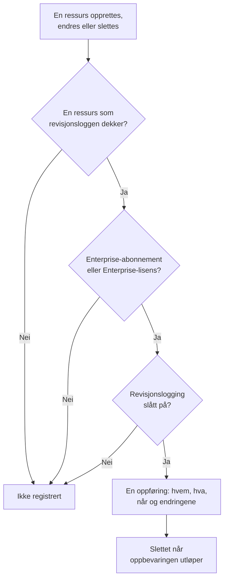

# Revisjonslogger

Revisjonsloggen registrerer hvem som endret hva i prosjektet ditt: hver opprettelse, endring og sletting av ressursene den dekker, med verdiene før og etter. Bruk den til å finne ut hvem som slo av en monitor eller endret en API-nøkkel, og til å føre dokumentasjon for compliance-gjennomganger. Den er en del av Enterprise-abonnementet i OneUptime Cloud og av Enterprise Edition når du selvhoster.

:::cards
- [Slå på revisjonslogging](#slå-på-revisjonslogging): Den er av fra start i alle prosjekter.
- [Les revisjonsloggen](#les-revisjonsloggen): Hvem endret hva, og når.
- [Hva som registreres](#hva-som-registreres): Ressursene og handlingene den dekker.
- [Hvor lenge oppføringer beholdes](#hvor-lenge-oppføringer-beholdes): Fra 7 til 180 dager.
:::

## Slik blir en endring til en oppføring

- **Den er av fra start.** Et prosjekt registrerer ingenting før noen slår på revisjonslogging, og ingenting fra før det øyeblikket.
- **Den registrerer hva folk gjør.** En endring gjort av en person, en API-nøkkel, en MCP-klient eller en arbeidsflyt registreres. En endring OneUptime selv gjør, som fra en bakgrunnsjobb, utelates, med mindre du slår på **Lagre systemhendelser**.
- **Oppføringer kan ikke endres.** Ingen kan redigere eller slette en oppføring, verken i dashbordet eller via API-et. En oppføring forsvinner først når oppbevaringen utløper.

## Før du begynner

- **I OneUptime Cloud: Enterprise-abonnementet.** På andre abonnementer viser revisjonsloggens sider hva funksjonen gjør og hvordan du får den.
- **Når du selvhoster: Enterprise Edition**, med en lisens som inkluderer revisjonslogger. Se [Enterprise Edition](/docs/self-hosted/enterprise).
- **En rolle som kan lese revisjonsloggen.** Project Owner, Project Admin, Settings Admin eller tillatelsen **Read Audit Log**. Å slå på revisjonslogging og endre innstillingene krever en Project Owner, en Project Admin eller tillatelse til å redigere prosjektet.

## Slå på revisjonslogging

:::steps
### Åpne innstillingene for revisjonsloggen

Gå til **Prosjektinnstillinger → Revisjonslogger → Innstillinger**. **Revisjonslogger** er slått sammen i sidemenyen fra start: klikk på den for å åpne den.

### Rediger innstillingene

Klikk på **Edit Audit Log Settings**.

### Slå den på

Slå på **Aktiver revisjonslogger**, angi **Oppbevaring (dager)**, og velg om du vil **Lagre systemhendelser**. Klikk på **Lagre endringer**.
:::

| Innstilling | Startverdi | Hva den gjør |
| --- | --- | --- |
| **Aktiver revisjonslogger** | Av | Registrerer fra nå av endringer i prosjektets ressurser. |
| **Oppbevaring (dager)** | 7 | Hvor mange dager hver oppføring beholdes: fra 7 til 180. |
| **Lagre systemhendelser** | Av | Registrerer også endringene OneUptime selv gjør, som ingen person eller nøkkel har startet. |

En endring av disse innstillingene trer i kraft innen ett minutt.

## Les revisjonsloggen

**Prosjektinnstillinger → Revisjonslogger → Revisjonslogger** viser hver oppføring i prosjektet, de nyeste først:

| Kolonne | Hva den viser |
| --- | --- |
| **Når** | Hvor lenge siden, med dato og klokkeslett. |
| **Handling** | `Create`, `Update` eller `Delete`, eller `Download` for en pakkeopptaksfil som noen har lastet ned. |
| **Ressurs** | Ressursens navn, som åpner den så lenge den finnes, og typen. |
| **Aktør** | Hvem som gjorde endringen: en person, en API-nøkkel, en arbeidsflyt eller `System` for en endring OneUptime selv gjorde. En persons endring via en MCP-klient nevner hvilken. |
| **Endringer** | Hvor mange felt som ble endret, eller registrert ved en opprettelse eller sletting. Klikk for å se hvert felt. |

Filtrer etter **Ressurstype**, **Ressursnavn**, **Handling**, **Bruker-e-post** eller **Tid**. En endring viser bare feltene som ble endret, før og etter, og en lagring som ikke endrer noe, legger ikke til noen oppføring.

Monitorer, hendelser, varsler, statussider, SLO-er og mange andre ressurser har også sin egen side **Revisjonslogger** i en sammenslått seksjon av sidemenyen, som **Avansert**. Den viser bare den ressursens oppføringer, sammen med oppføringene for det som hører til den: siden til et SLO viser også reglene og eierne.

## Hva som registreres

| Ressurs | **Ressurstype** i loggen |
| --- | --- |
| Monitorer | `Monitor` |
| Hendelser | `Incident` |
| Varsler | `Alert` |
| Statussider | `Status Page` |
| Planlagte vedlikeholdshendelser | `Scheduled Maintenance Event` |
| Vaktretningslinjer | `On-Call Policy` |
| SLO-er | `Service Level Objective` |
| Reglene og eierne til et SLO | `SLO Burn Rate Rule`, `SLO Monitor Rule`, `Service Level Objective User Owner`, `Service Level Objective Team Owner` |
| Team | `Team` |
| Egendefinerte roller, og teamene og API-nøklene som får en | `Custom Role`, `Team Custom Role`, `API Key Custom Role` |
| Etiketter | `Label` |
| Statuser og alvorlighetsgrader for hendelser | `Incident State`, `Incident Severity` |
| Statuser og alvorlighetsgrader for varsler | `Alert State`, `Alert Severity` |
| Monitorstatuser | `Monitor Status` |
| Statuser for planlagt vedlikehold | `Scheduled Maintenance State` |
| Hendelsesroller | `Incident Role` |
| Statuser for etteranalyse | `Postmortem Status` |
| API-nøkler | `API Key` |
| MCP-klienter som folk kobler til | `MCP Client Authorization` |
| Inventarelementer | `Inventory Item` |
| Innsamlerkonfigurasjoner | `Collector Config` |
| vCenter-servere | `vCenter` |
| Pakkeopptak og nedlastingene av dem | `Packet Capture` |
| Sikkerhetssaker og prioritetene og statusene deres, playbooks og kjøringene deres, beskyttede enheter, entitetskritikalitet, og risikoen for en entitet når noen tilbakestiller den | `Security Case`, `Security Case Priority`, `Security Case Status`, `Security Playbook`, `Security Playbook Run`, `Protected Entity`, `Entity Criticality`, `Entity Risk` |
| Regelunntak | `Rule Exception` |
| Oppgaver og bevis i sikkerhetssaker | `Security Case Task`, `Security Case Evidence` |
| Eksporter av revisjonsloggen | `Audit Log Export` |

Det registreres også når en administrator legger til eller fjerner en varslingsmetode eller en personlig vaktregel på en annens konto, uten selve adressen eller nummeret.

Andre data er ikke i revisjonsloggen, som hvem som er med i et team, eller en tillatelse som er lagt til et team for seg. Felt som ingen kan lese, utelates fra alle oppføringer, og nøkler, tokener og passord registreres som `[REDACTED]`: oppføringen viser at de er endret, aldri verdien deres.

## Hvor lenge oppføringer beholdes

Hver oppføring beholdes i den **Oppbevaring (dager)** prosjektet hadde da den ble registrert, og slettes deretter. En ny oppbevaring gjelder for nye oppføringer: oppføringene som allerede er registrert, beholder datoene sine.

For å beholde oppføringer i mer enn 180 dager sender du dem etter hvert som de registreres til din egen lagring eller ditt SIEM: se [Eksport av revisjonslogg](/docs/configuration/audit-log-export). Du kan også lese dem via API-et med en API-nøkkel som har **Read Audit Log**, og lagre dem der du trenger dem. Se [OneUptime API-referanse](/docs/api-reference/api-reference).

## Når abonnementet eller lisensen ikke lenger inkluderer revisjonslogger

- **I OneUptime Cloud** slutter et prosjekt som forlater Enterprise-abonnementet å registrere, og revisjonsloggsidene viser oppgraderingskortet til det er tilbake på abonnementet.
- **Når du selvhoster**, slutter revisjonslogging å registrere når Enterprise-prøveperioden eller fristen slutter uten en lisens, eller når lisensen ikke inkluderer revisjonslogger. Revisjonsloggen viser det i rødt. Oppføringer som allerede er registrert, beholdes, og registreringen fortsetter med de samme innstillingene så snart en lisens aktiveres. Se [Når en lisens utløper eller mangler](/docs/self-hosted/enterprise#når-en-lisens-utløper-eller-mangler).

## Feilsøking

:::details Revisjonsloggen er tom
Revisjonslogging er av fra start og registrerer ingenting fra før den ble slått på. Hvis listen sier at revisjonslogging er av, følger du lenken til innstillingene og slår den på. Ellers endrer du en monitor eller en hendelse og oppdaterer listen.
:::

:::details En endring mangler i revisjonsloggen
Sjekk at ressursen står under [Hva som registreres](#hva-som-registreres), og at endringen ble gjort etter at revisjonslogging ble slått på. En endring OneUptime selv gjorde, registreres bare med **Lagre systemhendelser** slått på.
:::

## Neste steg

:::cards
- [Eksport av revisjonslogg](/docs/configuration/audit-log-export): Send revisjonsloggen til din egen lagring eller ditt SIEM.
- [Brukere, team og tillatelser](/docs/permissions/index): Bestem hvem som kan lese revisjonsloggen.
- [Prosjektinnstillinger](/docs/configuration/project-settings): Prosjektets andre innstillinger.
- [Fakturering og bruk](/docs/configuration/billing): Endre prosjektets abonnement.
- [Enterprise Edition](/docs/self-hosted/enterprise): Revisjonslogger på en selvhostet installasjon.
:::
