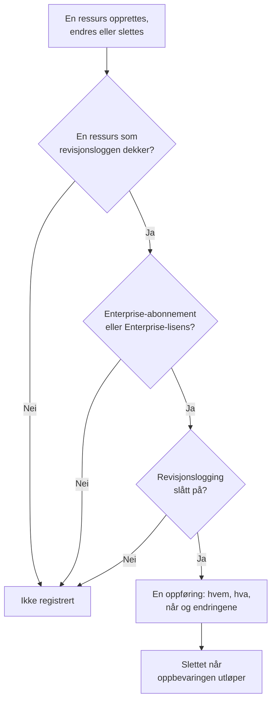

# Revisjonslogger

Revisjonsloggen registrerer hvem som endret hva i prosjektet ditt: hver opprettelse, endring og sletting av ressursene den dekker, med verdiene før og etter, og hver gang noen logger på eller logger ut. Bruk den til å finne ut hvem som slo av en monitor eller endret en API-nøkkel, hvem som logget på og hvorfra, og til å føre dokumentasjon for compliance-gjennomganger. Den er en del av Enterprise-abonnementet i OneUptime Cloud og av Enterprise Edition når du selvhoster.

:::cards
- [Slå på revisjonslogging](#slå-på-revisjonslogging): Den er av fra start i alle prosjekter.
- [Les revisjonsloggen](#les-revisjonsloggen): Hvem endret hva, og når.
- [Hva som registreres](#hva-som-registreres): Ressursene og handlingene den dekker.
- [Pålogginger og økter](#pålogginger-og-økter): Hvem som logget på, og hvordan hver økt endte.
- [Hvor lenge oppføringer beholdes](#hvor-lenge-oppføringer-beholdes): Fra 7 til 180 dager.
:::

## Slik blir en endring til en oppføring

- **Den er av fra start.** Et prosjekt registrerer ingenting før noen slår på revisjonslogging, og ingenting fra før det øyeblikket.
- **Den registrerer hva folk gjør.** En endring gjort av en person, en API-nøkkel, en MCP-klient eller en arbeidsflyt registreres. En endring OneUptime selv gjør, som fra en bakgrunnsjobb, utelates, med mindre du slår på **Lagre systemhendelser**.
- **Oppføringer kan ikke endres.** Ingen kan redigere eller slette en oppføring, verken i dashbordet eller via API-et. En oppføring forsvinner først når oppbevaringen utløper.

## Før du begynner

- **I OneUptime Cloud: Enterprise-abonnementet.** På andre abonnementer viser revisjonsloggens sider hva funksjonen gjør og hvordan du får den.
- **Når du selvhoster: Enterprise Edition**, med en lisens som inkluderer revisjonslogger. Se [Enterprise Edition](/docs/self-hosted/enterprise).
- **En rolle som kan lese revisjonsloggen.** Project Owner, Project Admin, Settings Admin eller tillatelsen **Read Audit Log**. Å slå på revisjonslogging og endre innstillingene krever en Project Owner, en Project Admin eller tillatelse til å redigere prosjektet.

## Slå på revisjonslogging

:::steps
### Åpne innstillingene for revisjonsloggen

Gå til **Prosjektinnstillinger → Revisjonslogger → Innstillinger**. **Revisjonslogger** er slått sammen i sidemenyen fra start: klikk på den for å åpne den.

### Rediger innstillingene

Klikk på **Edit Audit Log Settings**.

### Slå den på

Slå på **Aktiver revisjonslogger**, angi **Oppbevaring (dager)**, og velg om du vil **Lagre systemhendelser**. Klikk på **Lagre endringer**.
:::

| Innstilling | Startverdi | Hva den gjør |
| --- | --- | --- |
| **Aktiver revisjonslogger** | Av | Registrerer fra nå av endringer i prosjektets ressurser. |
| **Oppbevaring (dager)** | 7 | Hvor mange dager hver oppføring beholdes: fra 7 til 180. |
| **Lagre systemhendelser** | Av | Registrerer også endringene OneUptime selv gjør, som ingen person eller nøkkel har startet. |

En endring av disse innstillingene trer i kraft innen ett minutt.

## Les revisjonsloggen

**Prosjektinnstillinger → Revisjonslogger → Revisjonslogger** viser hver oppføring i prosjektet, de nyeste først:

| Kolonne | Hva den viser |
| --- | --- |
| **Når** | Hvor lenge siden, med dato og klokkeslett. |
| **Handling** | `Create`, `Update` eller `Delete`, `Download` for en pakkeopptaksfil som noen har lastet ned, eller `Sign In`, `Sign Out`, `Session Timeout` eller `Session Revoked` for en økt. |
| **Ressurs** | Ressursens navn, som åpner den så lenge den finnes, og typen. |
| **Aktør** | Hvem som gjorde endringen: en person, en API-nøkkel, en arbeidsflyt eller `System` for en endring OneUptime selv gjorde. En persons endring via en MCP-klient nevner hvilken. |
| **Endringer** | Hvor mange felt som ble endret, eller registrert ved en opprettelse eller sletting. For en økt: hvordan den logget på, eller hvorfor den sluttet. Klikk for å se hvert felt. |

Filtrer etter **Ressurstype**, **Ressursnavn**, **Handling**, **Bruker-e-post** eller **Tid**. En endring viser bare feltene som ble endret, før og etter, og en lagring som ikke endrer noe, legger ikke til noen oppføring.

En ressurs uten eget navn får navn etter det som navngir den i OneUptime: et unntak etter typen og begynnelsen av meldingen, med ID-er, adresser og alt som ligner en hemmelighet maskert, en kjøring av en runbook etter runbooken, telefonnummeret til en policy for innkommende anrop etter nummeret, og en mal eller et domene etter sitt eget navn.

Monitorer, hendelser, varsler, statussider, SLO-er og mange andre ressurser har også sin egen side **Revisjonslogger** i en sammenslått seksjon av sidemenyen, som **Avansert**. Den viser bare den ressursens oppføringer, sammen med oppføringene for det som hører til den: siden til et SLO viser også reglene og eierne.

## Hva som registreres

Alt folk oppretter, endrer eller sletter i et prosjekt, registreres: monitorer, hendelser, varsler, statussider, arbeidsflyter og trinnene deres, køer, dashbord, vaktpolicyer, team og hvem som er med i dem, API-nøkler og alle innstillinger. **Ressurstype** sier hva en oppføring gjelder, for eksempel `Monitor`, `Workflow` eller `Queue`.

| Registreres ikke | Hvorfor |
| --- | --- |
| Logger over meldinger | Hver av dem er allerede registreringen av en e-post, SMS, en samtale, et pushvarsel eller en chatmelding OneUptime har sendt eller mottatt. |
| Registreringer av kjøringer | Hver av dem er allerede registreringen av en kjøring av en arbeidsflyt, en vakteskalering, en skanning, en import eller en AI-kjøring. |
| Det agenter og telemetri rapporterer | Oppdagede ressurser, målinger og forbruk endrer seg med hver rapport, ikke fordi noen har endret dem. |
| Aktivitetsfeeder | En feed viser endringer som revisjonsloggen allerede registrerer. |
| OneUptimes arbeidstilstand | Økter for lesere av statussider, jobber i kø og annen tilstand OneUptime holder mens det arbeider. |
| En persons egen varslingsoppsett | Hver persons adresser, numre og personlige vaktregler tilhører bare dem. |
| En persons egne preferanser | Produktene hver person fester i sin egen øverste linje, tilhører bare dem, og bare de ser dem. |

Det registreres også når en administrator legger til eller fjerner en varslingsmetode eller en personlig vaktregel på en annens konto, uten selve adressen eller nummeret.

Felt som bare OneUptime skriver, for eksempel når en vert sist ble sett, utelates fra alle oppføringer, og det samme gjør felt som ingen kan lese. Når OneUptime skriver et av dem fordi noen ba om det, for eksempel når et unntak slås sammen med et annet eller en webhook-URL tilbakestilles, registrerer oppføringen det som den personens endring. Nøkler, tokener og passord registreres som `[REDACTED]`: oppføringen viser at de er endret, aldri verdien deres. Trinnene i en arbeidsflyt registreres som det som endret seg, med navnene på et trinns innstillinger, men aldri det som ble skrevet inn i dem, og å flytte et trinn på lerretet registreres ikke.

Det OneUptime gjør fordi noen ba om det, registreres også som deres endring, enten prosjektet lagrer systemhendelser eller ikke:

- Å starte, godkjenne, fullføre, hoppe over og avbryte en kjøring av en runbook. Trinnene registreres som det som ble gjort med hvert av dem, for eksempel `Approved "Restart the API" (step 3)`, aldri med det et trinn skrev ut.
- Det en regel endrer når noen kjører den: etikettene og eierne den legger til, postene en personvernregel gjør private, enhetene en regel for stedstildeling flytter, enhetene og monitorene en regel for automatisk import oppretter, og det en monitorregel på en statusside eller en SLO endrer på siden eller SLO-en.
- Å kjøpe, knytte til og frigi telefonnummeret til en policy for innkommende anrop.
- Å løse et datavarsel som noen markerer som forventet eller som ikke et problem.
- Å tilbakestille lenken til en kalenderfeed.
- Teamene noen blir med i når de logger på med SSO.

Det en regel gjør av seg selv, er OneUptimes egen endring og registreres når **Lagre systemhendelser** er slått på: etiketter og eiere en regel legger til når en post opprettes, og en post den da gjør privat; enhetene og monitorene en regel for automatisk import oppretter fra nye skanneresultater; og det en monitorregel på en statusside eller en SLO endrer når en regel, en monitor eller en etikett lagres.

Å tilbakestille AI-agenten til en vert, en klynge eller en skykonto registreres på ressursens egen side **Revisjonslogger**, som endringen av `aiAgentResetAt` gjort av den som tilbakestilte den: hvem, og når. Det samme gjelder å lage en nøkkel til AI-agenten for en skykonto: nøklene vises som endret, aldri med en nøkkel eller en hash. Det en agent rapporterer når den kobler til og melder seg, holdes utenfor, som før.

## Pålogginger og økter

Hver gang et medlem av prosjektet logger på OneUptime, registrerer revisjonsloggen det, og igjen når den økten slutter. En pålogging gjelder OneUptime, ikke ett prosjekt, så alle prosjektene personen er medlem av, registrerer den.

| Handling | Når den registreres |
| --- | --- |
| `Sign In` | Noen logger på: med passord eller en innloggingslenke, en passnøkkel, Google, Microsoft, Vercel eller enkel pålogging. |
| `Sign Out` | Personen logger ut. |
| `Session Timeout` | OneUptime avslutter økten fordi tiden er ute: inaktivitetsperioden eller øktlengden en serveradministrator har angitt, eller 30 dager uten bruk. |
| `Session Revoked` | OneUptime avslutter økten fordi passordet ble endret, kontoen ble blokkert, eller en serveradministrator tilbakestilte eller krevde totrinnsbekreftelse. |

For en slik oppføring er **Ressurs** økten, navngitt etter enheten den logget på fra, for eksempel `Chrome 130 on macOS`. **Aktør** er personen økten tilhører, så filtrering etter **Bruker-e-post** finner alle påloggingene og øktene deres. Detaljene sier hvordan de logget på og med hvilken andre faktor, IP-adressen og stedet, og for en økt som er avsluttet, når den logget på, når den sist ble brukt og når den utløp. Et prosjekts egen SSO-leverandør nevnes bare i revisjonsloggen til det prosjektet.

Pålogginger og økter registreres enten prosjektet lagrer systemhendelser eller ikke. En utløpt øktlengde eller 30 dager uten bruk registreres innen noen minutter. En utløpt inaktivitetsperiode registreres neste gang personens åpne fane eller mobilappen kontakter OneUptime.

## Hvor lenge oppføringer beholdes

Hver oppføring beholdes i den **Oppbevaring (dager)** prosjektet hadde da den ble registrert, og slettes deretter. En ny oppbevaring gjelder for nye oppføringer: oppføringene som allerede er registrert, beholder datoene sine. Også gjennom API-et er en oppbevaring et helt antall dager fra 7 til 180: alle andre verdier avvises.

For å beholde oppføringer i mer enn 180 dager sender du dem etter hvert som de registreres til din egen lagring eller ditt SIEM: se [Eksport av revisjonslogg](/docs/configuration/audit-log-export). Du kan også lese dem via API-et med en API-nøkkel som har **Read Audit Log**, og lagre dem der du trenger dem. Se [OneUptime API-referanse](/docs/api-reference/api-reference).

## Når abonnementet eller lisensen ikke lenger inkluderer revisjonslogger

- **I OneUptime Cloud** slutter et prosjekt som forlater Enterprise-abonnementet å registrere, og revisjonsloggsidene viser oppgraderingskortet til det er tilbake på abonnementet.
- **Når du selvhoster**, slutter revisjonslogging å registrere når Enterprise-prøveperioden eller fristen slutter uten en lisens, eller når lisensen ikke inkluderer revisjonslogger. Revisjonsloggen viser det i rødt. Oppføringer som allerede er registrert, beholdes, og registreringen fortsetter med de samme innstillingene så snart en lisens aktiveres. Se [Når en lisens utløper eller mangler](/docs/self-hosted/enterprise#når-en-lisens-utløper-eller-mangler).

## Feilsøking

:::details Revisjonsloggen er tom
Revisjonslogging er av fra start og registrerer ingenting fra før den ble slått på. Hvis listen sier at revisjonslogging er av, følger du lenken til innstillingene og slår den på. Ellers endrer du en monitor eller en hendelse og oppdaterer listen.
:::

:::details En endring mangler i revisjonsloggen
Sjekk at ressursen står under [Hva som registreres](#hva-som-registreres), og at endringen ble gjort etter at revisjonslogging ble slått på. En endring OneUptime selv gjorde, registreres bare med **Lagre systemhendelser** slått på.
:::

## Neste steg

:::cards
- [Eksport av revisjonslogg](/docs/configuration/audit-log-export): Send revisjonsloggen til din egen lagring eller ditt SIEM.
- [Brukere, team og tillatelser](/docs/permissions/index): Bestem hvem som kan lese revisjonsloggen.
- [Prosjektinnstillinger](/docs/configuration/project-settings): Prosjektets andre innstillinger.
- [Fakturering og bruk](/docs/configuration/billing): Endre prosjektets abonnement.
- [Enterprise Edition](/docs/self-hosted/enterprise): Revisjonslogger på en selvhostet installasjon.
:::
