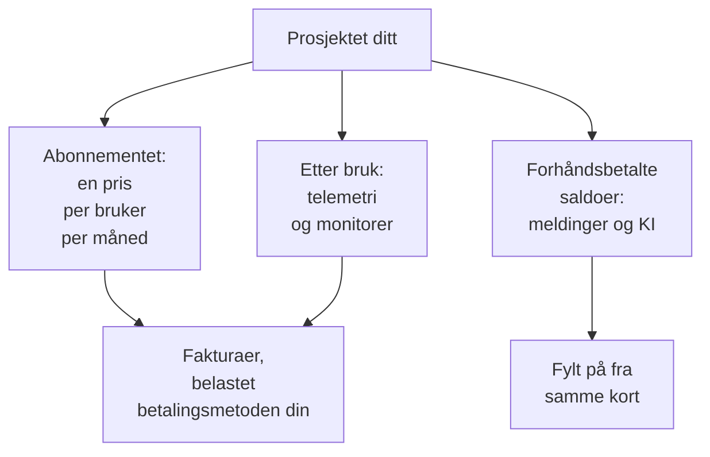

# Fakturering og bruk

I OneUptime Cloud betaler et prosjekt for abonnementet sitt, per bruker, og for det det bruker: telemetri, aktive monitorer og meldingene og KI-arbeidet det betaler fra forhåndsbetalte saldoer. Denne siden viser hvor du ser og endrer hver av dem, og hvem som kan. En selvhostet installasjon har ingen fakturering og ingen av disse sidene.

:::cards
- [Abonnementet og plassene dine](#abonnementet-og-plassene-dine): Hva abonnementet koster, og hvem som teller som en plass.
- [Betalingsmetoder](#betalingsmetoder): Kortet fakturaene dine belastes.
- [Fakturaer](#fakturaer): Betal dem, last dem ned, og se hva du har brukt.
- [Forhåndsbetalte saldoer](#forhåndsbetalte-saldoer): Meldinger og KI, fylt på manuelt eller automatisk.
:::

## Hva et prosjekt betaler for

| Hva | Hvordan det prises |
| --- | --- |
| Abonnementet | En pris per bruker per måned, fakturert månedlig eller årlig. Hver person i prosjektet er en plass. |
| Telemetri | $0.10 per inntatt GB, med 15 dagers oppbevaring. Lengre oppbevaring koster mer, og oppbevaring under 7 dager faktureres som 7 dager: se [Hva oppbevaring koster](/docs/telemetry/data-retention#hva-oppbevaring-koster). |
| Øktavspillinger | $2 per GB, med 15 dagers oppbevaring. |
| Aktive monitorer | $1 per monitor per måned. Alle monitorer unntatt manuelle er aktive, også mens de er slått av. |
| SMS, anrop, WhatsApp og Telegram | Betales fra prosjektets saldo etter hvert som hver melding sendes. |
| OneUptime AI | Betales fra prosjektets AI-kreditter, med mindre den kjører på din egen LLM-leverandør. |

[Prissiden](https://oneuptime.com/pricing) sammenligner abonnementene.

## Før du begynner

- **OneUptime Cloud.** Seksjonen **Fakturering og fakturaer** i **Prosjektinnstillinger** finnes bare i OneUptime Cloud og er slått sammen fra start: klikk på tittelen for å åpne den.
- **En rolle som kan lese faktureringen.** Project Owners, folk med **Manage Billing** og de tre faktureringsrollene leser alle faktureringssidene. Se [Hvem kan gjøre hva](#hvem-kan-gjøre-hva).

## Abonnementet og plassene dine

Gå til **Prosjektinnstillinger → Fakturering og fakturaer → Fakturering**. Kortet **Gjeldende abonnement** viser prosjektets abonnement og prisen per bruker, og **Plasser**: én for hver person i prosjektet.

En person teller som en plass fra du inviterer personen, allerede før den godtar, til du fjerner den. For å endre antallet plasser inviterer eller fjerner du folk: se [Inviter personer](/docs/permissions/inviting-people).

## Endre abonnementet

:::steps
### Legg til en betalingsmetode først

Et abonnementsbytte krever en betalingsmetode. Uten en åpner **Change Plan** i stedet **Add a Payment Method**: se [Betalingsmetoder](#betalingsmetoder).

### Klikk på Change Plan

Klikk på **Change Plan** på kortet **Gjeldende abonnement**. **Årsplan** er slått på fra start: slå den av for å se månedsprisene.

### Velg abonnementet

Hvert abonnement viser prisen sin per bruker. Notatet under abonnementene sier hva som skjer med prøveperioden din: **Your free trial carries over** så lenge prosjektet fortsatt er i prøveperioden, og **Changing plan does not start a free trial** når det ikke lenger er det.

### Lagre endringen

Klikk på **Lagre endringer**. Et betalt abonnement faktureres fra det øyeblikket du bytter til det, og hver person du inviterer på det, faktureres når du inviterer personen.
:::

API-nøkler krever Growth-abonnementet eller et høyere abonnement, og under Scale-abonnementet fjerner SCIM-tilkoblinger bare folk. Et abonnement som stopper dem, sier hvor mange før du velger det, og siden **Fakturering** viser **Ikke inkludert i dette abonnementet** så lenge de er stoppet. Ingenting slettes: de virker igjen på et abonnement som inkluderer dem.

> [!NOTE]
> Kjøpte du OneUptime via en forhandler eller en skymarkedsplass (AWS Marketplace, Microsoft Marketplace, Google Cloud Marketplace eller Vercel Marketplace)? Siden **Fakturering** sier det. En forhandler endrer abonnementet ditt for deg, og en markedsplass fakturerer prosjektets abonnement og bruk på skyregningen din.

## Betalingsmetoder

Kortet **Betalingsmetoder** viser kortene i prosjektet. Fakturaer belastes automatisk standardkortet.

:::steps
### Klikk på Legg til betalingsmetode

Klikk på **Legg til betalingsmetode** på kortet **Betalingsmetoder**.

### Skriv inn kortet

Skriv inn betalingsopplysningene, og klikk på **Save payment method**. Metoden du legger til, blir standard, og når du legger til en, slås betaling etter bruk på. Det endrer ikke abonnementet ditt.
:::

- **Angi som standard** gjør en annen metode i listen til den fakturaer belastes.
- **Re-sync Autopay**, på standardmetoden, retter en fornyelse som fortsatt belaster et eldre kort.
- Prosjektet beholder minst én betalingsmetode: legg til en annen før du sletter den siste.

## Fakturaadresse og faktura-e-post

Kortet **Bedriftsdetaljer / faktureringsadresse** inneholder det fakturaene dine sier om deg. Klikk på **Oppdater**, og fyll ut to trinn:

| Trinn | Felt |
| --- | --- |
| **Fakturaadresse** | **Bedriftsdetaljer / faktureringsadresse**: firmaets juridiske navn, adresse og mva- eller skatte-ID. **Land**: faktureringslandet ditt. |
| **Fakturaer** | **E-post for økonomi / regnskap**: hvor fakturaer, kvitteringer og faktureringsmeldinger sendes, flere adresser skilt med komma. **Send fakturaer på e-post**: send hver faktura dit så snart den utstedes. |

## Fakturaer

**Prosjektinnstillinger → Fakturering og fakturaer → Fakturaer** viser prosjektets fakturaer, hver med **Fakturanummer**, **Fakturadato**, **Beløp** og **Fakturastatus**.

- **Betal faktura** betaler en faktura som fortsatt er ubetalt.
- **Last ned** åpner fakturaen som PDF. På en faktura som fortsatt er ubetalt, ligger den i radmenyen **⋯**.

Når banken din fortsatt behandler en betaling, sier OneUptime det: noen banker bruker opptil 2 dager på å bekrefte en kortbetaling, og fakturaen oppdaterer seg selv. Ikke betal den på nytt.

## Brukshistorikk

**Prosjektinnstillinger → Fakturering og fakturaer → Brukshistorikk** viser telemetrien prosjektet har sendt, én rad per produkt, tjeneste og dag:

| Kolonne | Hva den viser |
| --- | --- |
| **Produkt** | Logger, sporinger, metrikker og de andre typene telemetri. |
| **Dag** | Dagen den ble sendt. |
| **Tjeneste** | Tjenesten, eller verten, klyngen eller den andre ressursen som sendte den. |
| **Data inntatt (i GB)** | Hvor mye som kom inn. |
| **Dataoppbevaring (i dager)** | Hvor lenge den oppbevares. |
| **Totalkostnad** | Hva den kostet, i amerikanske dollar. |

En dags bruk vises når dagen er over. Filtrer etter **Produkt**, **Dag** eller **Tjeneste** for å finne det som har vokst.

## Forhåndsbetalte saldoer

SMS, anrop, WhatsApp- og Telegram-meldinger betales fra prosjektets saldo, og OneUptime AI fra AI-kredittene. Du fyller på hver av dem på forhånd:

| Saldo | Hvor |
| --- | --- |
| SMS, anrop, WhatsApp og Telegram | **Prosjektinnstillinger → Varsler → Varselinnstillinger** |
| OneUptime AI | **Prosjektinnstillinger → KI → AI-kreditter** |

:::steps
### Fyll på nå

Klikk på **Fyll på saldo** på sidens kort **Gjeldende saldo**. Skriv inn et beløp fra $20 til $1,000, og klikk på **Fyll på**. Beløpet belastes prosjektets kort.

### Eller la den fylle seg selv på

Klikk på **Rediger Automatisk påfylling** på kortet **Automatisk påfylling**, og slå på **Aktiver automatisk påfylling**. Den er av fra start. Når den er på, legger OneUptime til $20 hver gang saldoen faller til $10, eller beløpene du velger.
:::

Når en saldo ikke kan betale, sendes ikke meldingen, eller OneUptime AI stopper, og prosjektets eiere får en e-post. Se [Når et varsel ikke sendes](/docs/on-call/escalation-rules#når-et-varsel-ikke-sendes) og [Når AI-kredittene tar slutt](/docs/ai/ai-sre#når-ai-kredittene-tar-slutt).

## Hvem kan gjøre hva

| For å | Kreves |
| --- | --- |
| Lese faktureringssidene: abonnementet, fakturaer, bruk, saldoer og betalingsmetoder | Project Owner, **Manage Billing**, **Billing Admin**, **Billing Member** eller **Billing Viewer** |
| Laste ned en faktura | Project Owner, Project Admin, **Manage Billing**, **Read Invoices**, **Billing Admin** eller **Billing Member** |
| Endre fakturaadressen og faktura-e-posten | Project Owner, **Manage Billing**, **Billing Admin** eller **Billing Member** |
| Slå SMS, anrop, WhatsApp eller Telegram på eller av | Project Owner, **Manage Billing** eller **Billing Admin** |
| Legge til en betalingsmetode | Project Owner, **Manage Billing** eller **Create Payment Method** |
| Betale en faktura | Project Owner, **Manage Billing** eller **Edit Invoices** |
| Endre abonnementet, fylle på en saldo eller endre automatisk påfylling | Project Owner eller **Manage Billing** |

En knapp du ikke kan bruke, vises låst og sier hvem som kan. Se [Brukere, team og tillatelser](/docs/permissions/index#team) for faktureringsrollene.

## Innstillinger som krever et abonnement

I OneUptime Cloud krever disse administrasjonsinnstillingene et abonnement. En side med et abonnement du ikke har, viser hva funksjonen gjør, og hvilket abonnement den krever.

| Innstilling | Abonnementet den krever |
| --- | --- |
| Etiketter | Growth |
| API-nøkler | Growth |
| Dine egne SMTP-servere og Twilio-kontoer | Growth |
| Dine egne LLM-leverandører | Growth |
| Koble til MCP-klienter | Growth |
| Opprette team | Scale |
| SSO, OIDC og SCIM | Scale |
| Overstyringer av oppbevaring | Scale |
| Revisjonslogger | Enterprise |

## Si opp abonnementet

For å slutte å betale for et prosjekt sletter du det: faktureringen stopper når det er slettet. Se [Slett prosjektet](/docs/configuration/project-settings#slett-prosjektet). Et prosjekt kjøpt via en forhandler sies opp hos forhandleren, og et kjøpt via en skymarkedsplass på markedsplassen.

## Feilsøking

:::details "Add a payment method in Project Settings > Billing and Invoices > Billing before using paid monitoring or telemetry"
Et prosjekt på Free-abonnementet må ha en betalingsmetode før det oppretter aktive monitorer eller sender telemetri, fordi de betales etter bruk. Legg til en under [Betalingsmetoder](#betalingsmetoder). Manuelle monitorer forblir gratis.
:::

:::details Et rødt banner sier at det finnes ubetalte fakturaer
Et prosjekt med ubetalte fakturaer blir inaktivt og slettes hvis de forblir ubetalte. Åpne **Fakturaer**, og klikk på **Betal faktura** på hver som fortsatt er ubetalt.
:::

:::details Change Plan åpner Add a Payment Method
Prosjektet har ingen betalingsmetode ennå. Legg til en, og endre deretter abonnementet.
:::

:::details Brukshistorikken er tom
Bruk telles per dag, og en dag vises når den er over. Et prosjekt som ikke har sendt telemetri, har ingen rader.
:::

## Neste steg

:::cards
- [Prosjektinnstillinger](/docs/configuration/project-settings): Alt annet som gjelder for hele prosjektet.
- [Inviter personer](/docs/permissions/inviting-people): Legg til folkene plassene dine er til.
- [Dataoppbevaring](/docs/telemetry/data-retention): Oppbevar telemetri så lenge som nødvendig, og ikke lenger.
- [Drop-filtre og scrub-regler](/docs/telemetry/drop-filters-and-scrub-rules): Slutt å betale for telemetri du ikke bruker.
:::
