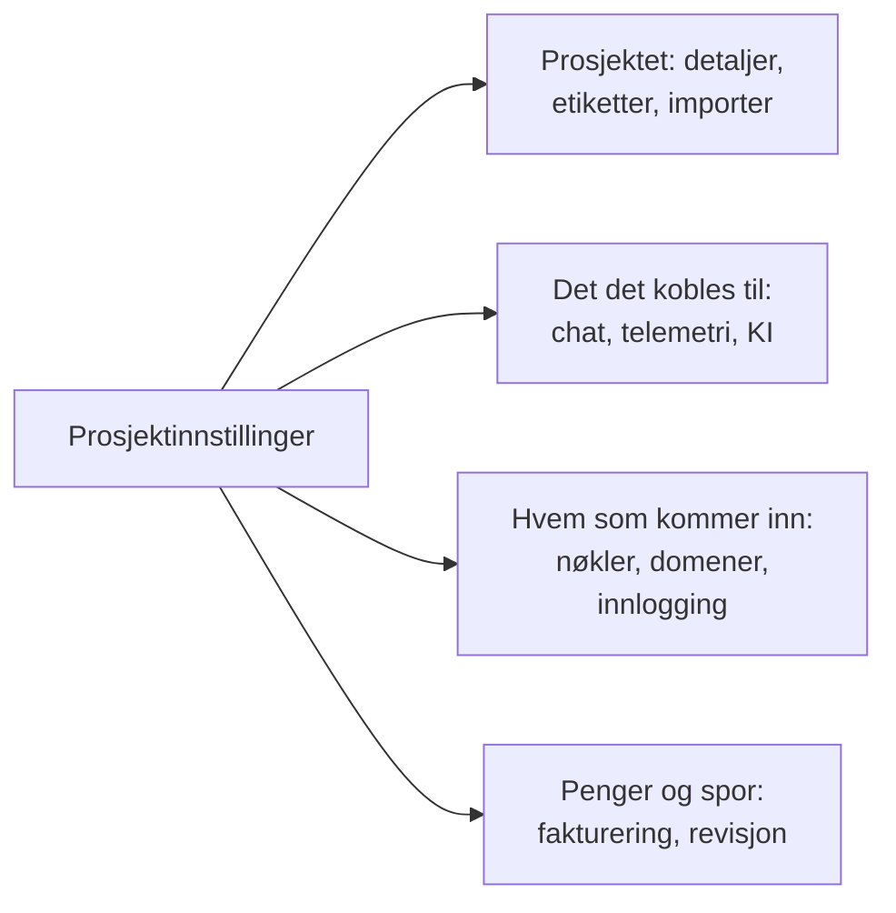

# Prosjektinnstillinger

Prosjektinnstillinger inneholder det som gjelder for hele prosjektet: navnet, verktøyene det er koblet til, nøklene, hvordan folk logger inn, faktureringen og revisjonssporet. Det meste setter du opp én gang og kommer sjelden tilbake til. Denne siden er et kart over det og dekker innstillingene som ikke har en egen side: prosjektets detaljer, etiketter, funksjonsflagg og sletting av prosjektet.

:::cards
- [Finn en innstilling](#finn-en-innstilling): Hva hver seksjon i sidemenyen inneholder.
- [Prosjektets detaljer](#prosjektets-detaljer): Navnet, ID-en og tilgang for støtte.
- [Etiketter](#etiketter): Merker for ressurser, tillatelser og regler.
- [Slett prosjektet](#slett-prosjektet): Hva det krever, og hva som forsvinner med det.
:::

## Åpne prosjektinnstillinger

Gå til **Produkter → Innstillinger → Prosjektinnstillinger**. Sidemenyen grupperer sidene i seksjoner, og bare **Grunnleggende** er åpen fra start: klikk på tittelen til en seksjon for å åpne den. En seksjon åpnes av seg selv på enhver side i den.

## Før du begynner

- **En rolle som kan endre prosjektet.** Project Owners og Project Admins endrer de fleste av disse innstillingene. Fakturering, varslingskanaler og sletting av prosjektet krever mer, som hver seksjon sier.
- **I OneUptime Cloud: abonnementet som inkluderer en innstilling.** Noen innstillinger krever et abonnement: se [Innstillinger som krever et abonnement](/docs/configuration/billing#innstillinger-som-krever-et-abonnement).

## Finn en innstilling

| Seksjon | Sider | Hvor du leser mer |
| --- | --- | --- |
| **Grunnleggende** | **Prosjekt**, **Etiketter** | [Prosjektets detaljer](#prosjektets-detaljer), [Etiketter](#etiketter) |
| **Arbeidsområde** | **Slack**, **Microsoft Teams**, **Video Calls** | [Slack](/docs/workspace-connections/slack), [Microsoft Teams](/docs/workspace-connections/microsoft-teams), [Videosamtaler](/docs/workspace-connections/video-calls) |
| **Telemetri og APM** | **Inntaksnøkler**, **Dataoppbevaring** | [Inntaksnøkler](/docs/telemetry/ingestion-keys), [Dataoppbevaring](/docs/telemetry/data-retention) |
| **Varsler** | **Varselinnstillinger**, **Varsellogger**, **Mobilapper** | [Varsler](#varsler) |
| **KI** | **AI Features**, **LLM-leverandører**, **Eksterne MCP-servere**, **AI-kreditter**, **AI-logger**, **MCP-server** | [LLM-leverandører](/docs/ai/llm-provider), [Eksterne MCP-servere](/docs/ai/external-mcp-servers), [MCP-server](/docs/ai/mcp-server), [AI SRE](/docs/ai/ai-sre#kostnadskontroll) |
| **Avansert** | **Domener**, **API-nøkler**, **Funksjonsflagg**, **Importer fra et annet verktøy** | [Egne domener](/docs/status-pages/branding-and-domains#egendefinerte-domener), [API-nøkler](/docs/permissions/index#api-nøkler), [Funksjonsflagg](#funksjonsflagg), [Bytt fra Opsgenie](/docs/moving-to-oneuptime/opsgenie) og de andre flytteveiledningene |
| **Sikkerhet** | **SSO**, **SCIM** | [SSO](/docs/identity/sso), [SCIM](/docs/identity/scim) |
| **Fakturering og fakturaer** | **Fakturering**, **Brukshistorikk**, **Fakturaer** | [Fakturering og bruk](/docs/configuration/billing) |
| **Revisjonslogger** | **Revisjonslogger**, **Innstillinger**, **Eksport** | [Revisjonslogger](/docs/configuration/audit-logs), [Eksport av revisjonslogg](/docs/configuration/audit-log-export) |
| **Faresone** | **Faresone** | [Slett prosjektet](#slett-prosjektet) |

**Fakturering og fakturaer** og **AI-kreditter** finnes bare i OneUptime Cloud: en selvhostet installasjon har ingen fakturering.

## Prosjektets detaljer

**Prosjektinnstillinger → Grunnleggende → Prosjekt** har to kort.

**Prosjektdetaljer** viser prosjektets navn og ID:

- **Prosjektnavn**: klikk på **Rediger Prosjekt** for å gi prosjektet nytt navn. Et navn har minst 2 tegn. Å gi nytt navn krever en Project Owner eller tillatelse til å redigere prosjektet eller administrere fakturering.
- **Prosjekt-ID**: kopier den til API-et, CLI-en og Terraform, eller når du skriver til støtte.
- **Data Residency**: i OneUptime Cloud, hvor prosjektets data skal ligge, når OneUptime har registrert det. Bare OneUptime angir det.

**Tilgang for kundestøtte** avgjør i OneUptime Cloud om OneUptimes støtteteam kan åpne prosjektet. Slå på **Gi OneUptime-støtte tilgang til dette prosjektet** når du vil ha hjelp: OneUptime spør først, fordi støtte da kan se og endre alt i prosjektet, og du klikker på **Gi støtte tilgang**. Slå det av når de er ferdige: det lagres med en gang. Project Owners og Project Admins endrer det.

## Etiketter

Etiketter er merker du setter på monitorer, hendelser, statussider og andre ressurser. De filtrerer og grupperer lister, og de begrenser hvor langt et teams tillatelser og prosjektets regler rekker.

:::steps
### Åpne etiketter

Gå til **Prosjektinnstillinger → Grunnleggende → Etiketter**.

### Opprett en etikett

Klikk på **Opprett Etikett**. Gi den et **Navn** og, om du vil, en **Beskrivelse**. **Etikettfarge** er allerede valgt, en farge ingen etikett på siden bruker ennå: velg en annen om du foretrekker det. Klikk på **Opprett Etikett** for å lagre den.
:::

I OneUptime Cloud krever det Growth-abonnementet å opprette og endre etiketter. Se [Etiketter](/docs/permissions/index#etiketter) for hvordan etiketter begrenser tillatelser, og [Etikett- og eierregler](/docs/configuration/label-and-owner-rules) for å sette etiketter på ressurser når de opprettes.

I en liste vises etikettene til en post under hverandre; er det flere enn fire, vises de tre første med en lenke til resten. Overalt der etiketter står oppført (i lister, på siden til en post og i hver etikettvelger), står de i naturlig rekkefølge: etiketter der navnet begynner med et tall, kommer først, i rekkefølgen til tallet (`2. Team` før `10. Owner`), deretter de andre alfabetisk, uansett store og små bokstaver. Vil du bestemme rekkefølgen på etikettene dine, begynner du navnene med et tall, som `1. Category` og `2. Subcategory`.

### Arkivere en etikett

For å fase ut en etikett arkiverer du den fra radens meny **⋯** i stedet for å slette den. Alt som har etiketten, beholder den, og du kan fortsatt filtrere på den, men ingen kan legge den til på noe igjen: Hver etikettvelger utelater den, og API-et, Terraform og MCP avviser den. Dialogen viser reglene og tillatelsene som er satt opp til å bruke etiketten, og som fortsetter å bruke den til du endrer dem. Arkiverte etiketter vises for seg, i den sammenslåtte delen **Arkiverte etiketter**, der **Fjern fra arkiv** setter en tilbake. **Slett** viser først alt etiketten ville blitt fjernet fra, og tilbyr **Arkiver i stedet**.

## Varsler

**Prosjektinnstillinger → Varsler** inneholder hvordan prosjektet sender varsler:

- **Varselinnstillinger**: kortet **Varslingskanaler** slår SMS, telefonsamtaler, WhatsApp og Telegram på eller av for prosjektet. Alle fire er av fra start. En Project Owner, en **Faktureringsadministrator** eller noen med **Manage Billing** slår dem på. Siden har også, sammenfoldet under **Flere innstillinger**, prosjektets egne e-postservere i **Egendefinerte SMTP-konfigurasjoner** (se [SMTP](/docs/emails/smtp)) og dets egen Twilio-konto (se [Twilio-integrasjon](/docs/self-hosted/twilio-integration)). I OneUptime Cloud har den saldoen som disse meldingene betales fra: se [Forhåndsbetalte saldoer](/docs/configuration/billing#forhåndsbetalte-saldoer).
- **Varsellogger**: hvert varsel prosjektet har sendt, med én fane per kanal: **E-post**, **SMS**, **WhatsApp**, **Telegram**, **Webhook**, **Anrop**, **Push** og **Arbeidsområde**.
- **Mobilapper**: hvor du får appene for iOS og Android. Se [Apper – Oversikt](/docs/mobile-desktop-apps/index).

## Funksjonsflagg

**Prosjektinnstillinger → Avansert → Funksjonsflagg** slår valgfrie funksjoner på eller av for prosjektet. Hver er en bryter som lagres når du slår den om. I dag har siden **Monitorgrupper**, av i et nytt prosjekt: slå den på for å legge monitorgrupper til i Monitorer-menyen. Å slå den av sletter ingen gruppe. Se [Monitorgrupper](/docs/monitor/monitor-groups).

## Slett prosjektet

Å slette et prosjekt sletter alt i det, for alle medlemmer: monitorer, hendelser, statussider, vaktoppsett og telemetri. Ingenting bringer det tilbake.

:::steps
### Åpne faresonen

Gå til **Prosjektinnstillinger → Faresone**.

### Klikk på Slett Prosjekt

Klikk på **Slett Prosjekt**. En dialog ber deg bekrefte.

### Skriv prosjektets navn

Skriv navnet nøyaktig slik det er. **Slett Prosjekt** forblir låst til du gjør det. I OneUptime Cloud spør dialogen også hvorfor du forlater oss: svaret er valgfritt.

### Bekreft

Klikk på **Slett Prosjekt**. OneUptime sletter prosjektet og tar deg ut av det.
:::

> [!CAUTION]
> Sletting av prosjektet kan ikke angres. Det krever en Project Owner eller tillatelse til å slette prosjektet.

I OneUptime Cloud sier du opp et prosjekts abonnement ved å slette prosjektet: faktureringen stopper når prosjektet er slettet. Et prosjekt som faktureres via en skymarkedsplass, får en siste belastning for forbruket sitt, og kjøpet på markedsplassen forblir aktivt til du sier det opp der.

## Feilsøking

:::details En seksjon i sidemenyen ser ut til å mangle
Alle seksjoner unntatt **Grunnleggende** er slått sammen fra start. Klikk på tittelen til seksjonen for å åpne den. På en selvhostet installasjon finnes verken seksjonen **Fakturering og fakturaer** eller siden **AI-kreditter**.
:::

:::details Rediger Prosjekt er låst
Å gi nytt navn krever en Project Owner eller tillatelse til å redigere prosjektet eller administrere fakturering. Den låste knappen nevner tillatelsen du mangler.
:::

:::details Slett Prosjekt forblir låst i dialogen
Skriv prosjektets navn nøyaktig slik dialogen viser det: store og små bokstaver teller.
:::

## Neste steg

:::cards
- [Inviter personer](/docs/permissions/inviting-people): Få teamet ditt inn i prosjektet.
- [Fakturering og bruk](/docs/configuration/billing): Abonnementet ditt, betalingsmetoder, fakturaer og bruk.
- [Revisjonslogger](/docs/configuration/audit-logs): Se hvem som endret hva i prosjektet.
- [SSO](/docs/identity/sso): La folk logge inn med identitetsleverandøren din.
:::
