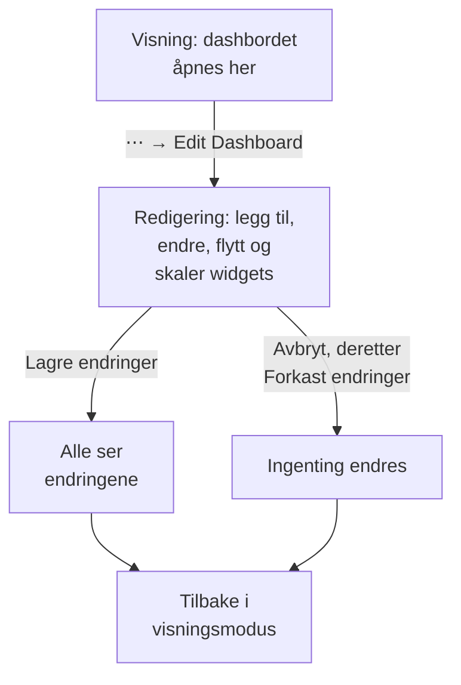

# Opprette et dashbord

For å opprette et dashbord åpner du **Produkter → Dashbord** og klikker på **Opprett dashbord**. Dialogen **Opprett et dashbord** spør hvordan du vil starte, og deretter om et navn. **Start fra bunnen** gir deg et tomt dashbord; en mal bygger widgetene sine, og ofte variablene sine, for deg og fyller inn navnet sitt (nummerert, som i "Kubernetes Dashboard 2", når prosjektet allerede har ett). Klikk på **Opprett dashbord**, og det nye dashbordet åpnes. Et tomt dashbord åpnes på lerretet sitt, med en knapp **Legg til widget** for den første widgeten.

:::cards
- [Opprett dashbordet](#opprett-dashbordet): Start fra bunnen eller fra en mal.
- [Rediger og lagre](#rediger-og-lagre): Ingenting endres for noen før du klikker på Lagre endringer.
- [Legg til en widget](#legg-til-en-widget): Velg den i katalogen, sett den opp og plasser den.
- [Zoom inn på en topp](#zoom-inn-på-en-topp): Dra over et diagram for å lese hele dashbordet i det øyeblikket.
:::

## Før du begynner

Prosjekteiere og -administratorer kan opprette og redigere alle dashbord. Alle andre trenger en teamtillatelse: `CreateDashboard` for å opprette dashbord og `EditDashboard` for å endre dem. Prosjektmedlemmer og seere kan lese dashbord uten noen av dem. Den som ikke kan redigere et dashbord, kan likevel åpne **⋯**-menyen, der **Rediger dashbord** er låst og forteller hvilken tillatelse som trengs.

## Opprett dashbordet

:::steps
### Velg hvordan du starter

Åpne **Produkter → Dashbord**, og klikk på **Opprett dashbord**. Dialogen **Opprett et dashbord** åpnes på **Start fra bunnen**, et tomt dashbord for dine egne widgets. Under den viser **Eller start fra en mal** seks maler under **Anbefalt**.

### Velg en mal

Klikk på en mal for å se hva den legger til: widgetene, navngitt slik **Legg til widget** navngir dem, og variablene du snevrer den inn med i verktøylinjen. For de andre velger du en kategori ved siden av søkefeltet, eller **Alle maler**, eller skriver i **Søk i maler…**: hvert ord du skriver, må passe. Klikk deretter på **Bruk denne malen**, eller dobbeltklikk på malen. I søkefeltet velger piltastene en mal, og **Enter** bruker den.

### Gi dashbordet et navn

Navnet på en mal er fylt inn, nummerert forbi navnene prosjektet allerede har. **Start fra bunnen** lar det stå tomt: skriv inn et. Beskrivelsen er valgfri, ligger sammenslått under **Flere felt**, og du kan legge den til senere på dashbordets side **Oversikt**. **Tilbake** tar deg tilbake til malene slik du forlot dem.

### Opprett det

Klikk på **Opprett dashbord**. Det nye dashbordet åpnes: med en mals widgets med en gang, eller med et tomt lerret med **Legg til widget** på.
:::

Malene, etter kategorien velgeren viser dem under:

| Kategori | Maler |
| --- | --- |
| Overvåking og APM | Monitor Dashboard, Metrics Dashboard, Real User Monitoring Dashboard, SLO Dashboard |
| Hendelseshåndtering | Incident Dashboard, Alert Dashboard |
| Infrastruktur | Kubernetes Dashboard, Kubernetes Cost Dashboard, Hosts Dashboard, Proxmox Dashboard, VMware Dashboard, Ceph Dashboard, Storage Array Dashboard, Docker Swarm Dashboard, Network Dashboard |

**Anbefalt** har Monitor Dashboard, Incident Dashboard, Alert Dashboard, Kubernetes Dashboard, Hosts Dashboard og Metrics Dashboard. En mal er et utgangspunkt, ikke en kobling: når dashbordet er opprettet, endrer du det som du vil. Malen oppdaterer det ikke senere.

## Rediger og lagre

Et dashbord åpnes i visningsmodus, for lesing. For å endre det åpner du **⋯**-menyen i verktøylinjen og velger **Rediger dashbord**. Verktøylinjen viser **Redigerer** ved siden av navnet og bytter ut tidsintervallet og de andre kontrollene med **Legg til widget**, **Variabler**, **Avbryt** og **Lagre endringer**, med en rad under for dashbordets **Standard tidsrom** og **Standard automatisk oppdatering**.

Endringene dine er bare dine til du lagrer dem. Ingenting lagres mens du redigerer, så andre ser fortsatt dashbordet slik det var.

- **Lagre endringer** lagrer widgetene, plasseringene og størrelsene deres, variablene, og standardtidsrommet og den automatiske standardoppdateringen, alt på én gang, og går tilbake til visningsmodus. Hvis lagringen blir avvist, for eksempel fordi du har mistet tillatelsen i mellomtiden, blir du i redigeringsmodus med endringene dine, og årsaken står over rutenettet.
- **Avbryt** spør først, fordi den kaster endringene dine: **Forkast endringer** går tilbake til dashbordet slik det ble lagret, og **Fortsett å redigere** tar deg tilbake til arbeidet ditt.

Mens du redigerer, står den automatiske oppdateringen på pause, og et zoomet tidsintervall går tilbake til intervallet du valgte.

## Legg til en widget

:::steps
### Åpne widgetkatalogen

Klikk på **Legg til widget**: i verktøylinjen mens du redigerer, eller på lerretet til et tomt dashbord. Katalogen grupperer widgetene etter hva de viser. Skriv i søkefeltet for å finne en etter navn eller formål ("error budget", "pods"), og trykk Enter for å legge til det første treffet.

### Velg en widget

Klikk på den. Widgeten havner på det første ledige stedet i rutenettet der den får plass, og innstillingene åpnes.

### Angi hva den viser

Innstillingsdialogen viser en **Live Preview** av widgeten over innstillingene, og forhåndsvisningen følger hver endring du gjør. Velg hva widgeten leser (en metrikkspørring, et filter, en tekst) og hvordan den ser ut, og klikk deretter på **Ferdig**.

### Plasser den

Dra widgeten for å flytte den, og dra i kantene eller hjørnene for å endre størrelsen. Se [Widgets i rutenettet](#widgets-i-rutenettet).
:::

[Dashbord-widgets](/docs/dashboards/widgets) går gjennom hver widget og innstillingene.

## Widgets i rutenettet

Lerretet er et rutenett som er tolv kolonner bredt. Widgets fester seg til det, og siden vokser nedover etter hvert som du legger til rader. Mens du drar en widget, viser et stiplet omriss hvor den havner, med kolonne og rad; mens du endrer størrelsen på en, viser omrisset størrelsen i rutenettenheter. Widgets som er i veien, flytter seg, så to widgets overlapper aldri.

Hver type widget har en minste størrelse, slik at det den tegner forblir lesbart: et diagram er minst seks kolonner bredt og tre rader høyt, mens ett enkelt tall får plass i én celle.

Rutenettet er like bredt som skjermen. På en smalere skjerm blir kolonnene smalere, og radene beholder høyden sin. På en telefon vises widgetene under hverandre, hver like bred som skjermen, i den rekkefølgen de står i rutenettet: rad for rad ovenfra og, innenfor en rad, fra venstre mot høyre. Et diagram tegnes høyere der, så kurven har plass. Når du redigerer på en telefon, ser du rutenettet, som kan rulles sidelengs.

For å endre en widget senere klikker du på den mens du redigerer. Innstillingene åpnes igjen, med to knapper til nederst:

- **Duplicate Widget** legger til en kopi, med de samme innstillingene, på det første ledige stedet.
- **Slett widget** fjerner den når du har bekreftet.

## Tidsintervall og automatisk oppdatering

I visningsmodus angir verktøylinjens tidsintervallvelger vinduet som alle diagram-, tall-, logg- og sporwidgets leser. Velg en forhåndsinnstilling fra de siste 5 minuttene til de siste 3 månedene, eller en egendefinert start og slutt. Dashbordet åpnes på standardtidsrommet sitt: den siste timen, med mindre noen som redigerer det, velger et annet.

Lister over hendelser, varsler, overvåkinger og ressurser viser den nåværende tilstanden sin, uansett tidsintervall.

Ved siden av tidsintervallet leser menyen for automatisk oppdatering hver widget på nytt med 5 sekunders, 10 sekunders, 30 sekunders, 1 minutts, 5 minutters eller 15 minutters mellomrom, med en nedtelling til neste oppdatering. La den være av mens du feilsøker, slik at visningen står stille. Dashbordet åpnes med den automatiske standardoppdateringen sin: av, med mindre noen som redigerer det, velger en annen.

Tidsintervallvelgeren, variablene og den automatiske oppdateringen vises så snart dashbordet har en widget.

### Dashbordets standarder

Mens du redigerer dashbordet, bestemmer raden under knappene i verktøylinjen hva alle åpner det med: **Standard tidsrom**, en forhåndsinnstilling fra de siste 5 minuttene til de siste 3 månedene, og **Standard automatisk oppdatering**. **Lagre endringer** lagrer dem sammen med resten av dashbordet, både for teamet ditt og for besøkende på den offentlige lenken. En egendefinert start og slutt kan ikke være en standard: dashbordet ville blitt stående på det øyeblikket for alltid. Raden vises så snart dashbordet har en widget.

Dashbord som ble lagret før disse innstillingene, åpnes på den siste timen, med den automatiske oppdateringen de hadde. Gjennom API-et og Terraform ligger begge i dashbordets `dashboardViewConfig`: `timeRange`, en forhåndsinnstilling skrevet slik API-referansen skriver den, for eksempel `Past 1 Day`, og `refreshInterval`, for eksempel `1m`. Alle andre verdier avvises.

### Dine egne valg

Tidsintervallet og den automatiske oppdateringen du velger i visningsmodus, gjelder bare deg, og nettleseren din husker dem for hvert dashbord: en ny innlasting, en omstart av nettleseren eller av en veggskjerm åpner dashbordet slik du forlot det. Bare en forhåndsinnstilling huskes. Et egendefinert intervall eller en zoom varer til du forlater siden, slik at dashbordet aldri blir stående fast på et øyeblikk i fortiden.

Det første valget i hver velger viser dashbordets standard, som i Standard (Past 1 Day). Velg det for å gå tilbake til standarden: nettleseren glemmer valget ditt, og dashbordet følger standarden sin igjen, også når noen endrer den senere. Når du selv lagrer nye standarder, ser du dem med en gang.

### Zoom inn på en topp

Du trenger ikke ta i bruk tidsintervallvelgeren for å se på en topp. Dra over den interessante strekningen av et linje- eller arealdiagram, og **hele dashbordet** flytter seg til det vinduet, akkurat som om du hadde valgt det i tidsintervallvelgeren: hver widget som bruker tidsintervallet, spør på nytt samtidig, så du leser ett øyeblikk over hele dashbordet i stedet for ett diagram i en annen skala enn naboene. Sanntidslister fortsetter å vise hva som skjer nå, som de alltid gjør.

**Dobbeltklikk på et hvilket som helst diagram** for å angre: dashbordet går tilbake til intervallet det hadde før du begynte å zoome, uansett hvor mange ganger du har zoomet videre inn. En knapp **Tilbakestill zoom** vises ved siden av tidsintervallvelgeren mens en zoom er aktiv, og et dobbeltklikk på et dashbord som ikke er zoomet, gjør ingenting.

Et zoomet vindu ligger fast, så det slutter å rulle fremover mens automatisk oppdatering er på; det er med vilje, for et vindu som gled unna deg midt i en feilsøking, ville vært verre. Tilbakestill zoomen for å få det til å rulle igjen.

Zoom fungerer bare i visningsmodus; i redigeringsmodus flytter og skalerer dra i stedet widgets. Stolpediagrammer zoomer på samme måte (dra over stolpene), og et dobbeltklikk på ett av dem tilbakestiller dashbordet som et hvilket som helst annet diagram. Bare et drag zoomer: et vanlig klikk på et diagram endrer aldri dashbordets tidsintervall. De samme bevegelsene fungerer på diagrammene i hele OneUptime; se [Zoome inn på et tidsintervall](/docs/telemetry/charts-and-time-ranges).

## Fullskjerm

**⋯ → Fullskjerm** viser dashbordets widgets på hele skjermen, for en veggskjerm eller et møte. Trykk Esc for å gå ut.

## Tips for dashbord som eldes godt

- **Ett tema per dashbord.** Noen få fokuserte dashbord slår én side med alt du følger med på.
- **Plasser den viktigste widgeten øverst.** Folk leser ovenfra og ned, så la det første de ser, svare på "er dette sunt?"
- **Gi seksjonene navn med Tekst-widgets.** En kort overskrift med noen raders mellomrom ("Ventetid", "Feil", "Kapasitet") gjør siden lett å skumme, selv fra den andre siden av rommet.
- **Bruk variabler i stedet for kopier.** Hvis du er i ferd med å bygge det samme dashbordet for en annen tjeneste, legger du heller til en variabel `service`. Se [Dashbord-variabler & filtre](/docs/dashboards/variables).
- **Ta en kopi før en stor endring.** **Dupliser Dashbord**, på dashbordets side **Innstillinger**, lager en trygg kopi du kan prøve ut ideene dine på.

## Neste steg

:::cards
- [Dashbord-widgets](/docs/dashboards/widgets): Hver widget, innstillingene og hvilken du skal velge.
- [Dashbord-variabler & filtre](/docs/dashboards/variables): Ett dashbord for hver tjeneste, vert eller kunde.
- [Deling & offentlige dashbord](/docs/dashboards/sharing): Del dashbordet utenfor teamet ditt.
- [Dashbord-konfigurasjon & tillatelser](/docs/dashboards/configuration): Eiere, etiketter, arkivering og hvem som kan gjøre hva.
:::
