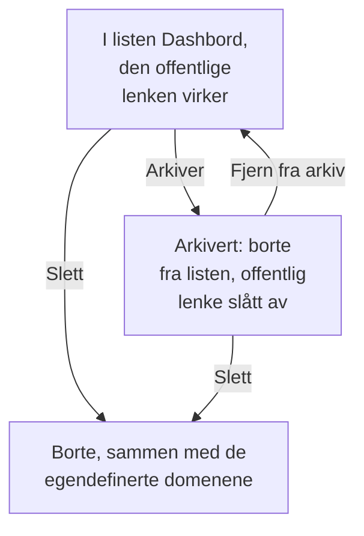

# Dashbord-konfigurasjon & tillatelser

Når du har et dashbord som er verdt å ta vare på, tar denne siden for seg hvem som kan lese og endre det, hvordan eiere og etiketter organiserer dashbordene dine, og hvordan du kopierer, eksporterer, arkiverer og sletter et.

:::cards
- [Hvem som kan gjøre hva](#hvem-som-kan-gjøre-hva): Tillatelsene bak hver handling, og hvem som har dem.
- [Eiere](#eiere): Brukerne og teamene et dashbord tilhører.
- [Duplisere et dashbord](#duplisere-et-dashbord): En trygg kopi, nummerert for deg.
- [Arkivere et dashbord](#arkivere-et-dashbord): Legg bort et dashbord uten å slette det.
:::

## Hvem som kan gjøre hva

Dashbord følger prosjektets [tillatelser](/docs/permissions/index). Hver handling krever en av disse, gitt gjennom et team:

| For å | Kreves |
| --- | --- |
| Lese dashbord | `ReadDashboard`, eller en prosjektrolle: Project Owner, Project Admin, Project Member, Viewer eller en Settings-rolle |
| Opprette dashbord | `CreateDashboard`, Project Owner eller Project Admin |
| Endre et dashbord: widgetene, variablene, delingen og merkevaren, og arkivere det | `EditDashboard`, Project Owner eller Project Admin |
| Slette et dashbord | `DeleteDashboard`, Project Owner eller Project Admin |
| Legge til og fjerne eiere | Tillatelsene for dashbordeiere, Project Owner, Project Admin eller Project Member |
| Legge til og endre egendefinerte domener | Tillatelsene for dashborddomener, Project Owner, Project Admin, Project Member, Settings Admin eller Settings Member |
| Opprette eierregler og etikettregler | Tillatelsene for regler, Project Owner eller Project Admin |

Et Project Member leser altså alle dashbord, men trenger `CreateDashboard` og `EditDashboard` for å bygge dem. Lesing, redigering og sletting kan hver for seg begrenses til dashbordene et team eier, eller til dashbord med bestemte etiketter: se [Omfang: hvor langt en tillatt rettighet rekker](/docs/permissions/index#omfang-hvor-langt-en-tillatt-rettighet-rekker).

Tildel dem på et teams side **Tillatelser**: åpne **Produkter → Team**, og velg teamet.

Hvem som kan se et dashbord utenfor prosjektet, er et eget spørsmål, som besvares på siden **Deling**: se [Tilgang til offentlige dashbord](#tilgang-til-offentlige-dashbord).

## Eiere

Et dashbords **eiere** er brukerne og teamene det tilhører. Legg dem til på dashbordets side **Eiere**, eller velg flere dashbord i listen **Dashbord** og legg til eiere på alle samtidig.

Eiere snevrer inn tilgangen når du ber om det: en teamtillatelse som er avgrenset til dashbordene teamet eier, når bare dashbordene som har det teamet, eller personen som handler, som eier. Eierskap alene gir ingenting.

Listen **Dashbord** viser hvert dashbords eiere, og filteret **Eier** finner dashbordene en person eller et team eier.

## Etiketter

Etiketter er merker for å organisere dashbord. Legg dem til på dashbordets side **Oversikt**, der du også redigerer navnet og beskrivelsen, eller på flere dashbord samtidig fra listen **Dashbord**.

Vanlige mønstre:

- **Etter team**: `team:platform`, `team:checkout`, `team:growth`.
- **Etter miljø**: `env:prod`, `env:staging`.
- **Etter formål**: `purpose:oncall`, `purpose:exec`, `purpose:investigation`.

Filteret **Etiketter** på listen **Dashbord** er den raskeste måten å finne et dashbord på i et prosjekt som har samlet mange. Etiketter begrenser også tillatelser: en teamtillatelse som er begrenset til bestemte etiketter, når bare dashbordene som har en av dem.

## Eier- og etikettregler

I stedet for å legge til eiere og etiketter for hånd kan du la regler gjøre det. Under **Innstillinger** i sidemenyen **Dashbord** legger **Eierregler** til eiere og **Etikettregler** etiketter på hvert nye dashbord som samsvarer med dem: etter etikettene det allerede har, eller etter et mønster i navnet eller beskrivelsen. [Etikett- og eierregler](/docs/configuration/label-and-owner-rules) forklarer hvordan regler samsvarer, og hvordan du kjører en på dashbordene du allerede har.

## Tilgang til offentlige dashbord

Hvem som kan se et dashbord utenfor prosjektet, er ett valg på siden **Deling** (også **⋯ → Del** på selve dashbordet; se [Deling & offentlige dashbord](/docs/dashboards/sharing)):

1. **Bare personer i dette prosjektet** (standard): dashbordet har ingen offentlig lenke; den offentlige adressen viser en side med "ikke funnet".
2. **Alle med lenken**: alle som har den offentlige lenken, kan se det uten å logge på.
3. **Alle med lenken og et passord**: besøkende skriver inn et passord før dashbordet vises.

Under **Flere innstillinger** på samme side avviser **IP-tillatelsesliste** (abonnementet Scale) forespørsler til den offentlige lenken fra enhver IP-adresse som ikke står på den. Det mest låste offentlige oppsettet er **Alle med lenken og et passord** med en IP-tillatelsesliste: nyttig for partnerportaler der du vil ha begge lagene.

## Duplisere et dashbord

For å kopiere et dashbord åpner du det, går til siden **Innstillinger** og klikker på **Dupliser Dashbord**. Kopiens navn fylles inn for deg: dashbordets navn, nummerert forbi navnene prosjektet allerede har ("Checkout API" kopieres som "Checkout API 2", og en kopi av den som "Checkout API 3"). Endre det om du vil, bekreft med **Dupliser Dashbord**, og kopien åpnes. Den har dashbordets widgets, variabler, beskrivelse og etiketter. Merkevare og egendefinerte domener blir værende hos originalen, og offentlig deling starter alltid av, slik at du kan bestemme om den skal slås på.

Dette er riktig grep når du vil forgrene en mal (som "vaktdashbordet vårt") til en kopi for en bestemt tjeneste.

## Eksportere og importere

Et dashbord reiser som JSON:

- **Eksporter Dashbord**, på dashbordets side **Innstillinger**, laster det ned som en JSON-fil. For å eksportere flere velger du dem i listen **Dashbord** og velger **Eksporter JSON**.
- **Importer JSON**, over listen **Dashbord**, oppretter dashbord fra en slik fil, i dette prosjektet eller et annet.

En eksport inneholder dashbordets egne innstillinger, blant annet widgetene og variablene. Eierne og etikettene er utelatt, og widgets som peker på dette prosjektets ressurser, for eksempel et SLO eller en datakilde, kan trenge at de velges på nytt i et annet prosjekt.

## Arkivere et dashbord

Arkiver et dashbord du ikke bruker lenger, men vil ta vare på. Et arkivert dashbord forsvinner fra listen **Dashbord**, og hvis det er offentlig, slutter den offentlige lenken å virke: URL-en og de egendefinerte domenene svarer "Dashboard not found". Widgetene, variablene, merkevaren, domenene og de offentlige innstillingene beholdes alle, så når du fjerner det fra arkivet, er det nøyaktig som det var, offentlig lenke inkludert.

For å arkivere ett dashbord åpner du det, går til siden **Innstillinger** og klikker på **Arkiver**. For å arkivere flere velger du dem i listen **Dashbord** og velger **Arkiver**. For å hente ett tilbake åpner du **Dashbord → Avansert → Arkivert**, velger det og velger **Fjern fra arkiv**, eller du åpner det og klikker på **Fjern fra arkiv** i banneret øverst på sidene.

Arkivering er det reversible alternativet til sletting: bruk det først når du er usikker.

## Slette et dashbord

Åpne dashbordets side **Slett**. Sletting kan ikke angres: dashbordet, widgetene og variablene, og alle egendefinerte domener som er knyttet til det, fjernes. Telemetrien din berøres ikke.

Hvis dashbordet er offentlig på et egendefinert domene, slutter adressen å svare så snart du sletter det. For å fortsette å servere adressen legger du domenet til et annet dashbord etter at du har slettet dette: et domene hører til ett dashbord om gangen.

## Revisjonslogger

Dashbordets side **Revisjonslogger** viser hver endring som er gjort på dashbordet, og hvem som gjorde den. Revisjonslogger er en del av Enterprise-abonnementet og [Enterprise Edition](/docs/self-hosted/enterprise).

## Datalagring og sikkerhetskopier

Dashbord utløper ikke i seg selv. Dataene de viser, følger prosjektets lagringsinnstillinger: med tidsintervallet satt til de siste 3 månedene viser et prosjekt som beholder loggene sine i 15 dager, de siste 15 dagene av dem.

Hvis du drifter OneUptime selv, er en regelmessig sikkerhetskopi av databasen nok: et dashbords konfigurasjon lagres sammen med resten av prosjektet ditt. På OneUptime Cloud tas sikkerhetskopier for deg. For å få din egen kopi eksporterer du dashbordet som JSON, eller leser det gjennom [OneUptime-API-et](/docs/api-reference/api-reference).

## Neste steg

:::cards
- [Deling & offentlige dashbord](/docs/dashboards/sharing): Offentlige lenker, passord, IP-tillatelseslister og egendefinerte domener.
- [Brukere, team og tillatelser](/docs/permissions/index): Team, roller, omfang og blokkeringer.
- [Dashbord-variabler & filtre](/docs/dashboards/variables): Ett dashbord for hver tjeneste.
- [Oversikt over dashbord](/docs/dashboards/index): Det store bildet.
:::
