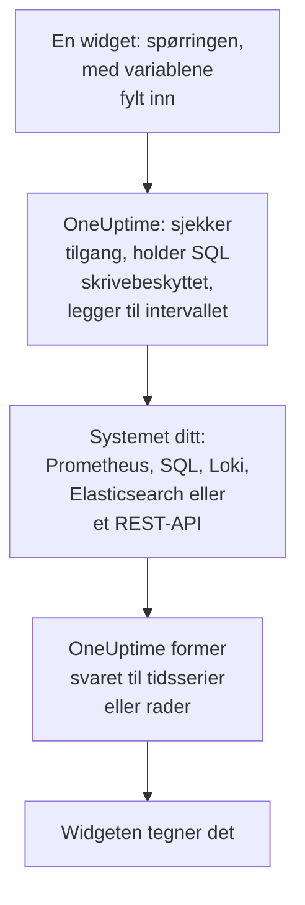

# Eksterne datakilder

En ekstern datakilde kobler til et system utenfor OneUptime, for eksempel Prometheus, en SQL-database, ClickHouse, Loki, Elasticsearch eller et REST-API, slik at dashbordene dine kan vise dataene derfra ved siden av dine egne. Du kobler til systemet én gang; deretter kjører hver widget en skrivebeskyttet spørring i systemets eget språk.

:::cards
- [Koble til en datakilde](#koble-til-en-datakilde): Velg typen, og angi deretter hvor den er og hvordan du logger på.
- [Skriv en spørring](#skriv-en-spørring): PromQL, SQL, LogQL, Query DSL eller en forespørsel.
- [Grenser](#grenser): Tidsavbruddene og takene som beskytter begge sider.
- [Sikkerhet](#sikkerhet): Skrivebeskyttede spørringer og påloggingsinformasjon som bare kan skrives.
:::

## Slik kjøres en spørring

Widgeten sender spørringen sin til OneUptime, med variablene allerede fylt inn. OneUptime sjekker at du har lov til å lese datakilden, fyller inn tidsintervallet og spør systemet ditt med påloggingsinformasjonen det tar vare på. Det former svaret til tidsserier eller rader som widgeten tegner.



## Før du begynner

- **Et abonnement som inkluderer det.** På OneUptime Cloud krever oppretting og endring av datakilder abonnementet **Growth**. Sletting av en fungerer på alle abonnementer.
- **En tillatelse til å legge dem til.** Prosjekteiere og -administratorer kan legge til datakilder; alle andre trenger `CreateDataSource`, med `EditDataSource` og `DeleteDataSource` for å endre og fjerne dem. Alle som kan lese prosjektets datakilder, også medlemmer og seere, ser dataene i widgetene deres.
- **En skrivebeskyttet konto.** Dashbord leser bare. Koble til databaser med en konto som bare kan lese, og HTTP-kilder med et token som bare kan spørre.
- **En vei inn.** Det er OneUptimes API-server som kobler til systemet ditt, så den må kunne nå det: se [Sikkerhet](#sikkerhet) for adressene som avvises.

## Støttede systemer

| Type | Spørrespråk | Fungerer med |
| --- | --- | --- |
| Prometheus | PromQL | Prometheus, Thanos, Cortex, Mimir, VictoriaMetrics |
| PostgreSQL | SQL | PostgreSQL, TimescaleDB, CockroachDB |
| MySQL | SQL | MySQL, MariaDB |
| Microsoft SQL Server | T-SQL | SQL Server, Azure SQL |
| ClickHouse | SQL | ClickHouse, via HTTP-grensesnittet |
| Grafana Loki | LogQL | Loki og Loki-kompatible endepunkter |
| Elasticsearch | Query DSL (JSON) | Elasticsearch, OpenSearch |
| REST API | Forespørsel (JSON) | Ethvert HTTP(S)-API som svarer med JSON |

## Koble til en datakilde

:::steps
### Åpne datakildene

Åpne **Produkter → Dashbord**, utvid **Innstillinger** i sidemenyen, og klikk på **Datakilder**.

### Velg typen

Klikk på **Opprett Data Source**. Dialogen **Choose a Data Source Type** grupperer typene etter hva de inneholder: metrikker, logger, databaser, søk og API-er. Klikk på én.

### Gi den et navn

Under **Grunnleggende informasjon** gir du den et **Navn**, for eksempel "Produksjons-Prometheus", og en **Beskrivelse** om du vil.

### Angi hvor den er

Under **Tilkobling** får en HTTP-kilde **URL** den svarer på. En database får sin **Database Host**, sin **Database Port** (la den stå tom for 5432, 3306, 1433 eller 8123) og sitt **Databasenavn**.

### Angi hvordan du logger på

Under **Autentisering** skriver du inn et **Brukernavn** og et **Passord**, eller for en HTTP-kilde et **API-token**, som sendes som et bearer-token. **Flere felt** inneholder **Custom HTTP Headers**, for eksempel `{ "X-Scope-OrgID": "tenant-1" }`, og **Additional Options**: `sslEnabled` og `sslRejectUnauthorized` for databaser, og `elasticsearchIndex` for Elasticsearch, som uten den leser alle indekser (`*`).

### Test den

Klikk på **Opprett Data Source**, og deretter på **Test** i raden. OneUptime kobler til med opplysningene du har oppgitt, og forteller om det fungerte, eller hva som gikk galt.
:::

For å endre en datakilde senere åpner du den fra listen. **Rediger** på **Data Source Details** endrer alt unntatt hemmelighetene; **Oppdater påloggingsinformasjon** erstatter passordet, tokenet eller headerne og lar feltene du lar stå tomme, være som de var; **Test** sjekker den på nytt.

## Bruk den i en widget

Rediger et dashbord, klikk på **Legg til widget**, og velg en widget fra gruppen Eksterne datakilder: et **Diagram**, en **Verdi**, en **Måler** eller en **Tabell**. I innstillingene:

- Velg **Data Source**, og skriv **Spørring**. Redigeringsprogrammet navngir spørrespråket og viser et eksempel for typen.
- På et diagram legger **Legg til spørring** flere spørringer på de samme aksene, og **Legend (optional)** navngir hver serie ut fra etikettene: `{{instance}} — errors` skriver seriens etikett `instance` foran.
- På en verdi eller en måler gjør **Reduce** punktene om til ett tall: den siste verdien (standard), den første, gjennomsnittet, summen, minimum eller maksimum. **Unit** legger til et suffiks og skalerer de kjente enhetene: `Bytes` leses som 1.5 MB, `ms` som 2.4 s.
- På en tabell fungerer enhver skrivebeskyttet spørring, og radene vises slik de kommer tilbake.

## Skriv en spørring

Hver type bruker sitt eget språk, med de samme reglene for hva som kommer tilbake:

- **Diagrammer, verdier og målere trenger tidsserier.** En SQL-spørring returnerer en tidskolonne med navnet `time`, `timestamp`, `date` eller `ts`, og en numerisk kolonne `value` (eller den første numeriske kolonnen); alle andre kolonner blir serieetiketter. Elasticsearch trenger en aggregering `date_histogram`, og Loki en metrikkspørring som `rate()` eller `count_over_time()`.
- **Tabeller viser rader** slik spørringen returnerer dem: SQL-rader, Prometheus-serier, Loki-logglinjer, Elasticsearch-treff, eller objektene ved et REST-API-s `rowsPath`.

:::tabs
@tab Prometheus
```text title="PromQL"
sum by (job) (rate(http_requests_total{job=~"{{job}}"}[5m]))
```
@tab SQL
```sql title="SQL"
SELECT date_trunc('minute', created_at) AS time, COUNT(*) AS value
FROM orders
WHERE created_at BETWEEN $__startTime AND $__endTime
GROUP BY 1
ORDER BY 1
```
@tab Loki
```text title="LogQL"
sum by (app) (rate({app="api"} |= "error" [5m]))
```
@tab Elasticsearch
```json title="Query DSL"
{
  "query": { "range": { "@timestamp": { "gte": "$__startTime", "lte": "$__endTime" } } },
  "aggs": {
    "over_time": {
      "date_histogram": { "field": "@timestamp", "fixed_interval": "1m" }
    }
  }
}
```
@tab REST API
```json title="Request"
{
  "path": "/api/stats?from=$__startTimeMs&to=$__endTimeMs",
  "method": "GET",
  "rowsPath": "data.items",
  "timestampField": "time",
  "valueField": "count",
  "seriesField": "service"
}
```
:::

### Tidsmakroer

Prometheus og Loki får dashbordets tidsintervall med hver forespørsel, så spørringene deres trenger ikke noe mer. De andre typene plasserer tidsintervallet der du skriver en makro:

| Makro | Blir til | I |
| --- | --- | --- |
| `$__startTime`, `$__endTime` | Intervallets start og slutt, i UTC: `'2026-10-13 09:00:00'` i SQL, ellers ISO 8601 | SQL, Elasticsearch, REST API |
| `$__startTimeMs`, `$__endTimeMs` | Det samme, som millisekunder siden 1970 | SQL, Elasticsearch, REST API |
| `$__rangeSeconds` | Intervallets lengde, i sekunder | SQL |

SQL-makroer skrives i UTC, så kjør databaseøktene dine i UTC, eller regn om i spørringen.

### Dashbordvariabler

Skriv `{{name}}` hvor som helst i en spørring, så setter widgeten inn variabelens verdi der før den sender spørringen. Flere verdier av en flervalgsvariabel slås sammen med `|`, som er det et regulært-uttrykk-filter i PromQL eller LogQL trenger: `job=~"{{job}}"`. En variabel uten noe valgt lar plassholderen stå slik den er skrevet, så feilen nevner den. [Dashbord-variabler & filtre](/docs/dashboards/variables) viser hvordan du legger til en.

## Grenser

Hver spørring er avgrenset, slik at et dashbord med tjue widgets som oppdateres hvert minutt, ikke kan overbelaste OneUptime eller systemet ditt:

| Grense | Verdi |
| --- | --- |
| Tilkobling | 10 sekunder |
| Kjøring av en spørring | 30 sekunder |
| Punkter i et tidsseriesvar | 11 000 |
| Rader i en tabell | 1 000 |
| Serier i ett svar | 100 |
| Svar fra en HTTP-kilde | 20 MB |

Intervallspørringer mot Prometheus og Loki ber om rundt 250 punkter over tidsintervallet, ikke tettere enn 10 sekunder og ikke lenger fra hverandre enn et døgn.

## Sikkerhet

- **SQL forblir skrivebeskyttet.** En spørring må være én setning som begynner med `SELECT`, `WITH`, `SHOW`, `EXPLAIN`, `DESCRIBE` eller `DESC`. Ord som skriver eller endrer en økt, for eksempel `INSERT`, `UPDATE`, `DELETE`, `DROP`, `INTO` eller `SET`, avvises overalt utenfor strenger og navn i anførselstegn, så sett en kolonne som heter som ett av dem, i anførselstegn. Skriv et anførselstegn i en streng som to anførselstegn (`''`): en omvendt skråstrek foran et anførselstegn avvises. Økter i PostgreSQL, MySQL og ClickHouse er også skrivebeskyttede. SQL Server har ingen skrivebeskyttet økt, så koble den til med en skrivebeskyttet pålogging.
- **Påloggingsinformasjon kan bare skrives.** **Passord**, **API-token** og **Custom HTTP Headers** krypteres når de er lagret, og API-et returnerer dem aldri, heller ikke til deg.
- **Adresser sjekkes.** Loopback-, link-local- (der skymetadata ligger) og andre reserverte adresser avvises overalt. Private adresser avvises på OneUptime Cloud og tillates på en selvdriftet installasjon, med mindre `DATA_SOURCE_BLOCK_PRIVATE_ADDRESSES` er `true`: se [Tilgang til privat nettverk](/docs/self-hosted/private-network-access).
- **Offentlige dashbord kjører dem aldri.** Widgetene fra Eksterne datakilder utelates fra et [offentlig dashbord](/docs/dashboards/sharing), spørringer og alt.

## Feilsøking

:::details Test sier at den ikke kan koble til
Sjekk URL-en, eller verten og porten, fra der OneUptime kjører: en brannmur, en privat adresse på OneUptime Cloud eller en database som bare lytter på sin egen maskin, ser like ut herfra. For en database som krever TLS, legger du til `{ "sslEnabled": true }` under **Additional Options**.
:::

:::details "Only read-only queries are allowed"
Spørringen begynner ikke med `SELECT`, `WITH`, `SHOW`, `EXPLAIN`, `DESCRIBE` eller `DESC`. Send én setning som bare leser: en andre setning etter et `;` avvises også, som "Only a single SQL statement is allowed per query."
:::

:::details "Query contains a keyword that is not allowed"
Et ord som skriver, står utenfor en streng, ofte som et kolonnenavn, for eksempel `delete` eller `set`. Sett det i anførselstegn slik databasen gjør: `"delete"` i PostgreSQL, `[delete]` i SQL Server, og i backticks i MySQL og ClickHouse.
:::

:::details Diagrammet forblir tomt, men tabellen viser rader
Spørringen returnerer rader, men ingen tidsserier. Gi tidskolonnen navnet `time` og tallet navnet `value` i SQL, legg til en aggregering `date_histogram` i Elasticsearch, eller gjør en Loki-loggspørring om til en metrikkspørring med `rate()` eller `count_over_time()`.
:::

:::details Noen data mangler
Svaret nådde en [grense](#grenser). Snevre inn tidsintervallet, filtrer spørringen, eller aggreger den til færre serier.
:::

## Neste steg

:::cards
- [Dashbord-widgets](/docs/dashboards/widgets): Hver widget, inkludert gruppen Eksterne datakilder.
- [Dashbord-variabler & filtre](/docs/dashboards/variables): Variabler du kan bruke i spørringene dine.
- [Tilgang til privat nettverk](/docs/self-hosted/private-network-access): Nå systemer på et privat nettverk fra en selvdriftet installasjon.
- [Dashbord-konfigurasjon & tillatelser](/docs/dashboards/configuration): Hvem som kan legge til datakilder, og hvem som leser dem.
:::
