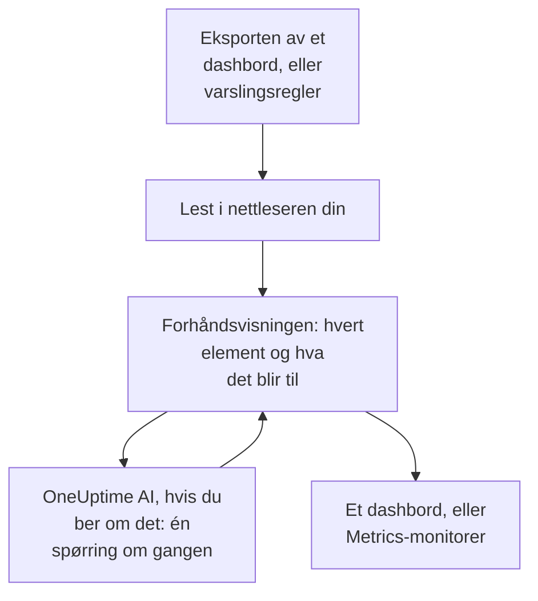

# Import fra Grafana og Datadog

Hent et dashbord du har bygget i Grafana eller Datadog, eller varslingsreglene du har skrevet for Prometheus, Grafana eller Datadog, inn i OneUptime. Du limer inn eller laster opp filen, ser hva hvert panel og hver regel blir til, og først da oppretter du dashbordet eller monitorene.

:::cards
- [Importer et dashbord](#importer-et-dashbord): JSON-modellen til et Grafana-dashbord, eller eksporten av et Datadog-dashbord.
- [Importer varslingsregler](#importer-varslingsregler): Prometheus-regelfiler, Grafana-varslingsregler og Datadog-monitorer.
- [Slik gjøres hvert element om](#slik-gjøres-hvert-element-om): Nøyaktig, omtrentlig eller ikke i det hele tatt, og hvorfor.
- [Gjør om en spørring med OneUptime AI](#gjør-om-en-spørring-med-oneuptime-ai): For en spørring som ingen regel gjør om.
:::

## Slik foregår en import

OneUptime leser filen i nettleseren din og gjør om hvert panel, hver widget, hver variabel og hver regel for seg. Forhåndsvisningen viser alle sammen med hva hver av dem blir til. Ingenting opprettes før du velger å opprette det, og da opprettes det med dine egne tillatelser, slik dashbord- og monitorskjemaene oppretter det.

## Før du begynner

- De importerte widgetene og monitorene leser dette prosjektets egne målinger med PromQL. Send dem med Prometheus remote write, OpenTelemetry eller Datadog Agent, så beholder de navnene de har der.
- Å importere et dashbord krever en rolle som kan opprette dashbord, og å importere varslingsregler en rolle som kan opprette monitorer.
- En fil kan være opptil 10 MB, og opptil 500 av panelene eller reglene i den leses.

## Importer et dashbord

:::steps
### Åpne dashbordimporten

Åpne **Produkter → Dashbord**, og deretter **Flere alternativer → Import from Grafana or Datadog**.

### Lim inn dashbordet

Kopier JSON-modellen fra dashbordets innstillinger i Grafana. Eksporter dashbordets JSON i Datadog. Lim det inn, eller velg **Upload a File**, og velg deretter **Forhåndsvisning**.

### Opprett dashbordet

Sjekk hva hvert panel og hver variabel blir til, gi dashbordet et navn, og velg **Opprett dashbord**. Det nye dashbordet åpnes.
:::

PromQL fra Grafana beholdes slik den er skrevet: OneUptime fyller inn `$__interval`, `$__rate_interval` og `$__range` slik Grafana gjør, og en variabel på All passer med alle verdier. En Datadog-spørring blir PromQL over målingene Datadog Agent har sendt: `avg:system.cpu.user{host:web-1}` leser `system_cpu_user{host="web-1"}`.

## Importer varslingsregler

:::steps
### Åpne varslingsimporten

Åpne **Produkter → Monitorer**, og deretter **Flere alternativer → Import Alerts**.

### Lim inn reglene

Lim inn en Prometheus-regelfil eller en PrometheusRule-ressurs, Grafanas eksport av varslingsreglene sine eller Datadog-monitorer eksportert som JSON, og velg deretter **Forhåndsvisning**.

### Opprett monitorene

Fjern haken for regler du ikke vil ha, velg under **When a rule fires** hva en regel som utløses åpner, og velg **Opprett monitorer**.
:::

Hver regel blir en Metrics-monitor med én PromQL-spørring, regelens betingelse og tidsvinduet dens. Den åpner et varsel, eller en hendelse, for hver serie som går over grensen, og løser det når serien er tilbake. Tittel og beskrivelse kommer fra regelens sammendrag eller melding, med seriens etiketter fylt inn.

## Slik gjøres hvert element om

| Status | Hva den betyr |
| --- | --- |
| **Converted exactly** | Det leser de samme dataene og viser dem på samme måte. |
| **Converted approximately** | Det opprettes, og notatene sier hva som er annerledes. |
| **Not converted** | Ingenting opprettes for det, og notatene sier hvorfor. |

Opptaksregler, varslingsregler over logger, Datadog-widgets som leser logger, traces eller hendelser, og Datadogs monitorer for avvik, uteliggere og prognoser gjøres ikke om.

## Gjør om en spørring med OneUptime AI

En spørring som ingen regel gjør om, viser **Convert with OneUptime AI**, som krever at AI er slått på for prosjektet. Bare den spørringen, med navnene på dashbordets variabler, sendes til prosjektets AI-leverandør. Svaret kontrolleres som enhver spørring og vises til deg: velg **Use This Query** for å bruke det. Ingenting opprettes før du oppretter dashbordet eller monitorene.

## Neste steg

:::cards
- [Dashbord-widgets](/docs/dashboards/widgets): Endre hva en importert widget viser.
- [Dashbord-variabler & filtre](/docs/dashboards/variables): Variablene en import har opprettet.
- [Målingsmonitor](/docs/monitor/metrics-monitor): Monitorene en import har opprettet.
- [PromQL](/docs/telemetry/promql): Språket de importerte widgetene og monitorene leser.
:::
