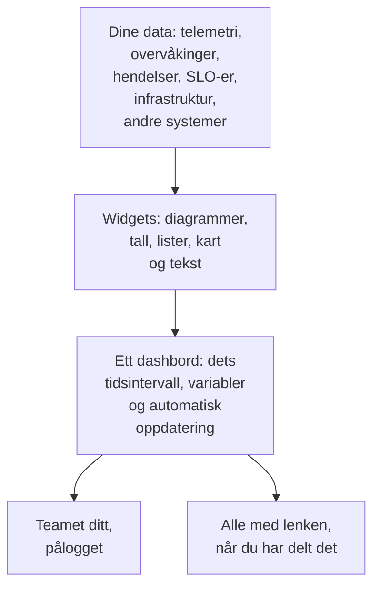

# Oversikt over dashbord

Et dashbord er én side med widgets som du ordner selv: diagrammer over metrikkene, loggene og sporene dine, lister over hendelser, varsler og overvåkinger, SLO-ene og infrastrukturen din, til og med data fra systemer utenfor OneUptime. Lag ett til vaktskjermen, til et teams morgensjekk eller som en side for kundene dine, og del det med prosjektet ditt eller med alle som har lenken.

:::cards
- [Slik fungerer et dashbord](#slik-fungerer-et-dashbord): Hvor dataene kommer fra, og hvem som ser dem.
- [Finn dashbordene dine](#finn-dashbordene-dine): Listen Dashbord og hvert dashbords egne sider.
- [Bygg ditt første dashbord](#bygg-ditt-første-dashbord): Fra en mal til en delt side i fem steg.
- [Et eksempel: et vaktdashbord](#et-eksempel-et-vaktdashbord): Én side som fungerer for alle tjenester.
:::

## Slik fungerer et dashbord

Hver widget leser fra én kilde, innenfor dashbordets tidsintervall og filtrert av variablene. Alle som åpner dashbordet, ser de samme widgetene: teamet ditt når det logger på, og besøkende via den offentlige lenken når du har delt det.

| Begrep | Hva det betyr |
| --- | --- |
| Dashbord | Én side: et navn, et rutenett med widgets, et tidsintervall, variabler og en innstilling for automatisk oppdatering. |
| Widget | Én flis i rutenettet: et diagram, et tall, en liste, et kart, en klokke eller en tekstblokk. |
| Variabel | En velger i verktøylinjen som snevrer inn hver widget som støtter den, til én tjeneste, vert eller kunde. |
| Tidsintervall | Vinduet som alle diagrammer og tall leser. Et dashbord åpnes på standarden sin, den siste timen med mindre noen som redigerer det, velger en annen, og hver seer kan velge sin egen. |
| Automatisk oppdatering | Hvor ofte widgetene leser dataene sine på nytt: av, eller fra hvert 5. sekund til hvert 15. minutt. |
| Visning og redigering | Et dashbord åpnes for lesing. Redigering er et eget steg som slutter med at du lagrer eller forkaster endringene dine. |

## Hva dashbord er gode for

- **En "er alt i orden?"-side** for den som har vakt, et teams standup eller en skjerm på veggen.
- **Å se sammenhenger**: en CPU-topp ved siden av en økende ventetid og en åpen hendelse er tydelig på én side, og lett å overse når det er spredt over tre.
- **Feilsøking**: legg diagrammene du stadig åpner på nytt side om side, og dra over en topp for å lese alle widgetene i det øyeblikket.
- **Deling utenfor teamet**: en ytelsesside for en kunde eller partner, beskyttet av et passord eller en IP-tillatelsesliste om du vil.

## Finn dashbordene dine

Åpne **Produkter → Dashbord**. Listen **Dashbord** viser prosjektets dashbord med beskrivelser, etiketter og eiere. Søk etter navn eller beskrivelse, snevre inn listen med filtrene **Eier** og **Etiketter**, eller velg flere dashbord for å endre etikettene eller eierne deres, arkivere dem eller eksportere dem som JSON.

Listens sidemeny har sidene som tar seg av alle dashbordene dine:

| Side | Hva du gjør der |
| --- | --- |
| **Dashbord** | Prosjektets dashbord. Opprett et, eller hent inn dashbord med **Importer JSON**. |
| **Dashbord → Spillelister** | [Vis dashbord etter hverandre](/docs/dashboards/playlists) på en skjerm, for eksempel en NOC-vegg. |
| **Innstillinger → Eierregler** | Legg til eiere automatisk på nye dashbord. |
| **Innstillinger → Etikettregler** | Legg til etiketter automatisk på nye dashbord. |
| **Innstillinger → Datakilder** | Koble til Prometheus, SQL-databaser, ClickHouse, Loki, Elasticsearch eller et REST-API. |
| **Avansert → Arkivert** | Dashbord du har arkivert. Fjern dem fra arkivet her. |

Åpne et dashbord, og dets egen sidemeny har disse sidene. Alle seksjoner unntatt **Grunnleggende** starter sammenslått: klikk på tittelen for å åpne den.

| Side | Hva du gjør der |
| --- | --- |
| **Dashbord** | Selve dashbordet. Les det, eller rediger det fra **⋯**-menyen. |
| **Oversikt** | Navnet, beskrivelsen og etikettene. |
| **Deling** | Hvem som kan se det, den offentlige lenken og en IP-tillatelsesliste under Flere innstillinger. |
| **Eiere** | Brukerne og teamene som eier det. |
| **Merkevare** | Sidetittel, beskrivelse, logo, tema og favicon for det offentlige dashbordet. |
| **Egendefinerte domener** | Host det offentlige dashbordet på ditt eget domene. |
| **Innstillinger** | Dupliser, eksporter eller arkiver dashbordet. |
| **Revisjonslogger** | Hver endring som er gjort på dashbordet, og hvem som gjorde den. |
| **Slett** | Slett dashbordet for godt. |

## Bygg ditt første dashbord

:::steps
1. **Opprett** — velg en mal, eller **Start fra bunnen**. En mal fyller inn navnet og åpnes med widgetene sine; et dashbord fra bunnen åpnes uten innhold, med **Legg til widget** på lerretet.
2. **Legg til widgets** — velg en widget i katalogen, angi i innstillingene hva den leser, og dra den deretter på plass og endre størrelsen.
3. **Legg til variabler, hvis du trenger dem** — en variabel `service` lar for eksempel ett dashbord vise hvilken som helst tjeneste.
4. **Lagre** — klikk på **Lagre endringer**. Ingenting du endrer under redigeringen, blir tatt vare på før du gjør det.
5. **(Valgfritt) Del offentlig** — velg **⋯ → Del** på dashbordet, og velg hvem som kan se det: alle med lenken, eller alle med lenken og et passord.
:::

[Opprette et dashbord](/docs/dashboards/authoring) går gjennom hvert steg.

## Et eksempel: et vaktdashbord

Målet: én side for checkout-tjenesten med ventetiden, feilraten, de åpne hendelsene og de nyeste loggene, som også fungerer for alle andre tjenester.

1. Klikk på **Opprett dashbord**, velg **Start fra bunnen**, og gi dashbordet navnet "Checkout-vakt".
2. Klikk på **Legg til widget**, og legg til et **Diagram** over metrikken for forespørslenes ventetid, aggregert som P95.
3. Ved siden av legger du til en **Verdi** for feilraten, med en varselterskel på 1 og en kritisk terskel på 5.
4. Under dem legger du til en **Hendelsesliste** filtrert på uløste hendelser, og en **Loggstrøm** med tjenestens logger.
5. Åpne **Variabler**, legg til en variabel med navnet `service` med kilden Telemetry Attribute og attributtnøkkelen `service.name`, og gi den standardverdien `checkout`.
6. Klikk på **Lagre endringer**. Velg `payments` i verktøylinjens velger `service`: diagrammet, verdien og loggstrømmen bytter til tjenesten payments, og hendelseslisten fortsetter å vise alle uløste hendelser.

## Slik passer dashbord inn i resten av OneUptime

- **Overvåkinger og telemetri** er der dataene kommer fra. Alle metrikker, logger og spor du sender, kan havne på en widget.
- **Hendelser og varsler** vises i widgetene **Hendelsesliste** og **Varselliste**. Et dashbord viser dem bare: du arbeider med dem på deres egne sider.
- **Statussider** forteller kundene dine om tjenesten din er oppe. Dashbord viser i detalj hvordan den oppfører seg. De to arbeider side om side.
- **Arbeidsflyter** handler på det som skjer. Dashbord er der du leser det.

## Neste steg

:::cards
- [Opprette et dashbord](/docs/dashboards/authoring): Opprett et dashbord, rediger det og lagre endringene dine.
- [Dashbord-widgets](/docs/dashboards/widgets): Hver widget, og hvilken du skal velge.
- [Dashbord-variabler & filtre](/docs/dashboards/variables): Ett dashbord for hver tjeneste, vert eller kunde.
- [Deling & offentlige dashbord](/docs/dashboards/sharing): Offentlige lenker, passord, IP-tillatelseslister og egendefinerte domener.
:::
