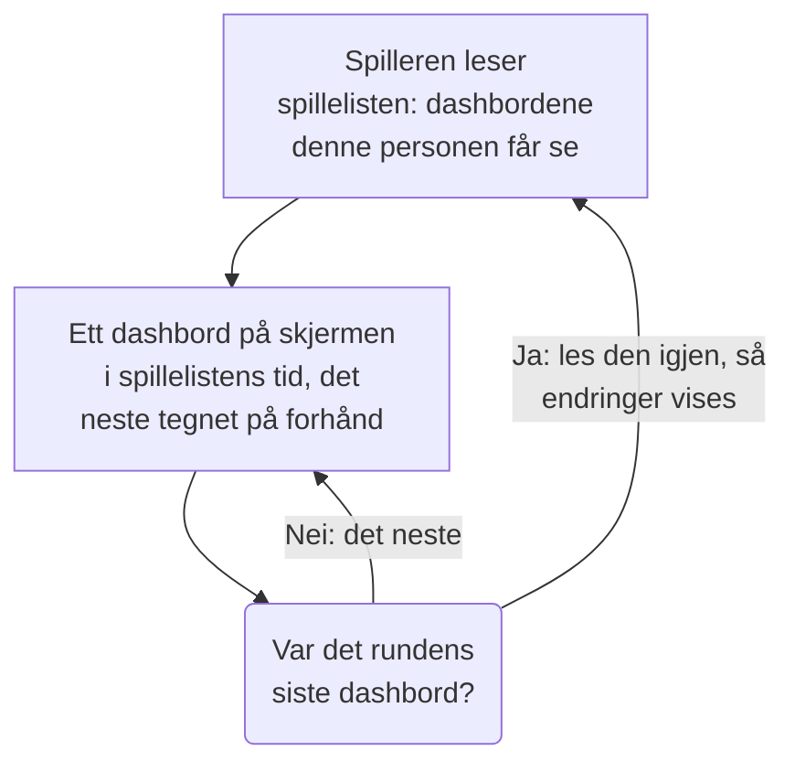

# Dashbord-spillelister

En spilleliste viser en rekke dashbord etter hverandre på en skjerm som ingen rører, for eksempel en NOC-vegg eller TV-en til et team: hvert dashbord i den tiden du velger, om og om igjen, til noen setter den på pause. Lag spillelisten én gang, åpne spilleren dens på skjermen, og la den gå.

:::cards
- [Slik spilles en spilleliste](#slik-spilles-en-spilleliste): Rekkefølgen, rundene og hva hvert dashbord viser.
- [Opprett en spilleliste](#opprett-en-spilleliste): Et navn, dashbordene i rekkefølge og hvor lenge hvert vises.
- [Spill den av på en skjerm](#spill-den-av-på-en-skjerm): Spillerens linje, knappene og tastene.
- [Hvem ser hva](#hvem-ser-hva): Tillatelsene, og dashbordene en person ikke får lese.
:::

## Slik spilles en spilleliste

Spilleren viser det første dashbordet i spillelisten, deretter det neste når tiden er ute, og begynner på det første igjen etter det siste. Hvert dashbord åpnes slik redaktørene lagret det: med sitt eget standard tidsrom, sin egen automatiske oppdatering og sine egne variabler, uansett hva adressen til spilleren sier. Mens ett dashbord er på skjermen, tegner spilleren det neste utenfor synsfeltet, så skjermen aldri blir tom mellom to av dem.

En spilleliste navngir dashbordene sine og kopierer dem aldri: en endring en redaktør lagrer i et dashbord, er på skjermen neste gang det er dets tur. Spilleren leser spillelisten på nytt før hver runde, så et dashbord som er lagt til, flyttet eller fjernet, vises innen en runde uten at skjermen lastes inn på nytt; mislykkes den lesingen, spiller skjermen runden den har en gang til.

## Opprett en spilleliste

:::steps
### Åpne Spillelister
Åpne **Produkter → Dashbord**, og deretter **Spillelister** i sidemenyen. Listen viser hvor mange dashbord hver spilleliste har og hvor lenge hvert vises, med **Spill av** på hver rad.

### Gi den et navn
Klikk på **Opprett Spilleliste**, og gi den et **Navn** som sier hvor den spilles, for eksempel "NOC-vegg".

### Legg til dashbordene
Under **Dashbord** velger du hvert av dem i **Legg til et dashbord**, i den rekkefølgen skjermen viser dem. Knappene på raden til et dashbord flytter det opp eller ned, eller fjerner det. Arkiverte dashbord tilbys ikke.

### Velg hvor lenge hvert vises
**Vis hvert dashbord i** starter på ett minutt; velg en tid fra 15 sekunder til én time. Klikk på **Opprett Spilleliste**.
:::

Siden til spillelisten viser dashbordene i rekkefølge, hvor lenge hvert vises og **Spillerlenke**. **Rediger spilleliste** endrer navnet, dashbordene, rekkefølgen deres og tiden. **Slett Dashbord-spilleliste**, nederst på siden, sletter spillelisten og aldri dashbordene dens.

Gjennom API-et og Terraform er en spilleliste et `name`, `dashboards` som en liste som `[{"dashboardId": "<id>"}]` i den rekkefølgen de vises, høyst 100, og `intervalInSeconds`, et hvilket som helst helt antall sekunder fra 10 til 86400 (et døgn). En verdi utenfor disse avvises, med hva som er galt.

## Spill den av på en skjerm

Klikk på **Spill av** på raden til spillelisten eller på siden dens. Spilleren fyller nettleservinduet, over resten av OneUptime; **Fullskjerm** fyller hele skjermen. For å starte en skjerm av seg selv åpner du **Spillerlenke** på den og lagrer et bokmerke: lenken åpner spilleren med en gang.

Spillerens linje viser dashbordet på skjermen, spillelisten, hvor runden er ("2 av 5") og dashbordet som kommer etterpå. En strek under linjen fylles mens et dashbord har sin tur. Knappene på linjen går til forrige dashbord, setter på pause eller spiller av, og går til neste; på en datamaskin gjør disse tastene det samme:

| Taster | Hva den gjør |
| --- | --- |
| `Space` | **Pause eller spill av**. På pause blir dashbordet stående på skjermen, og linjen viser **Pauset**. |
| `Right Arrow` | **Neste dashbord**. |
| `Left Arrow` | **Forrige dashbord**. |
| `F` | **Fullskjerm**, eller ut av den igjen. |
| `Esc` | **Gå ut av spilleren**, tilbake til siden til spillelisten. I fullskjerm forlater den første `Esc` bare fullskjermen. |
| `?` | **Vis hurtigtaster**. |

Et dashbord du går til, det neste eller det forrige, får en hel tur. På en side som leses fra høyre mot venstre, for eksempel på persisk, bytter pilene plass: `Left Arrow` går til neste dashbord. Mens den spiller, holder spilleren skjermen våken, der nettleseren tillater det.

## Hvem ser hva

Spillelister har sine egne tillatelser, som gis gjennom et team slik dashbordenes egne gjør:

| For å | Kreves |
| --- | --- |
| Se og spille av spillelister | `ReadDashboardPlaylist`, eller en prosjektrolle: Project Owner, Project Admin, Project Member, Viewer eller en Settings-rolle |
| Opprette spillelister | `CreateDashboardPlaylist`, Project Owner eller Project Admin |
| Endre en spilleliste: navnet, dashbordene og tiden | `EditDashboardPlaylist`, Project Owner eller Project Admin |
| Slette en spilleliste | `DeleteDashboardPlaylist`, Project Owner eller Project Admin |

En spilleliste viser aldri noen et dashbord de ikke får lese. Spilleren spiller bare av dashbordene som personen som er logget inn på skjermen, får lese, og som ikke er arkivert, og hopper over resten: et slettet dashbord, et arkivert eller et som tillatelsene deres holder dem unna. Siden til spillelisten sier hvorfor den hopper over hvert av dem. Når en spilleliste lagres, beholder den dashbordene i den som redaktøren ikke selv kan se, så ingenting går tapt som noen andre har lagt inn.

| Når spilleren finner | Viser den |
| --- | --- |
| Dashbord den får vise | Hvert etter tur. |
| Ingen dashbord den får vise | **Ingenting å vise ennå**, og den ser etter igjen hvert minutt. |
| Spillelisten slettet, eller ikke personens å lese | **Fant ikke spillelisten**. |
| En lesing som mislyktes | **Spillelisten kunne ikke lastes inn**, og den prøver igjen hvert minutt, eller ved **Prøv igjen**. |

> [!NOTE]
> Spilleren er for noen som er logget inn på OneUptime. For å kjøre en spilleliste på en skjerm logger du inn på den skjermen med en konto som får lese spillelisten og dashbordene dens, for eksempel et teammedlem med rollen Viewer.

## Neste steg

:::cards
- [Opprette et dashbord](/docs/dashboards/authoring): Bygg dashbordene en spilleliste viser.
- [Dashbord-variabler & filtre](/docs/dashboards/variables): Det lagrede utvalget hvert dashbord åpner med.
- [Deling & offentlige dashbord](/docs/dashboards/sharing): Vis ett dashbord til folk som ikke logger inn.
- [Dashbord-konfigurasjon & tillatelser](/docs/dashboards/configuration): Eiere, etiketter og hvem som får lese et dashbord.
:::
