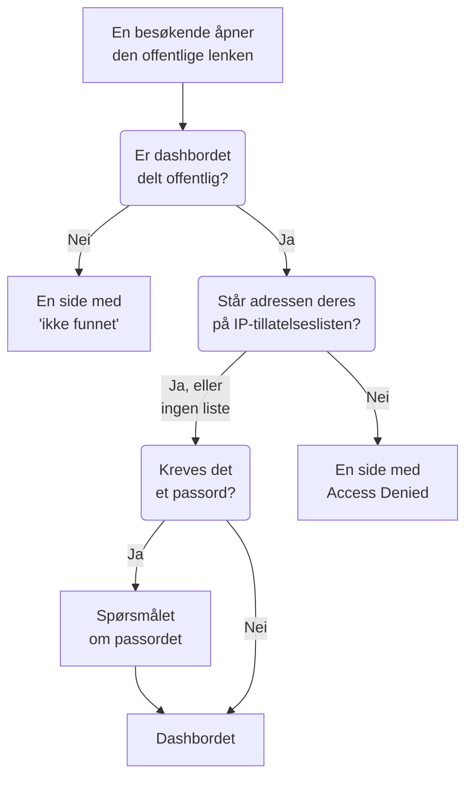

# Deling & offentlige dashbord

Som standard er et dashbord privat for prosjektet ditt: bare personer som logger på prosjektet ditt, kan se det. Du kan også dele det via en offentlig lenke, beskytte lenken med et passord, begrense den til bestemte IP-adresser og hoste dashbordet på ditt eget domene. Denne siden dekker alle fire.

:::cards
- [Hvem som kan se et dashbord](#hvem-som-kan-se-et-dashbord): Ett valg av tre, med abonnementet hvert valg krever.
- [Deling med passord](#deling-med-passord): Del lenken, og deretter passordet, med personene som skal se det.
- [IP-tillatelsesliste](#ip-tillatelsesliste): Åpne den offentlige lenken bare for kontoret ditt eller VPN-en din.
- [Egendefinerte domener](#egendefinerte-domener): Server dashbordet på ditt eget domene, med et gratis sertifikat.
:::

## Hva en besøkende går gjennom

En besøkende som åpner den offentlige lenken til et dashbord, møter hver av disse kontrollene etter tur. Prosjektmedlemmer som logger på OneUptime, ser dashbordet inne i produktet, uansett hva du velger her.



## Hvem som kan se et dashbord

Åpne dashbordet, og velg **⋯ → Del**, eller åpne **Deling** i dashbordets sidemeny. Kortet **Hvem som kan se dette dashbordet** er ett valg:

- **Bare personer i dette prosjektet** (standard): medlemmer ser dashbordet når de logger på OneUptime. Det har ingen offentlig lenke: den offentlige adressen viser den samme siden med "ikke funnet" som en adresse uten dashbord, og ingenting om dashbordet, ikke engang navnet.
- **Alle med lenken**: dashbordet er offentlig. Alle som har lenken, kan se det uten å logge på.
- **Alle med lenken og et passord**: besøkende åpner lenken og skriver deretter inn ett passord som du deler med dem. Ingen trenger en konto.

Når du velger et alternativ, blir du bedt om å bekrefte, med en forklaring av hva som endres for besøkende, og så gjelder det umiddelbart. Velger du **Alle med lenken og et passord**, ber den samme dialogen om passordet når dashbordet ikke har noe; så lenge det er valget, erstatter **Endre passord** det. Så lenge dashbordet er offentlig, står adressene besøkende åpner det på, under valget: først de egendefinerte domenene, deretter den offentlige lenken, hver med **Kopier lenke**. Et egendefinert domene som ikke er live ennå, er merket med **Ikke live ennå**, med årsaken.

Innenfor prosjektet styrer eiere og etiketter hvem som ser hva: se [Dashbord-konfigurasjon & tillatelser](/docs/dashboards/configuration). Den som kan se dashbordet, men ikke redigere det, ser valget og kan kopiere den offentlige lenken, men kan ikke endre valget.

På OneUptime Cloud krever deling av et dashbord abonnementet **Growth**: på et lavere abonnement viser de to offentlige valgene abonnementet de krever, og kan ikke velges. Å gjøre et dashbord privat igjen (**Bare personer i dette prosjektet**) fungerer på alle abonnementer, så et dashbord som sto offentlig da en prøveperiode tok slutt, eller etter et bytte til et lavere abonnement, alltid kan slutte å være delt; dialogen sier at det krever **Growth** å dele det igjen. Å bytte mellom **Alle med lenken** og **Alle med lenken og et passord**, og å endre passordet, fungerer på alle abonnementer. Et dashbord som opprettes gjennom API-et eller Terraform, er underlagt de samme abonnementene: opprettet offentlig krever det **Growth**, og opprettet med en IP-tillatelsesliste **Scale**.

Valget lagres i tre kolonner, som API-et og Terraform leser og skriver som før: `isPublicDashboard`, `enableMasterPassword` og `masterPassword`. Bare et offentlig dashbord har en offentlig lenke, og de besøkende blir bedt om passordet når `enableMasterPassword` er på. Et offentlig dashbord med `enableMasterPassword` på, men uten angitt passord, slipper ingen inn via den offentlige lenken: siden **Deling** viser det som **Alle med lenken og et passord**, sier at ingen kan åpne lenken ennå, og tilbyr **Angi passord**. Å velge **Bare personer i dette prosjektet** slår også av `enableMasterPassword` og beholder passordet, slik at en ny deling med passord kan bruke det igjen.

## Offentlige dashbord

Et offentlig dashbord:

- Åpnes alltid for lesing. Besøkende kan ikke redigere det og ser aldri redigeringskontrollene.
- Inneholder variablene du har lagt til. Besøkende velger i de samme velgerne som teamet ditt bruker, og kan endre tidsintervallet, zoome, slå på automatisk oppdatering og gå til fullskjerm. Det åpnes med dashbordets standardtidsrom og automatiske standardoppdatering, og nettleseren til hver besøkende husker deres egne valg.
- Lar besøkende [sortere listene og tabellene](/docs/dashboards/widgets#sortere-lister-og-tabeller) ved å klikke på en kolonneoverskrift, slik teamet ditt gjør. Nettleseren til hver besøkende husker deres egen sortering, og OneUptime sorterer selv hele listen, alltid bare etter en av widgetens egne kolonner.
- Bruker merkevaren du angir på dashbordets side **Merkevare**: sidetittel, beskrivelse, logo, tema, favicon.
- Lar hver besøkende bytte mellom det lyse og det mørke dashbordet med en sol- eller måneknapp i verktøylinjen; [Tema](#tema) forklarer hvordan.

Behandle deling av et dashbord som publisering av en nettside. Alle widgets på det blir lesbare for alle med lenken. Se hva som er på lerretet før du deler det.

Hver widget publiserer bare det den tegner, og bare for ressursene den er rettet mot. En SLO-widget publiserer for eksempel nøkkeltallene til det SLO-et, men aldri definisjonen: se [SLO](/docs/dashboards/widgets#slo). Widgets med en ekstern **Data Source** er unntaket: de fjernes helt fra et offentlig dashbord i stedet for å gjengis, fordi konfigurasjonen deres er selve spørringen. Noen få andre widgets kan ikke vises uten en pålogget økt, og sier det på sin plass: [På et offentlig dashbord](/docs/dashboards/widgets#på-et-offentlig-dashbord) viser hvilke.

## Deling med passord

Velg **Alle med lenken og et passord**, og skriv inn passordet i dialogen. Besøkende ser et spørsmål om passordet før dashbordet vises. Spørsmålet viser dashbordets navn, sidetittel og favicon, i dashbordets tema, og ingenting annet: beskrivelsen, logoen og widgetene vises når passordet er skrevet inn. Passordet lagres som en hash: ingen kan lese det tilbake. Et nytt passord fungerer umiddelbart; de som skrev inn det gamle, kan fortsette å se dashbordet i opptil 7 dager.

Bruk et passord når:

- Du vil dele med en partner eller kunde, men ikke vil at URL-en skal være nyttig hvis den lekker.
- Dashbordet er "halvoffentlig": åpent nok til at du ikke vil invitere hver seer som teammedlem, men ikke åpent nok til å legge det på det åpne internettet.

For strengere tilgangskontroll (separate kontoer per seer, et revisjonsspor over hvem som så hva) holder du dashbordet på **Bare personer i dette prosjektet** og inviterer heller seerne som skrivebeskyttede teammedlemmer.

## IP-tillatelsesliste

Under **Flere innstillinger** på siden **Deling** begrenser seksjonen **IP-tillatelsesliste** (kolonnen `ipWhitelist`) den offentlige lenken til IP-adressene eller IPv4-områdene du lister opp, én per linje, for eksempel `203.0.113.7` eller `10.0.0.0/8`. Den gjelder med eller uten passordet; prosjektmedlemmer som logger på, påvirkes ikke. La den stå tom for å tillate alle adresser. Den lagres for seg, atskilt fra valget, og å endre den krever abonnementet **Scale** på OneUptime Cloud; å tømme den fungerer på alle abonnementer. Så lenge en liste gjelder, viser den sammenslåtte overskriften for **Flere innstillinger** **IP-tillatelsesliste** med antall oppføringer den har. Selvhostet er det en del av Enterprise Edition å endre den: på Community Edition gjelder en liste som allerede er angitt, fortsatt og kan bare fjernes.

Bruk den når:

- Dashbordet bare skal kunne nås fra kontoret ditt eller VPN-en din.
- En leverandørportal bare skal kunne nås fra leverandørens kjente IP-er.
- Du vil ha ekstra beskyttelse i tillegg til et passord.

Forespørsler fra en hvilken som helst annen IP avvises med en side med **Access Denied** som ikke viser noe om dashbordet: verken navnet, merkevaren eller spørsmålet om passordet. En linje som verken er en IP-adresse eller et IPv4-område, avvises når du lagrer, fordi serveren ville hoppet over den.

## Egendefinerte domener

Som standard serveres et offentlig dashbord på den offentlige lenken, på OneUptimes egen adresse. For å hoste det på ditt eget underdomene, som `dashboard.acme.com`, åpner du **Merkevare → Egendefinerte domener** i dashbordets sidemeny. Det fungerer nøyaktig som siden **Egendefinerte domener** for en statusside.

Kortet heter **Egendefinerte domener** og sier hva du skal gjøre: pek hvert domenes CNAME-post mot installasjonens CNAME-post for dashbord, så utsteder OneUptime domenets SSL-sertifikat og fornyer det for deg. Tabellen har to kolonner, **Domene** og **Status**.

Å legge dashbordet på ditt eget domene tar tre steg, og bare de to første er dine:

1. **Legg til domenet**: et underdomene og ett av de bekreftede domenene dine.
2. **Legg til CNAME-posten** hos DNS-leverandøren din. Dialogen **DNS-oppsett** åpnes med posten så snart du legger til domenet.
3. **Det gratis SSL-sertifikatet utstedes automatisk** så snart posten er funnet. Det er ingen knapp å trykke på.

Når det er bekreftet, kan dashbordet nås både på det egendefinerte domenet ditt og på den opprinnelige URL-en.

### Legg til domenet

Klikk på **Opprett Dashboard Domene**. Dialogen er én side:

- **Underdomene**: bare etiketten, med plassholderen `dashboard (leave blank for root)`. Skriv bare `dashboard`, ikke hele vertsnavnet. La det stå tomt eller skriv `@` for å bruke rotdomenet (apex).
- **Domene**: domenene som er bekreftet under **Prosjektinnstillinger → Avansert → Domener**, der du beviser med en TXT-post at et domene er ditt. Et domene du ikke har bekreftet, står ikke på listen, fordi det ville blitt avvist. Lenken **Legg til et domene** ved siden av feltet åpner den siden i en ny fane.
- **Flere felt**: sammenslått. Så lenge det er sammenslått, sier overskriften hvilket sertifikat domenet skal bruke: "Vi utsteder et gratis SSL-sertifikat for dette domenet og fornyer det automatisk." Åpne det bare for å bruke ditt eget sertifikat (se nedenfor).

Klikk på **Opprett Dashboard Domene**. Dialogen lukkes, og **DNS-oppsett** for det nye domenet åpnes. Et domenes fulle navn ligger fast når du legger det til, så **Rediger** endrer bare sertifikatet. For å bruke et annet underdomene legger du til det domenet og sletter det gamle.

### DNS-oppsett og Sjekk nå

Dialogen **DNS-oppsett** viser posten du skal legge til hos DNS-leverandøren din, ett felt per rad, hvert med en kopieringsknapp: **Type** `CNAME`, **Navn** det fulle domenet du la til, og **Verdi** installasjonens CNAME-post for dashbord. For et rotdomene, uten underdomene, legger dialogen til en merknad: mange DNS-leverandører tillater ikke en CNAME-post der, så bruk i stedet leverandørens ALIAS-, ANAME- eller CNAME-flattening-post med samme verdi.

OneUptime sjekker hvert ubekreftede domene hvert 15. minutt, og når sjekken finner posten, bestiller det domenets gratis Let's Encrypt-sertifikat i samme sjekk, enten du kommer tilbake eller ikke. For å sjekke med en gang klikker du på **Sjekk nå**:

- **Posten er ikke funnet ennå.** Dialogen forblir åpen og sier hvilken post den lette etter. En ny DNS-post kan bruke litt tid på å dukke opp. Klikk på **Sjekk nå** igjen senere, eller overlat det til sjekken hvert 15. minutt.
- **Posten er funnet.** Dialogen sier "CNAME-posten din er verifisert." og hva som skjer med sertifikatet videre. Det gratis sertifikatet bestilles i det øyeblikket, og er vanligvis aktivt innen 15 minutter.

Til et domene er bekreftet og sertifikatet er på plass, har raden en handling **DNS-oppsett** som åpner den samme dialogen. På et bekreftet domene der sertifikatbestillingen fortsetter å feile, eller der sertifikatet har utløpt, bestiller **Sjekk nå** der på nytt og viser hvorfor den siste bestillingen feilet. Den bestiller høyst én gang per domene hvert 15. minutt; innimellom fortsetter OneUptime å prøve på egen hånd, og venter litt lenger etter hver feil på rad. Fornyelse skjer automatisk, i god tid før sertifikatet utløper, og en mislykket DNS-sjekk fjerner aldri et sertifikat som fortsatt er gyldig.

### Slik leser du kolonnen Status

Kolonnen **Status** forteller hvor hvert domene er på veien mot HTTPS, i én av åtte tilstander, de samme som for statussider. Når en bestilling har feilet, står årsaken på linjen under.

| Hva kolonnen Status sier | Hva det betyr |
| --- | --- |
| Venter på DNS: legg til CNAME-posten. | CNAME-posten er ikke funnet ennå. Åpne **DNS-oppsett** for posten, legg den til hos DNS-leverandøren din, og klikk deretter på **Sjekk nå** eller vent på sjekken hvert 15. minutt. |
| Utsteder et gratis sertifikat, vanligvis innen 15 minutter. | Posten er bekreftet, og sertifikatet bestilles eller skrives ut. Ingenting å gjøre. |
| Kunne ikke utstede et gratis sertifikat ennå. Vi fortsetter å prøve. | Posten er bekreftet, men bestillingen av sertifikatet feilet, av årsaken på linjen under. Rett årsaken, åpne deretter **DNS-oppsett**, og klikk på **Sjekk nå** for å bestille på nytt med en gang. |
| Sertifikatet er utløpt. Vi fortsetter å prøve å fornye det. | Domenets sertifikat har utløpt fordi fornyelsene feilet. Åpne **DNS-oppsett**, og klikk på **Sjekk nå** for å fornye det med en gang og se hvorfor. |
| Sertifikat utstedt, fornyes automatisk. | Ferdig. Domenet serverer sertifikatet over HTTPS, og OneUptime fornyer det. |
| Sertifikat utstedt, men fornyelsen mislyktes. Vi fortsetter å prøve. | Domenet serverer fortsatt et gyldig sertifikat, men den siste fornyelsen feilet, av årsaken på linjen under. OneUptime prøver igjen i god tid før sertifikatet utløper. |
| Bruker det opplastede sertifikatet ditt. | Posten er bekreftet, og domenet serveres med sertifikatet du lastet opp. |
| Bekreftet. Bruker HTTPS fra din egen proxy. | På en selvdriftet installasjon uten Let's Encrypt-kontonøkkel er posten verifisert og domenet i drift. HTTPS-en står din egen proxy for, med mindre du laster opp et sertifikat. |

Hvis en bestilling feiler, er de vanlige årsakene en CAA-post på domenet ditt som ikke tillater `letsencrypt.org`, og, på en selvdriftet installasjon, en server som Let's Encrypt ikke kan nå på port 80.

### Ditt eget sertifikat, og ny utstedelse

For å bruke ditt eget sertifikat i stedet åpner du **Flere felt** når du legger til domenet, slår på **Last opp tilpasset sertifikat** og limer inn **Sertifikat** og **Sertifikatets private nøkkel**. OneUptime serverer det innen 15 minutter i stedet for å bestille et Let's Encrypt-sertifikat, og det erstatter ethvert Let's Encrypt-sertifikat domenet hadde fra før. Å fornye et opplastet sertifikat er opp til deg: rediger domenet og lim inn det nye. Hvis domenet hadde et gratis sertifikat fra før, fortsetter OneUptime å fornye det mens ditt er i bruk, så det går umiddelbart å bytte tilbake.

Når et gratis sertifikat er bestilt for et domene, viser raden **Reissue SSL**, som ber Let's Encrypt om et helt nytt sertifikat når du vil ha et før den automatiske fornyelsen. Hvert domene kan få et nytt sertifikat én gang hver 24. time.

På en selvdriftet installasjon slås egendefinerte domener for dashbord på med miljøvariabelen `DASHBOARD_CNAME_RECORD` (`dashboard.cnameRecord` i Helm-chartet), som er målet CNAME-postene dine peker mot. Uten den sier kortet og dialogen **DNS-oppsett** "Custom Domains not enabled for this OneUptime installation" i stedet for å vise en post, og OneUptime bekrefter ikke domener og bestiller ikke sertifikater for dashbord. En installasjon uten Let's Encrypt-kontonøkkel (`LETS_ENCRYPT_ACCOUNT_KEY`, `letsEncrypt.accountKey` i Helm-chartet) bestiller ingen sertifikater: et dashborddomene er i drift så snart posten er bekreftet, og serveres med HTTPS fra din egen proxy eller et sertifikat du laster opp.

### Hvem som kan sjekke og utstede på nytt

**Sjekk nå**, bestilling av et domenes sertifikat og **Reissue SSL** endrer domenet, så de krever tillatelse til å redigere det: **Edit Dashboard Domain**, eller en rolle som inkluderer den (Project Owner, Project Admin, Project Member, Settings Admin eller Settings Member).

Den som bare kan lese domenet, for eksempel en Viewer eller en Settings Viewer, ser fortsatt kolonnen **Status** og posten som skal legges til, i **DNS-oppsett**. For dem er **Sjekk nå** og **Reissue SSL** låst, og sier hvilken tillatelse som trengs. OneUptime fortsetter uansett å sjekke hvert domene og bestille sertifikatet på egen hånd.

Det samme gjelder API-nøkler. En nøkkel som bare kan lese dashborddomener, kan ikke kalle `verify-cname`, `order-ssl` eller `reissue-ssl` på `/dashboard-domain`. Gi den **Read Dashboard Domain** og **Edit Dashboard Domain** hvis den trenger det.

Et domene hører til ett dashbord i prosjektet om gangen. Du kan knytte mer enn ett egendefinert domene til ett enkelt dashbord hvis du serverer det samme innholdet til flere målgrupper: et kundevendt dashbord med din egen merkevare, et partnerdashbord med begges merkevare eller en offentlig helseside med sin egen URL. Et navn som en statusside eller et skjema allerede bruker, i hvilket som helst prosjekt, avvises: ett domene viser én statusside, ett dashbord eller ett skjema.

## Merkevare

På dashbordets side **Merkevare** kan du konfigurere:

- **Sidetittel**: det som vises i nettleserfanen og øverst på siden.
- **Sidebeskrivelse**: beskrivelsen som brukes av søkemotorer og forhåndsvisninger i sosiale medier.
- **Logo**: et bilde som vises i toppen av det offentlige dashbordet.
- **Tema**: lyst, mørkt eller slik hver besøkendes enhet er innstilt; se [Tema](#tema).
- **Favicon**: det lille ikonet i nettleserfanen.

Logoen og faviconet er filer som er lastet opp i dashbordets eget prosjekt, og det sjekkes hver gang et av dem lagres: fra dashbordet, API-et, Terraform eller en arbeidsflyt. En fil som er lastet opp i et annet prosjekt, avvises med de ordene en fil som ikke lenger finnes, får: "The logo's file could not be found. Upload the logo again." eller "The favicon's file could not be found. Upload the favicon again." Det offentlige dashbordet viser bare bilder fra sitt eget prosjekt.

Sidetittelen og beskrivelsen står også øverst i dashbordets verktøylinje for teamet ditt, i stedet for navnet og beskrivelsen. Logoen, temaet og faviconet gjelder bare for det offentlige dashbordet.

Besøkende ser merkevaren først når de har lov til å se dashbordet. Før passordet er skrevet inn, viser et dashbord som er delt med passord, bare sidetittelen, faviconet og temaet, og søkemotorer og lenkeforhåndsvisninger ser sidetittelen, men ikke sidebeskrivelsen. Et dashbord med en IP-tillatelsesliste viser merkevaren bare til adressene på listen, og søkemotorer og lenkeforhåndsvisninger ser ingenting av den.

### Tema

Kortet **Tema**, rett under logoen, bestemmer hvordan det offentlige dashbordet ser ut for de besøkende. Velg ett av de tre valgene, så lagres det med en gang; det finnes ingen knapp **Rediger**.

| Valg | Hva de besøkende ser |
| ------ | ----------------- |
| **Lyst** | Det lyse dashbordet, uansett hvordan enheten deres er innstilt. Dashbord som ble laget før innstillingen fantes, er **Lyst**, så de ser ut som de alltid har gjort. |
| **Mørkt** | Det mørke dashbordet, uansett hvordan enheten deres er innstilt. |
| **Som hver besøkendes enhet** | Lyst eller mørkt, slik enheten deres er innstilt, og dashbordet skifter med enheten mens det er åpent. |

Uansett hva du velger, lar en sol- eller måneknapp i dashbordets verktøylinje hver besøkende bytte til det lyse eller det mørke dashbordet eller tilbake til temaet du har angitt, og nettleseren deres husker valget for hvert offentlige dashbord på den adressen. På det mørke dashbordet står logoen på en lys bakgrunn, så en logo som er laget for en hvit side, fortsatt synes godt.

Et dashbord som lages fra nå av, starter med **Som hver besøkendes enhet**. Gjennom API-et og Terraform heter feltet `theme`, med en av verdiene `Light`, `Dark` eller `System` (**Som hver besøkendes enhet**), skrevet nøyaktig slik; enhver annen verdi avvises. En Terraform-konfigurasjon som ikke angir noe `theme`, får `Light`, så en konfigurasjon som ble skrevet før innstillingen, planlegger aldri en endring på et dashbord den styrer.

Temaet ligger i dashbordets HTML, så dashbordet tegnes i det fra starten: et mørkt dashbord blinker ikke hvitt mens det lastes, og spørsmålet om passordet tegnes også i det. Alle widgeter følger det; en HTML-widgets egen kode kan style det mørke temaet, slik [HTML](/docs/dashboards/widgets#html) beskriver. Sidene **Access Denied** og "ikke funnet" viser ingenting av et dashbord, så de følger den besøkende: det egne valget deres, ellers enheten deres.

## Innbygging

Du kan bygge inn et offentlig dashbord på ditt eget nettsted med en iframe, på den offentlige lenken eller på et av de egendefinerte domenene:

```html title="embed.html"
<iframe
  src="https://dashboard.acme.com"
  width="100%"
  height="800"
  frameborder="0"
></iframe>
```

Hvis dashbordet er delt med et passord, ser besøkende spørsmålet om passordet inne i iframen.

For å gi et innebygd dashbord nettstedets utseende legger du til `?theme=light` eller `?theme=dark` i adressen, som i `https://dashboard.acme.com/?theme=dark`: dashbordet tegnes da i det temaet for alle som åpner den adressen, uansett dashbordets eget tema og den besøkendes valg, og verktøylinjen har ingen temaknapp. `?theme=system` følger hver besøkendes enhet. Temaet beholdes gjennom spørsmålet om passordet.

## Send en lenke

Den offentlige lenken åpner dashbordet på de lagrede standardverdiene. For å sende en lenke som åpnes på en bestemt verdi, legger du variabelen til i den som `?var-<name>=<value>`, slik adresselinjen gjør når en besøkende velger en verdi; flere verdier atskilles med komma. For å åpne det med et eget tidsintervall eller en egen automatisk oppdatering legger du til `range` og `refresh` på samme måte: `?range=1d&refresh=1m` åpnes på det siste døgnet og oppdateres hvert minutt, slik en veggskjerm kanskje trenger. `range` tar `5m`, `15m`, `30m`, `1h`, `2h`, `3h`, `1d`, `2d`, `7d`, `14d`, `1mo` eller `3mo`, og `refresh` tar `off`, `5s`, `10s`, `30s`, `1m`, `5m` eller `15m`. De går foran dashbordets standarder og de besøkendes egne valg, og besøkende kan fortsatt endre dem. For å åpne dashbordet i et tema legger du til `theme=light`, `theme=dark` eller `theme=system`, slik [Innbygging](#innbygging) beskriver.

## Neste steg

:::cards
- [Dashbord-konfigurasjon & tillatelser](/docs/dashboards/configuration): Eiere, etiketter og hvem som kan endre delingen.
- [Dashbord-variabler & filtre](/docs/dashboards/variables): Velgerne besøkende bruker, og lenker som beholder et utvalg.
- [Dashbord-widgets](/docs/dashboards/widgets): Hva hver widget publiserer på et offentlig dashbord.
- [Statussider – Oversikt](/docs/status-pages/index): Fortell kundene om tjenesten din er oppe.
:::
