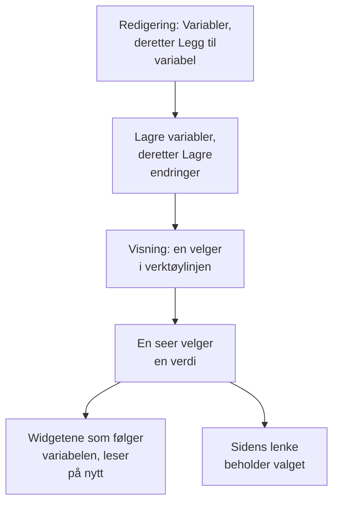

# Dashbord-variabler & filtre

En variabel er en velger i dashbordets verktøylinje. Legg til en variabel `service`, og de samme diagrammene viser `checkout`, `payments` eller `search`: seerne velger i verktøylinjen i stedet for at du bygger tre nesten like dashbord.

:::cards
- [Legg til en variabel](#legg-til-en-variabel): Gi den et navn, velg hvor verdiene kommer fra, og lagre.
- [Variabelkilder](#variabelkilder): Telemetry Attribute, Project Labels, Custom List og Text Input.
- [Slik bruker widgets en variabel](#slik-bruker-widgets-en-variabel): Hvilke widgets som følger hvilke variabler.
- [Lenker som beholder utvalget](#lenker-som-beholder-utvalget): Send en lenke som åpnes på den samme tjenesten.
:::

## Slik fungerer en variabel

Du definerer variabler mens du redigerer dashbordet, og de lagres sammen med det. I visningsmodus er hver av dem en velger i verktøylinjen. Når en seer velger en verdi, leser hver widget som følger variabelen, dataene sine på nytt, og sidens lenke beholder valget.



## Legg til en variabel

:::steps
### Åpne variabeldialogen

Åpne dashbordet, velg **⋯ → Rediger dashbord**, og klikk på **Variabler** i verktøylinjen. Dialogen **Dashbordvariabler** viser dashbordets variabler; knappen i verktøylinjen teller dem.

### Legg til en

Klikk på **Legg til variabel**. En ny variabel leser et telemetriattributt; velg en annen **Kilde** hvis du trenger det.

### Fyll den ut

Gi den et **Navn**, som widgets og lenker bruker, for eksempel `service`: bokstaver, sifre og understreker, som begynner med en bokstav eller en understrek og er forskjellig fra dashbordets andre navn. Legg til en **Etikett** for verktøylinjen om du vil, en **Standard** å starte på, og huk av for **Tillat flervalg** for å la seerne velge flere verdier.

### Lagre den

Klikk på **Lagre variabler**, og deretter på **Lagre endringer** i verktøylinjen. Variabelens velger vises i verktøylinjen når dashbordet er tilbake i visningsmodus.
:::

For å endre eller fjerne en variabel senere åpner du dialogen igjen: endre feltene, eller klikk på søppelbøtta ved siden av.

## Variabelkilder

**Kilde** avgjør hvor en variabels verdier kommer fra, og hvilke widgets som følger den.

| Kilde | Hvor verdiene kommer fra | Flervalg |
| --- | --- | --- |
| Telemetry Attribute | Verdiene til én attributtnøkkel i metrikkene dine, for eksempel `service.name` | Ja |
| Project Labels | Prosjektetikettene du tillater, fra 1 til 1 000 | Ja |
| Custom List | Verdier du skriver, atskilt med komma, for eksempel `prod, staging` | Ja |
| Text Input | Det seeren skriver | Nei |

### Telemetry Attribute

Angi **Attributtnøkkel**, for eksempel `service.name`, `host.name` eller `k8s.namespace.name`; feltet foreslår nøklene telemetrien din har. Velgeren tilbyr opptil 100 verdier for den nøkkelen, lest fra metrikkene dine fra det siste døgnet, så en ny tjeneste dukker opp i den uten at du redigerer dashbordet.

Dette er den vanligste kilden, fordi den ikke trenger en egen liste: verdiene er de du allerede sender.

### Project Labels

Velg eksisterende prosjektetiketter som skal tilbys som en nedtrekksliste på dashbordet. Opprett for eksempel en variabel med navnet `UNIT`, sett kilden til **Prosjektetiketter**, og velg etikettene `0660` og `0661`.

Dashbordet lagrer ID-ene og visningsnavnene til de valgte etikettene. Filtreringen bruker ID-ene, så å gi en prosjektetikett nytt navn bryter ikke koblingen. Visningsnavnene lagres sammen med dashbordet; velg en omdøpt etikett på nytt i variabelredigeringen for å oppdatere visningsnavnet. Offentlige dashbord viser de samme lagrede valgene.

I en widget **Overvåkingsliste** åpner du **Filtre → Etikettvariabel** og velger `UNIT`. Når du velger `0660`, vises nå overvåkingene som har den etiketten. Andre widgets påvirkes ikke, med mindre de uttrykkelig støtter og kobler variabelen: **SLO-liste** har den samme innstillingen **Etikettvariabel**.

Faste widgetfiltre gjelder fortsatt. Med en fast etikett `network` og `UNIT` satt til `0660` må en overvåking for eksempel ha begge etikettene. Flere valgte enheter samsvarer med hvilken som helst av dem. Å velge **Alle** fjerner bare variabelens betingelse og beholder de faste filtrene for etikett, status og overvåkingstype.

En manglende variabel eller et valg utenfor de konfigurerte valgene viser en feil. En valgt etikett uten samsvarende overvåkinger viser den tomme listen. Fjern widgetens kobling uttrykkelig når den ikke lenger trengs.

### Custom List og Text Input

En Custom List tilbyr verdiene du skriver, atskilt med komma. En Text Input lar seeren skrive en hvilken som helst verdi, for eksempel en IP-adresse eller en forespørsels-ID. Ingen av dem filtrerer en widget alene: verdiene havner der du skriver `{{name}}` (se nedenfor).

En Query-variabel fra et eldre dashbord beholdes og viser et tekstfelt i verktøylinjen: OneUptime laster ikke lenger verdiene fra en spørring.

## Flervalg og standardverdier

Med **Tillat flervalg** avhuket velger seerne én eller flere verdier, og widgetene viser hvilken som helst av dem. Et tomt utvalg betyr **Alle**, og en flervalgsvariabel starter alltid på **Alle**, så **Standard** er nedtonet.

En enkeltvalgsvariabel starter på sin **Standard**, eller på **Alle** når den ikke har noen. **Alle** fjerner variabelens filter, så widgetene viser alt.

Bruk flervalg til å sammenligne "checkout og payments sammen" uten å forlate dashbordet. Unngå det der tallene ikke kan legges sammen på tvers av verdier, for eksempel et gjennomsnitt av gjennomsnitt.

## Slik bruker widgets en variabel

Hver kilde når widgetene på sin egen måte:

- Variabler av typen **Telemetriattributt** filtrerer widgets uten at du trenger å stille inn noe på dem: alle metrikkdiagrammer, verdier, målere og tabeller; **Loggdiagram**, **Loggstrøm**, **Spordiagram** og **Sportabell**; og infrastrukturlistene der ressursene har attributtet, for eksempel `host.name` på vertslister og `k8s.namespace.name` på Kubernetes-lister. Et diagram over en metrikk uten attributtet viser ingen data mens en verdi er valgt: velg **Alle** for å se det igjen. **Sporliste** og hendelses- og varsellistene følger dem ikke.
- Variabler av typen **Prosjektetiketter** filtrerer en **Overvåkingsliste** eller en **SLO-liste** der **Etikettvariabel** nevner dem.
- **Enhver variabel** kan skrives inn i tekst som `{{name}}`: i en [HTML-widget](/docs/dashboards/widgets#html), i spørringen til en [ekstern datakilde](/docs/dashboards/data-sources), og i tittelen på en **Overvåkingsliste** eller en **SLO-liste**. En tittel som `{{UNIT}} NETWORK` viser `0660 NETWORK`, `0660, 0661 NETWORK` eller `All NETWORK`. En tittel styrer bare den viste teksten; konfigurer **Etikettvariabel** for å filtrere overvåkingsspørringen.

[SLO-widgeten](/docs/dashboards/widgets#slo) kan følge en Telemetry Attribute-variabel på nøkkelen `sloName`, slik at seerne velger hvilket SLO den viser.

## Lenker som beholder utvalget

Sidens lenke bærer hver variabels valg som `?var-<name>=<value>`, med flere verdier atskilt med komma, så en lenke du kopierer, åpnes med det samme utvalget, også en uttrykkelig **Alle**. En lenke som denne åpnes på tjenesten payments:

```text title="A dashboard link with a variable"
https://oneuptime.com/dashboard/<project-id>/dashboards/<dashboard-id>?var-service=payments
```

Lenken bærer også tidsintervallet og den automatiske oppdateringen du har valgt, som `range` og `refresh`, slik at de du sender den til, ser det du ser. [Send en lenke](/docs/dashboards/sharing#send-en-lenke) viser verdiene deres.

## Et eksempel: ett dashbord for hver tjeneste

Et tjenestedashbord har som regel:

1. En variabel `service`, kilde Telemetry Attribute, attributtnøkkel `service.name`, med den travleste tjenesten din som standard. La flervalg være av, slik at diagrammene viser én tjeneste om gangen.
2. En variabel `namespace`, kilde Telemetry Attribute, attributtnøkkel `k8s.namespace.name`, med flervalg på for å sammenligne navnerom.
3. En variabel `environment`, kilde Custom List, verdier `prod, staging`, brukt som `{{environment}}` i spørringen til en datakilde.
4. Widgets som leser disse attributtene: diagrammer og verdier for tjenestens metrikker, en loggstrøm og en liste over Kubernetes-pods.

Resultatet: ett dashbord for hver tjeneste, med tre velgere øverst.

## Neste steg

:::cards
- [Dashbord-widgets](/docs/dashboards/widgets): Hvilke widgets som følger hvilke variabler.
- [Eksterne datakilder](/docs/dashboards/data-sources): Sett en variabel inn i en PromQL- eller SQL-spørring.
- [Deling & offentlige dashbord](/docs/dashboards/sharing): Variabler på et offentlig dashbord.
- [Opprette et dashbord](/docs/dashboards/authoring): Redigeringsmodus, lagring og tidsintervallet.
:::
