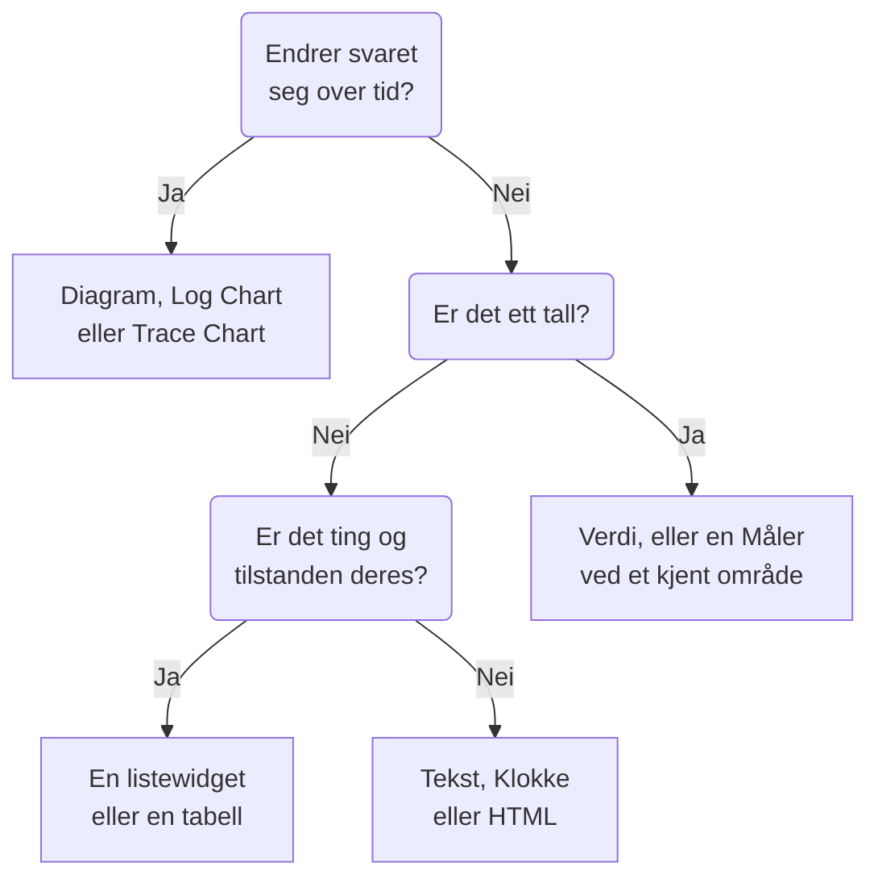

# Dashbord-widgets

En widget er én flis på et dashbord. Denne siden går gjennom hver widget i katalogen **Legg til widget**, hva den viser og innstillingene som betyr noe, i katalogens egne grupper. For å plassere widgets i rutenettet og lagre dem, se [Opprette et dashbord](/docs/dashboards/authoring).

:::cards
- [Hvilken widget bør jeg bruke?](#hvilken-widget-bør-jeg-bruke): Velg ut fra spørsmålet flisen svarer på.
- [Diagrammer og tall](#diagrammer-og-tall): Diagram, Verdi, Måler og Tabell, fra en metrikkspørring.
- [Logger, spor og sikkerhet](#logger-spor-og-sikkerhet): Volumdiagrammer, sanntidsstrømmer og lister.
- [Sortere lister og tabeller](#sortere-lister-og-tabeller): Sorter etter en kolonne, og velg rekkefølgen alle ser.
- [Når en widget ikke kan vises](#når-en-widget-ikke-kan-vises): Hva en ødelagt widget viser, og hvordan du fikser den.
:::

## Hvilken widget bør jeg bruke?

Start med spørsmålet flisen skal svare på:

| Spørsmålet | Widgeten |
| --- | --- |
| Hvordan har en metrikk endret seg over tid? | **Diagram** |
| Hvor mange logger, av hvilken alvorlighet, over tid? | **Loggdiagram** |
| Hvor raske er forespørslene, og hvor mange feiler, over tid? | **Spordiagram** |
| Hva er ett bestemt tall akkurat nå? | **Verdi**, eller **Måler** når det har et kjent område |
| Hvilke verter, tjenester eller endepunkter skiller seg ut? | **Tabell** eller **Sportabell** |
| Hva skjer akkurat nå? | **Loggstrøm**, **Sporliste**, **Hendelsesliste** eller **Varselliste** |
| Er alle nettstedene våre oppe? | **Overvåkingsliste** |
| Holder vi påliteligheten vi har lovet? | **SLO** eller **SLO-liste** |
| Hvilken tilstand er klyngene og vertene våre i? | En widget fra gruppen Infrastruktur |
| Hvor i verden er nettverket vårt, og hva er nede? | **Nettverkskart** |
| En overskrift, et notat, klokka på et annet kontor? | **Tekst** eller **Klokke** |
| Data som ligger utenfor OneUptime? | En widget fra gruppen Eksterne datakilder |
| Noe ingen widget dekker? | **HTML**, når du er sikker på at ingen annen widget gjør det |



De fleste dashbord blander noen få: et diagram øverst, en verdi eller to ved siden av, en tekstoverskrift og en liste eller to under.

## Diagrammer og tall

Disse fire widgetene leser en metrikkspørring, bygget slik metrikkutforskeren bygger en: velg en metrikk og en aggregering, legg til attributtfiltre, og grupper etter et attributt for å få én serie per verdi.

### Diagram

En tidsserie med én eller flere metrikkspørringer over dashbordets tidsintervall. **Chart Type** tegner den som et linje-, stolpe-, areal-, stablet areal- eller kakediagram. **Additional Queries** legger flere metrikker på de samme aksene, og **Formulas** kombinerer dem med `+`, `-`, `*`, `/`, `%`, `^` og parenteser, som i `(1 - a) * 100`. Hver spørrings visningsinnstillinger legger til en forklaring og en enhet, en farge, varsel- og kritiske linjer og en rate per sekund for tellere som bare vokser.

Bruk den når formen på linjen forteller historien: ventetid, feil, gjennomstrømning eller kødybde.

### Verdi

Ett stort tall med en sparkline: spørringens verdi over hele tidsintervallet, summert for en sum eller en telling, den høyeste for et maksimum, den laveste for et minimum og ellers gjennomsnittet. En pil sammenligner den andre halvdelen av intervallet med den første, hver halvdel regnet ut på samme måte, farget etter **Trend Direction**: om en høyere verdi er bedre eller verre, eller lest ut fra metrikkens navn. Pek på pilen for å se verdien for hver halvdel, og på sparklinen for å lese verdien og tidspunktet for et punkt. **Warning Threshold** gjør bakgrunnen gul og **Critical Threshold** rød når verdien når dem.

Bruk den når ett tall svarer på spørsmålet: feilraten, P95-ventetiden eller antall forespørsler betjent i dag.

### Måler

En skive mellom et minimum og et maksimum, 0 og 100 med mindre du angir dem, med en gul sone fra **Warning Threshold** og en rød sone fra **Critical Threshold**.

Bruk den når verdien lever i et kjent område: CPU- eller diskbruk i prosent, eller kapasiteten til en kø.

### Tabell

Metrikkverdier som rader. **Group By Attributes** gir én rad per verdi, for eksempel én per `host.name`; uten den er hver rad en tidsbolk. **Metrics & Columns** angir kolonnene: metrikker og formler over dem, som tilgjengelighet i prosent. Når du grupperer, gjør **Reduce across time** hver rads serie om til én verdi: den siste verdien, gjennomsnittet, summen, minimum eller maksimum.

Bruk den til en oppdeling i stedet for en trend: de mest støyende vertene, feilene per tjeneste, forespørslene per endepunkt.

## Tekst, klokke og HTML

Disse widgetene trenger ingen datakilde.

### Tekst

En linje eller en tekstblokk, for en overskrift, et notat eller lenker til runbookene dine. Slå på **Markdown** for å tegne overskrifter, lenker, lister, kode og tabeller; ellers vises teksten slik den er skrevet, med fet, kursiv eller understreking om du vil.

### Klokke

Klokkeslettet nå i en hvilken som helst tidssone, som sifre eller som en analog urskive, med en etikett som "Sydney-kontoret". Uten tidssone viser den hver seers egen. Legg til én per kontor for å se hvem som er våken.

### HTML

Din egen HTML, CSS og JavaScript, tegnet som en widget. Innstillingene er HTML-innholdet, et valgfritt stilark, et valgfritt skript og tre tillatelsesbrytere.

Bruk den når du trenger noe ingen innebygd widget dekker: et innebygd merke fra en tredjepart, en tabell hentet fra et internt API, en tilpasset forklaring eller et sett stiliserte lenker til dine egne verktøy.

#### Hva den kan og ikke kan gjøre

Widgeten gjengis i en sandkasseramme på sin egen isolerte opprinnelse. Inne i den rammen kan koden din gjøre mer eller mindre hva som helst: bygge DOM, kjøre tidtakere, hente fra en hvilken som helst URL, tegne på et canvas.

Det den ikke kan, er å nå OneUptime-siden rundt seg. Den har ingen tilgang til dashbordets DOM, informasjonskapsler, lokale lagring eller API-økt, og den kan ikke få nettleserfanen til å navigere bort. Det gjelder enten dashbordet er privat eller delt offentlig.

To konsekvenser som er verdt å kjenne til før du limer inn noe:

- En `fetch` fra widgeten er en forespørsel på tvers av opprinnelser fra en ugjennomsiktig opprinnelse, så serveren du kaller, må tillate den med CORS. Det støttes ikke å kalle OneUptime-API-et herfra.
- Widgeten starter gjennomsiktig. Angi en bakgrunn på `body` i CSS-en din hvis du vil at den skal fylle kortet. I det mørke temaet starter teksten lys, og elementet `<html>` har klassen `dark`: start en CSS-regel med `html.dark` for å style bare det mørke temaet.

#### Bruke dashbordvariabler

Skriv `{{variableName}}` hvor som helst i HTML, CSS eller JavaScript, så erstattes det med variabelens nåværende verdi før widgeten gjengis. Å velge en ny verdi gjengir widgeten på nytt. En plassholder som nevner en variabel som ikke finnes, blir stående som den er.

Skript får de samme verdiene, pluss dashbordets tidsintervall, på `window.ONEUPTIME`:

```javascript title="window.ONEUPTIME"
window.ONEUPTIME.variables.environment; // current value, or "" if unset
window.ONEUPTIME.startDate; // ISO 8601 string, start of the dashboard's time range
window.ONEUPTIME.endDate; // ISO 8601 string, end of it
```

Widgeten lastes inn på nytt hver gang dashbordet oppdateres, så en widget som henter sine egne data, holder tritt med oppdateringsintervallet.

#### Tillatelser

**Run JavaScript** (på som standard) kjører skriptet ditt. Slå den av for bare å gjengi markering og stiler: skriptet utelates da helt fra widgeten i stedet for bare å bli blokkert.

**Open links in a new tab** (på som standard) lar lenker og `window.open` åpne en nettleserfane. Lenker åpnes alltid i en ny fane; widgeten kan aldri få selve dashbordet til å navigere.

**Allow forms to submit** (av som standard) lar et `<form>` inne i widgeten sendes.

Den som kan redigere dashbordet, bestemmer hva denne widgeten kjører, og alle som ser dashbordet, kjører det: på et offentlig dashbord gjelder det også anonyme besøkende. Behandle redigeringstilgang til et dashbord med en HTML-widget slik du ville behandlet tilgang til all annen kode du leverer.

## Logger, spor og sikkerhet

| Widget | Hva den viser | Innstillinger som betyr noe |
| --- | --- | --- |
| **Loggdiagram** | Loggvolum over tid, én serie per alvorlighet, som stolper, linjer eller arealer. | Alvorligheter, tekst innholdet inneholder, attributtfiltre. |
| **Loggstrøm** | De nyeste logglinjene som samsvarer med et filter. | Alvorlighet, tekst innholdet inneholder, attributtfiltre som `@service.name:checkout`, hvor mange rader. |
| **Spordiagram** | Antall forespørsler, antall feil eller responstid (gjennomsnitt, minimum, maksimum, P50 til P99) over tid. | Metrikken, hvilke spenn som telles, og et attributt seriene deles opp etter. |
| **Sporliste** | De nyeste sporene, med varighet og status. | Status, hvor mange rader. |
| **Sportabell** | De største spennavnene, statusene eller attributtverdiene etter antall forespørsler, med median, gjennomsnittlig, minste og største responstid. | Hva radene grupperes etter, og hvilke spenn som telles. |
| **Sikkerhetshendelser** | De nyeste sikkerhetshendelsene, med alvorlighet, hendelsesklasse og vert. | Alvorligheter, hendelsesklasser, tekst meldingen inneholder. |
| **Flyt av sikkerhetshendelser** | En flyt av sikkerhetshendelser fra kilden, gjennom hendelsesklassen, til alvorligheten. | Alvorligheter, hvor mange hendelser. |

Sporwidgetene teller bare rotspenn, slik sporutforskeren gjør, med mindre du tar med underordnede spenn i innstillingene deres. Et vanlig mønster er et ventetidsdiagram øverst med en liste over trege spor under.

## Hendelser, varsler og overvåkinger

| Widget | Hva den viser | Filtre |
| --- | --- | --- |
| **Hendelsesliste** | Hendelser med tilstand og alvorlighet. | Uløste, bekreftede eller løste; alvorlighet, tilstand, overvåkinger og etiketter. |
| **Varselliste** | Varsler med tilstand og alvorlighet. | Uløste, bekreftede eller løste; alvorlighet, tilstand, overvåkinger og etiketter. |
| **Overvåkingsliste** | Overvåkinger med nåværende status. | I drift eller ikke, status, overvåkingstype og etiketter, eller en **Etikettvariabel** som seerne velger i verktøylinjen. |

Som de fleste listewidgets kan disse tre tegne en bikube av celler farget etter status i stedet for en tabell: velg det under **Visningsmodus**. De viser den nåværende tilstanden, uansett dashbordets tidsintervall.

## Tjenestenivåmål

### SLO

Ett tjenestenivåmål (SLO), tegnet enten som ett tall eller som en linje over tid.

**Innstillinger**: hvilket SLO, eller SLO-et som er valgt i en dashbordvariabel; hvilket av de tre tallene (SLI, Error Budget Remaining eller Burn Rate); visning som Tile eller Diagram; og en valgfri tittel.

- **Tile** viser det nåværende tallet, pluss en andre linje der det finnes en: målet under SLI-et, gjenstående minutter under feilbudsjettet. En statusetikett farger det hele.
- **Diagram** tegner det samme tallet over dashbordets tidsintervall, med målet markert som en stiplet linje på SLI-serien. Historikken skrives med noen minutters mellomrom av evalueringsworkeren, så et helt nytt SLO vises som et tomt diagram til det er evaluert første gang.

Bruk den når dashbordet svarer på "holder vi det vi har lovet?" heller enn "hva skjer akkurat nå?".

SLO-widgeten fungerer på [offentlige dashbord](/docs/dashboards/sharing). Det som publiseres, er SLO-ets nøkkeltall (navn, mål, nåværende SLI, gjenstående feilbudsjett, burn rate og status), uansett hvilket av dem widgeten tegner. Definisjonen forblir privat: overvåkingene det følger med på, etikettene, beskrivelsen, spørringen og evalueringsplanen sendes aldri til en offentlig seer. En Tile-widget publiserer bare disse nåværende tallene; en Diagram-widget publiserer også historikken til den ene serien den tegner, og ingenting annet.

### SLO List

Hvert SLO med status, SLI, feilbudsjett og burn rate, med minst gjenstående budsjett først. Filtrer den etter status eller etiketter, eller med en **Etikettvariabel** som seerne velger i verktøylinjen. [SLO-metrikker og -dashbord](/docs/slo/metrics) viser begge SLO-widgetene i bruk.

## Infrastruktur

Hver av disse widgetene viser ressursene som en agent eller en collector rapporterer til OneUptime. Snevre dem inn etter klynge, vert eller navnerom i filtrene, og vis dem som en liste eller som en bikube.

| Gruppe | Widgets | Fylles av |
| --- | --- | --- |
| **Verter** | **Verter**, med tilkoblingsstatus, OS, CPU og minne | Enhver OpenTelemetry-collector som sender `host.name` |
| **Kubernetes** | **Pods**, **Noder**, **Navnerom**, **Distribusjoner**, **StatefulSets**, **DaemonSets**, **Jobber**, **CronJobs** | [Kubernetes-agent](/docs/monitor/kubernetes-agent) |
| **Docker** | **Verter**, **Containere**, **Bilder**, **Nettverk**, **Volumer** | Docker-agenten |
| **Docker Swarm** | **Noder**, **Tjenester** | Docker Swarm-agenten |
| **Podman** | **Verter**, **Containere**, **Bilder**, **Nettverk**, **Volumer** | Podman-agenten |
| **Proxmox** | **Noder**, **Gjester** | Proxmox-agenten |
| **VMware** | **Verter**, **Virtuelle maskiner** | VMware-agenten, eller et vCenter du kobler til |
| **Ceph** | **OSD-er**, som en vegg farget etter tilstand, og **Pools** | Ceph-agenten |
| **Lagringsarrayer** | **Volumer**, og **Maskinvare** som en vegg farget etter status | Storage Array-agenten |

Bruk dem til én side som blander tilstanden til infrastrukturen din med telemetrien fra arbeidslastene som kjører på den.

### Network Map

Nettverkslokasjonene dine tegnet på verdenskartet, hver festet på sin egen breddegrad og lengdegrad og farget etter overvåkingsstatusen som er samlet på den. Lokasjoner nær hverandre deler en markør med antallet skrevet inni; en markør som står for nøyaktig én lokasjon, åpner den lokasjonen når du klikker på den.

Kartet rammer seg selv inn rundt lokasjonene det tegnet: et nettverk innenfor ett land fyller rammen med det landet, og ett spredt over kontinenter åpnes på hele verden. Det finnes ingen kontroller for å zoome eller panorere: en dashbordflis er et bilde, og siden Network Map under Network er der du går gjennom hierarkiet.

Over kartet står det hvor mange lokasjoner som er nede, fordi en rød prikk på to piksler blant to hundre grønne ikke er noe noen leser på dashbordavstand. Under det forteller en dekningslinje hva kartet ikke viser: lokasjoner uten koordinater, og om radgrensen ble nådd.

**Innstillinger**: tittel, kart- eller listevisning, høyeste antall tegnede lokasjoner, om lokasjonsnavn skal skrives, og filtre etter lokasjonstype og etter status. Lokasjonsnavn forsvinner automatisk når kartet blir for fullt til at de kan leses; verktøytipset navngir fortsatt hver markør.

En lokasjon vises bare hvis den har koordinater. Legg til breddegrad og lengdegrad på lokasjonen (eller importer dem fra en CSV) for å feste den.

## Eksterne datakilder

Gruppen Eksterne datakilder tegner et **Diagram**, en **Verdi**, en **Måler** eller en **Tabell** fra et system som OneUptime ikke eier: Prometheus, PostgreSQL, MySQL, SQL Server, ClickHouse, Loki, Elasticsearch eller et hvilket som helst REST-API. Du kobler til systemet én gang og skriver deretter hver widgets spørring i systemets eget språk. [Eksterne datakilder](/docs/dashboards/data-sources) viser hvordan.

## Sortere lister og tabeller

Klikk på overskriften til en kolonne for å sortere en liste eller en tabell etter den: et første klikk sorterer slik tabellen nedenfor sier, neste klikk den andre veien, og klikket etter det setter widgeten tilbake i sin egen rekkefølge. På kolonnen widgeten allerede er sortert etter, snur et klikk rekkefølgen. En pil markerer kolonnen radene er sortert etter.

| Kolonne | Første klikk | Neste klikk |
| --- | --- | --- |
| En status, en tilstand eller en alvorlighetsgrad | Verste først | Beste først |
| Et tidspunkt | Nyeste først | Eldste først |
| Et tall | Høyeste først | Laveste først |
| Tekst | A til Å | Å til A |

Verst følger prosjektets egen rekkefølge: en monitorstatus etter prioriteten, alvorlighetsgraden og tilstanden til en hendelse eller et varsel etter rekkefølgen du har dem i, og en ressurs som er nede, ikke klar eller slått av, før en sunn. Fasen til en pod sorteres Failed, så Unknown, så Pending, så Running og Succeeded. SLI-en og feilbudsjettet til et SLO, og VMID-en til en Proxmox-gjest, sorteres med de laveste først.

Hele listen sorteres, ikke bare radene på skjermen: en liste som viser 25 rader, sortert med de verste først, viser de 25 verste av alle. Rader som står likt, beholder widgetens egen rekkefølge. En kolonne en liste ikke kan sorteres etter som helhet, som meldingen til en sikkerhetshendelse, sorterer ikke.

### Din egen sortering

Sorteringen din er bare din: nettleseren din husker den for den widgeten på det dashbordet, så en ny innlasting eller en omstart av en veggskjerm beholder den, og ingen andre ser den. Klikket som setter widgeten tilbake i sin egen rekkefølge, glemmer sorteringen din, og widgeten følger deretter sin egen rekkefølge, også når en redaktør endrer den senere.

### Rekkefølgen alle ser

For å velge rekkefølgen en widget åpnes i for alle, redigerer du den og velger rekkefølgen under **Sorter**, eller klikker på en kolonneoverskrift i **Live Preview** for den, og klikker så på **Lagre endringer**. Du ser den nye rekkefølgen med en gang; en seer som har sortert widgeten på sin egen måte, beholder sorteringen sin.

Dashbordmalene åpner listene over verter, noder, pods, Swarm-tjenester og nettverksenheter med de verste først.

Gjennom API-et og Terraform er rekkefølgen widgetens `arguments.sort`: en kolonne og en retning, for eksempel `status:desc`. En listewidget avviser en kolonne den ikke har, og feilen lister opp sorteringene den har.

## På et offentlig dashbord

Et [offentlig dashbord](/docs/dashboards/sharing) tegner de fleste widgets for de besøkende, og hver viser bare det den er satt opp til å vise. Noen få kan ikke vises uten en pålogget økt:

- **Loggdiagram**, **Spordiagram**, **Sportabell**, **Sikkerhetshendelser** og **Flyt av sikkerhetshendelser** sier på sin plass at de ikke er tilgjengelige på offentlige dashbord.
- Widgetene fra Eksterne datakilder utelates helt fra et offentlig dashbord, fordi innstillingene deres er selve spørringen.

## Når en widget ikke kan vises

En widget som ikke kan tegnes, viser **Denne widgeten kunne ikke vises** på sin egen plass, og resten av dashbordet fortsetter å fungere. Det skjer når OneUptime ikke har noen widget av den typen (en som er fjernet, feilstavet da dashbordet ble skrevet gjennom API-et, eller lagt til av en nyere versjon), eller når widgeten feiler mens den tegnes, for eksempel fordi de lagrede innstillingene er ufullstendige.

Hvis du kan redigere dashbordet, klikker du på **Rediger widget** på den. Dashbordet bytter til redigeringsmodus med widgetens innstillinger åpne: rett dem, eller klikk på **Slett widget**, og deretter på **Lagre endringer**. En widget som feilet mens den ble tegnet, tilbyr også **Prøv igjen**, og tegnes på nytt ved neste automatiske oppdatering eller når du endrer tidsintervallet.

Besøkende på et offentlig dashbord får bare beskjed om at widgeten ikke kunne vises.

## Neste steg

:::cards
- [Dashbord-variabler & filtre](/docs/dashboards/variables): La seerne rette widgetene mot en tjeneste, en vert eller en kunde.
- [Eksterne datakilder](/docs/dashboards/data-sources): Vis Prometheus, SQL, Loki og mer ved siden av dine egne data.
- [Opprette et dashbord](/docs/dashboards/authoring): Legg til, ordne og lagre widgets.
- [Deling & offentlige dashbord](/docs/dashboards/sharing): Del dashbordet utenfor teamet ditt.
:::
