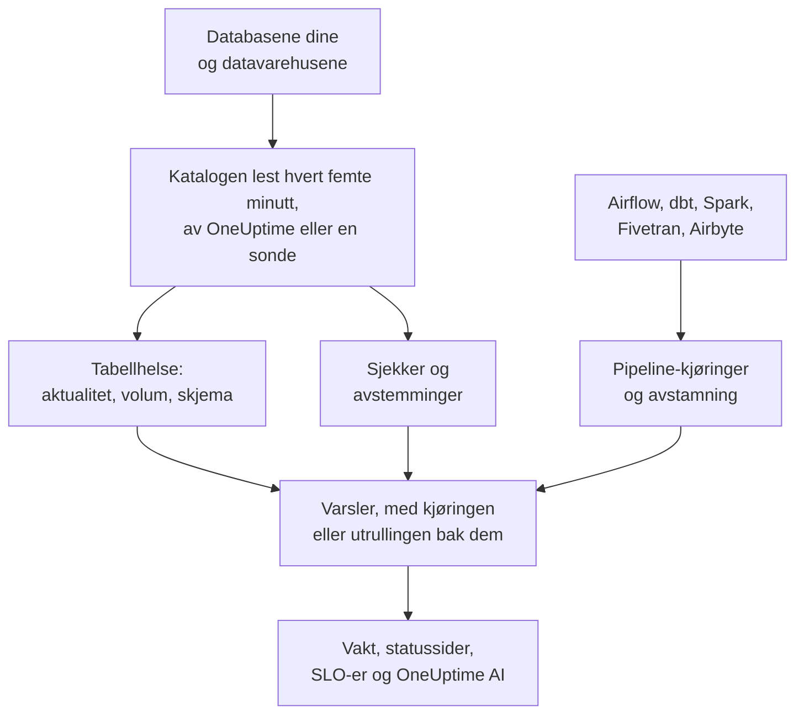

# Dataobserverbarhet

Dataobserverbarhet holder øye med tabellene bedriften din er avhengig av, i PostgreSQL, MySQL, SQL Server, Oracle, MongoDB, Redshift, Snowflake, BigQuery, ClickHouse, Databricks og Athena, og sier fra når dataene er forsinket, mangler, er feil eller er ødelagt, før de som bruker dem, merker det. Den lærer seg rytmen til hver tabell på egen hånd, leser katalogen til hver database slik at ingen verdi forlater den, og knytter hvert dataproblem til pipeline-kjøringen, utrullingen eller oppstrømstabellen som ligger bak.

Den svarer på fire spørsmål:

:::cards
- [Er dataene ferske?](/docs/data-observability/table-health): Siste endring, rader, størrelse og kolonner for hver tabell, lest hvert femte minutt, med varsler når en tabell er forsinket, krymper eller endrer form.
- [Er dataene riktige?](/docs/data-observability/checks): Sjekker av hva en tabell inneholder, avstemminger mellom en tabell og kopien av den, og dbt-testene, med varsler når de feiler.
- [Hvor kommer dataene fra, og hva mater de?](/docs/data-observability/lineage-and-pipelines): Avstamning fra pipelinene dine, dbt, Fivetran, Airbyte, visninger og databasenes egen spørringshistorikk, slik at ett problem åpner én sak.
- [Kan de som bruker dataene, stole på dem?](/docs/data-observability/data-products): Dataprodukter med en aktualitets-SLA, på statussider og fulgt som et SLO, med et «data as of»-merke.
:::

## Slik fungerer det

1. **Koble til en database** med en skrivebeskyttet bruker. En database som Datasikkerhet allerede kjenner, overvåkes uten at du trenger å gjøre noe, og det samme gjelder hvert BigQuery-datasett Google Cloud-tilkoblingen din har funnet. En database i et privat nettverk leses av en sonde du kjører der.
2. **Hvert femte minutt** leser OneUptime katalogen og statistikken til hver database: hver tabell og visning, kolonnene, radene og størrelsen, og når den sist ble endret. Ingen tabell skannes, og i MongoDB leses bare feltnavnene til de nyeste dokumentene. En sti i en bucket kan overvåkes på samme måte.
3. **Rytmen til hver tabell læres**: hvor ofte den vanligvis endres. En tabell som bryter rytmen sin, er forsinket; en tabell som mister rader, eller der kolonnene endres, sier fra om det.
4. **Anbefalte varsler** gjør hvert av disse til en monitor du selv velger å ha, og sjekker du legger til, leser hva en tabell inneholder.
5. **Avstamning** viser hvilke tabeller som mater hvilke, slik at et varsel på en tabell der kilden svikter først, blir en følge av kilden: én sak, ikke ti.

## Hva som gjør den annerledes

- **Den er en del av resten av OneUptime.** Et datavarsel er et vanlig varsel: det tilkaller den som har vakt, åpner hendelser, vises på statussider og teller mot SLO-er. Tjenestene som trasene dine viser at skriver til en tabell, og utrullingene deres, står ved siden av hvert tabellvarsel.
- **Ingenting å konfigurere per tabell.** Rytmer, tidsplaner og vanlige kjøretider læres av det hver tabell og pipeline gjør, og en monitor som anbefales for en database, dekker hver tabell i den, også de som opprettes senere.
- **Én sak per årsak.** Et varsel der oppstrømstabellen, pipelinen eller databasen allerede har et åpent varsel, slutter seg til det varselet som en følge av det, allerede bekreftet, så en ødelagt lasting tilkaller vakten bare én gang.
- **Hvert varsel forklarer seg selv.** Det rangerer den sannsynlige årsaken, sier hva som avhenger av tabellen og hvem som eier den, og lærer av det du sier om det: marker ett som **Ikke et problem**, så er det samme stille neste gang.
- **OneUptime AI kjenner dataene dine.** Undersøkelser av datavarsler starter fra tabellens skrivere, kjøringer og oppstrømstabeller; Spør AI, Slack, Microsoft Teams og AI-agenter kan spørre om en tabell er fersk; og en sjekk kan skrives ut fra én setning. Se [OneUptime AI og API-et](/docs/data-observability/ai-and-api).

## Før du begynner

- **En rolle som kan sette det opp.** Prosjekteiere, prosjektadministratorer og telemetriadministratorer kobler til databaser. Alle som kan redigere dataressurser, legger til sjekker, avstemminger og dataprodukter; de med rollen Leser ser det den har funnet. Se [Tillatelsesreferanse](/docs/permissions/reference).
- **En skrivebeskyttet bruker på hver database.** [Koble til en database](/docs/data-observability/connect) viser det minste hver databasemotor trenger. OneUptime foreslår databasene sporene dine, skykontoene dine og Databaseovervåking allerede kjenner til.

## Kom i gang

:::steps
### Koble til en database

Åpne **Dataobserverbarhet**, gå til **Databaser** og velg **Koble til en database**. Velg databasemotoren, og oppgi en skrivebeskyttet tilkoblingsstreng, eller navnet på miljøvariabelen sonden din leser den fra. [Koble til en database](/docs/data-observability/connect) viser brukeren hver databasemotor trenger.

### Se tabellene

Innen fem minutter vises tabellene under **Tabeller**, hver med rader, størrelse og når den sist ble endret. Aktualiteten til en tabell er kjent når den har endret seg to ganger: **Fersk** så lenge den holder rytmen, **Sen** når den bryter den.

### Legg til de anbefalte varslene

Under **Databaser** velger du **Anbefalte varsler** for databasen og legger til dem du vil ha: en tabell som er forsinket, en der antall rader faller kraftig eller er uvanlig lavt, en der kolonnene endres, og en database som slutter å rapportere. Hver av dem er en vanlig monitor: vakt, eiere, vedlikeholdsvinduer og statussider fungerer som for alle andre.
:::

## Hva det koster

På OneUptime Cloud er de første 100 tabellene i et prosjekt gratis. Hver tabell etter det koster 1 $ i måneden, og 0,25 $ over 1 000. Visninger er gratis, og det samme er tabellene i en database du slutter å overvåke. En sjekk med et varsel faktureres som en aktiv monitor. **Databaser** og **Oversikt** viser hvor mange tabeller prosjektet ditt overvåker og hva de koster, og [Priser](https://oneuptime.com/pricing) har en kalkulator.

En selvhostet OneUptime betaler ingenting for tabeller.

## Neste steg

:::cards
- [Koble til en database](/docs/data-observability/connect): Brukeren med minst mulig tilgang for hver databasemotor, og sonder for private nettverk.
- [Tabellhelse](/docs/data-observability/table-health): Aktualitet, volum, skjemaendringer, ubrukte tabeller og metrikkene hver tabell skriver.
- [Kontroller og avstemminger](/docs/data-observability/checks): Regler for verdiene i en tabell, sammenligning av en tabell med kopien av den, og dbt-testene.
- [Avstamning og pipelines](/docs/data-observability/lineage-and-pipelines): OpenLineage, dbt, Fivetran og Airbyte, og én sak per årsak.
- [Dataprodukter](/docs/data-observability/data-products): Aktualitets-SLA-er for dem som bruker data, på statussider og som SLO-er.
- [OneUptime AI og API-et](/docs/data-observability/ai-and-api): Undersøkelser, en sjekk ut fra én setning, aktualitet for AI-agenter, og hvert endepunkt.
:::
