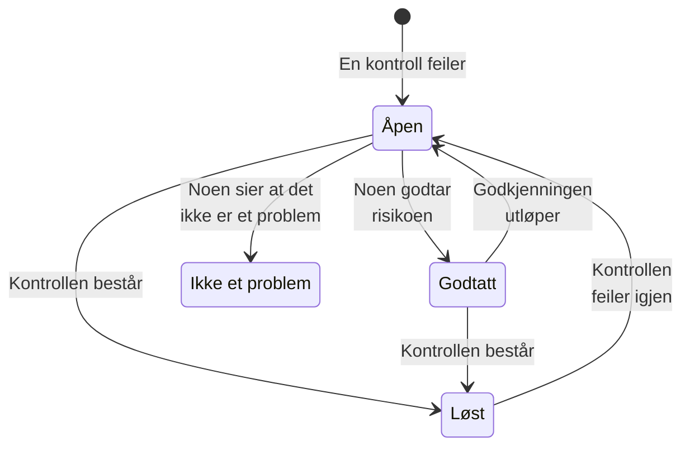

# Kontroller og problemer i Datasikkerhet

Datasikkerhet kjører 34 kontroller på hvert datalager, i ni grupper. En kontroll leser det som er kjent om ett datalager – hvordan det er konfigurert, hva som er funnet i det, hvem som kan nå det, hvor det befinner seg – og består, feiler eller kan ikke avgjøre. En kontroll som feiler, åpner ett problem på datalageret, og problemet lukkes av seg selv når kontrollen består. Denne siden viser hver kontroll, hvordan alvorlighetsgraden og risikoscoren til et problem beregnes, og hva som skjer med et problem gjennom livsløpet. Sikkerhetshendelser, Network Flows og sikkerhetsadressehvelvet er OneUptimes egne, oppbevart for sikkerheten din: oppgitt, aldri skannet eller kontrollert (se [Datalagre OneUptime oppbevarer for sikkerheten din](/docs/data-security/compliance#datalagre-oneuptime-oppbevarer-for-sikkerheten-din)).

:::cards
- [Hvordan en kontroll avgjør](#hvordan-en-kontroll-avgjør): Bestått, feilet eller kan ikke avgjøre, og hvor alvorlig en feil er.
- [Hver kontroll](#hver-kontroll): Alle 34, med hva hver av dem kontrollerer og hvordan det fikses.
- [Risikoscore](#risikoscore): Hvordan problemer ordnes innenfor en alvorlighetsgrad.
- [Hva som skjer med et problem](#hva-som-skjer-med-et-problem): Åpent, løst, godtatt, ikke et problem, hvordan hvert ble løst, og rettelser som følges helt til produksjon.
- [Analysen fra OneUptime AI](#analysen-fra-oneuptime-ai): Om et problem er reelt, hva det setter i fare, hva fiksen ville ødelegge og den korteste veien til fikset.
- [Fiks det herfra](#fiks-det-herfra): Lukk en eksponering, eller slå på en manglende beskyttelse, med ett klikk.
- [Problemer med én årsak](#problemer-med-én-årsak): Problemene som én feil laget, gruppert, og årsaken deres rettet én gang.
:::

## Hvordan en kontroll avgjør

Hver kontroll leser fakta om et datalager og svarer på én av fire måter:

| Svar | Hva det betyr | Hva som skjer med problemet |
| --- | --- | --- |
| Bestått | Kontrollen finner ingenting galt. | Et åpent eller godtatt problem blir løst. |
| Feilet | Kontrollen finner problemet, og sier hva den så i én setning: problemets bevis. | Et problem åpnes, eller det åpne oppdateres. |
| Kan ikke avgjøre | En opplysning kunne ikke leses: en tillatelse rollen ikke har, et kall som feilet. | Ingenting endres: et åpent problem forblir åpent, fordi ingen kan slutte at et problem er løst når OneUptime ikke kunne se. |
| Gjelder ikke | Datalagerets type har ingen slik innstilling. | Et åpent problem blir løst. |

### Alvorlighetsgraden følger dataene

Det samme problemet betyr mer for mer sensitive data. Hver kontroll angir en alvorlighetsgrad for hvert sensitivitetsnivå, og et problem får den som gjelder for datalageret: en offentlig bucket med kortnumre er Kritisk, en offentlig bucket med bilder til et nettsted bare Lav. En strek betyr ikke noe problem i det hele tatt. Sensitiviteten til et datalager kommer fra funnene (se [Sensitive datatyper](/docs/data-security/data-types#sensitivitet)), så innholdsprøver gir riktige alvorlighetsgrader.

Noen få kontroller setter i stedet alvorlighetsgraden ut fra det de så. **Det lagres hemmeligheter i det** er Høy på alle datalagre, og Kritisk på et datalager som er offentlig eller delt med andre kontoer.

## Hver kontroll

Alvorlighetsgraden er oppgitt for data som er Begrenset, Konfidensiell, Intern og Offentlig, i den rekkefølgen. Siden til hvert problem viser den fullstendige løsningen for sitt eget datalager – stegene i konsollen, CLI-kommandoen og, der det passer, Terraform – med navnet og regionen til datalageret fylt ut.

### Eksponering

| Kontroll | Kjører på | Hva den kontrollerer | Alvorlighetsgrad | Slik fikser du det |
| --- | --- | --- | --- | --- |
| Hvem som helst på internett kan lese det (`public-read`) | Objektlagring, datavarehus, søk | Datalagerets policy, ACL eller IAM-bindinger lar hvem som helst lese dataene uten å logge på. | Kritisk / Kritisk / Høy / Lav | Fjern alle tildelinger til anonyme eller alle autentiserte prinsipaler. Filer som må være offentlige, hører hjemme i et datalager merket **Offentlig med vilje** som ikke inneholder noe annet. |
| Hvem som helst på internett kan endre det (`public-write`) | Objektlagring, datavarehus, søk | Datalagerets policy, ACL eller IAM-bindinger lar hvem som helst skrive eller slette dataene. | Kritisk / Kritisk / Kritisk / Høy | Fjern alle skrive- eller slettetildelinger til anonyme eller alle autentiserte prinsipaler. |
| Offentlig tilgang er ikke blokkert (`public-access-not-blocked`) | AWS S3 Bucket | S3 Block Public Access er ikke helt slått på for bucketen eller kontoen, så én endring i policyen kan gjøre den offentlig. | Høy / Middels / Lav / — | Slå på alle de fire Block Public Access-innstillingene for bucketen. |
| Databasen godtar tilkoblinger fra internett (`internet-reachable`) | Database, datavarehus, søk, cache | Databasen har et offentlig endepunkt eller offentlig nettverkstilgang slått på. | Høy / Høy / Middels / Lav | Slå av det offentlige endepunktet, og nå databasen gjennom et privat nettverk eller en bastion. |
| Brannmuren slipper inn alle adresser (`open-to-all-addresses`) | Database, datavarehus, søk, cache | En brannmurregel eller et autorisert nettverk tillater 0.0.0.0/0 eller hele adresseområdet. | Kritisk / Kritisk / Høy / Middels | Erstatt regelen som tillater alt, med adressene eller nettverkene som trenger tilgang. |
| Et øyeblikksbilde av det kan gjenopprettes av hvem som helst (`snapshot-public`) | Database, øyeblikksbilde | Et øyeblikksbilde av databasen er delt offentlig, så enhver skykonto kan gjenopprette en full kopi. | Kritisk / Kritisk / Kritisk / Høy | Gjør øyeblikksbildet privat. |
| Et øyeblikksbilde av det er delt med andre kontoer (`snapshot-shared-externally`) | Database, øyeblikksbilde | Et øyeblikksbilde av databasen er delt med kontoer utenfor de tilkoblede. | Høy / Høy / Middels / Lav | Slutt å dele øyeblikksbildet med kontoene som ikke skal ha det. |
| Kontoer utenfor organisasjonen din kan nå det (`shared-with-external-accounts`) | Alle datalagre unntatt telemetri | Datalagerets policy gir tilgang til kontoer, leietakere eller prosjekter som ikke er koblet til OneUptime. | Høy / Høy / Middels / Lav | Gå gjennom hver ekstern prinsipal, og fjern dem som ikke trenger tilgang. |

### Kryptering

| Kontroll | Kjører på | Hva den kontrollerer | Alvorlighetsgrad | Slik fikser du det |
| --- | --- | --- | --- | --- |
| Dataene er ikke kryptert i hvile (`not-encrypted-at-rest`) | Alle datalagre unntatt telemetri | Lagringskryptering er slått av. | Høy / Middels / Lav / — | Slå på kryptering i hvile. En RDS-instans kan ikke krypteres på stedet: gjenopprett en kryptert kopi av øyeblikksbildet. |
| Begrensede data er ikke under din egen nøkkel (`no-customer-managed-key`) | Alle datalagre unntatt telemetri | Datalageret inneholder data med sensitiviteten Begrenset, men er kryptert med leverandørens standardnøkkel, ikke en kundeadministrert nøkkel. | Middels / — / — / — | Krypter datalageret med en nøkkel du administrerer i nøkkeltjenesten din. |
| Ukrypterte tilkoblinger er tillatt (`encryption-in-transit-not-enforced`) | Alle datalagre unntatt telemetri | Datalageret godtar tilkoblinger som ikke bruker TLS. | Høy / Middels / Lav / — | Krev TLS for hver tilkobling. I S3 avviser du alle forespørsler der `aws:SecureTransport` er false. |
| Det godtar TLS eldre enn 1.2 (`weak-tls`) | Alle datalagre unntatt telemetri | Minste TLS-versjon er 1.0 eller 1.1. | Middels / Middels / Lav / — | Sett minste TLS-versjon til 1.2 eller nyere. |

### Gjenoppretting

| Kontroll | Kjører på | Hva den kontrollerer | Alvorlighetsgrad | Slik fikser du det |
| --- | --- | --- | --- | --- |
| Det har ingen sikkerhetskopier, eller beholder dem kortere enn 7 dager (`no-backups`) | Database, datavarehus | Automatiske sikkerhetskopier er av, eller beholdes i færre enn 7 dager. | Høy / Middels / Lav / — | Slå på automatiske sikkerhetskopier, og behold dem i minst 7 dager. |
| Gjenoppretting til et tidspunkt er av (`no-point-in-time-recovery`) | AWS DynamoDB Table, Azure Cosmos DB Account | Tabellen eller databasen kan ikke gjenopprettes til et øyeblikk før en feil. | Middels / Lav / — / — | Slå på gjenoppretting til et tidspunkt. |
| Det kan slettes i ett steg (`deletion-protection-off`) | Database, datavarehus | Slettebeskyttelse er av. | Middels / Lav / — / — | Slå på slettebeskyttelse. |
| Slettede eller overskrevne filer kan ikke gjenopprettes (`deleted-data-not-recoverable`) | Objektlagring | Versjonering og myk sletting er begge av. | Middels / Lav / — / — | Slå på versjonering eller myk sletting. |

### Synlighet

| Kontroll | Kjører på | Hva den kontrollerer | Alvorlighetsgrad | Slik fikser du det |
| --- | --- | --- | --- | --- |
| Ingen ville vite hvem som leste det (`access-not-logged`) | Alle datalagre unntatt telemetri | Lesinger fra datalageret logges ikke: ingen tilgangslogger, ingen revisjonslogger for datatilgang. | Høy / Middels / Lav / — | Slå på tilgangs- eller revisjonslogging for lesinger: S3 server access logs eller CloudTrail data events, StorageRead-diagnostikklogger i Azure, Data Access-revisjonslogger i Cloud Storage. |

### Tilgang

| Kontroll | Kjører på | Hva den kontrollerer | Alvorlighetsgrad | Slik fikser du det |
| --- | --- | --- | --- | --- |
| Alle med kontonøkkelen kan lese alt (`shared-key-access`) | Azure Storage Account | Lagringskontoen tillater tilgang med delt nøkkel, som omgår Microsoft Entra ID og ikke etterlater noe revisjonsspor per person. | Middels / Lav / — / — | Flytt applikasjonene til Microsoft Entra ID, og slå deretter av tilgang med lagringskontonøkkel. |
| Objekter kan ha sine egne tilgangsregler (`object-acls-enabled`) | AWS S3 Bucket, Google Cloud Storage Bucket | Objekt-ACL-er er på, så ett objekt kan gjøres offentlig mens bucketen ser privat ut. | Lav / Lav / — / — | I S3 setter du Object Ownership til Bucket owner enforced. I Cloud Storage slår du på uniform bucket-level access. |
| Mer enn 25 identiteter kan lese begrensede data (`many-readers`) | Alle datalagre unntatt telemetri | Flere identiteter enn de fleste team klarer å gå gjennom, har lesetilgang til datalageret. | Middels / — / — / — | Åpne siden **Hvem kan nå det** for datalageret, og fjern tilgang som er ubrukt eller bredere enn nødvendig. |
| Identiteter som ikke er brukt på 90 dager, kan fortsatt nå det (`unused-access`) | Alle datalagre unntatt telemetri | Roller og brukere som ikke er brukt på 90 dager, har fortsatt tilgang til datalagerets sensitive data. | Middels / Lav / — / — | Åpne siden **Hvem kan nå det** for datalageret, der de er merket **Ikke brukt på 90 dager**, og fjern tilgangen hver av dem ikke lenger trenger. |

### Datahygiene

| Kontroll | Kjører på | Hva den kontrollerer | Alvorlighetsgrad | Slik fikser du det |
| --- | --- | --- | --- | --- |
| Det lagres hemmeligheter i det (`secrets-stored`) | Alle datalagre unntatt telemetri | Passord, API-nøkler, tokens eller private nøkler ble funnet i datalagerets data. | Høy / Høy / Høy / Høy | Roter hver hemmelighet som er funnet, som om den var lekket. Flytt hemmeligheter til en hemmelighetsbehandler og slett dem fra datalageret. |
| Kortsikkerhetskoder lagres (`card-security-codes-stored`) | Alle datalagre unntatt telemetri | CVV- eller CVC-koder ble funnet. PCI DSS forbyr å lagre dem etter at en betaling er autorisert, kryptert eller ikke. | Kritisk / Kritisk / Kritisk / Kritisk | Stopp koden som skriver dem, slett de lagrede kodene, og sjekk at ingen er igjen i sikkerhetskopier. |
| Kortnumre lagres i lesbar form (`card-numbers-readable`) | Alle datalagre unntatt telemetri | Fullstendige kortnumre ble funnet i lesbar form. PCI DSS krever at de er uleselige uansett hvor de lagres. | Høy / Høy / Høy / Høy | Tokeniser kortnumre hos betalingsleverandøren din, eller krypter dem på feltnivå, og slett de lesbare kopiene. |
| Passord lagres i klartekst (`plaintext-passwords`) | Alle datalagre unntatt telemetri | Et passordfelt inneholder verdier som ikke er passordhasher (bcrypt, argon2, scrypt eller PBKDF2). | Kritisk / Kritisk / Kritisk / Kritisk | Hash passord med bcrypt, scrypt eller argon2, migrer de lagrede, og få alle kontoer til å tilbakestille passordet. |
| Produksjonsdata ble kopiert til et datalager utenfor produksjon (`production-data-in-non-production`) | Alle datalagre unntatt telemetri | Verdier funnet i et produksjonslager ble også funnet her, i et utviklings-, test- eller stagingdatalager. | Høy / Middels / — / — | Erstatt kopien med maskerte eller syntetiske data, og slett de ekte dataene fra datalageret utenfor produksjon. |
| Sensitive data ingen har brukt på 90 dager (`stale-sensitive-data`) | Alle datalagre unntatt telemetri | Datalageret inneholder sensitive data og har ikke hatt lesinger eller skrivinger på 90 dager. | Middels / Lav / — / — | Bekreft at dataene ikke lenger trengs, og arkiver dem deretter med en oppbevaringsdato, eller slett dem. |
| En ny kolonne inneholder personopplysninger (`new-personal-data-column`) | Alle datalagre unntatt telemetri | En kolonne lagt til de siste 14 dagene har et navn som sier at den inneholder personopplysninger. | Høy / Høy / Middels / Middels | Bekreft at kolonnen skal inneholde disse dataene, og noter hvorfor. Hvis den ikke skal det, slett den eller slutt å skrive til den. |
| Ingen eier dette sensitive datalageret (`no-owner`) | Alle datalagre | Datalageret inneholder sensitive data og har ingen eier. | Middels / Lav / — / — | Legg til en eier på siden **Eiere** for datalageret, eller en eierregel som treffer taggene. |

### Telemetri

| Kontroll | Kjører på | Hva den kontrollerer | Alvorlighetsgrad | Slik fikser du det |
| --- | --- | --- | --- | --- |
| Sensitive data når telemetrien din (`sensitive-data-in-telemetry`) | Telemetri | Logger, traser, målinger, unntak, avspillinger eller AI-samtaler inneholder sensitive data som ingen regel maskerer ved inntak. | Høy / Middels / Lav / — | Trykk på **Rens** på hvert funn for å maskere dataene ved inntak, og fiks deretter koden som skriver dem. |
| Hemmeligheter når telemetrien din (`secrets-in-telemetry`) | Telemetri | Passord, API-nøkler eller tokens vises i logger, traser, målinger, unntak eller AI-samtaler. | Kritisk / Kritisk / Kritisk / Kritisk | Roter hemmeligheten først, trykk deretter på **Rens** og fiks koden som skriver den. |

### Residens

| Kontroll | Kjører på | Hva den kontrollerer | Alvorlighetsgrad | Slik fikser du det |
| --- | --- | --- | --- | --- |
| Data lagres utenfor regionene de kan ligge i (`residency-violation`) | Alle datalagre unntatt telemetri | Datalagerets region, eller en region dataene replikeres til, bryter en residensregel. | Høy / Høy / Middels / — | Flytt dataene til en tillatt region, eller slutt å kopiere dem til den andre. Hvis overføringen er lovlig, godtar du problemet og registrerer hvorfor. |

### AI

| Kontroll | Kjører på | Hva den kontrollerer | Alvorlighetsgrad | Slik fikser du det |
| --- | --- | --- | --- | --- |
| Sensitive data sendes til en AI-leverandør (`sensitive-data-to-ai`) | AI-samtaler | AI-samtaler registrert i OneUptime bærer sensitive data til en modelleverandør. | Kritisk / Høy / Lav / — | Fjern sensitive verdier før prompter sendes, eller send disse kallene til en modell du drifter selv. |
| Begrensede data ligger i et datalager som brukes til AI (`sensitive-data-in-ai-store`) | Alle datalagre unntatt telemetri | Et datalager tagget som data for AI-trening eller -gjenfinning inneholder data med sensitiviteten Begrenset. | Høy / Middels / — / — | Fjern eller masker de begrensede dataene før de brukes til å trene eller forankre en modell. |

## Risikoscore

Alvorlighetsgraden sier hvor alvorlig et problem er. Risikoscoren, fra 0 til 100, ordner problemene innenfor én alvorlighetsgrad, ut fra det som gjør det samme problemet verre:

```text
risk = severity + 10 × exposure + 6 × volume + 5 × activity + 4 × production, at most 100
```

| Faktor | Poeng |
| --- | --- |
| Alvorlighetsgrad | 75 for Kritisk, 50 for Høy, 25 for Middels, 0 for Lav |
| Eksponering | 10 for Offentlig, 8 for Andre kontoer, 6 for Tilgjengelig fra internett, 3 for Ukjent, 0 for Privat |
| Volum | Opptil 6, etter datalagerets anslåtte antall sensitive poster på en logaritmisk skala: 1 for 10 poster, 3 for 1 000, 5 for en million, 6 for ti millioner eller mer |
| Aktivitet | 5 når Security Operations har sett deteksjoner på datalageret den siste uken |
| Produksjon | 4 for et datalager i produksjon |

Tilleggene gir høyst 25 poeng, så et problem får aldri lavere score enn et problem med lavere alvorlighetsgrad. En offentlig produksjonsbucket med en million poster med begrensede data får 75 + 10 + 5 + 4 = 94 for et kritisk problem. Hvert problem viser faktorene som bidro til scoren, med poengene, og datalageret viser scoren til det verste åpne problemet.

Miljøet til et datalager – Produksjon, Staging, Development, Test eller Ukjent – kommer fra taggene (`env`, `environment`, `stage`, `tier` og lignende) eller, uten en slik tagg, fra ordene i navnet, som `prod`, `staging`, `dev` eller `qa`. Sett det på datalageret når ingen av dem sier det.

## Hva som skjer med et problem



OneUptime åpner, oppdaterer og løser problemer etter hvert som kontrollene kjører. Det en person gjør med et problem, er å bestemme hva som skjer videre:

| Status | Hvordan det havner der | Hva som følger |
| --- | --- | --- |
| **Åpen** | Kontrollen feiler på datalageret nå. | Det teller på Oversikt, i datalagerets sammendrag og i samsvar, til kontrollen består. |
| **Løst** | Kontrollen besto ved en senere kjøring, gjelder ikke lenger eller ble slått av, eller datalageret ble arkivert. En person kan også velge **Merk som løst**: datalageret kontrolleres da på nytt med en gang. | Det viser hvordan det ble løst (se nedenfor). Det åpnes igjen hvis kontrollen feiler igjen, og problemet teller hvor ofte det er gjenåpnet. |
| **Godtatt** | En person valgte **Godta risiko**, med en **Årsak** og en dato i **Godtatt til**, høyst ett år frem i tid. | Det forblir lukket til den datoen, og åpnes deretter igjen hvis kontrollen fortsatt feiler. Godta det igjen da hvis årsaken fortsatt gjelder. |
| **Ikke et problem** | En person valgte **Ikke et problem** og sa hvorfor under **Årsak**: funnet var feil. | Det forblir lukket, også mens kontrollen feiler, og beholder årsaken. **Gjenåpne** setter det tilbake til Åpen. |

Sikkerhetsmedlem, Sikkerhetsadministrator, Prosjektadministrator og Prosjekteier kan endre statusen til et problem, og bruke **Tildel** for å gi det til en person eller et team. Hver endring skrives til problemets **Tidslinje**: når det ble åpnet, hver endring i alvorlighetsgrad, hver statusendring og hvem som gjorde den, nye kontroller som ble bedt om, og hva integrasjonene gjorde.

Et problem som åpnes igjen, beholder historikken sin. Godtatte risikoer vurderes på nytt hver dag, så en godkjenning utløper i tide selv når ingenting er skannet.

### Hvordan det ble løst

Et løst problem viser hvordan, øverst på siden sin og i problemlisten, som kan filtreres på det under **Løsning**:

| Løsning | Hva det betyr |
| --- | --- |
| **Rettet i koden** | Pull-forespørselen til en koderettelse ble levert, og tjenestens nye versjon skriver ikke lenger dataene. Problemet viser hvilken og når: «Rettet i pull-forespørsel #482, rullet ut i versjon 2.4.1, verifisert». |
| **Rettet i infrastrukturkoden** | En pull-forespørsel til Terraform-, CloudFormation- eller Bicep-koden som deklarerer datalageret, ble slått sammen, og datalageret besto kontrollen sin da endringen var tatt i bruk. |
| **Rettet herfra** | En responshandling ([Fiks det herfra](#fiks-det-herfra)) endret datalageret, og kontrollen besto etterpå. |
| **Begrenset ved inntak** | Hvert funn i et telemetriproblem skjules av en rensingsregel før det lagres. Dette er ikke en rettelse: koden skriver fortsatt dataene, til stdout og til alle andre steder tjenesten sender telemetrien sin. Problemet sier det i gult, med det regelen har endret den siste uken, og tilbyr **Rett koden**. |
| **Kontroll bestått** | Kontrollen består, uten at OneUptime har endret noe. |
| **Løst av en person** | Noen valgte **Merk som løst**. Datalageret kontrolleres på nytt med en gang, og problemet åpnes igjen hvis kontrollen fortsatt feiler. |
| **Kontrolleres ikke lenger** | Kontrollen ble slått av, eller gjelder ikke lenger for datalageret. |
| **Datalager arkivert** | Datalageret er borte fra kilden sin. |

Oversikten teller problemene som er rettet der de oppstår, atskilt fra lekkasjene som bare er begrenset ved inntak, og **I telemetrien din** holder et begrenset funn synlig, merket **Renset**, til koden slutter å skrive det.

### Rettelser som følges helt til produksjon

En pull-forespørsel OneUptime AI åpnet for et problem (**Fiks med AI**, eller én pull-forespørsel for en [gruppe problemer](#problemer-med-én-årsak)), har ennå ikke rettet noe når den slås sammen. OneUptime følger den til produksjonen beviser det:

- **En lekkasje i koden.** OneUptime venter på en registrert utrulling av tjenesten som inneholder sammenslåingen, og følger deretter med på den nye versjonen. Der en rensingsregel skjuler dataene, må regelen ikke endre noen verdi i den versjonen; der ingen regel gjør det, kan ingen poster fra den versjonen inneholde dataene på stedene der de ble funnet. Den nye versjonen må også kjøre i et døgn og sende minst like mange logger eller spans som den gamle gjorde i timen da lekkasjen sist ble sett. Da er problemet **Rettet i koden**. Én endret verdi, eller én post som fortsatt inneholder dataene, betyr at rettelsen ikke stoppet lekkasjen, og om en versjon som sender for lite i løpet av en uke, kan ingenting avgjøres. Utrullinger kobles via commiten sin: registrer dem med `oneuptime deploy`, eller send `vcs.ref.head.revision` (se [Utrullinger og endringer](/docs/telemetry/change-events)).
- **Konfigurasjonen til et datalager.** Når pull-forespørselen slås sammen, leses datalagrene dens på nytt med en gang. Hvert problem der kontrollen består etter det, er **Rettet i infrastrukturkoden**. Hvis et datalager fortsatt feiler kontrollen sin når det leses på nytt et døgn etter sammenslåingen, ble rettelsen **slått sammen, ikke tatt i bruk**: eierne av datalageret og personen som ba om pull-forespørselen, får en e-post, én gang, og tidslinjene til problemet og datalageret viser det. Det som mangler, er som regel en apply.
- **Rensingsregelen beholdes.** Etter en verifisert koderettelse blir rensingsregelen som begrenset lekkasjen, værende, så en regresjon skjules så snart den dukker opp. Problemet sier at regelen ikke har endret noe siden rettelsen, og tilbyr **Fjern regel**.
- **En regresjon.** En verifisert rettelse følges også etterpå: når en beholdt regel endrer verdier igjen, eller skanningen finner dataene igjen, åpnes problemet igjen og viser hvilken versjon som brakte dem tilbake. Det forblir åpent til det er rettet igjen, også mens en regel skjuler dataene.

Hvert trinn står på problemets **Tidslinje** og på datalagerets, og AI-resultater teller de verifiserte rettelsene etter type (se [Hvor godt OneUptime AI gjør det](/docs/ai/ai-sre#hvor-godt-oneuptime-ai-gjør-det)).

## Analysen fra OneUptime AI

Mens **Jobb med nye problemer** er slått på under **Datasikkerhet → KI**, analyserer OneUptime AI selv hvert nytt eller gjenåpnet problem med alvorlighetsgrad Kritisk eller Høy, før noen åpner det; KI-reglene dine for datasikkerhet kan velge andre problemer. Ethvert problem kan analyseres fra siden sin med **Analyser problemet**. Analysen åpner problemets **Oversikt**, under **OneUptime AI-analyse**, og svarer ut fra det Datasikkerhet vet:

- om det er reelt: **Reelt**, **Sannsynligvis med vilje**, **Sannsynligvis et feilaktig funn** eller **Kan ikke avgjøres**, og hvorfor;
- hva det setter i fare: dataene og omtrent hvor mange poster, hvem som kan nå dem, kopier av dem i andre lagre og sikkerhetssakene om dem;
- hva fiksen ville ødelegge: tjenestene som er sett bruke lageret, identitetene som brukte tilgangen sin de siste 90 dagene, og tildelingene som fiksen fjerner og som noe fortsatt bruker;
- den korteste veien til fikset: hva som demmer det inn nå, koden som erklærer lageret, og hvem som bør gjøre det.

Hver linje nevner faktaene den bygger på, listet under den av en knapp som **Vis de 3 faktaene den bygger på**. En linje som ikke bygger på noe faktum, utelates, en vurdering der årsaken ikke bygger på noe, er **Kan ikke avgjøres**, og et lager med begrensede data er aldri **Sannsynligvis med vilje** på OneUptime AIs ord. En linje som bygger på noe du ikke har lov til å lese, som hvem som kan nå lageret, skjules for deg og sier det.

OneUptime AI endrer aldri problemet: status og alvorlighetsgrad blir hos kontrollen og hos deg. For **Sannsynligvis med vilje** tilbyr den **Godta risiko** med årsaken skrevet, og **Offentlig med vilje** for et offentlig lager; for **Sannsynligvis et feilaktig funn** **Ikke et problem** med årsaken skrevet. Ingenting endres før du velger.

Analysen lagres på problemet, med en oppføring på **Tidslinje** hver gang den skrives, på språket de fleste medlemmene i prosjektet valgte (**Analyser på nytt** skriver den på ditt). Den skrives bare på nytt når det den bygger på er endret, så å åpne problemet spør ikke OneUptime AI om noe; **Analyser på nytt** spør likevel. **Problemer** filtrerer og viser problemer etter **OneUptime AI-vurdering**. Hva den sender og aldri sender, står i [OneUptime AI i Datasikkerhet](/docs/data-security/ai). Med KI slått av finnes det ingen analyse.

## Fiks det herfra

Et åpent problem som én endring i innstillingene til et datalager fikser – en offentlig bucket, et delt øyeblikksbilde, en bucket der slettede filer ikke kan gjenopprettes – kan fikses fra siden til problemet. Over stegene i konsollen tilbyr **Fiks det herfra** endringen som fikser det:

| Problemet | Datalageret | Knappen | Hva den endrer |
| --- | --- | --- | --- |
| `public-read`, `public-write` eller `public-access-not-blocked` | En S3-bucket, en Azure-lagringskonto eller en Cloud Storage-bucket | **Blokker offentlig tilgang** | Slår på de fire Block Public Access-innstillingene for bucketen, slår av anonym blob-tilgang for lagringskontoen, eller håndhever forhindring av offentlig tilgang for bucketen |
| `snapshot-public` eller `snapshot-shared-externally` | Et RDS-øyeblikksbilde, en RDS-database, eller en Aurora- eller DocumentDB-klynge | **Tilbakekall deling** | Slutter å dele øyeblikksbildet, eller hvert delte manuelle øyeblikksbilde av databasen, med alle og med kontoer utenfor dem du har koblet til |
| `deleted-data-not-recoverable` | En S3-bucket eller en Cloud Storage-bucket | **Slå på versjonskontroll** | Beholder den forrige versjonen av hvert objekt som overskrives eller slettes, til en livssyklusregel fjerner den |
| `deleted-data-not-recoverable` | En Azure-lagringskonto | **Slå på myk sletting** | Beholder slettede blober og containere i 14 dager, slik at de kan gjenopprettes |
| `object-acls-enabled` | En S3-bucket | **Slå av objekt-ACL-er** | Setter Object Ownership til Bucket owner enforced, slik at bucketens policy alene avgjør hvem som leser den |
| `object-acls-enabled` | En Cloud Storage-bucket | **Slå på enhetlig tilgang** | Slår på enhetlig tilgang på bucketnivå, slik at bucketens IAM-policy alene avgjør hvem som leser den |
| `encryption-in-transit-not-enforced` eller `weak-tls` | En Azure-lagringskonto | **Krev sikker overføring** | Slår på sikker overføring og setter laveste TLS-versjon til 1.2, slik at kontoen bare tar imot HTTPS med TLS 1.2 eller nyere |
| `no-point-in-time-recovery` | En DynamoDB-tabell | **Slå på gjenoppretting til et tidspunkt** | Lar tabellen gjenopprettes til ethvert sekund de siste 35 dagene |

Den spør først, og sier hva som endres, hva som slutter å virke og hva det koster. Den endrer innstillingene til datalageret, aldri dataene, og endrer ingenting som allerede er slik det skal være. Et datalager merket **Offentlig med vilje** blir aldri blokkert.

Den handler gjennom skytilkoblingen til datalageret, så tilkoblingen må ha **Datasikkerhetsrespons** slått på og oppsettkommandoen kjørt på nytt (se [Sett opp Datasikkerhet](/docs/data-security/setup#la-datasikkerhet-lukke-en-eksponering)). Inntil da sier panelet hva du må slå på. Datalageret kontrolleres på nytt rett etterpå, og problemet løses av seg selv når kontrollen består. Problemets **Tidslinje** og datalagerets **Tidslinje** viser hva som ble gjort, og hvem som gjorde det.

## Problemer med én årsak

Én Terraform-modul som slår av tilgangslogger, lager førti buckets med førti problemer. Datasikkerhet samler problemene som én feil laget, så årsaken deres rettes én gang.

**Grupper etter årsak** under **Problemer** viser hver gruppe over listen: «40 problemer, én årsak: modulen static-site», hva kontrollen dens finner, hvor mange som er rettet og hvor mange som er igjen. Datalagrene dens folder seg ut under den, hvert med en lenke til problemet sitt, og listens filtre snevrer dem inn slik de snevrer inn radene. Problemene uten gruppe står under gruppene. Grupperingen er på så snart en gruppe har fem problemer, og nettleseren din husker valget ditt.

Fakta danner en gruppe, aldri OneUptime AI. Problemer fra én kontroll på datalagre i én sky er en gruppe når datalagrene deres har ett av disse faktaene til felles, det sterkeste først:

| Faktum | Hvor det leses |
| --- | --- |
| Koden som deklarerer dem | En fil i et tilkoblet kodelager oppkalt etter modulen eller stacken taggene deres nevner |
| Stacken deres | CloudFormation-stackens egen tagg, eller en tagg som nevner en stack |
| En tagg | En tagg som nevner modulen, stacken eller komponenten som laget dem, som `module` eller `component` |
| Hvem som opprettet dem | Identiteten som opprettet dem ifølge skyens endringslogg, for datalagre der taggene ikke nevner noe som laget dem |
| Et navnemønster | En del av navnene deres som få andre datalagre har, som `static-site-*` |

En gruppe har minst to problemer, et problem er i høyst én gruppe, og et problem blir i gruppen sin så lenge datalageret deler gruppens faktum. Mens **Jobb med nye problemer** er slått på under **Datasikkerhet → KI**, gir OneUptime AI hver gruppe et navn ut fra faktaene, som «modulen static-site slår av tilgangslogger», og et navn som sier noe faktaene ikke sier, beholdes ikke. Ellers får gruppen navn etter faktumet sitt.

**Rett årsaken** på en gruppe sier hva den endrer, hva den utelater og hvorfor, før noe endres:

- **Én pull-forespørsel**, for datalagrene som er deklarert som kode: OneUptime AI endrer modulen eller filen som deklarerer dem, i kodelageret du bekrefter, i stedet for hvert datalager. Pull-forespørselen lister hvert datalager og hvert problem den retter, og vises under **Kode** og på hvert problems **Tidslinje**. Den krever det samme som **Fiks med AI**: tillatelse til å endre datasikkerhetsproblemer og et kodelager OneUptime AI kan jobbe i.
- **Én godkjenning**, for datalagrene som ble laget i konsollen: endringen [Fiks det herfra](#fiks-det-herfra) gjør, på hvert av dem via skytilkoblingen. Den krever tillatelse til å redigere datalagre.
- **Utelatt**: Et datalager merket **Offentlig med vilje** blir aldri blokkert. Et datalager der analysen sier at rettelsen ville fjerne tilgang noe fortsatt bruker, venter på at du huker av **Rett det likevel**. Et datalager som ingen skytilkobling lar Datasikkerhet endre, overlates til konsollen sin, med årsaken.

Når en gruppe har begge typer datalagre, gjør ett klikk begge delene, og hver del kan utelates. Hvert problem løses av seg selv når kontrollen består, og gruppen viser hvor mange som er igjen til ingen er det. En gruppe der alle problemene er rettet, blir værende i listen i sju dager.

OneUptime AI foreslår rettelsen for hver gruppe slik KI-reglene dine for datasikkerhet sier: uten regler venter pull-forespørselen på deg under **Datasikkerhet → KI**, og en regel der **Rettelse** er **Uten å spørre**, åpner den av seg selv. En endring via skytilkoblingene venter alltid på deg. På en datasikkerhetssak ber trinnet **Fix the code with AI** i en playbook om pull-forespørselen for sakens gruppe. Et problem i en gruppe sier det under **OneUptime AI-analyse**, med **Rett årsaken**.

Bare personer som leser datasikkerhetsproblemer i hele prosjektet, ser grupper: en gruppe nevner datalagre som en lesetilgang begrenset til etiketter ikke kan nå.

## Hvor dataene i et telemetriproblem ble funnet

Et telemetriproblem - **Sensitive data havner i telemetrien din** eller **Hemmeligheter havner i telemetrien din** - nevner i beviset sitt hver type data som ingen rensingsregel maskerer, for eksempel "2 kinds of sensitive data are not scrubbed: IP address, Ireland PPS number." Siden viser under **Hvor det ble funnet** hvor hver av dem ligger:

- **Hva og hvor.** Hver datatype med sin sensitivitet, og stedet i telemetrien der den ligger: et attributt som `attributes.user.pps`, teksten i en logglinje, meldingen i et unntak, en prompt. Under, hvor mange av prøveverdiene som samsvarte, når en skanning sist så den, og de maskerte prøvene. Tjenesten, eller RUM-applikasjonen, lenker til loggene, sporene, målingene, unntakene eller øktavspillingene sine.
- **Postene dataene ble sett i.** **Vis postene de ble sett i** viser nettopp postene den siste skanningen fant dataene i - hver skanning lagrer opptil 10 av dem med funnet - eller, for et funn fra før skanningene lagret dem, postene som ble skrevet i timen den skanningen leste. Hver viser linjen sin - en logglinje, et spans attributt, et unntaks melding, en prompt - kuttet rundt dataene, som er uthevet, med hver sensitive verdi i den maskert slik et funns prøver er, og sier hva posten er (en logglinje og alvorlighetsgraden, et span og navnet, et unntak og typen, et AI-kall, en økt, et datapunkt i en måling og målingen), når den ble skrevet og hvilken tjeneste som sendte den. Hver åpnes der OneUptime allerede viser den: **Åpne spor** fokuserer sporvisningen på spanet, **Åpne i Logger** åpner nettopp den linjen i loggutforskeren, over linjene fra spanet dens i minuttene rundt den, **Åpne unntak** viser unntakets gruppe, **Åpne øktavspilling** spiller av økten, og **Åpne i Målinger** åpner målingsutforskeren på punktets måling, gruppert etter attributtet dataene ligger under. De tre første postene vises, resten er ett klikk unna, og det første funnet viser postene sine når siden åpnes. Når telemetriens oppbevaring ikke lenger beholder dem, sier funnet det og viser de maskerte prøvene sine i stedet.
- **Rens.** Ved siden av hvert funn som ennå ikke er maskert, lager **Rens** regelen som maskerer det ved inntak (se [Rens](/docs/data-security/telemetry#rens)). Der ingen regel kan det, som for navnet til en måling eller detaljene til selve økten, sier den hvorfor i stedet. På navnet til en måling kan **Forkast denne målingen** slutte å lagre disse målingene til koden er rettet (se [Forkast denne målingen](/docs/data-security/telemetry#forkast-denne-målingen)). Et funn som allerede er renset, blir stående i listen, merket **Renset** (**Forkastet** for navnet til en måling), så du ser hva som gjenstår. Problemet løses av seg selv så snart alle funn bak det er renset og datalageret kontrolleres på nytt.

**Datasikkerhet > I telemetrien din** viser funnene i telemetrien til alle tjenester, og de som ingen regel maskerer, står først. **Vis poster** på hver rad åpner de samme postene ved siden av listen, med **Rens** under dem, for den som kan lese maskerte prøver.

Listen inneholder funnene kontrollen teller: de som er minst middels sikre, som en verdi samsvarte med eller en person bekreftet, sett de siste 30 dagene og ikke merket som ikke sensitive. En verdi vises aldri i sin helhet her: åpne posten for å se den, noe som krever samme tillatelse som å lese den telemetrien et annet sted. Postene vises derfor for den som kan lese maskerte prøver - Sikkerhetsmedlemmer og høyere - og kan lese loggene, sporene, målingene, unntakene eller øktene til tjenesten; Sikkerhetslesere ser hva som ble funnet og hvor, uten prøver eller poster. En verdi som bare er en testverdi, en verdi prosjektet tillater, eller en som en rensingsregel allerede har maskert ved inntak, er ikke et treff.

## Innstillinger for kontroller

**Datasikkerhet → Innstillinger → Sjekker** viser hver kontroll etter gruppe, med hva den ser etter og alvorlighetsgraden en feil får for hver sensitivitet. Hver kontroll kan justeres for prosjektet, og hver endring lagres med en gang:

- **Bryteren** slår av kontrollen når den ikke passer med måten du jobber på. De åpne og godtatte problemene blir løst, og sier at kontrollen ikke lenger kjører.
- **Alvorlighetsgraden** er **Etter sensitivitet** som standard, eller én alvorlighetsgrad som hver feil i kontrollen får, uansett hva datalageret inneholder.

For å dempe en kontroll på bare ett datalager godtar du risikoen på problemet for det datalageret, eller merker problemet som ikke et problem. For et funn som er feil, heller enn et problem som ikke betyr noe, merker du i stedet funnet som ikke sensitivt (se [Sensitive datatyper](/docs/data-security/data-types#ikke-sensitivt-og-aldri-sensitivt)).

**Kontroller nå** på et datalager leser konfigurasjonen på nytt og kjører kontrollene. **Skann nå** tar prøver av innholdet, og kontrollene kjører når skanningen er ferdig.

## Neste steg

:::cards
- [Integrasjoner for Datasikkerhet](/docs/data-security/integrations): Sikkerhetssaker, varsler og e-post til eiere når et problem åpnes.
- [Dataflyt, tilgang og residens](/docs/data-security/flows-access-residency): Tilgangen, kopiene og regionene flere kontroller leser.
- [Samsvar i Datasikkerhet](/docs/data-security/compliance): Kravene i rammeverkene som hver kontroll er bevis for.
:::
