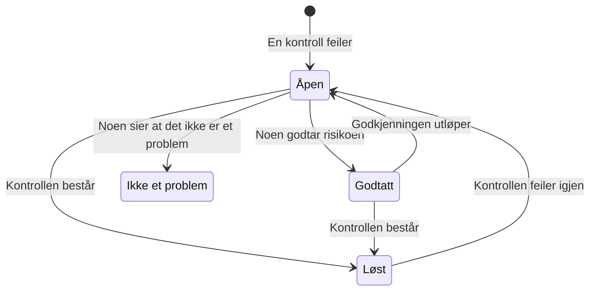

# Kontroller og problemer i Datasikkerhet

Datasikkerhet kjører 32 kontroller på hvert datalager, i ni grupper. En kontroll leser det som er kjent om ett datalager – hvordan det er konfigurert, hva som er funnet i det, hvem som kan nå det, hvor det befinner seg – og består, feiler eller kan ikke avgjøre. En kontroll som feiler, åpner ett problem på datalageret, og problemet lukkes av seg selv når kontrollen består. Denne siden viser hver kontroll, hvordan alvorlighetsgraden og risikoscoren til et problem beregnes, og hva som skjer med et problem gjennom livsløpet.

:::cards
- [Hvordan en kontroll avgjør](#hvordan-en-kontroll-avgjør): Bestått, feilet eller kan ikke avgjøre, og hvor alvorlig en feil er.
- [Hver kontroll](#hver-kontroll): Alle 32, med hva hver av dem kontrollerer og hvordan det fikses.
- [Risikoscore](#risikoscore): Hvordan problemer ordnes innenfor en alvorlighetsgrad.
- [Hva som skjer med et problem](#hva-som-skjer-med-et-problem): Åpent, løst, godtatt, ikke et problem.
- [Fiks det herfra](#fiks-det-herfra): Blokker en offentlig bucket, eller stopp deling av et øyeblikksbilde, med ett klikk.
:::

## Hvordan en kontroll avgjør

Hver kontroll leser fakta om et datalager og svarer på én av fire måter:

| Svar | Hva det betyr | Hva som skjer med problemet |
| --- | --- | --- |
| Bestått | Kontrollen finner ingenting galt. | Et åpent eller godtatt problem blir løst. |
| Feilet | Kontrollen finner problemet, og sier hva den så i én setning: problemets bevis. | Et problem åpnes, eller det åpne oppdateres. |
| Kan ikke avgjøre | En opplysning kunne ikke leses: en tillatelse rollen ikke har, et kall som feilet. | Ingenting endres: et åpent problem forblir åpent, fordi ingen kan slutte at et problem er løst når OneUptime ikke kunne se. |
| Gjelder ikke | Datalagerets type har ingen slik innstilling. | Et åpent problem blir løst. |

### Alvorlighetsgraden følger dataene

Det samme problemet betyr mer for mer sensitive data. Hver kontroll angir en alvorlighetsgrad for hvert sensitivitetsnivå, og et problem får den som gjelder for datalageret: en offentlig bucket med kortnumre er Kritisk, en offentlig bucket med bilder til et nettsted bare Lav. En strek betyr ikke noe problem i det hele tatt. Sensitiviteten til et datalager kommer fra funnene (se [Sensitive datatyper](/docs/data-security/data-types#sensitivitet)), så innholdsprøver gir riktige alvorlighetsgrader.

Noen få kontroller setter i stedet alvorlighetsgraden ut fra det de så. **Det lagres hemmeligheter i det** er Høy på alle datalagre, og Kritisk på et datalager som er offentlig eller delt med andre kontoer.

## Hver kontroll

Alvorlighetsgraden er oppgitt for data som er Begrenset, Konfidensiell, Intern og Offentlig, i den rekkefølgen. Siden til hvert problem viser den fullstendige løsningen for sitt eget datalager – stegene i konsollen, CLI-kommandoen og, der det passer, Terraform – med navnet og regionen til datalageret fylt ut.

### Eksponering

| Kontroll | Kjører på | Hva den kontrollerer | Alvorlighetsgrad | Slik fikser du det |
| --- | --- | --- | --- | --- |
| Hvem som helst på internett kan lese det (`public-read`) | Objektlagring, datavarehus, søk | Datalagerets policy, ACL eller IAM-bindinger lar hvem som helst lese dataene uten å logge på. | Kritisk / Kritisk / Høy / Lav | Fjern alle tildelinger til anonyme eller alle autentiserte prinsipaler. Filer som må være offentlige, hører hjemme i et datalager merket **Offentlig med vilje** som ikke inneholder noe annet. |
| Hvem som helst på internett kan endre det (`public-write`) | Objektlagring, datavarehus, søk | Datalagerets policy, ACL eller IAM-bindinger lar hvem som helst skrive eller slette dataene. | Kritisk / Kritisk / Kritisk / Høy | Fjern alle skrive- eller slettetildelinger til anonyme eller alle autentiserte prinsipaler. |
| Offentlig tilgang er ikke blokkert (`public-access-not-blocked`) | AWS S3 Bucket | S3 Block Public Access er ikke helt slått på for bucketen eller kontoen, så én endring i policyen kan gjøre den offentlig. | Høy / Middels / Lav / — | Slå på alle de fire Block Public Access-innstillingene for bucketen. |
| Databasen godtar tilkoblinger fra internett (`internet-reachable`) | Database, datavarehus, søk, cache | Databasen har et offentlig endepunkt eller offentlig nettverkstilgang slått på. | Høy / Høy / Middels / Lav | Slå av det offentlige endepunktet, og nå databasen gjennom et privat nettverk eller en bastion. |
| Brannmuren slipper inn alle adresser (`open-to-all-addresses`) | Database, datavarehus, søk, cache | En brannmurregel eller et autorisert nettverk tillater 0.0.0.0/0 eller hele adresseområdet. | Kritisk / Kritisk / Høy / Middels | Erstatt regelen som tillater alt, med adressene eller nettverkene som trenger tilgang. |
| Et øyeblikksbilde av det kan gjenopprettes av hvem som helst (`snapshot-public`) | Database, øyeblikksbilde | Et øyeblikksbilde av databasen er delt offentlig, så enhver skykonto kan gjenopprette en full kopi. | Kritisk / Kritisk / Kritisk / Høy | Gjør øyeblikksbildet privat. |
| Et øyeblikksbilde av det er delt med andre kontoer (`snapshot-shared-externally`) | Database, øyeblikksbilde | Et øyeblikksbilde av databasen er delt med kontoer utenfor de tilkoblede. | Høy / Høy / Middels / Lav | Slutt å dele øyeblikksbildet med kontoene som ikke skal ha det. |
| Kontoer utenfor organisasjonen din kan nå det (`shared-with-external-accounts`) | Alle datalagre unntatt telemetri | Datalagerets policy gir tilgang til kontoer, leietakere eller prosjekter som ikke er koblet til OneUptime. | Høy / Høy / Middels / Lav | Gå gjennom hver ekstern prinsipal, og fjern dem som ikke trenger tilgang. |

### Kryptering

| Kontroll | Kjører på | Hva den kontrollerer | Alvorlighetsgrad | Slik fikser du det |
| --- | --- | --- | --- | --- |
| Dataene er ikke kryptert i hvile (`not-encrypted-at-rest`) | Alle datalagre unntatt telemetri | Lagringskryptering er slått av. | Høy / Middels / Lav / — | Slå på kryptering i hvile. En RDS-instans kan ikke krypteres på stedet: gjenopprett en kryptert kopi av øyeblikksbildet. |
| Begrensede data er ikke under din egen nøkkel (`no-customer-managed-key`) | Alle datalagre unntatt telemetri | Datalageret inneholder data med sensitiviteten Begrenset, men er kryptert med leverandørens standardnøkkel, ikke en kundeadministrert nøkkel. | Middels / — / — / — | Krypter datalageret med en nøkkel du administrerer i nøkkeltjenesten din. |
| Ukrypterte tilkoblinger er tillatt (`encryption-in-transit-not-enforced`) | Alle datalagre unntatt telemetri | Datalageret godtar tilkoblinger som ikke bruker TLS. | Høy / Middels / Lav / — | Krev TLS for hver tilkobling. I S3 avviser du alle forespørsler der `aws:SecureTransport` er false. |
| Det godtar TLS eldre enn 1.2 (`weak-tls`) | Alle datalagre unntatt telemetri | Minste TLS-versjon er 1.0 eller 1.1. | Middels / Middels / Lav / — | Sett minste TLS-versjon til 1.2 eller nyere. |

### Gjenoppretting

| Kontroll | Kjører på | Hva den kontrollerer | Alvorlighetsgrad | Slik fikser du det |
| --- | --- | --- | --- | --- |
| Det har ingen sikkerhetskopier, eller beholder dem kortere enn 7 dager (`no-backups`) | Database, datavarehus | Automatiske sikkerhetskopier er av, eller beholdes i færre enn 7 dager. | Høy / Middels / Lav / — | Slå på automatiske sikkerhetskopier, og behold dem i minst 7 dager. |
| Gjenoppretting til et tidspunkt er av (`no-point-in-time-recovery`) | AWS DynamoDB Table, Azure Cosmos DB Account | Tabellen eller databasen kan ikke gjenopprettes til et øyeblikk før en feil. | Middels / Lav / — / — | Slå på gjenoppretting til et tidspunkt. |
| Det kan slettes i ett steg (`deletion-protection-off`) | Database, datavarehus | Slettebeskyttelse er av. | Middels / Lav / — / — | Slå på slettebeskyttelse. |
| Slettede eller overskrevne filer kan ikke gjenopprettes (`deleted-data-not-recoverable`) | Objektlagring | Versjonering og myk sletting er begge av. | Middels / Lav / — / — | Slå på versjonering eller myk sletting. |

### Synlighet

| Kontroll | Kjører på | Hva den kontrollerer | Alvorlighetsgrad | Slik fikser du det |
| --- | --- | --- | --- | --- |
| Ingen ville vite hvem som leste det (`access-not-logged`) | Alle datalagre unntatt telemetri | Lesinger fra datalageret logges ikke: ingen tilgangslogger, ingen revisjonslogger for datatilgang. | Høy / Middels / Lav / — | Slå på tilgangs- eller revisjonslogging for lesinger: S3 server access logs eller CloudTrail data events, StorageRead-diagnostikklogger i Azure, Data Access-revisjonslogger i Cloud Storage. |

### Tilgang

| Kontroll | Kjører på | Hva den kontrollerer | Alvorlighetsgrad | Slik fikser du det |
| --- | --- | --- | --- | --- |
| Alle med kontonøkkelen kan lese alt (`shared-key-access`) | Azure Storage Account | Lagringskontoen tillater tilgang med delt nøkkel, som omgår Microsoft Entra ID og ikke etterlater noe revisjonsspor per person. | Middels / Lav / — / — | Flytt applikasjonene til Microsoft Entra ID, og slå deretter av tilgang med lagringskontonøkkel. |
| Objekter kan ha sine egne tilgangsregler (`object-acls-enabled`) | AWS S3 Bucket, Google Cloud Storage Bucket | Objekt-ACL-er er på, så ett objekt kan gjøres offentlig mens bucketen ser privat ut. | Lav / Lav / — / — | I S3 setter du Object Ownership til Bucket owner enforced. I Cloud Storage slår du på uniform bucket-level access. |
| Mer enn 25 identiteter kan lese begrensede data (`many-readers`) | Alle datalagre unntatt telemetri | Flere identiteter enn de fleste team klarer å gå gjennom, har lesetilgang til datalageret. | Middels / — / — / — | Åpne siden **Hvem kan nå det** for datalageret, og fjern tilgang som er ubrukt eller bredere enn nødvendig. |

### Datahygiene

| Kontroll | Kjører på | Hva den kontrollerer | Alvorlighetsgrad | Slik fikser du det |
| --- | --- | --- | --- | --- |
| Det lagres hemmeligheter i det (`secrets-stored`) | Alle datalagre unntatt telemetri | Passord, API-nøkler, tokens eller private nøkler ble funnet i datalagerets data. | Høy / Høy / Høy / Høy | Roter hver hemmelighet som er funnet, som om den var lekket. Flytt hemmeligheter til en hemmelighetsbehandler og slett dem fra datalageret. |
| Kortsikkerhetskoder lagres (`card-security-codes-stored`) | Alle datalagre unntatt telemetri | CVV- eller CVC-koder ble funnet. PCI DSS forbyr å lagre dem etter at en betaling er autorisert, kryptert eller ikke. | Kritisk / Kritisk / Kritisk / Kritisk | Stopp koden som skriver dem, slett de lagrede kodene, og sjekk at ingen er igjen i sikkerhetskopier. |
| Kortnumre lagres i lesbar form (`card-numbers-readable`) | Alle datalagre unntatt telemetri | Fullstendige kortnumre ble funnet i lesbar form. PCI DSS krever at de er uleselige uansett hvor de lagres. | Høy / Høy / Høy / Høy | Tokeniser kortnumre hos betalingsleverandøren din, eller krypter dem på feltnivå, og slett de lesbare kopiene. |
| Passord lagres i klartekst (`plaintext-passwords`) | Alle datalagre unntatt telemetri | Et passordfelt inneholder verdier som ikke er passordhasher (bcrypt, argon2, scrypt eller PBKDF2). | Kritisk / Kritisk / Kritisk / Kritisk | Hash passord med bcrypt, scrypt eller argon2, migrer de lagrede, og få alle kontoer til å tilbakestille passordet. |
| Produksjonsdata ble kopiert til et datalager utenfor produksjon (`production-data-in-non-production`) | Alle datalagre unntatt telemetri | Verdier funnet i et produksjonslager ble også funnet her, i et utviklings-, test- eller stagingdatalager. | Høy / Middels / — / — | Erstatt kopien med maskerte eller syntetiske data, og slett de ekte dataene fra datalageret utenfor produksjon. |
| Sensitive data ingen har brukt på 90 dager (`stale-sensitive-data`) | Alle datalagre unntatt telemetri | Datalageret inneholder sensitive data og har ikke hatt lesinger eller skrivinger på 90 dager. | Middels / Lav / — / — | Bekreft at dataene ikke lenger trengs, og arkiver dem deretter med en oppbevaringsdato, eller slett dem. |
| Ingen eier dette sensitive datalageret (`no-owner`) | Alle datalagre | Datalageret inneholder sensitive data og har ingen eier. | Middels / Lav / — / — | Legg til en eier på siden **Eiere** for datalageret, eller en eierregel som treffer taggene. |

### Telemetri

| Kontroll | Kjører på | Hva den kontrollerer | Alvorlighetsgrad | Slik fikser du det |
| --- | --- | --- | --- | --- |
| Sensitive data når telemetrien din (`sensitive-data-in-telemetry`) | Telemetri | Logger, traser, unntak, avspillinger eller AI-samtaler inneholder sensitive data som ingen rensingsregel maskerer. | Høy / Middels / Lav / — | Trykk på **Rens** på hvert funn for å maskere dataene ved inntak, og fiks deretter koden som skriver dem. |
| Hemmeligheter når telemetrien din (`secrets-in-telemetry`) | Telemetri | Passord, API-nøkler eller tokens vises i logger, traser, unntak eller AI-samtaler. | Kritisk / Kritisk / Kritisk / Kritisk | Roter hemmeligheten først, trykk deretter på **Rens** og fiks koden som skriver den. |

### Residens

| Kontroll | Kjører på | Hva den kontrollerer | Alvorlighetsgrad | Slik fikser du det |
| --- | --- | --- | --- | --- |
| Data lagres utenfor regionene de kan ligge i (`residency-violation`) | Alle datalagre unntatt telemetri | Datalagerets region, eller en region dataene replikeres til, bryter en residensregel. | Høy / Høy / Middels / — | Flytt dataene til en tillatt region, eller slutt å kopiere dem til den andre. Hvis overføringen er lovlig, godtar du problemet og registrerer hvorfor. |

### AI

| Kontroll | Kjører på | Hva den kontrollerer | Alvorlighetsgrad | Slik fikser du det |
| --- | --- | --- | --- | --- |
| Sensitive data sendes til en AI-leverandør (`sensitive-data-to-ai`) | AI-samtaler | AI-samtaler registrert i OneUptime bærer sensitive data til en modelleverandør. | Kritisk / Høy / Lav / — | Fjern sensitive verdier før prompter sendes, eller send disse kallene til en modell du drifter selv. |
| Begrensede data ligger i et datalager som brukes til AI (`sensitive-data-in-ai-store`) | Alle datalagre unntatt telemetri | Et datalager tagget som data for AI-trening eller -gjenfinning inneholder data med sensitiviteten Begrenset. | Høy / Middels / — / — | Fjern eller masker de begrensede dataene før de brukes til å trene eller forankre en modell. |

## Risikoscore

Alvorlighetsgraden sier hvor alvorlig et problem er. Risikoscoren, fra 0 til 100, ordner problemene innenfor én alvorlighetsgrad, ut fra det som gjør det samme problemet verre:

```text
risk = severity + 10 × exposure + 6 × volume + 5 × activity + 4 × production, at most 100
```

| Faktor | Poeng |
| --- | --- |
| Alvorlighetsgrad | 75 for Kritisk, 50 for Høy, 25 for Middels, 0 for Lav |
| Eksponering | 10 for Offentlig, 8 for Andre kontoer, 6 for Tilgjengelig fra internett, 3 for Ukjent, 0 for Privat |
| Volum | Opptil 6, etter datalagerets anslåtte antall sensitive poster på en logaritmisk skala: 1 for 10 poster, 3 for 1 000, 5 for en million, 6 for ti millioner eller mer |
| Aktivitet | 5 når Security Operations har sett deteksjoner på datalageret den siste uken |
| Produksjon | 4 for et datalager i produksjon |

Tilleggene gir høyst 25 poeng, så et problem får aldri lavere score enn et problem med lavere alvorlighetsgrad. En offentlig produksjonsbucket med en million poster med begrensede data får 75 + 10 + 5 + 4 = 94 for et kritisk problem. Hvert problem viser faktorene som bidro til scoren, med poengene, og datalageret viser scoren til det verste åpne problemet.

Miljøet til et datalager – Produksjon, Staging, Development, Test eller Ukjent – kommer fra taggene (`env`, `environment`, `stage`, `tier` og lignende) eller, uten en slik tagg, fra ordene i navnet, som `prod`, `staging`, `dev` eller `qa`. Sett det på datalageret når ingen av dem sier det.

## Hva som skjer med et problem



OneUptime åpner, oppdaterer og løser problemer etter hvert som kontrollene kjører. Det en person gjør med et problem, er å bestemme hva som skjer videre:

| Status | Hvordan det havner der | Hva som følger |
| --- | --- | --- |
| **Åpen** | Kontrollen feiler på datalageret nå. | Det teller på Oversikt, i datalagerets sammendrag og i samsvar, til kontrollen består. |
| **Løst** | Kontrollen besto ved en senere kjøring, gjelder ikke lenger eller ble slått av, eller datalageret ble arkivert. En person kan også velge **Merk som løst**: datalageret kontrolleres da på nytt med en gang. | Det åpnes igjen hvis kontrollen feiler igjen, og problemet teller hvor ofte det er gjenåpnet. |
| **Godtatt** | En person valgte **Godta risiko**, med en **Årsak** og en dato i **Godtatt til**, høyst ett år frem i tid. | Det forblir lukket til den datoen, og åpnes deretter igjen hvis kontrollen fortsatt feiler. Godta det igjen da hvis årsaken fortsatt gjelder. |
| **Ikke et problem** | En person valgte **Ikke et problem**: funnet var feil. | Det forblir lukket, selv mens kontrollen feiler. **Gjenåpne** setter det tilbake til Åpen. |

Security Member, Security Admin, Project Admin og Project Owner kan endre statusen til et problem, og bruke **Tildel** for å gi det til en person eller et team. Hver endring skrives til problemets **Tidslinje**: når det ble åpnet, hver endring i alvorlighetsgrad, hver statusendring og hvem som gjorde den, nye kontroller som ble bedt om, og hva integrasjonene gjorde.

Et problem som åpnes igjen, beholder historikken sin. Godtatte risikoer vurderes på nytt hver dag, så en godkjenning utløper i tide selv når ingenting er skannet.

## Fiks det herfra

Et åpent problem om en offentlig bucket eller et delt øyeblikksbilde kan fikses fra siden til problemet. Over stegene i konsollen tilbyr **Fiks det herfra** endringen som fikser det:

| Problemet | Datalageret | Knappen | Hva den endrer |
| --- | --- | --- | --- |
| `public-read`, `public-write` eller `public-access-not-blocked` | En S3-bucket, en Azure-lagringskonto eller en Cloud Storage-bucket | **Blokker offentlig tilgang** | Slår på de fire Block Public Access-innstillingene for bucketen, slår av anonym blob-tilgang for lagringskontoen, eller håndhever forhindring av offentlig tilgang for bucketen |
| `snapshot-public` eller `snapshot-shared-externally` | Et RDS-øyeblikksbilde, en RDS-database, eller en Aurora- eller DocumentDB-klynge | **Tilbakekall deling** | Slutter å dele øyeblikksbildet, eller hvert delte manuelle øyeblikksbilde av databasen, med alle og med kontoer utenfor dem du har koblet til |

Den spør først, og sier hva som endres og hva som slutter å virke. Den endrer hvordan datalageret deles, aldri dataene, og endrer ingenting som allerede er lukket. Et datalager merket **Offentlig med vilje** blir aldri blokkert.

Den handler gjennom skytilkoblingen til datalageret, så tilkoblingen må ha **Datasikkerhetsrespons** slått på og oppsettkommandoen kjørt på nytt (se [Sett opp Datasikkerhet](/docs/data-security/setup#la-datasikkerhet-lukke-en-eksponering)). Inntil da sier panelet hva du må slå på. Datalageret kontrolleres på nytt rett etterpå, og problemet løses av seg selv når kontrollen består. Problemets **Tidslinje** og datalagerets **Tidslinje** viser hva som ble gjort, og hvem som gjorde det.

## Innstillinger for kontroller

**Datasikkerhet → Innstillinger → Sjekker** viser hver kontroll etter gruppe, med hva den ser etter og alvorlighetsgraden en feil får for hver sensitivitet. Hver kontroll kan justeres for prosjektet, og hver endring lagres med en gang:

- **Bryteren** slår av kontrollen når den ikke passer med måten du jobber på. De åpne og godtatte problemene blir løst, og sier at kontrollen ikke lenger kjører.
- **Alvorlighetsgraden** er **Etter sensitivitet** som standard, eller én alvorlighetsgrad som hver feil i kontrollen får, uansett hva datalageret inneholder.

For å dempe en kontroll på bare ett datalager godtar du risikoen på problemet for det datalageret, eller merker problemet som ikke et problem. For et funn som er feil, heller enn et problem som ikke betyr noe, merker du i stedet funnet som ikke sensitivt (se [Sensitive datatyper](/docs/data-security/data-types#ikke-sensitivt-og-aldri-sensitivt)).

**Kontroller nå** på et datalager leser konfigurasjonen på nytt og kjører kontrollene. **Skann nå** tar prøver av innholdet, og kontrollene kjører når skanningen er ferdig.

## Neste steg

:::cards
- [Integrasjoner for Datasikkerhet](/docs/data-security/integrations): Sikkerhetssaker, varsler og e-post til eiere når et problem åpnes.
- [Dataflyt, tilgang og residens](/docs/data-security/flows-access-residency): Tilgangen, kopiene og regionene flere kontroller leser.
- [Samsvar i Datasikkerhet](/docs/data-security/compliance): Kravene i rammeverkene som hver kontroll er bevis for.
:::
