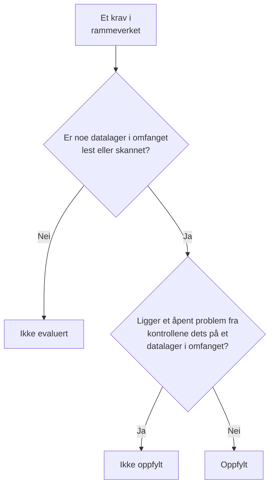

# Samsvar i Datasikkerhet

Datasikkerhet gir ni samsvarsrammeverk en score ut fra det skanningene fant. Hvert rammeverk dekker datalagrene reglene i det handler om – GDPR datalagrene som inneholder personopplysninger, PCI DSS datalagrene der det ble funnet kortdata, SOC 2 alle datalagre – og om hvert krav i det er oppfylt, avgjøres av kontrollene som er bevis for det. **Datasikkerhet → Samsvar** viser scoren for hvert rammeverk, hvor mange datalagre det dekker, og hvert krav med hvor mange åpne problemer som bryter det. En score er bevis til en revisjon, ikke et sertifikat: den sier hva OneUptime kan se av datalagrene den leser.

:::cards
- [Rammeverkene](#rammeverkene): De ni, og hvilke datalagre hvert av dem dekker.
- [Slik får et rammeverk sin score](#slik-får-et-rammeverk-sin-score): Krav som er oppfylt, ikke oppfylt eller ikke evaluert.
- [Kravene og kontrollene deres](#kravene-og-kontrollene-deres): Hvert krav, og kontrollene som er bevis for det.
- [Behandlingsprotokoll](#behandlingsprotokoll): GDPR artikkel 30, skrevet ut fra datalagrene dine.
:::

## Rammeverkene

| Rammeverk | Fullt navn | Datalagre som omfattes |
| --- | --- | --- |
| GDPR | EUs personvernforordning | Datalagre som inneholder personopplysninger. |
| CCPA | California Consumer Privacy Act, slik den er endret av CPRA | Datalagre som inneholder personlig informasjon. |
| HIPAA | HIPAA Security Rule | Datalagre som inneholder helsedata. |
| PCI DSS | PCI DSS v4.0 | Datalagre der det ble funnet kortnumre. |
| SOC 2 | SOC 2 Trust Services Criteria | Alle datalagre. |
| ISO 27001 | ISO/IEC 27001:2022 | Alle datalagre. |
| NIST CSF | NIST Cybersecurity Framework 2.0 | Alle datalagre. |
| LGPD | Brasils generelle lov om personvern | Datalagre som inneholder personopplysninger om personer i Brasil. |
| DPDP | Indias Digital Personal Data Protection Act, 2023 | Datalagre som inneholder personopplysninger om personer i India. |

## Hvilke datalagre et rammeverk dekker

Hvilke rammeverk et datalager omfattes av, følger av dataene som er funnet i det, så det endres etter hvert som skanningene finner mer:

- **SOC 2, ISO 27001 og NIST CSF** er sikkerhetsrammeverk: de dekker alle datalagre, uansett hva de inneholder.
- **GDPR, CCPA, HIPAA og PCI DSS** dekker datalagrene som inneholder en datatype de beskytter. Personopplysninger tar inn GDPR og CCPA, helsedata i tillegg HIPAA, og kortnumre, sikkerhetskoder for kort og utløpsdatoer for kort PCI DSS. Et datalager som bare inneholder hemmeligheter eller forretningsdokumenter, omfattes av ingen av dem.
- **LGPD og DPDP** er lands egne lover: de dekker datalagrene som inneholder personopplysninger om personer i Brasil eller i India, lest ut fra datatyper som hører til det landet, for eksempel et brasiliansk CPF eller et indisk Aadhaar-nummer.

[Sensitive datatyper](/docs/data-security/data-types#innebygde-datatyper) lister opp hver datatype, med landet sitt.

## Slik får et rammeverk sin score

- **Et krav er oppfylt** når ingen åpne problemer fra kontrollene som er knyttet til det, ligger på et datalager i rammeverkets omfang, og **ikke oppfylt** når ett gjør det.
- **Det er ikke evaluert** så lenge ingen datalagre i omfanget har fått konfigurasjonen lest eller innholdet skannet.
- **To krav oppfylles av Datasikkerhet selv**: GDPR artikkel 30, protokoll over behandlingsaktiviteter, og ISO 27001 A.5.12, klassifisering av informasjon. De er oppfylt når hvert datalager i omfanget er lest eller skannet, og ikke oppfylt så lenge ett ikke er det.
- **Scoren** er andelen av rammeverkets evaluerte krav som er oppfylt, som en hel prosent. Et rammeverk der ingenting er evaluert, har ingen score.

Bare åpne problemer teller. Et problem der risikoen er godtatt, eller som ikke er et problem, bryter ikke kravene sine, så en godtatt risiko er en beslutning revisjonen din kan se på problemet: hvem som godtok den, hvorfor og til når.

## Kravene og kontrollene deres

### GDPR

| Krav | Hva det krever | Kontroller |
| --- | --- | --- |
| Art. 5(1)(c) | Dataminimering | `production-data-in-non-production`, `stale-sensitive-data`, `sensitive-data-in-telemetry`, `sensitive-data-to-ai`, `sensitive-data-in-ai-store` |
| Art. 5(1)(e) | Lagringsbegrensning | `stale-sensitive-data` |
| Art. 25 | Innebygd personvern og personvern som standard | `production-data-in-non-production`, `stale-sensitive-data`, `sensitive-data-in-telemetry`, `sensitive-data-to-ai`, `sensitive-data-in-ai-store` |
| Art. 28 | Databehandlere | `sensitive-data-to-ai` |
| Art. 30 | Protokoll over behandlingsaktiviteter | Oppfylt av Datasikkerhet selv |
| Art. 32 | Sikkerhet ved behandlingen | `public-read`, `public-write`, `public-access-not-blocked`, `internet-reachable`, `open-to-all-addresses`, `snapshot-public`, `snapshot-shared-externally`, `shared-with-external-accounts`, `not-encrypted-at-rest`, `no-customer-managed-key`, `encryption-in-transit-not-enforced`, `weak-tls`, `no-backups`, `no-point-in-time-recovery`, `deletion-protection-off`, `deleted-data-not-recoverable`, `access-not-logged`, `shared-key-access`, `object-acls-enabled`, `many-readers`, `secrets-stored`, `plaintext-passwords`, `secrets-in-telemetry` |
| Art. 44-49 | Overføringer til tredjeland | `residency-violation` |

### CCPA

| Krav | Hva det krever | Kontroller |
| --- | --- | --- |
| 1798.100(c) | Innsamling begrenset til det som er nødvendig | `production-data-in-non-production`, `stale-sensitive-data`, `sensitive-data-in-telemetry`, `sensitive-data-to-ai`, `sensitive-data-in-ai-store` |
| 1798.150 | Rimelige sikkerhetsprosedyrer | `public-read`, `public-write`, `public-access-not-blocked`, `internet-reachable`, `open-to-all-addresses`, `snapshot-public`, `snapshot-shared-externally`, `shared-with-external-accounts`, `shared-key-access`, `object-acls-enabled`, `many-readers` |

### HIPAA

| Krav | Hva det krever | Kontroller |
| --- | --- | --- |
| 164.308(a)(7) | Beredskapsplan | `no-backups`, `no-point-in-time-recovery`, `deletion-protection-off`, `deleted-data-not-recoverable` |
| 164.312(a)(1) | Tilgangskontroll | `public-read`, `public-write`, `public-access-not-blocked`, `internet-reachable`, `open-to-all-addresses`, `snapshot-public`, `snapshot-shared-externally`, `shared-with-external-accounts`, `shared-key-access`, `object-acls-enabled`, `many-readers` |
| 164.312(a)(2)(iv) | Kryptering og dekryptering | `not-encrypted-at-rest`, `no-customer-managed-key` |
| 164.312(b) | Revisjonskontroller | `access-not-logged` |
| 164.312(e)(1) | Overføringssikkerhet | `encryption-in-transit-not-enforced`, `weak-tls` |

### PCI DSS

| Krav | Hva det krever | Kontroller |
| --- | --- | --- |
| 3.3.1 | Sensitive autentiseringsdata beholdes ikke etter autorisering | `card-security-codes-stored` |
| 3.4.1 | Kortnumre maskeres når de vises | `card-numbers-readable`, `sensitive-data-in-telemetry` |
| 3.5.1 | Kortnumre er uleselige overalt der de lagres | `not-encrypted-at-rest`, `no-customer-managed-key`, `card-numbers-readable` |
| 4.2.1 | Sterk kryptografi beskytter kortdata under overføring | `encryption-in-transit-not-enforced`, `weak-tls` |
| 7.2 | Tilgang defineres og tildeles etter behov | `public-read`, `public-write`, `public-access-not-blocked`, `internet-reachable`, `open-to-all-addresses`, `snapshot-public`, `snapshot-shared-externally`, `shared-with-external-accounts`, `shared-key-access`, `object-acls-enabled`, `many-readers` |
| 8.3.2 | Autentiseringsfaktorer er uleselige når de lagres | `plaintext-passwords` |
| 10.2 | Revisjonslogger registrerer tilgang til kortdata | `access-not-logged` |

### SOC 2

| Krav | Hva det krever | Kontroller |
| --- | --- | --- |
| A1.2 | Sikkerhetskopiering og gjenoppretting | `no-backups`, `no-point-in-time-recovery`, `deletion-protection-off`, `deleted-data-not-recoverable` |
| CC6.1 | Logisk tilgangssikkerhet | `public-read`, `public-write`, `public-access-not-blocked`, `internet-reachable`, `open-to-all-addresses`, `snapshot-public`, `snapshot-shared-externally`, `shared-with-external-accounts`, `not-encrypted-at-rest`, `no-customer-managed-key`, `shared-key-access`, `object-acls-enabled`, `many-readers`, `secrets-stored`, `plaintext-passwords`, `secrets-in-telemetry` |
| CC6.7 | Overføring av informasjon | `encryption-in-transit-not-enforced`, `weak-tls` |
| CC7.2 | Overvåking av systemkomponenter | `access-not-logged` |

### ISO 27001

| Krav | Hva det krever | Kontroller |
| --- | --- | --- |
| A.5.9 | Fortegnelse over informasjon og andre tilknyttede aktiva | `no-owner` |
| A.5.12 | Klassifisering av informasjon | Oppfylt av Datasikkerhet selv |
| A.5.15 | Tilgangskontroll | `public-read`, `public-write`, `public-access-not-blocked`, `internet-reachable`, `open-to-all-addresses`, `snapshot-public`, `snapshot-shared-externally`, `shared-with-external-accounts`, `shared-key-access`, `object-acls-enabled`, `many-readers` |
| A.5.34 | Personvern og beskyttelse av PII | `production-data-in-non-production`, `stale-sensitive-data`, `sensitive-data-in-telemetry`, `sensitive-data-to-ai`, `sensitive-data-in-ai-store` |
| A.8.11 | Datamaskering | `production-data-in-non-production`, `stale-sensitive-data`, `sensitive-data-in-telemetry`, `sensitive-data-to-ai`, `sensitive-data-in-ai-store` |
| A.8.12 | Forebygging av datalekkasje | `secrets-stored`, `secrets-in-telemetry` |
| A.8.13 | Sikkerhetskopiering av informasjon | `no-backups`, `no-point-in-time-recovery`, `deletion-protection-off`, `deleted-data-not-recoverable` |
| A.8.15 | Logging | `access-not-logged` |
| A.8.24 | Bruk av kryptografi | `not-encrypted-at-rest`, `no-customer-managed-key`, `encryption-in-transit-not-enforced`, `weak-tls`, `plaintext-passwords` |

### NIST CSF

| Krav | Hva det krever | Kontroller |
| --- | --- | --- |
| ID.AM-07 | Oversikter over data og metadata vedlikeholdes | `no-owner` |
| PR.AA-05 | Tilgangstillatelser forvaltes | `public-read`, `public-write`, `public-access-not-blocked`, `internet-reachable`, `open-to-all-addresses`, `snapshot-public`, `snapshot-shared-externally`, `shared-with-external-accounts`, `shared-key-access`, `object-acls-enabled`, `many-readers` |
| PR.DS-01 | Data i ro er beskyttet | `not-encrypted-at-rest`, `no-customer-managed-key`, `secrets-stored`, `secrets-in-telemetry` |
| PR.DS-02 | Data under overføring er beskyttet | `encryption-in-transit-not-enforced`, `weak-tls` |
| PR.DS-11 | Sikkerhetskopier av data tas vare på og testes | `no-backups`, `no-point-in-time-recovery`, `deletion-protection-off`, `deleted-data-not-recoverable` |
| DE.CM-09 | Data og bruken av dem overvåkes | `access-not-logged` |

### LGPD

| Krav | Hva det krever | Kontroller |
| --- | --- | --- |
| Art. 6 | Nødvendighet og formålsbegrensning | `production-data-in-non-production`, `stale-sensitive-data`, `sensitive-data-in-telemetry`, `sensitive-data-to-ai`, `sensitive-data-in-ai-store` |
| Art. 33 | Internasjonal overføring av data | `residency-violation` |
| Art. 46 | Sikkerhetstiltak | `public-read`, `public-write`, `public-access-not-blocked`, `internet-reachable`, `open-to-all-addresses`, `snapshot-public`, `snapshot-shared-externally`, `shared-with-external-accounts`, `not-encrypted-at-rest`, `no-customer-managed-key`, `shared-key-access`, `object-acls-enabled`, `many-readers` |

### DPDP

| Krav | Hva det krever | Kontroller |
| --- | --- | --- |
| Sec. 8(5) | Rimelige sikkerhetstiltak | `public-read`, `public-write`, `public-access-not-blocked`, `internet-reachable`, `open-to-all-addresses`, `snapshot-public`, `snapshot-shared-externally`, `shared-with-external-accounts`, `not-encrypted-at-rest`, `no-customer-managed-key`, `shared-key-access`, `object-acls-enabled`, `many-readers` |
| Sec. 8(7) | Sletting når formålet er oppfylt | `production-data-in-non-production`, `stale-sensitive-data`, `sensitive-data-in-telemetry`, `sensitive-data-to-ai`, `sensitive-data-in-ai-store` |
| Sec. 16 | Overføring utenfor India | `residency-violation` |

## Behandlingsprotokoll

GDPR artikkel 30 krever at du fører en protokoll over behandlingsaktivitetene dine. Datasikkerhet skriver den delen av den som handler om hvor personopplysninger oppbevares: én rad for hvert datalager som inneholder personopplysninger.

| Kolonne | Hvor den kommer fra |
| --- | --- |
| Datalager, type, leverandør og region | Discovery |
| Miljø | Taggene eller navnet til datalageret, eller det du angir |
| Sensitivitet, kategorier og datatyper | Det skanningene fant, eller sensitiviteten du angir |
| Eiere | Eierne av datalageret, personer og medlemmene av teamene |
| Formål | Det du skriver i **Formål** for datalageret: hvorfor det inneholder personopplysninger |
| Oppbevaring | Det du skriver i **Oppbevaring** for datalageret: hvor lenge data oppbevares i det |
| Rammeverk | Rammeverkene datatypene bringer inn i omfanget |

Fyll ut **Formål** og **Oppbevaring** under **Innstillinger** for hvert datalager: det er de to tingene ingen skanning kan vite. Protokollen og scorene er også tilgjengelige fra API-et til Datasikkerhet, på `/data-security/record-of-processing` og `/data-security/compliance`, for alle som kan lese datalagre (se [Integrasjoner for Datasikkerhet](/docs/data-security/integrations#api-terraform-og-mcp)).

## Neste steg

:::cards
- [Kontroller og problemer i Datasikkerhet](/docs/data-security/checks-and-issues): Kontrollene bak hvert krav, og hvordan du retter dem.
- [Dataflyter, tilgang og residens](/docs/data-security/flows-access-residency): Residensregler, for overføringer etter GDPR, LGPD og DPDP.
- [Sensitive datatyper](/docs/data-security/data-types): Datatypene som bringer et datalager inn i omfanget til et rammeverk.
:::
