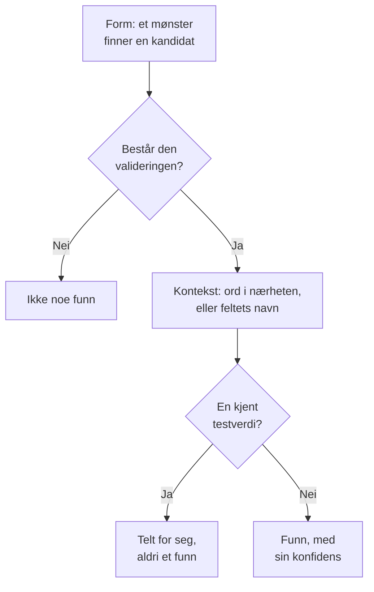

# Sensitive datatyper

Datasikkerhet kjenner 143 typer sensitive data: kortnumre, bankkontoer, nasjonale ID-er fra 43 land, helseidentifikatorer, API-nøkler og tokens, og de særlige kategoriene av personopplysninger. Hver har en kategori, en sensitivitet og, når den hører til ett land, det landet. Denne siden forklarer hvordan en verdi blir funnet, og viser hver datatype, så du kan se hvorfor noe ble funnet og bestemme hva du vil gjøre med det.

:::cards
- [Hvordan en verdi blir funnet](#hvordan-en-verdi-blir-funnet): Form, validator, kontekst, testverdier, konfidens.
- [Felt og kolonner](#felt-og-kolonner): Hvordan en hel kolonne eller et helt attributt vurderes.
- [Navn og gateadresser i fritekst](#navn-og-gateadresser-i-fritekst): Den lille modellen inne i skanneren, og hvor godt den treffer.
- [Hver datatype](#innebygde-datatyper): Alle 143, etter kategori.
- [Dine egne datatyper](#dine-egne-datatyper): Ansatt-ID-er, polisenumre og boksen Test det.
- [Datatyper som OneUptime AI finner](#datatyper-som-oneuptime-ai-finner): Dine egne datatyper, funnet i feltene som ingen detektor kunne plassere.
- [Vurderingene fra OneUptime AI](#vurderingene-fra-oneuptime-ai): En vurdering av hvert funn som venter på deg, med teamets beslutninger som presedens.
:::

## Hvordan en verdi blir funnet



Hver skanning – en logglinje, en CSV-celle, en databaserad, de første bytene av et objekt – kjører de samme stegene:

1. **Form.** Hver datatype har mønstre som finner kandidater: seksten sifre, `AKIA` og seksten bokstaver, et ord, en `@` og et domene. Et mønster treffer aldri inne i et lengre token, så et kortnummer blir ikke funnet inne i en lengre rekke sifre.
2. **Validator.** En kandidat må bestå typens egne regler: en kontrollsum (Luhn for kort, mod 97 for IBAN, Verhoeff for Aadhaar-numre, kontrollsifferet i de fleste nasjonale ID-er), en ekte dato, et kjent prefiks, nok tilfeldighet for en hemmelighet. En kandidat som feiler, er ikke noe funn i det hele tatt. Plassholdere som `000000000` og `123456789` feiler for alle numeriske typer.
3. **Kontekst.** Ord nær en kandidat – som standard opptil 64 tegn før og 32 etter – som sier hva den er, hever konfidensen ett nivå, og det samme gjør et felt med et navn som peker mot typen. Ord som sier at den er noe annet, som et ordre- eller sporingsnummer, senker den ett nivå. Et nummer uten kontrollsum og med en vanlig form, som et passnummer eller en bankkonto, teller bare ved siden av ord som navngir det.
4. **Kjente testverdier.** Publiserte testkortnumre (som Stripes `4242 4242 4242 4242`), eksempel-IBAN-er, adresser på `example.com` og andre reserverte domener, IP-adresser for dokumentasjon, eksempel-ID-ene som myndighetenes dokumentasjon trykker, testmodusnøkler som `sk_test_` og plassholdernøkler telles for seg. De gir aldri et funn, så et datalager fullt av dem ser ut som et testmiljø, ikke et brudd.
5. **Konfidens.** Det som er igjen, er et funn, så sikkert som bevisene tillater.

| Konfidens | Hva det betyr |
| --- | --- |
| **Høy** | Verdien besto valideringen, og ord rundt den eller feltet den står i sier hva den er – eller, for et felt, de fleste verdiene er av den typen. |
| **Middels** | Verdien besto valideringen uten noe rundt den som bekrefter den, eller feltets navn sier hva det inneholder og noen verdier stemmer overens. |
| **Lav** | Formen stemmer, men ingenting bekrefter den. |

Bare funn med Høy og Middels konfidens teller: de gjør et datalager sensitivt og kan åpne et problem. Funn med Lav konfidens vises på datalageret, sammenslått, slik at et menneske kan vurdere dem: **Bekreft** på et funn som stemmer, gjør det til Høy, og det forblir Høy i senere skanninger.

Når to datatyper gjør krav på de samme tegnene, vinner det sikreste funnet: høyest konfidens, deretter detektoren med egne regler som beviser mest, deretter det lengste treffet.

En verdi leses også slik folk skriver den. Prosentkodingene i en URL leses, så en IP-adresse eller en e-postadresse i en spørrestreng, som `jane%40example.com`, blir funnet. Sifrene i et kortnummer leses i enhver skrift, som sifre i full bredde (`４１１１ １１１１ １１１１ １１１１`) eller arabisk-indiske sifre, først hver skrift for seg og så sammen. En e-postadresse blir funnet i enhver skrift, som `张伟@example.com` eller `почта@пример.рф`, og en IPv6-adresse rett etter kolonet til en nøkkel, som `ip:2001:db8::1`. Hvert funn er verdien slik den er skrevet, så en rensingsregel skjuler den der.

En lang verdi leses i vinduer på 64 KB som overlapper med 4 KB, så en verdi blir funnet hel uansett hvor den står, og høyst 4 MB av én verdi leses.

## Felt og kolonner

En kolonne, et JSON-felt eller et loggattributt vurderes som en helhet. Navnet antyder en datatype, og verdiene i prøven beviser en. Andelen av verdiene som inneholder typen, avgjør hvor sikkert funnet er:

| Verdier som inneholder typen | Konfidens |
| --- | --- |
| 60 % eller mer | Høy |
| 25 % eller mer | Høy når feltets navn peker mot typen, ellers Middels |
| Færre | Middels når feltets navn peker mot typen, ellers Lav: noen få e-postadresser i en kolonne med noe annet |

Et felt der verdiene i snitt er lengre enn 80 tegn, er fritekst – notater, meldinger, beskrivelser – og forventes ikke å inneholde én type. Funnene beholder konfidensen hvert treff fikk for seg selv, og sier at de ble funnet i fritekst. Opptil 1 000 verdier av et felt klassifiseres, og opptil 16 KB av hver.

Navnet på et felt deles opp i ord – `customerEmail`, `customer_email` og `customer-email` er alle «customer email» – og navnehintet til en type treffer når ordene står i den rekkefølgen, ved siden av hverandre: «date of birth» treffer `customer_date_of_birth`, ikke `birth_city`. Bare den siste delen av en sti med punktum er feltets eget navn, sammen med delen før når den siste er et generelt ord som `number`, `id` eller `value`: `customer.address.city` er ikke en gateadresse, og `card.number` er fortsatt et kortnummer.

Noen datatyper kan ikke gjenkjennes på verdiene: ingen mønstre skiller en persons navn fra en gate, eller en religion fra et hvilket som helst annet ord. Disse blir bare funnet ut fra feltets navn, når feltet har verdier: Personnavn, Brukernavn, Kjønn, Nasjonalitet, Helseopplysninger, Rasemessig eller etnisk opprinnelse, Religiøs overbevisning, Seksuell orientering, Politisk oppfatning, Fagforeningsmedlemskap, Biometriske data, Genetiske data og Strafferegister. Et navn, et brukernavn, et kjønn eller en nasjonalitet er da Høy når 60 % eller mer av verdiene ser ut som det, og ellers Middels. I fritekst finnes personnavn og gateadresser også av en liten modell: se [Navn og gateadresser i fritekst](#navn-og-gateadresser-i-fritekst).

Et felt med et navn som sier at det inneholder et passord – `password`, `passwordHash`, `pwd`, ikke `password_changed_at` – bør inneholde en hash: bcrypt, argon2, scrypt, PBKDF2 eller et annet skjema et datalager sannsynligvis bruker. Tomme verdier, plassholdere som `********` og krypterte verdier holdes utenfor. Når flere av resten ikke er hasher enn er det, inneholder feltet selve passordene, som ingen mønstre kan se, og datalageret feiler [Passord lagres i klartekst](/docs/data-security/checks-and-issues#datahygiene).

### Felt som ingen detektor kunne plassere

En kolonne eller et felt der navnet ikke peker på noen datatype og verdiene ikke treffer noen detektor, er ikke kjent som trygt: det kan være ditt eget kundenummer, eller en kolonne med navn på et annet språk. Med **Aktiver AI** slått på i prosjektet beholder en innholdsskanning slike felt, høyst 200 per skanning, og OneUptime AI blir spurt om hvilken av prosjektets datatyper hvert felt inneholder, høyst 40 felt fra et datalager om gangen. Den får feltets navn, navnene på feltene ved siden av og formene på verdiene - hver bokstav skrevet som `a` eller `A` og hvert siffer som `9`, så `AB-1234` blir `AA-9999` - aldri en verdi. Det spørres ikke om fritekst, felt med færre enn 5 verdier, små heltall og felt som er navngitt som en ID, et tidspunkt eller en status.

En telemetriskanning beholder på samme måte attributtene som ingen detektor plasserte, fra en tjenestes logger, spans, målinger og resten av telemetrien, høyst 50 per tjeneste i hver skanning. Den beholder aldri OneUptimes egne attributter, attributtene som OpenTelemetrys konvensjoner skriver på hver post for å si hvor den kommer fra, som tjenesten, verten eller poden, eller fritekst, som brødteksten i en logg.

Hver type OneUptime AI nevner, er et funn med Lav konfidens, merket **Foreslått av OneUptime AI** med begrunnelsen, skrevet på prosjektets språk og vist over hele funnets rad. Som ethvert funn med Lav konfidens teller det ikke før et menneske velger **Bekreft** på datalagerets side **Innhold**; **Merk som ikke sensitivt** avviser det. Det spørres ikke på nytt om et felt som har fått svar, på 30 dager, og aldri igjen om et felt et menneske har vurdert.

## Navn og gateadresser i fritekst

Ingen mønstre skiller en persons navn fra et hvilket som helst annet ord. Derfor leses fritekst - et supportnotat, en logglinje, en unntaksmelding, en prompt - også av en liten språkmodell som finner personnavn og gateadresser. Modellen kjører inne i skanneren, på OneUptimes workers og på probene dine: teksten forlater aldri skanneren, ingenting lastes ned mens den kjører, og ingen prompt skrives. Den er ikke OneUptime AI, og OneUptime AIs brytere slår den ikke av eller på: det gjør **Finn navn og gateadresser**.

- **Hva den leser.** Et felt der verdiene i snitt er lengre enn 80 tegn; et felt der navnet sier at en person skriver fritekst i det, uansett hvor korte verdiene er, for eksempel `delivery_note`, `comentario`, `Lieferhinweis` eller `opmerking` (se [Korte verdier](#korte-verdier)); og i telemetri hver loggtekst, unntaksmelding, stakksporing og AI-samtale, uansett hvor kort. Den leser opptil 100 ulike verdier i et felt, 32 KB tekst til sammen, og opptil 16 KB av én verdi.
- **Hva den finner.** Et **Personnavn** (`person-name`) og en **Gateadresse** (`postal-address`): et sted modellen leser ved siden av et husnummer, for eksempel `14 Calle Mayor`, med postnummeret og stedet som følger. Et sted eller et land alene er ingen gateadresse.
- **Hvor sikker den er.** Et navn eller en adresse modellen finner, er Middels i seg selv. Det er Høy når feltets navn sier at feltet inneholder navn eller adresser, eller når ord i nærheten gjør det, som "customer", "Kunde" eller "dirección". Det er Lav når modellen er usikker, med en poengsum under 0,6. Hver av dem beholder konfidensen den fikk på egen hånd, så ett navn blant tusen logglinjer er fortsatt Middels.
- **Testverdier.** Plassholdere som `Jane Doe`, `John Smith`, `Max Mustermann` og `123 Main Street` telles for seg, slik testverdiene til hver type gjør.
- **Hva den beholder.** Prøvene maskeres slik som for et navn funnet ut fra feltets navn: første tegn og fire stjerner, `M****`. De får aldri noe fingeravtrykk. På datalagerets side **Innhold** står det **Funnet i fritekst av skannerens modell** ved et slikt funn.
- **Postene, og reglene.** Et funn den gjorde, viser postene det ble funnet i, med hver linje kuttet rundt navnet eller adressen og hvert navn og hver adresse i den maskert, og **Rens** beviser en regel på disse postene, som for alle funn: de leses på nytt med modellen, med opptil 20 sekunder av tiden dens hver gang. En post den ikke rakk, vises ikke, og listen sier hvor mange verdier den ikke rakk. Der modellen ikke kan kjøre, sier listen det, og ingen regel for funnet blir bevist.

| Modell | Lisens | Størrelse | Revisjon | Målte språk |
| --- | --- | --- | --- | --- |
| [openmasq/ner-multilingual](https://huggingface.co/openmasq/ner-multilingual): seks lag flerspråklig BERT, int8 ONNX | Apache 2.0 | 98 MB | `8cf7273` | Engelsk, spansk, tysk, fransk, italiensk, portugisisk, nederlandsk |

### Hvor godt den finner dem

Den ble målt med skannerens egen kode på et testsett skrevet for den: 392 oppdiktede setninger på sju språk - logglinjer, supportnotater, e-poster, prompter - der 168 verken har et navn eller en adresse. Et funn er riktig når det overlapper et navn eller en adresse av sin type. Kravet ble skrevet før noen modell ble målt: en presisjon på minst 0,90 for hver type over alle språk og 0,85 i hvert språk, en recall på minst 0,70, og høyst 20 falske funn per 1 000 verdier som ikke har noen av dem. Av de fire modellene som ble målt, klarte to kravet, og den minste ble valgt. En test holder fast på disse tallene: en endring i modellen eller skanneren som senker ett av dem, feiler.

| Språk | Navn: presisjon | Navn: recall | Adresser: presisjon | Adresser: recall |
| --- | --- | --- | --- | --- |
| Engelsk | 0,96 | 0,96 | 1,00 | 1,00 |
| Spansk | 0,96 | 0,96 | 1,00 | 1,00 |
| Tysk | 1,00 | 0,93 | 1,00 | 1,00 |
| Fransk | 0,96 | 0,96 | 1,00 | 1,00 |
| Italiensk | 0,96 | 0,96 | 1,00 | 1,00 |
| Portugisisk | 0,93 | 0,89 | 1,00 | 1,00 |
| Nederlandsk | 0,96 | 0,89 | 1,00 | 1,00 |
| Alle sju | 0,96 | 0,94 | 1,00 | 1,00 |

På testsettets 168 setninger som ikke har noen av dem, gjør den 18 falske funn per 1 000. På en del av et offentlig referansesett, [gretelai/synthetic_pii_finance_multilingual](https://huggingface.co/datasets/gretelai/synthetic_pii_finance_multilingual) (Apache 2.0): 15 finansdokumenter på hvert av sju språk, med etiketter satt av en maskin og ikke fullstendige, så les det sammen med tabellen over og ikke alene:

| Språk | Navn: presisjon | Navn: recall | Adresser: presisjon | Adresser: recall |
| --- | --- | --- | --- | --- |
| Engelsk | 0,91 | 0,90 | 0,83 | 1,00 |
| Spansk | 0,89 | 0,37 | 0,58 | 0,70 |
| Tysk | 0,93 | 0,58 | 0,75 | 0,70 |
| Fransk | 0,84 | 0,50 | 0,42 | 0,83 |
| Italiensk | 0,73 | 0,61 | 0,79 | 0,69 |
| Nederlandsk | 0,91 | 0,49 | 1,00 | 0,89 |
| Svensk | 1,00 | 0,61 | 1,00 | 0,93 |
| Alle sju | 0,89 | 0,54 | 0,77 | 0,82 |

De fire modellene som ble målt, på det skrevne testsettet, én etter én på samme maskin, hver tidtatt på én kjerne med onnxruntimes native kode. OneUptime kjører den valgte med onnxruntimes WebAssembly, som kjører i hvert image, fem til åtte ganger langsommere:

| Modell | Lisens | Størrelse | Navn: presisjon / recall | Adresser: presisjon / recall | Falske funn per 1 000 | Tid per 1 000 verdier på 75 / 1 181 tegn |
| --- | --- | --- | --- | --- | --- | --- |
| openmasq/ner-multilingual (valgt) | Apache 2.0 | 98 MB | 0,963 / 0,939 | 1,000 / 1,000 | 18 | 5,9 s / 82 s |
| Wismut/nym-pii-multilingual-small | MIT | 121 MB | 0,995 / 0,974 | 0,985 / 1,000 | 12 | 7,4 s / 103 s |
| jkomyno/minilmv2-l6-h384-ner-en-it-q8 | MIT | 34 MB | 0,704 / 0,929 | 0,839 / 1,000 | 369 | 3,7 s / 68 s |
| balticml/mmbert-small-pii-redaction | Apache 2.0 | 38 MB | 0,712 / 0,995 | 0,762 / 0,992 | 589 | 7,8 s / 159 s |

### Korte verdier

Et kort felt leses bare når navnet sier at en person skriver fritekst i det. Regelen ble målt før den ble valgt, på 49 kolonner i en database på de sju språkene, 588 verdier i alt: produktnavn, titler, etiketter, stillingstitler og butikknavn, der navnet på et merke, en figur eller en gate ikke er et funn, og korte leveringsnotater, supportkommentarer og kundemerknader med 91 navn og 28 gateadresser. Å lese hvert felt med fire eller flere ord, den første regelen som ble vurdert, leste 108 av katalogens verdier og gjorde 53 falske navn av dem, som `Ralph Lauren` i navnet på en poloskjorte og `Tom Sawyer` i tittelen på en bok:

| Regel | Katalogverdier lest | Navn: presisjon | Navn: recall | Adresser: presisjon | Falske funn per 1 000 |
| --- | --- | --- | --- | --- | --- |
| Felt med fire eller flere ord (ikke valgt) | 108 | 0,62 | 0,99 | 1,00 | 222 |
| Felt med et navn som sier fritekst (valgt) | 0 | 0,98 | 0,99 | 1,00 | 14 |

Regelen som ble valgt, per språk. En test holder disse resultatene, og terskelen modellen ble valgt etter:

| Språk | Navn: presisjon | Navn: recall | Adresser: presisjon | Adresser: recall |
| --- | --- | --- | --- | --- |
| Engelsk | 1,00 | 1,00 | 1,00 | 1,00 |
| Spansk | 1,00 | 1,00 | 1,00 | 1,00 |
| Tysk | 1,00 | 1,00 | 1,00 | 1,00 |
| Fransk | 1,00 | 1,00 | 1,00 | 1,00 |
| Italiensk | 1,00 | 1,00 | 1,00 | 1,00 |
| Portugisisk | 0,86 | 0,92 | 1,00 | 1,00 |
| Nederlandsk | 1,00 | 1,00 | 1,00 | 1,00 |
| Alle sju | 0,98 | 0,99 | 1,00 | 1,00 |

Feltets eget navn teller: `orders.delivery_note` leses, `notes.author` gjør ikke det, og heller ikke et navn som slutter på en id, et antall, en type, en status eller et tidspunkt, som `message_id`. En beskrivelse leses ikke på grunn av navnet: et produkts beskrivelse er katalogtekst.

### Hvor den kjører, og hva den koster

- **I hvert image.** App-imaget, som kjører workers, og Probe-imaget har med seg modellen, ordforrådet og kjøremiljøet, også luftgappede og Iron Bank-images: rundt 114 MB på disk. De hentes når imaget bygges, fra en fastlåst revisjon, og kontrolleres mot sin SHA-256. Ingenting lastes ned mens en skanning kjører.
- **Minne.** Den lastes inn første gang en skanning trenger den, én gang per prosess: rundt 550 MB, som gis tilbake etter 10 minutter uten skanning.
- **Tid.** På én kjerne mellom 30 sekunder og ett minutt per 1 000 verdier på lengde med en logglinje, og rundt 9 minutter per 1 000 verdier på 1 200 tegn. En innholdsskanning av et datalager gir den opptil 2 minutter. Telemetriskanningen hver time gir den opptil 1 minutt til sammen og 6 sekunder per datalager, til et nytt utvalg datalagre hver time.
- **Tur.** Modellen i hver innholdsskanning begynner der den forrige stoppet: ved den første tabellen eller containeren der den ikke leste friteksten, og med objektene i en bucket den ikke rakk, som leses på nytt før alle andre. Det den begynte på og ikke rakk å fullføre, tas ikke først igjen, så ingenting holder på tiden dens skanning etter skanning, og hver tabell og hvert objekt får sin tur, uansett hvor mye fritekst datalageret har.
- **Når tiden er brukt opp**, fullføres skanningen med det modellen rakk å lese, og varslene sier hvor mange av fritekstverdiene den leste, aldri hva. En worker eller en probe uten modellen skanner som før og sier hvorfor:

```text
Names and street addresses were looked for in 120 of 500 free-text values: this store's 6 seconds of model time ran out.
Names and street addresses in free text were not looked for: the model's model_quantized.onnx is not installed on this probe.
```

Detaljene for en skanning viser disse, og alle andre varsler fra en innholds- eller telemetriskanning, på leserens språk.

**Finn navn og gateadresser** er på i hvert prosjekt: innholdsskanninger av buckets, databaser og BigQuery-datasett leser fritekst med modellen, på workers og på prober. **Finn navn og gateadresser i telemetri**, under den, er av: å lese hver loggtekst, hvert unntak og hver samtale i et travelt prosjekt med 200 tjenester én gang tar rundt 48 minutter på én kjerne, og skanningens minutt i timen leser rundt 4 % av det. Slå den på for at hver timeskanning skal lese en del av dem. Begge ligger under **Datasikkerhet → Innstillinger → Skanneinnstillinger**, i **Hva Datasikkerhet leser**. **Test det** kjører i nettleseren din, uten modellen: det modellen ville funnet, vises ikke der. Modellen ville lagt til rundt 113 MB å laste ned, 67 MB komprimert, og rundt 440 MB i fanens minne, så den kjører bare i skanneren.

## Sensitivitet

| Sensitivitet | Hva det betyr |
| --- | --- |
| **Begrenset** | Det fører til skade hvis det lekker: hemmeligheter, kortnumre, helsejournaler, offentlig utstedte ID-er. |
| **Konfidensiell** | Personopplysninger, og dokumenter merket konfidensielle. |
| **Intern** | Virksomhetens egne data, ikke ment for utenforstående. |
| **Offentlig** | Ingenting sensitivt ble funnet. |

Et datalager er like sensitivt som den mest sensitive datatypen som er funnet i det med minst Middels konfidens. Testverdier og funn merket som ikke sensitive teller ingenting, og et datalager der ingenting er funnet, er Offentlig. For å behandle et datalager som mer eller mindre sensitivt enn funnene sier, setter du sensitiviteten selv i datalagerets **Innstillinger**: kontrollene bruker da den.

## Kategorier

| Kategori | Hva den dekker | Personopplysninger |
| --- | --- | --- |
| Hemmeligheter og påloggingsinformasjon | Passord, API-nøkler, tokens og private nøkler som låser opp andre systemer. | Nei |
| Finansielt | Kortnumre, bankkontoer, IBAN-er og kryptolommebøker. | Ja |
| Helse | Journalnumre, helseidentifikatorer, diagnoser og resepter. | Ja |
| Offentlig utstedt ID | Nasjonale identitetsnumre, skattenumre, passnumre og trygdenumre. | Ja |
| Særlig kategori | Det GDPR artikkel 9 beskytter mest: etnisitet, religion, seksuell orientering, politikk, fagforeningsmedlemskap, biometriske og genetiske data. | Ja |
| Kontakt og identitet | Hvem noen er og hvordan de kan nås: e-post, telefon, adresse, fødselsdato, IP-adresse. | Ja |
| Forretningskonfidensielt | Dokumenter merket konfidensielle, kun til intern bruk eller privilegerte. | Nei |

Personopplysninger er data om en person, slik GDPR, CCPA, LGPD og DPDP forstår det. Et datalager som bare inneholder hemmeligheter og forretningsdokumenter, er utenfor omfanget til et personvernrammeverk, men aldri utenfor omfanget til et sikkerhetsrammeverk (se [Samsvar i Datasikkerhet](/docs/data-security/compliance)).

## Innebygde datatyper

En datatype som hører til ett land, navngir det med en ISO 3166-1-kode: residensregler og de landbundne rammeverkene leser den (se [Residens](/docs/data-security/flows-access-residency#residensregler)). ID-en er det API-et og funnene navngir typen med.

### Kontakt og identitet

| Datatype | ID | Hva det er | Sensitivitet | Land |
| --- | --- | --- | --- | --- |
| E-postadresse | `email-address` | En persons e-postadresse. | Konfidensiell | — |
| Telefonnummer | `phone-number` | Et telefonnummer i internasjonalt eller nasjonalt format. | Konfidensiell | — |
| Personnavn | `person-name` | En persons fornavn, etternavn eller fulle navn, funnet ut fra feltets navn, eller av skannerens modell i fritekst. | Konfidensiell | — |
| Gateadresse | `postal-address` | En gateadresse: et nummer, et gatenavn og en gatetype. | Konfidensiell | — |
| Postnummer | `postal-code` | Et postnummer. Alene snevrer det inn hvor noen bor. | Intern | — |
| Fødselsdato | `date-of-birth` | En dato ved siden av ord som sier at den er noens fødselsdato. | Konfidensiell | — |
| IP-adresse | `ip-address` | En offentlig IPv4- eller IPv6-adresse, som GDPR regner som personopplysninger. | Konfidensiell | — |
| MAC-adresse | `mac-address` | Maskinvareadressen til et nettverkskort, som identifiserer en enhet. | Konfidensiell | — |
| Annonserings-ID | `advertising-id` | En mobil annonserings-ID (IDFA, GAID, AAID) som sporer én enhet. | Konfidensiell | — |
| Nøyaktig posisjon | `geolocation` | En breddegrad og lengdegrad som er nøyaktige nok til å finne en bygning. | Konfidensiell | — |
| Brukernavn | `username` | En persons påloggings- eller kontonavn, funnet ut fra feltets navn. | Konfidensiell | — |
| Kjønn | `gender` | En persons kjønn eller kjønnsidentitet, funnet ut fra feltets navn. | Konfidensiell | — |
| Nasjonalitet | `nationality` | En persons nasjonalitet eller statsborgerskap, funnet ut fra feltets navn. | Konfidensiell | — |
| Understellsnummer | `vehicle-identification-number` | Et VIN på 17 tegn med gyldig kontrollsiffer. | Konfidensiell | — |

### Offentlig utstedt ID

| Datatype | ID | Hva det er | Sensitivitet | Land |
| --- | --- | --- | --- | --- |
| Amerikansk Social Security-nummer | `us-ssn` | Et amerikansk Social Security-nummer. | Begrenset | US |
| Amerikansk skatteyter-ID (ITIN) | `us-itin` | Et amerikansk Individual Taxpayer Identification Number. | Begrenset | US |
| Amerikansk arbeidsgiver-ID (EIN) | `us-ein` | Et amerikansk Employer Identification Number, ved siden av ord som sier det. | Konfidensiell | US |
| Amerikansk passnummer | `us-passport` | Et amerikansk passnummer, ved siden av ord som sier det. | Begrenset | US |
| Amerikansk førerkortnummer | `us-drivers-license` | Et amerikansk førerkortnummer, ved siden av ord som sier det. | Begrenset | US |
| Britisk National Insurance-nummer | `uk-nino` | Et britisk National Insurance-nummer. | Begrenset | GB |
| Britisk passnummer | `uk-passport` | Et britisk passnummer, ved siden av ord som sier det. | Begrenset | GB |
| Britisk førerkortnummer | `uk-driving-licence` | Et britisk førerkortnummer på 16 tegn. | Begrenset | GB |
| Kanadisk Social Insurance-nummer | `ca-sin` | Et kanadisk Social Insurance Number med gyldig kontrollsiffer. | Begrenset | CA |
| Meksikansk CURP | `mx-curp` | En meksikansk Clave Única de Registro de Población. | Begrenset | MX |
| Meksikansk RFC | `mx-rfc` | En meksikansk skatte-ID, Registro Federal de Contribuyentes. | Begrenset | MX |
| Brasiliansk CPF | `br-cpf` | Et brasiliansk Cadastro de Pessoas Físicas-nummer. | Begrenset | BR |
| Brasiliansk CNPJ | `br-cnpj` | Et brasiliansk organisasjonsnummer (CNPJ). | Konfidensiell | BR |
| Argentinsk CUIT / CUIL | `ar-cuit` | En argentinsk identifikasjonskode for skatt eller arbeid. | Begrenset | AR |
| Chilensk RUT | `cl-rut` | En chilensk Rol Único Tributario med gyldig kontrollsiffer. | Begrenset | CL |
| Spansk DNI | `es-dni` | Et spansk nasjonalt identitetsdokumentnummer med kontrollbokstav. | Begrenset | ES |
| Spansk NIE | `es-nie` | Et spansk identitetsnummer for utlendinger med kontrollbokstav. | Begrenset | ES |
| Portugisisk NIF | `pt-nif` | Et portugisisk skatteidentifikasjonsnummer. | Begrenset | PT |
| Fransk trygdenummer (NIR) | `fr-nir` | Et fransk INSEE-nummer med tosifret nøkkel. | Begrenset | FR |
| Tysk skatte-ID | `de-tax-id` | En tysk Steuerliche Identifikationsnummer. | Begrenset | DE |
| Italiensk codice fiscale | `it-codice-fiscale` | En italiensk skattekode med gyldig kontrolltegn. | Begrenset | IT |
| Nederlandsk BSN | `nl-bsn` | Et nederlandsk borgerservicenummer som består elleveprøven. | Begrenset | NL |
| Belgisk nasjonalt nummer | `be-national-number` | Et belgisk nasjonalt registernummer. | Begrenset | BE |
| Polsk PESEL | `pl-pesel` | Et polsk nasjonalt identifikasjonsnummer. | Begrenset | PL |
| Svensk personnummer | `se-personnummer` | Et svensk personnummer med gyldig kontrollsiffer. | Begrenset | SE |
| Norsk fødselsnummer | `no-fodselsnummer` | Et norsk fødselsnummer med begge kontrollsifrene. | Begrenset | NO |
| Dansk CPR-nummer | `dk-cpr` | Et dansk personnummer, ved siden av ord som sier det. | Begrenset | DK |
| Finsk personidentitetskode | `fi-hetu` | En finsk henkilötunnus med kontrolltegn. | Begrenset | FI |
| Irsk PPS-nummer | `ie-ppsn` | Et irsk Personal Public Service Number. | Begrenset | IE |
| Sveitsisk AHV-nummer | `ch-ahv` | Et sveitsisk trygdenummer (AHV / AVS). | Begrenset | CH |
| Rumensk CNP | `ro-cnp` | En rumensk personlig numerisk kode. | Begrenset | RO |
| Bulgarsk EGN | `bg-egn` | Et bulgarsk enhetlig sivilt nummer. | Begrenset | BG |
| Kroatisk OIB | `hr-oib` | Et kroatisk personlig identifikasjonsnummer. | Begrenset | HR |
| Gresk AMKA | `gr-amka` | Et gresk trygdenummer. | Begrenset | GR |
| Tyrkisk identitetsnummer | `tr-tckn` | Et tyrkisk T.C. Kimlik-nummer. | Begrenset | TR |
| Israelsk identitetsnummer | `il-teudat-zehut` | Et israelsk Teudat Zehut-nummer. | Begrenset | IL |
| Sørafrikansk ID-nummer | `za-id` | Et sørafrikansk identitetsnummer med gyldig dato og kontrollsiffer. | Begrenset | ZA |
| Emirates ID fra UAE | `ae-emirates-id` | Et identitetskortnummer fra De forente arabiske emirater. | Begrenset | AE |
| Saudiarabisk nasjonal ID | `sa-national-id` | Et saudiarabisk nasjonalt ID- eller iqama-nummer. | Begrenset | SA |
| Indisk Aadhaar-nummer | `in-aadhaar` | Et 12-sifret Aadhaar-nummer som består Verhoeff-kontrollen. | Begrenset | IN |
| Indisk PAN | `in-pan` | Et indisk Permanent Account Number. | Begrenset | IN |
| Kinesisk identitetsnummer for innbyggere | `cn-resident-id` | Et kinesisk identitetskortnummer for innbyggere på 18 tegn. | Begrenset | CN |
| Japansk My Number | `jp-my-number` | Et japansk individnummer med gyldig kontrollsiffer. | Begrenset | JP |
| Sørkoreansk registreringsnummer for innbyggere | `kr-rrn` | Et koreansk registreringsnummer for innbyggere. | Begrenset | KR |
| Singaporsk NRIC / FIN | `sg-nric` | Et identitetskortnummer eller utenlandsk identifikasjonsnummer fra Singapore. | Begrenset | SG |
| Identitetskortnummer fra Hongkong | `hk-hkid` | Et identitetskortnummer fra Hongkong med kontrollsiffer. | Begrenset | HK |
| Taiwansk nasjonal ID | `tw-national-id` | Et taiwansk nasjonalt identifikasjonsnummer. | Begrenset | TW |
| Thailandsk nasjonal ID | `th-national-id` | Et thailandsk identifikasjonsnummer for borgere. | Begrenset | TH |
| Malaysisk MyKad-nummer | `my-mykad` | Et malaysisk identitetskortnummer. | Begrenset | MY |
| Indonesisk NIK | `id-nik` | Et indonesisk folkeregisternummer. | Begrenset | ID |
| Australsk tax file number | `au-tfn` | Et australsk tax file number med gyldig kontroll. | Begrenset | AU |
| Newzealandsk IRD-nummer | `nz-ird` | Et newzealandsk Inland Revenue-nummer med gyldig kontrollsiffer. | Begrenset | NZ |
| Russisk SNILS | `ru-snils` | Et russisk forsikringskontonummer med kontrollnummer. | Begrenset | RU |
| Russisk INN | `ru-inn` | Et russisk skatteidentifikasjonsnummer. | Begrenset | RU |
| Passnummer | `passport-number` | Et passnummer fra et hvilket som helst land, ved siden av ord som sier det. | Begrenset | — |

### Finansielt

| Datatype | ID | Hva det er | Sensitivitet | Land |
| --- | --- | --- | --- | --- |
| Kortnummer | `credit-card-number` | Et betalingskortnummer som består Luhn-kontrollen og hører til et kortmerke. | Begrenset | — |
| Kortsikkerhetskode | `card-verification-code` | En CVV eller CVC, som PCI DSS forbyr å lagre etter at en betaling er autorisert. | Begrenset | — |
| Kortets utløpsdato | `card-expiration-date` | Utløpsdatoen til et kort, ved siden av ord som sier det. | Konfidensiell | — |
| IBAN | `iban` | Et internasjonalt bankkontonummer som består mod-97-kontrollen. | Begrenset | — |
| Bankkontonummer | `bank-account-number` | Et bankkontonummer, ved siden av ord som sier det. | Begrenset | — |
| SWIFT / BIC-kode | `swift-bic` | En banks SWIFT- eller BIC-kode, ved siden av ord som sier det. | Intern | — |
| Amerikansk routingnummer for bank | `us-bank-routing-number` | Et ABA-routingnummer med gyldig kontrollsum, ved siden av ord som sier det. | Intern | US |
| Britisk sort code | `uk-sort-code` | En britisk sort code for bank, ved siden av ord som sier det. | Intern | GB |
| Indisk IFSC | `in-ifsc` | En indisk Financial System Code som navngir en bankfilial. | Intern | IN |
| Australsk BSB | `au-bsb` | Et australsk bank-state-branch-nummer, ved siden av ord som sier det. | Intern | AU |
| Bitcoin-adresse | `bitcoin-address` | En Bitcoin-adresse med gyldig kontrollsum. | Konfidensiell | — |
| Ethereum-adresse | `ethereum-address` | En Ethereum-adresse, ved siden av ord som sier det. | Konfidensiell | — |

### Helse

| Datatype | ID | Hva det er | Sensitivitet | Land |
| --- | --- | --- | --- | --- |
| Britisk NHS-nummer | `uk-nhs-number` | Et nummer fra britiske National Health Service med gyldig kontrollsiffer. | Begrenset | GB |
| Amerikansk Medicare-mottaker-ID | `us-medicare-mbi` | En amerikansk Medicare Beneficiary Identifier. | Begrenset | US |
| Australsk Medicare-nummer | `au-medicare-number` | Et australsk Medicare-kortnummer med gyldig kontrollsiffer. | Begrenset | AU |
| Tysk helseforsikringsnummer | `de-health-insurance-number` | En tysk Krankenversichertennummer med gyldig kontrollsiffer. | Begrenset | DE |
| Journalnummer | `medical-record-number` | En pasients journalnummer, ved siden av ord som sier det. | Begrenset | — |
| Medlems-ID i helseforsikring | `health-plan-id` | Et medlems- eller polisenummer for helseforsikring, ved siden av ord som sier det. | Begrenset | — |
| Diagnosekode (ICD-10) | `diagnosis-code` | En ICD-10-diagnosekode, ved siden av ord som sier det. | Begrenset | — |
| Legemiddelkode (NDC) | `drug-code` | En amerikansk National Drug Code, ved siden av ord som sier det. | Konfidensiell | — |
| Amerikansk DEA-nummer | `us-dea-number` | Et Drug Enforcement Administration-nummer for en forskriver, med gyldig kontrollsiffer. | Konfidensiell | US |
| Amerikansk behandler-ID (NPI) | `us-npi` | En National Provider Identifier. Den navngir en helseaktør, ikke en pasient. | Intern | US |
| Helseopplysninger | `health-information` | Diagnoser, tilstander, medisiner og andre helsedetaljer, funnet ut fra feltets navn. | Begrenset | — |

### Hemmeligheter og påloggingsinformasjon

| Datatype | ID | Hva det er | Sensitivitet | Land |
| --- | --- | --- | --- | --- |
| AWS-tilgangsnøkkel-ID | `aws-access-key-id` | Den offentlige halvdelen av en AWS-tilgangsnøkkel. Sammen med hemmeligheten signerer den AWS-forespørsler. | Begrenset | — |
| Hemmelig AWS-tilgangsnøkkel | `aws-secret-access-key` | Den hemmelige halvdelen av en AWS-tilgangsnøkkel, ved siden av ord som sier det. | Begrenset | — |
| Google API-nøkkel | `google-api-key` | En API-nøkkel for Google Cloud eller Maps. | Begrenset | — |
| Nøkkel for Google-tjenestekonto | `google-service-account-key` | En nøkkelfil for en Google Cloud-tjenestekonto med den private nøkkelen. | Begrenset | — |
| Google OAuth-klienthemmelighet | `google-oauth-client-secret` | En Google OAuth-klienthemmelighet. | Begrenset | — |
| Azure-lagringskontonøkkel | `azure-storage-account-key` | En Azure-lagringskontonøkkel eller en tilkoblingsstreng som inneholder en. | Begrenset | — |
| Azure SAS-token | `azure-sas-token` | En Azure shared access signature, som gir tilgang uten pålogging. | Begrenset | — |
| Azure-klienthemmelighet | `azure-client-secret` | En klienthemmelighet for en applikasjon i Microsoft Entra ID. | Begrenset | — |
| GitHub-token | `github-token` | Et GitHub-token for personlig tilgang, OAuth, app eller fine-grained. | Begrenset | — |
| GitLab-token | `gitlab-token` | Et personlig tilgangstoken for GitLab. | Begrenset | — |
| Slack-token | `slack-token` | Et Slack-token for bot, bruker eller app. | Begrenset | — |
| Slack-webhook-URL | `slack-webhook-url` | En innkommende Slack-webhook, som lar hvem som helst poste i en kanal. | Begrenset | — |
| Hemmelig Stripe-nøkkel | `stripe-secret-key` | En hemmelig eller begrenset live-nøkkel for Stripe, som kan flytte penger. | Begrenset | — |
| Twilio API-nøkkel | `twilio-api-key` | En Twilio API key SID med hemmelighet. | Begrenset | — |
| SendGrid API-nøkkel | `sendgrid-api-key` | En SendGrid API-nøkkel. | Begrenset | — |
| Mailgun API-nøkkel | `mailgun-api-key` | En Mailgun API-nøkkel. | Begrenset | — |
| Mailchimp API-nøkkel | `mailchimp-api-key` | En Mailchimp API-nøkkel. | Begrenset | — |
| OpenAI API-nøkkel | `openai-api-key` | En OpenAI API-nøkkel, som bruker av kontoens kreditt. | Begrenset | — |
| Anthropic API-nøkkel | `anthropic-api-key` | En Anthropic API-nøkkel. | Begrenset | — |
| Hugging Face-token | `huggingface-token` | Et Hugging Face-token. | Begrenset | — |
| npm-token | `npm-token` | Et npm-tilgangstoken, som kan publisere pakker. | Begrenset | — |
| PyPI-token | `pypi-token` | Et opplastingstoken for PyPI. | Begrenset | — |
| Docker Hub-token | `docker-hub-token` | Et personlig tilgangstoken for Docker Hub. | Begrenset | — |
| Shopify-token | `shopify-token` | Et tilgangs- eller app-token for Shopify. | Begrenset | — |
| Square-token | `square-token` | Et tilgangstoken eller en hemmelighet for Square. | Begrenset | — |
| Braintree-tilgangstoken | `braintree-access-token` | Et tilgangstoken for Braintree-produksjon. | Begrenset | — |
| DigitalOcean-token | `digitalocean-token` | Et personlig tilgangstoken for DigitalOcean. | Begrenset | — |
| New Relic API-nøkkel | `new-relic-api-key` | En bruker-API-nøkkel for New Relic. | Begrenset | — |
| Datadog API-nøkkel | `datadog-api-key` | En API- eller applikasjonsnøkkel for Datadog, ved siden av ord som sier det. | Begrenset | — |
| HashiCorp Vault-token | `vault-token` | Et tjenestetoken for HashiCorp Vault. | Begrenset | — |
| Terraform Cloud-token | `terraform-cloud-token` | Et API-token for Terraform Cloud eller Enterprise. | Begrenset | — |
| Atlassian API-token | `atlassian-api-token` | Et Atlassian API-token. | Begrenset | — |
| Linear API-nøkkel | `linear-api-key` | En Linear API-nøkkel. | Begrenset | — |
| JSON web token | `json-web-token` | Et signert JWT, ofte et økt- eller tilgangstoken. | Begrenset | — |
| Privat nøkkel | `private-key` | En privat nøkkelblokk i PEM, OpenSSH eller PGP. | Begrenset | — |
| Passord i en URL | `password-in-url` | En URL som inneholder et brukernavn og et passord, som en tilkoblingsstreng til en database. | Begrenset | — |
| Passord i en tilkoblingsstreng | `connection-string-password` | En Password=- eller Pwd=-verdi i en tilkoblingsstreng. | Begrenset | — |
| Authorization-header | `authorization-header` | En Basic- eller Bearer-legitimasjon kopiert fra en HTTP Authorization-header. | Begrenset | — |
| Passord eller hemmelighet | `generic-secret` | En verdi tilordnet et passord, en hemmelighet, en API-nøkkel eller et token, som ser tilfeldig nok ut til å være ekte. | Begrenset | — |
| Privat Bitcoin-nøkkel | `bitcoin-private-key` | En privat Bitcoin-nøkkel i wallet import format, med gyldig kontrollsum. | Begrenset | — |

### Særlig kategori

| Datatype | ID | Hva det er | Sensitivitet | Land |
| --- | --- | --- | --- | --- |
| Rasemessig eller etnisk opprinnelse | `racial-or-ethnic-origin` | Rase eller etnisitet, funnet ut fra feltets navn. | Begrenset | — |
| Religiøs overbevisning | `religious-belief` | Religion eller livssyn, funnet ut fra feltets navn. | Begrenset | — |
| Seksuell orientering | `sexual-orientation` | Seksuell orientering, funnet ut fra feltets navn. | Begrenset | — |
| Politisk oppfatning | `political-opinion` | Politiske oppfatninger eller partimedlemskap, funnet ut fra feltets navn. | Begrenset | — |
| Fagforeningsmedlemskap | `trade-union-membership` | Fagforeningsmedlemskap, funnet ut fra feltets navn. | Begrenset | — |
| Biometriske data | `biometric-data` | Fingeravtrykk, ansiktsmaler, stemmeavtrykk og andre biometriske data, funnet ut fra feltets navn. | Begrenset | — |
| Genetiske data | `genetic-data` | DNA- og genomdata, funnet ut fra feltets navn. | Begrenset | — |
| Strafferegister | `criminal-record` | Straffedommer og lovovertredelser (GDPR artikkel 10), funnet ut fra feltets navn. | Begrenset | — |

### Forretningskonfidensielt

| Datatype | ID | Hva det er | Sensitivitet | Land |
| --- | --- | --- | --- | --- |
| Juridisk privilegert dokument | `privileged-document` | Et dokument merket som underlagt advokat-klient-privilegium eller juridisk privilegert. | Begrenset | — |
| Dokument merket konfidensielt | `confidential-document` | Et dokument merket konfidensielt, strengt konfidensielt eller forretningshemmelighet. | Konfidensiell | — |
| Dokument merket internt | `internal-document` | Et dokument merket kun til intern bruk eller ikke for distribusjon. | Intern | — |

## Dine egne datatyper

Legg til en datatype for det bare bedriften din har: en ansatt-ID, et polisenummer, en prosjektkode. Gå til **Datasikkerhet → Innstillinger → Datatyper** og legg den til under **Dine datatyper**. Den skannes nøyaktig som de innebygde, i bucketer, databaser og telemetri, fra neste skanning.

:::steps
### Si hva den er

Gi den et **Navn**, som Ansatt-ID, en **Kategori** og en **Følsomhet**: hvor sensitivt et datalager som inneholder den, er. En **Beskrivelse** sier hva den er, for den som leser et funn av den.

### Si hvordan den blir funnet

Skriv inn et **Mønster**: et regulært JavaScript-uttrykk for én verdi, som `EMP-\d{6}`. Legg til **Feltnavn** som inneholder den, som `employee id`, og **Nøkkelord** som, nær en verdi, bekrefter at den er av denne typen. La mønsteret stå tomt for å finne typen bare ut fra feltnavn.

### Test den

Lim inn eksempeltekst i **Test det** for å se hva datatypen din finner i den. Den kjører skannerens egen kode på teksten, i nettleseren din: teksten sendes aldri til OneUptime, og bare de første 64 KB testes.
:::

Under **Flere felt** gjør **Ignorer store/små bokstaver** at mønsteret treffer uansett store eller små bokstaver, **Krever et nøkkelord** teller en verdi bare når et nøkkelord står i nærheten eller feltets navn sier at den er av denne typen, og **Kontrollsum** krever at en verdi består en kontroll: **Ingen**, **Luhn** (kontrollsifferet kortnumre har), **Mod97** (kontrollsifrene i en IBAN) eller **Verhoeff** (kontrollsifferet i et Aadhaar-nummer).

Et mønster kontrolleres når du lagrer det: det må kompilere, ikke treffe tom tekst og kjøre i tid som vokser lineært med teksten. Det kjøres av en matcher som aldri bruker backtracking, så ingen mønstre kan holde en skanning fast, uansett hvordan de er skrevet. En type tar høyst 50 nøkkelord og 50 feltnavn.

En verdi av typen din er Middels alene og Høy med et nøkkelord i nærheten når den består en kontrollsum, og Lav alene og Middels med et nøkkelord når den ikke har noen. I en kolonne avgjør andelen verdier som treffer, som for alle typer.

### Beskriv det

Øverst i skjemaet for en ny datatype fyller **Beskriv det** ut skjemaet for deg. Skriv hvordan dataene ser ut, for eksempel "ansattnumrene våre ser ut som EMP-123456, noen ganger uten bindestrek", legg til noen eksempler hvis du vil, ett per linje, og velg **Fyll ut skjemaet**. OneUptime AI får setningen din og formene på eksemplene dine, aldri selve eksemplene: de blir i nettleseren din, der **Test det** viser hvor mange av dem mønsteret finner. Les det den fylte ut, endre det du vil, og lagre: ingenting lagres før du gjør det, og mønsteret kontrolleres som et du har skrevet selv. Beskriv det krever at **Aktiver AI** er slått på for prosjektet.

## Datatyper som OneUptime AI finner

Feltene som ingen detektor kunne plassere, inneholder ofte en datatype som er bedriftens egen, lagret mange steder under navn som sier det samme: et forsikringsselskaps polisenumre i kolonner med navnene `policy_no`, `policyNumber` og `police_nr`, i alle databasene. Med **Aktiver AI** slått på for prosjektet finner OneUptime AI en slik datatype i feltene skanningene dine beholdt, og spør deg først når dine egne skanninger har bevist den.

:::steps
### Den finner en gruppe felt

Tre eller flere felt i to eller flere datalagre danner en gruppe når de fleste verdiene deres har én form, med eller uten skilletegnene mellom delene, og navnene deler et ord som sier hva de inneholder. En form uten sifre, en dato, et klokkeslett eller et desimaltall danner aldri en gruppe, og et ord som `id`, `no` eller `number` sier ingenting alene.

### Den lager utkast til en datatype

OneUptime AI lager et utkast til en datatype for hver nye gruppe, høyst 3 om gangen, ut fra feltenes navn og formene på verdiene, aldri ut fra en verdi. Utkastet må bestå det en lagret type må bestå, og finne formene det ble laget ut fra. Et utkast som ikke gjør det, blir bedt om én gang til, med årsaken.

### De neste skanningene dine beviser den

Utkastet kjører i den neste skanningen av hvert datalager i gruppen, i opptil 48 timer eller ett skanneintervall, det som er lengst. Det lager ingen funn: hver skanning teller hvor mange verdier det ville funnet, i gruppens felt og i alle andre felt i de samme datalagrene. Det tilbys når det finner minst 80 % av verdiene i feltene sine og høyst 1 % av de andre verdiene. Et felt et annet sted der det finner nesten hver verdi, inneholder de samme dataene under et annet navn: det nevnes, ikke telles mot utkastet.
:::

Hvert utkast telles samtidig også i en innsnevret utgave: utenfor gruppens felt finner et innsnevret utkast en verdi bare ved siden av et av nøkkelordene sine eller under et feltnavn som nevner det. Et utkast som finner for mye andre steder, tilbys innsnevret når det holder. Et utkast som ikke holder på noen av de to måtene, forkastes, og gruppen lages ikke utkast for igjen på 30 dager.

Hver datatype den tilbyr, venter under **Datatyper til gjennomgang**, øverst på **Datasikkerhet → Innstillinger → Datatyper** og på **Datasikkerhet → KI**, med det skanningene dine telte, for eksempel "Treffer 98 % av verdiene i disse 11 feltene, og 0,1 % av verdiene andre steder i de samme datalagrene." **Legg til datatype** åpner skjemaet for en datatype utfylt med den, så du kan endre og teste den; lagrer du, legges typen til, og skanninger finner den fra neste kjøring. **Ikke en datatype** avviser den: den tilbys aldri igjen for de feltene. Å legge til en krever en rolle som kan opprette datatyper.

## Ikke sensitivt, og aldri sensitivt

En skanning kan finne noe som ikke er det det ser ut som: en kolonne med ordrenumre som består Luhn-kontrollen, din egen støtteadresse i hver logglinje. Si fra til OneUptime, så slutter den å telle det:

- **Merk funnet som ikke sensitivt.** På siden **Innhold** for datalageret velger du **Merk som ikke sensitivt** på funnet og sier hvorfor. Det teller ikke lenger mot datalagerets sensitivitet eller kontrollene, og datalageret kontrolleres på nytt med en gang. Funnet blir værende på datalageret, merket, med begrunnelsen din, så den neste personen ser hva som ble bestemt.
- **Legg til verdien i Aldri sensitivt**, i innstillingene for Datasikkerhet, for en verdi som aldri er et funn noe sted, som `support@yourcompany.com`. Verdier sammenlignes etter at skanneren har normalisert dem, uten hensyn til store og små bokstaver.
- **Slå av en innebygd datatype.** Under **Innebygde datatyper**, på **Datasikkerhet → Innstillinger → Datatyper**, har hver datatype en bryter, som lagres i det øyeblikket den slås om. Ingen skanning i prosjektet ser etter en type som er slått av.

## Vurderingene fra OneUptime AI

Med **Aktiver AI** slått på i prosjektet og **Jobb med nye problemer** slått på under **Datasikkerhet → KI** gir OneUptime AI sin vurdering av hvert funn som venter på en person, etter hver skanning av datalageret. Et funn venter når skanningen ikke var sikker på det – et funn med Lav konfidens, eller et av forslagene fra OneUptime AI – eller når et funn med Middels eller Høy konfidens viser tegn på feil treff:

- det meste av det som traff, var kjente testverdier;
- feltets navn peker på en annen datatype, og ikke på denne;
- et ID-felt, som `order_number`, `invoice_no` eller `ref_id`, inneholder en type som kontrolleres med Luhn-algoritmen, som én av ti tilfeldige tallrekker består, og navnet peker ikke på den typen.

Vurderingen er **Bekreft det**, **Ikke sensitivt** eller **Kan ikke avgjøres**, med en begrunnelse på prosjektets språk. Den vises over hele funnets rad på datalagerets side **Innhold** og på **I telemetrien din**, sammen med beslutningene fra teamet ditt som den bygger på, for eksempel «Teamet ditt merket `order_number` som ikke sensitivt i 4 datalagre». **Vis beslutningene** viser hver av dem: datalageret, feltet og begrunnelsen teamet ditt ga.

### Teamets beslutninger som presedens

OneUptime AI får teamets tidligere beslutninger om funn av samme datatype, høyst ti. Først kommer de i et felt med samme navn, i et hvilket som helst datalager: `order_number`, `orderNumber` og `public.orders.order_number` er alle «order number». Det samme stedet kommer først, deretter den nyeste beslutningen. Så kommer felt der navnene, eller begrunnelsene som ble gitt for dem, sier det samme, for eksempel `order_ref` med begrunnelsen «Shopify-ordrenumre». Den får vite hvor hvert funn var, hva som ble bestemt, og begrunnelsen som ble gitt, med eventuelle verdier i en begrunnelse utelatt. Den får aldri en verdi, en maskert prøve eller en post.

Et funn i fritekst, som en loggtekst eller en melding, har ikke noe feltnavn å sammenligne etter. Presedensen er det samme stedet i et annet datalager, for eksempel loggteksten til en annen tjeneste.

### Hva OneUptime AI bestemmer på egen hånd

- **Den merker aldri et funn som ikke sensitivt**, uansett hva en regel sier. Det gjør en person, med sin egen begrunnelse. Der vurderingen er **Ikke sensitivt**, starter **Merk som ikke sensitivt** med begrunnelsen OneUptime AI skrev et utkast til, og den kan du endre.
- **Den bekrefter bare et funn på egen hånd der en AI-regel sier det**: en AI-regel for Datasikkerhet der **Vurder** er **Automatisk**, for datalageret og datatypen. Det krever også at teamet ditt selv har bekreftet et lignende funn, eller et felt som er oppkalt etter typen. Bekreftelsen står på datalagerets **Tidslinje** og under **Gjort av AI** på **Datasikkerhet → KI**, og **Angre** tar den tilbake.

Ellers venter vurderingen på funnets rad. Der prosjektet har AI-regler, får et funn bare en vurdering når en regel for datalageret og datatypen har **Vurder** slått på; en regel som er begrenset til enkelte kontroller eller alvorlighetsgrader, gjelder problemer og vurderer ingen funn. OneUptime AI vurderer høyst 40 av funnene i et datalager etter en skanning, først dem den aldri har vurdert, og resten etter neste skanning. Etter en senere skanning spørres det bare på nytt om et funn når det vurderingen bygger på, har endret seg, for eksempel ved en ny beslutning om et lignende funn.

## Lignende funn

Etter at du har bekreftet et funn eller merket det som ikke sensitivt, viser **Bruk på lignende funn** de lignende funnene som ingen har tatt stilling til ennå: samme datatype, i et felt med samme navn, i dette datalageret og i alle andre datalagre du har lov til å lese. Hvert av dem er avkrysset. Fjern krysset for dem du vil vurdere hver for seg, så får resten samme beslutning, med begrunnelsen din, som din egen endring; et funn du ikke har lov til å endre, blir stående som det var. **Ikke nå** lar dem alle være som de er. Et funn i fritekst har aldri lignende funn: det én tekst inneholder, sier ingenting om en annen.

## Hva beslutningene dine sier om skanningene

Når teamet ditt merker funn som ikke sensitive, foreslår OneUptime AI endringer i skanningene under **Venter på deg** på **Datasikkerhet → KI**:

- **Slå av en innebygd datatype** når hvert eneste av funnene er merket som ikke sensitivt: minst 3 funn, i minst 2 datalagre. Et funn OneUptime AI bare foreslo, teller ikke.
- **Hold et sted utenfor skanningene av et datalager** når hvert funn der er merket som ikke sensitivt, minst 2 av dem. Det foreslås for en databasekolonne eller et telemetriattributt, som en skanning kan holde utenfor alene.

Hvert forslag venter alltid på at en person godkjenner det: en skanning som slutter å lete, går glipp av de ekte dataene som kommer senere. Det foreslås aldri noe til **Aldri sensitivt**, fordi den inneholder verdier, og OneUptime AI ser aldri en verdi.

## Neste steg

:::cards
- [Kontroller og problemer i Datasikkerhet](/docs/data-security/checks-and-issues): Hva sensitiviteten til et datalager endrer for problemene.
- [Sensitive data i telemetri](/docs/data-security/telemetry): Datatypene som blir funnet i loggene, trasene og promptene dine.
- [Samsvar i Datasikkerhet](/docs/data-security/compliance): Rammeverkene hver datatype bringer inn i omfanget.
:::
