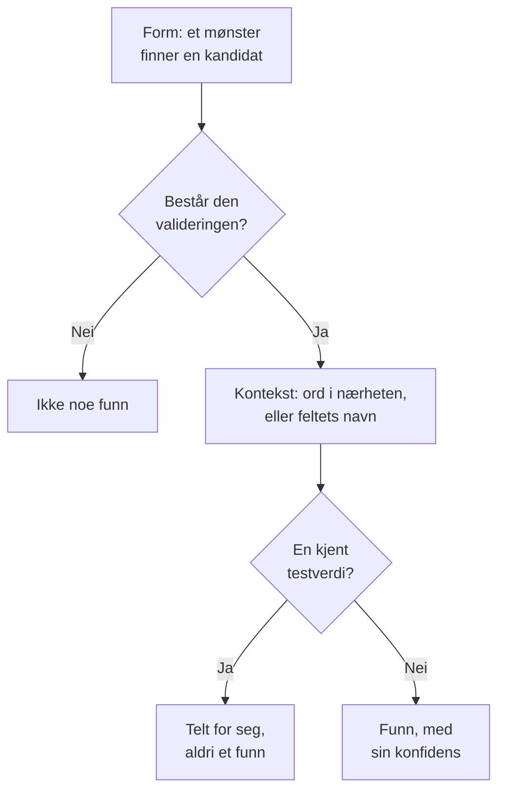

# Sensitive datatyper

Datasikkerhet kjenner 143 typer sensitive data: kortnumre, bankkontoer, nasjonale ID-er fra 43 land, helseidentifikatorer, API-nøkler og tokens, og de særlige kategoriene av personopplysninger. Hver har en kategori, en sensitivitet og, når den hører til ett land, det landet. Denne siden forklarer hvordan en verdi blir funnet, og viser hver datatype, så du kan se hvorfor noe ble funnet og bestemme hva du vil gjøre med det.

:::cards
- [Hvordan en verdi blir funnet](#hvordan-en-verdi-blir-funnet): Form, validator, kontekst, testverdier, konfidens.
- [Felt og kolonner](#felt-og-kolonner): Hvordan en hel kolonne eller et helt attributt vurderes.
- [Hver datatype](#innebygde-datatyper): Alle 143, etter kategori.
- [Dine egne datatyper](#dine-egne-datatyper): Ansatt-ID-er, polisenumre og boksen Test det.
:::

## Hvordan en verdi blir funnet

Hver skanning – en logglinje, en CSV-celle, en databaserad, de første bytene av et objekt – kjører de samme stegene:

1. **Form.** Hver datatype har mønstre som finner kandidater: seksten sifre, `AKIA` og seksten bokstaver, et ord, en `@` og et domene. Et mønster treffer aldri inne i et lengre token, så et kortnummer blir ikke funnet inne i en lengre rekke sifre.
2. **Validator.** En kandidat må bestå typens egne regler: en kontrollsum (Luhn for kort, mod 97 for IBAN, Verhoeff for Aadhaar-numre, kontrollsifferet i de fleste nasjonale ID-er), en ekte dato, et kjent prefiks, nok tilfeldighet for en hemmelighet. En kandidat som feiler, er ikke noe funn i det hele tatt. Plassholdere som `000000000` og `123456789` feiler for alle numeriske typer.
3. **Kontekst.** Ord nær en kandidat – som standard opptil 64 tegn før og 32 etter – som sier hva den er, hever konfidensen ett nivå, og det samme gjør et felt med et navn som peker mot typen. Ord som sier at den er noe annet, som et ordre- eller sporingsnummer, senker den ett nivå. Et nummer uten kontrollsum og med en vanlig form, som et passnummer eller en bankkonto, teller bare ved siden av ord som navngir det.
4. **Kjente testverdier.** Publiserte testkortnumre (som Stripes `4242 4242 4242 4242`), eksempel-IBAN-er, adresser på `example.com` og andre reserverte domener, IP-adresser for dokumentasjon, eksempel-ID-ene som myndighetenes dokumentasjon trykker, testmodusnøkler som `sk_test_` og plassholdernøkler telles for seg. De gir aldri et funn, så et datalager fullt av dem ser ut som et testmiljø, ikke et brudd.
5. **Konfidens.** Det som er igjen, er et funn, så sikkert som bevisene tillater.

| Konfidens | Hva det betyr |
| --- | --- |
| **Høy** | Verdien besto valideringen, og ord rundt den eller feltet den står i sier hva den er – eller, for et felt, de fleste verdiene er av den typen. |
| **Middels** | Verdien besto valideringen uten noe rundt den som bekrefter den, eller feltets navn sier hva det inneholder og noen verdier stemmer overens. |
| **Lav** | Formen stemmer, men ingenting bekrefter den. |

Bare funn med Høy og Middels konfidens teller: de gjør et datalager sensitivt og kan åpne et problem. Funn med Lav konfidens vises på datalageret, sammenslått, slik at et menneske kan vurdere dem.

Når to datatyper gjør krav på de samme tegnene, vinner det sikreste funnet: høyest konfidens, deretter detektoren med egne regler som beviser mest, deretter det lengste treffet.

En lang verdi leses i vinduer på 64 KB som overlapper med 4 KB, så en verdi blir funnet hel uansett hvor den står, og høyst 4 MB av én verdi leses.

## Felt og kolonner

En kolonne, et JSON-felt eller et loggattributt vurderes som en helhet. Navnet antyder en datatype, og verdiene i prøven beviser en. Andelen av verdiene som inneholder typen, avgjør hvor sikkert funnet er:

| Verdier som inneholder typen | Konfidens |
| --- | --- |
| 60 % eller mer | Høy |
| 25 % eller mer | Høy når feltets navn peker mot typen, ellers Middels |
| Færre | Middels når feltets navn peker mot typen, ellers Lav: noen få e-postadresser i en kolonne med noe annet |

Et felt der verdiene i snitt er lengre enn 80 tegn, er fritekst – notater, meldinger, beskrivelser – og forventes ikke å inneholde én type. Funnene beholder konfidensen hvert treff fikk for seg selv, og sier at de ble funnet i fritekst. Opptil 1 000 verdier av et felt klassifiseres, og opptil 16 KB av hver.

Navnet på et felt deles opp i ord – `customerEmail`, `customer_email` og `customer-email` er alle «customer email» – og navnehintet til en type treffer når ordene står i den rekkefølgen, ved siden av hverandre: «date of birth» treffer `customer_date_of_birth`, ikke `birth_city`. Bare den siste delen av en sti med punktum er feltets eget navn, sammen med delen før når den siste er et generelt ord som `number`, `id` eller `value`: `customer.address.city` er ikke en gateadresse, og `card.number` er fortsatt et kortnummer.

Noen datatyper kan ikke gjenkjennes på verdiene: ingen mønstre skiller en persons navn fra en gate, eller en religion fra et hvilket som helst annet ord. Disse blir bare funnet ut fra feltets navn, når feltet har verdier: Personnavn, Brukernavn, Kjønn, Nasjonalitet, Helseopplysninger, Rasemessig eller etnisk opprinnelse, Religiøs overbevisning, Seksuell orientering, Politisk oppfatning, Fagforeningsmedlemskap, Biometriske data, Genetiske data og Strafferegister. Et navn, et brukernavn, et kjønn eller en nasjonalitet er da Høy når 60 % eller mer av verdiene ser ut som det, og ellers Middels.

Et felt med et navn som sier at det inneholder et passord – `password`, `passwordHash`, `pwd`, ikke `password_changed_at` – bør inneholde en hash: bcrypt, argon2, scrypt, PBKDF2 eller et annet skjema et datalager sannsynligvis bruker. Tomme verdier, plassholdere som `********` og krypterte verdier holdes utenfor. Når flere av resten ikke er hasher enn er det, inneholder feltet selve passordene, som ingen mønstre kan se, og datalageret feiler [Passord lagres i klartekst](/docs/data-security/checks-and-issues#datahygiene).

## Sensitivitet

| Sensitivitet | Hva det betyr |
| --- | --- |
| **Begrenset** | Det fører til skade hvis det lekker: hemmeligheter, kortnumre, helsejournaler, offentlig utstedte ID-er. |
| **Konfidensiell** | Personopplysninger, og dokumenter merket konfidensielle. |
| **Intern** | Virksomhetens egne data, ikke ment for utenforstående. |
| **Public** | Ingenting sensitivt ble funnet. |

Et datalager er like sensitivt som den mest sensitive datatypen som er funnet i det med minst Middels konfidens. Testverdier og funn merket som ikke sensitive teller ingenting, og et datalager der ingenting er funnet, er Offentlig. For å behandle et datalager som mer eller mindre sensitivt enn funnene sier, setter du sensitiviteten selv i datalagerets **Innstillinger**: kontrollene bruker da den.

## Kategorier

| Kategori | Hva den dekker | Personopplysninger |
| --- | --- | --- |
| Hemmeligheter og påloggingsinformasjon | Passord, API-nøkler, tokens og private nøkler som låser opp andre systemer. | Nei |
| Finansielt | Kortnumre, bankkontoer, IBAN-er og kryptolommebøker. | Ja |
| Helse | Journalnumre, helseidentifikatorer, diagnoser og resepter. | Ja |
| Offentlig utstedt ID | Nasjonale identitetsnumre, skattenumre, passnumre og trygdenumre. | Ja |
| Særlig kategori | Det GDPR artikkel 9 beskytter mest: etnisitet, religion, seksuell orientering, politikk, fagforeningsmedlemskap, biometriske og genetiske data. | Ja |
| Kontakt og identitet | Hvem noen er og hvordan de kan nås: e-post, telefon, adresse, fødselsdato, IP-adresse. | Ja |
| Forretningskonfidensielt | Dokumenter merket konfidensielle, kun til intern bruk eller privilegerte. | Nei |

Personopplysninger er data om en person, slik GDPR, CCPA, LGPD og DPDP forstår det. Et datalager som bare inneholder hemmeligheter og forretningsdokumenter, er utenfor omfanget til et personvernrammeverk, men aldri utenfor omfanget til et sikkerhetsrammeverk (se [Samsvar i Datasikkerhet](/docs/data-security/compliance)).

## Innebygde datatyper

En datatype som hører til ett land, navngir det med en ISO 3166-1-kode: residensregler og de landbundne rammeverkene leser den (se [Residens](/docs/data-security/flows-access-residency#residensregler)). ID-en er det API-et og funnene navngir typen med.

### Kontakt og identitet

| Datatype | ID | Hva det er | Sensitivitet | Land |
| --- | --- | --- | --- | --- |
| E-postadresse | `email-address` | En persons e-postadresse. | Konfidensiell | — |
| Telefonnummer | `phone-number` | Et telefonnummer i internasjonalt eller nasjonalt format. | Konfidensiell | — |
| Personnavn | `person-name` | En persons fornavn, etternavn eller fulle navn, funnet ut fra feltets navn. | Konfidensiell | — |
| Gateadresse | `postal-address` | En gateadresse: et nummer, et gatenavn og en gatetype. | Konfidensiell | — |
| Postnummer | `postal-code` | Et postnummer. Alene snevrer det inn hvor noen bor. | Intern | — |
| Fødselsdato | `date-of-birth` | En dato ved siden av ord som sier at den er noens fødselsdato. | Konfidensiell | — |
| IP-adresse | `ip-address` | En offentlig IPv4- eller IPv6-adresse, som GDPR regner som personopplysninger. | Konfidensiell | — |
| MAC-adresse | `mac-address` | Maskinvareadressen til et nettverkskort, som identifiserer en enhet. | Konfidensiell | — |
| Annonserings-ID | `advertising-id` | En mobil annonserings-ID (IDFA, GAID, AAID) som sporer én enhet. | Konfidensiell | — |
| Nøyaktig posisjon | `geolocation` | En breddegrad og lengdegrad som er nøyaktige nok til å finne en bygning. | Konfidensiell | — |
| Brukernavn | `username` | En persons påloggings- eller kontonavn, funnet ut fra feltets navn. | Konfidensiell | — |
| Kjønn | `gender` | En persons kjønn eller kjønnsidentitet, funnet ut fra feltets navn. | Konfidensiell | — |
| Nasjonalitet | `nationality` | En persons nasjonalitet eller statsborgerskap, funnet ut fra feltets navn. | Konfidensiell | — |
| Understellsnummer | `vehicle-identification-number` | Et VIN på 17 tegn med gyldig kontrollsiffer. | Konfidensiell | — |

### Offentlig utstedt ID

| Datatype | ID | Hva det er | Sensitivitet | Land |
| --- | --- | --- | --- | --- |
| Amerikansk Social Security-nummer | `us-ssn` | Et amerikansk Social Security-nummer. | Begrenset | US |
| Amerikansk skatteyter-ID (ITIN) | `us-itin` | Et amerikansk Individual Taxpayer Identification Number. | Begrenset | US |
| Amerikansk arbeidsgiver-ID (EIN) | `us-ein` | Et amerikansk Employer Identification Number, ved siden av ord som sier det. | Konfidensiell | US |
| Amerikansk passnummer | `us-passport` | Et amerikansk passnummer, ved siden av ord som sier det. | Begrenset | US |
| Amerikansk førerkortnummer | `us-drivers-license` | Et amerikansk førerkortnummer, ved siden av ord som sier det. | Begrenset | US |
| Britisk National Insurance-nummer | `uk-nino` | Et britisk National Insurance-nummer. | Begrenset | GB |
| Britisk passnummer | `uk-passport` | Et britisk passnummer, ved siden av ord som sier det. | Begrenset | GB |
| Britisk førerkortnummer | `uk-driving-licence` | Et britisk førerkortnummer på 16 tegn. | Begrenset | GB |
| Kanadisk Social Insurance-nummer | `ca-sin` | Et kanadisk Social Insurance Number med gyldig kontrollsiffer. | Begrenset | CA |
| Meksikansk CURP | `mx-curp` | En meksikansk Clave Única de Registro de Población. | Begrenset | MX |
| Meksikansk RFC | `mx-rfc` | En meksikansk skatte-ID, Registro Federal de Contribuyentes. | Begrenset | MX |
| Brasiliansk CPF | `br-cpf` | Et brasiliansk Cadastro de Pessoas Físicas-nummer. | Begrenset | BR |
| Brasiliansk CNPJ | `br-cnpj` | Et brasiliansk organisasjonsnummer (CNPJ). | Konfidensiell | BR |
| Argentinsk CUIT / CUIL | `ar-cuit` | En argentinsk identifikasjonskode for skatt eller arbeid. | Begrenset | AR |
| Chilensk RUT | `cl-rut` | En chilensk Rol Único Tributario med gyldig kontrollsiffer. | Begrenset | CL |
| Spansk DNI | `es-dni` | Et spansk nasjonalt identitetsdokumentnummer med kontrollbokstav. | Begrenset | ES |
| Spansk NIE | `es-nie` | Et spansk identitetsnummer for utlendinger med kontrollbokstav. | Begrenset | ES |
| Portugisisk NIF | `pt-nif` | Et portugisisk skatteidentifikasjonsnummer. | Begrenset | PT |
| Fransk trygdenummer (NIR) | `fr-nir` | Et fransk INSEE-nummer med tosifret nøkkel. | Begrenset | FR |
| Tysk skatte-ID | `de-tax-id` | En tysk Steuerliche Identifikationsnummer. | Begrenset | DE |
| Italiensk codice fiscale | `it-codice-fiscale` | En italiensk skattekode med gyldig kontrolltegn. | Begrenset | IT |
| Nederlandsk BSN | `nl-bsn` | Et nederlandsk borgerservicenummer som består elleveprøven. | Begrenset | NL |
| Belgisk nasjonalt nummer | `be-national-number` | Et belgisk nasjonalt registernummer. | Begrenset | BE |
| Polsk PESEL | `pl-pesel` | Et polsk nasjonalt identifikasjonsnummer. | Begrenset | PL |
| Svensk personnummer | `se-personnummer` | Et svensk personnummer med gyldig kontrollsiffer. | Begrenset | SE |
| Norsk fødselsnummer | `no-fodselsnummer` | Et norsk fødselsnummer med begge kontrollsifrene. | Begrenset | NO |
| Dansk CPR-nummer | `dk-cpr` | Et dansk personnummer, ved siden av ord som sier det. | Begrenset | DK |
| Finsk personidentitetskode | `fi-hetu` | En finsk henkilötunnus med kontrolltegn. | Begrenset | FI |
| Irsk PPS-nummer | `ie-ppsn` | Et irsk Personal Public Service Number. | Begrenset | IE |
| Sveitsisk AHV-nummer | `ch-ahv` | Et sveitsisk trygdenummer (AHV / AVS). | Begrenset | CH |
| Rumensk CNP | `ro-cnp` | En rumensk personlig numerisk kode. | Begrenset | RO |
| Bulgarsk EGN | `bg-egn` | Et bulgarsk enhetlig sivilt nummer. | Begrenset | BG |
| Kroatisk OIB | `hr-oib` | Et kroatisk personlig identifikasjonsnummer. | Begrenset | HR |
| Gresk AMKA | `gr-amka` | Et gresk trygdenummer. | Begrenset | GR |
| Tyrkisk identitetsnummer | `tr-tckn` | Et tyrkisk T.C. Kimlik-nummer. | Begrenset | TR |
| Israelsk identitetsnummer | `il-teudat-zehut` | Et israelsk Teudat Zehut-nummer. | Begrenset | IL |
| Sørafrikansk ID-nummer | `za-id` | Et sørafrikansk identitetsnummer med gyldig dato og kontrollsiffer. | Begrenset | ZA |
| Emirates ID fra UAE | `ae-emirates-id` | Et identitetskortnummer fra De forente arabiske emirater. | Begrenset | AE |
| Saudiarabisk nasjonal ID | `sa-national-id` | Et saudiarabisk nasjonalt ID- eller iqama-nummer. | Begrenset | SA |
| Indisk Aadhaar-nummer | `in-aadhaar` | Et 12-sifret Aadhaar-nummer som består Verhoeff-kontrollen. | Begrenset | IN |
| Indisk PAN | `in-pan` | Et indisk Permanent Account Number. | Begrenset | IN |
| Kinesisk identitetsnummer for innbyggere | `cn-resident-id` | Et kinesisk identitetskortnummer for innbyggere på 18 tegn. | Begrenset | CN |
| Japansk My Number | `jp-my-number` | Et japansk individnummer med gyldig kontrollsiffer. | Begrenset | JP |
| Sørkoreansk registreringsnummer for innbyggere | `kr-rrn` | Et koreansk registreringsnummer for innbyggere. | Begrenset | KR |
| Singaporsk NRIC / FIN | `sg-nric` | Et identitetskortnummer eller utenlandsk identifikasjonsnummer fra Singapore. | Begrenset | SG |
| Identitetskortnummer fra Hongkong | `hk-hkid` | Et identitetskortnummer fra Hongkong med kontrollsiffer. | Begrenset | HK |
| Taiwansk nasjonal ID | `tw-national-id` | Et taiwansk nasjonalt identifikasjonsnummer. | Begrenset | TW |
| Thailandsk nasjonal ID | `th-national-id` | Et thailandsk identifikasjonsnummer for borgere. | Begrenset | TH |
| Malaysisk MyKad-nummer | `my-mykad` | Et malaysisk identitetskortnummer. | Begrenset | MY |
| Indonesisk NIK | `id-nik` | Et indonesisk folkeregisternummer. | Begrenset | ID |
| Australsk tax file number | `au-tfn` | Et australsk tax file number med gyldig kontroll. | Begrenset | AU |
| Newzealandsk IRD-nummer | `nz-ird` | Et newzealandsk Inland Revenue-nummer med gyldig kontrollsiffer. | Begrenset | NZ |
| Russisk SNILS | `ru-snils` | Et russisk forsikringskontonummer med kontrollnummer. | Begrenset | RU |
| Russisk INN | `ru-inn` | Et russisk skatteidentifikasjonsnummer. | Begrenset | RU |
| Passnummer | `passport-number` | Et passnummer fra et hvilket som helst land, ved siden av ord som sier det. | Begrenset | — |

### Finansielt

| Datatype | ID | Hva det er | Sensitivitet | Land |
| --- | --- | --- | --- | --- |
| Kortnummer | `credit-card-number` | Et betalingskortnummer som består Luhn-kontrollen og hører til et kortmerke. | Begrenset | — |
| Kortsikkerhetskode | `card-verification-code` | En CVV eller CVC, som PCI DSS forbyr å lagre etter at en betaling er autorisert. | Begrenset | — |
| Kortets utløpsdato | `card-expiration-date` | Utløpsdatoen til et kort, ved siden av ord som sier det. | Konfidensiell | — |
| IBAN | `iban` | Et internasjonalt bankkontonummer som består mod-97-kontrollen. | Begrenset | — |
| Bankkontonummer | `bank-account-number` | Et bankkontonummer, ved siden av ord som sier det. | Begrenset | — |
| SWIFT / BIC-kode | `swift-bic` | En banks SWIFT- eller BIC-kode, ved siden av ord som sier det. | Intern | — |
| Amerikansk routingnummer for bank | `us-bank-routing-number` | Et ABA-routingnummer med gyldig kontrollsum, ved siden av ord som sier det. | Intern | US |
| Britisk sort code | `uk-sort-code` | En britisk sort code for bank, ved siden av ord som sier det. | Intern | GB |
| Indisk IFSC | `in-ifsc` | En indisk Financial System Code som navngir en bankfilial. | Intern | IN |
| Australsk BSB | `au-bsb` | Et australsk bank-state-branch-nummer, ved siden av ord som sier det. | Intern | AU |
| Bitcoin-adresse | `bitcoin-address` | En Bitcoin-adresse med gyldig kontrollsum. | Konfidensiell | — |
| Ethereum-adresse | `ethereum-address` | En Ethereum-adresse, ved siden av ord som sier det. | Konfidensiell | — |

### Helse

| Datatype | ID | Hva det er | Sensitivitet | Land |
| --- | --- | --- | --- | --- |
| Britisk NHS-nummer | `uk-nhs-number` | Et nummer fra britiske National Health Service med gyldig kontrollsiffer. | Begrenset | GB |
| Amerikansk Medicare-mottaker-ID | `us-medicare-mbi` | En amerikansk Medicare Beneficiary Identifier. | Begrenset | US |
| Australsk Medicare-nummer | `au-medicare-number` | Et australsk Medicare-kortnummer med gyldig kontrollsiffer. | Begrenset | AU |
| Tysk helseforsikringsnummer | `de-health-insurance-number` | En tysk Krankenversichertennummer med gyldig kontrollsiffer. | Begrenset | DE |
| Journalnummer | `medical-record-number` | En pasients journalnummer, ved siden av ord som sier det. | Begrenset | — |
| Medlems-ID i helseforsikring | `health-plan-id` | Et medlems- eller polisenummer for helseforsikring, ved siden av ord som sier det. | Begrenset | — |
| Diagnosekode (ICD-10) | `diagnosis-code` | En ICD-10-diagnosekode, ved siden av ord som sier det. | Begrenset | — |
| Legemiddelkode (NDC) | `drug-code` | En amerikansk National Drug Code, ved siden av ord som sier det. | Konfidensiell | — |
| Amerikansk DEA-nummer | `us-dea-number` | Et Drug Enforcement Administration-nummer for en forskriver, med gyldig kontrollsiffer. | Konfidensiell | US |
| Amerikansk behandler-ID (NPI) | `us-npi` | En National Provider Identifier. Den navngir en helseaktør, ikke en pasient. | Intern | US |
| Helseopplysninger | `health-information` | Diagnoser, tilstander, medisiner og andre helsedetaljer, funnet ut fra feltets navn. | Begrenset | — |

### Hemmeligheter og påloggingsinformasjon

| Datatype | ID | Hva det er | Sensitivitet | Land |
| --- | --- | --- | --- | --- |
| AWS-tilgangsnøkkel-ID | `aws-access-key-id` | Den offentlige halvdelen av en AWS-tilgangsnøkkel. Sammen med hemmeligheten signerer den AWS-forespørsler. | Begrenset | — |
| Hemmelig AWS-tilgangsnøkkel | `aws-secret-access-key` | Den hemmelige halvdelen av en AWS-tilgangsnøkkel, ved siden av ord som sier det. | Begrenset | — |
| Google API-nøkkel | `google-api-key` | En API-nøkkel for Google Cloud eller Maps. | Begrenset | — |
| Nøkkel for Google-tjenestekonto | `google-service-account-key` | En nøkkelfil for en Google Cloud-tjenestekonto med den private nøkkelen. | Begrenset | — |
| Google OAuth-klienthemmelighet | `google-oauth-client-secret` | En Google OAuth-klienthemmelighet. | Begrenset | — |
| Azure-lagringskontonøkkel | `azure-storage-account-key` | En Azure-lagringskontonøkkel eller en tilkoblingsstreng som inneholder en. | Begrenset | — |
| Azure SAS-token | `azure-sas-token` | En Azure shared access signature, som gir tilgang uten pålogging. | Begrenset | — |
| Azure-klienthemmelighet | `azure-client-secret` | En klienthemmelighet for en applikasjon i Microsoft Entra ID. | Begrenset | — |
| GitHub-token | `github-token` | Et GitHub-token for personlig tilgang, OAuth, app eller fine-grained. | Begrenset | — |
| GitLab-token | `gitlab-token` | Et personlig tilgangstoken for GitLab. | Begrenset | — |
| Slack-token | `slack-token` | Et Slack-token for bot, bruker eller app. | Begrenset | — |
| Slack-webhook-URL | `slack-webhook-url` | En innkommende Slack-webhook, som lar hvem som helst poste i en kanal. | Begrenset | — |
| Hemmelig Stripe-nøkkel | `stripe-secret-key` | En hemmelig eller begrenset live-nøkkel for Stripe, som kan flytte penger. | Begrenset | — |
| Twilio API-nøkkel | `twilio-api-key` | En Twilio API key SID med hemmelighet. | Begrenset | — |
| SendGrid API-nøkkel | `sendgrid-api-key` | En SendGrid API-nøkkel. | Begrenset | — |
| Mailgun API-nøkkel | `mailgun-api-key` | En Mailgun API-nøkkel. | Begrenset | — |
| Mailchimp API-nøkkel | `mailchimp-api-key` | En Mailchimp API-nøkkel. | Begrenset | — |
| OpenAI API-nøkkel | `openai-api-key` | En OpenAI API-nøkkel, som bruker av kontoens kreditt. | Begrenset | — |
| Anthropic API-nøkkel | `anthropic-api-key` | En Anthropic API-nøkkel. | Begrenset | — |
| Hugging Face-token | `huggingface-token` | Et Hugging Face-token. | Begrenset | — |
| npm-token | `npm-token` | Et npm-tilgangstoken, som kan publisere pakker. | Begrenset | — |
| PyPI-token | `pypi-token` | Et opplastingstoken for PyPI. | Begrenset | — |
| Docker Hub-token | `docker-hub-token` | Et personlig tilgangstoken for Docker Hub. | Begrenset | — |
| Shopify-token | `shopify-token` | Et tilgangs- eller app-token for Shopify. | Begrenset | — |
| Square-token | `square-token` | Et tilgangstoken eller en hemmelighet for Square. | Begrenset | — |
| Braintree-tilgangstoken | `braintree-access-token` | Et tilgangstoken for Braintree-produksjon. | Begrenset | — |
| DigitalOcean-token | `digitalocean-token` | Et personlig tilgangstoken for DigitalOcean. | Begrenset | — |
| New Relic API-nøkkel | `new-relic-api-key` | En bruker-API-nøkkel for New Relic. | Begrenset | — |
| Datadog API-nøkkel | `datadog-api-key` | En API- eller applikasjonsnøkkel for Datadog, ved siden av ord som sier det. | Begrenset | — |
| HashiCorp Vault-token | `vault-token` | Et tjenestetoken for HashiCorp Vault. | Begrenset | — |
| Terraform Cloud-token | `terraform-cloud-token` | Et API-token for Terraform Cloud eller Enterprise. | Begrenset | — |
| Atlassian API-token | `atlassian-api-token` | Et Atlassian API-token. | Begrenset | — |
| Linear API-nøkkel | `linear-api-key` | En Linear API-nøkkel. | Begrenset | — |
| JSON web token | `json-web-token` | Et signert JWT, ofte et økt- eller tilgangstoken. | Begrenset | — |
| Privat nøkkel | `private-key` | En privat nøkkelblokk i PEM, OpenSSH eller PGP. | Begrenset | — |
| Passord i en URL | `password-in-url` | En URL som inneholder et brukernavn og et passord, som en tilkoblingsstreng til en database. | Begrenset | — |
| Passord i en tilkoblingsstreng | `connection-string-password` | En Password=- eller Pwd=-verdi i en tilkoblingsstreng. | Begrenset | — |
| Authorization-header | `authorization-header` | En Basic- eller Bearer-legitimasjon kopiert fra en HTTP Authorization-header. | Begrenset | — |
| Passord eller hemmelighet | `generic-secret` | En verdi tilordnet et passord, en hemmelighet, en API-nøkkel eller et token, som ser tilfeldig nok ut til å være ekte. | Begrenset | — |
| Privat Bitcoin-nøkkel | `bitcoin-private-key` | En privat Bitcoin-nøkkel i wallet import format, med gyldig kontrollsum. | Begrenset | — |

### Særlig kategori

| Datatype | ID | Hva det er | Sensitivitet | Land |
| --- | --- | --- | --- | --- |
| Rasemessig eller etnisk opprinnelse | `racial-or-ethnic-origin` | Rase eller etnisitet, funnet ut fra feltets navn. | Begrenset | — |
| Religiøs overbevisning | `religious-belief` | Religion eller livssyn, funnet ut fra feltets navn. | Begrenset | — |
| Seksuell orientering | `sexual-orientation` | Seksuell orientering, funnet ut fra feltets navn. | Begrenset | — |
| Politisk oppfatning | `political-opinion` | Politiske oppfatninger eller partimedlemskap, funnet ut fra feltets navn. | Begrenset | — |
| Fagforeningsmedlemskap | `trade-union-membership` | Fagforeningsmedlemskap, funnet ut fra feltets navn. | Begrenset | — |
| Biometriske data | `biometric-data` | Fingeravtrykk, ansiktsmaler, stemmeavtrykk og andre biometriske data, funnet ut fra feltets navn. | Begrenset | — |
| Genetiske data | `genetic-data` | DNA- og genomdata, funnet ut fra feltets navn. | Begrenset | — |
| Strafferegister | `criminal-record` | Straffedommer og lovovertredelser (GDPR artikkel 10), funnet ut fra feltets navn. | Begrenset | — |

### Forretningskonfidensielt

| Datatype | ID | Hva det er | Sensitivitet | Land |
| --- | --- | --- | --- | --- |
| Juridisk privilegert dokument | `privileged-document` | Et dokument merket som underlagt advokat-klient-privilegium eller juridisk privilegert. | Begrenset | — |
| Dokument merket konfidensielt | `confidential-document` | Et dokument merket konfidensielt, strengt konfidensielt eller forretningshemmelighet. | Konfidensiell | — |
| Dokument merket internt | `internal-document` | Et dokument merket kun til intern bruk eller ikke for distribusjon. | Intern | — |

## Dine egne datatyper

Legg til en datatype for det bare bedriften din har: en ansatt-ID, et polisenummer, en prosjektkode. Gå til **Datasikkerhet → Innstillinger → Datatyper** og legg den til under **Dine datatyper**. Den skannes nøyaktig som de innebygde, i bucketer, databaser og telemetri, fra neste skanning.

:::steps
### Si hva den er

Gi den et **Navn**, som Ansatt-ID, en **Kategori** og en **Følsomhet**: hvor sensitivt et datalager som inneholder den, er. En **Beskrivelse** sier hva den er, for den som leser et funn av den.

### Si hvordan den blir funnet

Skriv inn et **Mønster**: et regulært JavaScript-uttrykk for én verdi, som `EMP-\d{6}`. Legg til **Feltnavn** som inneholder den, som `employee id`, og **Nøkkelord** som, nær en verdi, bekrefter at den er av denne typen. La mønsteret stå tomt for å finne typen bare ut fra feltnavn.

### Test den

Lim inn eksempeltekst i **Test det** for å se hva datatypen din finner i den. Den kjører skannerens egen kode på teksten, i nettleseren din: teksten sendes aldri til OneUptime, og bare de første 64 KB testes.
:::

Under **Flere felt** gjør **Ignorer store/små bokstaver** at mønsteret treffer uansett store eller små bokstaver, **Krever et nøkkelord** teller en verdi bare når et nøkkelord står i nærheten eller feltets navn sier at den er av denne typen, og **Kontrollsum** krever at en verdi består en kontroll: **Ingen**, **Luhn** (kontrollsifferet kortnumre har), **Mod97** (kontrollsifrene i en IBAN) eller **Verhoeff** (kontrollsifferet i et Aadhaar-nummer).

Et mønster kontrolleres når du lagrer det: det må kompilere, ikke treffe tom tekst og kjøre i tid som vokser lineært med teksten. Det kjøres av en matcher som aldri bruker backtracking, så ingen mønstre kan holde en skanning fast, uansett hvordan de er skrevet. En type tar høyst 50 nøkkelord og 50 feltnavn.

En verdi av typen din er Middels alene og Høy med et nøkkelord i nærheten når den består en kontrollsum, og Lav alene og Middels med et nøkkelord når den ikke har noen. I en kolonne avgjør andelen verdier som treffer, som for alle typer.

## Ikke sensitivt, og aldri sensitivt

En skanning kan finne noe som ikke er det det ser ut som: en kolonne med ordrenumre som består Luhn-kontrollen, din egen støtteadresse i hver logglinje. Si fra til OneUptime, så slutter den å telle det:

- **Merk funnet som ikke sensitivt.** På siden **Innhold** for datalageret velger du **Merk som ikke sensitivt** på funnet og sier hvorfor. Det teller ikke lenger mot datalagerets sensitivitet eller kontrollene, og datalageret kontrolleres på nytt med en gang. Funnet blir værende på datalageret, merket, med begrunnelsen din, så den neste personen ser hva som ble bestemt.
- **Legg til verdien i Aldri sensitivt**, i innstillingene for Datasikkerhet, for en verdi som aldri er et funn noe sted, som `support@yourcompany.com`. Verdier sammenlignes etter at skanneren har normalisert dem, uten hensyn til store og små bokstaver.
- **Slå av en innebygd datatype.** Under **Innebygde datatyper**, på **Datasikkerhet → Innstillinger → Datatyper**, har hver datatype en bryter, som lagres i det øyeblikket den slås om. Ingen skanning i prosjektet ser etter en type som er slått av.

## Neste steg

:::cards
- [Kontroller og problemer i Datasikkerhet](/docs/data-security/checks-and-issues): Hva sensitiviteten til et datalager endrer for problemene.
- [Sensitive data i telemetri](/docs/data-security/telemetry): Datatypene som blir funnet i loggene, trasene og promptene dine.
- [Samsvar i Datasikkerhet](/docs/data-security/compliance): Rammeverkene hver datatype bringer inn i omfanget.
:::
