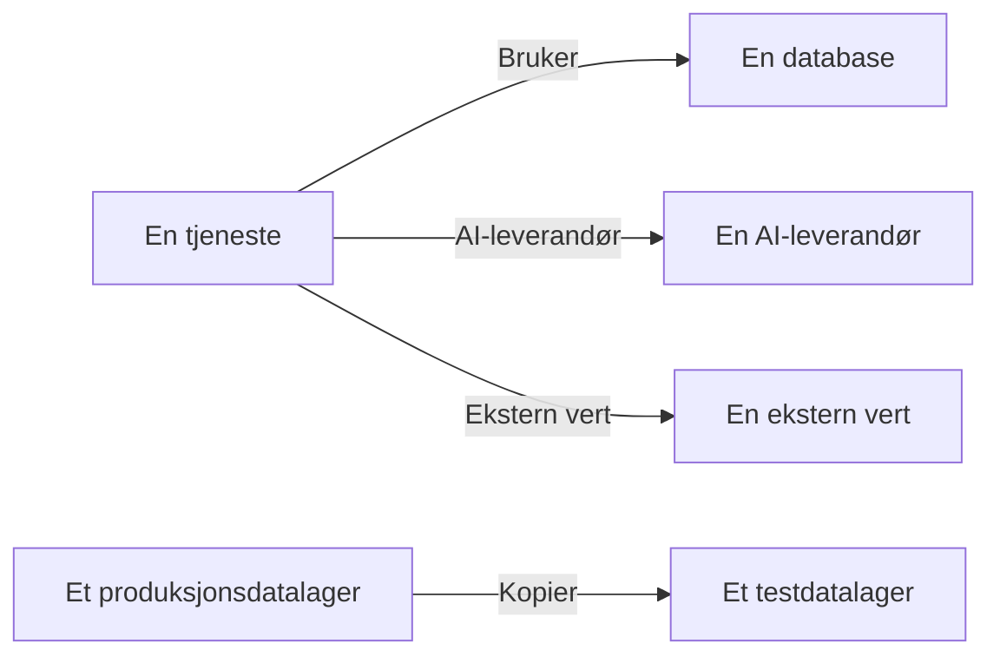

# Dataflyter, tilgang og residens

Å vite hva et datalager inneholder, er bare halvparten. Datasikkerhet finner også ut hvor dataene går – hvilke tjenester som bruker datalageret, hvilke AI-leverandører og eksterne verter dataene når, og hvor de ble kopiert – hvem som kan nå hvert datalager, og om det ligger i regionene det har lov til. Alt dette kommer fra bevis OneUptime allerede har: sporene dine, skyens egne tilgangsinnstillinger og fingeravtrykk av det skanningene fant.

:::cards
- [Dataflyter](#dataflyter): Tjenester, AI-leverandører, eksterne verter og kopier.
- [Hvem som kan nå et datalager](#hvem-som-kan-nå-et-datalager): Hver tilgang skyen din rapporterer, og hvor eksponert datalageret er.
- [Residensregler](#residensregler): Regionene hver type data kan ligge i.
:::

## Dataflyter

| Dataflyt | Hva det betyr | Hvor den kommer fra |
| --- | --- | --- |
| **Bruker** | En tjeneste snakker med et datalager. | Tjenestekartet, som OneUptime regner ut fra klient-spans fra tjenestene dine hvert tiende minutt. Hver database på det knyttes til sitt datalager etter navn, adresse eller endepunkt, så en database som ingen annen kilde lister opp, blir et eget datalager. |
| **AI-leverandør** | En tjeneste sender data til en AI-leverandør. | AI-kallene i tjenestens spor fra de siste 7 dagene, som nevner leverandøren de når. |
| **Ekstern vert** | En tjeneste kaller en vert utenfor systemene dine. | De eksterne tjenestene på tjenestekartet, etter adressen de kalles på. |
| **Kopier** | Ett datalager inneholder verdier fra et annet. | Fingeravtrykk av verdiene hver skanning fant: to datalagre deler data når fingeravtrykkene deres for én datatype overlapper med halvparten eller mer. |

En dataflyt bærer datatypene kilden inneholder, og sensitiviteten deres. En dataflyt er bekreftet når en skanning har bevist at dataene er der, ikke bare at det finnes en vei til dem: en kopi er det alltid, og en dataflyt til en AI-leverandør er det når tjenestens AI-samtaler inneholder data med sensitiviteten Konfidensiell eller Begrenset. En dataflyt som ikke er sett igjen på 30 dager, fjernes.

To kontroller leser dataflytene. [Produksjonsdata ble kopiert til et datalager utenfor produksjon](/docs/data-security/checks-and-issues#datahygiene) feiler på målet for en kopi. En kopi går fra produksjonsdatalageret når bare ett av de to er i produksjon, og ellers fra datalageret OneUptime fant først. [Sensitive data sendes til en AI-leverandør](/docs/data-security/checks-and-issues#ai) feiler på AI-samtalene til en tjeneste når de inneholder sensitive data, og nevner leverandørene de nådde.

### Slik holdes fingeravtrykk private

En kopi finnes uten verdiene fra noen av datalagrene. For hver datatype en skanning finner med sikkerheten Høy, lager den en skisse av verdiene den leste, som en MinHash: 128 plasser, hver den minste verdien av én hashfunksjon over verdiene, der bare de laveste 16 bitene beholdes. To skisser stemmer overens på omtrent like mange plasser som de to verdimengdene overlapper, så en sammenligning av skisser anslår hvor mye av ett datalager som finnes i det andre.

- **Verdiene hashes med en nøkkel som tilhører prosjektet** (HMAC-SHA256), så ingen uten nøkkelen kan teste en kjent verdi mot en skisse, og skissene til to prosjekter kan aldri sammenlignes.
- **Bare 16 biter av hvert minimum forlater skanningen.** Ingen verdi, og ingen hash av en verdi, kan leses tilbake fra en skisse.
- **En skisse gjelder en datatype, ikke et felt.** Et datalager har én for hver datatype som er funnet i det med sikkerheten Høy, og ikke mer.

## Hvem som kan nå et datalager

Konfigurasjonslesingen gjør hver skys egne tilgangsinnstillinger – bucket-policyer og ACL-er, rolletildelinger i Azure, IAM-bindinger i Google Cloud, delinger av øyeblikksbilder – om til én liste over hvem som kan nå datalageret, på siden **Hvem kan nå det**:

| Kolonne | Hva den sier |
| --- | --- |
| **Prinsipal** | Hvem eller hva som har tilgang, slik skyen navngir det: `*`, en konto-ID, en ARN, en e-postadresse, en tjenestekonto. |
| **Prinsipaltype** | Public, Konto, Rolle, Bruker, Gruppe, Tjenesteprinsipal, Tjenestekonto eller Tjeneste. |
| **Tilgangsnivå** | Lesing, Skriving eller Administrator. |
| **Gitt via** | Hva som gir tilgangen: en bucket-policy, en ACL, en rolletildeling, en IAM-binding eller en deling av et øyeblikksbilde. |
| **Ekstern** | Prinsipalen er utenfor kontoene, abonnementene og prosjektene som er koblet til OneUptime. |
| **Offentlig** | Prinsipalen er hvem som helst på internett. |

Listen leses på nytt ved hver konfigurasjonslesing, og en tilgang skyen ikke lenger rapporterer, fjernes. [Mer enn 25 identiteter kan lese begrensede data](/docs/data-security/checks-and-issues#tilgang) teller leserne på den. Tjenestene som bruker et datalager, er dataflytene av typen **Bruker**.

Ut fra det den leser, får hvert datalager en eksponering:

| Eksponering | Hva det betyr |
| --- | --- |
| **Offentlig** | Hvem som helst på internett kan lese det. |
| **Andre kontoer** | Kontoer utenfor de tilkoblede kontoene dine kan nå det. |
| **Tilgjengelig fra internett** | Nettverksendepunktet godtar tilkoblinger fra internett. |
| **Privat** | Bare dine egne kontoer og nettverk når det. |
| **Ukjent** | OneUptime kunne ikke lese nok av konfigurasjonen til å avgjøre det. |

Offentlig går foran delt, og delt går foran tilgjengelig: en offentlig bucket som også er delt med en annen konto, er Public. Eksponering bidrar til [risikoscoren](/docs/data-security/checks-and-issues#risikoscore) til et problem.

## Residensregler

En residensregel sier hvor en type data kan ligge. Legg til en under **Datasikkerhet → Innstillinger → Residensregler**:

| Felt | Hva det gjør |
| --- | --- |
| **Navn** | Hva regelen er, for eksempel Personopplysninger fra EU blir i EU. |
| **Tillatte regioner** | Regionene dataene kan lagres og kopieres i, skrevet slik skyen din navngir dem. En regel uten regioner kontrollerer ingenting. |
| **Datakategorier** | Datakategoriene den dekker. Tom dekker alle typer personopplysninger. |
| **Data om personer i** | Bare data om personer i disse landene, som ISO 3166-1-koder, for eksempel `DE` eller `IN`. Tom dekker data om personer hvor som helst. |
| **Beskrivelse** | Hva regelen er til, for eksempel Dataene til kundene våre i EU lagres bare i EU. |
| **Aktivert** | Om datalagre kontrolleres mot regelen. |

Et datalager bryter en regel når det inneholder data regelen dekker, og dets egen region, eller en region dataene kopieres til, ikke samsvarer med noen av de tillatte regionene. Kopier er regionene dataene i et datalager replikeres til: S3-replikering, den georedundante kopien til en lagringskonto, replikaene til en database. Datalageret feiler da [Data lagres utenfor regionene de kan ligge i](/docs/data-security/checks-and-issues#residens), med regionen og regelen det brøt.

### Regioner og jokertegn

En `*` i en tillatt region står for hvilke som helst tegn, store og små bokstaver regnes som like, og mønsteret må samsvare med hele regionen:

| Tillatt region | Samsvarer med | Samsvarer ikke med |
| --- | --- | --- |
| `eu-*` (AWS) | `eu-west-1`, `eu-central-1` | `us-east-1`, `us-eu-1` |
| `europe-*` (Google Cloud) | `europe-west1`, `europe-north1` | `us-central1` |
| `westeurope` (Azure) | `westeurope` | `northeurope` |

List opp ett mønster for hver sky du bruker: `eu-*`, `europe-*`, `westeurope` og `northeurope` holder sammen data i Europa i alle tre.

### Hvem dataene i et datalager gjelder

OneUptime leser ut fra selve dataene hvem dataene i et datalager gjelder. En datatype som hører til ett land, sier at personene er i det landet: et tysk skatte-ID-nummer sier `DE`, et indisk Aadhaar-nummer `IN`, et britisk NHS-nummer `GB`. Datalageret oppgir disse landene som landene til de registrerte, og en regel som er begrenset til personer i bestemte land, dekker bare datalagrene som inneholder dataene deres. [Sensitive datatyper](/docs/data-security/data-types#innebygde-datatyper) nevner landet til hver datatype som har et.

## Neste steg

:::cards
- [Kontroller og problemer i Datasikkerhet](/docs/data-security/checks-and-issues): Hver kontroll disse dataflytene, tilgangene og reglene gir data til.
- [Samsvar i Datasikkerhet](/docs/data-security/compliance): Hvordan residens og tilgang teller for GDPR, LGPD og DPDP.
- [Topologi](/docs/telemetry/topology): Tjenestekartet dataflytene kommer fra.
:::
