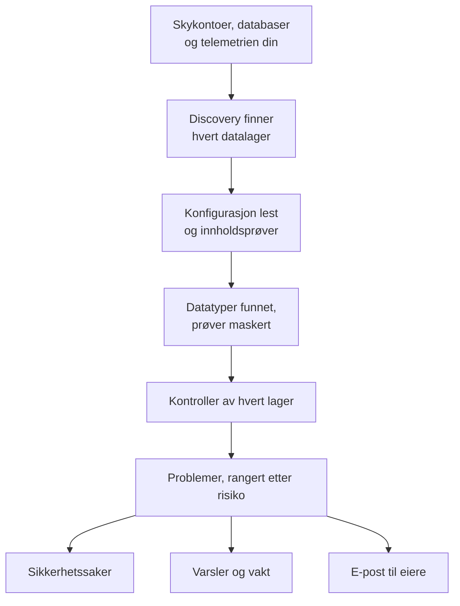

# Datasikkerhet

Datasikkerhet finner de sensitive dataene bedriften din oppbevarer – i bucketer i skyen, databaser og datavarehus, og i telemetrien du sender til OneUptime – og forteller deg hva som er galt med måten de oppbevares på. Den finner datalagrene selv, leser hvordan hvert av dem er satt opp, tar prøver av innholdet, og åpner et problem for alt som er galt, rangert etter risiko.

Den svarer på fire spørsmål:

:::cards
- [Hvor er de sensitive dataene våre?](/docs/data-security/data-types): 143 datatyper, fra kortnumre og nasjonale ID-er til API-nøkler, funnet i bucketer, tabeller og telemetri.
- [Er de eksponert?](/docs/data-security/checks-and-issues): 32 kontroller av hvert datalager: offentlig tilgang, kryptering, sikkerhetskopier, logging, hemmeligheter og kopier.
- [Hvem kan nå dem, og hvor havner de?](/docs/data-security/flows-access-residency): Hvem som kan lese hvert datalager, hvilke tjenester som bruker det, og hvilke AI-leverandører og verter dataene når.
- [Oppfyller de reglene våre?](/docs/data-security/compliance): Residensregler, og ni rammeverk vurdert ut fra det skanningene fant.
:::

## Slik fungerer det

1. **Discovery** finner datalagrene OneUptime allerede kjenner til: skyinventaret ditt, databasene Database-produktet overvåker, databasene tjenestene dine snakker med på tjenestekartet, og telemetrien til hver tjeneste. Du legger bare til et datalager manuelt når ingen kilde viser det.
2. **Konfigurasjonslesingen** spør hver sky hvordan hvert datalager er satt opp: hvem som kan nå det, og hvordan det er kryptert, sikkerhetskopiert og logget. Den leser innstillinger, aldri data.
3. **Innholdsprøver** leser litt av det et datalager inneholder, der du tillater det: noen få objekter av hver type i en bucket, noen rader fra hver tabell, de nyeste postene i telemetrien til hver tjeneste.
4. **Klassifisering** finner sensitive verdier i prøvene, og beholder tellinger og maskerte prøver, aldri en verdi.
5. **Sjekker** avgjør hva som er galt med hvert datalager, og hvor alvorlig det er for dataene det inneholder. Hver kontroll som feiler, åpner et problem, som lukkes av seg selv når kontrollen består.

## Hva som gjør den annerledes

- **Telemetrien din er et datalager.** Loggene, trasene, unntakene, øktavspillingene og AI-samtalene til hver tjeneste kontrolleres som en bucket, hver time. En e-postadresse i en logglinje er et funn, og **Rens** maskerer den ved inntak fra da av. Se [Sensitive data i telemetri](/docs/data-security/telemetry).
- **Dataflyt kommer fra ekte trafikk.** Tjenestekartet viser hvilken tjeneste som bruker hvilken database, AI-kall navngir leverandøren de når, og kopier av produksjonsdata finnes ved å sammenligne fingeravtrykk. Se [Dataflyt, tilgang og residens](/docs/data-security/flows-access-residency).
- **Bevis maskeres, alltid.** Et funn beholder tellinger og høyst tre maskerte prøver, som `j***@e******.com`, maskert inne i skanneren før noe forlater den. Slår du av prøver, beholder det bare tellinger.
- **Skanneren er åpen kildekode.** Mønsteret, kontrollsummen, kontekstordene og testverdiene til hver datatype ligger i OneUptimes kildekode, så du kan lese nøyaktig hva som gir et funn. Den samme koden kjører på OneUptimes workers, på en sonde og i boksen **Test det**.
- **Den fungerer sammen med resten av OneUptime.** Et kritisk problem åpner en sikkerhetssak på datalageret, så [Security Operations](/docs/telemetry/security-cases) behandler det som enhver annen trussel. Det kan opprette et varsel som tilkaller den som har vakt, og det sender e-post til eierne av datalageret. Se [Integrasjoner for Datasikkerhet](/docs/data-security/integrations).
- **OneUptime AI hjelper deg å fikse det.** **Forklar med AI** forteller eieren av et datalager hva som er galt og hvordan det fikses i skyen deres, og **Fiks med AI** åpner en pull request i infrastrukturkoden din.

## Før du begynner

- **En rolle som kan sette det opp.** Project Owner, Project Admin og Security Admin endrer innstillingene for Datasikkerhet. Security Member behandler problemer og skanner datalagre, og Security Viewer leser det den har funnet. Andre roller ser ingenting av det med mindre teamet deres får tillatelsene for det: hvilke bucketer som inneholder kortnumre, er nøyaktig det en angriper vil vite. Se [Roller](/docs/permissions/reference#roller).
- **En skykonto å lese, eller en database.** Datasikkerhet leser en skykonto gjennom en [skytilkobling](/docs/telemetry/cloud-accounts), og en database du drifter selv gjennom en skrivebeskyttet tilkoblingsstreng. Telemetri trenger ingenting: den skannes hver time.

## Kom i gang

:::steps
### Koble til en skykonto

Gå til **Sky → Koble til** og velg skyen din. Er kontoen allerede koblet til, velger du i stedet **Rediger** på tilkoblingen. [Koble til en skykonto](/docs/telemetry/cloud-accounts) går gjennom hver sky.

### Velg nivå for datasikkerhet

Under **Flere felt** setter du **Datasikkerhet** til **Bare konfigurasjon** for å kontrollere hvordan hvert datalager er satt opp, eller til **Konfigurasjon og innholdsprøver** for også å finne de sensitive dataene i dem. Kommandoen skjemaet viser, endres etter valget ditt: kjør den i skyens shell, slik skjemaet sier. [Sett opp Datasikkerhet](/docs/data-security/setup) viser nøyaktig hva hvert nivå gir tilgang til, og [Koble til en skykonto](/docs/telemetry/cloud-accounts#datasikkerhet) viser kommandoen for hvert nivå.

### Gå gjennom problemene

Åpne **Datasikkerhet**. Datalagre vises under **Datalagre** etter hvert som discovery finner dem, hvert 15. minutt, og konfigurasjonen til en tilkobling leses innen en time. Problemer åpnes under **Problemer** så snart en lesing eller en skanning er ferdig, hvert med sin risikoscore, og **Oversikt** viser de fem mest risikable. Hvert problem sier hva som er galt, hvorfor det betyr noe og hvordan det fikses, med kommandoene for skyen din.
:::

## Hva som regnes som et datalager

| Hvor | Datalagre | Innholdsprøver |
| --- | --- | --- |
| AWS | AWS S3 Bucket, AWS RDS Instance, AWS Aurora Cluster, AWS RDS Snapshot, AWS DynamoDB Table, AWS Redshift Cluster, AWS DocumentDB Cluster, AWS OpenSearch Domain, AWS ElastiCache Cluster, AWS EFS File System | AWS S3 Bucket |
| Azure | Azure Storage Account, Azure SQL Database, Azure Cosmos DB Account, Azure PostgreSQL Server, Azure MySQL Server | Azure Storage Account |
| Google Cloud | Google Cloud Storage Bucket, Google Cloud SQL Instance, Google BigQuery Dataset, Google Firestore Database, Google Spanner Instance, Google Bigtable Instance | Google Cloud Storage Bucket, Google BigQuery Dataset |
| Databaser du drifter selv | PostgreSQL, MySQL, MongoDB, SQL Server, Oracle, Redis, Elasticsearch | PostgreSQL, MySQL |
| OneUptime | Logger, traser, unntak, øktavspillinger, AI-samtaler | Logger, traser, unntak, øktavspillinger, AI-samtaler |

Hvert datalager får kontrollene som gjelder for typen. Et datalager der innholdet ikke kan prøvetas, kontrolleres likevel: en offentlig bucket eller en ukryptert database er et problem uansett hva den inneholder.

Et datalager arkiveres, med historikken sin, når kilden ikke lenger viser det, og de åpne problemene på det blir løst: **Arkiverte datalagre**, nederst i menyen til Datasikkerhet, tar vare på det. Det kommer tilbake av seg selv hvis kilden viser det igjen, og et problem der kontrollen fortsatt feiler, åpnes igjen.

Et datalagers **Tidslinje** viser hva som har skjedd med det, og hvem som gjorde det: når det ble funnet eller lagt til, hver endring i innstillingene og eierne, når det ble arkivert eller kom tilbake, og hver eksponering som er lukket fra et problem eller en playbook.

## Hvor ofte den kjører

| Hva | Når |
| --- | --- |
| Finn nye datalagre | Hvert 15. minutt |
| Les konfigurasjonen til en skytilkobling | Én gang om dagen, og innen en time etter at CloudTrail registrerer en endring i tilgang, kryptering, sikkerhetskopier eller deling for et AWS-datalager |
| Ta prøver av innholdet i et datalager | Hver 24. time, eller så ofte som **Skanneintervall (timer)** sier |
| Ta prøver av telemetrien til hver tjeneste | Hver time, den siste timen av den |
| Kontroller hvert datalager igjen | Etter hver lesing og skanning, etter at du endrer noe en kontroll avhenger av, og én gang om dagen |

**Skann nå** på et datalager tar prøver av innholdet med en gang, og **Kontroller nå** leser konfigurasjonen på nytt.

## Neste steg

:::cards
- [Sett opp Datasikkerhet](/docs/data-security/setup): De tre nivåene, tillatelsene hvert av dem gir, og skanning av dine egne databaser.
- [Sensitive datatyper](/docs/data-security/data-types): Hvordan en verdi blir funnet, og hver datatype Datasikkerhet kjenner.
- [Kontroller og problemer i Datasikkerhet](/docs/data-security/checks-and-issues): Hver kontroll, risikoscoren og hva som skjer med et problem.
- [Integrasjoner for Datasikkerhet](/docs/data-security/integrations): Sikkerhetssaker, varsler, eiere, arbeidsflyter og OneUptime AI.
:::
