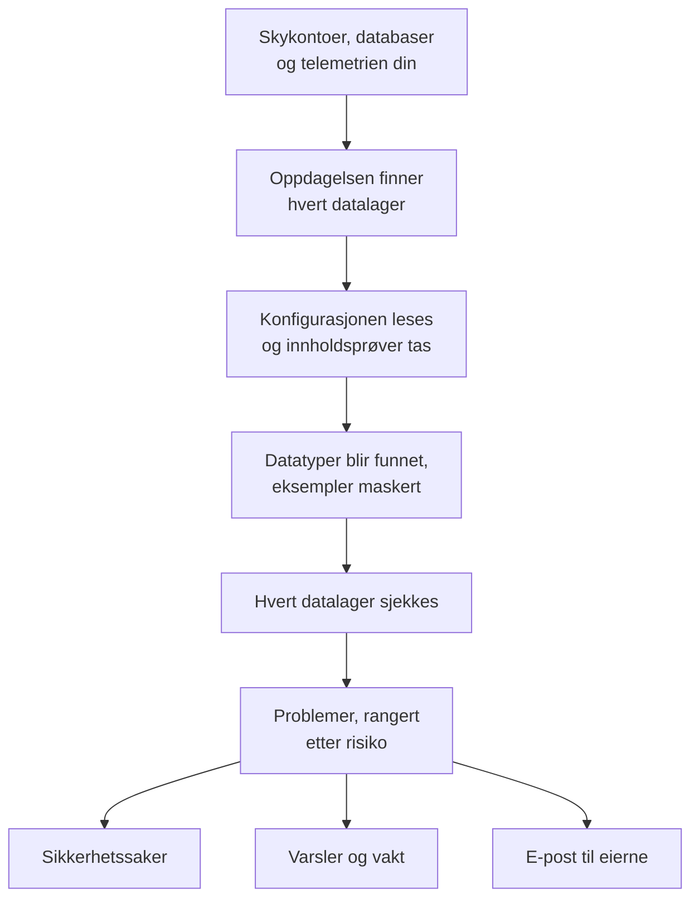

# Datasikkerhet

Data Security finner de sensitive dataene bedriften din har - i buckets, databaser og datavarehus i skyen, og i telemetrien du sender til OneUptime - og forteller deg hva som er galt med måten de oppbevares på. Den finner datalagrene på egen hånd, leser hvordan hvert av dem er satt opp, tar prøver av det de inneholder, og åpner et problem for hvert avvik, rangert etter risiko.

Den svarer på fire spørsmål:

:::cards
- [Hvor ligger de sensitive dataene våre?](/docs/data-security/data-types): 143 datatyper, fra kortnumre og nasjonale ID-numre til API-nøkler, funnet i buckets, tabeller og telemetri.
- [Er de eksponert?](/docs/data-security/checks-and-issues): 32 sjekker av hvert datalager: offentlig tilgang, kryptering, sikkerhetskopier, logging, hemmeligheter og kopier.
- [Hvem kan nå dem, og hvor havner de?](/docs/data-security/flows-access-residency): Hvem som kan lese hvert datalager, hvilke tjenester som bruker det, og hvilke AI-leverandører og verter dataene når.
- [Følger de reglene våre?](/docs/data-security/compliance): Residensregler, og ni rammeverk som får en poengsum ut fra det skanningene fant.
:::

## Slik fungerer det

1. **Oppdagelsen** finner datalagrene OneUptime allerede kjenner til: skyinventaret ditt, databasene produktet Databaser overvåker, databasene tjenestene dine snakker med på tjenestekartet, og telemetrien til hver tjeneste. Du legger bare til et datalager manuelt når ingen kilde lister det.
2. **Konfigurasjonslesingen** spør hver sky hvordan hvert datalager er satt opp: hvem som kan nå det, og hvordan det er kryptert, sikkerhetskopiert og logget. Den leser innstillinger, aldri data.
3. **Innholdsprøver** leser litt av det et datalager inneholder, der du tillater det: noen få objekter av hvert slag i en bucket, noen rader fra hver tabell, de nyeste postene i telemetrien til hver tjeneste.
4. **Klassifiseringen** finner sensitive verdier i prøvene, og beholder antall og maskerte eksempler, aldri en verdi.
5. **Sjekkene** avgjør hva som er galt med hvert datalager, og hvor ille det er for dataene det inneholder. Hver sjekk som feiler, åpner et problem, som lukkes av seg selv når sjekken består.

## Hva som er annerledes

- **Telemetrien din er et datalager.** Loggene, sporene, unntakene, øktavspillingene og AI-samtalene til hver tjeneste sjekkes som en bucket, hver time. En e-postadresse i en logglinje er et funn, og **Scrub It** maskerer den ved inntak fra da av. Se [Sensitive data i telemetri](/docs/data-security/telemetry).
- **Flytene kommer fra ekte trafikk.** Tjenestekartet sier hvilken tjeneste som bruker hvilken database, AI-kall navngir leverandøren de når, og kopier av produksjonsdata finnes ved å sammenligne fingeravtrykk. Se [Dataflyter, tilgang og dataresidens](/docs/data-security/flows-access-residency).
- **Bevis maskeres, alltid.** Et funn beholder antall og høyst tre maskerte eksempler, som `j***@e******.com`, maskert inne i skanneren før noe forlater den. Slå av eksemplene, så beholder det bare antall.
- **Skanneren er åpen kildekode.** Mønsteret, kontrollsummen, kontekstordene og testverdiene til hver datatype ligger i kildekoden til OneUptime, så du kan lese nøyaktig hva som gir et funn. Den samme koden kjører på OneUptimes workers, på en probe og i boksen **Test It**.
- **Den virker sammen med resten av OneUptime.** Et kritisk problem åpner en sikkerhetssak om datalageret, så [Security Operations](/docs/telemetry/security-cases) behandler det som enhver annen trussel. Den kan utløse et varsel som tilkaller den som har vakt, og den sender e-post til eierne av datalageret. Se [Datasikkerhet – integrasjoner](/docs/data-security/integrations).
- **OneUptime AI hjelper deg å rette det.** **Explain** forteller eieren av et datalager hva som er galt og hvordan det rettes i skyen deres, og **Fiks med AI** åpner en pull request i infrastrukturkoden din.

## Før du begynner

- **En rolle som kan sette det opp.** Project Owners, Project Admins og Security Admins endrer innstillingene til Data Security. Security Members behandler problemer og skanner datalagre, og Security Viewers leser det den har funnet. Andre roller ser ingenting av det med mindre teamet deres får tillatelsene: Hvilke buckets som inneholder kortnumre, er nøyaktig det en angriper vil vite. Se [Roller](/docs/permissions/reference#roles).
- **En skykonto å lese, eller en database.** Data Security leser en skykonto gjennom en [skytilkobling](/docs/telemetry/cloud-accounts), og en database du drifter, gjennom en tilkoblingsstreng som bare kan lese. Telemetri trenger ingenting: Den skannes hver time.

## Hurtigstart

:::steps
### Koble til en skykonto

Gå til **Sky → Koble til** og velg skyen din. Er kontoen allerede tilkoblet, velger du i stedet **Rediger** på tilkoblingen. [Koble til en skykonto](/docs/telemetry/cloud-accounts) går gjennom hver sky.

### Velg nivået for datasikkerhet

Under **Flere felt** setter du **Data security** til **Configuration only** for å sjekke hvordan hvert datalager er satt opp, eller til **Configuration and content samples** for også å finne de sensitive dataene i dem. Kommandoen skjemaet viser, endres med valget ditt: Kjør den i skyens skall, slik skjemaet sier. [Sett opp datasikkerhet](/docs/data-security/setup) lister nøyaktig hva hvert nivå gir tilgang til, og [Koble til en skykonto](/docs/telemetry/cloud-accounts#data-security) viser kommandoen for hvert nivå.

### Gå gjennom problemene

Åpne **Data Security**. Datalagre vises under **Data Stores** etter hvert som oppdagelsen finner dem, hvert 15. minutt, og konfigurasjonen til en tilkobling leses innen en time. Problemer åpnes under **Problemer** så snart en lesing eller en skanning er ferdig, hvert med sin risikoscore, og **Oversikt** viser de fem mest risikable. Hvert problem sier hva som er galt, hvorfor det betyr noe og hvordan det rettes, med kommandoene for skyen din.
:::

## Hva som teller som et datalager

| Hvor | Datalagre | Innholdsprøver |
| --- | --- | --- |
| AWS | AWS S3 Bucket, AWS RDS Instance, AWS Aurora Cluster, AWS RDS Snapshot, AWS DynamoDB Table, AWS Redshift Cluster, AWS DocumentDB Cluster, AWS OpenSearch Domain, AWS ElastiCache Cluster, AWS EFS File System | AWS S3 Bucket |
| Azure | Azure Storage Account, Azure SQL Database, Azure Cosmos DB Account, Azure PostgreSQL Server, Azure MySQL Server | Azure Storage Account |
| Google Cloud | Google Cloud Storage Bucket, Google Cloud SQL Instance, Google BigQuery Dataset, Google Firestore Database, Google Spanner Instance, Google Bigtable Instance | Google Cloud Storage Bucket, Google BigQuery Dataset |
| Databaser du drifter | PostgreSQL, MySQL, MongoDB, SQL Server, Oracle, Redis, Elasticsearch | PostgreSQL, MySQL |
| OneUptime | Logs, Traces, Exceptions, Session Replays, AI Conversations | Logs, Traces, Exceptions, Session Replays, AI Conversations |

Hvert datalager får sjekkene som gjelder for typen. Et datalager der innholdet ikke kan prøves, sjekkes likevel: En offentlig bucket eller en ukryptert database er et problem uansett hva den inneholder.

Et datalager arkiveres, med historikken sin, når kilden ikke lenger lister det: **Archived Stores**, nederst i menyen til Data Security, tar vare på det. Det kommer tilbake av seg selv hvis kilden lister det igjen.

## Hvor ofte det kjører

| Hva | Når |
| --- | --- |
| Finne nye datalagre | Hvert 15. minutt |
| Lese konfigurasjonen til en skytilkobling | Én gang i døgnet, og innen en time etter at CloudTrail registrerer en endring i tilgang, kryptering, sikkerhetskopier eller deling for et AWS-datalager |
| Ta prøver av innholdet i et datalager | Hver 24. time, eller så ofte som **Scan Every (Hours)** sier |
| Ta prøver av telemetrien til hver tjeneste | Hver time, av den siste timen |
| Sjekke hvert datalager på nytt | Etter hver lesing og skanning, etter at du endrer noe en sjekk avhenger av, og én gang i døgnet |

**Scan Now** på et datalager tar prøver av innholdet med en gang, og **Check Now** leser konfigurasjonen på nytt.

## Neste steg

:::cards
- [Sett opp datasikkerhet](/docs/data-security/setup): De tre nivåene, tillatelsene hvert av dem gir, og skanning av dine egne databaser.
- [Sensitive datatyper](/docs/data-security/data-types): Hvordan en verdi blir funnet, og hver datatype Data Security kjenner.
- [Datasikkerhet – sjekker og problemer](/docs/data-security/checks-and-issues): Hver sjekk, risikoscoren og hva som skjer med et problem.
- [Datasikkerhet – integrasjoner](/docs/data-security/integrations): Sikkerhetssaker, varsler, eiere, arbeidsflyter og OneUptime AI.
:::
