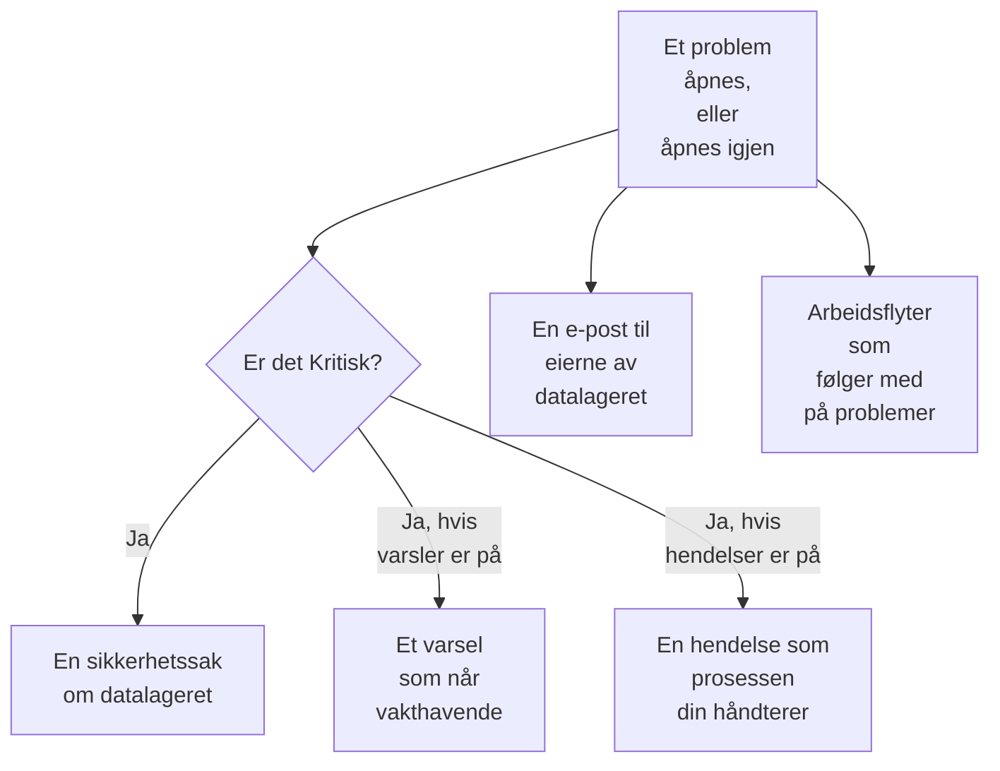

# Integrasjoner for Datasikkerhet

Datasikkerhet har ingen egen personsøking eller egen sikkerhetskø. Den gir det den finner, videre til delene av OneUptime som allerede har det: et kritisk problem blir en sikkerhetssak, det kan varsle vakthavende eller erklære en hendelse, og hvert nytt problem sendes på e-post til eierne av datalageret. Arbeidsflyter, OneUptime AI, API-et, Terraform og MCP-serveren når alt den tar vare på.

:::cards
- [Security Operations](#security-operations): En sikkerhetssak for hvert datalager med et kritisk problem.
- [Varsler og vakt](#varsler-og-vakt): Varsle vakthavende når et kritisk problem åpnes.
- [Hendelser](#hendelser): Erklær en hendelse for et sikkerhetsbrudd som hendelsesprosessen din bør håndtere.
- [Eiere](#eiere): Hvem som eier hvert datalager, angitt manuelt eller av regler, og e-posten de får.
- [OneUptime AI](#oneuptime-ai): Forklar et problem, åpne en pull request som retter det, eller still Spør AI spørsmål om dataene dine.
- [Lukk en eksponering](#lukk-en-eksponering): Blokker offentlig tilgang eller stopp deling, fra et problem eller en playbook.
:::

## Slik fungerer det

Hver av disse kjører når en evaluering åpner et problem, eller åpner et på nytt. Hver av dem gjøres så godt det lar seg gjøre: problemet er allerede åpent og står på tidslinjen sin, så en integrasjon som feiler, logges og hoppes over, og prøves aldri på nytt slik at det blir en sak eller et varsel til. Hva hver av dem gjorde, skrives til problemets **Tidslinje**, og siden til problemet lenker til saken, varselet og hendelsen det startet.

| Innstilling | Standard | Hva den gjør |
| --- | --- | --- |
| **Åpne sikkerhetssaker** | På | Et kritisk problem åpner en sikkerhetssak, gruppert etter datalager. |
| **Opprett varsler** | Av | Et kritisk problem oppretter et varsel, som når vakthavende. |
| **Varselsalvor** | Tom | Alvorlighetsgraden til disse varslene. Tom betyr prosjektets alvorligste. |
| **Erklær hendelser** | Av | Et kritisk problem erklærer en hendelse, som hendelsesprosessen din håndterer. |
| **Hendelsesalvor** | Tom | Alvorlighetsgraden til disse hendelsene. Tom betyr prosjektets alvorligste. |
| **Varsle eiere** | På | Hvert nytt problem sendes på e-post til eierne av datalageret. |

## Security Operations

Hvert datalager er en egen entitet i Security Operations, av typen **Datalager**. Med **Åpne sikkerhetssaker** slått på sendes et kritisk problem til Security Operations som en deteksjon om datalageret:

- kilden er **Datasikkerhet**, og regelen får navn etter kontrollen, for eksempel `Data Security: public-read`;
- den er kritisk, så saken den åpner, får prosjektets kritiske prioritet;
- den grupperes etter datalageret: et nytt kritisk problem på det samme datalageret legges i den åpne saken om det i stedet for å åpne en ny.

Derfra behandles saken som alle andre: den tildeles, får notater, lukkes og besvares av prosjektets playbooks. Deteksjonene for datalageret teller med i risikoen på [Entitetsrisiko](/docs/telemetry/security-entity-risk), slik deteksjonene for enhver entitet gjør. Se [Sikkerhetssaker og playbooks](/docs/telemetry/security-cases).

## Varsler og vakt

Med **Opprett varsler** slått på oppretter et kritisk problem et varsel, med navnet «Data Security:» fulgt av problemets tittel og datalageret. Varselet når vakthavende gjennom sine egne regler, som alle andre varsler (se [Varsler](/docs/alerts/index) og [Vaktordning](/docs/on-call/index)). Et problem har høyst ett åpent varsel om gangen, uansett hvor ofte det evalueres. **Varselsalvor** angir alvorlighetsgraden til varselet; står den tom, er det prosjektets alvorligste.

Et varsel avsluttes sammen med problemet sitt: når problemet ikke lenger er åpent – kontrollen består, eller en person merker det som løst, godtar risikoen eller sier at det ikke er et problem – blir varselet løst, og problemets **Tidslinje** viser det. Et problem som åpnes igjen, oppretter et nytt varsel.

Varsler er av som standard, fordi de fleste team vil ha et datasikkerhetsfunn i en sikkerhetssak først. Slå dem på når en offentlig bucket med kortnumre bør vekke noen.

## Hendelser

Med **Erklær hendelser** slått på erklærer et kritisk problem en hendelse, navngitt på samme måte som varselet, for et sikkerhetsbrudd som hendelsesprosessen din bør håndtere: vakt, kanaler i arbeidsområdet, statussider og en postmortem (se [Hendelser](/docs/incidents/index)). Et problem har høyst én åpen hendelse om gangen. **Hendelsesalvor** angir alvorlighetsgraden til hendelsen; står den tom, er det prosjektets alvorligste.

Datasikkerhet løser aldri en hendelse, selv når problemet er løst: en hendelse kan ha en statusside og en postmortem, så den som håndterer den, lukker den. En sikkerhetssak er den andre veien til en hendelse: **Erklær hendelse** på saken åpner en som er knyttet til den (se [Erklær en hendelse](/docs/telemetry/security-cases#erklær-en-hendelse)).

## Eiere

Eierne av et datalager er personer og team, på datalagerets side **Eiere**. Det er dem et problem er til: de får e-posten, og **Ingen eier dette sensitive datalageret** feiler på et sensitivt datalager som ikke har noen.

Med **Varsle eiere** slått på sender hver evaluering som åpner problemer på et datalager, én e-post til eierne – personene som eier det, og medlemmene av teamene som gjør det, opptil 50 – med en tittel som sier hvor mange nye problemer datalageret har, for eksempel «Data Security: 2 new issues on orders-db». Den lister opp alvorlighetsgraden og tittelen til hvert nytt problem og sensitiviteten til datalageret, og lenker til datalageret. Den inneholder aldri en prøve.

### Eierregler og etikettregler

Regler angir eiere og etiketter for deg etter hvert som datalagre blir funnet:

| Regel | Hvor | Hva den gjør |
| --- | --- | --- |
| **Eierregler** | **Datasikkerhet → Regler → Eierregler** | Legger til eierbrukere og eierteam på hvert datalager som samsvarer |
| **Etikettregler** | **Datasikkerhet → Regler → Etikettregler** | Legger til etiketter på hvert datalager som samsvarer |

En regel samsvarer med et datalager etter etikettene, etter et mønster for navnet eller beskrivelsen, eller etter **Sky-taggmønster**: et mønster som sammenlignes med hver av sky-taggene til datalageret, skrevet `key=value`. `^team=payments$` samsvarer med hvert datalager som er tagget `team=payments`, og `^env=` med hvert datalager som har en `env`-tagg. Et nytt datalager får prosjektets regler i det øyeblikket det blir funnet, og **Varsle eiere** i en eierregel sier om eierne den legger til, får beskjed. [Etikett- og eierregler](/docs/configuration/label-and-owner-rules) forklarer hvordan hver regel samsvarer, og når regler kjører.

## Arbeidsflyter

**Datalager** og **Datasikkerhetsproblem** er utløsere for arbeidsflyter, hver med **Ved oppretting**, **Ved oppdatering**, **Ved oppretting eller oppdatering** og **Ved sletting**. Velg dem i panelet **Legg til utløser**, under **OneUptime-ressurser**.

- **Datasikkerhetsproblem → Ved oppretting** kjører når et problem åpnes for første gang. Les alvorlighetsgraden i en blokk av typen **Hvis / Ellers**, og post de kritiske i en kanal eller åpne en sak i sporingssystemet ditt.
- **Datasikkerhetsproblem → Ved oppdatering**, med **Felt som skal overvåkes** satt til statusen, kjører når et problem løses, godtas eller åpnes igjen.
- **Datalager → Ved oppretting** kjører når discovery finner et datalager, for eksempel for å fortelle et team om hver nye bucket.

Se [Utløsere for arbeidsflyter](/docs/workflows/triggers) for feltene hver utløser sender videre.

## OneUptime AI

To handlinger på et problem ber OneUptime AI om hjelp. Begge sender OneUptime AI problemets tittel og alvorlighetsgrad, datalagerets navn, type, region og sky-ID, sensitiviteten og datatypene, bevisene, hvorfor kontrollen er viktig, og løsningen for datalagerets sky – aldri prøvene fra et funn. Begge kjører under prosjektets brytere og grenser for OneUptime AI.

- **Forklar med AI** skriver, for eieren av datalageret, hva som er galt, hva som kan skje, og de nøyaktige stegene for å rette det i skyen deres. Forklaringen lagres på problemets **Tidslinje**. Alle som kan lese Datasikkerhet, kan be om den.
- **Fiks med AI** ber OneUptime AI rette problemet i infrastrukturkoden din – Terraform, CloudFormation, Bicep eller lignende – med den minste endringen som får kontrollen til å bestå, og åpne en pull request. Den krever at kodelageret med infrastrukturkoden til datalageret er koblet til under **Kode**: velg det under **Kodelager** når prosjektet har flere. Pull requesten vises under **Kode** (se [Kode](/docs/ai/ai-agent)). Security Members og høyere kan be om den.

### Spør AI

**Spør AI** leser også Datasikkerhet. På hvilken som helst side i Datasikkerhet kan du spørre hvilke datalagre som inneholder kortnumre, hva du bør rette først, eller hvilke datalagre en rolle kunne nådd hvis den lekket; på siden til et datalager eller et problem leser den den posten først. Den svarer med tre leseverktøy, som kjøres med dine egne tillatelser:

| Verktøy | Hva det leser |
| --- | --- |
| `query_data_stores` | Datalagrene, de mest risikable først, etter sensitivitet, datatype, eksponering, leverandør eller navn – eller ett datalager med hva som ble funnet hvor, hvem som kan nå det, og de åpne problemene |
| `query_data_security_issues` | Problemene, de mest risikable først, etter status, alvorlighetsgrad, datalager eller kontroll – eller ett problem med bevisene og løsningen for skyen |
| `query_data_store_access` | Hvem som kan nå et datalager, eller hvert datalager én prinsipal kan nå |

De leser datatyper, plasseringer og antall, aldri prøvene fra et funn, maskert eller ikke. Spør AI endrer ingenting i Datasikkerhet.

## Lukk en eksponering

To endringer lukker eksponeringen til et datalager i skyen, hver gjennom datalagerets skytilkobling med **Datasikkerhetsrespons** slått på (se [Sett opp Datasikkerhet](/docs/data-security/setup#la-datasikkerhet-lukke-en-eksponering)):

- **Blokker offentlig tilgang**, på en S3-bucket, en Azure-lagringskonto eller en Cloud Storage-bucket.
- **Tilbakekall deling**, på et RDS-øyeblikksbilde, eller på de delte manuelle øyeblikksbildene av en RDS-database, en Aurora-klynge eller en DocumentDB-klynge.

En person kjører en av dem fra et åpent problem den retter, med **Fiks det herfra** (se [Kontroller og problemer i Datasikkerhet](/docs/data-security/checks-and-issues#fiks-det-herfra)). En playbook i Security Operations kjører dem som steg i kategorien **Begrens**, **Blokker offentlig tilgang til datalagre** og **Tilbakekall deling av datalager**: på hvert datalager saken gjelder, høyst 10, hvert et steg som starter med **Krever godkjenning** slått på. Et datalager merket **Offentlig med vilje** blokkeres aldri. Uansett sier datalagerets feed hva som ble gjort, og datalageret kontrolleres på nytt med en gang, så problemet løses når endringen har fått virkning.

## API, Terraform og MCP

Alt Datasikkerhet tar vare på, er en post i OneUptime-API-et, som leses med de samme tillatelsene som i dashbordet (se [API-referansen](/docs/api-reference/api-reference)):

| Poster | API-sti |
| --- | --- |
| Datalagre, tidslinjene deres, funnene deres og hvem som kan nå dem | `/data-store`, `/data-store-feed`, `/data-store-finding`, `/data-store-access` |
| Problemer, tidslinjene deres og dataflyter | `/data-security-issue`, `/data-security-issue-feed`, `/data-security-flow` |
| Skanninger | `/data-security-scan` |
| Egendefinerte datatyper, kontrollinnstillinger og residensregler | `/data-security-custom-data-type`, `/data-security-check-setting`, `/data-security-residency-rule` |
| Prosjektets innstillinger | `/data-security-setting` |
| Eiere, eierregler og etikettregler | `/data-store-owner-user`, `/data-store-owner-team`, `/data-store-owner-rule`, `/data-store-label-rule` |

Noen få svar beregnes ved forespørsel i stedet for å lagres. Hver av dem er en `POST`:

| Sti | Hva den gjør |
| --- | --- |
| `/data-security/overview` | Tallene på Oversikt-siden: datalagre etter sensitivitet og kategori, åpne problemer etter alvorlighetsgrad, de mest risikable problemene og de siste 30 dagene av dem |
| `/data-security/compliance` | Scoren og kravene for hvert rammeverk |
| `/data-security/record-of-processing` | GDPR-behandlingsprotokollen, en rad for hvert datalager som inneholder personopplysninger |
| `/data-store/<id>/scan-now` | **Skann nå**: tar stikkprøver av innholdet i datalageret nå |
| `/data-store/<id>/check-now` | **Kontroller nå**: leser konfigurasjonen til datalageret på nytt og kjører kontrollene |
| `/data-store-finding/<id>/scrub` | **Rens** på et telemetrifunn |
| `/data-security-issue/<id>/explain` | **Forklar med AI** på et problem |
| `/data-security-issue/<id>/fix-with-ai` | **Fiks med AI** på et problem |
| `/data-store/<id>/response-actions` | Hvilke responshandlinger datalageret kan utføre nå, og hvorfor ikke |
| `/data-store/<id>/respond` | **Blokker offentlig tilgang** eller **Tilbakekall deling** på datalageret, med problemet det ble kjørt fra |

[Terraform-provideren](/docs/terraform/index) har en ressurs for hver type post du oppretter – datalagre du legger til selv, egendefinerte datatyper, kontrollinnstillinger, residensregler, eier- og etikettregler – oppkalt etter posten, for eksempel `oneuptime_residency_rule`.

[MCP-serveren](/docs/ai/mcp-server) har verktøy for å opprette, hente, liste, oppdatere, slette og telle for disse postene: Data Store, Data Store Finding, Data Store Access Entry, Data Flow, Data Security Issue, Data Security Scan, Custom Data Type, Check Setting, Residency Rule og Data Security Setting. En AI-assistent kan da spørre hvilke datalagre som inneholder kortnumre, eller hva som er åpent på en bucket, med dine tillatelser.

## Neste steg

:::cards
- [Sikkerhetssaker og playbooks (SOAR)](/docs/telemetry/security-cases): Behandle sakene Datasikkerhet åpner.
- [Etikett- og eierregler](/docs/configuration/label-and-owner-rules): Hvordan regler samsvarer, og når de kjører.
- [Utløsere for arbeidsflyter](/docs/workflows/triggers): Kjør en arbeidsflyt når et problem åpnes eller et datalager blir funnet.
- [Kontroller og problemer i Datasikkerhet](/docs/data-security/checks-and-issues): Hva hvert problem betyr, og hvordan du retter det.
:::
