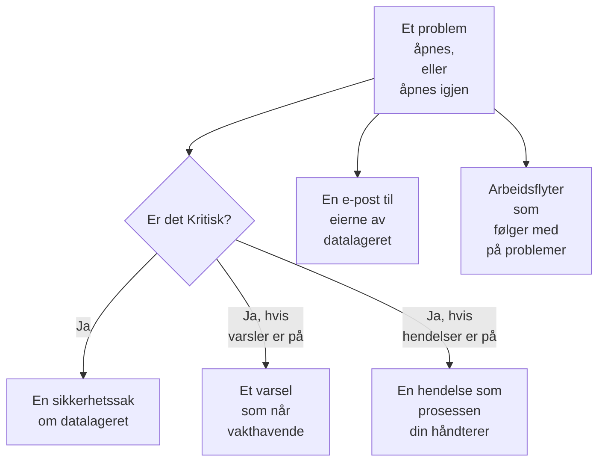

# Integrasjoner for Datasikkerhet

Datasikkerhet har ingen egen personsøking eller egen sikkerhetskø. Den gir det den finner, videre til delene av OneUptime som allerede har det: et kritisk problem blir en sikkerhetssak, det kan varsle vakthavende eller erklære en hendelse, og hvert nytt problem sendes på e-post til eierne av datalageret. Arbeidsflyter, OneUptime AI, API-et, Terraform og MCP-serveren når alt den tar vare på.

:::cards
- [Security Operations](#security-operations): En sikkerhetssak for hvert datalager med et kritisk problem.
- [Var det et sikkerhetsbrudd?](#var-det-et-sikkerhetsbrudd): Hver kritisk eksponering vurdert: hvor lenge, hvem som kunne lese det, hvem dataene tilhørte, og lovene om sikkerhetsbrudd som kan gjelde.
- [Varsler og vakt](#varsler-og-vakt): Varsle vakthavende når et kritisk problem åpnes.
- [Hendelser](#hendelser): Erklær en hendelse for et sikkerhetsbrudd som hendelsesprosessen din bør håndtere.
- [Eiere](#eiere): Analyser et problem, åpne en pull-forespørsel som fikser det, eller spør Spør AI om dataene dine og la det handle, med din godkjenning.
- [OneUptime AI](#oneuptime-ai): Forklar et problem, åpne en pull request som retter det, eller still Spør AI spørsmål om dataene dine.
- [Lukk en eksponering](#lukk-en-eksponering): Blokker offentlig tilgang eller stopp deling, fra et problem eller en playbook, og slå på en manglende beskyttelse fra et problem.
:::

## Slik fungerer det

Hver av disse kjører når en evaluering åpner et problem, eller åpner et på nytt. Hver av dem gjøres så godt det lar seg gjøre: problemet er allerede åpent og står på tidslinjen sin, så en integrasjon som feiler, logges og hoppes over, og prøves aldri på nytt slik at det blir en sak eller et varsel til. Hva hver av dem gjorde, skrives til problemets **Tidslinje**, og siden til problemet lenker til saken, varselet og hendelsen det startet.

| Innstilling | Standard | Hva den gjør |
| --- | --- | --- |
| **Åpne sikkerhetssaker** | På | Et kritisk problem åpner en sikkerhetssak, gruppert etter datalager. |
| **Opprett varsler** | Av | Et kritisk problem oppretter et varsel, som når vakthavende. |
| **Varselsalvor** | Tom | Alvorlighetsgraden til disse varslene. Tom betyr prosjektets alvorligste. |
| **Erklær hendelser** | Av | Et kritisk problem erklærer en hendelse, som hendelsesprosessen din håndterer. |
| **Hendelsesalvor** | Tom | Alvorlighetsgraden til disse hendelsene. Tom betyr prosjektets alvorligste. |
| **Varsle eiere** | På | Hvert nytt problem sendes på e-post til eierne av datalageret. |

## Security Operations

Hvert datalager er en egen entitet i Security Operations, av typen **Datalager**. Med **Åpne sikkerhetssaker** slått på sendes et kritisk problem til Security Operations som en deteksjon om datalageret:

- kilden er **Datasikkerhet**, og regelen får navn etter kontrollen, for eksempel `Data Security: public-read`;
- den er kritisk, så saken den åpner, får prosjektets kritiske prioritet;
- den grupperes etter datalageret: et nytt kritisk problem på det samme datalageret legges i den åpne saken om det i stedet for å åpne en ny.

Derfra behandles saken som alle andre: den tildeles, får notater, lukkes og besvares av prosjektets playbooks. Deteksjonene for datalageret teller med i risikoen på [Entitetsrisiko](/docs/telemetry/security-entity-risk), slik deteksjonene for enhver entitet gjør. Se [Sikkerhetssaker og playbooks](/docs/telemetry/security-cases).

Enhver sikkerhetssak, uansett hva som åpnet den, viser data i fare under **Påvirkning**: datalagrene med sensitive data saken gjelder, og hvert datalager brukerne og rollene dens kan nå, det mest sensitive først, med hva hvert inneholder, omtrent hvor mange poster, hvor eksponert det er og hvor mange identiteter som kan nå det. En påtatt rolleøkt som saken nevner, teller som rollen sin, og en e-postadresse som skybrukerne den hører til. Det leses med leserens egne tillatelser, så en rolle som ikke kan lese Datasikkerhet, ser at denne delen er utelatt.

## Var det et sikkerhetsbrudd?

En kritisk eksponering av et datalager med data klassifisert som **Begrenset** eller **Konfidensiell** – åpent for alle på internett, delt med kontoer utenfor deres egne, eller et øyeblikksbilde andre kan gjenopprette – får saken sin vurdert av seg selv når saken åpnes. Alle andre saker om et datalager vurderes når en person trykker på **Vurder denne eksponeringen** på sakens **Oversikt**. Vanlig kode utleder vurderingen av det OneUptime har registrert, og utleder den på nytt hver gang den leses:

- **Hvor lenge det var åpent**: fra endringen i loggen til skyen din som eksponerte datalageret, når en slik ble logget i løpet av de 30 dagene før eksponeringen ble funnet, ellers minst fra Datasikkerhet fant den; til Datasikkerhets egen respons lukket den, en endring lukket den, eller en kontroll fant at den var lukket.
- **Hvem som kunne lese det**: om datalageret logget lesinger. Der det ikke gjorde det, sier vurderingen «Lesinger ble ikke logget. Gå ut fra at dataene er lest.» Den teller kontoene utenfor bedriften din som kunne lese datalageret, og hvor mange av dem som brukte tilgangen sin mens det var åpent, uten noen gang å nevne dem ved navn. Er datalageret en S3-bucket som logger servertilgangene sine, leser **Les tilgangsloggene** de loggene for perioden, og Data Security leser dem selv før OneUptime AI skriver vurderingen: hvor mange lesinger som kom fra alle på internett, fra kontoer utenfor bedriften din og fra forespørrere den ikke kan plassere, hvor mange objekter som ble lest, og hvor mye som ble sendt. Den som får se hvem som kan nå datalageret, ser hvilke eksterne kontoer som leste det; saken, OneUptime AI og en eksport beholder bare tallene. Logger som bare er lest delvis, viser aldri at ingen leste dataene.
- **Hvem dataene tilhørte**: hva datalageret inneholder, omtrent hvor mange poster, hvem de gjelder, og hvor de registrerte bor, slik dataene viser og slik en person oppgir. En person oppgir en region eller hver amerikanske delstat, District of Columbia, Puerto Rico, Guam og De amerikanske Jomfruøyene. En person oppgir også om organisasjonen din oppbevarer dataene for en annen organisasjon, som leverandør, tjenesteleverandør eller databehandler for den: først da legges varslene til som loven krever at den som oppbevarer dataene, sender til eieren av dataene.
- **Hemmelighetene som må roteres**: hver hemmelighet som ble funnet i datalageret mens det var åpent, etter type og hvor den ble funnet, aldri verdien.
- **Lovene om sikkerhetsbrudd som kan gjelde**: hver rad i OneUptimes tabell over lover om sikkerhetsbrudd, med hva den krever, av hvem, fristen regnet fra da Datasikkerhet fant eksponeringen, og hva en person fortsatt sjekker før den gjelder.

Tabellen dekker GDPR artikkel 33 og 34, UK GDPR artikkel 33 og 34, HIPAAs Breach Notification Rule, PCI DSS-krav 12.10.1 med kortmerkenes egne publiserte regler ved siden av - Visas, Mastercards og American Express' -, Brasils LGPD, Indias DPDP Rules og CERT-In-direktivene, og lovene om brudd i alle amerikanske delstater unntatt Vest-Virginia, og i District of Columbia, Puerto Rico, Guam og De amerikanske Jomfruøyene. For hver delstat er det varselet til de registrerte og, der loven der krever dem fra en virksomhet, varslene til Attorney General eller et annet delstatskontor og til kredittopplysningsbyråene, hvert lest fra lovens egen tekst. For en organisasjon som oppbevarer dataene for en annen, er det også hver delstats varsel til eieren av dataene, med fristen slik loven angir den - umiddelbart, så snart det er mulig, eller innen et antall timer eller dager -, og GDPRs og UK GDPRs varsel fra en databehandler til den behandlingsansvarlige og HIPAAs fra en forretningsforbindelse (business associate) til den dekkede enheten (covered entity). Et varsel loven krever umiddelbart, er varselet med første frist. Der teksten i en lov endres på en fastsatt dag, har tabellen en rad for hver tekst, og dagen Datasikkerhet fant eksponeringen, avgjør hvilken som gjelder: Vermonts tekst fra 1. januar 2027 gjelder for en eksponering funnet fra den dagen, og teksten før den for en som ble funnet tidligere. Hver rad lenker til lovens egen tekst, kilden, og oppgir dagen den sist ble sjekket. Så lenge ingen har sagt hvilke delstater de registrerte bor i, står delstatenes lover samlet på kortet, hver delstats varsler under navnet dens, og OneUptime AI får bare vite hvor mange som kan gjelde. Det tabellen ikke dekker - et annet land; Vest-Virginia, der loven ikke kunne leses fra en offisiell kilde; varslene til eieren av dataene, så lenge ingen har sagt hvem dataene tilhører; kortmerkene som ikke publiserer en frist; hvor organisasjonen din er etablert; kontraktene dine - sier vurderingen med klare ord.

OneUptime AI skriver ut vurderingen slik AI-reglene dine for Datasikkerhet tillater, eller når en person ber om det: hva det betyr, en melding til myndigheten, en underretning til de berørte registrerte og et internt sammendrag (se [OneUptime AI i Datasikkerhet](/docs/data-security/ai)). Hvert utkast holdes opp mot fakta i vurderingen: et tall eller en lov som ingen av dem inneholder, gjør at utkastet forkastes. Ingenting sendes noe sted: en melding er tekst en person redigerer og kopierer, og vurderingen og hvert utkast sier at de ikke er juridisk rådgivning.

Sakens lesere som også kan lese datalageret og funnene i det, ser vurderingen, siden den nevner hva datalageret inneholder. Å vurdere, skrive utkast, redigere en melding og angi hvor de registrerte bor og hvem dataene tilhører krever i tillegg tillatelse til å redigere saken. Se [Var det et sikkerhetsbrudd?](/docs/telemetry/security-cases#var-det-et-sikkerhetsbrudd) for sakens kort.

## Varsler og vakt

Med **Opprett varsler** slått på oppretter et kritisk problem et varsel, med navnet «Data Security:» fulgt av problemets tittel og datalageret. Varselet når vakthavende gjennom sine egne regler, som alle andre varsler (se [Varsler](/docs/alerts/index) og [Vaktordning](/docs/on-call/index)). Et problem har høyst ett åpent varsel om gangen, uansett hvor ofte det evalueres. **Varselsalvor** angir alvorlighetsgraden til varselet; står den tom, er det prosjektets alvorligste.

Et varsel avsluttes sammen med problemet sitt: når problemet ikke lenger er åpent – kontrollen består, eller en person merker det som løst, godtar risikoen eller sier at det ikke er et problem – blir varselet løst, og problemets **Tidslinje** viser det. Et problem som åpnes igjen, oppretter et nytt varsel.

Varsler er av som standard, fordi de fleste team vil ha et datasikkerhetsfunn i en sikkerhetssak først. Slå dem på når en offentlig bucket med kortnumre bør vekke noen.

## Hendelser

Med **Erklær hendelser** slått på erklærer et kritisk problem en hendelse, navngitt på samme måte som varselet, for et sikkerhetsbrudd som hendelsesprosessen din bør håndtere: vakt, kanaler i arbeidsområdet, statussider og en postmortem (se [Hendelser](/docs/incidents/index)). Et problem har høyst én åpen hendelse om gangen. **Hendelsesalvor** angir alvorlighetsgraden til hendelsen; står den tom, er det prosjektets alvorligste.

Datasikkerhet løser aldri en hendelse, selv når problemet er løst: en hendelse kan ha en statusside og en postmortem, så den som håndterer den, lukker den. En sikkerhetssak er den andre veien til en hendelse: **Erklær hendelse** på saken åpner en som er knyttet til den (se [Erklær en hendelse](/docs/telemetry/security-cases#erklær-en-hendelse)).

## Eiere

Eierne av et datalager er personer og team, på datalagerets side **Eiere**. Det er dem et problem er til: de får e-posten, og **Ingen eier dette sensitive datalageret** feiler på et sensitivt datalager som ikke har noen.

Med **Varsle eiere** slått på sender hver evaluering som åpner problemer på et datalager, én e-post til eierne – personene som eier det, og medlemmene av teamene som gjør det, opptil 50 – med en tittel som sier hvor mange nye problemer datalageret har, for eksempel «Data Security: 2 new issues on orders-db». Den lister opp alvorlighetsgraden og tittelen til hvert nytt problem og sensitiviteten til datalageret, og lenker til datalageret. Den inneholder aldri en prøve.

Mens OneUptime AI selv jobber med nye problemer, venter e-posten på analysen, i opptil 10 minutter, og gir hvert analysert problem to linjer til: vurderingen og hvorfor, og den korteste veien til fikset. Hver eier får linjene eieren har lov til å lese: en eier som ikke kan lese problemet, får ingen, og en linje som bygger på noe eieren ikke kan lese, utelates.

### Eierregler og etikettregler

Regler angir eiere og etiketter for deg etter hvert som datalagre blir funnet:

| Regel | Hvor | Hva den gjør |
| --- | --- | --- |
| **Eierregler** | **Datasikkerhet → Regler → Eierregler** | Legger til eierbrukere og eierteam på hvert datalager som samsvarer |
| **Etikettregler** | **Datasikkerhet → Regler → Etikettregler** | Legger til etiketter på hvert datalager som samsvarer |

En regel samsvarer med et datalager etter etikettene, etter et mønster for navnet eller beskrivelsen, eller etter **Sky-taggmønster**: et mønster som sammenlignes med hver av sky-taggene til datalageret, skrevet `key=value`. `^team=payments$` samsvarer med hvert datalager som er tagget `team=payments`, og `^env=` med hvert datalager som har en `env`-tagg. Et nytt datalager får prosjektets regler i det øyeblikket det blir funnet, og **Varsle eiere** i en eierregel sier om eierne den legger til, får beskjed. [Etikett- og eierregler](/docs/configuration/label-and-owner-rules) forklarer hvordan hver regel samsvarer, og når regler kjører.

### Eiere som OneUptime AI foreslår

Et datalager uten eiere kan få dem fra OneUptime AI. Den leser det som allerede peker på en eier - datalagerets skytagger, tjenestene som bruker det, kodeeierne til filen som deklarerer det, og hvem som endret eller la det til - og foreslår ut fra det teamene og personene i ditt eget prosjekt. Ingenting endres før en person godkjenner det under **Eiere til gjennomgang**, under **Datalagre** eller **Datasikkerhet → KI**, og eierne som legges til, får beskjed som enhver eier. Når eierne av tre eller flere datalagre hviler på én tagg eller én begynnelse av navnet, foreslår den også eierregelen som holder det neste lignende datalageret med en eier, og som blir med i **Eierregler** når den er godkjent. [OneUptime AI i Datasikkerhet](/docs/data-security/ai) sier hva den sender, og når den kjører.

## Arbeidsflyter

**Datalager** og **Datasikkerhetsproblem** er utløsere for arbeidsflyter, hver med **Ved oppretting**, **Ved oppdatering**, **Ved oppretting eller oppdatering** og **Ved sletting**. Velg dem i panelet **Legg til utløser**, under **OneUptime-ressurser**.

- **Datasikkerhetsproblem → Ved oppretting** kjører når et problem åpnes for første gang. Les alvorlighetsgraden i en blokk av typen **Hvis / Ellers**, og post de kritiske i en kanal eller åpne en sak i sporingssystemet ditt.
- **Datasikkerhetsproblem → Ved oppdatering**, med **Felt som skal overvåkes** satt til statusen, kjører når et problem løses, godtas eller åpnes igjen.
- **Datalager → Ved oppretting** kjører når discovery finner et datalager, for eksempel for å fortelle et team om hver nye bucket.

Se [Utløsere for arbeidsflyter](/docs/workflows/triggers) for feltene hver utløser sender videre.

## Pull requests

En lekkasje er billigst å rette før den merges. I et repositorium koblet til under **Kode** med produksjonsgjennomganger slått på har gjennomgangen av hver pull request en del **Sensitive data**, lest fra diffen: kode som skriver personopplysninger eller en hemmelighet til telemetri, i en logg, et span, en måling, meldingen til et unntak eller rapporten til en feilsporer, infrastrukturkode som gjør et datalager offentlig eller slår av krypteringen, sikkerhetskopiene eller loggingen, og migreringer som legger til kolonner for personopplysninger, passord eller kortdata. Hvert punkt nevner datasikkerhetskontrollen endringen ville feilet når den er rullet ut, og dine egne datatyper leses ut fra navnehintene sine, slik skanningene leser dem. Se [Produksjonsgjennomgang av pull requests](/docs/ai/ai-agent#produksjonsgjennomgang-av-pull-requests).

Det Datasikkerhet vet, gjør disse punktene skarpere, i kommentaren til et privat repositorium og, i Kode, for dem som får lese Datasikkerhets funn: hvor tjenestens telemetri inneholdt samme type data de siste 7 dagene, rensingsregelen som maskerer dem ved inntak, og datalageret en ressurs er, med følsomheten. For en migrering, bare i et privat repositorium, nevner punktet datalageret tabellen ligger i, hva det datalageret inneholder, om datalageret kan nås utenfra eller ikke er kryptert i hvile, og kolonnene i tabellen der samme type data allerede er funnet. Et datalager merket **Offentlig med vilje** gir ikke noe punkt for å være offentlig. Kommentaren til et offentlig repositorium sier bare det diffen viser.

**Lekkasjer fanget før merge** på **Prosjektinnstillinger → KI → AI-resultater** teller lekkasjene gjennomganger fanget i pull requests, rettet der eller ikke ennå, ved siden av problemene skanningene åpnet for de samme kontrollene etter at koden ble rullet ut.

## OneUptime AI

To handlinger på et problem ber OneUptime AI om hjelp. Begge sender OneUptime AI problemets tittel og alvorlighetsgrad, datalagerets navn, type, region og sky-ID, sensitiviteten og datatypene, hver med sitt navn (dine egne datatyper med navnet du ga dem), bevisene, hvorfor kontrollen er viktig, og løsningen for datalagerets sky – aldri prøvene fra et funn. Begge kjører under prosjektets brytere og grenser for OneUptime AI. Hva hver av dem sender, hva den aldri sender, og modellen den kjører på, står på [OneUptime AI i Datasikkerhet](/docs/data-security/ai).

- **Analyser problemet**, øverst på siden til problemet, lar OneUptime AI skrive analysen: om problemet er reelt, hva det setter i fare, hva fiksen ville ødelegge og den korteste veien til fikset (se [Datasikkerhetskontroller og problemer](/docs/data-security/checks-and-issues)). Den sender også hvem som kan nå lageret - hver tildeling og omtrent når den sist ble brukt, og tjenestene som er sett bruke det -, kopier av dataene i andre lagre, sikkerhetssakene, responshandlingen som fikser problemet, repositoryet og filene som erklærer lageret, og hvor mange eiere det har, aldri hvem de er. Analysen lagres på problemet, vurderingen på problemets **Tidslinje**. Verken det som ble sendt eller svaret lagres i **Prosjektinnstillinger → KI → AI-logger**, som alle med rollen Prosjektmedlem eller Leser kan lese: den raden sier bare at kallet ble gjort, og hva det kostet. Alle som kan lese problemet, kan spørre, og **Forklar med AI** gjennom API-et og MCP-serveren svarer med den samme analysen.
- **Fiks med AI** ber OneUptime AI rette problemet i infrastrukturkoden din – Terraform, CloudFormation, Bicep eller lignende – med den minste endringen som får kontrollen til å bestå, og åpne en pull request. Den krever at kodelageret med infrastrukturkoden til datalageret er koblet til under **Kode**: velg det under **Kodelager** når du kan be om den i flere. Pull requesten vises under **Kode** (se [Kode](/docs/ai/ai-agent)). Sikkerhetsmedlemmer og høyere kan be om den, i et kodelager de kan endre under **Kode**, slik det kreves for å be KI om noe der: en sikkerhetsrolle leser og endrer ingen kodelagre på egen hånd, så gi teamet deres også **Read Code Repository** og **Edit Code Repository**. Når KI ikke kan arbeide nå – den er slått av, prosjektet er tomt for KI-kreditter, de daglige grensene er nådd, eller ingen Runner er på nett – sier Fiks med AI hva som må rettes, og starter ingenting. For et problem i en tjenestes telemetri viser den først én pull-forespørsel for hver av tjenestens lekkasjer, med hvor postene sier at hver skrives - aldri en verdi - og der dataene skrives på mer enn tre steder, legger den i stedet til ett sladdetrinn med en test: se [Fiks det i koden](/docs/data-security/telemetry#fiks-det-i-koden).

OneUptime AI jobber også på egen hånd med hvert nytt problem, slik AI-reglene dine tillater: se [OneUptime AI i datasikkerhet](/docs/data-security/ai).

### Spør AI

**Spør AI** leser Datasikkerhet og handler i den med din godkjenning. På hvilken som helst side i Datasikkerhet kan du spørre hvilke datalagre som inneholder kortnumre, hva du bør fikse først, eller hvilke datalagre en rolle kunne nå hvis den lakk; på siden til et datalager eller et problem leser det den posten først. Det leser med disse verktøyene, som kjører med dine egne tillatelser:

| Verktøy | Hva det leser |
| --- | --- |
| `query_data_stores` | Datalagrene, de mest risikable først, etter sensitivitet, datatype, eksponering, leverandør eller navn – eller ett datalager med hva som ble funnet hvor, hvem som kan nå det, og de åpne problemene |
| `query_data_security_issues` | Problemene, de mest risikable først, etter status, alvorlighetsgrad, datalager eller kontroll – eller ett problem med bevisene og løsningen for skyen |
| `query_data_store_access` | Hvem som kan nå et datalager, eller hvert datalager én prinsipal kan nå |

De leser datatyper, plasseringer og antall, aldri prøvene i et funn, maskert eller ikke. To til leser det OneUptime AI jobber med: `query_data_security_proposals` viser hva det foreslår, og datatypene det har funnet og som skanninger ennå ikke ser etter, hver med hvordan den ble bevist og feltene den står i, aldri en verdi; `draft_data_security_rule` lager et regelutkast fra setningen din og sier hvilke datalagre den treffer i dag. Det lagrer ingenting.

Spør AI gjør det knappene i Datasikkerhet gjør, hver ved å gjøre nøyaktig den endringen knappen gjør, som deg og med dine tillatelser:

| Handling | Hva den gjør | Spør deg først |
| --- | --- | --- |
| `scrub_data_security_finding` | **Rens** på et funn i telemetrien: den beviste, smale renseregelen for det | I **Spør før handling**, og i alle moduser når noe leser det den skjuler |
| `judge_data_security_finding` | **Bekreft**, eller **Ikke sensitivt** med din begrunnelse, og det samme for lignende funn | **Ikke sensitivt** i alle moduser; **Bekreft** i alle moduser når et kritisk problem varsler noen i prosjektet ditt |
| `change_data_security_issue` | **Godta risiko** med din begrunnelse og en sluttdato, **Ikke et problem** med din begrunnelse, **Gjenåpne** eller **Tildel** | **Godta risiko** og **Ikke et problem** i alle moduser |
| `set_data_store_owners` | Legger til eller fjerner eierne av et datalager | I alle moduser |
| `save_data_security_rule` | Lagrer en residens-, eier- eller etikettregel laget fra setningen din, og bruker en eier- eller etikettregel på datalagrene den treffer i dag | I alle moduser |
| `respond_on_data_store` | En responshandling gjennom datalagerets skytilkobling, som **Blokker offentlig tilgang** | I alle moduser |
| `fix_data_security_issue_with_ai` | **Fiks med AI**: en pull-forespørsel som noen går gjennom og fletter. En retting som allerede er på vei, startes ikke to ganger | I **Spør før handling** |
| `decide_data_security_proposal` | **Godkjenn** eller **Skjul** på det OneUptime AI foreslår. En funnet datatype legges til via skjemaet i **Innstillinger → Datatyper**, så her kan den bare avvises | I alle moduser |

Hver handling viser først et kort som med enkle ord sier hva som endres, hva som slutter å virke og hva det koster. I **Spør før handling** tillater eller hopper du over hver handling. I **Kjør automatisk** venter handlingene ovenfor som spør i alle moduser, fortsatt på deg: De endrer hvem som kan nå dataene dine, får et funn eller et problem til å slutte å telle, endrer hvem som får beskjed om et datalager, eller ville latt OneUptime AI godkjenne sitt eget forslag. Navn på datalagre, plasseringer av funn og bevis kommer fra skyene dine og fra alle som skriver til dem, så Spør AI handler aldri fordi en slik tekst ber om det, og hver handling sjekkes på nytt, med dine tillatelser, når den kjører.

## Lukk en eksponering

To endringer lukker eksponeringen til et datalager i skyen, hver gjennom datalagerets skytilkobling med **Datasikkerhetsrespons** slått på (se [Sett opp Datasikkerhet](/docs/data-security/setup#la-datasikkerhet-lukke-en-eksponering)), og seks til slår på en innstilling som beskytter et datalager, bare fra problemet:

- **Blokker offentlig tilgang**, på en S3-bucket, en Azure-lagringskonto eller en Cloud Storage-bucket.
- **Tilbakekall deling**, på et RDS-øyeblikksbilde, eller på de delte manuelle øyeblikksbildene av en RDS-database, en Aurora-klynge eller en DocumentDB-klynge.
- **Slå på versjonskontroll**, **Slå på myk sletting**, **Slå av objekt-ACL-er**, **Slå på enhetlig tilgang**, **Krev sikker overføring** og **Slå på gjenoppretting til et tidspunkt**, på datalagrene som [Fiks det herfra](/docs/data-security/checks-and-issues#fiks-det-herfra) lister opp.

En person kjører en av dem fra et åpent problem den retter, med **Fiks det herfra** (se [Kontroller og problemer i Datasikkerhet](/docs/data-security/checks-and-issues#fiks-det-herfra)). En playbook i Security Operations kjører dem som steg i kategorien **Begrens**, **Blokker offentlig tilgang til datalagre** og **Tilbakekall deling av datalager**: på hvert datalager saken gjelder, høyst 10, hvert et steg som starter med **Krever godkjenning** slått på. Et datalager merket **Offentlig med vilje** blokkeres aldri. Uansett sier datalagerets feed hva som ble gjort, og datalageret kontrolleres på nytt med en gang, så problemet løses når endringen har fått virkning.

Playbook-malen **Lukk en dataeksponering** svarer på sakene Datasikkerhet åpner: den sender e-post til eierne av datalageret, blokkerer offentlig tilgang og tilbakekaller deling når et menneske har godkjent hvert steg, og legger responsens sjekkliste til saken som oppgaver – hvem som leste dataene mens de var eksponert, om det er et brudd du må melde, hvilke hemmeligheter som må roteres, og hva som skal skrives når saken lukkes. Legg den til fra **Opprett fra mal** under prosjektets playbooks. Sakens kort **Var det et sikkerhetsbrudd?** svarer på hver av disse oppgavene (se [Var det et sikkerhetsbrudd?](#var-det-et-sikkerhetsbrudd)).

## API, Terraform og MCP

Alt Datasikkerhet tar vare på, er en post i OneUptime-API-et, som leses med de samme tillatelsene som i dashbordet (se [API-referansen](/docs/api-reference/api-reference)):

| Poster | API-sti |
| --- | --- |
| Datalagre, tidslinjene deres, funnene deres, hvem som kan nå dem og hver identitet som kan | `/data-store`, `/data-store-feed`, `/data-store-finding`, `/data-store-access`, `/data-security-identity` |
| Problemer, tidslinjene deres, de tilkoblede pull-forespørslene deres og dataflyter | `/data-security-issue`, `/data-security-issue-feed`, `/data-security-issue-pull-request`, `/data-security-flow` |
| Skanninger | `/data-security-scan` |
| Egendefinerte datatyper, kontrollinnstillinger, samsvarsinnstillinger og residensregler | `/data-security-custom-data-type`, `/data-security-check-setting`, `/data-security-compliance-setting`, `/data-security-residency-rule` |
| Prosjektets innstillinger | `/data-security-setting` |
| Eiere, eierregler og etikettregler | `/data-store-owner-user`, `/data-store-owner-team`, `/data-store-owner-rule`, `/data-store-label-rule` |
| Hva OneUptime AI foreslår for et problem, og hvorfor den handlet eller ikke handlet på et | `/data-security-ai-proposal`, `/data-security-ai-decision` |

Noen få svar beregnes ved forespørsel i stedet for å lagres. Hver av dem er en `POST`:

| Sti | Hva den gjør |
| --- | --- |
| `/data-security/overview` | Tallene på Oversikt-siden: datalagre etter sensitivitet og kategori, åpne problemer etter alvorlighetsgrad, de mest risikable problemene og de siste 30 dagene av dem |
| `/data-security/compliance` | Scoren og kravene for hvert rammeverk |
| `/data-security/resource-scope` | Datalagrene til én ressurs – en Kubernetes-klynge, en Docker- eller Podman-vert, en database, en tjeneste eller en skyressurs – og hvilken ressurs' samsvarsbrytere de følger |
| `/data-security/resource-compliance` | Rammeverkene til én ressurs: scorene deres for datalagrene til ressursen, og hva som er slått av for den |
| `/data-security/record-of-processing` | GDPR-behandlingsprotokollen, en rad for hvert datalager som inneholder personopplysninger. Et datalager OneUptime oppbevarer for sikkerheten din, har et objekt `declared`: sitt eget formål og sin egen oppbevaring, og hvem som kan lese det |
| `/data-store/<id>/declared` | Hva protokollen sier om et datalager OneUptime oppbevarer for sikkerheten din: hva det inneholder, hvorfor, hvor lenge og hvem som kan lese det |
| `/data-store/<id>/scan-now` | **Skann nå**: tar stikkprøver av innholdet i datalageret nå |
| `/data-store/<id>/check-now` | **Kontroller nå**: leser konfigurasjonen til datalageret på nytt og kjører kontrollene |
| `/data-store-finding/<id>/scrub` | **Rens** på et telemetrifunn |
| `/data-store-finding/<id>/drop-metric-impact` | Hva **Forkast denne målingen** ville forkaste for et funn i navnet til en måling: hvor mange målinger, og monitorene, dashbordene, SLO-ene og opptaksreglene som leser dem |
| `/data-store-finding/<id>/drop-metric` | **Forkast denne målingen**: en pipelineregel for målinger som for godt forkaster de nye datapunktene fra disse målingene til tjenesten. Den tar `{"confirmDataLoss": true}` |
| `/data-security-issue/<id>/explain` | **Forklar med AI**: analysen fra OneUptime AI av et problem, slik **Analyser problemet** skriver den. Den svarer med analysen problemet lagrer når ingenting den bygger på er endret, og skriver ellers en ny; `{"force": true}` skriver en ny, slik **Analyser på nytt** gjør |
| `/data-security-issue/<id>/analysis` | Analysen problemet lagrer, slik du har lov til å lese den. Den spør aldri OneUptime AI |
| `/data-security-issue/<id>/fix-with-ai` | **Fiks med AI** på et problem |
| `/data-store/<id>/response-actions` | Hvilke responshandlinger datalageret kan utføre nå, og hvorfor ikke |
| `/data-store/<id>/respond` | Én responshandling på datalageret, for eksempel **Blokker offentlig tilgang** eller **Slå på versjonskontroll**, med problemet den ble kjørt fra |
| `/data-security-ai-proposal/<id>/approve` | **Godkjenn** på en endring OneUptime AI foreslår, som gjøres med dine egne tillatelser. Tar `expectedPlanFingerprint` for forslaget du ble vist, og avviser et som har endret seg siden |
| `/data-security-ai-proposal/<id>/dismiss` | **Avvis forslaget**, med `{"reason": "..."}`, som legges på problemets tidslinje |
| `/data-security-ai-proposal/<id>/undo` | **Angre** på en endring OneUptime AI gjorde: den trekkes tilbake, og datalageret kontrolleres på nytt |
| `/security-case/<id>/exposure-assessment` | Eksponeringsvurderingen for en sikkerhetssak, slik du kan lese den: det vanlig kode utleder om datalageret saken gjelder, og teksten fra OneUptime AI |
| `/security-case/<id>/exposure-assessment/assess` | **Vurder denne eksponeringen**: starter sakens vurdering, av datalageret `{"dataStoreId": "..."}` angir når saken gjelder mer enn ett |
| `/security-case/<id>/exposure-assessment/draft` | **Skriv utkast med OneUptime AI**: OneUptime AI skriver utkast til hver del ingen person har redigert. Ingenting sendes |
| `/security-case/<id>/exposure-assessment/edit` | En del med en persons egne ord, for eksempel `{"part": "regulatorNotice", "markdown": "..."}`, som aldri får et nytt utkast |
| `/security-case/<id>/exposure-assessment/people` | Hvor de registrerte som dataene gjelder, bor, for eksempel `{"places": ["EEA", "GB"]}`; en tom liste trekker svaret tilbake |
| `/security-case/<id>/exposure-assessment/held-for` | Om organisasjonen din oppbevarer dataene for en annen organisasjon, `{"forAnother": true}` eller `false`; `null` trekker svaret tilbake |

[Terraform-provideren](/docs/terraform/index) har en ressurs for hver type post du oppretter – datalagre du legger til selv, egendefinerte datatyper, kontrollinnstillinger, samsvarsinnstillinger, residensregler, eier- og etikettregler – oppkalt etter posten, for eksempel `oneuptime_residency_rule`.

[MCP-serveren](/docs/ai/mcp-server) har verktøy for å opprette, hente, liste, oppdatere, slette og telle for disse postene: Data Store, Data Store Finding, Data Store Access Entry, Data Security Identity, Data Flow, Data Security Issue, Data Security Scan, Custom Data Type, Check Setting, Compliance Setting, Residency Rule og Data Security Setting. En AI-assistent kan da spørre hvilke datalagre som inneholder kortnumre, eller hva som er åpent på en bucket, med dine tillatelser. Den har også [handlingene til Spør AI](#spør-ai), ett kall hver, og hver gjør nøyaktig den endringen knappen gjør, som deg. MCP-serveren kan ikke vise noen et kort, så en handling som Spør AI spør om i alle moduser, avvises der: Svaret sier hvorfor og nevner siden i OneUptime der du gjør endringen. Det samme gjelder en skriveoperasjon på en av disse postene som gjør den samme endringen, for eksempel at et problems `status` settes til `Accepted` gjennom `update_data_security_issue`, at en datatype slås av, eller at et sted holdes utenfor skanningene av et datalager; alle andre felt endres som før.

## Neste steg

:::cards
- [Sikkerhetssaker og playbooks (SOAR)](/docs/telemetry/security-cases): Behandle sakene Datasikkerhet åpner.
- [Etikett- og eierregler](/docs/configuration/label-and-owner-rules): Hvordan regler samsvarer, og når de kjører.
- [Utløsere for arbeidsflyter](/docs/workflows/triggers): Kjør en arbeidsflyt når et problem åpnes eller et datalager blir funnet.
- [Kontroller og problemer i Datasikkerhet](/docs/data-security/checks-and-issues): Hva hvert problem betyr, og hvordan du retter det.
:::
