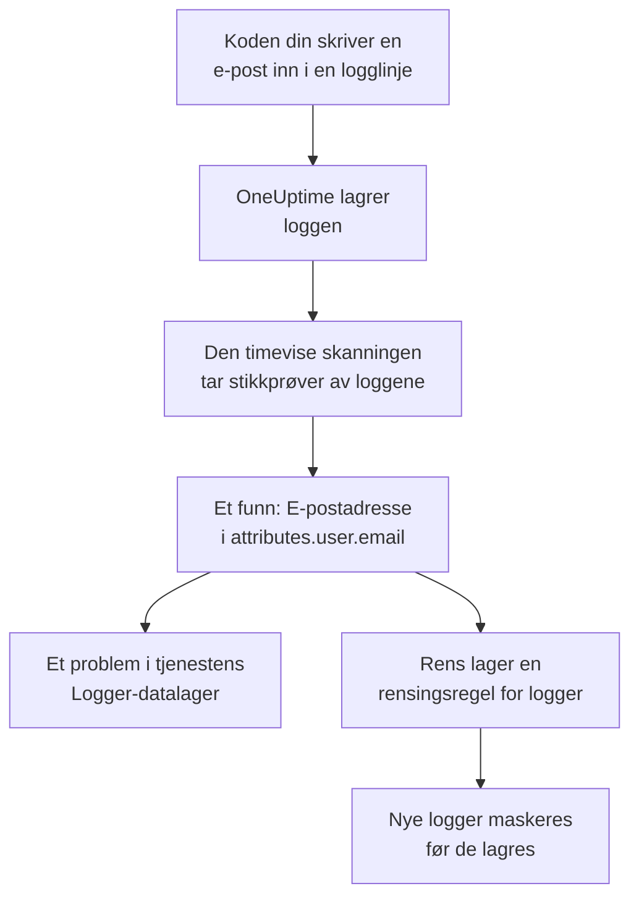

# Sensitive data i telemetri

Telemetri inneholder det koden din skriver: en e-postadresse i en logglinje, et kortnummer i et span-attributt, et token i en stakksporing, et spørsmål fra en kunde i en prompt. Datasikkerhet behandler loggene, sporene, unntakene og AI-samtalene til hver tjeneste, og øktene til hver RUM-applikasjon, som egne datalagre. Den tar stikkprøver av dem hver time, finner sensitive data i dem slik den gjør i en bucket, og **Rens** gjør et funn om til en rensingsregel som maskerer disse dataene ved inntak fra da av.

Det er ingenting å sette opp: telemetrien til hver tjeneste skannes hver time, med mindre **Skann telemetri** er slått av i prosjektets innstillinger.

:::cards
- [Hva som leses](#hva-som-leses): Attributtene, brødtekstene, meldingene og promptene til hvert signal.
- [Slik tar en skanning stikkprøver](#slik-tar-en-skanning-stikkprøver): De nyeste postene fra hver tjeneste, hver time.
- [Rens](#rens): Masker et funn ved inntak, med ett klikk.
- [Hva som regnes som renset](#hva-som-regnes-som-renset): Når en rensingsregel allerede dekker et funn.
:::

## Slik fungerer det

Et funn som en rensingsregel dekker, merkes som renset: det som er igjen av disse dataene, er gamle data som venter på at oppbevaringstiden går ut, ikke en lekkasje som fortsatt pågår. De to telemetrikontrollene teller bare det ingen regel dekker, så problemet deres løses når hvert funn er renset (se [Telemetrikontroller](/docs/data-security/checks-and-issues#telemetri)).

## Hva som leses

| Datalager | Hva som leses | Hvor et funn peker |
| --- | --- | --- |
| Logger | Hvert attributt, og brødteksten | `attributes.<key>`, `body` |
| Spor | Hvert span-attributt, og attributtene til hver span-hendelse | `attributes.<key>`, `events.<event>.<key>` |
| Unntak | Meldingen, stakksporingen og attributtene | `message`, `stackTrace`, `attributes.<key>` |
| AI-samtaler | Promptene og svarene i hvert AI-kall, under nøklene GenAI-konvensjonene legger dem i, og hvert annet attributt | Nøkkelen de ligger i, for eksempel `gen_ai.input.messages` eller `gen_ai.prompt[].content` |
| Øktavspillinger | Attributtene til spans og logger fra en RUM-applikasjon, attributtene til øktene, egenskapene `identify()` ga brukerne, og brukerreferansen den fikk oppgitt | `spans.attributes.<key>`, `logs.attributes.<key>`, `sessions.attributes.<key>`, `sessions.identifiedUserTraits.<key>`, `sessions.identifiedUserLabel` |

Nummererte nøkler slås sammen til én plassering: `gen_ai.prompt.3.content` blir `gen_ai.prompt[].content`, så de tjue meldingene i en chat er ett funn, ikke tjue. Attributter som OneUptime legger til selv, og som starter med `oneuptime.`, leses ikke.

### Hvorfor opptaket av en avspilling aldri leses

Opptaket i en øktavspilling inneholder teksten på sidene folk så. Å se det krever en egen tillatelse, og et funn som var lest ut av det, ville vist maskert sidetekst til alle som kan lese Datasikkerhet. Derfor leses en avspilling bare gjennom attributtene sine: spans, logger og øktdetaljer ved siden av opptaket. Opptakeren maskerer allerede det den tar opp i nettleseren, og rensingsregler for logger kjøres også over opptak (se [Øktavspilling](/docs/telemetry/session-replay)).

### AI-samtaler

Prompten i et AI-kall inneholder hele chatten før personens nyeste melding, så opptil 16 384 tegn av hver verdi i et AI-kall leses. Når AI-samtaler inneholder sensitive data, følger to ting til: AI-leverandøren kallene gikk til, er en dataflyt for disse dataene, og [Sensitive data sendes til en AI-leverandør](/docs/data-security/checks-and-issues#ai) feiler på datalageret.

Samtalene i et [AI-verktøy for bedriften](/docs/telemetry/ai-company-tools) utelates. Bare Project Owners og Project Admins kan lese dem, og et funn havner der alle som leser Datasikkerhet, leser det, så spans fra disse tjenestene leses aldri, og AI-samtalene deres rapporteres som ikke lest.

## Slik tar en skanning stikkprøver

Hver time leses de nyeste postene fra den siste timen for hvert signal, og de klassifiseres felt for felt, slik postene i alle andre datalagre klassifiseres (se [Felt og kolonner](/docs/data-security/data-types#felt-og-kolonner)):

| Grense | Verdi |
| --- | --- |
| Poster for hver tjeneste og hvert signal | **Utvalgsstørrelse for telemetri**, 500 som standard, aldri mer enn 1 000 |
| Tjenester eller RUM-applikasjoner som leses per signal | De 200 travleste |
| Poster i én lesing | 5 000, delt mellom tjenestene; 500 for AI-kall |
| Tegn i brødteksten til en logg, en unntaksmelding eller en stakksporing | 8 192 |
| Tegn i en attributtverdi | 4 096 |
| Tegn i en verdi i et AI-kall | 16 384 |
| Attributter i én post | 128; 64 for et AI-kall |
| Hendelser i ett span, og attributter i én hendelse | 16 og 32 |
| Plasseringer i ett datalager | 500 |

Hver verdi kortes ned i databasen, så ingen lang verdi forlater den, og hver lesing stopper etter 30 sekunder. En lesing som feiler, blir en advarsel på datalagrene den gjaldt; skanningen fortsetter med den neste.

For å utelate noe legger du det til i datalagerets **Skanneunntak**: en plassering angitt i sin helhet (`attributes.http.url`), alt under en plassering (`attributes.http`), eller en attributtnøkkel angitt alene (`http.url`).

## Rens

**Rens** på et funn lager rensingsregelen som skjuler den datatypen på den plasseringen fra da av, eller peker på den aktiverte regelen som allerede gjør det:

:::steps
### Åpne funnet

Åpne telemetridatalageret – for eksempel **Logger** for en tjeneste – og funnet.

### Trykk på Rens

Klikk på **Rens**. For logger og loggene til en RUM-applikasjon lager OneUptime en rensingsregel for logger, og for spans, unntak og AI-kall en rensingsregel for spor, på den delen av posten funnet ligger i.

### Rett koden også

Regelen maskerer nye data før de lagres. Data som allerede er lagret, blir liggende til oppbevaringstiden er ute, så rett koden som skriver dem: funnet nevner tjenesten og attributtet.
:::

Regelen får navn etter det den skjuler, for eksempel «Data Security: Email address in attributes.user.email», og står sammen med de andre rensingsreglene dine (se [Forkastingsfiltre og rensingsregler](/docs/telemetry/drop-filters-and-scrub-rules#rens-sensitive-data)). Den er en av disse:

| Funn | Regelen Rens lager |
| --- | --- |
| E-postadresse, kortnummer, amerikansk Social Security-nummer, telefonnummer eller IP-adresse | Det innebygde mønsteret for den typen. Kortnumre, Social Security-numre og telefonnumre maskeres, resten sladdes. |
| En verdi under en nøkkel som ser sensitiv ut, for eksempel `password` eller `token` | En regel av typen **Sensitive Attribute Keys**, som sladder hele verdien til hvert slikt attributt |
| Enhver annen datatype et mønster kan finne | En regel av typen **Egendefinert regex**, laget av datatypens egne mønstre, som sladder hver verdi med den formen |

Noen funn kan ikke renses av en regel, og **Rens** sier hvorfor:

- En datatype som bare finnes ut fra feltnavn, for eksempel en persons navn: ingen mønstre kan finne den. Gi attributtet nytt navn til en nøkkel som en regel for sensitive nøkler skjuler, eller slutt å sende det.
- En datatype som bare skilles fra andre verdier av ordene rundt den, for eksempel et routingnummer: en regel ville skjult langt mer enn den datatypen.
- En dokumentmerking: å skjule ordet ville ikke skjule dokumentet.
- En av dine egne datatyper: legg selv til en egendefinert rensingsregel med mønsteret dens.
- Detaljene til selve økten (`sessions.*`): inntak av øktavspillinger kjører ingen rensingsregler.

**Rens** lager regelen som deg, med dine egne tillatelser: Project Owners og Project Admins kan trykke på den, og det kan også et team som har lov til å opprette rensingsregler for logger, og rensingsregler for spor når det gjelder spans, unntak og AI-kall.

## Hva som regnes som renset

Et funn merkes som renset bare når inntaket ville kjørt en aktivert regel over det, og regelen ville funnet datatypen til funnet:

- **De riktige postene.** Loggregler dekker logger og loggene til en RUM-applikasjon. Sporregler dekker spans, unntak og AI-kall: et unntak er en kopi av unntakshendelsen i sitt span, så reglene som renser hendelser, renser det.
- **Den riktige delen.** Regelens **Felt som skal renses** inkluderer den delen av posten funnet ligger i, eller regelen lar dem stå på standardverdien.
- **Et mønster som finner typen.** En innebygd **Mønstertype** finner sin egen datatype: **E-postadresse** finner e-postadresser, **Kredittkortnummer** kortnumre, **SSN (personnummer)** amerikanske Social Security-numre, **Telefonnummer** telefonnumre og **IP-adresse** IP-adresser. **Sensitive Attribute Keys** dekker hver verdi under en nøkkel som ser sensitiv ut, uansett hva verdien er.
- **Dine egne mønstre teller aldri.** En **Egendefinert regex** dekker et funn bare når den er nøyaktig det mønsteret **Rens** lager for typen. Et funn beholder bare maskerte prøver, som ingen mønstre kan prøves på, så OneUptime kunne ikke bevise at mønsteret ditt skjuler dataene, og et funn som feilaktig kalles renset, er en lekkasje ingen ser på.

En regel som er slått av, eller som ikke renser noe, teller aldri. Dekningen beregnes på nytt etter hver skanning, så en regel du legger til eller fjerner manuelt, endrer hva som er merket som renset, innen en time.

## Neste steg

:::cards
- [Forkastingsfiltre og rensingsregler](/docs/telemetry/drop-filters-and-scrub-rules): Alle alternativer for rensingsregler, og reglene du skriver selv.
- [Kontroller og problemer i Datasikkerhet](/docs/data-security/checks-and-issues): De to telemetrikontrollene og AI-kontrollene.
- [Dataflyter, tilgang og residens](/docs/data-security/flows-access-residency): AI-leverandørene og vertene tjenestene dine sender data til.
:::
