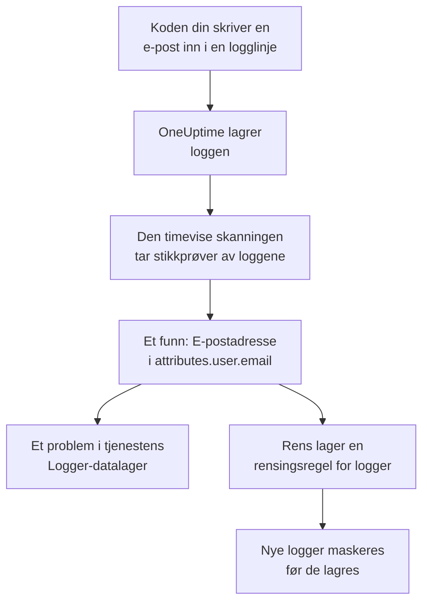

# Sensitive data i telemetri

Telemetri inneholder det koden din skriver: en e-postadresse i en logglinje, et kortnummer i et span-attributt, et token i en stakksporing, et spørsmål fra en kunde i en prompt, en brukers IP-adresse i etiketten til en måling. Datasikkerhet behandler loggene, sporene, målingene, unntakene og AI-samtalene til hver tjeneste, og øktene til hver RUM-applikasjon, som egne datalagre. Den tar stikkprøver av dem hver time, finner sensitive data i dem slik den gjør i en bucket, og **Rens** gjør et funn om til en regel som maskerer disse dataene ved inntak fra da av.

Det er ingenting å sette opp: telemetrien til hver tjeneste skannes hver time, med mindre **Skann telemetri** er slått av i prosjektets innstillinger. For å utelate én tjenestes logger, sporinger eller et annet av dens signaler, slår du av **Skann innhold** i det datalagerets **Innstillinger**: fra neste skanning leses ingenting av det.

:::cards
- [Hva som leses](#hva-som-leses): Attributtene, brødtekstene, meldingene og promptene til hvert signal.
- [Slik tar en skanning stikkprøver](#slik-tar-en-skanning-stikkprøver): De nyeste postene fra hver tjeneste, hver time.
- [Rens](#rens): Masker et funn ved inntak, med ett klikk.
- [Forkast denne målingen](#forkast-denne-målingen): Slutt å lagre målingene der navnet inneholder sensitive data.
- [Hva som regnes som renset](#hva-som-regnes-som-renset): Når en rensingsregel allerede dekker et funn.
:::

## Slik fungerer det

Et funn som en rensingsregel dekker, merkes som renset: det som er igjen av disse dataene, er gamle data som venter på at oppbevaringstiden går ut, ikke en lekkasje som fortsatt pågår. De to telemetrikontrollene teller bare det ingen regel dekker, så problemet deres løses når hvert funn er renset (se [Telemetrikontroller](/docs/data-security/checks-and-issues#telemetri)).

## Hva som leses

| Datalager | Hva som leses | Hvor et funn peker |
| --- | --- | --- |
| Logger | Hvert attributt, og brødteksten | `attributes.<key>`, `body` |
| Spor | Hvert span-attributt, og attributtene til hver span-hendelse | `attributes.<key>`, `events.<event>.<key>` |
| Unntak | Meldingen, stakksporingen og attributtene | `message`, `stackTrace`, `attributes.<key>` |
| AI-samtaler | Promptene og svarene i hvert AI-kall, under nøklene GenAI-konvensjonene legger dem i, og hvert annet attributt | Nøkkelen de ligger i, for eksempel `gen_ai.input.messages` eller `gen_ai.prompt[].content` |
| Øktavspillinger | Attributtene til spans og logger fra en RUM-applikasjon, attributtene til øktene, egenskapene `identify()` ga brukerne, og brukerreferansen den fikk oppgitt | `spans.attributes.<key>`, `logs.attributes.<key>`, `sessions.attributes.<key>`, `sessions.identifiedUserTraits.<key>`, `sessions.identifiedUserLabel` |
| Målinger | Hvert attributt i et datapunkt, også ressursens, og navnene på målingene | `attributes.<key>`, `attributes.resource.<key>`, `name` |

Nummererte nøkler slås sammen til én plassering: `gen_ai.prompt.3.content` blir `gen_ai.prompt[].content`, så de tjue meldingene i en chat er ett funn, ikke tjue. Attributter som OneUptime legger til selv, og som starter med `oneuptime.`, leses ikke.

### Målinger

Attributtene til en måling er etikettene til seriene dens. De er like på hvert datapunkt i en serie, så en måling som skriver tusen punkter i minuttet, kan inneholde bare tre verdier, og en etikett som lekker en brukers e-postadresse, legger til en serie, ikke et punkt. Derfor tas det stikkprøver av en måling etter seriene, ikke etter punktene:

- **Ett punkt fra hver serie.** Hver måling leses i det nyeste minuttet den skrev i løpet av den siste timen: ett datapunkt fra hver av opptil 100 av seriene i det minuttet, uansett hvor ofte målingen sendes, så en travel serie aldri fortrenger en rolig. En verdi klassifiseres én gang, uansett hvor mange serier som gjentar den, så et funn teller de ulike verdiene på sitt sted.
- **Nye målinger først, deretter resten etter tur.** Hvilke målinger en tjeneste skrev, og når hver av dem først skrev i løpet av det siste døgnet, hentes fra sammendraget per minutt som målingstabellen holder, aldri fra punktene. Hver skanning leser en tjenestes travleste målinger, de som mest sannsynlig har mange serier. Deretter kommer målingene den begynte å skrive de siste 2 timene, siden en ny lekkasje som regel kommer fra ny kode, og så de neste av de andre målingene dens, i fast rekkefølge, fra der forrige skanning stoppet. Nye målinger tar høyst halvparten av disse plassene, så de andre alltid beholder sine.
- **Hver måling innen en fast tid.** En skanning gir hver tjeneste 10 av lesingene sine, færre når prosjektet har mer enn 10 tjenester. Lesingene en tjeneste ikke bruker, fordi den har færre målinger, går én etter én til tjenestene som fortsatt har målinger som venter på tur, så ingen går til spille og ingen tjeneste får mindre enn sin andel. De 5 travleste målingene til en tjeneste tar 5 av lesingene, og resten leser de andre målingene etter tur: for en tjeneste med M målinger som får r lesinger etter tur, leses hver av dem minst én gang hver M ÷ r timer, rundet opp. Det er 60 timer for en tjeneste med 300 målinger som bare får sine egne 5, og 11 timer når to andre tjenester med 300 målinger deler prosjektet, siden hver da får 28 eller 29. Så lenge den fortsetter å starte nye målinger hver time, er det høyst det dobbelte.
- **Hver målings eget område.** Målingene leses sammen, hver etter sitt eget område av tabellens primærnøkkel. En måling der det nyeste minuttet inneholder mer enn 16 384 punkter, for eksempel en som har e-postadressen til hver bruker som etikett, leses for seg, og lesingen stopper ved de første punktene, så den koster ikke mer enn noen annen måling.

Et funn nevner attributtet, for eksempel `attributes.user.email`, eller `name` for data i navnet til en måling. Postene til funnet er datapunktene det ble funnet i: hver viser målingen sin og verdien til attributtet, maskert, og åpnes i **Målinger** på den målingen, gruppert etter det attributtet. Der navnet til en måling inneholder sensitive data, maskeres også navnet, og posten åpner tjenestens målinger i stedet.

### Hvorfor opptaket av en avspilling aldri leses

Opptaket i en øktavspilling inneholder teksten på sidene folk så. Å se det krever en egen tillatelse, og et funn som var lest ut av det, ville vist maskert sidetekst til alle som kan lese Datasikkerhet. Derfor leses en avspilling bare gjennom attributtene sine: spans, logger og øktdetaljer ved siden av opptaket. Opptakeren maskerer allerede det den tar opp i nettleseren, og rensingsregler for logger kjøres også over opptak (se [Øktavspilling](/docs/telemetry/session-replay)).

### AI-samtaler

Prompten i et AI-kall inneholder hele chatten før personens nyeste melding, så opptil 16 384 tegn av hver verdi i et AI-kall leses. Når AI-samtaler inneholder sensitive data, følger to ting til: AI-leverandøren kallene gikk til, er en dataflyt for disse dataene, og [Sensitive data sendes til en AI-leverandør](/docs/data-security/checks-and-issues#ai) feiler på datalageret.

Samtalene i et [AI-verktøy for bedriften](/docs/telemetry/ai-company-tools) utelates. Bare Prosjekteiere og Prosjektadministratorer kan lese dem, og et funn havner der alle som leser Datasikkerhet, leser det, så spans fra disse tjenestene leses aldri, og AI-samtalene deres rapporteres som ikke lest.

## Slik tar en skanning stikkprøver

Hver time leses de nyeste postene fra den siste timen for hvert signal, og de klassifiseres felt for felt, slik postene i alle andre datalagre klassifiseres (se [Felt og kolonner](/docs/data-security/data-types#felt-og-kolonner)):

| Grense | Verdi |
| --- | --- |
| Poster for hver tjeneste og hvert signal | **Utvalgsstørrelse for telemetri**, 500 som standard, aldri mer enn 1 000 |
| Tjenester eller RUM-applikasjoner som leses per signal | De 200 travleste |
| Poster i én lesing | 5 000, delt mellom tjenestene; 500 for AI-kall |
| Tegn i brødteksten til en logg, en unntaksmelding eller en stakksporing | 8 192 |
| Tegn i en attributtverdi | 4 096 |
| Tegn i en verdi i et AI-kall | 16 384 |
| Attributter i én post | 128; 64 for et AI-kall |
| Hendelser i ett span, og attributter i én hendelse | 16 og 32 |
| Plasseringer i ett datalager | 500 |
| Målinger som leses i én skanning | 100, delt mellom tjenestene, minst én fra hver; 10 fra hver tjeneste, halvparten blant de travleste og halvparten blant de nye og de andre etter tur, og lesingene en tjeneste ikke bruker, går etter tur til de andre |
| En ny måling | En måling der det første punktet de siste 24 timene kom i løpet av de siste 2 timene |
| Serier i én måling | Ett datapunkt fra hver, fra det nyeste minuttet, høyst 100 |

Hver verdi kortes ned i databasen, så ingen lang verdi forlater den, og hver lesing stopper etter 30 sekunder. En lesing som feiler, blir en advarsel på datalagrene den gjaldt; skanningen fortsetter med den neste.

For å utelate noe legger du det til i datalagerets **Skanneunntak**: en plassering angitt i sin helhet (`attributes.http.url`), alt under en plassering (`attributes.http`), eller en attributtnøkkel angitt alene (`http.url`).

## Rens

**Rens** på et funn lager regelen som skjuler den datatypen på den plasseringen fra da av, eller peker på den aktiverte regelen som allerede gjør det:

:::steps
### Åpne funnet

Åpne problemet – **Hvor det ble funnet** viser hvert funn bak det – eller **Datasikkerhet > I telemetrien din**, der **Vis poster** åpner postene et funn ble gjort i, ved siden av listen.

### Trykk på Rens

Klikk på **Rens**. For logger og loggene til en RUM-applikasjon lager OneUptime en rensingsregel for logger, for spans, unntak og AI-kall en rensingsregel for spor, på den delen av posten funnet ligger i, og for attributtet til en måling en pipelineregel for målinger.

### Rett koden også

Regelen maskerer nye data før de lagres. Data som allerede er lagret, blir liggende til oppbevaringstiden er ute, så rett koden som skriver dem: funnet nevner tjenesten og attributtet.
:::

Regelen får navn etter det den skjuler, for eksempel «Data Security: Email address in attributes.user.email», og står sammen med de andre rensingsreglene dine (se [Forkastingsfiltre og rensingsregler](/docs/telemetry/drop-filters-and-scrub-rules#rens-sensitive-data)). Den er en av disse:

| Funn | Regelen Rens lager |
| --- | --- |
| E-postadresse, kortnummer, amerikansk Social Security-nummer, telefonnummer eller IP-adresse | Det innebygde mønsteret for den typen. Kortnumre, Social Security-numre og telefonnumre maskeres, resten sladdes. |
| En verdi under en nøkkel som ser sensitiv ut, for eksempel `password` eller `token` | En regel av typen **Sensitive attributtnøkler**, som sladder hele verdien til hvert slikt attributt |
| Enhver annen datatype et mønster kan finne | En regel av typen **Egendefinert regex**, laget av datatypens egne mønstre, som sladder hver verdi med den formen |
| Enhver datatype i attributtet til en måling | En pipelineregel for målinger av typen **Sladd attributt** for tjenesten, som erstatter verdiene i attributtet som har datatypens form, med `[REDACTED]`, eller hver verdi i attributtet der ingen mønstre finner datatypen |

Noen funn kan ikke renses av en regel, og **Rens** sier hvorfor. Attributtet til en måling kan alltid renses, siden regelen kan skjule hver verdi i attributtet:

- En datatype som bare finnes ut fra feltnavn, for eksempel en persons navn: ingen mønstre kan finne den. Gi attributtet nytt navn til en nøkkel som en regel for sensitive nøkler skjuler, eller slutt å sende det.
- En datatype som bare skilles fra andre verdier av ordene rundt den, for eksempel et routingnummer: en regel ville skjult langt mer enn den datatypen.
- En dokumentmerking: å skjule ordet ville ikke skjule dokumentet.
- En av dine egne datatyper: legg selv til en egendefinert rensingsregel med mønsteret dens.
- Detaljene til selve økten (`sessions.*`): inntak av øktavspillinger kjører ingen rensingsregler.
- Navnet til en måling (`name`): koden som oppretter målingen, setter det, og en pipelineregel kan bare gi en måling nytt navn i sin helhet. Gi målingen nytt navn, og send det som varierer i navnet, som et attributt i stedet. Til da kan **Forkast denne målingen** slutte å lagre disse målingene.

**Rens** lager regelen som deg, med dine egne tillatelser: Prosjekteiere og Prosjektadministratorer kan trykke på den, og det kan også et team som har lov til å opprette rensingsregler for logger, rensingsregler for spor når det gjelder spans, unntak og AI-kall, og pipelineregler for målinger.

## Forkast denne målingen

Ingen regel fjerner dataene fra navnet til en måling, så til koden som navngir målingen er rettet, fortsetter dataene å komme. **Forkast denne målingen** på et funn i navnet til en måling slutter å lagre målingene der navnet inneholder dem, på bekostning av dataene deres, og skjer derfor bare når du ber om det:

- **Målingene til én tjeneste.** Den lager en pipelineregel for målinger av typen **Forkast** for tjenesten til funnet: hvert nye datapunkt fra en måling der navnet inneholder den datatypen, forkastes før det lagres. Filteret er mønsteret **Rens** bruker for typen, så en type som ikke noe mønster kan finne, som en persons navn, kan ikke forkastes, og dialogen sier hvorfor.
- **Sagt før det skjer.** Dialogen sier at disse datapunktene går tapt for godt, hvor mange av tjenestens målinger skrevet det siste døgnet som har et slikt navn, hva som leser dem og dermed ikke får nye data, at det som allerede er lagret, blir værende til oppbevaringstiden er ute, og hvordan det angres. Ingenting forkastes før du har krysset av for at du forstår det.
- **Hva som leser dem, og hva som skjer med det.** Dialogen nevner, hver som en lenke, hver monitor, hvert dashbord med widgetene på det som leser disse målingene, hver målingsbasert SLO for tjenesten og hver opptaksregel for målinger som leser dem. Monitorer kan ikke lenger varsle på verdiene deres, widgeter viser ingen nye data, SLO-er teller ingen nye hendelser fra dem, og utdata-målingene til opptaksreglene tar dem ikke lenger med. Under hver opptaksregel nevner den også hva som leser utdata-målingen til regelen, og hva som i sin tur leser deres, opptil tre utdata-målinger lenger ned i kjeden. Lenken til en widget åpner dashbordet dens ved den widgeten. Det du ikke kan se, blir telt, men aldri nevnt ved navn.
- **Som deg, og registrert.** Regelen opprettes med din egen tillatelse til å opprette pipelineregler for målinger: Prosjekteiere og Prosjektadministratorer kan opprette den, og det kan også et team som har lov til å opprette pipelineregler for målinger. Revisjonsloggene registrerer hvem som opprettet den.
- **Angres ved å slette regelen.** Regelen får navn etter det den forkaster, for eksempel «Data Security: drop metrics named with Email address», og står sammen med de andre pipelinereglene dine for målinger under **Målinger → Innstillinger → Pipelineregler**. Slett den eller slå den av, så lagres disse målingene igjen fra da av. Det som ble forkastet i mellomtiden, kommer ikke tilbake.

Funnet merkes da **Forkastet** og regnes som renset: ingenting mer av disse dataene lagres.

## Hva som regnes som renset

Et funn merkes som renset bare når inntaket ville kjørt en aktivert regel over det, og regelen ville funnet datatypen til funnet:

- **De riktige postene.** Loggregler dekker logger og loggene til en RUM-applikasjon. Sporregler dekker spans, unntak og AI-kall: et unntak er en kopi av unntakshendelsen i sitt span, så reglene som renser hendelser, renser det.
- **Den riktige delen.** Regelens **Felt som skal renses** inkluderer den delen av posten funnet ligger i, eller regelen lar dem stå på standardverdien.
- **Et mønster som finner typen.** En innebygd **Mønstertype** finner sin egen datatype: **E-postadresse** finner e-postadresser, **Kredittkortnummer** kortnumre, **SSN (personnummer)** amerikanske Social Security-numre, **Telefonnummer** telefonnumre og **IP-adresse** IP-adresser. **Sensitive attributtnøkler** dekker hver verdi under en nøkkel som ser sensitiv ut, uansett hva verdien er.
- **Dine egne mønstre teller aldri.** En **Egendefinert regex** dekker et funn bare når den er nøyaktig det mønsteret **Rens** lager for typen. Et funn beholder bare maskerte prøver, som ingen mønstre kan prøves på, så OneUptime kunne ikke bevise at mønsteret ditt skjuler dataene, og et funn som feilaktig kalles renset, er en lekkasje ingen ser på.
- **Attributtet til en måling.** En pipelineregel for målinger av typen **Sladd attributt** eller **Fjern attributt** for nøkkelen til det attributtet, for tjenesten til funnet eller hele prosjektet, dekker funnet når den ikke har noe filter, eller nøyaktig filteret **Rens** lager. Et filter du har skrevet selv, teller aldri, av samme grunn.
- **Navnet til en måling.** En pipelineregel for målinger av typen **Forkast** for tjenesten til funnet eller hele prosjektet dekker funnet når den har nøyaktig filteret **Forkast denne målingen** lager, eller ikke noe filter i det hele tatt, slik at den ikke lagrer noen av tjenestens målinger. En slik regel uten filter dekker hvert funn i disse målingene.

En regel som er slått av, eller som ikke renser noe, teller aldri. Dekningen beregnes på nytt etter hver skanning, så en regel du legger til eller fjerner manuelt, endrer hva som er merket som renset, innen en time.

## Neste steg

:::cards
- [Forkastingsfiltre og rensingsregler](/docs/telemetry/drop-filters-and-scrub-rules): Alle alternativer for rensingsregler, og reglene du skriver selv.
- [Kontroller og problemer i Datasikkerhet](/docs/data-security/checks-and-issues): De to telemetrikontrollene og AI-kontrollene.
- [Dataflyter, tilgang og residens](/docs/data-security/flows-access-residency): AI-leverandørene og vertene tjenestene dine sender data til.
:::
