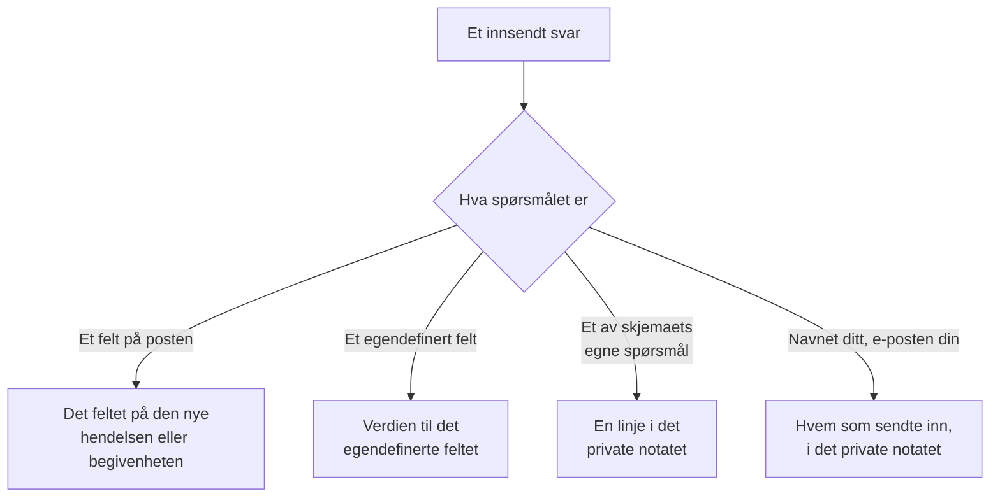

# Bygg et skjema

Et skjemas side **Bygg** er der du bestemmer hva det spør om, og hvordan siden ser ut. Spørsmålene står til venstre, i den rekkefølgen den offentlige siden viser dem; **Legg til et spørsmål**, til høyre, viser alt du kan legge til. Over spørsmålene, sammenfoldet, er skjemaets [merkevare](#merkevare): logoen og favikonet. Navngitte sett med svar som folk kan starte skjemaet fra — som hver også kan gjøre et spørsmål påkrevd, valgfritt eller skjult for sitt eget tilfelle — ligger på skjemaets side **Maler**: se [Maler](#maler).

:::cards
- [Byggeren](#byggeren): Legg til, rediger, flytt og lagre spørsmål.
- [Hva du kan legge til](#hva-du-kan-legge-til): Dine egne spørsmål, postens felt, egendefinerte felt og innsenderen.
- [Skjulte spørsmål](#skjulte-spørsmål): Besvares av en mal, aldri av den som sender inn.
- [Maler](#maler): Ett skjema, og én lenke, for hvert tilfelle teamet ditt ofte melder.
:::

## Hvor hvert svar havner

Hvert svar lagres også med innsendingen, på skjemaets side **Innsendinger**. Et felt skjemaet ikke spør om, eller som står tomt, fylles ut fra skjemaets [innstillinger Ved innsending](/docs/forms/on-submit).

## Byggeren

:::steps
### Legg til et spørsmål

Velg hva du vil legge til, i **Legg til et spørsmål**. Det nye spørsmålet settes inn etter det valgte, eller til slutt, og blir valgt.

### Rediger det der det står

Velg et kort for å redigere det: spørsmålet, hjelpeteksten, svartypen og alternativene, om det er påkrevd eller skjult, og knappene for å duplisere eller slette det. **Ferdig** lukker det.

### Sett det på plass

Dra et kort i håndtaket for å flytte det, eller bruk **Flytt opp** og **Flytt ned** på det valgte kortet — på en telefon, eller fra tastaturet.

### Lagre skjemaet

**Lagre endringer** lagrer alle endringer på én gang. Til du lagrer, sier byggeren **Ulagrede endringer** og tilbyr **Forkast endringer**, og nettleseren spør før du forlater siden.
:::

- **Skjemaets overskrift** viser navnet og beskrivelsen slik den offentlige siden vil gjøre. **Rediger navn og beskrivelse** endrer dem.
- **Spørsmålene** er kort. Hvert viser spørsmålet slik folk vil se det, med et merke som sier hva det er koblet til — **Hendelse · Alvorlighetsgrad**, **Egendefinert felt · Region**, **Innsender · E-post**, eller svartypen for et av skjemaets egne spørsmål. En rød stjerne markerer et påkrevd spørsmål, og et merke **Skjult** et [skjult](#skjulte-spørsmål) spørsmål.
- **Grenser.** Et skjema kan ha opptil 50 spørsmål. De som kan lese et skjema, men ikke redigere det, ser byggeren skrivebeskyttet.

## Merkevare

**Merkevare**, sammenfoldet over spørsmålene, er hvordan skjemaets side ser ut: logoen din øverst på siden, over skjemaets navn, og favikonet ditt i nettleserfanen mens skjemaet er åpent. Til du laster opp dine egne, viser skjemaet OneUptimes logo og favikon.

Sammenfoldet viser seksjonen **Logo** og **Favicon** — vist som angitt så snart skjemaet har sine egne — og sier hvilke av OneUptimes som fortsatt gjelder. Fold den ut for å se begge slik siden viser dem: logoen slik den står øverst på siden, og favikonet i en nettleserfane ved siden av skjemaets navn, som er fanens tittel.

**Rediger merkevare** endrer dem i én dialog:

| Felt | Hva det er |
| --- | --- |
| **Logo** | Vises øverst på skjemaets side, over navnet, i stedet for OneUptimes logo. Et PNG-, JPEG-, GIF-, WebP- eller SVG-bilde på høyst 512 KB. Fjern den for å gå tilbake til OneUptimes logo. |
| **Logo Alt Text** | Hva logoen sier, lest opp av skjermlesere: vanligvis navnet på organisasjonen din. Spørres om så snart det finnes en logo. La den stå tom, så hopper skjermlesere over logoen — skjemaets navn kommer etter den uansett. Å fjerne logoen tømmer også denne. |
| **Favicon** | Ikonet i nettleserfanen mens skjemaet er åpent, i stedet for OneUptimes favikon. Et PNG-, JPEG-, GIF-, WebP-, SVG- eller ICO-bilde på høyst 128 KB; et kvadratisk PNG, SVG eller ICO fungerer best. Fjern det for å gå tilbake til OneUptimes favikon. |

Logoen beholder høyden til OneUptime-logoen den erstatter, og en bred logo tilpasses sidens bredde. Hvert bilde sjekkes når det lagres — fra dashbordet, API-et, Terraform eller en arbeidsflyt: det må være lastet opp i skjemaets eget prosjekt, være av en av typene ovenfor og ikke være større enn grensen. En logo som ikke er et av de bildene, avvises med "The logo must be a PNG, JPEG, GIF, WebP or SVG image.", en som er for stor med "The logo must be 512 KB or smaller.", og en der opplastingen er borte — eller som ble lastet opp i et annet prosjekt — med "The logo's file could not be found. Upload the logo again." Et favikon avvises på samme måte, med "The favicon must be a PNG, JPEG, GIF, WebP, SVG or ICO image.", "The favicon must be 128 KB or smaller." og "The favicon's file could not be found. Upload the favicon again."

**Forhåndsvisning** viser logoen slik siden gjør. De som kan lese et skjema, men ikke redigere det, ser merkevaren uten **Rediger merkevare**. Logoen og favikonet når bare skjemaets side inne i selve skjemaet — se [Deling og sikkerhet](/docs/forms/sharing-and-security#hva-som-beskytter-et-skjema).

## Hva du kan legge til

**Legg til et spørsmål** viser fire grupper: skjemaets egne **Spørsmål**, **Hendelsesfelt** eller **Felt for planlagt vedlikehold** for det skjemaet oppretter, **Egendefinerte felt** og **Innsender**.

### Skjemaets egne spørsmål

| Svartype | Hva innsenderen gir |
| --- | --- |
| **Kort svar** | Én linje med tekst. |
| **Avsnitt** | Flere linjer med tekst. |
| **Formatert tekst** | Tekst med formatering og lenker. |
| **Antall** | Et tall. |
| **Nedtrekksliste** | Ett valg fra en liste. |
| **Flervalg** | Et hvilket som helst antall valg fra en liste. |
| **Avkrysningsboks** | En boks å krysse av, som en bekreftelse. |
| **Dato** | En dag. |
| **Dato og klokkeslett** | En dag og et klokkeslett. |

En nedtrekksliste eller et flervalg viser **Alternativer** du gir det, hvert med en valgfri farge (knappen ved siden av et alternativ åpner et sett med navngitte farger, med **Egendefinert farge** for en eksakt kode), mellom ett og 100 av dem. Å bytte et spørsmål mellom **Nedtrekksliste** og **Flervalg** beholder alternativene; et spørsmål som blir en av dem, starter med to du kan gi nytt navn, og et som slutter å være en av dem, mister dem. **Dupliser** kopierer et av skjemaets egne spørsmål rett under det.

Svarene på disse spørsmålene lagres med innsendingen og vises i det private notatet på det skjemaet oppretter — de fyller ikke ut noe felt. For å fylle ut et felt legger du til selve feltet, fra de to neste gruppene.

### Felt på det skjemaet oppretter

Feltene på en hendelse, eller på en planlagt vedlikeholdsbegivenhet, som en innsender kan svare på. Svaret blir feltets verdi.

| Hendelsesfelt | Besvares med |
| --- | --- |
| **Tittel** | Én linje, opptil 500 tegn. |
| **Beskrivelse** | Formatert tekst, opptil 20 000 tegn. |
| **Alvorlighetsgrad** | En av alvorlighetsgradene dine for hendelser. |
| **Monitorer** | Hvilke som helst av monitorene du tilbyr — hendelsens berørte monitorer. |
| **Etiketter** | Hvilke som helst av etikettene du tilbyr. |
| **Påvirkning startet** | En dato og et klokkeslett: når problemet startet, slik innsenderen husker det. |

| Felt for planlagt vedlikehold | Besvares med |
| --- | --- |
| **Tittel** | Én linje, opptil 100 tegn. |
| **Beskrivelse** | Formatert tekst, opptil 20 000 tegn. |
| **Begynner den** | En dato og et klokkeslett. Spørres alltid om og er alltid påkrevd. |
| **Slutter den** | En dato og et klokkeslett etter **Begynner den**. Spørres alltid om og er påkrevd. |
| **Monitorer** | Hvilke som helst av monitorene du tilbyr. |
| **Statussider** | Hvilke som helst av statussidene du tilbyr. |
| **Etiketter** | Hvilke som helst av etikettene du tilbyr. |

Hvert felt kan bare spørres om én gang; listen markerer de som allerede er på skjemaet, med **Lagt til**. Et felt skjemaet ikke spør om — eller som står tomt — fylles ut fra skjemaets [innstillinger Ved innsending](/docs/forms/on-submit).

**Tilbudte valg.** En offentlig side skal ikke vise hele prosjektet ditt til fremmede, så et felt som besvares ved å velge poster, tilbyr bare de du velger. **Monitorer**, **Etiketter** og **Statussider** viser nøyaktig valgene du tilbyr, og spørres ikke om før du tilbyr minst ett. **Alvorlighetsgrad** tilbyr alle alvorlighetsgrader for hendelser med mindre du begrenser den, siden alvorlighetsgrader ikke er hemmelige. Svar utenfor de tilbudte valgene avvises.

### Egendefinerte felt

Dine egendefinerte felt for hendelser — eller for planlagt vedlikehold, på et vedlikeholdsskjema — hvert et spørsmål der svaret blir feltets verdi. Spørsmålet tar typen og alternativene fra det egendefinerte feltet, og starter med navnet som spørsmål og beskrivelsen som hjelpetekst, som du kan endre.

Et skjema spør bare om de egendefinerte feltene du legger til det, uansett hva **Vis ved opprettelse** sier: hvert felt et skjema spør om, viser navnet, beskrivelsen og alternativene sine til alle med lenken. Når et egendefinert felt slettes, blir spørsmålet stående på skjemaet, men spørres ikke lenger om, og kortet sier det — slett spørsmålet. Et felt som opprettes igjen med samme navn, er et nytt felt: legg det til igjen.

Et egendefinert felt som kopierer verdien sin fra et egendefinert monitorfelt, sier det på kortet: når hendelsen eller begivenheten har monitorer som er enige om en verdi for det, erstatter den verdien innsenderens svar.

### Innsender

**Ditt navn** og **Din e-post** spør hvem som sender inn. De lagres med innsendingen og nevnes i det private notatet, så teamet ditt kan følge opp, og vises aldri på selve hendelsen eller begivenheten. OneUptime sender aldri e-post til innsenderen. Utelat dem, eller gjør dem valgfrie, for å ta imot anonyme innsendinger.

E-posten må være én vanlig adresse, som `ada@example.com` — ikke et navn med adressen i vinkelparenteser, og ikke en liste med adresser. Navn og e-post er hver på opptil 100 tegn.

## Spørsmålene i et nytt skjema

Et nytt skjema starter med spørsmålene det nesten alltid bør stille, så det fungerer i det øyeblikket det opprettes: **Tittel**, påkrevd; **Beskrivelse**; for et vedlikeholdsskjema **Begynner den** og **Slutter den**; og **Ditt navn** og **Din e-post**, påkrevd. Ordlyden er på dashbordets språk. Endre, skjul eller fjern dem som du vil — unntatt starten og slutten på en vedlikeholdsbegivenhet, uten dem kan ingen begivenhet planlegges. Når dine egne spørsmål sier alt, skjuler du **Beskrivelse** i stedet for å la en boks stå som ingen burde skrive i: se [Skjulte spørsmål](#skjulte-spørsmål).

## Påkrevde spørsmål

**Påkrevd** betyr at skjemaet ikke kan sendes inn uten et svar. Et svar som bare består av mellomrom, tabulatorer eller linjeskift, teller som ikke noe svar, og en påkrevd **Avkrysningsboks** må være krysset av. Serveren sjekker hvert påkrevde spørsmål igjen når skjemaet sendes inn, så en forespørsel som gjøres uten siden, holdes også opp mot dem.

Et spørsmål som ikke er påkrevd, kan stå tomt: feltet fylles da ut fra innstillingene Ved innsending, som om skjemaet ikke hadde spurt om det.

## Skjulte spørsmål

Slå på **Skjult** på et kort, så vises spørsmålet ikke lenger på skjemaet. Ingen blir spurt, så det er aldri påkrevd, og en innsending kan ikke besvare det — forespørselen leses ikke engang for det. Bare [malen](#maler) en innsending starter fra, besvarer det, og det forblir ubesvart når innsenderen ikke starter fra noen mal, eller fra en som lar det stå tomt. En mal kan også likevel spørre om et skjult spørsmål, for sitt eget tilfelle: se [Slik spør en mal om hvert spørsmål](#slik-spør-en-mal-om-hvert-spørsmål).

Skjul et spørsmål når svaret er teamets å bestemme, ikke innsenderens:

- **Hendelsens beskrivelse**, når spørsmålene du la til, sier alt. Skjult inviterer den ikke lenger noen til å skrive der; gi hver mal standardteksten du sender for tilfellet, eller la hendelser starte uten.
- **Et egendefinert felt som arbeidsflytene eller reglene dine leser**, som en varslingstype, satt av hver mal.
- **Et av skjemaets egne spørsmål** der bare teamet ditt trenger svaret i det private notatet.

Et skjult spørsmål beholder plassen, etiketten og innstillingene sine, så du kan vise det igjen når som helst. Et felt som skjemaets mål ikke kan opprettes uten — en vedlikeholdsbegivenhets **Begynner den** og **Slutter den** — kan ikke skjules. Et skjult spørsmåls svar sjekkes og lagres nøyaktig slik et skrevet svar ville bli, og beholdes med innsendingen.

## Maler

Et skjemas side **Maler** inneholder navngitte sett med svar som folk kan starte skjemaet fra — ett for hvert tilfelle teamet ditt ofte melder, som **Applikasjonsutfall**, **Planlagt vedlikehold** eller **Tjeneste gjenopprettet** — så ett skjema, og én lenke, dekker alle.

:::steps
### Legg til en mal

Klikk på **Legg til mal**. Redigeringsverktøyet har to deler. **Spørsmål** viser hvert spørsmål på skjemaet med hvordan denne malen spør om det — se [Slik spør en mal om hvert spørsmål](#slik-spør-en-mal-om-hvert-spørsmål). **Svar** viser dem igjen, skjulte inkludert og ingen av dem påkrevd: fyll ut det malen skal svare på, og overlat resten til den som sender inn. Et svar på et spørsmål malen ikke spør om, sier det under seg — det brukes som det er.

### Velg standarden

**Standard** gjør den til malen skjemaet åpnes med. Bare én mal kan være standarden, og et skjema der den eneste malen er standarden, er rett og slett et forhåndsutfylt skjema.

### Del lenken

**Kopier lenke** kopierer malens egen lenke, som åpner skjemaet utfylt med den. Se [Deling og sikkerhet](/docs/forms/sharing-and-security#en-lenke-for-hver-mal).
:::

Hver mal viser hva den fyller ut og spørsmålene den spør om på sin egen måte, som **Dato for planlagt vedlikehold · Skjult**, og har **Rediger**, **Dupliser** — en kopi rett etter den, med navn som **Applikasjonsutfall 2** —, **Flytt opp** og **Flytt ned**, for rekkefølgen skjemaet viser dem i, og **Slett**.

På den offentlige siden viser et skjema med maler dem over spørsmålene, under **Start fra en mal**. Å velge en fyller ut skjemaet og stiller spørsmålene slik den malen stiller dem; innsenderen kan fortsatt endre hvilket som helst svar før innsending, og å velge en annen starter skjemaet på nytt fra den. Siden åpnes med malen lenken nevner, ellers med standarden, ellers med ingen. **Forhåndsvisning** viser også malene og åpnes på standarden.

> [!IMPORTANT]
> Alle som åpner lenken, ser navnet på hver mal og svarene dens på spørsmålene den spør om — det er slik siden fyller seg ut selv. En mals svar på spørsmål den ikke spør om, forlater aldri serveren, så hold alt internt i et skjult spørsmål.

Hvert svar i hver mal sjekkes mot spørsmålet sitt når malene lagres — et alternativ spørsmålet tilbyr, en post skjemaet tilbyr, tekst som passer —, og det samme gjelder hvert spørsmål en mal spør om på sin egen måte, og lagringen avvises med en melding som nevner malen og problemet, enten den kommer fra dashbordet, API-et eller Terraform. En mals navn er på opptil 100 tegn og unikt i skjemaet, og et skjema har opptil 50 maler. Når du senere endrer spørsmålene, blir en mals svar på et spørsmål du fjernet, eller som ikke lenger passer til det, rett og slett ikke brukt, og neste gang den malen lagres, fjernes det. Lagring av de andre malene avvises aldri på grunn av dette: det en mal allerede inneholdt, sjekkes ikke igjen.

### Slik spør en mal om hvert spørsmål

Forskjellige tilfeller trenger forskjellige spørsmål: et utfall trenger den berørte applikasjonen og ikke et vedlikeholdsvindu, planlagt vedlikehold trenger vinduet. I stedet for å bygge et skjema for hvert tilfelle kan du la hver mal stille skjemaets spørsmål på sin egen måte. I en mals **Spørsmål** har hvert spørsmål én av disse:

| Innstilling | Når noen starter fra malen |
| --- | --- |
| **Skjemaets standard** | Spørsmålet stilles slik skjemaet stiller det — påkrevd, valgfritt eller skjult, slik kortet i byggeren sier. Velgeren sier hvilken, som **Skjemaets standard (Skjult)**, og følger kortet når du endrer det. |
| **Påkrevd** | Spørsmålet stilles, og skjemaet kan ikke sendes inn uten et svar. |
| **Valgfritt** | Spørsmålet stilles, og kan stå tomt. |
| **Skjult** | Spørsmålet stilles ikke. Malens eget svar på det, hvis den har et, er svaret, som for et spørsmål skjemaet skjuler. |

Ett hendelsesskjema kan dermed dekke begge tilfellene:

| Spørsmål | Applikasjonsutfall | Planlagt vedlikehold |
| --- | --- | --- |
| Applikasjonens navn | Påkrevd | Påkrevd |
| Berørte anlegg | Påkrevd | Valgfritt |
| Dato for planlagt vedlikehold | Skjult | Påkrevd |

Hvert spørsmål starter på **Skjemaets standard**, og det gjør også hvert spørsmål du senere legger til i skjemaet, i hver mal. En vedlikeholdsbegivenhets **Begynner den** og **Slutter den** spørres alltid om og er alltid påkrevd: ingen mal kan endre dem. En mal kan skjule alle andre spørsmål og svare på dem selv: lenken er da et skjema med én knapp, **Send inn** — praktisk for et tilfelle som **Tjeneste gjenopprettet**.

Siden følger malen innsenderen velger: å velge en annen tegner skjemaet på nytt med den malens spørsmål, og **Forhåndsvisning** gjør det samme. Serveren holder hver innsending opp mot spørsmålene malen den nevner stiller, uansett hva som sendte den: et spørsmål malen krever, må besvares, og et den skjuler, leses ikke fra forespørselen — malens eget svar brukes. En innsending som ikke nevner noen mal, eller en mal som er slettet siden, holdes opp mot skjemaets egne innstillinger. Et spørsmål skjemaet skjuler, vises bare for den offentlige siden når en mal spør om det.

## Når byggeren markerer et spørsmål

Et kort med noe galt sier hva, i gult:

| Kortet sier | Hva som er galt |
| --- | --- |
| **Dette egendefinerte feltet er slettet, så spørsmålet stilles ikke. Slett spørsmålet.** | Den offentlige siden utelater spørsmålet. |
| **Velg minst ett valg å tilby, ellers stilles ikke spørsmålet.** | Et felt som besvares ved å velge poster, tilbyr ingen: velg monitorene, etikettene eller statussidene det tilbyr. |
| **Legg til minst ett alternativ.** | En nedtrekksliste eller et flervalg har ingenting å velge mellom. |
| **Skriv spørsmålet.** | Spørsmålet har ingen tekst. |

Skjemaet kan ikke lagres mens et spørsmål har en av de tre siste: **Lagre endringer** sier hvilket spørsmål og hva som er galt, og forhåndsvisningen utelater et slikt spørsmål. Lagring sjekker også spørsmålene som helhet, og avvises med en melding som nevner problemet når for eksempel to spørsmål ber om samme felt, eller et vedlikeholdsskjema ikke spør når vedlikeholdet starter og slutter — enten spørsmålene kommer fra byggeren, API-et, Terraform eller en arbeidsflyt.

## Forhåndsvisning

**Forhåndsvisning** åpner skjemaet nøyaktig slik folk ser det via lenken — samme logo, spørsmål, felt, alternativer og sjekker, listen over maler, og bare spørsmålene den valgte malen stiller — og lar deg fylle det ut. Ingenting du skriver inn der, sendes inn: **Send inn** sjekker bare svarene dine, og **Fyll ut på nytt** starter på nytt. Forhåndsvisningen viser spørsmålene slik de er i byggeren, lagret eller ikke, og sier når den utelater et markert spørsmål.

## Hva innsenderen ser

Den offentlige siden viser skjemaets logo — OneUptimes logo til du laster opp din — deretter skjemaets navn og beskrivelse, malene hvis det har noen, spørsmålene det stiller — slik den valgte malen stiller dem, eller de det ikke skjuler når ingen mal er valgt — og **Send inn**, og nettleserfanen viser skjemaets navn og favikon. Siden er på innsenderens språk når OneUptime har det — språket innsenderen sist valgte i OneUptime i den nettleseren, eller ellers det nettleseren ber om — og ellers på engelsk. Spørsmålene, alternativene og hjelpetekstene dine vises slik du skrev dem.

Etter innsending sier siden "Takk — svaret ditt er sendt." og gir nummeret på det som ble opprettet — "Referansenummeret ditt er INC-42." — etterfulgt av skjemaets takkemelding, hvis du skrev en på siden **Del**. **Send et nytt svar** åpner et tomt skjema. Innsenderen får ingen e-post og ingen vei tilbake til hendelsen eller begivenheten.

## Størrelsesgrenser

| Svar | Grense |
| --- | --- |
| En hendelses **Tittel** | 500 tegn, uten å telle mellomrom i hver ende. |
| En vedlikeholdsbegivenhets **Tittel** | 100 tegn. |
| **Beskrivelse** | 20 000 tegn. |
| Et hvilket som helst annet tekstsvar | 10 000 tegn. |
| Et flervalgssvar | 100 valg. |
| **Ditt navn**, **Din e-post** | 100 tegn hver. |

En innsending som bryter en grense, utelater et påkrevd svar eller gir et svar som ikke passer til spørsmålet, avvises med en melding som sier hvilket, og ingenting opprettes. Svar på spørsmål skjemaet ikke stiller, ignoreres.

## Neste steg

:::cards
- [Hva en innsending oppretter](/docs/forms/on-submit): Hvordan svarene og innstillingene Ved innsending blir til en hendelse eller en vedlikeholdsbegivenhet.
- [Deling og sikkerhet](/docs/forms/sharing-and-security): Del lenken, en lenke for hver mal, og hva som beskytter dem.
- [Hendelsesinnstillinger og automatisering](/docs/incidents/settings): Egendefinerte felt og maler for hendelser.
:::
