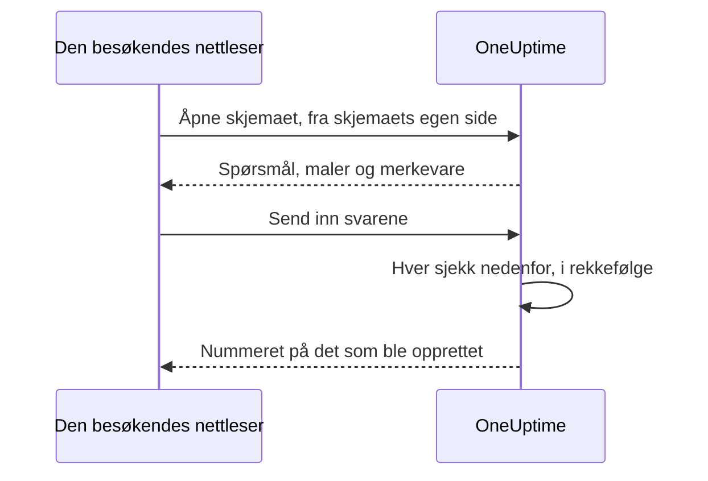

# Deling og sikkerhet

Et skjema er åpent for alle som har lenken, og hver innsending kan tilkalle vaktteamet ditt eller sette et vedlikeholdsvindu i kalenderen din. Denne siden handler om skjemaets side **Del** — lenken, å slå av skjemaet, meldingen etter innsending og IP-tillatelseslisten — og hver annen sjekk en forespørsel passerer på veien.

:::cards
- [Del lenken](#del-lenken): Kopier den, åpne den, og tilbakestill den når den sprer seg for langt.
- [En lenke for hver mal](#en-lenke-for-hver-mal): Ett bokmerke per tilfelle, ett skjema bak alle.
- [Hva som beskytter et skjema](#hva-som-beskytter-et-skjema): Hver sjekk en forespørsel passerer, i rekkefølge.
- [Feilsøking](#feilsøking): Hva hver melding på skjemaets side betyr, og hva du skal gjøre.
:::

## Siden Del

| Kort | Hva det inneholder |
| --- | --- |
| **Status** | **Tar imot innsendinger** — om skjemaets lenke fungerer. |
| **Delingslenke** | Lenken, med **Kopier lenke**, **Åpne skjema** og **Tilbakestill lenke**. |
| **Etter innsending** | **Takkemelding** folk ser når de har sendt inn, under nummeret på det skjemaet opprettet. |
| **Tilgang** | **IP-tillatelsesliste**. |

## Del lenken

Kortet **Delingslenke** viser skjemaets lenke, som `https://oneuptime.com/accounts/form/<share-key>`:

- **Kopier lenke** kopierer den.
- **Åpne skjema** åpner skjemaet i en ny fane, slik folk ser det.
- **Tilbakestill lenke** gir skjemaet en ny lenke etter at du har bekreftet. Den gamle lenken slutter å fungere med en gang og viser meldingen om at skjemaet ikke er tilgjengelig, så alle du delte den med, trenger den nye. Bruk den når en lenke har spredt seg lenger enn den burde.

Alle med lenken kan åpne skjemaet og sende det inn, uten en OneUptime-konto og uten å logge på. Å være pålogget endrer ingenting: OneUptime vet bare hvem som sendte inn, ut fra navnet og e-posten som er skrevet inn i skjemaet. Så behandle lenken som et telefonnummer til vaktteamet ditt. Del den der de som skal bruke den, finner den — en intranettside, en runbook for kundestøtte, en festet chatmelding — og ikke på et offentlig nettsted, med mindre du vil ha innsendinger fra hvem som helst.

Lenken har en egen tilfeldig nøkkel, ikke skjemaets ID. På en selvdriftet installasjon serveres den fra din egen OneUptime-vert, og fungerer bare på adressen `HTTP_PROTOCOL` og `HOST` konfigurerer: åpnet under et annet navn på serveren, eller på IP-adressen, avvises skjemaets forespørsler som om de kom fra et annet nettsted.

Lenker til de gamle hendelsesskjemaene, `/accounts/incident-form/<share-key>`, åpner det samme skjemaet på den nye adressen.

### En lenke for hver mal

Hver av skjemaets [maler](/docs/forms/building#maler) har sin egen lenke: skjemaets lenke med `?template=` og malens id, som `https://oneuptime.com/accounts/form/<share-key>?template=<template-id>`. **Kopier lenke** på skjemaets side **Maler** kopierer den. Den åpner skjemaet med den malen fylt ut, så et team kan lagre ett bokmerke per tilfelle mens du beholder ett skjema. Når innsenderen velger en annen mal, følger adressen i nettleseren med, så lenken som kopieres, er skjemaet slik det vises.

En mals lenke er skjemaets lenke: den fungerer så lenge skjemaet står på **Tar imot innsendinger**, og **Tilbakestill lenke** trekker den tilbake sammen med resten. En lenke som nevner en mal du har slettet, åpner skjemaet som om den ikke nevnte noen — med standardmalen, hvis det finnes en.

### Slå av et skjema

For å slutte å ta imot innsendinger uten å slette skjemaet slår du av **Tar imot innsendinger**. Lenken viser da "Dette skjemaet er ikke tilgjengelig. Det kan være slått av, eller lenken kan være utdatert.", og kortet **Delingslenke** minner deg på at skjemaet er slått av. Slå det på igjen, så fungerer den samme lenken igjen.

### Takkemeldingen

Etter en innsending sier siden "Takk — svaret ditt er sendt." og gir nummeret på det som ble opprettet, deretter **Takkemelding**, i Markdown. Bruk den til å si hva som skjer videre, og hvor man skal henvende seg når noe haster. Uten en viser siden bare standardmeldingen.

Et bilde i skjemaets beskrivelse eller takkemelding vises for alle som åpner lenken så lenge skjemaet står på **Tar imot innsendinger**. Slå av skjemaet, eller ta ut bildet, så er bildet privat igjen, med mindre noe annet alle ser, fortsatt inneholder det.

## Hva som beskytter et skjema

Hver forespørsel passerer disse sjekkene, i denne rekkefølgen:

1. Forespørselen må komme fra skjemaets egen side, ikke fra et annet nettsted — se [Forespørsler fra andre nettsteder](#forespørsler-fra-andre-nettsteder).
2. Den må være innenfor frekvensgrensene.
3. Skjemaet må finnes, stå på **Tar imot innsendinger** og høre til et prosjekt på en plan som omfatter skjemaer.
4. Den må komme fra en adresse på **IP-tillatelsesliste**, når skjemaet har en.
5. En innsending må bestå captchaen, når instansen har captcha slått på.
6. Hvert svar må være innenfor størrelsesgrensene og passe til spørsmålet — se [Bygg et skjema](/docs/forms/building#størrelsesgrenser).
7. Det svarene og innstillingene danner, må kunne opprettes: en hendelse trenger en alvorlighetsgrad, en begivenhet en slutt etter starten.
8. En innsending må passe innenfor skjemaets timekvote — se [Frekvensgrenser](#frekvensgrenser).

Et skjemas logo og favikon er en del av skjemaet: de sendes inne i svaret som åpner det, i base64, først når det har bestått de fire første sjekkene, og aldri fra en egen adresse. Ingen kan hente dem uten skjemaet, og ingen fil kan hentes via id-en sin gjennom et skjema; selve filene forblir private. Et skjema viser bare bilder som er lastet opp i dets eget prosjekt: en fil fra et annet prosjekt avvises når skjemaet lagres, og sendes aldri til siden.

### IP-tillatelsesliste

For å begrense et skjema til dine egne nettverk:

:::steps
1. Åpne skjemaets side **Del**.
2. På kortet **Tilgang** klikker du på **Rediger IP-tillatelsesliste**.
3. Angi ett nettverk per linje, og lagre. Kortet viser dem deretter under **IP-tillatelsesliste**.
:::

Hver linje er en av disse:

| Oppføring | Eksempel | Merknad |
| --- | --- | --- |
| En IPv4-adresse | `203.0.113.7` | |
| En IPv6-adresse | `2001:db8::7` | Passer uansett hvordan den er skrevet, med store bokstaver eller med nullene skrevet ut. |
| Et IPv4-område, i CIDR-notasjon | `10.0.0.0/8` | IPv6-områder støttes ikke — oppgi hver IPv6-adresse på en egen linje. |

En IPv4-adresse må skrives som en IPv4-adresse: skrevet på IPv6-måten, som `::ffff:203.0.113.7`, avvises den. Listen sjekkes hver gang den lagres — fra dashbordet, API-et, Terraform eller en arbeidsflyt —, og en linje som aldri kan passe, avvises med en melding som nevner den. La listen stå tom for å tillate alle nettverk. Så snart den har en oppføring, avvises en forespørsel der adressen ikke kan fastslås.

På OneUptime Cloud krever det **Scale**-planen å angi IP-tillatelseslisten — både når et skjema opprettes med en via API-et og når det redigeres —, slik som IP-tillatelseslisten for et [offentlig dashbord](/docs/dashboards/sharing). Å tømme den fungerer på alle planer.

### Forespørsler fra andre nettsteder

En nettleser forteller en server hvilken side som sendte en forespørsel. Når et annet nettsteds side får en besøkendes nettleser til å åpne eller sende inn et skjema, avvises forespørselen med "This form can only be used from its own page." — før noen frekvensgrense teller den, og uansett lenken, så svaret sier ingenting om hvilke skjemaer som finnes.

En forespørsel avvises når headeren `Sec-Fetch-Site` er til stede og sier noe annet enn `same-origin` eller `none`, eller når headeren `Origin` er til stede og ikke er OneUptime-adressen din — `HTTP_PROTOCOL` og `HOST`, med porten når `HOST` har en. En innsending må også sendes som JSON (`application/json`); en som sendes som skjemafelt fra en nettside, eller som ren tekst, avvises med "The request must be a JSON object holding the form's answers in "data".". Å lese et skjema krever også headeren skjemaets side legger til i hver forespørsel den gjør, `X-OneUptime-Form: 1`: en side kan ikke få en nettleser til å legge til en header uten et skript, og et annet nettsteds skript som legger til en, avslører seg selv med sin `Origin`.

### Frekvensgrenser

Å åpne et skjema og å sende det inn begrenses per nettverksadresse, og innsending begrenses også per skjema:

- **Å åpne et skjema** — per skjema fra én adresse, og per adresse på tvers av alle skjemaer, med plass til at et helt kontor åpner lenken samtidig. Over en av dem viser siden "For mange forespørsler. Prøv igjen senere." Hvis frekvensbegrenseren ikke kan nås, åpnes skjemaer fortsatt.
- **Å sende inn, per adresse** — per skjema fra én adresse, og per adresse på tvers av alle skjemaer. Over en av dem ser innsenderen "For mange innsendinger fra nettverket ditt. Vent noen minutter, og prøv igjen." Alle bak én adresse — et kontornettverk, en VPN-gateway — deler disse grensene, og hver innsending teller, også en som deretter avvises for et feil svar.
- **Å sende inn, per skjema** — hvor mange poster ett skjema kan opprette i løpet av en time, fra alle adresser til sammen, så selv innsendinger fra mange adresser samtidig bare kan tilkalle deg et begrenset antall ganger i timen. Bare en innsending som har bestått alle andre sjekker, teller, rett før posten opprettes. Over den ser alle "Dette skjemaet mottar for mange innsendinger akkurat nå. Prøv igjen senere." til vinduet er over. **Tilbakestill lenke** starter den nye lenken med en ny kvote.

Hver grense svarer `429` med en header `Retry-After`, i sekunder, og siden forteller innsenderen når det kan prøves igjen. Vinduene er faste, ikke glidende. Hvis frekvensbegrenseren ikke kan nås, avvises innsendinger i stedet for å slippes gjennom uten å telles: API-et svarer `503`, og innsenderen ser "Innsendinger kan ikke tas imot akkurat nå. Prøv igjen om noen minutter."

På en selvdriftet installasjon endrer disse miljøvariablene i OneUptime-appen grensene:

| Variabel | Standard | Hva den angir |
| --- | --- | --- |
| `FORM_RATE_LIMIT_WINDOW_SECONDS` | `60` | Vinduet for å åpne skjemaer, i sekunder. |
| `FORM_RATE_LIMIT_PER_FORM_AND_IP_PER_WINDOW` | `120` | Hvor ofte én adresse kan åpne ett skjema per vindu. |
| `FORM_RATE_LIMIT_PER_IP_PER_WINDOW` | `600` | Hvor ofte én adresse kan åpne skjemaer per vindu, på tvers av alle skjemaer. |
| `FORM_SUBMIT_RATE_LIMIT_WINDOW_SECONDS` | `900` | Vinduet for innsendingsgrensene per adresse, i sekunder. |
| `FORM_SUBMIT_RATE_LIMIT_PER_FORM_AND_IP_PER_WINDOW` | `10` | Innsendinger til ett skjema fra én adresse per vindu. |
| `FORM_SUBMIT_RATE_LIMIT_PER_IP_PER_WINDOW` | `30` | Innsendinger fra én adresse per vindu, på tvers av alle skjemaer. |
| `FORM_SUBMIT_RATE_LIMIT_PER_FORM_WINDOW_SECONDS` | `3600` | Vinduet for grensen per skjema, i sekunder. |
| `FORM_SUBMIT_RATE_LIMIT_PER_FORM_PER_WINDOW` | `60` | Poster ett skjema kan opprette per vindu, fra alle adresser til sammen. |

Hver variabel leser også det gamle navnet sitt, med `INCIDENT_FORM_` foran i stedet for `FORM_` — som `INCIDENT_FORM_SUBMIT_RATE_LIMIT_PER_FORM_PER_WINDOW` —, så en installasjon som hadde justert hendelsesskjemaer, beholder grensene sine; det nye navnet vinner når begge er angitt. Verken `config.env` eller Helm-chartets verdier sender dem videre: legg dem selv til i miljøet til containeren `app` — med `app.extraEnv`, eller den felles `extraEnv` for hele chartet, i Helm-chartet, eller i en `docker-compose.override.yml` for Docker Compose. `TRUSTED_PROXY_HOPS` bestemmer hvilken adresse grensene per adresse teller.

### Captcha

Når OneUptime-instansen din har hCaptcha slått på, viser skjemaet en captcha, og en innsending som ikke har bestått den, avvises. Det finnes ingen innstilling per skjema. En selvdriftet installasjon slår på captcha med `CAPTCHA_ENABLED`, `CAPTCHA_SITE_KEY` og `CAPTCHA_SECRET_KEY` — de samme innstillingene som beskytter registrering. Uten den bærer frekvensgrensene og IP-tillatelseslisten belastningen.

## Feilsøking

:::details Lenken sier at skjemaet ikke er tilgjengelig
"Dette skjemaet er ikke tilgjengelig. Det kan være slått av, eller lenken kan være utdatert." Siden gir det samme svaret uansett årsak, så den aldri forteller en fremmed om et skjema finnes:

- **Tar imot innsendinger** er slått av på siden **Del**.
- Lenken ble erstattet med **Tilbakestill lenke**. Del den nye.
- Skjemaet ble slettet.
- På OneUptime Cloud er prosjektet under **Growth**-planen, eller abonnementet er ikke betalt.
- Lenken ble kuttet da den ble kopiert.
:::

:::details Skjemaet kan bare åpnes fra et tillatt nettverk
"Dette skjemaet kan bare åpnes fra et tillatt nettverk." Innsenderens adresse er ikke på skjemaets **IP-tillatelsesliste**: legg til nettverket, eller tøm listen. På en selvdriftet installasjon bak en proxy eller lastbalanserer sjekker du `TRUSTED_PROXY_HOPS` — når den er for lav, ser OneUptime proxyens adresse i stedet for innsenderens. Siden sier det samme når skjemaet ble åpnet på en annen adresse enn din egen OneUptime sin: åpne lenken nøyaktig slik kortet **Delingslenke** viser den.
:::

:::details For mange innsendinger
"For mange innsendinger fra nettverket ditt. Vent noen minutter, og prøv igjen." Alle bak én adresse deler grensene per adresse, noe som betyr noe under et stort utfall, når mange melder samtidig. Siden sier når det kan prøves igjen. "Dette skjemaet mottar for mange innsendinger akkurat nå. Prøv igjen senere." er i stedet kvoten per skjema: den handler ikke om innsenderens nettverk, og meldinger tas imot igjen når vinduet er over. Hvis innsendingene ikke er ekte fordi lenken har spredt seg lenger enn den burde, stopper **Tilbakestill lenke** den gamle lenken med en gang.
:::

:::details Innsendinger kan ikke tas imot akkurat nå
"Innsendinger kan ikke tas imot akkurat nå. Prøv igjen om noen minutter." Frekvensbegrenseren kunne ikke nås, så innsendinger avvises i stedet for å slippes gjennom uten å telles. Å åpne skjemaet fungerer fortsatt. På en selvdriftet installasjon sjekker du at Valkey, hurtigbufferen frekvensbegrenseren teller i, kjører og kan nås fra OneUptime-appen.
:::

:::details Dette skjemaet kan ikke opprette en hendelse fordi det ikke har noen alvorlighetsgrad
Skjemaet spør ikke om en alvorlighetsgrad, innstillingene nevner ingen — eller den de nevnte, ble slettet — og hendelsesmalen angir heller ingen. Velg en alvorlighetsgrad på skjemaets side **Ved innsending**. Se [Ingen alvorlighetsgrad, ingen hendelse](/docs/forms/on-submit#slik-blir-en-innsending-til-en-hendelse).
:::

:::details En innsending avvises
Meldingen sier hva som er galt: et påkrevd svar mangler eller er bare mellomrom, et svar er for langt eller passer ikke til spørsmålet, e-postadressen er ikke én vanlig adresse, eller et vedlikeholdsvindu slutter før det starter. "Captcha-verifiseringen mislyktes. Prøv igjen." betyr at captchaen ikke ble bestått, eller har utløpt: løs den igjen. På en selvdriftet installasjon der hver innsending feiler på captchaen, sjekker du at `CAPTCHA_SITE_KEY` og `CAPTCHA_SECRET_KEY` begge er angitt.
:::

:::details Et spørsmål er ikke på skjemaet
Byggeren markerer spørsmål den utelater fra det offentlige skjemaet — et egendefinert felt som ble slettet, for eksempel —, og **Forhåndsvisning** sier når den utelater ett. Se [Når byggeren markerer et spørsmål](/docs/forms/building#når-byggeren-markerer-et-spørsmål). Et spørsmål med merket **Skjult** utelates med vilje: bare maler svarer på det. Se [Skjulte spørsmål](/docs/forms/building#skjulte-spørsmål). Et spørsmål kan også være på skjemaet for én mal og ikke for en annen: hver mal kan skjule et spørsmål, eller stille et skjemaet skjuler. Åpne malens **Rediger**, og sjekk **Spørsmål**. Se [Slik spør en mal om hvert spørsmål](/docs/forms/building#slik-spør-en-mal-om-hvert-spørsmål).
:::

:::details En mal fyller ikke ut et spørsmål
En mals svar brukes bare så lenge det fortsatt passer til spørsmålet: et alternativ spørsmålet fortsatt tilbyr, en post skjemaet fortsatt tilbyr, tekst som ikke er for lang. Rediger malen, svar på spørsmålet igjen, og lagre den. Se [Maler](/docs/forms/building#maler).
:::

:::details Hendelsen eller begivenheten er ikke på statussiden
Det er med vilje: hendelser fra et skjema opprettes skjult, og vedlikeholdsbegivenheter forblir skjult med mindre skjemaets innstillinger under **Publisering** sier noe annet. Se [Hva en innsending oppretter](/docs/forms/on-submit).
:::

:::details Ingen ble tilkalt
Et skjemas hendelse kjører vaktpolicyene innstillingene og malen nevner, og det vaktreglene dine legger til, som alle andre hendelser. Uten noen av dem tilkalles ingen. Legg til en vaktpolicy på skjemaets side **Ved innsending**, eller skriv en vaktregel som matcher hendelsene — på en etikett skjemaet alltid legger til, for eksempel.
:::

## Neste steg

:::cards
- [Skjemaer – oversikt](/docs/forms/index): Hva skjemaer er til, tillatelser og API-et.
- [Bygg et skjema](/docs/forms/building): Spørsmålene, skjulte spørsmål og maler.
- [Hva en innsending oppretter](/docs/forms/on-submit): Hendelsen eller begivenheten hver innsending oppretter.
:::
