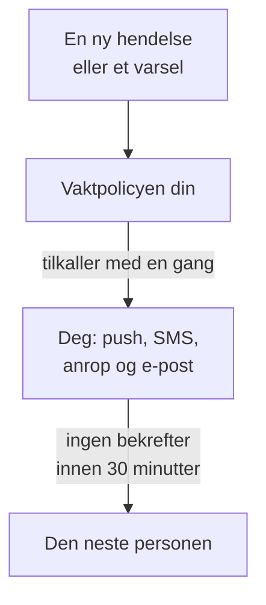

# Bli varslet via telefon, SMS eller push

Når du har fulgt denne guiden, blir du tilkalt på telefonen din med push-varsel, SMS eller anrop ved hver nye hendelse og hvert nye varsel i prosjektet ditt. Den neste personen tilkalles hvis ingen bekrefter innen 30 minutter, og et testoppkall du har bekreftet, viser at det virker. Underveis følger du det guidede oppsettet **Varsle rett person når noe går ned**, og det tar omtrent 10 minutter.

## Dette trenger du

- Et prosjekt du eier: SMS og anrop slås på av eieren, og en vaktpolicy opprettes av eieren eller en administrator.
- Mobiltelefonen din.
- Teammedlemmene som skal tilkalles, lagt til i prosjektet: [Inviter personer](/docs/permissions/inviting-people) viser hvordan.

:::tabs
@tab OneUptime Cloud
Push-varsler er gratis på alle planer. SMS og anrop betales fra prosjektets saldo, som starter på 0.00 USD, og når du legger til et telefonnummer, sendes det en SMS, så saldoen må først være over 1.00 USD. Når du legger til saldo, belastes prosjektets kort. Free-planen har plass til én person og én eskaleringsregel: bare du blir tilkalt, og tilkallingen gjentas i stedet for å gå videre til noen andre.
@tab Selvdriftet
Serveren din må kunne sende e-post, SMS og anrop. Hovedadministratoren setter dem opp på `/admin/setup`, med en test for hver, slik [Selv-hosting-veiledning](/docs/installation/self-hosting-guide) viser. Push-varsler når appen gjennom OneUptimes push-relé, uten noe å sette opp.
:::

## Trinn

:::steps
### Åpne det guidede oppsettet

På siden **Hjem** i prosjektet ditt klikker du på **Sett opp en vaktpolicy** i sjekklisten **Velkommen til OneUptime 👋**. Startsiden til et nytt prosjekt spør først **Hva vil du gjøre først?**: kryss av for **Varsle rett person når noe går ned**, og klikk på **Fortsett**. Mangler steget, eller er det allerede gjort, trykker du `Ctrl+K` (`Cmd+K` på en Mac), skriver `get paged` og velger **Varsle rett person når noe går ned**.

### Last ned appen på telefonen din

Installer OneUptime On-Call fra App Store eller Google Play, og logg inn: da registreres telefonen din for push-varsler. Tilbake i oppsettet klikker du på **Kontroller på nytt**: **Mobilapp eller nettleser** under **Hvordan skal vi nå deg?** viser nå telefonen din.

### Slå på SMS og anrop

Nye prosjekter starter med SMS og telefonanrop slått av. Eier du prosjektet, klikker du på **Slå på SMS og anrop**; alle andre får vite hvem som kan. Er saldoen på OneUptime Cloud 1.00 USD eller mindre, klikker du på **Legg til saldo**, skriver inn 20 til 1 000 USD under **Beløp (USD)** og klikker på **Fyll på**.

### Legg til telefonnummeret ditt

Skriv inn mobilnummeret ditt med landskode i **Telefonnummeret ditt**, for eksempel `+15551234567`, og klikk på **Send meg en kode på SMS**. Skriv inn koden fra SMS-en, og klikk på **Verifiser**: det samme nummeret blir også ringt opp ved tilkallinger. Klikk på **Fortsett**. Vil du bare tilkalles via appen og e-post, lar du nummeret stå tomt og klikker på **Fortsett** med en gang.

### Velg hvem andre som tilkalles

Under **Hvem andre har vakt?** er du allerede med i **Tilkalles først**. Klikk på **Legg til teammedlemmer** for å tilkalle andre sammen med deg, og klikk deretter på **Lagre og fortsett**. I et prosjekt som ennå ikke har en vaktpolicy, opprettes `Default on-call policy`, som tilkaller dem ved hver nye hendelse og hvert nye varsel. I et prosjekt som har en, velger du den under **Vaktpolicy** og legger i stedet til personer under **Legg til i den første eskaleringsregelen**. Kan noen ikke nås ennå, blir steget stående på **Når et tilkall dem?**: klikk på **Send påminnelse om oppsett** for dem, og deretter på **Fortsett**.

### Bestem hva som skjer hvis ingen svarer

Under **Hva om ingen svarer?** beholder du **Tilkall noen andre**, velger hvem det skal være under **Tilkalles deretter** og lar **Minutter å vente** stå på `30` eller endrer det. Klikk på **Lagre og fortsett**. På Free-planen tilbyr steget i stedet **Tilkall de samme personene igjen**, med **Antall nye tilkall** på `2`.

### Send et testoppkall

Under **Send et testoppkall** klikker du på **Test denne policyen**. Velg en **Alvorlighetsgrad**, og klikk på **Send testoppkall**. Policyens første eskaleringsregel tilkalles slik en ekte hendelse ville tilkalt den, og det står TEST i hver melding. Ingen hendelse opprettes, og ingen statusside eller abonnent får beskjed.

### Bekreft testoppkallet

Åpne lenken i SMS-en eller e-posten, og bekreft tilkallingen der, eller trykk 1 under anropet. Appen viser at tilkallingen kom frem, men kan ikke bekrefte en test. Klikk deretter på **Ferdig** i dialogen, og på **Fortsett**.
:::

## Sjekk at det virker

- Teststeget viser hvem som bekreftet tilkallingen, hvordan og hvor raskt.
- Oppsettet slutter med **Tilkalling er satt opp**, hentet fra det som faktisk er lagret: **Hvem som tilkalles**, **Hvis ingen svarer** og **Testet**. Et problem med selve policyen, for eksempel noen den ikke kan nå, står under **Krever oppmerksomhet**.
- På **Hjem** merker sjekklisten **Sett opp en vaktpolicy** som ferdig. Var det det siste steget, er sjekklisten borte.

Tilkaller policyen noen andre, kan du også se eskaleringen: klikk på **Åpne vaktpolicyen** i sammendraget, og deretter på **Test denne policyen**. Slå på **Gå gjennom hvert eskaleringsnivå**, send testen, og ikke bekreft den første tilkallingen: den neste personen tilkalles opptil 2 minutter senere.

## Hva som kan gå galt

:::details Knappen Send meg en kode på SMS mangler
SMS er slått av eller kan ikke sendes, og steget sier hvorfor. Bare en prosjekteier, eller noen som administrerer fakturering, ser **Slå på SMS og anrop**. På OneUptime Cloud skjuler en saldo på 1.00 USD eller mindre feltet. På en selvdriftet server som ikke kan sende SMS, ser hovedadministratoren **Sett opp SMS og anrop**, som åpner Admin Dashboard for å legge til Twilio, slik [Twilio-integrasjon](/docs/self-hosted/twilio-integration) viser.
:::

:::details Legg til saldo sier at ingen betalingsmetode ble funnet
Når du legger til saldo, belastes prosjektets kort. Legg til et kort under **Prosjektinnstillinger → Fakturering og fakturaer → Fakturering** med **Legg til betalingsmetode**, og legg deretter til saldo igjen. Inntil da tilkaller appen og e-posten deg fortsatt.
:::

:::details Selvdriftet: nummeret avvises fordi ingen Twilio-konto er satt opp
Bare hovedadministratoren får vite på forhånd at serveren ikke kan sende SMS. Be vedkommende sette opp SMS og anrop på `/admin/setup`. Klikk i mellomtiden på **Fortsett**: appen og e-posten tilkaller deg fortsatt.
:::

:::details Koden eller testoppkallet kommer aldri frem
Sjekk landskoden til nummeret først. Etter et testoppkall lukker du dialogen med **Ferdig** og klikker på **Jeg fikk den ikke**: den sier hva du skal sjekke, og **Åpne mine varslingsmetoder** viser alle måtene du kan nås på. På en selvdriftet server sender du en test-SMS fra `/admin/setup` og kjører `npm run doctor` på serveren.
:::

## Neste steg

:::cards
- [Vaktplaner](/docs/on-call/schedules): Del vaktene, så hver tilkalling går til den som har vakt. På Cloud fra Growth-planen.
- [Eskaleringsregler](/docs/on-call/escalation-rules): Legg til nivåer, team og vaktplaner i policyen.
- [Slik når man meg](/docs/notifications/on-call-rules): Velg hvilken metode som når deg først, og når.
- [Publiser en statusside](/docs/guides/status-page): Fortell kundene dine hva som skjer, på ditt eget domene.
:::
