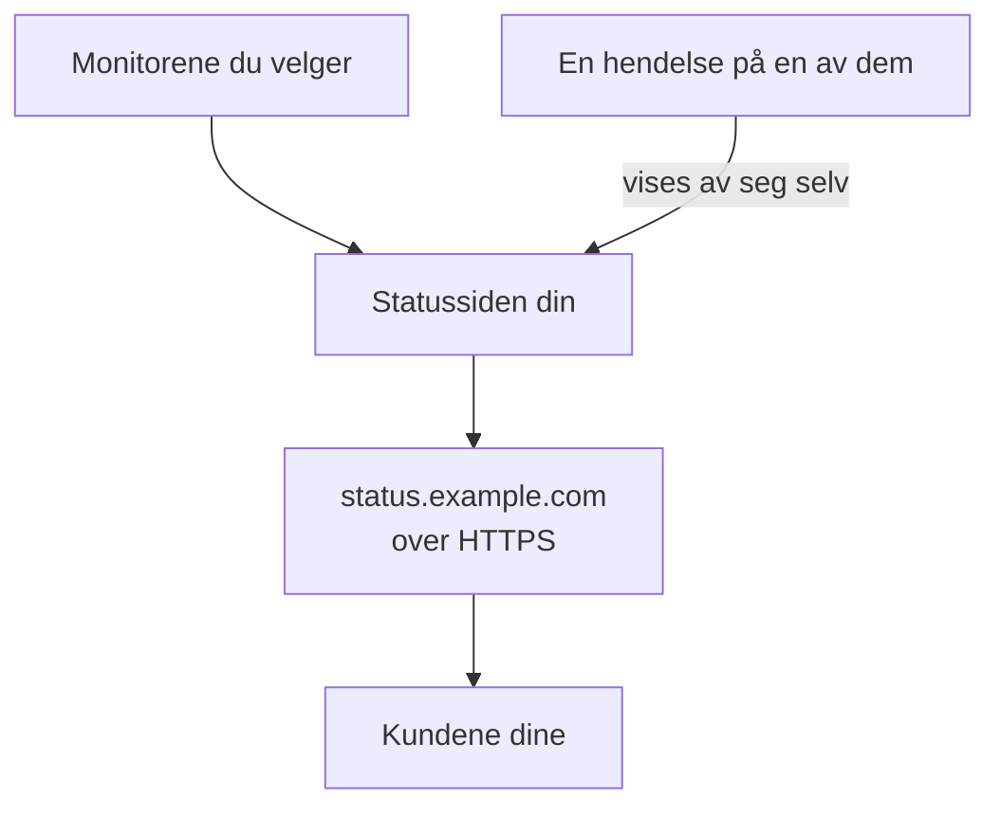

# Publiser en statusside

Når du har fulgt denne guiden, åpner kundene dine en statusside på din egen adresse, for eksempel `status.example.com`, over HTTPS. Den viser monitorene du velger, med status og oppetid, og en hendelse på en av dem vises der av seg selv. Underveis følger du det guidede oppsettet **Publiser en statusside**, og deretter legger du til domenet ditt under sidens **Egendefinerte domener**: omtrent 15 minutter, pluss tiden DNS-leverandøren din bruker.

## Dette trenger du

- Minst én monitor: en statusside viser monitorer. Har du ingen ennå, tilbyr det guidede oppsettet **Konfigurer en monitor** først.
- Rollen som prosjekteier eller administrator: siden krever tillatelse til å opprette statussider, og domenet ditt krever tillatelse til å legge til og verifisere prosjektets domener.
- Et domene du kontrollerer, og tilgang til DNS-postene for det hos DNS-leverandøren din.

:::tabs
@tab OneUptime Cloud
Et egendefinert domene med gratis SSL-sertifikat følger med alle planer. Free-planen har én statusside per prosjekt: har du allerede en, åpner du **Egendefinerte domener** for den og starter ved steget som legger til domenet ditt. En ny statusside er offentlig; å gjøre den privat krever Growth-planen.
@tab Selvdriftet
Serveren din trenger et eget vertsnavn med en A-post som peker på den, for eksempel `oneuptime.example.com`, og som svarer på port 80 og 443. Sett det som `STATUS_PAGE_CNAME_RECORD` i `config.env` (`statusPage.cnameRecord` i Helm-chartet), i stedet for eksempelverdien som står der. Gratis sertifikater trenger også `LETS_ENCRYPT_ACCOUNT_KEY` (`letsEncrypt.accountKey`): en privat nøkkel laget med openssl og kodet i base64. Start OneUptime på nytt etter at du har endret dem. **Legg til egendefinert domene** sjekker serveren først og viser hva som fortsatt mangler.
:::

## Trinn

:::steps
### Åpne det guidede oppsettet

På siden **Hjem** i prosjektet ditt klikker du på **Publiser en statusside** i sjekklisten **Velkommen til OneUptime 👋**. Startsiden til et nytt prosjekt spør først **Hva vil du gjøre først?**: kryss av for **Fortelle kundene mine det med en statusside**, og klikk på **Fortsett**. Mangler steget, eller er det allerede gjort, trykker du `Ctrl+K` (`Cmd+K` på en Mac), skriver `status page` og velger **Publiser en statusside**.

### Gi den et navn og velg hva den viser

Under **Gi den et navn og velg hva den viser** beholder du forslaget i **Navn på statussiden** eller skriver inn ditt eget. Under **Hva den viser** krysser du av for monitorene kundene dine skal se, eller klikker på **Velg alle**. Klikk på **Opprett statussiden**. Fra nå av er siden offentlig på lenken sin og viser bare monitorene du krysset av for.

### Se hva kundene dine ser

Under **Dette ser kundene dine** åpner du adressen under **Offentlig lenke**: monitorene dine står i listen med statusen sin. Tilbake i oppsettet klikker du på **Ser bra ut**.

### Åpne Egendefinerte domener

Oppsettet slutter med et sammendrag. Under **Gjør den til din egen (valgfritt)** klikker du på **Ditt eget domene**. **Egendefinerte domener** for statussiden åpnes.

### Legg til domenet ditt

Klikk på **Legg til egendefinert domene**. I **Domene** skriver du adressen kundene dine skal åpne, for eksempel `status.example.com`, og klikker på **Fortsett**. **DNS-oppsett** åpnes med postene som skal legges til.

### Legg til DNS-postene

Hos DNS-leverandøren din legger du til hver post som **DNS-oppsett** viser, med **Type**, **Navn** og **Verdi**: en CNAME-post som peker adressen til OneUptime, og, første gang prosjektet bruker dette domenet, en TXT-post som viser at prosjektet eier det. Legger leverandøren din selv til domenet på hvert navn, skriver du bare delen foran, for eksempel `status`, og `@` for selve domenet.

### Sjekk postene

La **DNS-oppsett** være åpen, og klikk på **Sjekk nå**. Under hver post står det hva som ble slått opp, og hva som kom tilbake. TXT-posten kommer først: til den er funnet, blir ikke domenet lagt til, så klikk på **Sjekk nå** igjen til den blir funnet. Så snart CNAME-posten er funnet, sier dialogen **CNAME-posten din er verifisert.**, og et gratis SSL-sertifikat utstedes, vanligvis innen 15 minutter.
:::

## Sjekk at det virker

- Åpne `https://status.example.com` med din egen adresse: statussiden din åpnes uten sertifikatadvarsel.
- På **Egendefinerte domener** står det **Sertifikat utstedt, fornyes automatisk.** under domenets **Status**. Det kan stå **Utsteder et gratis sertifikat, vanligvis innen 15 minutter.** en stund, selv om siden allerede åpnes.
- På **Hjem** merker sjekklisten **Publiser en statusside** som ferdig: det skjer så snart en statusside viser en monitor. Var det det siste steget, er sjekklisten borte.

Mer trengs ikke: OneUptime fornyer sertifikatet selv. Så snart domenet står i listen, sjekker OneUptime CNAME-posten hvert 15. minutt og verifiserer domenet når posten er aktiv, selv om du lukker **DNS-oppsett**.

## Hva som kan gå galt

:::details Domenet står ikke i listen etter at DNS-oppsett ble lukket
**DNS-oppsett** ble lukket før TXT-posten ble funnet, så domenet ble aldri lagt til. Klikk på **Legg til egendefinert domene**, skriv inn den samme adressen, klikk på **Fortsett** og deretter på **Sjekk nå** til dialogen finner begge postene.
:::

:::details Domenet blir stående på Venter på DNS
Åpne **DNS-oppsett** fra raden til domenet, og klikk på **Sjekk nå**: den sier hva den fant. Sjekk at navnet på posten er hele adressen, for eksempel `status.example.com`, og at verdien er den **DNS-oppsett** viser. Svarer navnet med en adresse, har det en A-post, eller DNS-leverandøren din proxyer det: erstatt A-posten, eller sett navnet til bare DNS. For et rotdomene, for eksempel `example.com`, bruker du leverandørens ALIAS-, ANAME- eller CNAME-flattening-post.
:::

:::details Status sier at et gratis sertifikat ikke kunne utstedes
En CAA-post på domenet ditt som utelater `letsencrypt.org`, blokkerer sertifikatet. På en selvdriftet server må Let's Encrypt nå serveren på port 80. Rett årsaken: OneUptime fortsetter selv å prøve, og **Sjekk nå** i **DNS-oppsett** bestiller på nytt, høyst én gang hvert 15. minutt per domene.
:::

:::details Selvdriftet: serveren er ikke klar for egendefinerte domener
**Legg til egendefinert domene** sier **Denne serveren er ikke klar for egendefinerte domener ennå**, med en linje for hver ting som fortsatt mangler og hva som må endres: innstillingene i [Dette trenger du](#dette-trenger-du). Uten `LETS_ENCRYPT_ACCOUNT_KEY` viser et verifisert domene **Bekreftet. Bruker HTTPS fra din egen proxy.**: lever HTTPS fra din egen proxy. [Statusside – merkevare og domener](/docs/status-pages/branding-and-domains#før-du-starter) har detaljene.
:::

## Neste steg

:::cards
- [Statusside – merkevare og domener](/docs/status-pages/branding-and-domains): Logo, farger, topptekstlenker og bunntekst.
- [Abonnenter og kunngjøringer](/docs/status-pages/subscribers): La kunder abonnere, og publiser kunngjøringer.
- [Planlagt vedlikehold – Oversikt](/docs/scheduled-maintenance/index): Fortell kundene om planlagt arbeid før det starter.
- [Bli varslet via telefon, SMS eller push](/docs/guides/paging): Bli tilkalt når en av disse monitorene går ned.
:::
