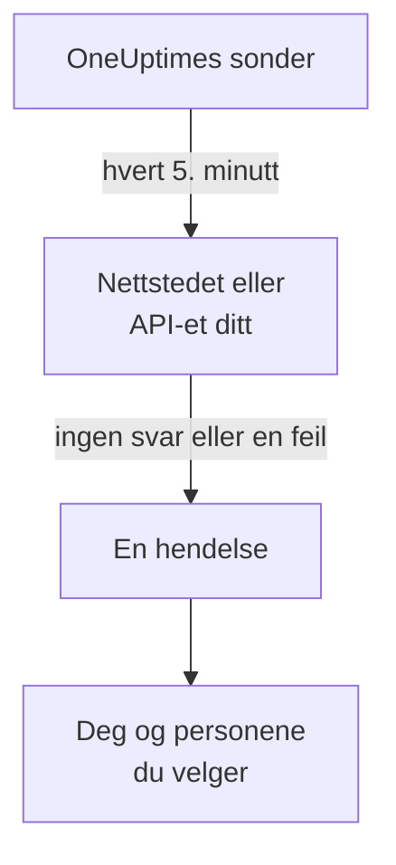

# Få beskjed når nettstedet eller API-et ditt går ned

Når du har fulgt denne guiden, sjekker OneUptime nettstedet eller API-et ditt hvert 5. minutt, åpner en hendelse når det slutter å svare eller svarer med en feil, og gir deg beskjed. Et testoppkall du har bekreftet, viser at meldingen når frem til deg. Underveis følger du det guidede oppsettet **Vite når nettstedet eller API-et mitt er nede**, og det tar omtrent 5 minutter.

## Dette trenger du

- Et OneUptime-prosjekt der du kan opprette monitorer: det kan eiere, administratorer og medlemmer. For å opprette en konto og et prosjekt følger du første del av [Hurtigstart](/docs/introduction/quickstart#opprett-et-prosjekt).
- Adressen som skal sjekkes, for eksempel `https://example.com`. For et API velger du et endepunkt som svarer på en vanlig `GET` uten nøkkel, for eksempel en helsesjekk: et svar som `401` regnes som nede.

:::tabs
@tab OneUptime Cloud
Sonder i flere regioner sjekker adressen, så den må kunne nås fra internett. Free-planen har plass til 10 aktive monitorer.
@tab Selvdriftet
Adressen sjekkes fra serverens egen sonde, så den må kunne nås derfra. For at du skal få e-post, må serveren kunne sende den: hovedadministratoren setter det opp på `/admin/setup`, slik [Selv-hosting-veiledning](/docs/installation/self-hosting-guide) viser. Hovedadministratoren blir ikke eier av det vedkommende oppretter, så vedkommende legger seg selv til på monitorens side **Eiere** for å få e-post.
:::

## Trinn

:::steps
### Åpne det guidede oppsettet

Siden **Hjem** i et nytt prosjekt spør først **Hva vil du gjøre først?**: kryss av for **Vite når nettstedet eller API-et mitt er nede**, og klikk på **Fortsett**. Klikk deretter på **Opprett din første overvåker** i sjekklisten **Velkommen til OneUptime 👋**. Mangler steget i sjekklisten, trykker du `Ctrl+K` (`Cmd+K` på en Mac), skriver `website down` og velger **Vite når nettstedet eller API-et mitt er nede**.

### Skriv inn adressen

Under **Hva skal vi sjekke?** skriver du adressen i **Adresse til nettsted eller API**. For et API-endepunkt krysser du av for **Dette er et API-endepunkt**. Klikk på **Start sjekkingen**: sondene sjekker adressen med en gang, og en setning forteller hva de fant. Klikk på **Fortsett**.

### Velg hvem som får beskjed

Under **Hvem skal få beskjed?** avhenger det av prosjektet hva du ser:

- Har prosjektet ennå ingen vaktpolicy eller vaktregel, er du allerede med i **Hvem som tilkalles**. Klikk på **Legg til teammedlemmer** for å legge til personer som allerede er med i prosjektet, og klikk deretter på **Lagre og fortsett**. Da opprettes `Default on-call policy`, som tilkaller dem ved hver nye hendelse og hvert nye varsel i prosjektet.
- Har prosjektet en vaktpolicy eller vaktregel, avgjør prosjektets egne regler hvem som tilkalles: klikk på **Fortsett**.
- Som medlem kan du ikke sette opp tilkalling, så steget forteller at du får e-post som monitorens eier: klikk på **Fortsett**.

### Send deg selv en test

Under **Send en test** klikker du på **Send meg et testoppkall**. Velg en **Alvorlighetsgrad**, og klikk på **Send testoppkall**. Testen når deg på samme måte som en ekte tilkalling, og det står TEST i hver melding. Ingen hendelse opprettes.

### Bekreft testoppkallet

Åpne lenken i e-posten, og bekreft tilkallingen der. Et verifisert telefonnummer fungerer også, så snart SMS og anrop er slått på for prosjektet: åpne lenken i SMS-en, eller trykk 1 under anropet. Klikk deretter på **Ferdig** i dialogen, og på **Fortsett**.
:::

## Sjekk at det virker

- Oppsettet slutter med et sammendrag, hentet fra det som faktisk er lagret: **Sjekket**, **Når den går ned**, **Hvem som får beskjed** og **Testet**.
- Klikk på **Åpne monitoren**, og deretter på **Vis kjeden** på kortet **Når den går ned**: da vises kjeden fra monitoren til personene den når, og det står **Ingenting stopper kjeden.** når ingenting ville stoppe den.
- På **Hjem** merker sjekklisten **Opprett din første overvåker** som ferdig så snart den første sjekken kommer inn. Var det det siste steget, er sjekklisten borte.

For å sette opp en annen adresse senere åpner du oppsettet på nytt og klikker på **Sjekk en annen adresse**.

## Hva som kan gå galt

:::details Den første sjekken melder aldri tilbake
Sier setningen at ingen plassering sjekker adressen, har monitoren ingen sonde; fortsetter den å si at adressen sjekkes, er monitorens sonde ikke tilkoblet. Åpne **Monitorer → Innstillinger → Sonder** for å se statusen til hver sonde. På en selvdriftet server sjekker hovedadministratoren serverens sonde på `/admin/setup`. Åpne deretter monitoren, legg til en tilkoblet sonde, og åpne oppsettet på nytt.
:::

:::details Nettstedet virker, men monitoren sier at det er nede
Monitoren regner det som nede når det ikke kommer noe svar, eller når svaret er utenfor 200 til 399. En brannmur som blokkerer sondene, ser ut som manglende svar: på OneUptime Cloud tillater du adressene på [IP-adresser](/docs/configuration/ip-addresses); på en selvdriftet server tillater du maskinen sonden kjører på. Hvordan du endrer regelen, står i [Nettsted-overvåking](/docs/monitor/website-monitor) eller [API-overvåking](/docs/monitor/api-monitor).
:::

:::details Testoppkallet kan ikke bekreftes
Det har ikke kommet noen melding du kan bekrefte fra, noe som på en selvdriftet server som regel betyr at serveren ikke kan sende e-post ennå: steget sier det, og hovedadministratoren ser **Sett opp e-post**. Sett det opp, og klikk deretter på **Send en test til**, eller klikk på **Hopp over testen** og kom tilbake senere. Etter en test lukker du dialogen med **Ferdig** og klikker på **Jeg fikk den ikke**: den sier hva du skal sjekke.
:::

## Neste steg

:::cards
- [Bli varslet via telefon, SMS eller push](/docs/guides/paging): Bli tilkalt på telefonen din, og tilkall den neste personen hvis ingen svarer.
- [Publiser en statusside](/docs/guides/status-page): Vis monitoren til kundene dine, på ditt eget domene.
- [Kriterier og statuser](/docs/monitor/criteria-and-statuses): Bestem nøyaktig når en monitor regnes som nede.
:::
