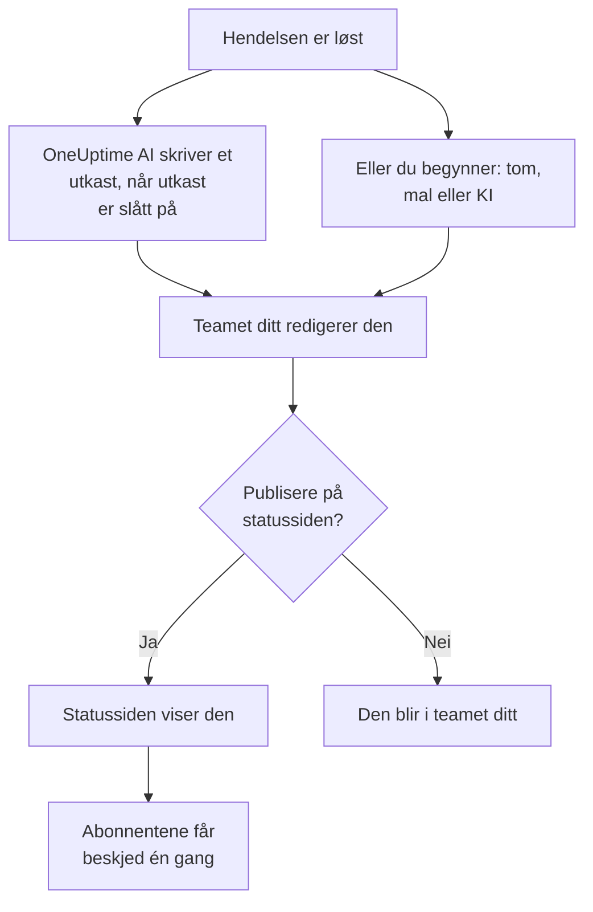

# Etteranalyser

En etteranalyse er gjennomgangen etter en hendelse: hva som skjedde, hvorfor, hva det kostet brukerne dine og hva som endres nå. I OneUptime skriver du den på selve hendelsen. Den kan starte fra din egen mal eller fra et utkast fra OneUptime AI, og den kan publiseres på statussiden din som hendelsens avsluttende oppdatering. Hver etteranalyse har også en status, og **Hendelser → Etteranalyser** viser etteranalysen for hver hendelse, slik at du ser hvilke som fortsatt mangler.

:::cards
- [Skriv en etteranalyse](#skriv-en-etteranalyse): På hendelsens side Etteranalyse, i fem trinn.
- [Start fra en mal eller et KI-utkast](#start-fra-en-mal-eller-et-ki-utkast): Din disposisjon, eller en som OneUptime AI fyller ut.
- [Publiser den på statussiden din](#publiser-den-på-statussiden-din): Vis den til kundene og varsle abonnenter én gang.
- [Følg hvor langt hver etteranalyse har kommet](#følg-hvor-langt-hver-etteranalyse-har-kommet): Ikke startet, Utkast, Fullført eller en status du lager selv.
- [Se alle etteranalyser](#se-alle-etteranalyser): Filtrer etter eier, alvorlighetsgrad og status for å finne dem som fortsatt mangler.
- [Etteranalyser for episoder](#etteranalyser-for-episoder): Én gjennomgang for en gruppe hendelser.
:::

## Slik blir en etteranalyse til

En etteranalyse har tre deler, alle på hendelsen: notatet, skrevet i Markdown; vedleggene, som skjermbilder og rapporter; og om den vises på statussiden din. De ligger på hendelsens side **Etteranalyse**, under **Undersøkelse** i sidemenyen. En etteranalyse har også en status, som sier hvor langt den har kommet, og eiere: hendelsens eiere.

## Skriv en etteranalyse

:::steps
### Åpne etteranalysen

Åpne hendelsen, og klikk på **Etteranalyse** under **Undersøkelse** i sidemenyen. Kortet **Etteranalyse** viser etteranalysens **Status** og **Eiere**, notatet, vedleggene og om etteranalysen vises på statussiden.

### Klikk på Skriv etteranalyse

Dialogen **Skriv etteranalyse** åpnes på første trinn, **Etteranalyse**. Når etteranalysen er skrevet, heter kortets knapp **Rediger evalueringsnotat**, og den åpner de samme trinnene.

### Skriv notatet og legg ved filer

Skriv **Notat om etteranalyse** i Markdown: hva som skjedde, konsekvensene, hvordan det ble løst og oppfølgingen. Legg til skjermbilder, rapporter eller tidslinjer under **Vedlegg til etteranalyse**.

### Velg om den skal publiseres

Klikk på **Neste**. På trinnet **Statusside** er **Publiser på statussiden** slått av, så etteranalysen blir i teamet ditt. For å vise den til kundene, se [Publiser den på statussiden din](#publiser-den-på-statussiden-din).

### Lagre etteranalysen

Klikk på **Lagre endringer**. Kortet viser notatet og vedleggene. Etteranalysens status flyttes fra **Ikke startet** til **Utkast**: se [Slik flytter en etteranalyse seg](#slik-flytter-en-etteranalyse-seg).
:::

Hver endring av notatet registreres i hendelsens feed og postes i hendelsens Slack- eller Microsoft Teams-kanal hvis den har en. Så lenge etteranalysen ikke er publisert, får ingen abonnent på statussiden høre om den.

Å skrive en etteranalyse krever rollen Project Owner, Project Admin, Project Member, Incident Admin eller Incident Member, eller en egendefinert rolle med tillatelsen Edit Incident. Alle som kan lese hendelsen, kan lese etteranalysen.

## Start fra en mal eller et KI-utkast

To knapper fyller ut notatet for deg. Så lenge ingenting er skrevet, står de ved siden av **Skriv etteranalyse**: **Start fra mal**, så snart prosjektet har en mal for etteranalyse, og **Generate with AI**. Når etteranalysen er skrevet, ligger de i menyen **⋯** ved siden av **Rediger evalueringsnotat**, som **Bruk mal** og **Generate with AI**. Begge åpner den samme editoren, med notatet utfylt og resten av etteranalysen uendret. Ingenting lagres før du klikker på **Lagre endringer**, så les notatet og rett det først.

### Bruk en mal

**Bruk mal** vises så snart prosjektet har en mal for etteranalyse. Du oppretter dem under **Hendelser → Innstillinger → Postmortem-maler**: se [Postmortem-maler](/docs/incidents/settings#maler-for-etteranalyse). På OneUptime Cloud krever maler Growth-planen.

Klikk på **Start fra mal**, eller på **Bruk mal** i menyen **⋯**, velg en under **Velg mal** i dialogen **Bruk obduksjonsmal**, og klikk på **Bruk mal**. Har prosjektet bare én mal, er den allerede valgt.

### Generer den med KI

Klikk på **Generate with AI**. Dialogen **Generate Postmortem with AI** tilbyr en disposisjon under **Velg mal**: **Standard Postmortem**, **Detailed Technical Postmortem** eller **Brief Postmortem**, og deretter dine egne maler for etteranalyse. **Template Preview** viser disposisjonen, og du kan endre den før du genererer.

Klikk på **Generate with AI** nederst i dialogen. OneUptime AI leser hendelsen (beskrivelsen, rotårsaken og utbedringen, statustidslinjen, de offentlige og private notatene, meldingene i hendelsens Slack- eller Microsoft Teams-kanal og det som ble sagt i [samtalene](/docs/workspace-connections/video-calls#transkripsjoner-av-samtaler)) og skriver etteranalysen etter disposisjonen din. Deretter åpnes editoren med resultatet.

Å generere krever at KI er slått på for prosjektet, under **Prosjektinnstillinger → KI → AI Features**, og en LLM-leverandør: se [LLM-leverandører](/docs/ai/llm-provider). Det krever også rollen Project Owner eller Project Admin, eller en egendefinert rolle med tillatelsen Edit Incident: andre roller kan skrive etteranalysen, men ikke generere den.

### La OneUptime AI skrive et utkast når en hendelse løses

Med **Skriv utkast til etteranalyse når en hendelse er løst** slått på skriver OneUptime AI et utkast til etteranalysen hver gang en hendelse løses, lagrer det som notatet og poster det i hendelsens feed slik at teamet ditt kan gå gjennom det. Bryteren ligger under **Hendelser → KI → Innstillinger**, og den er slått på for nye prosjekter.

- Den erstatter aldri et notat som allerede er skrevet.
- Den skriver aldri i en etteranalyse som allerede er publisert, der utkastet ville nå statussiden uten gjennomgang.
- Den krever at KI er slått på for prosjektet, og stopper for dagen så snart prosjektet når de daglige KI-grensene sine. Se [Automatisk etteranalyse](/docs/ai/ai-sre#automatisk-etteranalyse).
- Er transkripsjonen av hendelsens samtale fortsatt på vei når hendelsen løses, venter den til OneUptime AI har lest den, slik at utkastet tar med det som ble sagt i samtalen: opptil seks timer mens leverandøren lager transkripsjonen. Se [Ta opp og transkribere hver samtale](/docs/workspace-connections/video-calls#ta-opp-og-transkribere-hver-samtale).

#### Velg hvilke hendelser som får et utkast, og malen det følger

Uten regler får hver løste hendelse et utkast i standardoppsettet til OneUptime AI. **Postmortem-regler**, under **Flere innstillinger** på samme side, endrer det:

- En regel samsvarer med **Alle hendelser**, eller med **Bare hendelser som oppfyller betingelsene** på monitorer, alvorlighetsgrader, labels, monitorlabels, tittel og beskrivelse, slik en AI-regel gjør.
- Dens **Maler** er malene for etteranalyse som utkastet kan følge. Uten noen følger utkastet standardoppsettet; med én, den malen; med flere, den OneUptime AI mener passer best til hendelsen. Utkastets innlegg i feeden nevner malen det fulgte.
- Dens **LLM-leverandør**, under **Flere felt**, er leverandøren OneUptime AI skriver utkastet og velger malen med. Med ingen valgt er det prosjektets standardleverandør, ellers den globale. Utkastets innlegg i feeden nevner leverandøren en regel valgte, eller den som ble brukt i stedet, og hvorfor. Se [Hvilken LLM-leverandør en regel bruker](/docs/ai/ai-sre#hvilken-llm-leverandør-en-regel-bruker).
- Den første aktiverte regelen som samsvarer med hendelsen, avgjør, regnet fra toppen av listen: dra en regel for å flytte den. En hendelse som ingen regel samsvarer med, får ikke noe utkast, og det får ingen hendelse så lenge reglene ikke kan leses.
- **Skriv utkast til etteranalyse når en hendelse er løst** er fortsatt den eneste bryteren som slår av utkast. Regler avgjør bare utkastene OneUptime AI skriver på egen hånd: **Generate with AI** tilbyr alle oppsett, uansett hva reglene sier.
- Å opprette, redigere og omordne regler krever rollen Project Owner eller Project Admin. På OneUptime Cloud krever maler Growth-planen: under den avgjør reglene fortsatt hvilke hendelser som får et utkast, og hvert utkast følger standardoppsettet.

## Publiser den på statussiden din

En publisert etteranalyse er hendelsens avsluttende oppdatering til kundene dine: statussiden viser notatet, uthevet i hendelsens tidslinje, med vedleggene til nedlasting.

:::steps
### Åpne trinnet Statusside

Klikk på **Rediger evalueringsnotat**, og deretter på **Neste** for å komme til trinnet **Statusside**.

### Slå på Publiser på statussiden

Slå på **Publiser på statussiden**. To felt til vises: **Varsle abonnenter**, som er slått på, og **Etteranalyse publisert**, som står på nå.

### Bestem hvem som får beskjed, og når den vises

Slå av **Varsle abonnenter** for å publisere uten å varsle abonnenter. Endre **Etteranalyse publisert** for å vise et annet tidspunkt ved siden av etteranalysen.

### Publiser

Klikk på **Lagre endringer**. Kortet viser nå **Etteranalyse synlig på statussiden?**, **Varsle abonnenter**, **Abonnentvarselsstatus** og **Etteranalyse publisert**.
:::

Dette avgjør om kundene ser den og hører om den:

- **Hendelsen må vises på statussiden.** En statusside viser en etteranalyse bare på en hendelse den viser: **Synlig på statussiden** slått på, og hendelsen ikke privat.
- **Notatet må si noe.** En etteranalyse som publiseres med et tomt notat, vises ikke, og ingen får beskjed.
- **Abonnentene får beskjed én gang**, første gang statussiden viser etteranalysen. Å lagre den igjen, eller redigere den mens den er publisert, oppdaterer siden uten å varsle noen. Å ta den bort og publisere den igjen varsler dem igjen. En etteranalyse som publiseres mens hendelsen er skjult, sendes når hendelsen gjøres synlig.
- **Varsle abonnenter leses når varselet sendes.** Å slå den på etter at etteranalysen er publisert, sender ingenting.

**Abonnentvarselsstatus** viser om varselet er sendt, og tilbyr **Prøv på nytt** når det mislyktes. Se [Etteranalysen](/docs/status-pages/subscribers#etteranalysen) for hvert tilfelle, og [Prøv på nytt og send på nytt](/docs/status-pages/subscribers#prøv-på-nytt-og-send-på-nytt).

**Etteranalyse publisert** er også tidspunktet da etteranalysen regnes som publisert for målingen **Tid til etteranalyse**: se [Ferdige målinger](/docs/incidents/settings#ferdige-målinger).

## Følg hvor langt hver etteranalyse har kommet

Etteranalysen for hver hendelse har en av prosjektets statuser for etteranalyse, vist under **Status** øverst på kortet **Etteranalyse**. Et nytt prosjekt har fire. En etteranalyse i **Ikke startet** eller **Utkast** mangler fortsatt; en i **Fullført** eller **Ikke nødvendig** gjør ikke det:

| Status | Hva den betyr | Mangler fortsatt |
| --- | --- | --- |
| **Ikke startet** | Ingen har skrevet denne etteranalysen ennå. | Ja |
| **Utkast** | Etteranalysen skrives. | Ja |
| **Fullført** | Etteranalysen er skrevet og ferdig. | Nei |
| **Ikke nødvendig** | Denne hendelsen trenger ingen etteranalyse. | Nei |

### Slik flytter en etteranalyse seg

OneUptime flytter en etteranalyse av seg selv på tre tidspunkter:

- Etteranalysen for en ny hendelse starter i **Ikke startet**, eller i **Utkast** når hendelsen erklæres med et notat, eller i **Fullført** når det notatet publiseres samtidig.
- Det første notatet i en etteranalyse i **Ikke startet** flytter den til **Utkast**, enten noen skriver det, bruker en mal eller OneUptime AI skriver et utkast.
- Når den publiseres på statussiden, flyttes den til **Fullført**, med mindre den allerede er ferdig.

Den flytter seg aldri tilbake: å tømme notatet, eller ta etteranalysen av statussiden, lar statusen bli der den er. En status som noen velger i samme lagring, gjelder alltid.

### Flytt den selv

Klikk på statusen, på hendelsens side **Etteranalyse** eller i raden dens i listen over etteranalyser, og velg en under **Flytt etteranalysen til**. Etteranalysen flyttes med en gang. Å flytte en etteranalyse krever rollene som skriver en, og alle som kan lese hendelsen, ser hvor langt etteranalysen har kommet.

### Lag dine egne statuser

Har prosessen din et eget trinn, for eksempel en gjennomgang, legger du til en status for det. Åpne **Hendelser → Innstillinger → Statuser for etteranalyse**, klikk på **Opprett Status for etteranalyse**, og gi den et navn, for eksempel **Til gjennomgang**, en farge og en beskrivelse. En ny status havner rett over **Fullført**; dra en status for å endre plasseringen.

Hvor en status står, avgjør hva den teller som, vist under **Teller som**: over **Utkast** som **Ikke startet**, fra **Utkast** og nedover som **Pågår**, fra **Fullført** og nedover som **Ferdig**, og da mangler den ikke lenger. **Til gjennomgang**, mellom dem, mangler fortsatt; **Ikke nødvendig**, under **Fullført**, gjør ikke det.

**Ikke startet**, **Utkast** og **Fullført** er innebygde, fordi OneUptime flytter etteranalyser til dem: du kan gi dem nytt navn og ny farge, men ikke slette eller arkivere dem, og de beholder rekkefølgen. Arkiver en status du ikke bruker lenger, fra menyen **⋯** i raden: ingen kan flytte en etteranalyse dit igjen, etteranalysene i den blir der til noen flytter dem, og listen filtrerer fortsatt etter den. **Arkiverte etteranalysestatuser**, slått sammen under tabellen, viser dem, med **Fjern fra arkiv** for å hente en tilbake. Å opprette, redigere og slette statuser krever rollen Project Owner, Project Admin eller Incident Admin, eller en egendefinert rolle med den tilsvarende tillatelsen for statuser for etteranalyse.

## Se alle etteranalyser

**Hendelser → Etteranalyser** viser etteranalysen for hver hendelse i prosjektet, den nyeste først, med kolonnene **Hendelse**, **Tittel**, **Status for etteranalyse**, **Alvorlighetsgrad**, **Eiere** og **Erklært**. **Vis** i en rad åpner hendelsens side **Etteranalyse**.

Over listen teller en flis per status etteranalysene i den. Klikk på en flis for å vise bare dem, og klikk igjen for å vise alle.

Filtrer listen med brikkene over den: **Eier**, en person eller et team; **Alvorlighetsgrad**; **Status for etteranalyse**; **Hendelsesstatus**; **Etiketter**; og **Berørte ressurser**. For å se hvilke etteranalyser et team fortsatt skylder for de alvorligste hendelsene dine, velger du teamet under **Eier**, alvorlighetsgraden under **Alvorlighetsgrad**, og **Ikke startet** og **Utkast** under **Status for etteranalyse**. Filtrene står i adressen til siden, så du kan lagre listen som bokmerke eller dele den.

For å endre mange samtidig velger du dem og åpner **Massehandlinger**: **Endre status for etteranalyse** flytter alle til én status, for eksempel **Ikke nødvendig** for hendelser som ikke trenger en, og **Add Owner** og **Remove Owner** endrer hvem som eier dem.

## Etteranalyser for episoder

En hendelsesepisode har også en side **Etteranalyse**, under **Undersøkelse**: én gjennomgang for alle hendelsene i episoden. Klikk på **Rediger evaluering** for å skrive den. **Bruk mal** og **Generate with AI** fungerer som på en hendelse, og KI leser episoden og medlemshendelsene.

En episodes etteranalyse er bare notatet: den har ingen vedlegg, og ingen statusside viser den. OneUptime AI skriver ikke et utkast av seg selv når en episode løses. Å generere en krever rollen Project Owner eller Project Admin, eller en egendefinert rolle med tillatelsen Edit Incident Episode. Den har heller ingen status, og listen over etteranalyser utelater den.

Varsler og planlagte vedlikeholdshendelser har ingen etteranalyse.

## Via API-et

En etteranalyse er et sett felt på hendelsen, som leses og skrives via `/api/incident` som resten av hendelsen:

| Felt | Hva det er |
| --- | --- |
| `postmortemNote` | Notatet, i Markdown. |
| `showPostmortemOnStatusPage` | Om etteranalysen er publisert på statussidene dine. Starter som `false`. |
| `notifySubscribersOnPostmortemPublished` | Om abonnenter får beskjed når den publiseres. Starter som `true`. |
| `postmortemPostedAt` | Tidspunktet statussiden viser ved siden av den. |
| `postmortemStatusId` | Etteranalysens status: en av prosjektets statuser, under `/api/incident-postmortem-status`. |

Å skrive `showPostmortemOnStatusPage` som `true` over en skrevet `postmortemNote` publiserer etteranalysen, slik dialogen gjør. Det flytter også etteranalysen til **Fullført**, med mindre samme skriving setter `postmortemStatusId`.

## Feilsøking

:::details Bruk mal er ikke på kortet
Prosjektet har ennå ingen mal for etteranalyse, eller rollen din kan ikke lese dem. Opprett en under **Hendelser → Innstillinger → Postmortem-maler**. På OneUptime Cloud krever maler Growth-planen.
:::

:::details Generate with AI sier at KI er slått av, eller at du mangler tillatelse
Slå på KI under **Prosjektinnstillinger → KI → AI Features**. Å generere krever rollen Project Owner eller Project Admin, eller en egendefinert rolle med tillatelsen Edit Incident, også for den som kan redigere etteranalysen.
:::

:::details Etteranalysen vises ikke på statussiden
Sjekk tre ting: **Publiser på statussiden** er slått på, notatet er ikke tomt, og hendelsen vises på statussiden (**Synlig på statussiden** slått på, og ikke privat).
:::

:::details Abonnentene fikk ikke beskjed om etteranalysen
**Varsle abonnenter** var slått av ved publiseringen, eller hendelsen er skjult: da sendes den så snart hendelsen gjøres synlig. **Abonnentvarselsstatus** på kortet forteller hvilken det var.
:::

:::details Det kom ikke noe KI-utkast da hendelsen ble løst
Hendelsen hadde allerede et notat, etteranalysen var allerede publisert, ingen postmortem-regel samsvarte med den, eller **Skriv utkast til etteranalyse når en hendelse er løst** er slått av. KI må være slått på for prosjektet, og prosjektet kan ikke ha nådd de daglige KI-grensene sine. Er transkripsjonen av hendelsens samtale på vei, kommer utkastet når OneUptime AI har lest den.
:::

:::details Statusen til en etteranalyse flyttet seg ikke da notatet ble skrevet
Bare en etteranalyse i **Ikke startet**, eller i en egen status over **Utkast**, flytter seg av seg selv, ved det første notatet. En som allerede pågår eller er ferdig, blir der den er, og det samme gjør en status som noen valgte i samme lagring. Flytt den selv via statusen: se [Flytt den selv](#flytt-den-selv).
:::

## Neste trinn

:::cards
- [Hendelser – Oversikt](/docs/incidents/index): Hendelsens andre sider, fra erklæring til løsning.
- [Hendelsesinnstillinger og automatisering](/docs/incidents/settings): Maler for etteranalyse og målingen av tid til etteranalyse.
- [Abonnenter og kunngjøringer](/docs/status-pages/subscribers): Alt en statusside forteller abonnentene sine.
- [AI SRE](/docs/ai/ai-sre): Hva OneUptime AI gjør av seg selv etter en hendelse.
:::
