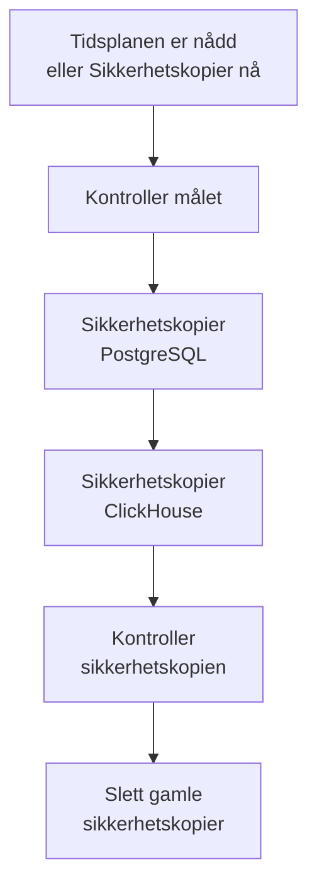

# Sikkerhetskopier

Sikkerhetskopier en selvhostet OneUptime til lagring du eier, etter en tidsplan, og gjenopprett den fra Admin Dashboard. En sikkerhetskopi inneholder PostgreSQL, med prosjektene, monitorene, hendelsene, statussidene og brukerne dine, og ClickHouse, med loggene, sporingene og måledataene dine. Sikkerhetskopier beholdes så mange dager du velger, eldre slettes for deg, og enhver sikkerhetskopi kan gjenopprettes på stedet. Sikkerhetskopier er en del av Enterprise Edition.

:::cards
- [Konfigurer sikkerhetskopier](#konfigurer-sikkerhetskopier): Velg et mål, test det og velg en tidsplan.
- [Mål](#mål): Hva hvert anbefalte mål ber om.
- [Gjenopprett en sikkerhetskopi](#gjenopprett-en-sikkerhetskopi): Hva som erstattes, og hvordan de nåværende dataene holdes trygge.
- [Flytt til en ny server](#flytt-til-en-ny-server): Gjenopprett én installasjons sikkerhetskopier på en annen.
:::

## Slik fungerer en sikkerhetskopi



- **Konsistent.** PostgreSQL dumpes i én transaksjon, så dumpen er databasen slik den var i ett øyeblikk, mens OneUptime fortsetter å kjøre. ClickHouse sikkerhetskopierer hver tabell slik den var da det leste tabellens parts.
- **Rett til målet.** Utdataene fra `pg_dump` strømmes til lagringen mens de skrives, og ClickHouse skriver sin egen sikkerhetskopi til lagringen. Ingenting skrives til serverens disk, uansett hvor store dataene er.
- **Kontrollert.** Før sikkerhetskopien teller, leser `pg_restore` dumpen tilbake fra målet, og ClickHouses egen oppføring av sikkerhetskopien sin finnes der. Dumpens SHA-256 lagres sammen med sikkerhetskopien, og en gjenoppretting kontrollerer den før den erstatter noe. En sikkerhetskopi som mislykkes eller avbrytes, sletter det den har skrevet, så målet bare inneholder hele sikkerhetskopier.
- **Kryptert.** Sikkerhetskopier sendes til lagringen over HTTPS, med mindre du angir et `http://`-endepunkt. Amazon S3, Google Cloud Storage, Azure Blob Storage og Cloudflare R2 krypterer alt de lagrer; på annen lagring slår du på bucketens kryptering av lagrede data. Målets påloggingsinformasjon lagres kryptert og vises aldri igjen.
- **Én om gangen.** Bare én sikkerhetskopi eller gjenoppretting kjører om gangen på hele installasjonen. De andre venter på tur.

Hver sikkerhetskopi er en egen mappe i målets mappe (`oneuptime/backups/` med mindre du velger en annen), oppkalt etter tidspunktet den startet, i UTC:

```text
oneuptime/backups/20261024T020000Z-3f2a9c1b/manifest.json
oneuptime/backups/20261024T020000Z-3f2a9c1b/postgres.dump
oneuptime/backups/20261024T020000Z-3f2a9c1b/clickhouse/
```

`manifest.json` skrives sist: den sier hva sikkerhetskopien inneholder, og hvilken versjon av OneUptime som laget den.

## Før du begynner

- **Enterprise Edition**, med en lisens som omfatter sikkerhetskopier. Sikkerhetskopier kjører i prøveperioden og fristperioden. Uten lisens lages ingen nye sikkerhetskopier, og gjenoppretting og sletting av sikkerhetskopier fungerer fortsatt. Se [Enterprise Edition](/docs/self-hosted/enterprise).
- **En hovedadministrator.** Sikkerhetskopier konfigureres i Admin Dashboard.
- **En bucket eller container bare for sikkerhetskopier**, og påloggingsinformasjon som kan lese, skrive, liste og slette i den.
- **Et mål som ClickHouse også når.** ClickHouse skriver sikkerhetskopien sin selv til lagringen, så nettverket dets må nå lagringen, slik OneUptimes gjør.
- **For å gjenopprette PostgreSQL, en databasebruker som kan opprette databaser.** En gjenoppretting skriver til en ny database ved siden av den aktive. PostgreSQL som følger med OneUptime, kobler til som superbruker, som har lov til det.

## Konfigurer sikkerhetskopier

:::steps
### Åpne siden for sikkerhetskopier

Gå til **Innstillinger → Sikkerhetskopier** i Admin Dashboard og klikk på **Konfigurer sikkerhetskopier**.

### Velg hvor sikkerhetskopier skal lagres

Velg ett av de anbefalte målene. Hva hvert av dem ber om, står under [Mål](#mål).

### Fyll ut tilkoblingen

Fyll ut det målet ber om. En mappe, en region og innstillingene de fleste lar være, venter under **Flere felt**, og **Oppsettveiledning** åpner målets del av denne siden.

### Test målet

Klikk på **Test målet**. OneUptime skriver, leser, lister og sletter en liten testfil, kontrollerer at `pg_dump` kan sikkerhetskopiere PostgreSQL-en din, og ber ClickHouse skrive en testsikkerhetskopi av definisjonene av tabellene sine. Ingenting lagres, og en kontroll som mislykkes, sier hva du må endre.

### Velg når sikkerhetskopier kjører

Velg **Hvor ofte** og klokkeslettet i **Kl. (UTC)**, og for ukentlige sikkerhetskopier **Ukedag**. **Behold sikkerhetskopier i (dager)** er 30 med mindre du endrer det. Slå av **Sikkerhetskopier ClickHouse også** for å sikkerhetskopiere bare PostgreSQL.

### Start sikkerhetskopieringen

Klikk på **Start sikkerhetskopiering**. Den første sikkerhetskopien kjører på neste planlagte tidspunkt, og **Sikkerhetskopier nå** starter en med en gang.
:::

Siden viser deretter hvordan det går med sikkerhetskopiene: når den siste kjørte, hvor stor den var og hvor lang tid den tok, og når den neste kjører. En sikkerhetskopi som pågår, viser trinnet den er på, og **Vis trinn** viser hvert trinn mens det kjører.

## Mål

| Mål | Lagring | Logger på med |
| --- | --- | --- |
| [Amazon S3](#amazon-s3) | Amazon S3 | En tilgangsnøkkel |
| [Cloudflare R2](#cloudflare-r2) | S3-kompatibel lagring | Et R2 API-token |
| [Backblaze B2](#backblaze-b2) | S3-kompatibel lagring | En applikasjonsnøkkel |
| [Wasabi](#wasabi) | S3-kompatibel lagring | En tilgangsnøkkel |
| [MinIO](#minio) | S3-kompatibel lagring | En tilgangsnøkkel |
| [Google Cloud Storage](#google-cloud-storage) | Google Cloud Storage | En HMAC-nøkkel |
| [Azure Blob Storage](#azure-blob-storage) | Azure Blob Storage | Et SAS-token eller en tilgangsnøkkel |
| [Annen S3-kompatibel lagring](#annen-s3-kompatibel-lagring) | S3-kompatibel lagring | En tilgangsnøkkel |

En nøkkel for Amazon S3 eller annen S3-kompatibel lagring trenger `s3:PutObject`, `s3:GetObject`, `s3:ListBucket`, `s3:DeleteObject` og `s3:AbortMultipartUpload` på mappen, og ingenting annet:

```json
{
  "Version": "2012-10-17",
  "Statement": [
    {
      "Effect": "Allow",
      "Action": "s3:ListBucket",
      "Resource": "arn:aws:s3:::my-backups"
    },
    {
      "Effect": "Allow",
      "Action": [
        "s3:PutObject",
        "s3:GetObject",
        "s3:DeleteObject",
        "s3:AbortMultipartUpload"
      ],
      "Resource": "arn:aws:s3:::my-backups/oneuptime/backups/*"
    }
  ]
}
```

### Amazon S3

| Felt | Hva du skriver inn |
| --- | --- |
| **Bucket** | Bucketen sikkerhetskopier skrives til. Bruk den bare til sikkerhetskopier. |
| **Region** | Bucketens region. Den står først på `us-east-1`. |
| **Tilgangsnøkkel-ID** | En tilgangsnøkkel med tillatelsene ovenfor. |
| **Hemmelig tilgangsnøkkel** | Hemmeligheten til nøkkelen. |
| **Mappe** | Under **Flere felt**. Står den tom, legges sikkerhetskopier i `oneuptime/backups/`. |

Amazon S3 krypterer hver fil det lagrer, og OneUptime ber om det (SSE-S3) for hver fil det skriver.

### Cloudflare R2

Skriv inn S3 API-adressen til kontoen din som **Endpoint**, `https://<account-id>.r2.cloudflarestorage.com`, fra bucketens innstillinger i R2. Skriv deretter inn **Bucket**, og **Tilgangsnøkkel-ID** og **Hemmelig tilgangsnøkkel** for et R2 API-token som kan lese og skrive objekter i den. Det koster ingenting å lese sikkerhetskopier tilbake fra R2.

### Backblaze B2

Skriv inn bucketens S3-endepunkt, som vises på Buckets-siden i Backblaze, for eksempel `https://s3.us-west-004.backblazeb2.com`, som **Endpoint**. Skriv deretter inn **Bucket**, og nøkkel-ID-en og nøkkelen til en applikasjonsnøkkel som **Tilgangsnøkkel-ID** og **Hemmelig tilgangsnøkkel**. Regionen leses fra endepunktet.

### Wasabi

Skriv inn tjeneste-URL-en for bucketens region, for eksempel `https://s3.us-east-1.wasabisys.com`, som **Endpoint**, deretter **Bucket** og en tilgangsnøkkel. Regionen leses fra endepunktet.

### MinIO

Skriv inn S3 API-adressen til MinIO-serveren din, for eksempel `https://minio.example.com:9000`, som **Endpoint**, deretter **Bucket** og en tilgangsnøkkel med en policy som kan lese, skrive, liste og slette i den. Både OneUptime og ClickHouse må nå adressen.

### Google Cloud Storage

Skriv inn **Bucket**, og **HMAC-tilgangsnøkkel** og **HMAC-hemmelighet** for en tjenestekonto med rollen Storage Object Admin på bucketen. Opprett nøkkelen i Cloud Storages innstillinger, på fanen Interoperabilitet. OneUptime og ClickHouse når bucketen gjennom Cloud Storages S3-kompatible API.

### Azure Blob Storage

Skriv inn **Lagringskonto** og **Container**, og velg under **Logg på med** hvordan du logger på: et **SAS-token** med tillatelsene Les, Legg til, Opprett, Skriv, Slett og List på containeren, eller en **Tilgangsnøkkel** for lagringskontoen. Et SAS-token kan begrenses til containeren og er derfor det tryggeste valget. **Sky** og **Mappe** venter under **Flere felt**.

### Annen S3-kompatibel lagring

For Ceph, DigitalOcean Spaces, Hetzner Object Storage og all lagring med et S3 API skriver du inn S3-adressen som **Endpoint**, deretter **Bucket** og en tilgangsnøkkel. **Region** under **Flere felt** trengs bare når lagringen ber om en. Står den tom, leses den fra endepunktet, ellers er den `us-east-1`.

## Tidsplan og oppbevaring

| Innstilling | Hva den gjør |
| --- | --- |
| **Hvor ofte** | **Hver time**, **Hver 6. time**, **Hver 12. time**, **Hver dag** eller **Hver uke**. Hver dag passer for de fleste installasjoner. |
| **Kl. (UTC)** | Timen sikkerhetskopier starter, i UTC, med din egen tid vist ved siden av. Hver 6. eller 12. time regnes fra den: ved `02:00` kjører sikkerhetskopier hver 6. time kl. 02:00, 08:00, 14:00 og 20:00. Sikkerhetskopier hver time kjører på hel time. |
| **Ukedag** | Dagen ukentlige sikkerhetskopier kjører. |
| **Behold sikkerhetskopier i (dager)** | Fra 1 til 3650 dager. 30 med mindre du endrer det. |
| **Sikkerhetskopier ClickHouse også** | På med mindre du slår det av. PostgreSQL sikkerhetskopieres alltid. |

Etter hver sikkerhetskopi slettes sikkerhetskopiene som startet for mer enn **Behold sikkerhetskopier i (dager)** siden, i målet og fra listen, unntatt den nyeste vellykkede sikkerhetskopien, som beholdes uansett hvor gammel den er. Å slå av sikkerhetskopier, eller en lisens som utløper, etterlater deg derfor aldri uten en sikkerhetskopi å gjenopprette.

**Slå av planlagte sikkerhetskopier** i statuskortets meny stopper tidsplanen. **Sikkerhetskopier nå** fungerer fortsatt, og ingen sikkerhetskopi slettes. **Slå på** starter tidsplanen igjen.

## Gjenopprett en sikkerhetskopi

:::warning Hva en gjenoppretting erstatter
En gjenoppretting erstatter de nåværende dataene med sikkerhetskopiens. Alt som er endret siden sikkerhetskopien ble laget, går tapt, med mindre du sikkerhetskopierer de nåværende dataene først.
:::

:::steps
### Velg sikkerhetskopien

Klikk på **Gjenopprett** i tabellen **Sikkerhetskopier** ved sikkerhetskopien du vil tilbake til. OneUptime kontrollerer sikkerhetskopien først: at filene er i målet og uendret, hvilken versjon av OneUptime som laget den, og at denne serveren kan gjenopprette den.

### Velg hva som skal gjenopprettes

Kryss av for **PostgreSQL: prosjekter, monitorer, hendelser, brukere**, **ClickHouse: logger, sporinger, måledata** eller begge. Dialogen viser hvor mange prosjekter, brukere og monitorer sikkerhetskopien inneholder, og hvor mange det er nå.

### Hold de nåværende dataene trygge

**Sikkerhetskopier de nåværende dataene først** er krysset av: gjenopprettingen starter med en sikkerhetskopi av dataene den erstatter, så du kan gå tilbake til dem. Fjern krysset bare hvis du har en annen kopi, for uten den kan ikke gjenopprettingen angres.

### Bekreft

Skriv `restore` og klikk på **Gjenopprett**.
:::

En gjenoppretting kjører trinn for trinn, og siden viser hvert av dem:

| Trinn | Hva som skjer |
| --- | --- |
| **Kontroller sikkerhetskopien** | Filene til sikkerhetskopien er der, og denne installasjonen kan gjenopprette den. |
| **Sikkerhetskopier de nåværende dataene** | En sikkerhetskopi av de nåværende dataene, med mindre du fjernet krysset. |
| **Gjenopprett PostgreSQL** | Sikkerhetskopien gjenopprettes i en ny database ved siden av den aktive, og kontrolleres. |
| **Gjenopprett ClickHouse** | Den aktive telemetrien legges til side, og sikkerhetskopiens gjenopprettes i stedet. |
| **Bytt til de gjenopprettede dataene** | Den gjenopprettede databasen tar den aktives navn, på et øyeblikk. |
| **Oppdater de gjenopprettede dataene** | Denne versjonens databasemigreringer kjører på de gjenopprettede dataene. |
| **Rydd opp** | Det som ble lagt til side, fjernes. |

OneUptime kjører videre på de nåværende dataene til byttet, og ingenting den bruker, endres før det. En gjenoppretting som mislykkes eller avbrytes før byttet, lar alt være som det var, og en som mislykkes under byttet, legger tilbake det den la til side. Telemetri som kommer mens ClickHouse gjenopprettes, lagres ikke. Etter at PostgreSQL er gjenopprettet, kan du bli logget ut: logg på med en konto som finnes i sikkerhetskopien.

:::details Gjenopprettingen sier at sikkerhetskopien ble laget med en annen ENCRYPTION_SECRET
Påloggingsinformasjonen OneUptime lagrer, som nøkkelen til et mål, er kryptert med `ENCRYPTION_SECRET`. Angi `ENCRYPTION_SECRET` som sikkerhetskopien ble laget med, før du gjenoppretter, ellers kan ikke den påloggingsinformasjonen leses etterpå.
:::

## Flytt til en ny server

:::steps
### Installer OneUptime på den nye serveren

Installer Enterprise Edition, i versjonen som laget sikkerhetskopiene eller en nyere.

### Konfigurer det samme målet

Konfigurer under **Innstillinger → Sikkerhetskopier** målet sikkerhetskopiene dine ligger i. Siden finner sikkerhetskopiene som allerede ligger der, og viser dem, klare til gjenoppretting. **Finn sikkerhetskopier** i statuskortets meny søker på nytt.

### Gjenopprett den nyeste sikkerhetskopien

Gjenopprett den som ovenfor. En sikkerhetskopi som en eldre versjon av OneUptime laget, oppdateres til denne versjonen. En sikkerhetskopi som en nyere versjon laget, kan gjenopprettes når du har oppdatert.
:::

## Når en sikkerhetskopi mislykkes

Statuskortet viser **Den siste sikkerhetskopien mislyktes** med feilen, og **Vis trinn** viser trinnet den stoppet på, og hvorfor. Hver hovedadministrator får også en e-post, høyst én gang hver 12. time så lenge sikkerhetskopier fortsetter å mislykkes. En gjenoppretting som mislykkes, varsles alltid på e-post.

## Feilsøking

:::details ClickHouse når ikke målet
ClickHouse kobler selv til lagringen. La nettverket dets nå adressen til målet, slik OneUptimes gjør, og test deretter målet på nytt.
:::

:::details pg_dump mangler eller er for gammel
Enterprise-bildet inneholder `pg_dump` og `pg_restore` 16, 17 og 18, som sikkerhetskopierer PostgreSQL 18 og alle tidligere versjoner. På et annet bilde installerer du PostgreSQL-klientverktøyene, eller setter `BACKUP_POSTGRES_BIN_DIR` til mappen som inneholder dem. `pg_dump` må være minst like ny som PostgreSQL-serveren din.
:::

:::details Gjenoppretting av PostgreSQL krever én endring
En gjenoppretting oppretter en database, noe OneUptimes databasebruker må ha lov til. Kjør dette på PostgreSQL som superbruker, med din `DATABASE_USERNAME` i stedet for `oneuptime`, og gjenopprett deretter på nytt:

```sql
ALTER USER oneuptime CREATEDB;
```
:::

:::details En sikkerhetskopi ligger i et tidligere mål
Når du har endret mål, blir sikkerhetskopiene som ble laget i det gamle, stående i listen, merket med **I et tidligere mål**. Konfigurer det målet på nytt for å gjenopprette en av dem, eller slett den fra listen: filene blir liggende der de er.
:::

## Neste trinn

:::cards
- [Enterprise Edition](/docs/self-hosted/enterprise): Lisenser, og hva Enterprise Edition legger til.
- [Oppgradering](/docs/installation/upgrading): Ta en sikkerhetskopi før hver oppgradering.
- [Docker Compose](/docs/installation/docker-compose): Kjør OneUptime på én server.
:::
