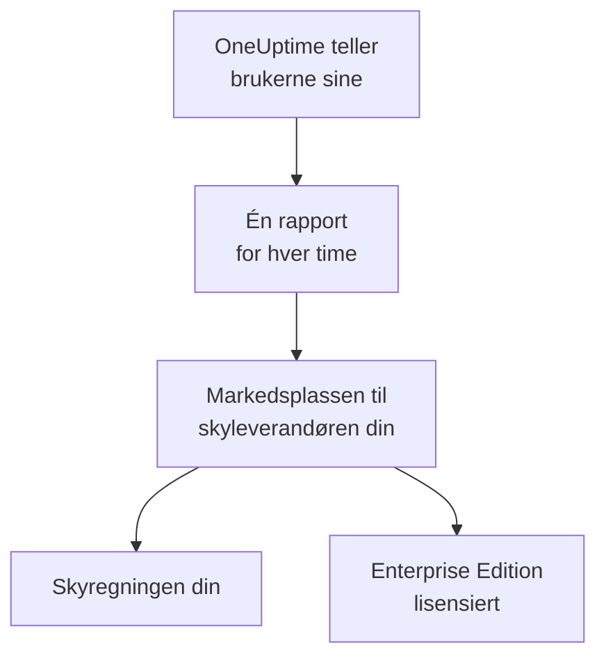

# Skymarkedsplasser

Kjør OneUptime Enterprise, kjøpt på AWS Marketplace, Microsoft Marketplace eller Google Cloud Marketplace, i ditt eget Kubernetes-cluster. Markedsplassen tar betalt for hver bruker av installasjonen din per time, på skyregningen din, og abonnementet ditt lisensierer Enterprise Edition: det finnes ingen lisensnøkkel å aktivere.

:::cards
- [Installer OneUptime](#installer-oneuptime): På Amazon EKS, Azure Kubernetes Service eller Google Kubernetes Engine.
- [Slik fungerer faktureringen](#slik-fungerer-faktureringen): USD 0.10 per bruker per time, rapportert hver time.
- [Oppgradering](#oppgradering): Slik når en ny release clusteret ditt.
- [Feilsøking](#feilsøking): Når utgavemerket varsler om markedsplassen.
:::

## Slik fungerer det

OneUptime teller brukerne sine hvert 15. minutt og rapporterer hver time til markedsplassen du kjøpte den på, én gang, med det høyeste antallet brukere den så i løpet av den timen. Markedsplassen legger timen til på skyregningen din. Hver rapport markedsplassen godtar, forteller også OneUptime at abonnementet ditt er aktivt, og det er det som holder Enterprise Edition lisensiert.



| | AWS | Microsoft | Google Cloud |
| --- | --- | --- | --- |
| Oppføring | Ikke offentlig ennå: [kontakt oss](https://oneuptime.com/enterprise/demo) | [OneUptime Enterprise](https://marketplace.microsoft.com/en-us/product/oneupitme.oneuptime-enterprise) | Ikke offentlig ennå: [kontakt oss](https://oneuptime.com/enterprise/demo) |
| Kjører på | Amazon EKS | Azure Kubernetes Service (AKS) | Google Kubernetes Engine (GKE) |
| Du installerer den med | Helm, fra registeret til oppføringen | Azure-portalen | Google Cloud-konsollen |
| OneUptime rapporterer med | IAM-rollen til Kubernetes-tjenestekontoen sin | Den administrerte identiteten Azure gir installasjonen | Rapporteringshemmeligheten Google Cloud Marketplace oppretter for utrullingen |
| Nye releaser | Du oppgraderer med Helm | Mindre versjoner installeres for deg | Du oppgraderer for hånd |

## Før du begynner

- **Et Kubernetes-cluster** i skyen som markedsplassen hører til, med minst 3 noder på 4 vCPU og 16 GiB minne, en StorageClass som er satt som standard, og støtte for tjenester av typen `LoadBalancer`. OneUptime kjører sin egen PostgreSQL, ClickHouse og Valkey i clusteret; dimensjoner dem etter [Dimensjonering og kapasitetsplanlegging](/docs/installation/sizing).
- **Et domenenavn** for OneUptime, for eksempel `oneuptime.example.com`, som du kan peke mot lastbalansereren til clusteret.
- **Utgående HTTPS** fra clusteret til markedsplassen, slik at OneUptime kan rapportere brukertallet sitt: `metering.marketplace.<region>.amazonaws.com` og `sts.<region>.amazonaws.com` på AWS, `marketplaceapi.microsoft.com` på Azure, `servicecontrol.googleapis.com` og `oauth2.googleapis.com` på Google Cloud.

## Installer OneUptime

### AWS Marketplace

På AWS rapporterer OneUptime brukertallet sitt med en IAM-rolle som EKS gir Kubernetes-tjenestekontoen til OneUptime (IAM-roller for tjenestekontoer). AWS Marketplace godtar bare bruksdata fra EKS når de er signert på denne måten.

:::steps
1. Abonner på OneUptime Enterprise på AWS Marketplace. Velg deretter **Continue to Configuration**, velg versjonen og så **Continue to Launch**.
2. Gi clusteret en IAM OIDC-leverandør hvis det ikke har en ennå, og opprett tjenestekontoen `oneuptime` med en IAM-rolle som har policyen `AWSMarketplaceMeteringFullAccess`, med kommandoene nedenfor. Kjør dem i stedet for `eksctl`-kommandoen i trinn 1 av **General launch instructions** på lanseringssiden: den kommandoen kobler til en rolle du ellers måtte ha opprettet selv først.
3. Logg Helm inn i registeret til oppføringen, og installer chartet med kommandoene i trinn 2 av **General launch instructions**. I `helm install`-kommandoen setter du `serviceAccount.name` til `oneuptime`, `host` til domenenavnet ditt og `httpProtocol` til `https` hvis det står et sertifikat foran OneUptime.
4. [Åpne OneUptime](#åpne-oneuptime).
:::

```bash
eksctl utils associate-iam-oidc-provider --cluster <cluster> --approve
eksctl create iamserviceaccount --name oneuptime --namespace oneuptime --cluster <cluster> \
  --attach-policy-arn arn:aws:iam::aws:policy/AWSMarketplaceMeteringFullAccess \
  --approve --override-existing-serviceaccounts
```

Ta vare på verdiene fra trinn 3 i en fil, og send den med hver `helm upgrade`:

```yaml title="values.yaml"
host: oneuptime.example.com
httpProtocol: https
serviceAccount:
  name: oneuptime
```

### Microsoft Marketplace

På Azure er OneUptime en Kubernetes-applikasjon: AKS installerer den som en clusterutvidelse og gir den en administrert identitet, som den rapporterer brukertallet med.

:::steps
1. Åpne OneUptime Enterprise på Microsoft Marketplace i Azure-portalen, eller åpne AKS-clusteret ditt og velg **Extensions + applications** > **Add**. Velg så plan og deretter **Create**.
2. Velg abonnement og ressursgruppe, og om du vil installere på et eksisterende AKS-cluster eller opprette et nytt.
3. I steget **OneUptime** skriver du inn et navn på installasjonen, domenenavnet ditt og protokollen det bruker.
4. Velg **Review + create**, og deretter **Create**. Installasjonen tar noen minutter; den er ferdig når **Extensions + applications** viser klargjøringstilstanden som **Succeeded**.
5. [Åpne OneUptime](#åpne-oneuptime).
:::

Egendefinerte målere fungerer på AKS-clustere, ikke på Azure Arc-aktivert Kubernetes, så OneUptime Enterprise på Microsoft Marketplace kan bare installeres på AKS.

### Google Cloud Marketplace

På Google Cloud kjører Marketplace et utrullingsverktøy som installerer OneUptime i namespacet du velger, sammen med en rapporteringshemmelighet som OneUptime bruker til å rapportere brukertallet.

:::steps
1. Åpne OneUptime Enterprise på Google Cloud Marketplace i Google Cloud-konsollen, og velg **Configure**.
2. Velg GKE-clusteret og namespacet, og skriv inn et navn på installasjonen, domenenavnet ditt og protokollen det bruker.
3. Velg **Deploy**. Utrullingen tar noen minutter; den er ferdig når applikasjonen vises som klar under **Kubernetes Engine** > **Applications**.
4. [Åpne OneUptime](#åpne-oneuptime).
:::

## Åpne OneUptime

OneUptime begynner med å migrere databasen sin, noe som tar noen minutter på en ny installasjon. Pek deretter domenenavnet ditt mot lastbalansereren til OneUptime:

```bash
kubectl get service --namespace <namespace>
```

Tjenesten der navnet slutter på `-nginx`, har en `EXTERNAL-IP`: opprett en DNS-post for domenenavnet ditt som peker på denne adressen. Åpne domenenavnet og registrer deg. Den første kontoen på en ny installasjon blir hovedadministratoren, som kan åpne Admin Dashboard på `/admin`.

Innen en time viser utgavemerket Enterprise Edition, lisensiert gjennom markedsplassen din. Hovedadministratorer ser utgavemerket i toppfeltet i Admin Dashboard og i bunnteksten i Dashbordet.

## Slik fungerer faktureringen

| Hva | Slik fungerer det |
| --- | --- |
| Pris | USD 0.10 per bruker per time, omtrent USD 73 per bruker per måned. |
| Hvem som telles | Alle med en OneUptime-konto på installasjonen. Abonnenter på statussider og de som logger på en privat statusside, telles ikke. |
| Når | OneUptime teller brukerne sine hvert 15. minutt og rapporterer hver time én gang, med det høyeste antallet brukere den så i løpet av timen. En time da OneUptime ikke kjørte, faktureres ikke. |
| Hvor | På regningen din fra AWS, Azure eller Google Cloud, gjennom markedsplassen. |
| Ikke inkludert | Selve clusteret: skyleverandøren din fakturerer nodene, diskene og lastbalansererne til clusteret som vanlig. |

Hver installasjon faktureres for seg, så en staging-installasjon faktureres også. For årspriser, volumrabatter eller en pris for installasjoner utenfor produksjon kan du be [sales@oneuptime.com](mailto:sales@oneuptime.com) om et privat tilbud, som du godtar på markedsplassen.

Når en rapport ikke kan sendes, på grunn av et nettverksproblem eller et driftsavbrudd hos markedsplassen, sender OneUptime den på nytt ved neste kjøring. Hver rapport har en nøkkel for timen sin, så en time faktureres aldri to ganger.

## Slik fungerer lisensieringen

Abonnementet ditt på markedsplassen er lisensen din. Hver rapport markedsplassen godtar, lisensierer alle enterprise-funksjoner, for alle brukere, de neste 72 timene. En lisensnøkkel fra OneUptime fungerer også på den samme installasjonen: installasjonen kjører på den som er best av de to.

| Hva som skjer | Hva utgavemerket viser |
| --- | --- |
| Markedsplassen godtar timesrapportene | Enterprise Edition, lisensiert gjennom markedsplassen din. |
| Ingen rapport er godtatt på 72 timer | **Enterprise Edition (Marketplace Reports Failing)**: alle enterprise-funksjoner fortsetter å virke i en frist på 30 dager. |
| Markedsplassen sier at installasjonen ikke har noe abonnement, eller fristen slutter | **Enterprise Edition (Marketplace Subscription Ended)**: enterprise-funksjonene stopper, slik de gjør når en [lisens utløper](/docs/self-hosted/enterprise#når-en-lisens-utløper-eller-mangler). |

Det markedsplassen avviser, er et oppsagt eller suspendert abonnement, eller en installasjon som ikke er den du kjøpte. Overvåking, varsler, hendelser, vakt og statussider fortsetter å virke i alle tilfeller, og ingenting slettes. Abonner på nytt, så lisensierer den neste godtatte rapporten Enterprise Edition igjen, uten omstart.

## Oppgradering

| Markedsplass | Slik når en ny release clusteret ditt |
| --- | --- |
| AWS Marketplace | Hver release er en ny versjon av oppføringen. Kjør `helm upgrade` med chartet fra registeret til oppføringen, den nye versjonen og verdifilen din. |
| Microsoft Marketplace | AKS installerer nye mindre versjoner og rettelsesversjoner for deg. En ny hovedversjon venter til du godtar den. Du kan slå av automatiske oppgraderinger på siden til installasjonen i **Extensions + applications**. |
| Google Cloud Marketplace | Google Cloud Marketplace holder en utrulling på versjonen den installerte, og oppdaterer den aldri. Kontakt [kundestøtte](https://oneuptime.com/support) før du flytter en utrulling til en ny versjon. |

OneUptime migrerer databasen sin når den nye releasen starter. Les [oppgraderingsnotatene](/docs/installation/upgrading) før du går over til en ny hovedversjon.

Oppgrader gjennom markedsplassen. En installasjon fra markedsplassen sammenligner seg ikke med OneUptime-releasene på GitHub: Versjonene markedsplassen din tilbyr, er de du oppgraderer til.

## Innstillinger og skalering

Regningen din endrer seg ikke når du skalerer: OneUptime faktureres per bruker. Flere replikaer eller større noder endrer bare det skyleverandøren din fakturerer for clusteret.

| Markedsplass | Hvor innstillingene dine ligger |
| --- | --- |
| AWS Marketplace | Verdifilen din. Alle innstillingene i [Helm-chartet](https://artifacthub.io/packages/helm/oneuptime/oneuptime) virker, unntatt de medfølgende operatorene. |
| Microsoft Marketplace | Konfigurasjonsinnstillingene til installasjonen, på siden dens i **Extensions + applications** eller med `az k8s-extension update --configuration-settings`. Hver innstilling er en chartverdi, for eksempel `autoscaling.enabled=true`. |
| Google Cloud Marketplace | Feltene i utrullingsskjemaet. Alt annet endrer du med `kubectl`, på utrullingens egne ressurser. |

- **Skaler OneUptime** med chartets innstillinger for replikaer og autoskalering (`deployment.replicaCount`, `autoscaling.enabled` og hver tjenestes egne overstyringer), og nodene med clusterets autoskalerer.
- **La markedsplassinnstillingene stå slik oppføringen setter dem**: `enterpriseMarketplace` og, på AWS, `serviceAccount`. Uten dem kan ikke OneUptime rapportere, og Enterprise Edition blir ikke lisensiert.
- **Operatorene KEDA, CloudNativePG og Altinity ClickHouse er ikke inkludert**, fordi en markedsplass bare leverer imagene på oppføringen sin. For datalagre med høy tilgjengelighet peker du OneUptime mot administrerte tjenester med `externalPostgres`, `externalRedis` og `externalClickhouse`.

Faktureringen avhenger ikke av hvor mange replikaer som kjører: bare én kjøring rapporterer om gangen, og hver time har én rapport.

## Feilsøking

:::details Utgavemerket viser Enterprise Edition (Marketplace Reports Failing)
OneUptime kan ikke rapportere til markedsplassen. Hver linje den logger om dette, begynner med `OneUptime Enterprise marketplace billing`; en linje som sier at bruken "cannot be reported", oppgir hva som mangler. De vanligste årsakene:

- **AWS:** tjenestekontoen `oneuptime` har ingen IAM-rolle, eller rollen mangler policyen `AWSMarketplaceMeteringFullAccess` (`AWSMarketplaceMeteringRegisterUsage` er ikke nok). Koble policyen til rollen, eller opprett rollen med `eksctl`-kommandoen under [AWS Marketplace](#aws-marketplace), og start deretter OneUptimes pods på nytt med `kubectl rollout restart deployment --namespace oneuptime`.
- **Azure:** installasjonen er ikke applikasjonen fra Microsoft Marketplace, for eksempel fordi den ble installert med Helm, og har derfor ingen identitet eller plan å rapportere med. Installer den fra Azure-portalen.
- **Google Cloud:** rapporteringshemmeligheten til utrullingen er slettet eller erstattet.
- **Alle markedsplasser:** en brannmur eller proxy blokkerer den utgående HTTPS-trafikken som er beskrevet under [Før du begynner](#før-du-begynner).

Bruksdataene tas vare på mens du retter feilen, og faktureres når OneUptime kan rapportere igjen. Bruk som er eldre enn 30 dager, faktureres ikke.
:::

:::details Utgavemerket viser Enterprise Edition (Marketplace Subscription Ended)
Markedsplassen avviste installasjonen: abonnementet ble sagt opp eller suspendert, eller installasjonen er ikke den som ble kjøpt på markedsplassen. Sjekk abonnementet på markedsplassen og abonner på nytt; den neste godtatte rapporten lisensierer Enterprise Edition igjen. Det samme merket vises når rapportene har feilet gjennom hele fristen.
:::

:::details Podene blir stående i Pending etter installasjonen
Databasene til OneUptime trenger vedvarende volumer. Gi clusteret en StorageClass som er satt som standard: på Amazon EKS installerer du tillegget for Amazon EBS CSI-driveren.
:::

## Neste steg

:::cards
- [Enterprise Edition](/docs/self-hosted/enterprise): Hva Enterprise Edition legger til, og hva som stopper når en lisens utløper.
- [Oppgradering](/docs/installation/upgrading): Oppgraderingsnotatene for hver release.
- [Dimensjonering og kapasitetsplanlegging](/docs/installation/sizing): Dimensjoner datalagrene for telemetrien din.
- [Arkitektur](/docs/self-hosted/architecture): Hva som kjører i clusteret ditt.
- [Kubernetes-agent](/docs/telemetry/kubernetes-agent#installer-som-et-amazon-eks-tillegg): Også på AWS Marketplace, gratis, som et Amazon EKS-tillegg for clustere som sender data til OneUptime.
:::
