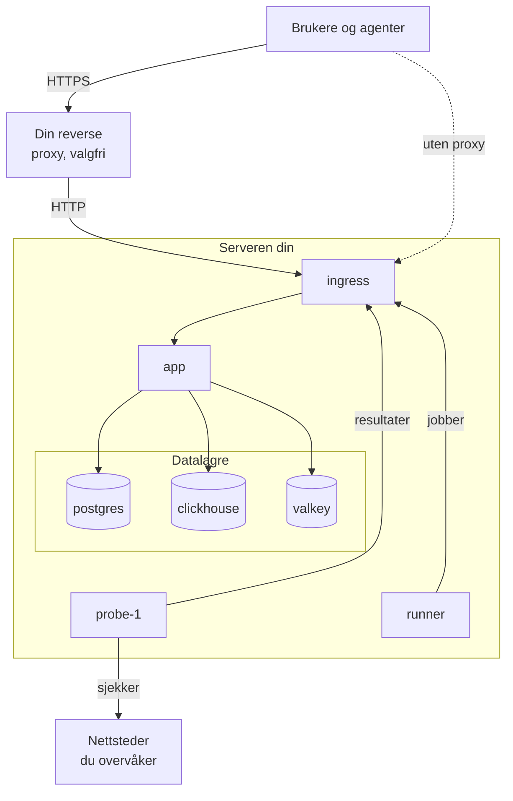

# Docker Compose

Kjør en komplett, gratis OneUptime-instans på én Linux-server med Docker Compose. Denne siden tar deg fra en ny server til en kjørende instans, og dekker deretter HTTPS, herding for produksjon, sikkerhetskopier, oppdateringer og fjerning. Vil du heller jobbe med OneUptimes egen kode, se [Lokal utvikling](/docs/installation/local-development).

:::cards
- [Installer OneUptime](#installer-oneuptime): Fra en ny server til din første konto i fem steg.
- [Sett opp HTTPS](#sett-opp-https): La OneUptime hente et sertifikat, eller sett din egen proxy foran.
- [Sjekkliste for produksjon](#sjekkliste-for-produksjon): Hva som må være på plass før ekte trafikk kommer.
- [Oppdater OneUptime](#oppdater-oneuptime): Gå over til den nyeste releasen.
:::

## Slik fungerer det

Docker Compose kjører hver del av OneUptime som en container på serveren din. All trafikk kommer inn gjennom containeren `ingress`, som sender den videre til `app`. Appen lagrer dataene sine i PostgreSQL, ClickHouse og Valkey. En medfølgende probe kjører monitorenes sjekker og rapporterer tilbake gjennom ingressen.



| Tjeneste | Image | Hva den gjør |
| --- | --- | --- |
| `ingress` | `oneuptime/nginx` | Tar imot all trafikk på port 80 og 443 og sender den videre til appen. Leverer HTTPS når OneUptime administrerer sertifikatet. |
| `app` | `oneuptime/app` | Dashbordet, API-et, statussider, innhenting av telemetri og bakgrunnsarbeiderne. |
| `probe-1` | `oneuptime/probe` | En global probe som kjører monitorenes sjekker. Den bruker vertens nettverk. |
| `runner` | `oneuptime/runner` | Instansens Runner, som kjører AI-kodeforbedringer. Den bruker vertens nettverk. |
| `postgres` | `postgres:15` | Konfigurasjon og tilstand: monitorer, hendelser, brukere. Lagret i volumet `postgres`. |
| `clickhouse` | `clickhouse/clickhouse-server:26.7` | Telemetri: logger, metrikker, traces og unntak. Lagret i volumet `clickhouse`. |
| `valkey` | `valkey/valkey:9.1-alpine` | Hurtigbuffer og køer. Den lagrer ingenting på disk. |

> [!NOTE]
> Tjenesten `valkey` kjører [Valkey](https://valkey.io), den BSD-lisensierte forken av Redis 7.2, konfigurert gjennom innstillingene `VALKEY_*` i `config.env`. Enhver server som snakker Redis-protokollen fungerer — pek `VALKEY_HOST` mot en administrert Redis hvis du foretrekker det. Fram til 13.0.0 het disse innstillingene `REDIS_*`; de gamle navnene leses fortsatt, containeren svarer fortsatt på vertsnavnet `redis`, og `npm run update` skriver dem ikke om, så en eldre `config.env` trenger ingen endringer.

For produksjon i stor skala, eller når du trenger høy tilgjengelighet, bruk i stedet [Helm-chartet](https://artifacthub.io/packages/helm/oneuptime/oneuptime) på Kubernetes: Docker Compose kjører én kopi av hver tjeneste på én server.

## Krav

Velg størrelsen på serveren etter hva du skal kjøre på den. Det er telemetrien (logger, metrikker, traces) som bestemmer minne og disk; se [Dimensjonering og kapasitetsplanlegging](/docs/installation/sizing) når du kjenner volumene dine.

| | Anbefalt | Minimum for et homelab |
| --- | --- | --- |
| **Minne** | 16 GB | 8 GB |
| **CPU** | 8 kjerner | 4 kjerner |
| **Disk** | 400 GB | 20 GB |
| **System** | Ubuntu 22.04, eller et annet Linux basert på Debian, Ubuntu eller RHEL | Det samme |
| **Arkitektur** | x86-64 (`amd64`) eller ARM (`arm64`) | Det samme |

Minimum for et homelab passer for personlig og eksperimentell bruk — noen kjører OneUptime på en Raspberry Pi.

Du trenger også:

- **Docker** med tillegget **Docker Compose v2** (kommandoen `docker compose`).
- **Git**, for å hente OneUptime.
- **Node.js og npm**, som kjører skriptene `npm start` og `npm run update` som pakker inn Docker Compose.
- **Port 80 og 443** ledige på serveren. Tabellen nedenfor viser hver port OneUptime bruker på verten.

| Vertsport | Brukes av | Innstilling | Hva den er til |
| --- | --- | --- | --- |
| 80 | `ingress` | `ONEUPTIME_HTTP_PORT` | Dashbordet, API-et, innhenting av telemetri og validering hos Let's Encrypt. |
| 443 | `ingress` | `STATUS_PAGE_HTTPS_PORT` | HTTPS for instansen din når OneUptime administrerer sertifikatet, og for statussider og dashbord på egne domener. |
| 5400 | `postgres` | Satt i `docker-compose.yml` | Lar `npm run backup` og `restore.sh` nå PostgreSQL fra selve serveren. Den er bare publisert på `127.0.0.1`. |
| 3874 | `probe-1` | `GLOBAL_PROBE_1_PORT` | Probens egen server. Ingenting utenfor serveren trenger den. |
| 3876 | `runner` | `ONEUPTIME_RUNNER_PORT` | Runnerens egen server. Ingenting utenfor serveren trenger den. |

Det finnes også en [videogjennomgang](https://youtu.be/j1SWmMW2oL4) av installasjonen.

## Installer OneUptime

På en ny Ubuntu-, Debian- eller RHEL-basert server kan én kommando kjøre stegene nedenfor for deg. Den installerer Docker, Git og Node.js der de mangler, kloner release-grenen til en mappe `oneuptime`, spør om adressen folk skal bruke, og kjører `npm start`:

```bash
curl -fsSL https://oneuptime.com/install.sh | bash
```

:::steps
### Klon release-grenen

Grenen `release` inneholder filene for den nyeste releasen.

```bash
git clone --depth 1 --single-branch --branch release https://github.com/OneUptime/oneuptime.git
cd oneuptime
```

### Opprett config.env

Alle innstillingene til OneUptime ligger i `config.env`. Start med eksemplet:

```bash
cp config.example.env config.env
```

### Angi vertsnavnet

Åpne `config.env` og sett `HOST` til domenenavnet eller IP-adressen folk skal bruke for å nå OneUptime, uten `http://`. Behold `localhost` bare for å prøve OneUptime på din egen datamaskin.

```ini title="config.env"
HOST=oneuptime.example.com
```

### Start OneUptime

:::tabs
@tab npm
```bash
npm start
```
@tab Docker CLI
```bash
(export $(grep -v '^#' config.env | xargs) && docker compose up --remove-orphans -d)
```
Før første start erstatter du plassholderhemmelighetene selv, som [Generer tilfeldige hemmeligheter](#generer-tilfeldige-hemmeligheter) viser: Bare `npm start` gjør det for deg.
:::

`npm start` sjekker først serveren: Docker, minne, diskplass, portene OneUptime bruker, og `HOST`. Den stopper ved alt som ville hindret OneUptime i å virke, og sier hva du skal endre. Deretter gir den hver plassholderhemmelighet i `config.env` sin egen tilfeldige verdi, starter OneUptime og venter til hver del svarer. Første start tar flere minutter, mens Docker laster ned imagene og OneUptime oppretter databasene sine. Den avslutter med **OneUptime is up!** og adressen du skal åpne.

### Opprett den første kontoen

Åpne `http://` etterfulgt av `HOST` (for eksempel `http://localhost`) og registrer deg. Den første kontoen på en ny instans blir hovedadministratoren, som kan åpne Admin Dashboard på `/admin`.

Alle som kan nå siden, kan registrere seg etter deg. For å hindre det åpner du Admin Dashboard, går til **Innstillinger > Autentisering** og slår av **Tillat registrering**. Personer du inviterer til et prosjekt, kan fortsatt opprette kontoen sin.
:::

### Generer tilfeldige hemmeligheter

`config.example.env` leverer hver hemmelighet som en plassholder som er offentlig på GitHub. `npm start` gir hver av dem sin egen tilfeldige verdi før den starter noe, og nevner innstillingene den fylte ut:

| Innstilling | Hva den beskytter |
| --- | --- |
| `ONEUPTIME_SECRET` | Kall mellom OneUptimes egne tjenester. |
| `ENCRYPTION_SECRET` | Hemmelighetene OneUptime lagrer, som integrasjonstokener og SMTP-passord, og påloggingstokenene den utsteder. |
| `DATABASE_PASSWORD`, `CLICKHOUSE_PASSWORD`, `VALKEY_PASSWORD` | De tre datalagrene. |
| `REGISTER_PROBE_KEY` | Registrering av prober hos instansen din. |
| `GLOBAL_PROBE_1_KEY`, `GLOBAL_PROBE_2_KEY` | De globale probene Docker Compose kan kjøre (`probe-1` kjører som standard). |
| `ONEUPTIME_RUNNER_KEY` | Den medfølgende Runneren. |
| `GLOBAL_RUNNER_KEY` | Den medfølgende globale Runneren, som kjører JavaScript-trinnene til alle prosjekter. |

> [!IMPORTANT]
> Behold hemmelighetene når OneUptime har startet. PostgreSQL tar bare passordet sitt når den oppretter databasen, og endrer du `ENCRYPTION_SECRET` senere, blir hver verdi som er kryptert med den gamle, uleselig. Derfor setter `npm start` `DATABASE_PASSWORD` og `ENCRYPTION_SECRET` bare på en ny installasjon, før PostgreSQL oppretter databasen sin.

Med Docker CLI erstatter du plassholderne selv før første start:

```bash
while grep -q "please-change-this-to-random-value" config.env; do
  sed -i "0,/please-change-this-to-random-value/{s/please-change-this-to-random-value/$(openssl rand -hex 32)/}" config.env
done
grep -c "please-change-this" config.env
```

Den siste kommandoen skriver ut `0`: Det er ingen plassholder igjen. Løkken bruker GNU `sed`, som alle Linux-servere har.

## Sett opp HTTPS

OneUptime leverer vanlig HTTP til du velger én av to måter å legge til HTTPS på:

| | La OneUptime hente et sertifikat | Bruk din egen reverse proxy |
| --- | --- | --- |
| **TLS avsluttes i** | OneUptimes `ingress`, med et gratis sertifikat fra Let's Encrypt som den fornyer selv | Proxyen din: Caddy, Nginx eller en lastbalanserer |
| **Du trenger** | Et offentlig domenenavn som peker på serveren, og port 80 og 443 som kan nås fra internett | En proxy og et sertifikat for domenet ditt |
| **Innstillinger** | `PROVISION_SSL=true`, `HTTP_PROTOCOL=https` | `PROVISION_SSL=false`, `HTTP_PROTOCOL=https`, `TRUSTED_PROXY_HOPS=2` |
| **Statussider på egne domener** | Fungerer uten ekstra oppsett | Proxyen din må også betjene de domenene |

Hvis du legger statussider eller dashbord på egne domener, er det enklest å la OneUptime håndtere TLS: Ingressen bestiller og leverer selv sertifikatene for de domenene.

Med `HTTP_PROTOCOL=https` bygger OneUptime HTTPS-lenker, holder påloggingsinformasjonskapsler på HTTPS og ber nettlesere om å nå `HOST`-en din bare over HTTPS. En nettleser holder seg til det i ett år, på alle porter for det navnet, så hvis `HOST` en dag må svare over vanlig HTTP igjen, setter du `HSTS_MAX_AGE_SECONDS=0` i `config.env` en stund før: Nettlesere glemmer regelen ved neste besøk.

### La OneUptime hente et sertifikat

:::steps
#### Pek domenet ditt mot serveren

Opprett en DNS-post `A` (eller `AAAA` for IPv6) for domenet ditt, med serverens offentlige IP-adresse som verdi. Med en `AAAA`-post slår du også på IPv6 for OneUptime: se [Besøkendes adresser](#besøkendes-adresser).

#### Slå på henting av sertifikater

Angi disse verdiene i `config.env`:

```ini title="config.env"
HOST=oneuptime.example.com
PROVISION_SSL=true
HTTP_PROTOCOL=https
```

`HOST` må være et domenenavn: OneUptime kan ikke få et sertifikat for en IP-adresse eller for `localhost`.

#### Start på nytt med de nye innstillingene

```bash
npm start
```

#### Åpne instansen over HTTPS

Åpne `https://oneuptime.example.com`. OneUptime bestiller sertifikatet når den starter, sjekker det deretter hver time og fornyer det når det er mindre enn 30 dager igjen. Til det første sertifikatet kommer, vanligvis i løpet av noen minutter, leverer ingressen et midlertidig selvsignert sertifikat, og nettleseren advarer deg.
:::

### Bruk din egen reverse proxy

Disse stegene kjører proxyen på samme server som OneUptime. Kjører proxyen din på en annen maskin, hopper du over det første steget, peker proxyen mot port 80 på denne serveren og lar bare proxyen nå port 80 og 443 med brannmuren til skyleverandøren din: en besøkende som når OneUptime utenom proxyen, kan velge adressen OneUptime teller vedkommende etter.

:::steps
#### Flytt ingressen bort fra port 80 og 443

Proxyen trenger port 80 og 443, så flytt ingressen til andre porter, publisert bare på serverens loopback-adresse `127.0.0.1`, slik at besøkende bare når OneUptime gjennom proxyen din:

```ini title="config.env"
ONEUPTIME_HTTP_PORT=127.0.0.1:8080
STATUS_PAGE_HTTPS_PORT=127.0.0.1:8443
```

Proben og Runneren bruker vertens nettverk og når OneUptime gjennom `http://localhost`. `npm start` flytter dem til ingressens nye port, `http://localhost:8080`, og sier fra.

#### Fortell OneUptime at den står bak en proxy

```ini title="config.env"
HOST=oneuptime.example.com
HTTP_PROTOCOL=https
PROVISION_SSL=false
TRUSTED_PROXY_HOPS=2
```

`HTTP_PROTOCOL=https` får lenkene OneUptime bygger til å bruke HTTPS. `TRUSTED_PROXY_HOPS=2` teller proxyen din og OneUptimes ingress, så OneUptime leser den besøkendes ekte adresse for IP-tillatelseslister og hastighetsbegrensninger. Legg til én for hver ekstra proxy som legger til i `X-Forwarded-For`, som et CDN eller en lastbalanserer.

#### Start OneUptime på nytt på de nye portene

```bash
npm start
```

`npm start` sjekker OneUptime på den nye porten, `localhost:8080`, og avslutter med **OneUptime is up!**

#### Konfigurer proxyen

:::tabs
@tab Caddy
```text title="Caddyfile"
oneuptime.example.com {
	reverse_proxy localhost:8080
}
```
Caddy henter og fornyer sertifikatet selv, omdirigerer HTTP til HTTPS og slipper WebSocket-tilkoblinger gjennom. Last inn Caddy på nytt etter at du har endret filen, for eksempel med `sudo systemctl reload caddy`.
@tab Nginx
```nginx title="/etc/nginx/conf.d/oneuptime.conf"
map $http_upgrade $oneuptime_connection_upgrade {
    default upgrade;
    ""      close;
}

server {
    listen 80;
    server_name oneuptime.example.com;
    return 301 https://$host$request_uri;
}

server {
    listen 443 ssl;
    server_name oneuptime.example.com;

    ssl_certificate     /etc/letsencrypt/live/oneuptime.example.com/fullchain.pem;
    ssl_certificate_key /etc/letsencrypt/live/oneuptime.example.com/privkey.pem;

    # The limits OneUptime's own ingress uses.
    client_max_body_size 50M;
    proxy_read_timeout 300s;
    proxy_send_timeout 300s;

    proxy_http_version 1.1;
    proxy_set_header Host $host;
    proxy_set_header X-Forwarded-For $proxy_add_x_forwarded_for;
    proxy_set_header X-Forwarded-Proto $scheme;
    proxy_set_header Upgrade $http_upgrade;
    proxy_set_header Connection $oneuptime_connection_upgrade;

    location / {
        proxy_pass http://127.0.0.1:8080;
    }

    # MCP clients keep a stream open.
    location /mcp {
        proxy_pass http://127.0.0.1:8080;
        proxy_buffering off;
        proxy_read_timeout 86400s;
        proxy_send_timeout 86400s;
    }
}
```
Sertifikatbanene er der Certbot legger et sertifikat fra Let's Encrypt; bruk banene til ditt eget sertifikat hvis det kommer fra et annet sted. Sjekk filen og last inn Nginx på nytt med `sudo nginx -t && sudo systemctl reload nginx`.
:::

Begge sender `X-Forwarded-Proto`, som forteller OneUptime at en besøkende kom over HTTPS. Alle andre proxyer må også sende den, ellers holdes ikke påloggingsinformasjonskapslene for statussider og dashbord på egne domener på HTTPS.

#### Åpne instansen gjennom proxyen

Åpne `https://oneuptime.example.com`. Du skal se påloggingssiden til OneUptime, levert med proxyens sertifikat.
:::

> [!NOTE]
> Bak din egen proxy sender du telemetri over OTLP/HTTP (`/otlp`). OTLP over gRPC når bare OneUptime når dens egen ingress avslutter TLS (`PROVISION_SSL=true`).

## Besøkendes adresser

OneUptime teller hver besøkende etter adressen vedkommende kobler til fra: påloggingsgrensene, de andre grensene per adresse og IP-tillatelseslistene for statussider og dashbord leser den alle. To oppsett trenger en innstilling for at den adressen skal være den besøkendes egen:

| Oppsett | Innstilling |
| --- | --- |
| Folk når OneUptime over IPv6, for eksempel gjennom en `AAAA`-post | IPv6 på OneUptimes nettverk, i `docker-compose.override.yml` |
| Din egen reverse proxy står foran OneUptime | `TRUSTED_PROXY_HOPS=2`, med ingressen publisert på `127.0.0.1` (se [Bruk din egen reverse proxy](#bruk-din-egen-reverse-proxy)) |

Uten IPv6 på OneUptimes nettverk sender Docker hver besøkende som kommer over IPv6 videre til OneUptime fra én adresse av sin egen, og OneUptime teller dem alle som én besøkende: én persons mislykkede pålogginger kan låse de andre ute. Å slå på IPv6 krever Docker Engine 27 eller nyere (`docker version` viser din).

:::steps
### Slå på IPv6

Opprett `docker-compose.override.yml` ved siden av `docker-compose.yml`, eller legg dette til i den du har; `npm start` og `npm run update` leser den:

```yaml title="docker-compose.override.yml"
networks:
  oneuptime:
    enable_ipv6: true
```

### Start OneUptime på nytt

```bash
npm stop
npm start
```

OneUptime stopper og starter igjen med IPv6 på nettverket sitt. Dataene dine beholdes. Docker kan ikke fjerne et nettverk som en egen container fortsatt er koblet til, for eksempel en reverse proxy: koble den fra OneUptimes nettverk først, og koble den til igjen etterpå. Stopper `npm start` med `has active endpoints`, kobler du den fra og kjører `npm stop` og `npm start` på nytt.

### Sjekk nettverket

```bash
docker network ls --quiet --filter name=_oneuptime | xargs docker network inspect | grep EnableIPv6
```

Den skriver ut `"EnableIPv6": true,`.
:::

Når flere personer logger på fra den samme private nettverksadressen, sier siden **OneUptime-tilstand** i Admin Dashboard fra, med innstillingen som endrer det.

## Sjekkliste for produksjon

Docker Compose kjører én kopi av hver tjeneste på én server, noe som passer for små team og homelab. Gå gjennom denne listen før du stoler på det.

| Område | Hva du gjør |
| --- | --- |
| **Hemmeligheter** | Ingen verdi i `config.env` er fortsatt en plassholder `please-change-this-to-random-value`. Se [Generer tilfeldige hemmeligheter](#generer-tilfeldige-hemmeligheter), og [Bytt databasepassordet](#bytt-databasepassordet) for en installasjon som startet med plassholderen i `DATABASE_PASSWORD`. |
| **HTTPS** | Folk når OneUptime over HTTPS, og `HTTP_PROTOCOL=https` er satt. Se [Sett opp HTTPS](#sett-opp-https). |
| **Registreringer** | Når teamet ditt har kontoer, slår du av **Tillat registrering** under **Innstillinger > Autentisering** i Admin Dashboard. |
| **Brannmur** | Bare port 80 og 443 (og SSH) er åpne mot internett. OneUptime publiserer PostgreSQLs port 5400 bare på `127.0.0.1`. Lukk alle andre porter du publiserer, med skyleverandørens brannmur: `ufw`-regler gjelder ikke porter som Docker publiserer. |
| **Besøkendes adresser** | Siden **OneUptime-tilstand** i Admin Dashboard sier ikke fra om at flere personer logger på fra den samme adressen. Se [Besøkendes adresser](#besøkendes-adresser). |
| **Sikkerhetskopier** | PostgreSQL sikkerhetskopieres hver dag, og kopiene forlater serveren. Se [Sikkerhetskopiering og gjenoppretting](#sikkerhetskopiering-og-gjenoppretting). |
| **E-post** | En e-postserver er satt opp under **Innstillinger > Varsler > E-poster** i Admin Dashboard, slik at OneUptime kan sende invitasjoner og varsler. Se [SMTP](/docs/emails/smtp). |
| **Disk** | Ledig plass overvåkes. ClickHouse vokser med telemetrien du beholder (se [Dimensjonering og kapasitetsplanlegging](/docs/installation/sizing)); loggen til hver container er begrenset til 1000 MB. |
| **Oppdateringer** | OneUptime oppdateres minst én gang i uken. Det kommer ofte nye releaser. Se [Oppdater OneUptime](#oppdater-oneuptime). |
| **Høy tilgjengelighet** | Hvis du trenger det, går du over til [Helm-chartet](https://artifacthub.io/packages/helm/oneuptime/oneuptime) på Kubernetes. |

### Bytt databasepassordet

PostgreSQL beholder passordet den ble opprettet med, så endrer du bare `DATABASE_PASSWORD` i `config.env`, stenger du OneUptime ute fra databasen sin. For å gi en installasjon som startet med plassholderen et eget passord, endrer du det i PostgreSQL og i `config.env` samtidig, og starter deretter OneUptime på nytt:

```bash
NEW_PASSWORD=$(openssl rand -hex 32) &&
  (export $(grep -v '^#' config.env | xargs) && docker compose exec -T postgres psql -U "$DATABASE_USERNAME" -d "$DATABASE_NAME" -c "ALTER USER \"$DATABASE_USERNAME\" PASSWORD '$NEW_PASSWORD'") &&
  sed -i "s/^DATABASE_PASSWORD=.*/DATABASE_PASSWORD=$NEW_PASSWORD/" config.env
npm start
```

Har du satt `DATABASE_BACKUP_PASSWORD` og `DATABASE_RESTORE_PASSWORD`, gir du dem også den nye verdien.

## Sikkerhetskopiering og gjenoppretting

PostgreSQL inneholder alt du konfigurerer: monitorer, hendelser, statussider, brukere. `npm run backup` dumper det til en fil i mappen `Backups`. Enterprise Edition kan også sikkerhetskopiere PostgreSQL og ClickHouse etter en tidsplan til din egen lagring fra Admin Dashboard: se [Sikkerhetskopier](/docs/installation/backups).

:::steps
### Gi sikkerhetskopiskriptet databasepassordet

Sett `DATABASE_BACKUP_PASSWORD` i `config.env` til verdien av `DATABASE_PASSWORD`. Skriptet leser `config.env` som ren tekst, så `${DATABASE_PASSWORD}` som følger med, blir aldri fylt ut.

### Kjør sikkerhetskopieringen

```bash
npm run backup
```

Det ber om sudo-passordet ditt og skriver `Backups/db-<day of the month>.backup`, slik at daglige sikkerhetskopier erstatter dem fra en måned tidligere. Kjør det minst én gang om dagen.

### Kopier sikkerhetskopiene bort fra serveren

En sikkerhetskopi på samme disk som databasen overlever ikke at den disken går tapt.
:::

Bare selve serveren når PostgreSQL: Den svarer på port 5400 på `127.0.0.1`. For å ta sikkerhetskopi av den fra en annen maskin åpner du en SSH-tunnel fra den maskinen, og kobler deretter til maskinens egen port 5400:

```bash
ssh -N -L 5400:127.0.0.1:5400 you@oneuptime.example.com
```

:::details Publiser PostgreSQL på en adresse i et privat nettverk
Hvis et verktøy på det private nettverket ditt må nå PostgreSQL uten tunnel, publiserer du den også på serverens adresse i det nettverket, på en egen port. Opprett `docker-compose.override.yml` ved siden av `docker-compose.yml`; `npm start` og `npm run update` leser den:

```yaml title="docker-compose.override.yml"
services:
  postgres:
    ports:
      - "10.0.0.5:5401:5432"
```

Bruk serverens egen private adresse i stedet for `10.0.0.5`, aldri en offentlig, og gi først PostgreSQL et eget passord (se [Bytt databasepassordet](#bytt-databasepassordet)). Kjør deretter `npm start`, så svarer PostgreSQL også på port 5401 på den adressen.
:::

ClickHouse holder telemetrien din i Docker-volumet `oneuptime_clickhouse`, og ingen skript sikkerhetskopierer det. Hvis du må beholde den telemetrien, sikkerhetskopierer du volumet med et ClickHouse-verktøy som [clickhouse-backup](https://github.com/Altinity/clickhouse-backup), eller kopierer det mens OneUptime er stoppet.

For å gjenopprette PostgreSQL setter du verdiene `DATABASE_RESTORE_*` i `config.env`: `DATABASE_RESTORE_PASSWORD` til verdien av `DATABASE_PASSWORD`, som for sikkerhetskopier, og `DATABASE_RESTORE_FILENAME` til sikkerhetskopien som skal gjenopprettes, for eksempel `db-31.backup`. Kjør deretter `bash restore.sh`. Databasen det gjenoppretter til, må allerede finnes; i en kjørende installasjon gjør den det.

> [!CAUTION]
> `restore.sh` sletter hvert objekt fra sikkerhetskopien i måldatabasen før det opprettes på nytt. Det spør før det starter; sjekk databasenavnet det viser.

## Oppdater OneUptime

Ta sikkerhetskopi først, og kjør deretter:

```bash
git checkout release
git pull
npm run update
```

`npm run update` legger til nye innstillinger fra `config.example.env` i `config.env` (dine egne verdier blir værende), henter de nye imagene og starter OneUptime på nytt. Som `npm start` avslutter det med **OneUptime is up!**

Å gå over til en ny hovedversjon (fra 13 til 14, for eksempel) kan kreve mer: Les [Oppgradering av OneUptime](/docs/installation/upgrading) før du begynner.

`APP_TAG=release` i `config.env` henter alltid den nyeste releasen av Community Edition. For å bli på én versjon setter du `APP_TAG` til nummeret, for eksempel `14.0.22`. For Enterprise Edition er taggene `enterprise-release` og `enterprise-14.0.22`.

## Avinstaller OneUptime

Stopp OneUptime og fjern containerne og nettverket:

```bash
npm run down
```

Dataene dine blir værende i volumene `oneuptime_postgres` og `oneuptime_clickhouse`, og mappen `oneuptime` beholder `config.env` og sikkerhetskopiene dine. For å slette dataene også:

```bash
(export $(grep -v '^#' config.env | xargs) && docker compose down --volumes --remove-orphans)
```

Slett deretter mappen `oneuptime`.

> [!CAUTION]
> `--volumes` sletter hver monitor, hendelse, bruker og all telemetri for godt. Ta sikkerhetskopi først hvis du kan få bruk for noe av det.

## Feilsøking

:::details npm start stopper før den starter OneUptime
`npm start` sjekker først serveren og stopper ved alt som ville hindret OneUptime i å virke: Docker eller Compose-tillegget mangler, Docker kjører ikke eller er utenfor rekkevidde for brukeren din, et annet program holder en port, eller `HOST` er en adresse ingen nettleser kan åpne. Hver linje merket med ✗ sier hva du skal endre. Endre det, og kjør deretter `npm start` på nytt. Tar en sjekk feil om serveren din, starter du uten sjekkene:

```bash
ONEUPTIME_SKIP_PREFLIGHT=true npm start
```
:::

:::details Docker sier "permission denied" når du kjører npm start
Brukeren din når ikke Docker-daemonen. Legg den til i gruppen `docker`, og logg deretter ut og inn igjen:

```bash
sudo usermod -aG docker $USER
```
:::

:::details Ingressen kan ikke starte fordi port 80 eller 443 er i bruk
Et annet program på serveren, ofte en webserver, holder porten. `npm start` sjekker portene før den starter noe, og nevner containeren som holder en av dem når Docker kjører den. Stopp programmet, eller flytt ingressen til andre porter og sett programmet foran OneUptime som beskrevet i [Bruk din egen reverse proxy](#bruk-din-egen-reverse-proxy).
:::

:::details npm start avslutter med "Maximum retries reached"
Sjekken som avslutter `npm start`, ga opp før OneUptime svarte. Første start kan ta lenger tid enn sjekken venter, mens imagene lastes ned og databasene opprettes. Se hva som kjører, og les loggene:

```bash
npm run ps
npm run logs
```

Når hver container kjører, kjører du sjekken på nytt med `npm run status-check`. Den sjekker ingressen på porten `ONEUPTIME_HTTP_PORT` angir.
:::

:::details Nettleseren viser "OneUptime er ikke satt opp for denne adressen"
Du åpnet OneUptime på en annen adresse enn `HOST`, for eksempel serverens IP-adresse mens `HOST` fortsatt er `localhost`. Siden viser `HOST`-linjen for adressen du åpnet, med en knapp som kopierer den: Sett linjen inn i `config.env`, og kjør deretter `npm start`. Åpnet du adressen i `HOST`, og siden sier at proxyen din ikke sendte den videre, stiller du inn proxyen til å sende videre vertsnavnet nettleseren ba om: Caddy gjør det som standard, Nginx med `proxy_set_header Host $host;` og Apache med `ProxyPreserveHost On`.
:::

:::details Noen sider lastes, men liveoppdateringer eller opplastinger feiler
Åpne OneUptime på adressen i `HOST`. Ingressen ruter forespørsler etter vertsnavn: Bare `HOST` og `localhost` når hele applikasjonen, og ethvert annet navn, som serverens IP-adresse, behandles som domenet til en statusside. Sett `HOST` til navnet folk bruker, og kjør deretter `npm start`.
:::

:::details Registrering eller innlogging feiler med "Page not found"
Registreringssiden lastes, men registrering feiler med `Page not found - /identity/signup`, og innlogging med `Page not found - /identity/login`. Forespørselen nådde OneUptime under et annet vertsnavn enn `HOST`, så ingressen rutet den som en statussides eget domene, der OneUptimes egen registrering og innlogging ikke tilbys. Sjekk begge deler:

- `HOST` er adressen folk åpner, med porten hvis de bruker en, som `oneuptime.example.com:8080`. Kjør `npm start` etter at du har endret den.
- En proxy foran OneUptime sender videre vertsnavnet nettleseren ba om. Caddy gjør det som standard, Nginx med `proxy_set_header Host $host;` som i [Bruk din egen reverse proxy](#bruk-din-egen-reverse-proxy), og Apache med `ProxyPreserveHost On`.
:::

:::details Nettleseren advarer om sertifikatet etter at du satte PROVISION_SSL
Til Let's Encrypt utsteder sertifikatet, leverer ingressen et midlertidig selvsignert sertifikat. Hvis advarselen varer i mer enn noen minutter, sjekker du at:

- `HOST` er et domenenavn, ikke en IP-adresse og ikke `localhost`.
- Domenets DNS-post peker mot denne serveren.
- Port 80 kan nås fra internett, slik at Let's Encrypt kan validere domenet.

Når en bestilling feiler, logger appen en feil som begynner med `CoreSSL:EnsurePrimaryHostCertificate`, etterfulgt av årsaken:

```bash
(export $(grep -v '^#' config.env | xargs) && docker compose logs app) | grep -A 5 CoreSSL
```
:::

:::details Den medfølgende proben viser Frakoblet etter at du flyttet ingressens port
Admin Dashboard viser proben under **Innstillinger > Overvåking > Globale prober**. Den når OneUptime på `GLOBAL_PROBE_1_ONEUPTIME_URL`, som er `http://localhost` (port 80) som standard. `npm start` flytter den og `ONEUPTIME_RUNNER_ONEUPTIME_URL` til ingressens port så lenge de peker på `localhost`. Har du satt dem til en annen adresse, eller startet OneUptime med Docker CLI, setter du begge til ingressens nye port, for eksempel `http://localhost:8080`, og starter OneUptime på nytt.
:::

## Neste steg

:::cards
- [Oppgradering av OneUptime](/docs/installation/upgrading): Hva hver hovedversjon krever av deg.
- [Dimensjonering og kapasitetsplanlegging](/docs/installation/sizing): Planlegg minne og disk for telemetrien din.
- [Selvdriftet arkitektur](/docs/self-hosted/architecture): Hvordan komponentene henger sammen.
- [Enterprise Edition](/docs/self-hosted/enterprise): Hva Enterprise-imaget legger til, og lisensen.
:::
