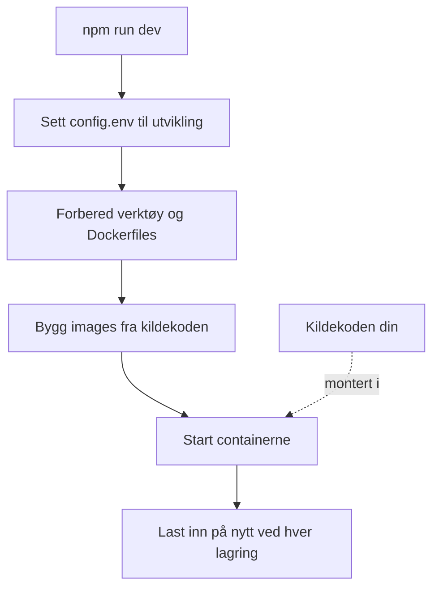

# Lokal utvikling

Kjør OneUptime fra kildekoden på din egen datamaskin for å jobbe med det. Utviklingsstakken bygger hver tjeneste fra din utsjekk, monterer kildekoden din i containerne og laster dem inn på nytt når du lagrer en fil.

Vil du heller kjøre en utgitt versjon, bruker du [Docker Compose](/docs/installation/docker-compose).

## Slik fungerer utviklingsstakken

`npm run dev` forbereder utsjekken din og starter deretter stakken som er definert i `Scripts/Dev/docker-compose.dev.yml`:



| Fase | Hva som skjer |
| --- | --- |
| Bytt til utvikling | Setter `ENVIRONMENT=development` i `config.env`. |
| Forbered | Ber om sudo-passordet ditt, installerer verktøy som mangler (Git, curl, Node.js, Docker, gomplate, ts-node), kjører `git pull` på den gjeldende branchen din, legger til nye innstillinger fra `config.example.env` i `config.env` og lager en `Dockerfile` av hver `Dockerfile.tpl`. |
| Bygg | Bygger et image for hver tjeneste fra kildekoden. Det første bygget tar en stund. |
| Kjør | Starter containerne med kildekoden din montert i dem. |
| Last inn på nytt | Appen starter API-et sitt på nytt når en serverfil endres, og bygger dashbordene på nytt mens du redigerer dem. |

Når repositoriets mappe `ee/` finnes, laster Appen Enterprise Edition derfra. Sett `ONEUPTIME_EDITION=community` i `config.env` for å kjøre Community Edition i stedet.

## Før du begynner

| Du trenger | Merknader |
| --- | --- |
| **Docker** | Docker Desktop på macOS og Windows, eller Docker Engine med Docker Compose v2-pluginen på Linux. |
| **Node.js 26 eller nyere, og npm** | Versjonen repositoriets `package.json` krever, og som CI bruker. |
| **Git** | For å klone repositoriet. |
| **Sudo-tilgang** | `npm run dev` ber om passordet ditt før det installerer noe. |
| **Ledige porter 80 og 443** | Stakken serverer OneUptime på `http://localhost` (port 80), og HTTPS på port 443. |

## Start utviklingsstakken

:::steps
### Klon repositoriet

```bash
git clone https://github.com/OneUptime/oneuptime.git
cd oneuptime
```

### Opprett config.env

```bash
cp config.example.env config.env
```

Eksempelverdiene fungerer som de er for utvikling. Du kan endre dem, men du trenger ikke.

### Start stakken

```bash
npm run dev
```

Den ber om sudo-passordet ditt, bygger så images og starter containerne i bakgrunnen. Følg oppstarten av Appen med `docker logs -f oneuptime-app-1`.

### Åpne OneUptime

Åpne `http://localhost` og registrer deg. Den første kontoen blir master-admin, som kan åpne Admin Dashboard på `http://localhost/admin`.
:::

## Jobb med koden

Rediger filene under `packages/` og lagre: Containerne fanger opp endringen.

Før du åpner en pull request, sjekker du endringen på datamaskinen din, utenfor containerne. Installer avhengighetene for det én gang: Kjør `npm install` i roten av repositoriet, for ESLint og migreringsverktøyene, og deretter `npm run install-modules`, som sletter og reinstallerer hver pakkes `node_modules` og tar en stund.

:::steps
### Kompiler det du har endret

Kjør kompilatoren i hver pakke du har endret, for eksempel Appen:

```bash
cd packages/App
npm run compile
```

### Lint bare filene dine

Fra roten av repositoriet gir du filene du har endret:

```bash
npx eslint --fix packages/App/path/to/File.ts
```

Unngå `npm run lint` og `npm run fix-lint`: De linter hele repositoriet.

### Kjør testene som dekker endringen din

Fra pakken kjører du testfilene som betyr noe, i stedet for hele suiten:

```bash
cd packages/App
npx jest Tests/path/to/YourChange.test.ts
```
:::

### Databasemigreringer

| Database | Slik legger du til en migrering |
| --- | --- |
| PostgreSQL | Endre modellen, og kjør så `npm run generate-postgres-migration` i stedet for å skrive migreringen for hånd. Registrer den nye filen i `packages/Common/Server/Infrastructure/Postgres/SchemaMigrations/Index.ts`: Den kjører ikke før den står der. `npm run check-postgres-schema-drift` skriver ut enhver setning som fortsatt mangler. |
| ClickHouse | Skriv migreringen for hånd i `packages/App/FeatureSet/Workers/DataMigrations`, etter mønster av de eksisterende. |

## Referanse

### Kommandoer

Kjør disse fra roten av repositoriet.

| Oppgave | Kommando |
| --- | --- |
| Start stakken, eller ta i bruk endringer i `config.env` | `npm run dev` |
| Bygg images på nytt etter en endring i avhengigheter | `npm run build`, deretter `npm run dev` |
| Bygg images på nytt fra bunnen av | `npm run force-build-dev`, deretter `npm run dev` |
| Vis containerne som kjører | `docker ps` |
| Følg loggene til én tjeneste | `docker logs -f oneuptime-app-1` |
| Stopp stakken og fjern containerne | `npm run down` |

`npm run down` beholder dataene dine: Volumene til PostgreSQL og ClickHouse overlever.

### Porter

Utviklingsstakken publiserer datalagrene, slik at du kan koble til dem med dine egne verktøy. Passordene står i `config.env`.

| Tjeneste | Adresse | Logg inn med |
| --- | --- | --- |
| OneUptime | `http://localhost` | Kontoen du opprettet |
| PostgreSQL | `localhost:5400` | Bruker `postgres`, database `oneuptimedb`, passord `DATABASE_PASSWORD` |
| ClickHouse | `localhost:8189` (HTTP), `localhost:9034` (native) | Bruker `default`, database `oneuptime`, passord `CLICKHOUSE_PASSWORD` |
| Valkey | `localhost:6310` | Passord `VALKEY_PASSWORD` |

## Feilsøking

:::details npm run dev stopper ved git pull
`npm run dev` kjører `git pull` på den gjeldende branchen din før det bygger. Git nekter på en branch uten upstream, eller når pull ville overskrive endringene dine som ikke er committet. Sett branchens upstream (for eksempel ved å pushe den med `git push -u origin <branch>`), eller commit arbeidet ditt, og kjør så `npm run dev` igjen.
:::

:::details npm run dev stopper mens det installerer et verktøy
Installer verktøyet selv, for eksempel gomplate eller ts-node, og kjør `npm run dev` igjen: Det hopper over alle verktøy som allerede er installert.
:::

:::details En tjeneste feiler etter at du endret avhengighetene
Images inneholder fortsatt de gamle avhengighetene. Bygg dem på nytt med `npm run build`, og start så stakken igjen med `npm run dev`. Holder ikke det, bygger du fra bunnen av med `npm run force-build-dev`.
:::

:::details Port 80 eller 443 er allerede i bruk
Et annet program på datamaskinen din, ofte en lokal webserver, bruker porten. Stopp det, og kjør så `npm run dev` igjen.
:::

## Neste steg

:::cards
- [Selvdriftet arkitektur](/docs/self-hosted/architecture): Hvordan tjenestene du nettopp startet henger sammen.
- [Docker Compose](/docs/installation/docker-compose): Kjør en utgitt versjon på en server.
- [API-referanse](/docs/api-reference/api-reference): Kall API-et til den lokale instansen din.
:::
