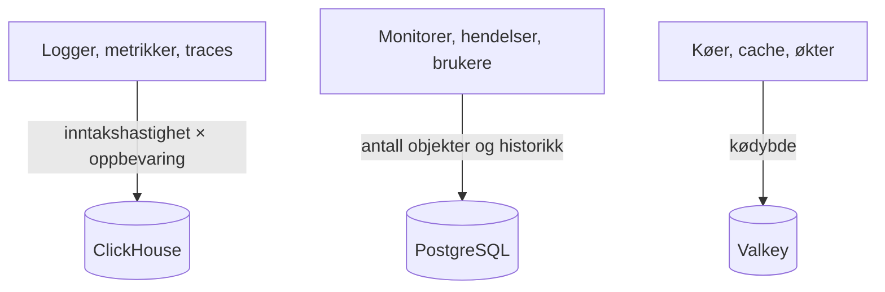

# Dimensjonering og kapasitetsplanlegging

Planlegg CPU, minne og disk for en selvdriftet OneUptime på Kubernetes med [Helm-chartet](https://artifacthub.io/packages/helm/oneuptime/oneuptime). Dimensjoner de tre datalagrene – **ClickHouse**, **PostgreSQL** og **Valkey** – og applikasjonen hver for seg, start fra et av nivåene nedenfor, og juster når du har ekte tall.

> [!IMPORTANT]
> Chartets standardverdier er ikke en produksjonsdimensjonering. Tjenestene det kjører som standard, setter **ingen CPU- eller minne-requests eller -grenser**, og PostgreSQL og ClickHouse får små volumer på **25 Gi**, slik at chartet kan installeres på alle clustere. For alt utover en prøve setter du selv ressurser og lagring, med tallene på denne siden.

Bruker du heller Docker Compose-installasjonen på én server? Den er enklere å dimensjonere: Se [kravene](/docs/installation/docker-compose#requirements) (16 GB minne, 8 kjerner og 400 GB disk anbefales).

:::cards
- [Hva som får hvert datalager til å vokse](#what-drives-each-datastore): Tre lagre som vokser med tre ulike ting.
- [Startnivåer](#starting-tiers): Små, mellomstore og store utgangspunkt.
- [Høy tilgjengelighet](#high-availability): Replikaer og failover for hvert datalager.
- [Oppbevaring](#retention-and-how-it-affects-storage): Innstillingen som ganger disken din.
:::

## Dimensjoner installasjonen din

:::steps
1. Finn ut hvor mye telemetri du sender: antall GB logger, metrikker og traces per dag. Mål det på en liten installasjon hvis du kan.
2. Bestem hvor mange dager du vil beholde det. Oppbevaringen ganger ClickHouse-disken (se [Oppbevaring](#retention-and-how-it-affects-storage)).
3. Regn ut ClickHouse-disken med [lagringsformelen](#storage-formula), og deretter PostgreSQL og Valkey ut fra deres egne avsnitt.
4. Velg [startnivået](#starting-tiers) som ligger nærmest tallene dine, og sett CPU, minne og lagring for det i Helm-values.
5. Slå på [høy tilgjengelighet](#high-availability) for datalagrene som trenger det, og følg deretter den faktiske bruken og juster.
:::

## Hva som får hvert datalager til å vokse

OneUptime trenger tre datalagre i produksjon. Hvert vokser med noe forskjellig, så dimensjoner dem uavhengig av hverandre.



| Datalager | Hva det lagrer | Hva som bestemmer størrelsen |
| --- | --- | --- |
| **ClickHouse** | All telemetri – logger, metrikker, traces, exceptions, profiler | Telemetri: **inntakshastighet × oppbevaring**. Dette er ~95 % av lagringen din og den største kostnaden. |
| **PostgreSQL** | Konfigurasjon og tilstand – monitorer, hendelser, varsler, brukere, team, prosjekter, arbeidsflyter, statussider, dashbord | **Antall objekter og historikk**, ikke telemetrimengden. Vokser sakte. |
| **Valkey** | Cache, arbeidskøer og økter | **Kødybde og aktive økter**. Minnebundet og beskjedent. Ikke en autoritativ datakilde. |

OneUptime trenger aldri objektlagring (S3, MinIO) for å kjøre, og det flytter ikke eldre telemetri til objektlagring. Du trenger bare objektlagring hvis du velger sikkerhetskopier til objektlagring: Barman Cloud-pluginen for CloudNativePG, eller [clickhouse-backup](https://github.com/Altinity/clickhouse-backup) for ClickHouse. Chartets egen CloudNativePG-sikkerhetskopi (`postgresOperator.cnpg.backup`) tar volum-snapshots og trenger ingen objektlagring. CloudNativePG sletter aldri gamle snapshots: Rydd dem selv, ellers fortsetter de å vokse.

## ClickHouse – den største faktoren

Nesten all lagringen din og en stor del av minnet går til ClickHouse, fordi hver logglinje, hvert metrikkpunkt, hvert trace-span og hver exception ligger der.

### Lagringsformel

```text
ClickHouse disk ≈ (daily raw telemetry GB ÷ compression) × retention days × replicas × 1.3 (headroom)
```

Komprimeringen avhenger av signalet:

| Signal | Typisk komprimering | Hva som endrer den |
| --- | --- | --- |
| Logger | Omtrent 5:1 | Logger komprimeres godt. |
| Metrikker | Omtrent 2:1 | Høy **kardinalitet** på etiketter blåser opp disk og minne raskere enn det rå volumet gjør. Hold kardinaliteten på etikettene lav. |
| Traces | Midt imellom | Span-attributtene du sender. |

### Regneeksempel

En flåte på **10 clustere**, hvert med rundt 10 noder og 100 poder som logger på INFO-nivå, produserer grovt regnet **50–150 GB rå logger per cluster over 30 dager** (omtrent 1,7–5 GB per dag per cluster). For hele flåten, med metrikker og traces lagt til og etter komprimering, budsjetterer du grovt regnet **5–15 GB komprimert telemetri per dag**.

| Oppbevaring | Én replika | 2 replikaer + 30 % reserve |
| --- | --- | --- |
| 30 dager | ~150–450 GB | **~0,4–1,2 TB** |
| 90 dager | ~0,45–1,35 TB | **~1,2–3,5 TB** |

Lagringen vokser **lineært med oppbevaringen**: Et vindu på 90 dager koster omtrent tre ganger så mye som et på 30.

### Minne og disktype

- **Bruk NVMe eller SSD.** Telemetri er skrivetung med utbrudd av aggregeringslesinger; ClickHouse sliter på roterende disker.
- **Gi ClickHouse rikelig med minne.** Aggregeringsspørringer krever mye minne. Som tommelfingerregel dimensjonerer du minnet til 25–50 % av dine *varme* (nylig spurte) komprimerte data, med et praktisk minimum på 16 GB for enhver ekte produksjonsflåte.
- **Hold kardinaliteten til metrikker i sjakk.** Den er den største enkeltstående spaken på både minne og disk i ClickHouse. Innfør etikettkonvensjoner med lav kardinalitet der du samler inn metrikker, og følg med på antallet aktive serier.

## PostgreSQL – konfigurasjon og tilstand

PostgreSQL lagrer konfigurasjonen og driftstilstanden din, ikke telemetri, så det vokser sakte og forblir lite ved siden av ClickHouse. Selv store installasjoner ligger vanligvis på noen titalls GB. Standardvolumet på **25 Gi** holder for små installasjoner; planlegg 50–100 GB for større, med plass til historikken for hendelser og varsler.

Med mange replikaer av app, workere og prober kan databasetilkoblingene ta slutt før lagringen. Hver pod åpner som standard opptil 50 tilkoblinger, og den medfølgende PostgreSQL-en tillater 500. Nettopp for dette inneholder chartet en valgfri connection pooler, **PgBouncer** (`pgbouncer.enabled`): Slå den på for installasjoner med mange replikaer.

## Valkey – cache, køer og økter

Cachelaget kjører [Valkey](https://valkey.io), den BSD-lisensierte forken av Redis 7.2, som cache, arbeidskø og øktlager. Enhver server med Redis-protokollen kan erstatte det, og dimensjoneringen nedenfor gjelder uansett. Det er **minnebundet**, og persistens er **av som standard**: Det er ikke en autoritativ datakilde og kan bygges opp på nytt. Dimensjoner det etter kødybde og samtidige økter; 2–8 GB minne dekker de fleste installasjoner. Eviction-policyen er `noeviction`, så følg med på minnet hvis køer hoper seg opp under vedvarende last.

## Applikasjonens regnekraft

I tillegg til datalagrene dimensjonerer du de tilstandsløse arbeidslastene. Hver kjører **uten ressurs-requests eller -grenser** til du setter dem, og med én replika, unntatt telemetry writeren, som kjører med to.

| Arbeidslast | Values-nøkkel | Vokser med |
| --- | --- | --- |
| App: dashbord, API og inntak | `app` | Brukere, API-kall og innkommende telemetri |
| Workere, når de er skilt fra appen | `worker` | Telemetri og behandling av bakgrunnsjobber |
| Prober | `probes` | Antallet aktive monitorer |
| Ingress-gateway | `nginx` | Mengden forespørsler |
| Telemetry writer, når den er slått på | `telemetryWriter` | Ikke med lasten: Den samler hvert telemetri-innsett i ClickHouse, så den dimensjoneres etter hva ClickHouse tåler |

Chartet inneholder **KEDA**, slik at appen, workerne, probene og Runner kan skalere etter køetterslepet sitt. Slå på `keda.enabled` sammen med hver tjenestes egen `keda.enabled` (for eksempel `app.keda.enabled`). På et cluster som ennå ikke har KEDA, trenger den første installasjonen en ekstra runde: Se chartets [KEDA-veiledning](https://github.com/OneUptime/oneuptime/blob/master/HelmChart/Docs/Keda.md). Tjenester som KEDA ikke styrer, kan i stedet bruke en autoskalerer basert på CPU eller minne (`autoscaling`).

## Startnivåer

Velg nivået som ligger nærmest miljøet ditt som utgangspunkt, følg så den faktiske bruken (`kubectl top pods`, diskveksten i ClickHouse og PostgreSQL) og juster.

- **Lite / PoC** – 1–3 clustere, ≤30 noder, ≤5 GB/dag rå telemetri, 30 dagers oppbevaring.
- **Middels / Produksjonsflåte** – ~10 clustere, ~100 noder, 10–30 GB/dag rå telemetri, 30–90 dagers oppbevaring.
- **Stort / Flere flåter** – 50+ clustere, 500+ noder, 100+ GB/dag rå telemetri, 90 dagers oppbevaring.

| | Lite / PoC | Middels / Produksjonsflåte | Stort / Flere flåter |
| --- | --- | --- | --- |
| **ClickHouse** | 4 vCPU / 16 GB / 200 GB NVMe | 8 vCPU / 32 GB / 1–3 TB NVMe | 16+ vCPU / 64–128 GB / 5–15 TB NVMe, **shardet** |
| **PostgreSQL** | 2 vCPU / 4 GB / 50 GB SSD | 4 vCPU / 8 GB / 100 GB SSD | 8 vCPU / 16–32 GB / 250 GB SSD (+ PgBouncer) |
| **Valkey** | 1 vCPU / 2 GB | 2 vCPU / 4 GB | 4 vCPU / 8–16 GB |
| **Antatt oppbevaring** | 30 dager | 30–90 dager | 90 dager |

Disse nivåene dimensjonerer OneUptime-backenden. Agenten du installerer på hvert overvåkede cluster, er beskrevet på siden [Kubernetes-agent](/docs/telemetry/kubernetes-agent), som også viser hvordan du kutter datamengden den sender.

## Høy tilgjengelighet

Chartets innebygde datalagre kjører som standard som **enkeltinstanser**. For høy tilgjengelighet i produksjon:

| Datalager | For høy tilgjengelighet |
| --- | --- |
| **PostgreSQL** | Slå på den medfølgende [CloudNativePG](https://cloudnative-pg.io)-operatoren (`postgresOperator.cnpg.enabled`) med **3 instanser** (`postgresOperator.cnpg.instances`): en primær og to hot standbys, med automatisk failover. |
| **ClickHouse** | Slå på den medfølgende [Altinity](https://github.com/Altinity/clickhouse-operator)-operatoren (`clickhouseOperator.altinity.enabled`) med **2 eller flere replikaer per shard** (`clickhouseOperator.altinity.cluster.replicasCount`). Den medfølgende ClickHouse Keeper kjører på **3 noder** for quorum. Legg til shards (`shardsCount`) når disken eller minnet til én node blir grensen. |
| **Valkey** | Chartet replikerer det ikke. Pek OneUptime mot en ekstern administrert Redis eller Valkey med automatisk failover (`externalValkey`). OneUptime kobler til én vert og port, så bruk tjenestens primære endepunkt, ikke et i cluster-modus. |

> [!WARNING]
> Slår du på en av operatorene for en eksisterende installasjon, starter en ny, tom database: Ingen av dem kopierer dataene fra enkeltinstansdatabasen den erstatter. Migrer dataene dine slik chartets veiledninger beskriver – for [PostgreSQL](https://github.com/OneUptime/oneuptime/blob/master/HelmChart/Docs/MigratePostgresStandaloneToOperator.md) og for [ClickHouse](https://github.com/OneUptime/oneuptime/blob/master/HelmChart/Docs/MigrateClickhouseStandaloneToOperator.md).

## Oppbevaring og hvordan den påvirker lagringen

Oppbevaring av telemetri er en **ClickHouse-TTL regnet i dager**. Hver utgave har prosjektets standard under **Prosjektinnstillinger > Telemetri og APM > Dataoppbevaring** (**Standard oppbevaring (dager)**); når ingenting er satt, er den 15 dager. [Enterprise Edition](/docs/self-hosted/enterprise) legger til overstyringer: per signal (logger, traces, metrikker, profiler), per alvorlighetsgrad for logger og trace-status, og per tjeneste eller ressurs.

Logger og metrikker slettes én dag om gangen, ved den første midnatt (servertiden til ClickHouse) etter at oppbevaringen deres er ute, slik at ClickHouse slipper å skrive om hver dag av dem med noen timers mellomrom mens den går ut. Like før midnatt ligger det fortsatt opptil én dag mer enn oppbevaringsvinduet på disken: Dimensjoner logger og metrikker for **oppbevaringsdager + 1**.

Fordi oppbevaringen ganger lagringen i ClickHouse, bestemmer du den før du dimensjonerer disken. OneUptime arkiverer **ikke** gammel telemetri og flytter den heller ikke til objektlagring. For flerårig oppbevaring av hensyn til etterlevelse forlenger du oppbevaringsvinduet og dimensjonerer lagringen i ClickHouse deretter, eller eksporterer til et eksternt arkiv du velger selv.

## Mål før du bestemmer deg

Telemetrimengden varierer enormt med hvor detaljerte applikasjonsloggene er, antall namespaces, scrape-intervallet og om DEBUG-logging er slått på noe sted. Bruk nivåene ovenfor som utgangspunkt: **samle inn fra miljøet ditt i minst fire uker**, mål de faktiske GB per dag for hvert signal, og dimensjoner deretter oppbevaring og lagring ut fra ekte data.

## Neste steg

:::cards
- [Docker Compose](/docs/installation/docker-compose): Krav for en installasjon på én server.
- [Selvdriftet arkitektur](/docs/self-hosted/architecture): Hvordan komponentene henger sammen.
- [Kubernetes-agent](/docs/telemetry/kubernetes-agent): Collectoren som sender telemetrien fra et cluster.
- [Enterprise Edition](/docs/self-hosted/enterprise): Overstyringer av oppbevaring og de andre Enterprise-funksjonene.
:::
