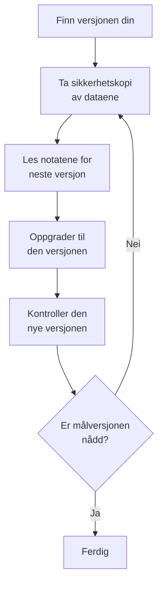

# Oppgradering

Oppgrader en selvhostet OneUptime-installasjon – med Docker Compose, eller med Kubernetes og Helm – til en nyere versjon. Følg fremgangsmåten nedenfor, og les notatene for hver hovedversjon mellom den du kjører, og den du skal til.

:::cards
- [Slik oppgraderer du](#slik-oppgraderer-du): Fremgangsmåten for Docker Compose og Kubernetes.
- [Notatene for hver versjon](#finn-notatene-for-versjonen-din): Hva hver hovedversjon krever av deg, med et blikk.
- [Images for Community Edition og Enterprise Edition](#images-for-community-edition-og-enterprise-edition): Hvilket image du kjører fra 14 og utover.
- [Oppgradering fra OneUptime 13 → 14](#oppgradering-fra-oneuptime-13-14): Den nyeste hovedversjonen.
:::

## Slik oppgraderer du

Tre regler gjør en oppgradering trygg:

- **Oppgrader én hovedversjon om gangen** (for eksempel 6 → 7 → 8). Ikke hopp over noen hovedversjon.
- **Hopp gjerne over mindre versjoner og rettelsesversjoner** (for eksempel 8.1 → 8.4), så lenge du følger utgivelsesnotatene deres.
- **Ta en sikkerhetskopi før hver oppgradering**, og kontroller at du kan gjenopprette den.



:::steps
### Finn den nåværende versjonen din

Åpne som hovedadministrator utgavemerket i toppfeltet i Admin-dashbordet: **This installation** viser versjonen du kjører. Instansen oppgir den også på `/version`:

```bash
curl http://localhost/version
```

Erstatt `http://localhost` med adressen til instansen din. Svaret er JSON, som `{"version":"14.0.22","commit":"..."}`.

### Ta sikkerhetskopi av dataene dine

Ta sikkerhetskopi av PostgreSQL, og av ClickHouse hvis du trenger telemetrien der. For Docker Compose, se [Sikkerhetskopiering og gjenoppretting](/docs/installation/docker-compose#sikkerhetskopiering-og-gjenoppretting). På Kubernetes bruker du volumøyeblikksbildene dine eller chartets CloudNativePG-sikkerhetskopier.

### Les notatene for neste hovedversjon

Du finner dem i [tabellen nedenfor](#finn-notatene-for-versjonen-din). Gjør det de ber om før du oppgraderer: noen trinn, som å gi Helm-verdier nye navn, må gjøres først.

### Kjør oppgraderingen

:::tabs
@tab Docker Compose
```bash
git checkout release
git pull
npm run update
```
`npm run update` legger nye innstillinger til i `config.env` uten å endre dine, henter de nye imagene og starter OneUptime på nytt.
@tab Kubernetes
```bash
helm repo update
helm upgrade my-oneuptime oneuptime/oneuptime -f values.yaml
```
Bruk ditt eget releasenavn og din egen verdifil. Chartet kjører databasemigreringene i en egen Job før de nye podene betjener trafikk.
:::

### Kontroller den nye versjonen

Med Docker Compose avslutter `npm run update` med **OneUptime is up!** På Kubernetes venter du til alle podene er `Running` og klare:

```bash
kubectl get pods -n <namespace>
```

Kontroller deretter versjonen din igjen, som i første trinn. Hvis du ennå ikke har nådd målversjonen, går du tilbake til [Ta sikkerhetskopi av dataene dine](#ta-sikkerhetskopi-av-dataene-dine) og videre til neste hovedversjon.
:::

### Finn notatene for versjonen din

| Oppgradering | Hva du må gjøre |
| --- | --- |
| [13 → 14](#oppgradering-fra-oneuptime-13-14) | Velg en utgave. Docker Compose-installasjoner som setter `IS_ENTERPRISE_EDITION=true`, bytter til `APP_TAG=enterprise-release`. Aktiver en lisens på Enterprise Edition. Lagre IPv6-overvåkinger av typen Ping, Port og SSL på nytt. |
| [12 → 13](#oppgradering-fra-oneuptime-12-13) | Som regel ingenting: Redis blir Valkey, og de gamle navnene på innstillingene fortsetter å virke. Kjører du Docker Compose for hånd? Legg til `--remove-orphans`. Bruker du din egen hurtigbuffer? Les [Hvis du kjører din egen hurtigbuffer](#hvis-du-kjører-din-egen-hurtigbuffer). |
| [11 → 12](#oppgradering-fra-oneuptime-11-12) | Rull ut Runbook Agents på nytt som Runners. Med Docker Compose: sett `ONEUPTIME_RUNNER_KEY`. Med Helm: gi `aiAgent:` det nye navnet `runner:`. Tildel på nytt Runner-tillatelsene som API-nøkler hadde direkte. |
| [10 → 11](#oppgradering-fra-oneuptime-10-11) | SCIM og teamenes samsvarsinnstillinger krever Enterprise Edition. For å beholde telemetrihistorikken må du gi de gamle ClickHouse-tabellene nye navn før oppgraderingen. |
| [9 → 10](#oppgradering-fra-oneuptime-9-10) | Ingenting. |
| [8 → 9](#oppgradering-fra-oneuptime-8-9) | Med Helm: fjern overstyringer av `oneuptimeIngress` fra verdiene dine. |
| [7 → 8](#oppgradering-fra-oneuptime-7-8) | Med Helm: gå over til den nye verdistrukturen for Postgres, Redis og ClickHouse. Ta en sikkerhetskopi først. |

## Images for Community Edition og Enterprise Edition

OneUptime leverer nå applikasjonen som to images. **Community Edition** er åpen kildekode under Apache 2.0-lisensen og omfatter SAML- og OIDC-enkel pålogging, global SSO og "Require SSO for login". **Enterprise Edition** legger til enterprise-modulene fra repositoriets mappe `ee/`: SCIM, teamsamsvar, revisjonslogger og Admin-dashbordets Health-dashbord for enterprise. Før denne endringen kjørte begge utgavene den samme koden, og `IS_ENTERPRISE_EDITION` avgjorde hvilke funksjoner som var slått på. Nå avgjør imaget det, og Community-imaget inneholder ikke mappen `ee/`.

Siden [Enterprise Edition](/docs/self-hosted/enterprise) har den fullstendige sammenligningen av funksjoner, lisensdetaljene og hva som skjer når du bytter utgave.

### Hva du må gjøre før oppgraderingen

- **Community Edition uten SCIM:** ingenting. Oppgrader som vanlig.
- **Helm med `image.type: enterprise-edition`:** ingenting. Chartet henter allerede `enterprise-`-imagene, som nå inneholder enterprise-modulene.
- **Docker Compose med `IS_ENTERPRISE_EDITION=true`:** bytt til Enterprise-imaget når du oppgraderer, ved å sette `APP_TAG=enterprise-release` (eller `enterprise-<version>`) i `config.env`. `APP_TAG=release` er Community-imaget, og `IS_ENTERPRISE_EDITION=true` slår ikke lenger på noe. `npm run update` gjør denne endringen for deg så lenge `IS_ENTERPRISE_EDITION=true` (`release` blir `enterprise-release`, en fastlåst `13.0.7` blir `enterprise-13.0.7`) og skriver ut hva den endret. Applikasjonen **nekter nå å starte** når `IS_ENTERPRISE_EDITION=true` er satt på Community-imaget, i stedet for å stoppe SCIM-klargjøring og revisjonslogging i det stille. Feilen sier hva du skal sette: `APP_TAG=enterprise-<version>` for å beholde Enterprise Edition, eller `IS_ENTERPRISE_EDITION=false` for å kjøre Community Edition.
- **Community-image med SCIM allerede satt opp:** SCIM-klargjøring stopper med denne oppgraderingen, også avklargjøring. Bytt til Enterprise-imaget for å beholde den. Ellers må du lese [Bytte fra Enterprise til Community](/docs/self-hosted/enterprise#bytte-fra-enterprise-til-community) før du oppgraderer. Den forklarer hva som stopper, og hvem du må fjerne først. For å kjøre Community Edition må du også sette `IS_ENTERPRISE_EDITION=false`. Enkel pålogging påvirkes ikke: Community-imaget leverer det også.

Konfigurasjonen din slettes aldri, og et bytte av utgave krever ingen migrering i noen retning.

### Lisenser etter oppgraderingen

Enterprise Edition kontrollerer nå lisensen sin:

- **En installasjon med en lisensnøkkel** fortsetter å kjøre. Den kontrollerer lisensen hos OneUptime ved oppstart og én gang om dagen. Hvis lisensen utløper, fortsetter alt å virke i en frist på 30 dager, og deretter skjer det samme som for en installasjon uten lisens.
- **En installasjon uten lisens**, for eksempel en som kjørte Enterprise Edition bare med `IS_ENTERPRISE_EDITION=true`, får en prøveperiode på 14 dager fra første oppstart av denne versjonen. **Hvis du bruker SCIM eller revisjonslogging, må du aktivere en lisens før prøveperioden slutter.** Etter prøveperioden stopper SCIM-klargjøring, og revisjonsloggingen slutter å registrere. Enterprise-konfigurasjonen blir også skrivebeskyttet, og Health-dashbordene for enterprise låses. Enkel pålogging påvirkes ikke. Alt fortsetter igjen, uten omstart, så snart du aktiverer en lisens. Prøveperioden er for evaluering: bruk av Enterprise Edition i produksjon krever et OneUptime Enterprise-abonnement. Se [Når en lisens utløper eller mangler](/docs/self-hosted/enterprise#når-en-lisens-utløper-eller-mangler).
- **Installasjoner uten nettverkstilgang** kan aktivere med et signert lisenstoken i stedet for en nøkkel. Se [Frakoblet aktivering](/docs/self-hosted/enterprise#frakoblet-aktivering-installasjoner-uten-nettverkstilgang).

### Kunder på OneUptime Cloud

For deg endres ingenting. OneUptime Cloud kjører Enterprise Edition, og planen din avgjør fortsatt hvilke funksjoner du får: SSO, OIDC, SCIM og teamsamsvar fra Scale-planen og oppover, og revisjonslogger på Enterprise-planen. Prosjekter på Scale-planen ser nå innstillingene for SSO, OIDC, SCIM og teamsamsvar som tidligere viste en oppfordring til å oppgradere.

### Endringer i API-et og endepunktene

- `GET /api/global-config/license` returnerer lisensnøkkelen, lisenstokenet, listen over instanser, instans-ID-en og versjonsdetaljene bare til hovedadministratorer. Andre kallere får utgaven og lisensstatusen.
- Selvhostede installasjoner leverer ikke lenger lisensserverens endepunkter under `/api/enterprise-license/`. Bare oneuptime.com bruker dem.
- SCIM-endepunktene beholder nøyaktig de samme stiene på Enterprise Edition, så konfigurasjonen i identitetsleverandøren endres ikke. På Community Edition returnerer de `404`. På Enterprise Edition avviser de forespørsler mens lisensen er utløpt (etter prøveperioden eller fristen), og de svarer igjen så snart en lisens er aktivert.
- SSO- og OIDC-endepunktene (SAML-påloggings- og ACS-URL-ene, OIDC-omdirigerings-URI-ene og endepunktene for global SSO) beholder nøyaktig de samme stiene og leveres av begge utgavene i enhver lisensstatus.

## Oppgradering fra OneUptime 13 → 14

OneUptime 14 deler applikasjonen i to utgaver, og imaget du henter, avgjør hvilken du kjører. **Community Edition** (Apache-2.0, taggene `release` og `<version>`) omfatter SAML SSO, OpenID Connect, global SSO og "Require SSO for login". Den inneholder ikke repositoriets mappe `ee/`, så SCIM-klargjøring, teamenes samsvarsinnstillinger, revisjonslogger, Admin-dashbordets **Health**-dashbord og Admin-dashbordets **Query Console** finnes ikke i det imaget i det hele tatt. **Enterprise Edition** (taggene `enterprise-release` og `enterprise-<version>`) inneholder dem, og den kontrollerer en Enterprise-lisens mens den kjører, noe OneUptime 13 aldri gjorde. Enkel pålogging avhenger ikke av den lisensen.

[Images for Community Edition og Enterprise Edition](#images-for-community-edition-og-enterprise-edition) ovenfor er referansen for denne endringen: hva hver utgave inneholder, hva du skal sette for hver type utrulling, og hva lisensen gjør. Denne delen er selve oppgraderingen. Oppgrader fra 13 – hvis du fortsatt er på 12, gjør du 12 → 13 først.

Ingenting slettes, i noen av utgavene. Enkel pålogging virker likt i begge: SSO- og OIDC-konfigurasjonen din og innstillingene dine for "Require SSO for login" beholdes som de er. SCIM-konfigurasjonen din og revisjonsloggene som er registrert til nå, blir liggende i databasen. Community Edition leverer dem bare ikke, og et bytte av utgave krever ingen migrering i noen retning.

### Hva du må gjøre

1. **Bestem hvilken utgave denne installasjonen kjører.** Hvis du bruker SCIM-klargjøring, teamenes samsvarsinnstillinger eller revisjonslogger, eller vil ha Admin-dashbordets **Health**-dashbord, er det Enterprise Edition. Ellers er det ingenting å bestemme: Community Edition er det du allerede har, og den omfatter SAML SSO og OpenID Connect.
2. **Med Helm: angi utgaven i verdifilen din:** `image.type: enterprise-edition` (standarden er `community-edition`). Ikke rør `image.tag` – chartet legger selv til prefikset `enterprise-`, så `image.tag: release` henter `oneuptime/app:enterprise-release`. Denne verdien er ikke ny. Hvis du allerede kjører `enterprise-edition`, er det ingenting å endre: taggen du allerede henter, inneholder nå `ee/`.
3. **Med Docker Compose: sett `APP_TAG=enterprise-release`** (eller `enterprise-<version>` for å låse en versjon) i `config.env`. `APP_TAG=release` er Community-imaget. Dette er det eneste som stopper en installasjon på 13: på 13 var en Enterprise-installasjon med Compose `APP_TAG=release` pluss `IS_ENTERPRISE_EDITION=true`, og den kombinasjonen **nekter nå å starte** i stedet for å komme opp som Community Edition med SCIM-klargjøring og revisjonslogging stoppet i det stille. `npm run update` skriver om `APP_TAG` for deg så lenge `IS_ENTERPRISE_EDITION=true` (`release` blir `enterprise-release`, en fastlåst `13.0.8` blir `enterprise-13.0.8`) og skriver ut hva den endret. Hvis du i stedet henter imagene for hånd, setter du `APP_TAG` selv først.
4. **På Enterprise Edition: aktiver en lisens.** En installasjon uten lisens får en prøveperiode på 14 dager, regnet fra første oppstart av Enterprise Edition – ved en oppgradering er det dagen du oppgraderer, ikke dagen du først installerte OneUptime. En hovedadministrator aktiverer den fra utgavemerket i toppfeltet i Admin-dashbordet; installasjoner uten nettverkstilgang aktiverer i stedet med et signert token. Se [Lisensiering](/docs/self-hosted/enterprise#lisensiering).
5. **Hvis denne installasjonen skal kjøre Community Edition mens identitetsleverandøren din avklargjør brukere via SCIM, må du gå gjennom hvem som har tilgang før du oppgraderer.** SCIM-avklargjøring stopper, så personer du fjerner i identitetsleverandøren, beholder OneUptime-kontoene sine, og med mindre "Require SSO for login" gjelder for dem, kan alle som fortsatt kommer til postkassen for en av disse kontoene, sette et passord med "Glemt passord" og logge på. Fjern disse brukerne først: [Bytte fra Enterprise til Community](/docs/self-hosted/enterprise#bytte-fra-enterprise-til-community).
6. **Hvis du overvåker IPv6-adresser med Ping-, Port- eller SSL-overvåkinger, må du lagre disse overvåkingene på nytt etter oppgraderingen.** Mål som ble lagret før 14, kan være lagret avkortet – se [IPv6-overvåkinger av typen Ping, Port og SSL](#ipv6-overvåkinger-av-typen-ping-port-og-ssl).

### Utgaver: hva som endret seg, og hva som ikke gjorde det

| | Til og med 13 | Fra 14 |
| --- | --- | --- |
| Enterprise-kode | i hvert image; `IS_ENTERPRISE_EDITION=true` slo den på | i `ee/`, og bare i `enterprise-`-imagene |
| Velger i Helm | `image.type` | `image.type` – uendret, men imagene er nå forskjellige |
| Velger i Compose | `IS_ENTERPRISE_EDITION=true` | `APP_TAG=enterprise-release` |
| Enterprise-lisens | aldri kontrollert under kjøring | kontrollert ved oppstart og én gang om dagen |
| SSO- og OIDC-endepunkter | de samme stiene i begge utgavene | de samme stiene i begge utgavene, uansett lisensstatus |
| SCIM-endepunkter | de samme stiene i begge utgavene | de samme stiene på Enterprise; `404` på Community |
| Enterprise-konfigurasjonen din | lagret, brukt | lagret i begge tilfeller, brukt på Enterprise |

Én migrering kjøres: en kolonne `enterpriseEditionFirstSeenAt` som kan være tom, på tabellen `GlobalConfig`, som har én rad, så den er umiddelbar. Det finnes ingen ClickHouse-migrering, ingenting fjernes, og et bytte av utgave krever ingen migrering i noen retning.

### Lisensens forløp på Enterprise Edition

- **En installasjon uten lisens** kjører en prøveperiode på 14 dager, regnet fra første oppstart av Enterprise Edition. I prøveperioden virker alle enterprise-funksjoner, og utgavemerket varsler før den slutter. Prøveperioden er for evaluering: bruk av Enterprise Edition i produksjon krever et abonnement under OneUptime Enterprise License.
- **En lisens som utløper,** får en frist på 30 dager fra utløpsdatoen, der alle enterprise-funksjoner virker og utgavemerket varsler.
- **Etter prøveperioden, eller etter den fristen,** og til en lisens er aktivert: SCIM-forespørsler fra identitetsleverandøren din avvises, og revisjonsloggingen slutter å registrere. Enterprise-konfigurasjonen blir skrivebeskyttet – du kan fortsatt se den, slette den og tilbakestille et SCIM-bearer-token, som er det en hendelse krever – og Admin-dashbordets Health-dashbord og Query Console låses.
- **Ingenting slettes, og kjerneovervåkingen påvirkes aldri.** Overvåkinger, varsler, hendelser, vakter, statussider og telemetri ligger utenfor lisensen, og det gjør pålogging også: pålogging med SSO og OIDC, "Require SSO for login" og pålogging med passord for alle brukere, hovedadministratorer inkludert, virker likt i enhver lisensstatus. Når du aktiverer en lisens, gjenopprettes SCIM-klargjøring og revisjonslogging med konfigurasjonen du allerede har, uten omstart.
- **En lisensnøkkel du allerede har, godtas**, som lisens med status "unverified": utløpsdatoen og setegrensen kommer fra det lisensserveren allerede har oppgitt til denne installasjonen, og den får den samme fristen på 30 dager etter det utløpet. Lisenser som utstedes fra nå av, er signerte og verifiseres av applikasjonen selv. Du trenger ingen ny nøkkel for denne oppgraderingen.
- **En nøkkel som denne installasjonen aldri har registrert utløpet for,** fortsetter å virke i prøveperioden i stedet for å stoppe. Lisensserveren skriver nøkkelen og utløpsdatoen hver for seg, så en installasjon kan ha en nøkkel som den aldri har fått oppgitt utløpet for. En slik installasjon behandles nøyaktig som en installasjon uten lisens: alle enterprise-funksjoner virker i prøveperioden på 14 dager, regnet fra første oppstart av Enterprise Edition, og etter prøveperioden stopper de samme tingene som ovenfor. Setegrensen håndheves ikke mens lisensen er i denne tilstanden, fordi installasjonens lisenspost allerede er ufullstendig. En hovedadministrator som aktiverer lisensen på nytt fra utgavemerket, eller den daglige lisenssynkroniseringen som henter utløpet fra oneuptime.com, gjenoppretter den uten omstart.

Den fullstendige tabellen over tilstander står i [Når en lisens utløper eller mangler](/docs/self-hosted/enterprise#når-en-lisens-utløper-eller-mangler).

### Docker Compose: velg image-taggen

```bash
git checkout release # Please make sure you're on release branch.
git pull
npm run update
```

- **`npm run update` flytter `APP_TAG` så lenge `IS_ENTERPRISE_EDITION=true`**, til Enterprise-imaget i samme versjon, og skriver ut hva den endret. Den beholder kommentarene og anførselstegnene dine, lar en `APP_TAG` som allerede er en `enterprise-`-tagg, være i fred og endrer ingenting ved en ny kjøring.
- **Henter du imagene for hånd, hoppes dette over**, og applikasjonen stopper da ved oppstart med en feil som sier nøyaktig hva du skal sette: `APP_TAG=enterprise-<version>` for å beholde Enterprise Edition, eller `IS_ENTERPRISE_EDITION=false` for å kjøre Community Edition.
- **For å bytte til Community Edition med vilje** setter du `APP_TAG=release` og `IS_ENTERPRISE_EDITION=false`. Les først punkt 5 ovenfor hvis identitetsleverandøren din avklargjør brukere via SCIM.
- Ingenting annet i `config.env` må endres for denne utgivelsen.

### Helm: velg image-typen

```bash
helm repo update
helm upgrade my-oneuptime oneuptime/oneuptime -f values.yaml
```

- **En installasjon som allerede er på `image.type: enterprise-edition`, trenger ikke å endre noen verdi.** Chartet har lenge satt prefikset foran taggen; det nye er at `enterprise-`-imagene inneholder `ee/`. Lisensen gjelder for den fra denne utgivelsen, etter forløpet ovenfor.
- **`image.tag: release` er standarden**, så et chart som har blitt stående på den flytende taggen, går til 14 ved neste oppgradering uten noen endring av verdier. Hvis den installasjonen har SCIM satt opp på `community-edition`, setter du `image.type: enterprise-edition` i samme oppgradering.
- **`IS_ENTERPRISE_EDITION` sendes fortsatt ut av chartet**, avledet av `image.type` slik at de to aldri kan være uenige. Den styrer ingenting. Å tvinge den til `true` via `extraEnv` på et Community-image får bare applikasjonen til å nekte å starte. Sett aldri `ONEUPTIME_EDITION` via chartet.
- **Chartets prober respekterer igjen `probes.<key>.allowPrivateNetworkMonitors`** ([#3879](https://github.com/OneUptime/oneuptime/issues/3879)). Ingenting endres med mindre du setter den – standarden forblir `false` – og den gjelder for overvåkingene i alle prosjekter på instansen, fordi chartets prober er globale prober. Loopback, link-local og `169.254.169.254` forblir blokkert, uansett hva du setter.

### Andre endringer i 14

Disse endringene endrer hvordan OneUptime oppfører seg etter oppgraderingen, og de fleste krever ingenting av deg. Les dem hvis du bruker egendefinerte roller eller API-nøkler som består av enkeltstående tillatelser, egne tilstander for hendelser, varsler eller vedlikehold, Terraform eller API-et, SSO, eller appene for Slack og Microsoft Teams.

:::details Les de andre endringene i 14
- **OTLP-inntak bekrefter en batch først når køen har godtatt den.** 13 svarte først `200` og la i kø etterpå, så en batch som køen avviste, gikk tapt i det stille. 14 svarer i stedet `503` med `Telemetry queue unavailable. Please retry.`, og gRPC-endepunktet returnerer `UNAVAILABLE`; begge kan prøves på nytt, og eksportører prøver på nytt. Dette gjelder logger, metrikker, sporinger og profiler. Du trenger ikke gjøre noe, men eksportørenes nye forsøk og køens mottrykk er nå synlige der data før forsvant – greit å vite hvis du dimensjonerer inntakskapasiteten.
- **Admin-dashbordets Health-dashbord og Query Console krever Enterprise Edition**, sammen med helsevarslene for PostgreSQL og Valkey. På 13 fulgte de med bare `IS_ENTERPRISE_EDITION=true`, så dette er et synlig tap for en Community-installasjon som brukte dem. Kapasitetsovervåking av ClickHouse og opprydding i den, migreringsstatus, globale prober og støttepakken finnes i begge utgavene.
- **HTTPS-overvåkinger som når en IP-adresse gjennom proxyen til en probe, virker igjen.** Proben sendte IP-adressen som TLS-servernavn, som ikke er et gyldig servernavn, og som Node avviser uten videre, så en overvåking av `https://<private IP>` fra en global probe med `PROBE_ALLOW_PRIVATE_NETWORK_MONITORS` feilet i handshaken. Proben utelater nå servernavnet for et IP-mål og kontrollerer sertifikatet mot selve IP-adressen. Mål angitt med vertsnavn endres ikke.
- **`oneuptime`-CLI-en oppgir sin faktiske versjon** med `--version` i stedet for en plassholder.
- **Et nytt varsel eller en ny episode starter i tilstanden som opprettelsen angir.** API-et, Terraform (`current_alert_state_id`, `current_incident_state_id`) og arbeidsflyter kan angi tilstanden et varsel, en varselepisode eller en hendelsesepisode starter i, slik dashbordets felt **Innledende tilstand** gjør. Før ble den tilstanden erstattet av prosjektets opprettelsestilstand; en Terraform-konfigurasjon som satte den, fikk en annen verdi enn planlagt. En opprettelse som ikke angir noen tilstand, starter fortsatt i opprettelsestilstanden, og en tilstand fra et annet prosjekt avvises. Se [Tilstanden en ny post starter i](/docs/api-reference/api-reference).
- **En post som opprettes allerede bekreftet eller løst, tilkaller ingen.** En hendelse, et varsel eller en episode som opprettes i en senere tilstand – via **Innledende tilstand**, startilstanden til en mal, API-et, Terraform eller en arbeidsflyt – kjører ikke lenger vaktretningslinjene sine; feeden sier det i stedet. En post som opprettes løst, blir heller ikke lenger gruppert i en episode, utbedret, undersøkt av OneUptime AI eller gitt en Slack- eller Microsoft Teams-kanal, og en hendelse som opprettes løst, lar overvåkingenes status og overvåking være og starter ingen SLA. En post som opprettes bekreftet, starter SLA-en sin som allerede besvart. Poster som opprettes i opprettelsestilstanden, som alle som en overvåking åpner, endres ikke. Se [Erklært allerede bekreftet eller løst](/docs/incidents/declaring-incidents#erklært-allerede-bekreftet-eller-løst).
- **En tilstand etter den løste tilstanden din teller som løst overalt.** En hendelse, et varsel eller en episode i en tilstand du har plassert etter den løste tilstanden – en tilstand **Closed** under **Løst**, for eksempel – telte som løst noen steder og som åpen andre steder. Alle følger nå én regel: prosjektets løste tilstand, og hver tilstand etter den, er løst. Poster i en slik tilstand forsvinner fra listene **Aktive hendelser** og **Aktive varsler** og tellerne deres i sidemenyen, fra dashbordenes lister over hendelser og varsler, fra aktive episoder og fra mobilappens lister over åpne poster; sammendrag i Slack og Microsoft Teams teller dem som løste, og statussidenes tidslinjer viser en slik rad som løst. En overvåking eller en SLO-burn-rate-regel som har hendelsen eller varselet sitt i en slik tilstand, åpner et nytt neste gang den utløses, der den før tok det gamle for fortsatt åpent. Å flytte en hendelse rett til en slik tilstand løser den, slik **Løst** gjør, og å flytte den forbi **Løst** gjenåpner ikke lenger en episode og starter ikke en ny SLA for hendelsen. Prosjekter der alle de egne tilstandene ligger over den løste tilstanden, merker ingen forskjell. Se [Listen over aktive hendelser](/docs/incidents/states-and-severities#listen-aktive-hendelser).
- **En tilstand etter den bekreftede tilstanden din teller som bekreftet overalt.** En hendelse, et varsel eller en episode i en tilstand du har plassert mellom de bekreftede og løste tilstandene dine – en tilstand **Investigating** under **Bekreftet**, for eksempel – stoppet allerede vaktoppringninger, men mobilappen og Microsoft Teams tilbød fortsatt **Acknowledge** for den, og å bekrefte et varsel eller en episode i den tilstanden (fra Teams, Slack eller en vaktside) flyttet det tilbake til **Bekreftet**. Alle følger nå én regel: prosjektets bekreftede tilstand, hver tilstand etter den og en løst tilstand teller som bekreftet. **Acknowledge** tilbys ikke lenger noe sted for en slik post, og å bekrefte den avvises ("... is already acknowledged.") i stedet for å flytte den tilbake; en vakthavende som bekrefter sin egen oppringning for den, avslutter bare oppringningen. Å flytte en post rett til en slik tilstand markerer nå hendelsens SLA som besvart – der den før forble ubesvart til hendelsen var løst, noe som kunne bryte svarmålet – og teller som bekreftelsen i oversiktens tid til bekreftelse, metrikken **Time to Acknowledge**, målingene og MTTA i sammendrag i Slack og Microsoft Teams. En post som ble løst uten å ha blitt bekreftet, teller nå som bekreftet i det øyeblikket den ble løst, slik oversikten allerede viste. Listefiltrene **Bekreftet** viser også poster i de tilstandene, og attributtet `isAcknowledgedState` i metrikken **Time in State** er `true` for dem. Prosjekter der alle de egne tilstandene ligger over den bekreftede tilstanden, merker ingen forskjell. Se [Hva bekreftelse gjør](/docs/incidents/states-and-severities#hva-bekreftelse-gjør).
- **Episoder går gjennom tilstandene sine etter regelen hendelser og varsler følger.** En hendelses- eller varselepisode kunne flyttes tilbake opp i tilstandslisten sin – en løst episode tilbake til **Bekreftet**, for eksempel – fra dashbordets tilstandstidslinje, Slack, Microsoft Teams, API-et eller Terraform, og flyttingen gikk videre til hendelsene eller varslene dens. Nå avvises en flytting til en tilstand som kommer før episodens nåværende i rekkefølgen, med feilen en hendelse får ("Episode cannot transition to Acknowledged state from Resolved state because Acknowledged is before Resolved in the order of incident states."), og ingenting endres. En grupperingsregels alternativ **Gjenåpne nylig løste episoder** gjenåpner fortsatt en episode, som OneUptimes egen flytting. For å rette en tilstand som ble satt ved en feil, sletter du raden dens fra episodens tilstandstidslinje, som for en hendelse; episoden går tilbake til tilstanden i den siste gjenværende raden, og å slette raden som løste den, fjerner løsningstidspunktet. En episode flytter bare hver av hendelsene eller varslene sine dit deres egen tilstand ville gått: en som allerede er i den tilstanden, eller lenger, blir der den er.
- **En skriving av en posts nåværende tilstand følger samme regel.** Å oppdatere den nåværende tilstanden til en hendelse, et varsel, en episode eller en planlagt vedlikeholdshendelse via API-et eller Terraform (`currentIncidentStateId`, `currentAlertStateId`, `currentScheduledMaintenanceStateId`) avvises før noe lagres når den flytter posten tilbake opp i listen sin, med samme feil. Før nådde skrivingen posten, og tilstandstidslinjen avviste den etterpå, slik at posten ble stående i en tilstand som tidslinjen aldri hadde hatt. Å skrive tilstanden til en hendelsesepisode registrerer den nå i episodens tilstandstidslinje og flytter hendelsene dens, slik skriving av tilstanden til en varselepisode allerede gjorde. En Terraform-plan som setter en tidligere tilstand, feiler ved apply; sett tilstandene i rekkefølge, eller endre tilstanden med en rad i tilstandstidslinjen.
- **Change State i Slack og Microsoft Teams tilbyr bare tilstandene en post kan gå til neste gang.** En post i den siste tilstanden den kan nå, får svaret "There is no later state to move this incident to." i stedet for et skjema der hvert valg ville blitt avvist. Menyen **Change state to** i dashbordets toppfelt følger samme regel.
- **Feilen for en planlagt vedlikeholdshendelse som flyttes tilbake opp i listen sin, lyder nå som de andre:** "Scheduled Maintenance cannot transition to Scheduled state from Ongoing state because Scheduled is before Ongoing in the order of scheduled maintenance states." (før sto det `ScheduledMaintenance` og `scheduledMaintenance states`). Et skript som sammenlignet med den gamle teksten, trenger den nye. Se [Rekkefølgen er en reell begrensning](/docs/incidents/states-and-severities#rekkefølgen-er-en-reell-begrensning-ikke-en-visningspreferanse).
- **Å løse en hendelse gir bare tilbake overvåkingene den holder.** OneUptime registrerer nå om en hendelse holder overvåkingenes status. En hendelse som allerede er løst én gang og deretter gjenåpnet, setter ikke lenger overvåkingene sine tilbake til operative når den løses igjen, så en status de har fått i mellomtiden – fra probene sine, fra vedlikehold eller satt for hånd – blir stående; å endre overvåkingene dens, eller statusen den setter dem i, mens den er åpen, får den til å holde dem igjen. Hendelser fra før oppgraderingen gir overvåkingene sine tilbake ved neste løsning, slik de alltid har gjort. Se [Hva løsning gjør](/docs/incidents/states-and-severities#hva-løsning-gjør).
- **Episoden til en hendelse eller et varsel settes bare gjennom episodens medlemmer.** `incidentEpisodeId` og `alertEpisodeId` (og relasjonene `incidentEpisode` og `alertEpisode`) er skrivebeskyttet. API-et, Terraform (`incident_episode_id`, `alert_episode_id`), MCP-verktøy og arbeidsflyter kunne skrive dem uten å legge posten til i episoden: episodens oversikt viste da en hendelse eller et varsel som siden **Medlemmer** ikke hadde, og en post som ble opprettet med en episode satt, ble aldri gruppert. En opprettelse eller oppdatering som sender en av dem, avvises nå, med en melding som viser til episodens medlemmer: legg til posten med `POST /api/incident-episode-member` (eller `/api/alert-episode-member`), og slett det medlemmet for å ta den ut, så følger referansen til episoden etter. Lesing endres ikke. En Terraform-konfigurasjon som setter `incident_episode_id` eller `alert_episode_id`, må fjerne den så snart du oppgraderer provideren, som nå bare leser dem; ressursene `oneuptime_incident_episode_member` og `oneuptime_alert_episode_member` styrer medlemskapet. Se [Episoden en hendelse eller et varsel er i](/docs/api-reference/api-reference).
- **Nye eskaleringsregler for innkommende anrop ringer i 20 sekunder, ikke 30.** Mange telefoner sender et ubesvart anrop til talepost innen 30 sekunder, og en talepost som svarer, avslutter anropet der i stedet for å sende det videre til neste regel. Dashbordets felt **Ringetid (i sekunder)**, API-et (`escalateAfterSeconds`) og Terraform-provideren (`escalate_after_seconds`) starter nå en ny regel på 20. Regler som allerede finnes, beholder ringetiden sin: oppgraderingen endrer bare kolonnens standardverdi. En Terraform-konfigurasjon som utelater `escalate_after_seconds`, vil planlegge `30 -> 20` for reglene den styrer så snart du oppgraderer provideren; sett `escalate_after_seconds = 30` for å beholde 30. Se [Retningslinje for innkommende anrop](/docs/on-call/incoming-call-policy).
- **Sammendrag i Slack og Microsoft Teams beholder klokkeslettet sitt når klokken stilles om.** Et sammendrag har nå en tidssone, og tidsplanen leses på den klokken. Til nå ble den lest i UTC, så et sammendrag satt til 09:00 i Berlin kom der kl. 08:00 når vintertiden kom tilbake. Oppgraderingen gir hvert eksisterende sammendrag tidssonen fra profilen til den som opprettet det, klokken dashbordet viste det, eller UTC når det ikke har en oppretter med en tidssone (en API-nøkkel opprettet det), som er det det ble lest i til nå. Ingen neste utsendelse forskyves under oppgraderingen; fra neste utsendelse går et sammendrag som hadde blitt forskjøvet én time, tilbake til klokkeslettet for sitt første sammendrag, og et månedlig sammendrag den 29. til 31. glir ikke lenger til den 28. API-et og Terraform (`timezone`) godtar navnet på en IANA-tidssone; et sammendrag som opprettes uten, får tidssonen fra opprettelsens profil, eller UTC når en API-nøkkel oppretter det, og et navn som ikke er en tidssone, avvises. Se [Sammendrag](/docs/workspace-connections/slack#sammendrag).
- **Feedposten "oppdatert" for en hendelse eller et varsel registrerer bare det som endret seg.** Å lagre kortet **Hendelsesdetaljer** etter bare å ha endret tittelen, eller en API-klient, en arbeidsflyt eller et skript som skrev en hendelse eller et varsel tilbake uendret, la til en post som gjentok tittelen, beskrivelsen, rotårsaken, utbedringsnotatene og etikettene den hadde – også publisert i hendelsens eller varselets kanaler i Slack og Microsoft Teams –, og hver skriving med etikettene eller bryteren **Send påminnelser** startet påminnelsesintervallet på nytt selv når ingenting endret seg, så en hendelse som ofte ble redigert, utsatte påminnelsene sine gang på gang. Nå skrives hver linje for en verdi som endret seg, og ingenting for en lagring som ikke endret noe; påminnelsesregelen brukes på nytt, og intervallet starter på nytt, bare når alvorlighetsgraden eller etikettene endres, eller når **Send påminnelser** slås av eller på. Tekst som leses likt, teller som lik (bortsett fra linjeskift og mellomrom rundt den), og etiketter som den samme mengden i vilkårlig rekkefølge. Varsler registrerer nå også en endret rotårsak på siden sin, som de før mistet med mindre tittelen endret seg samtidig, og en tømt beskrivelse, rotårsak eller tømte utbedringsnotater. Å fjerne alle etiketter registreres som "All labels removed.". Se [Hva feeden registrerer](/docs/incidents/notes-owners-and-feed#hva-feeden-registrerer).
- **Feedposten "oppdatert" for en planlagt vedlikeholdshendelse eller en overvåking registrerer også bare det som endret seg.** Å lagre en vedlikeholdshendelses kort **Maintenance Details** eller **Berørte ressurser**, eller en overvåkings detaljer, uten å endre noe, eller en API-klient, en arbeidsflyt, Terraform eller et skript som skrev en vedlikeholdshendelse eller overvåking tilbake uendret, la til en post som gjentok tittelen (navnet på en overvåking), vinduet, beskrivelsen, påminnelsene, statussidene, de berørte ressursene og etikettene den hadde – også publisert i kanalene dens i Slack og Microsoft Teams –, og hver skriving med etikettene til en vedlikeholdshendelse eller bryteren **Send påminnelser** startet påminnelsesintervallet på nytt. Nå skrives hver linje for en verdi som endret seg, og ingenting for en lagring som ikke endret noe; påminnelsesregelen til en vedlikeholdshendelse brukes bare på nytt når etikettene endres, eller når **Send påminnelser** slås av eller på. Et tidspunkt teller som likt når det angir samme øyeblikk, uansett hvordan det er skrevet, og påminnelser, statussider, berørte ressurser og etiketter som den samme mengden i vilkårlig rekkefølge. Å tømme beskrivelsen, påminnelsene, statussidene eller etikettene til en vedlikeholdshendelse, eller beskrivelsen eller etikettene til en overvåking, registreres nå, og navnet, beskrivelsen og etikettnavnene til en overvåking vises slik de ble skrevet, i stedet for å bli lest som Markdown. En vedlikeholdshendelse som flyttes fra **Planlagt** rett til en egen tilstand mellom **Pågående** og **Avsluttet**, starter nå slik **Pågående** gjør: overvåkingene dens går til **Endre overvåkingsstatus til**, der de til nå ble værende som de var. Se [Planlagte vedlikeholdshendelser](/docs/status-pages/subscribers#planlagte-vedlikeholdshendelser).
- **En vedlikeholdshendelse i en egen tilstand før Pågående starter til sin tid, og vises som kommende.** En planlagt vedlikeholdshendelse som ble flyttet fra **Planlagt** til en egen tilstand plassert over **Pågående** – et trinn "Confirmed", for eksempel – ble aldri startet ved **Begynner den**: overvåkingene dens gikk ikke i vedlikehold, og eierne og abonnentene ble ikke varslet, før noen flyttet den for hånd. Den forsvant også fra kommende hendelser på statussidene og fra RSS- og Atom-feedene deres, fra Microsoft Teams-appens planlagte vedlikehold, og påminnelsene til abonnentene før hendelsen ble forkastet. Nå starter den til sin tid som en vedlikeholdshendelse som er latt stå i **Planlagt**, og frem til da vises og påminnes den som en kommende. En vedlikeholdshendelse i en slik tilstand som har startet for lengst, startes innen ett minutt etter oppgraderingen – og avsluttes ett minutt senere hvis **Slutter den** også er passert –, og eierne og abonnentene varsles som ved enhver start og avslutning; så før du oppgraderer, flytt hver slik vedlikeholdshendelse som har blitt liggende igjen, videre, eller slett den. En egen tilstand plassert før **Planlagt** – et utkast eller et godkjenningstrinn – overlates fortsatt til et menneske, som før. Fire mindre endringer følger med. Hvert tilstandsskifte for en vedlikeholdshendelse beregner med en gang statusen til nettverksstedene den dekker, også når den går tilbake fordi posten for tilstanden den er i, ble slettet fra **Tilstandstidslinje**, der et steg tilbake til nå ventet på femminuttersskanningen. En vedlikeholdshendelse er fullført i **Fullført** og i hver egen tilstand plassert etter den – "Archived": eiernes påminnelser planlegges ikke lenger på nytt for den etter en endring av påminnelsesregelen, Microsoft Teams behandler den som lukket når den ser etter reaksjoner som skal bli notater, og feeden og statussidens tidslinje markerer den som avsluttet. Kortet **Målinger** for vedlikeholdshendelsen behandler en vedlikeholdshendelse i en egen tilstand plassert etter **Avsluttet** som ferdig, slik toppfeltet gjør, og "å gå inn i den avsluttede tilstanden" og "å gå inn i den fullførte tilstanden" er overgangene til en tilstand der vedlikeholdshendelsen er ferdig eller fullført, så en vedlikeholdshendelse som fullføres rett fra **Pågående**, registrerer slutten sin der. Og en tilstand som har mer enn ett av de fire innebygde flaggene, leses nå likt i vedlikeholdshendelsens toppfelt og på serveren. Prosjekter uten egne tilstander ser bare endringene for nettverkssteder og målinger. Se [Planlagte vedlikeholdshendelser](/docs/status-pages/subscribers#planlagte-vedlikeholdshendelser).
- **En vedlikeholdshendelse i en egen tilstand etter Pågående teller som pågående overalt.** En planlagt vedlikeholdshendelse som ble flyttet fra **Pågående** til en egen tilstand plassert over **Avsluttet** – et trinn "Verifying", for eksempel – holdt overvåkingene sine i vedlikehold, men ingenting annet så den som pågående: oversikten på statussidene utelot den helt, nettverksstedene og telemetriseriene den dekker, ble ikke lenger dempet, SLO-burn-rate-varsler på overvåkingene ble utløst, listene **Pågående** under **Planlagt vedlikehold** og **Hjem**, menymerkene deres og flisen **Pågående vedlikehold** utelot den, Microsoft Teams-appen viste den ikke, og ingenting avsluttet den ved **Slutter den**: den ble værende i den tilstanden, med overvåkingene i vedlikehold, til noen flyttet den. Alle følger nå én regel: en vedlikeholdshendelse er pågående i den pågående tilstanden og i hver egen tilstand plassert mellom **Pågående** og **Avsluttet**. En slik vedlikeholdshendelse avsluttes ved **Slutter den** som en pågående og varsler abonnentene hvis **Når hendelsen slutter** er slått på, så en vedlikeholdshendelse som har blitt stående i "Verifying" etter sin slutt, avsluttes innen ett minutt etter oppgraderingen. En egen tilstand plassert etter **Avsluttet** – "Reviewing" – er ferdig: å flytte en vedlikeholdshendelse dit fra **Pågående** eller fra "Verifying" avslutter den nå slik **Avsluttet** gjør, der overvåkingene til nå ble værende i vedlikehold for alltid, og vedlikeholdshendelsens toppfelt tilbyr ikke lenger **Merk som Avsluttet** for den. En tilstand plassert før **Pågående** venter fortsatt på starten. Å flytte en vedlikeholdshendelse for hånd til en egen tilstand som starter eller avslutter den, utløser **Varsle statussideabonnenter** slik **Merk som Pågående** eller **Merk som Avsluttet** ville gjort. Statussidens side med planlagte hendelser og RSS- og Atom-feedene viser også en pågående vedlikeholdshendelse som startet før sidens historikkvindu. Prosjekter der alle de egne tilstandene ligger før **Pågående**, merker ingen forskjell. Tre mindre rettelser følger med: å flytte **Begynner den** for en vedlikeholdshendelse flytter den første påminnelsen med når påminnelsesregelen venter på starten; å fjerne den siste berørte ressursen utenom overvåkinger registreres i feeden som "No other affected resources."; og en **Begynner den** eller **Slutter den** som er skrevet uten tidssone, sammenlignes som UTC, slik den lagres, så en server som ikke kjører i UTC, registrerer ikke lenger en flytting som ikke skjedde. Se [Planlagte vedlikeholdshendelser](/docs/status-pages/subscribers#planlagte-vedlikeholdshendelser).
- **Å lagre en hemmelighet tilbake uendret endrer ingenting.** En overvåkingshemmelighet, en arbeidsflytvariabel, en runbook-hemmelighet eller -påloggingsinformasjon, API-nøkkelen til en LLM-leverandør, en OIDC-klienthemmelighet og de andre verdiene OneUptime lagrer kryptert, krypteres på nytt ved hver lagring, så en lagring som sendte en av dem tilbake uendret, så ut som en endring: den kjørte postens **On Update**-arbeidsflyter, sendte posten til åpne dashbord og la til en post i revisjonsloggen. En verdi som skrives tilbake uendret, teller nå som uendret; en ny verdi gjør fortsatt alle tre tingene og forblir lagret kryptert.
- **På OneUptime Cloud slutter API-nøkler å virke under planen sin, og SCIM fjerner bare personer.** Et prosjekts API-nøkler krever **Growth**, og SCIM-tilkoblingene – prosjektets og statussidenes – krever **Scale**. Til nå fortsatte de å virke etter at en prøveperiode var over, eller prosjektet gikk over til en lavere plan. Nå avvises hver forespørsel med en av prosjektets API-nøkler – REST-API-et, Terraform, CLI-en, MCP-klienter tilkoblet med en API-nøkkel – med `402` og en melding som nevner planen, og hver SCIM-forespørsel som ville lagt til eller endret personer eller grupper, avvises med `402` i SCIM-feilformatet. SCIM deaktiverer, sletter og fjerner fortsatt personer på alle planer, så den som slutter, mister fortsatt tilgangen sin. Ingenting slettes: de virker fullt ut igjen, som de er, så snart prosjektet er tilbake på planen, innen ett minutt. Prosjektets eiere får en e-post når en planendring stopper dem, og eierne av prosjekter som allerede var under disse planene, får én e-post etter denne oppgraderingen om hva som stoppet, og hvordan de slår det på igjen. **Prosjektinnstillinger** > **Fakturering** oppgir hvor mange en lavere plan stopper eller begrenser. Personer som logger på, MCP-klienter tilkoblet ved pålogging, inntaksnøkler for telemetri, probenøkler og agentnøkler påvirkes ikke, og selvhostede installasjoner (uten planer) merker ingen forskjell. Se [API-nøkler og SCIM under planen sin](/docs/api-reference/api-reference).
- **En bryter som skrives som tekst, er bryteren som lagres, og en lagring som ikke endrer noe, starter ingenting.** API-et, Terraform og arbeidsflyter kan sende et av/på-felt som tekst eller som tall: `"true"`, `"yes"`, `"on"`, `"1"` eller `1` for på, `"false"`, `"no"`, `"off"`, `"0"` eller `0` for av. Databasen lagret dem alltid som på eller av, men OneUptime selv leste teksten: en planlagt vedlikeholdshendelse som ble sendt med `"isVisibleOnStatusPage": "true"`, dukket opp på statussiden sin med bildene sine latt være private, så de ikke ble lastet der, og en overvåking som ble sendt med `"isArchived": "false"`, forble ikke arkivert, men ble merket med hvem som hadde arkivert den, og når. Nå er hver av disse verdiene det på eller av som databasen lagrer, overalt der OneUptime leser den. En verdi databasen ikke kan lagre, som `"maybe"`, `""` eller `2`, avvises med `400` og en melding som nevner feltet (`isEnabled must be true or false.`) i stedet for med en serverfeil; dette omfatter `""` for varsel- og hendelsesalternativene til en SLO-burn-rate-regel, som før ble lest som standardverdien deres. Å skrive en post tilbake med verdiene den allerede har – en avslått bryter sendt som av, et antall på 0 som 0, de samme etikettene i en annen rekkefølge – starter ikke lenger **On Update**-arbeidsflytene dens, sender ingen sanntidsoppdatering og legger ikke til noen post i revisjonsloggen, og en post for en reell endring nevner bare de endrede feltene. **Listen on** for en arbeidsflyt hører nå bare feltene en oppdatering endrer, og hører hver endring av dem: en som lytter på en bryter, kjører også når bryteren slås av, noe den før gikk glipp av. Se [Brytere](/docs/api-reference/api-reference).
- **Runners har flyttet fra Prosjektinnstillinger til Runbooks.** Runners ligger nå under **Runbooks → Runbook-agenter** (`…/runbooks/runners`) og Runner-påloggingsinformasjon under **Runbooks → Runbook-agenter → Påloggingsinformasjon** (`…/runbooks/runner-credentials`), ved siden av runbookene de kjører trinnene til. De gamle URL-ene `…/settings/runners` og `…/settings/runner-credentials` videresender, så bokmerker fortsetter å virke. Ingenting annet endres: Runners beholder ID-ene, nøklene, kapasitetene og tillatelsene sine, og de kjører fortsatt AI-koderettelser og AI-utbedringskommandoer. Et Runner-image som er eldre enn denne utgivelsen, skriver fortsatt "Project Settings > Runners" i loggmeldingene sine; les det som Runbooks → Runbook-agenter.
- **Sanntidsoppdateringer slutter med påloggingen som åpnet dem, og spør om det hver forespørsel spør om.** En åpen sides sanntidsoppdateringer – tellerne i toppfeltet, direktelogger, AI-chatten – stopper nå når påloggingen slutter: ved avlogging, et passordbytte, en blokkering eller når tilgangstokenet på 15 minutter utløper. Ett minutt før tokenet utløper, fornyer siden påloggingen og kobler seg til igjen av seg selv, så sanntidsoppdateringene fortsetter; en pålogging som ikke kan fornyes, sender personen til påloggingssiden, som før. Et prosjekt som krever SSO, eller en instans som krever det, gir bare sanntidsoppdateringer til sider som er pålogget med SSO, og sender en side uten SSO-pålogging til pålogging med SSO, slik forespørslene allerede gjorde – også sider som allerede var åpne da kravet ble slått på. En endring av noens tillatelser, en blokkering eller tap av rollen som hovedadministrator når med en gang de åpne sidene deres, på hver applikasjonsserver i stedet for bare den som gjorde endringen: hver applikasjonsserver holder én ekstra tilkobling til Valkey, abonnert på kanalen `oneuptime:realtime:access-changes`. Når den kanalen ikke kan nås, tar en server igjen tillatelser innen 30 sekunder, en blokkering innen ett minutt og en økt eller en nylig påkrevd SSO-pålogging innen tilgangstokenets 15 minutter. Se [Brukere, team og tillatelser](/docs/permissions/index).
- **Å slå av et prosjekts SSO-leverandør, eller slette den, avslutter påloggingene den ga.** Der SSO er påkrevd, må personer som logget på med en SAML- eller OIDC-leverandør som slås av eller slettes, logge på med SSO igjen ved neste forespørsel, de åpne sidene deres slutter å få sanntidsoppdateringer, og MCP-klienter de koblet til med den påloggingen, må kobles til på nytt. Å slå leverandøren på igjen bringer ikke de påloggingene tilbake, og en leverandør som allerede var slått av ved oppgraderingen, teller som slått av ved oppgraderingen. Et nytt sertifikat eller en ny klienthemmelighet holder alle pålogget. Så lenge et prosjekt krever SSO, kan ikke den siste leverandøren, og leverandøren det krever, slås av eller slettes før "Require SSO for Login" er slått av; når hele serveren krever SSO, kan ikke et prosjekts siste leverandør slås av eller slettes før en annen er slått på. Se [SSO](/docs/identity/sso#slå-av-eller-slette-en-leverandør).
- **Globale SSO-leverandører og statussidenes SSO-leverandører avslutter påloggingene sine på samme måte, og å slå på "Require SSO for Login" krever en leverandør.** Å slå av en global SAML- eller OIDC-leverandør, eller slette den, avslutter påloggingene den ga, slik et prosjekts leverandør gjør, og å slå den på igjen bringer dem ikke tilbake; en global leverandør som allerede var slått av ved oppgraderingen, teller som slått av ved oppgraderingen. En endring av en global leverandør eller de tilknyttede prosjektene dens som ville etterlatt et prosjekt som krever SSO – selv eller fordi hele serveren krever det – uten en leverandør å logge på med, avvises, med navnene på prosjektene. Å slå på "Require SSO for Login", for et prosjekt eller for hele serveren, avvises så lenge ingen leverandør ville logget folk på der; meldingen sier hva du må sette opp først. Å slå av en statussides SSO- eller OIDC-leverandør, eller slette den, logger ut de private brukerne den logget på, og en statusside som krever SSO, holder ikke lenger økter åpne som ble startet med et passord. Private brukere som bare SSO noen gang har logget på, logger på én gang til etter oppgraderingen. Se [Global SSO](/docs/identity/global-sso#slå-av-eller-slette-en-leverandør) og [Statussider](/docs/status-pages/index#sso-og-oidc).
- **Å opprette et prosjekt følger også SSO-reglene, og endringer som lar folk logge på, når med en gang hver applikasjonsserver.** Så lenge hele serveren krever SSO for å logge på, krever det å opprette et prosjekt en aktivert global SSO-leverandør som logger folk på i alle prosjekter, siden et nytt prosjekt ennå ikke har sin egen leverandør; uten en slik avvises opprettelsen av et prosjekt, og meldingen ber en serveradministrator slå en på. Hovedadministratorer kan fortsatt opprette prosjekter. Et prosjekt som opprettes med "Require SSO for Login" allerede slått på, krever det samme. Å slå på en leverandør eller tilknytningen til en global leverandør, fjerne en global leverandørs begrensning til de tilknyttede prosjektene og slå av "Require SSO for Login", for et prosjekt eller for hele serveren, når nå med en gang hver applikasjonsserver, slik endringer som avslutter pålogginger, allerede gjorde, i stedet for når en annen servers bufrede svar utløper ett minutt senere. Bare når to endringer av samme innstilling lagres på nøyaktig samme tidspunkt, kan en applikasjonsserver fortsatt bruke opptil ett minutt på å ta igjen. Se [SSO](/docs/identity/sso#krev-sso-for-prosjektet-ditt) og [Global SSO](/docs/identity/global-sso#håndhev-sso).
- **Å lagre "Require SSO for Login" slått på igjen kontrolleres som når den slås på.** En lagring som sender "Require SSO for Login" slått på – for et prosjekt eller for hele serveren – eller som angir et prosjekts påkrevde leverandør, kontrolleres nå også når innstillingen allerede har den verdien, slik API-et, Terraform og andre verktøy som sender hver innstilling ved hver lagring, gjør. Så lenge ingen leverandør ville logget folk på der, eller et prosjekts påkrevde leverandør er slått av, avvises en slik lagring med meldingen som påslåingen gir, uansett hva annet som endres: slå på en leverandør først, eller slå av innstillingen. Å slå den av og tømme den påkrevde leverandøren avvises aldri. Se [SSO](/docs/identity/sso#krev-sso-for-prosjektet-ditt).
- **En post du ikke kan lese, kan ikke lenger endres eller slettes, og en endring via ID som ikke når noe, sier fra.** En endring eller sletting – fra dashbordet, API-et, Terraform, MCP-verktøy eller en arbeidsflyt – når nå bare postene kalleren kan lese, og en post som leses gjennom en annen, bare gjennom en post kalleren kan lese. Rollene OneUptime leverer, virker som før: hver rolle som kan endre eller slette en type post, kan lese den, varselrollene ser fortsatt hvilke hendelser varslene deres er koblet til, telemetrirollene leser fortsatt reglene for metrikkpipelines og kildekart, og alle leser fortsatt loggen over varslinger som er sendt til dem. Det som endres, gjelder egendefinerte roller og API-nøkler som består av enkeltstående tillatelser:
  - En tillatelse til å endre eller slette en type post krever en tillatelse til å lese den: `EditProjectIncident` uten en tillatelse til å lese hendelser endrer ingen hendelse. En rolle der lesingen er begrenset til noen etiketter eller noen eiere, endrer og sletter bare de postene, uansett hvor brede endrings- eller slettetillatelsene er, og en blokkering av lesing fjerner også endring og sletting.
  - En post som leses gjennom en annen – notatene til en hendelse eller et varsel, kunngjøringene og domenene til en statusside, eskaleringsreglene til en vaktretningslinje og lignende – krever en tillatelse til å lese den andre posten: `ReadIncidentInternalNote` uten en tillatelse til å lese hendelser når nå ingen notater, der den før nådde notatene til alle hendelser. En blokkering med etiketter på lesing av hendelser utelater notatene til hendelsene som har dem.
  - Å endre eller slette en post via ID-en (`PUT` eller `DELETE /api/<resource>/<id>`, og rutene `update-item` og `delete-item`) svarer `404` når posten ikke finnes eller kalleren ikke kan lese den, og `422` når kalleren kan lese den, men ikke endre den. En sletting svarte før `200` uten å slette noe, og en oppdatering `422` i begge tilfeller. Terraform leser en `404` under en destroy som allerede slettet.

  Gi en egendefinert rolle eller en API-nøkkel lesetillatelsen ved siden av hver endrings- eller slettetillatelse, og lesetillatelsen for den overordnede posten ved siden av tillatelsen for et notat eller en kunngjøring. En API-nøkkel med Project Admin leser nå også prosjektets SSO- og OIDC-leverandører, som den allerede kunne endre. Se [Endre eller slette en post du ikke kan lese](/docs/api-reference/api-reference) og [Brukere, team og tillatelser](/docs/permissions/index).
- **En post som leses gjennom en annen, opprettes bare under en post som oppretteren kan lese.** Notatene, tilstandstidslinjen og feeden til en hendelse, et varsel, en episode eller en planlagt vedlikeholdshendelse, kunngjøringene, domenene, gruppene og eierne til en statusside, eskaleringsreglene til en vaktretningslinje og de andre postene som leses gjennom en annen, opprettes – fra dashbordet, API-et, Terraform eller MCP-verktøy – bare under en post kalleren kan lese, etter regelen lesingen følger: etikettene eller eierne kallerens lesetillatelse når, minus det en blokkering med etiketter på lesingen fjerner. En post kalleren ikke kan lese, avvises som om den ikke fantes, med `400` som nevner feltet og ID-en, og ingenting skrives. En privat hendelse, et privat varsel eller en privat episode godtar dem bare fra sine eiere, direkte eller via et team, og fra prosjektets eiere og administratorer. En kunngjøring opprettes bare på statussider kalleren kan lese, hver eneste av dem, og en kaller som har tillatelse til å lese bare noen statussider, angir minst én. Rollene OneUptime leverer, virker som før, og det gjør også en egendefinert rolle eller API-nøkkel som leser postene den oppretter under, i hele prosjektet. Det som endres, gjelder de som består av enkeltstående tillatelser: `CreateIncidentInternalNote` uten en tillatelse til å lese hendelser oppretter nå ingen notater, der den før kunne legge til et på enhver hendelse, og med `ReadProjectIncident` begrenset til noen etiketter eller til omfanget **Eid** legger den bare til notater på de hendelsene. En overvåkings statustidslinje følger samme regel: en hendelse som noen erklærer eller endrer, endrer statusen til overvåkingene den personen kan lese, og lar de andre være som de er. Gi en egendefinert rolle eller en API-nøkkel lesetillatelsen for posten den oppretter under, ved siden av hver av disse opprettelsestillatelsene. Se [Poster en forespørsel angir](/docs/api-reference/api-reference) og [Brukere, team og tillatelser](/docs/permissions/index).
- **En post som flyttes under en annen eller får flere poster i en liste, får bare poster den som endrer den, har lov til å lese, og en tillatelse til å opprette begrenset til etiketter eller til omfanget Eid gjelder også posten den oppretter.** En endring som flytter en post som leses gjennom en annen – en kunngjøring som settes på flere statussider, en regel som flyttes til en annen tjeneste – følger regelen en opprettelse følger: hver post den legger til som overordnet, må være en kalleren kan lese, ellers avvises endringen med `400` som nevner feltet og ID-en, og ingenting skrives. Postene en opprettelse eller endring lister opp – overvåkingene til en hendelse, tjenestene til et varsel, statussidene til en planlagt vedlikeholdshendelse – holder seg til kallerens tillatelse til å lese den typen post når kalleren har en, og i alle tilfeller til en blokkering med etiketter på kallerens lesing. Det en endring lar bli der det er, som overordnet eller i en liste, kontrolleres ikke på nytt. En tillatelse til å opprette som er begrenset til etiketter, oppretter bare poster som har en av etikettene dens – for en post uten egne etiketter: poster under en som har en –, med mindre en annen tillatelse til å opprette den typen post når hele prosjektet, og en blokkering med etiketter på en tillatelse til å opprette avviser en post som har en av etikettene dens; begge avvises med `422` som nevner etikettene. En tillatelse til å opprette med omfanget **Eid** oppretter en overvåking, en statusside eller en annen post med egne eiere bare for en person, som blir eieren, og et notat bare på en hendelse som den personen eller et av personens team eier. Roller og API-nøkler med tillatelser som når hele prosjektet, virker som før; gi en som er begrenset til etiketter, en av de etikettene på hver post den oppretter. Eierne som velges når man oppretter en overvåking, hendelse, et varsel, en planlagt vedlikeholdshendelse, statusside eller mal, og den første eskaleringsregelen som velges når man oppretter en vaktretningslinje, legges til for oppretteren selv når oppretterens lesing ikke når den nye posten. Et valg som oppretterens tillatelse til å legge det til ikke når – begrenset til etiketter den nye posten ikke har, for eksempel – gjør at opprettelsen avvises, og ingenting lagres. Se [Poster en forespørsel angir](/docs/api-reference/api-reference) og [Brukere, team og tillatelser](/docs/permissions/index).
- **Den ene posten en skriving angir, og en endring av etikettene til en post, holder seg også til kallerens tillatelser.** Den ene posten som en opprettelse eller endring angir i et eget felt – overvåkingen til et varsel, overvåkingen en statussideressurs viser, tjenesten til et kostnadsbudsjett, hendelsen en runbook-kjøring er knyttet til – følger regelen postene en skriving lister opp, følger, under begge navnene sine: en post utenfor kallerens tillatelse til å lese den typen post, eller med en etikett som en blokkering av lesingen fjerner, avvises med `400` som nevner feltet og ID-en, og ingenting skrives. En endring kontrollerer det bare når den angir en annen post. OneUptimes globale prober og AI-agenter forblir åpne for alle prosjekter. Postene en tjeneste fyller ut for kalleren sin – overvåkingene, statussidene og vaktretningslinjene som en hendelsesmal legger til en hendelse som erklæres fra den – kontrolleres på samme måte, før noe lagres og før hendelsen får nummeret sitt. En endring av etikettene en post har, holder den innenfor kallerens tillatelse til å endre den: er tillatelsen begrenset til etiketter, beholder posten en av dem, og en blokkering med etiketter på endring av den avviser å gi den en av blokkeringens etiketter; begge avvises med `422` som nevner etikettene. En oppretter med en tillatelse til å opprette som bare når det oppretteren eier, blir eier rett etter lagringen, før noe annet skjer med posten, og når det mislykkes, fjernes posten igjen, og opprettelsen avvises med `500`. Eierne av overvåkinger, hendelser, varsler, planlagte vedlikeholdshendelser og malene deres leses nå gjennom posten de eier, slik en statussides og en tjenestes gjør. Roller og API-nøkler med tillatelser som når hele prosjektet, virker som før; gi en egendefinert rolle eller en API-nøkkel som er begrenset til etiketter, lesing av postene den angir. Se [Poster en forespørsel angir](/docs/api-reference/api-reference) og [Brukere, team og tillatelser](/docs/permissions/index).
- **Det et abonnement, en regels Run Now, en liste over LLM-leverandører og godkjenningen av en AI-kommandoplan når, holder seg innenfor det de har lov til.**
  - Et abonnement på en statusside angir bare ressurser fra sin egen statusside. En registrering eller endring på statussiden angir bare ressursene siden viser, så ikke en med arkivert overvåking, og en opprettelse eller endring gjort av teamet, en API-nøkkel eller en arbeidsflyt angir bare ressurser fra abonnentens side; enhver annen ressurs avvises med `400` som nevner feltet og ID-en, slik en som ikke finnes, gjør. En endring spør bare om ressursene den legger til, så et abonnement beholder det det allerede angir. Et abonnement som ble lagret før dette, og som angir en ressurs fra en annen side, blir latt være som det er: det får bare beskjed om hendelser gjennom ressursene på sin egen side, slik det alltid har gjort.
  - **Run Now** på et nettverks regler for tildeling av steder, enhetsetiketter og automatisk import krever tillatelser som når hele prosjektet, slik **Run Now** for enhver annen regel gjør: å redigere regelen, og `EditNetworkDevice` – eller, for en regel for automatisk import, `CreateNetworkDevice`, og `CreateProjectMonitor` når regelen har en overvåkingsmal. En tillatelse som er begrenset til etiketter eller til eide ressurser, avvises med `422`, og det gjør et teams blokkering med etiketter på ressursene en kjøring endrer, også, for **Run Now** på enhver regel: kjøringen ville også endret ressursene som har de etikettene. Gi en rolle eller en API-nøkkel som kjører regler, disse tillatelsene med alle ressurser i prosjektet som omfang.
  - LLM-leverandører leses bare av prosjektets medlemmer som kan lese innstillingene (`ProjectOwner`, `ProjectAdmin`, `ProjectMember`, `Viewer`, `SettingsAdmin`, `SettingsMember`, `SettingsViewer` og `ReadProjectLlm`); en forespørsel som ikke er pålogget, får `401`. Listen over globale LLM-leverandører på **Prosjektinnstillinger → KI → LLM-leverandører** viser navn, beskrivelse og pris til alle som er pålogget.
  - Å godkjenne en AI-kommandoplan med en SSH-kommando krever tillatelse til å lese runbook-påloggingsinformasjon (`ReadRunbookCredential`, eller `ProjectOwner` eller `ProjectAdmin`), slik det krever å angi påloggingsinformasjon i et runbook-trinn; uten den avvises godkjenningen med `422`, og ingenting kjøres. Å lagre en regel for automatisk utbedring som lar OneUptime AI kjøre kommandoene sine uten å spørre – OneUptime AI som setter sammen kommandoer, **Rett uten å spørre** og en liste over tillatte kommandoer – krever den samme tillatelsen når lagringen slår det på (også når en slik regel slås på) eller legger til mønstre eller Runners i listen over tillatte kommandoer. Regler som allerede kjører slik, fortsetter, og å snevre dem inn eller slå det av krever ikke mer. Å slå på **Kjører AI-utbedringskommandoer** for en Runner som har SSH-påloggingsinformasjon, krever den samme tillatelsen; en Runner som allerede kjører dem, fortsetter med det. `ProjectMember` og runbook-rollene godkjenner slike planer så snart `ReadRunbookCredential` er lagt til i teamet deres.
  Se [La abonnenter velge ressurser og hendelsestyper](/docs/status-pages/subscribers#la-abonnentene-velge-ressurser-og-hendelsestyper), [Kjør regler på eksisterende ressurser](/docs/configuration/run-rules-now#før-du-begynner) og [Brukere, team og tillatelser](/docs/permissions/index).
- **Hvem som eier en ressurs, og en innstilling med påloggingsinformasjon, angis bare av noen som kan lese dem.** Eierne av enhver ressurs – vaktretningslinjer og vaktplaner, overvåkingsgrupper, dashbord, retningslinjer for innkommende anrop, arbeidsflyter, runbooks, prober, verter og klynger, SLO-er og resten – listes, leses, legges til og fjernes nå gjennom ressursen de eier, slik eierne av en overvåking, en statusside og en tjeneste gjør: en rolle eller API-nøkkel som er begrenset til etiketter, når eierne av ressursene som har etikettene dens, en blokkering med etiketter på lesing av ressursen utelater eierne, og en tillatelse bare på eiere når ingen. Eierne av retningslinjer for innkommende anrop følger nå retningslinjens egne roller (`SettingsAdmin`, `SettingsMember`, `SettingsViewer`) i stedet for vaktrollene. En opprettelse eller endring som angir en SMTP-server, en leverandør av anrop og SMS, runbook-påloggingsinformasjon, SNMP-påloggingsinformasjon, en videosamtaletilkobling eller en API-nøkkel – en statussides SMTP-server eller leverandør av anrop og SMS, leverandøren til en retningslinje for innkommende anrop, påloggingsinformasjonen en Kubernetes-klynge gir OneUptime AI, SNMP-påloggingsinformasjonen til en nettverksenhet eller et sted, tilkoblingen til en videosamtale, nøkkelen til en API-nøkkeltillatelse, påloggingsinformasjonen til en runbooks SSH- og Kubernetes-trinn – krever en tillatelse til å lese den typen innstilling og avvises ellers med `400` som nevner feltet og ID-en; en endring som beholder innstillingen en post allerede angir, kontrolleres ikke. En rolle som redigerer statussider, men ikke kan lese prosjektets SMTP-servere eller leverandører av anrop og SMS, som `StatusPageAdmin`, velger ikke lenger en for en statusside; en runbook-forfatter trenger `ReadRunbookCredential` for å angi påloggingsinformasjon i et trinn. Å søke etter numre å kjøpe og å liste numrene en leverandør av anrop og SMS eier, krever den samme lesingen av leverandøren de angir. Hvor et prosjekt er kjøpt – forhandleren, forhandlerplanen og lisensen – settes bare av OneUptime: en opprettelse av et prosjekt som sender `resellerId`, `resellerPlanId`, `resellerLicenseId` eller relasjonene deres, avvises med `400` som nevner feltet, slik en endring av dem allerede ble. Se [Poster en forespørsel angir](/docs/api-reference/api-reference) og [Brukere, team og tillatelser](/docs/permissions/index).
- **Hver tildeling og hvert omfang snevrer inn det de når, og en lesing via ID av en post du ikke kan lese, svarer `404`.** Den samme regelen gjelder nå på stedene den ennå ikke nådde:
  - Å lese én post via ID-en (`POST /api/<resource>/<id>/get-item`) svarer `404` når posten ikke finnes, ligger i et annet prosjekt eller er en kalleren ikke kan lese – det samme svaret i hvert tilfelle, slik en endring eller sletting via ID allerede gir. Før svarte den `200` med en tom body. Dashbordet viser en slik post som ikke funnet, som før. MCP-verktøyene svarer med en ikke-funnet-feil som viser til listeverktøyet, og CLI-en avslutter med kode `3`. Terraform-provideren fjerner en ressurs den ikke lenger kan lese, fra staten sin når den oppdaterer, og neste plan oppretter den på nytt: gi API-nøkkelen Terraform bruker, tillatelsene og etikettene som trengs for å lese hver ressurs den styrer (se [Feilsøking](/docs/terraform/troubleshooting#a-resource-leaves-the-state-and-the-next-apply-creates-it-again)).
  - En tillatelse **All Operational Resources** som er begrenset til etiketter (`ReadAllOperationalResources`, `EditAllOperationalResources`, `DeleteAllOperationalResources`), nådde alle prosjektets overvåkinger, hendelser, statussider og andre operative ressurser, uansett etiketter. Nå når den dem som har en av etikettene dens, slik hver ressurs' egen tillatelse begrenset til de samme etikettene gjør, og en blokkering med etiketter på den fjerner ressursene som har de etikettene, fra det den gir. Et team eller en API-nøkkel som trenger alle ressurser, har tillatelsen med omfanget **Alle**.
  - Når en rolle bare kan lese hendelser med omfanget **Eid**, er postene som leses gjennom en hendelse – notatene, tilstandstidslinjen, feeden og lignende – postene til hendelsene som rollens personer eller teamene deres eier, både for lesing, endring og sletting, uansett omfanget til tillatelsen for selve postene. Det samme gjelder varsler, episoder, planlagt vedlikehold, overvåkinger, vaktretningslinjer, statussider og enhver annen post som andre leses gjennom: notatene til en episode, eller kunngjøringene til en statusside, nådde før de til alle episoder eller statussider.
  - Å slette telemetri – logger, sporinger, metrikker, unntak, profiler og øktopptak – holder seg til ressursene som kalleren både kan lese og slette telemetrien til, minus dem en blokkering med etiketter fjerner, og gjøres i ett prosjekt om gangen: en forespørsel på tvers av alle kallerens prosjekter avvises. En sletting av én rad via ID-en som ikke når noe, svarer `404`, eller `422` når kalleren kan lese raden, men ikke slette den.
  - En statussides SAML- og OIDC-påloggingsleverandører leses av `ProjectOwner`, `ProjectAdmin`, `ProjectMember`, `Viewer` og tillatelsene **Read Status Page SSO** og **Read Status Page OIDC**, og ikke lenger av alle medlemmer som kan lese statussiden. Statussidens egen påloggingsside påvirkes ikke.

  Se [Lese én post via ID-en](/docs/api-reference/api-reference) og [Brukere, team og tillatelser](/docs/permissions/index).
- **Runbook Member kjører runbooks og bygger ingen.** `RunbookMember` kunne opprette og slette runbooks, Runners og eierne deres, men ikke redigere dem. Nå åpner den runbooks og kjøringene deres og kjører dem – starter en kjøring, fullfører eller hopper over trinnene, avbryter den – og oppretter, endrer og sletter ingen av dem: gi `RunbookAdmin` til personene som bygger runbooks. En rolle kjører også bare runbookene som etikettene og omfanget av eide ressurser når, lest med rollens egen tildeling: før kunne en `RunbookMember` som var begrenset til noen etiketter, kjøre alle runbooks i prosjektet, fra runbookens side, API-et eller ved å godkjenne et forslag til utbedring. **Run Now** er låst, med begrunnelsen i verktøytipset, for den som ikke kan kjøre runbooks. `WorkflowMember` legger ikke lenger til eller fjerner eiere av en arbeidsflyt. Se [Tillatelser](/docs/runbooks/configuration#tillatelser).
- **Faktureringsrollene gjør det de sier.** `BillingViewer` leser prosjektets faktureringssider og -poster – planen og abonnementet, fakturaer, forbruk, saldoer, AI-kreditter, betalingsmåter og kontaktinformasjonen for fakturering – og endrer ingenting. `BillingMember` laster også ned fakturaer og endrer kontaktinformasjonen for fakturering, og `BillingAdmin` gjør det `BillingMember` gjør, og slår SMS, telefonanrop, WhatsApp og Telegram av og på. Før kunne et team eller en API-nøkkel med bare `BillingViewer` eller `BillingMember` ikke lese noe av dette, og faktureringssiden feilet for alle unntatt eierne. **Manage Billing** leser og betaler nå også fakturaer. Å endre planen, betalingsmåtene eller saldoene, og å betale fakturaer, krever fortsatt `ProjectOwner` eller **Manage Billing**: de knappene er låst for alle andre og sier hvem som kan.
- **E-postene til eierne følger teamblokkeringer.** E-postene et prosjekts eiere får – planendringer, stansen på grunn av planen, AI-grenser og -kreditter, lave saldoer – går til medlemmene som har `ProjectOwner`, og ikke lenger til noen som et team blokkerer fra den. En ventende invitasjon er ikke medlemskap.
- **Beskrivelsen av hver rolle sier hva rollen gjør.** Beskrivelsene i rollevelgeren er holdt opp mot tillatelsene til hver rolle. De som lovet mer enn rollen gjør – API-nøklene, teamene, etikettene, SSO og domenene til `SettingsAdmin`, pipelinene og inntaksnøklene til `TelemetryAdmin`, probene og hemmelighetene til `MonitorAdmin`, SSO-en til `StatusPageAdmin` – sier nå hva den gjør, og de som sa for lite, som "can view most resources" for `ProjectMember`, sier hva den endrer. Ingen annen rolle har mistet noe den kunne: bare `RunbookMember` og `WorkflowMember` ovenfor. **Create Team** tilbys ikke lenger til `ProjectMember`, `SettingsAdmin` og `SettingsMember`: navnet til et team krever `ProjectAdmin` eller **Create Team**, så de kunne aldri opprette et.
- **En tilkobling til Slack, Microsoft Teams eller GitHub som ikke blir ferdig, sier hvorfor, på siden den startet fra.** En tilkobling som feilet under avslutningen – en tokenutveksling Slack avviste, en lesing eller skriving som feilet – kunne la nettleseren vente uten noe svar; en avvist Slack- eller GitHub-tilkobling endte på en naken feilside, og de fra Microsoft Teams og GitHub kunne vise hva Microsoft eller GitHub hadde svart. Nå går nettleseren alltid tilbake til siden tilkoblingen startet fra – Slack eller Microsoft Teams i Prosjektinnstillinger eller i dine egne brukerinnstillinger, GitHub under Kodelagre – som sier, på ditt språk, at tilkoblingen ikke ble opprettet og hvorfor, med tilkoblingsknappen rett der. Det leverandøren svarte, står bare i serverloggen. En lenke som ikke lenger kan brukes, går til `/dashboard/connect-return`, som åpner leverandørens side i prosjektet du har åpent. Ingenting å konfigurere: omdirigerings-URL-ene til Slack-appen, Microsoft-appregistreringen og GitHub App forblir de samme. Se [Slack](/docs/self-hosted/slack-integration#feilsøking), [Microsoft Teams](/docs/self-hosted/microsoft-teams-integration#tilkoblingen-ble-ikke-fullført) og [GitHub](/docs/self-hosted/github-integration#feilsøking).
- **En serveradministrator er ikke bundet av noen plan i et prosjekt.** Der fakturering er slått på, ble en forespørsel som en serveradministrator gjorde i et prosjekt gjennom API-ets egne ruter – et testvarsel, start av en GitHub-tilkobling – bundet av prosjektets plan, mens opprettelse av poster aldri ble det. Nå gjelder én regel overalt: en serveradministrator som handler i et prosjekt, er ikke bundet av noen plan, og alle andre er bundet av prosjektets. Installasjoner med fakturering slått av, standarden ved selvhosting, merker ingen forskjell.
- **Å endre en tilstand krever tillatelsen til tilstandstidslinjen, og ingenting mer.** En hendelse, et varsel, en episode eller en planlagt vedlikeholdshendelse endrer tilstand, og en overvåking endrer status, ved en ny rad i tilstandstidslinjen sin, og posten tar deretter den nye tilstanden. Den andre skrivingen ble gjort med dine egne tillatelser, så en egendefinert rolle med **Create Incident State Timeline**, men uten **Edit Incident** – eller et team med en blokkering på **Edit Incident** – fikk endringen registrert på tidslinjen og avvist på hendelsen, som beholdt den gamle tilstanden. OneUptime skriver nå selv postens tilstand så snart tidslinjeraden er tillatt, så de rollene endrer tilstander. Hvis du brukte en blokkering av redigering for å hindre et team i å endre tilstander, blokkerer du i stedet tilstandstidslinjens opprettelsestillatelse. Et notat som publiseres sammen med en endring, krever fortsatt notatets egen tillatelse. Et tilstandsskifte som feilet etter at det startet, holder heller ikke lenger tilbake neste endring av samme post: den neste går videre med en gang, der den før ventet omtrent ti sekunder og så gikk videre uten låsen som hindrer to endringer i å krysse hverandre. Se [Endre en tilstand](/docs/permissions/index#endre-en-tilstand).
- **Å bekrefte varsler mens du erklærer en hendelse, krever det samme som å bekrefte dem alle andre steder.** Å erklære en hendelse fra varsler med boksen for å bekrefte dem krysset av – `acknowledgeAlertsToLink` i API-et – krevde **Edit Alert** i tillegg til **Create Alert State Timeline** for hvert varsel den bekreftet, mer enn å bekrefte de samme varslene ett og ett på sine egne sider. Nå krever den bare **Create Alert State Timeline**, snevret inn av etikettene dine, eierne og personvernet til hvert varsel slik som på varselets side, så en egendefinert rolle med den tillatelsen, men uten **Edit Alert** – eller et team med en blokkering på **Edit Alert** – bekrefter varslene mens den erklærer. En blokkering på **Create Alert State Timeline** hindrer fortsatt et team i det, og de innebygde rollene merker ingen forskjell. Dashbordets boks ber om det samme, og Terraform erklærer ikke hendelser fra varsler, så ingenting endres der. Se [Bekrefte varslene mens du erklærer](/docs/incidents/linked-alerts#bekreft-varslene-mens-du-erklærer).
- **Telefonnumrene til en retningslinje for innkommende anrop følger retningslinjens roller.** Å slå opp numre – `POST /api/notification/phone-number/search` og `/list-owned` – krever tillatelse til å lese retningslinjer for innkommende anrop og til å lese konfigurasjoner for anrop og SMS, så **Viewer** og **Settings**-rollene kan nå slå opp numre, og en egendefinert rolle med bare **Read Incoming Call Policy**, som ble sluppet inn og så fikk høre at konfigurasjonen ikke ble funnet, avvises med "Looking up phone numbers needs permission to read incoming call policies and call and SMS settings." Å kjøpe, knytte til og frigi et nummer – `/purchase`, `/assign-existing` og `/release` – krever tillatelse til å redigere retningslinjer for innkommende anrop, som **Settings Admin** og **Settings Member** nå har her, slik de har på selve retningslinjen. Et teams blokkering uten etiketter på en av tillatelsene fjerner den, der den før ble ignorert. Dashbordets knapper **Add Phone Number** og **Frigi** blir værende på skjermen, låst, for alle som API-et ville avvist. Å kjøpe et nummer belaster fortsatt din egen Twilio-konto og krever ingen faktureringstillatelse. Terraform styrer ikke telefonnumre, så ingenting endres der. Se [Hvem som kan legge til og frigi telefonnumre](/docs/on-call/incoming-call-policy#hvem-som-kan-legge-til-og-frigi-telefonnumre).
- **Skjemaer i Slack og Microsoft Teams handler som OneUptime-medlemmet som bruker dem.** Slacks `/incident` og `/maintenance`, Microsoft Teams' kort `create incident` og `create maintenance` og velgerne **Execute On-Call Policy** listet alle prosjektets alvorlighetsgrader, overvåkinger, overvåkingsstatuser, vaktretningslinjer og etiketter, og Slacks `/incident` var åpen for alle i arbeidsområdet, tilkoblet eller ikke. Nå blir den som ikke har koblet chatkontoen sin til OneUptime, bedt om å koble den til, den som ikke kan erklære en hendelse, opprette en vedlikeholdshendelse eller kjøre en retningslinje, får beskjed om det før noe skjema åpnes, hver liste inneholder bare det medlemmet kan lese, og innsendingen gjøres med medlemmets egne tillatelser: en post medlemmet ikke kan lese, eller en fra et annet prosjekt, avvises som en prosjektet ikke har, og ingenting opprettes. Teams' visninger av overvåkinger og vaktretningslinjer leser også som medlemmet, og å eskalere en retningslinje fra et kort krever tillatelsen til å kjøre en. Ingen prosjektinnstilling bringer tilbake erklæring fra Slack uten en tilkoblet konto. REST-API-et og Terraform endres ikke. Se [Slack](/docs/workspace-connections/slack#opprett-hendelser-og-vedlikehold-fra-slack) og [Microsoft Teams](/docs/workspace-connections/microsoft-teams#opprett-hendelser-og-vedlikehold-fra-microsoft-teams).
- **Knapper i Slack og Microsoft Teams handler som OneUptime-medlemmet som trykker på dem.** **Acknowledge**, **Resolve**, **Change State**, **Mark as Ongoing**, **Mark as Complete**, **Add Note** og **Execute On-Call Policy** på hendelser, varsler, episoder og planlagte vedlikeholdshendelser, og notater som lagres fra en melding med en reaksjon, gjør nå endringen dashbordet gjør for samme handling, med medlemmets egne tillatelser, og tilskriver den medlemmet. Et medlem som ikke kan gjøre den endringen i OneUptime, en post utenfor medlemmets etiketter eller fra et annet prosjekt, og en endring som prosjektets plan ikke omfatter, avvises, og ingenting endres. Microsoft Teams' **Acknowledge** og **Resolve** krevde tillatelse til å redigere hendelsen eller varselet; i likhet med dashbordets tilstandspanel krever de nå tillatelse til å endre tilstanden (**Create Incident State Timeline**, **Create Alert State Timeline**), så gå gjennom egendefinerte roller som har den ene av de to og ikke den andre. **Change State** lister bare tilstandene medlemmet kan lese. Teams' **Escalate** kjører retningslinjen sin for hendelsen, varselet eller episoden kortet handler om, og et kort som ikke handler om noen av dem, får i stedet et svar. Å kjøre en arkivert vaktretningslinje, også fra en posts **Kjør vakttjenesteretningslinje** eller via API-et, tilkaller ingen, og kjøringsloggen sier hvorfor, slik erklæring av en hendelse med en slik allerede gjorde. Se [Slack](/docs/workspace-connections/slack#handle-på-hendelser-varsler-og-begivenheter-fra-slack) og [Microsoft Teams](/docs/workspace-connections/microsoft-teams#handle-på-hendelser-varsler-og-begivenheter-fra-microsoft-teams).
- **Handlingene til Ask AI utføres som personen som spurte.** Å bekrefte eller løse en hendelse eller et varsel, tilkalle via en vaktretningslinje, kjøre en runbook, endre alvorlighetsgraden til en hendelse, starte en AI-undersøkelse og skrive kode til et repository fra Ask AI gjør nå endringen dashbordet gjør for samme handling, med den spørrende personens egne tillatelser, etiketter og eiere, og tilskriver den personen. Bekreftelse og løsning krevde tillatelse til å redigere hendelsen eller varselet; i likhet med dashbordets tilstandspanel krever de nå tillatelse til å endre tilstanden (**Create Incident State Timeline**, **Create Alert State Timeline**). Tilkalling krevde tillatelse til å redigere hendelser og krever nå tillatelse til å kjøre vaktretningslinjer (**Create On-Call Duty Policy Execution Log**), og kjøring av en runbook krevde tillatelse til å redigere runbooks og krever nå tillatelse til å starte runbook-kjøringer (**Create Runbook Execution**), så gå gjennom egendefinerte roller som har den gamle tillatelsen og ikke den nye. En avvist handling endrer ingenting, og Ask AI sier hvorfor. AI-ens svar i Slack og Microsoft Teams, og autonome AI-undersøkelser, utfører ingen av disse handlingene. Se [Ask AI](/docs/ai/ask-ai#actions-are-made-as-you).
- **SSH-påloggingsinformasjon når en Runner som kjører OneUptime AIs kommandoer, bare gjennom noen som kan lese runbook-påloggingsinformasjon.** Å opprette SSH-påloggingsinformasjon for runbooks med en Runner som har **Kjører AI-utbedringskommandoer** slått på, eller å legge til en slik Runner i påloggingsinformasjon, krever nå tillatelse til å lese runbook-påloggingsinformasjon (`ReadRunbookCredential`, eller `ProjectOwner` eller `ProjectAdmin`), slik det allerede krever å slå på den bryteren for en Runner som har SSH-påloggingsinformasjon; uten den avvises lagringen med `422` som nevner Runneren. Påloggingsinformasjon beholder Runnerne den var tildelt før oppgraderingen, og å fjerne Runners, å lagre påloggingsinformasjon med Runnerne den har, og Kubernetes-påloggingsinformasjon krever ikke mer. Opprettelse av slik påloggingsinformasjon og påslåing av bryteren gjort av noen uten den tillatelsen lagres én om gangen i et prosjekt: en slik lagring som venter for lenge på en annen, eller som ikke når Valkey, avvises med `400` som ber deg prøve igjen om et øyeblikk. Å lagre en Runner uten å endre bryteren – å redigere beskrivelsen, for eksempel – venter aldri og krever ingen Valkey, uansett hvem som lagrer den. En arbeidsflyts trinn handler som en Project Admin, men får aldri låne lesingen av runbook-påloggingsinformasjon, eller av noen annen innstilling med påloggingsinformasjon: et trinn som ville latt OneUptime AIs kommandoer bruke runbook-påloggingsinformasjon, eller som angir en SMTP-server, en leverandør av anrop og SMS, SNMP-påloggingsinformasjon, en videosamtaletilkobling, en API-nøkkel eller runbook-påloggingsinformasjon, avvises, og kjøringsloggen sier at en person som kan lese dem, må gjøre endringen. Oppgradering fra 14.0.26 til og med 14.0.31: de utgivelsene spurte i stedet om personen som sist lagret trinnene til en arbeidsflyt, registrert i en skrivebeskyttet kolonne `lastSavedByUserId` på arbeidsflyter. Den kolonnen fjernes ved oppstart, API-et og Terraform returnerer den ikke lenger, og et trinn avvises uansett hvem som lagret arbeidsflyten. Se [Runners som kjører OneUptime AIs kommandoer](/docs/runbooks/credentials#runnere-som-kjører-kommandoene-til-oneuptime-ai) og [Hva arbeidsflyttrinn kan gjøre](/docs/workflows/configuration#hva-arbeidsflyttrinn-kan-gjøre).
- **Ekstra parametere for en LLM-leverandør leses som API-nøkkelen, og Basis-URL-en endres bare av dem som kan lese dem.** En leverandørs **Ekstra parametere** sendes til leverandøren med hver forespørsel og kan inneholde et token eller en header, så de leses nå bare av prosjektets eiere og administratorer (`ProjectOwner`, `ProjectAdmin`), slik **API-nøkkel** allerede ble. Andre medlemmer, og API-nøkler med rollene deres, får `422` når de ber om `additionalParams`; de kan i stedet lese det nye skrivebeskyttede feltet `hasAdditionalParams`, som sier om det er lagret parametere, og som utledes av dem ved hver lesing. Medlemmer som kan redigere en leverandør, kan fortsatt erstatte API-nøkkelen og parameterne. API-nøkkelen og parameterne sendes til leverandørens **Basis-URL**, så å endre `baseUrl` krever nå også `ProjectOwner` eller `ProjectAdmin`; alle andre får `422` som nevner hvem som kan endre den. Terraform-provideren og MCP-serveren utelater det en API-nøkkel ikke kan lese, så en Terraform-API-nøkkel som styrer `additional_params` eller `base_url`, trenger `ProjectOwner` eller `ProjectAdmin`. Alle som leser en leverandør, leser **Basis-URL**-en, så hold nøkler og tokener utenfor den. Se [Hvem som kan se en leverandør](/docs/ai/llm-provider#konfigurere-en-llm-leverandør).
- **Prober og AI-agenter leses bare av medlemmer av prosjektet sitt.** Å lese et prosjekts prober eller AI-agenter krever en rolle som kan lese dem, som **Viewer**, **Settings Viewer**, **Read Probe** eller **Read AI Agent** (og overvåkingsrollene, for prober), og en forespørsel uten en pålogget bruker eller en API-nøkkel besvares med `401`. Den som kan lese, opprette eller redigere overvåkinger, en overvåkings prober, nettverksenheter, oppdagelsesskanningene deres eller nettverkssteder, leser det en probevelger viser av prosjektets prober – navn, beskrivelse, ikon, status og om nye overvåkinger starter med den – men ikke probens nøkkel, versjon, etiketter eller rapport over pakkefangst. En probes nøkkel forblir hos prosjektets eiere og administratorer. Listene over globale prober og globale AI-agenter svarer bare påloggede brukere.
- **En oppdatering eller sletting angir prosjektet sitt.** En pålogget brukers oppdatering eller sletting av et prosjekts poster som ikke angir noe prosjekt (ingen header `tenantid`), eller som spør på tvers av alle brukerens prosjekter (headeren `is-multi-tenant-query`), avvises med `400` som sier at prosjekt-ID-en må sendes med. En slik forespørsel feilet før med `500`. API-nøkler handler i sitt eget prosjekt, og Dashboard og mobilappen sender alltid prosjektet med en endring, så ingen av dem påvirkes. Se [Endringer gjøres i ett prosjekt om gangen](/docs/api-reference/api-reference).
- **En databasesetning som appen slutter å vente på, avbrytes.** Når en setning kjører lenger enn `DATABASE_QUERY_TIMEOUT_MS` (35 sekunder som standard), avbryter appen den nå i databasen og lukker tilkoblingen den kjørte på, i stedet for bare å gi den opp. Bak PgBouncer fortsatte en slik setning å kjøre, og en opprettelse den var en del av, kunne bli committet av neste forespørsel som brukte den tilkoblingen, etter at den første hadde fått beskjed om at den feilet. En forespørsel der setningen kjører så lenge, venter nå opptil 5 sekunder til på at databasen bekrefter avbruddet, og feiler så som før. Chartets PgBouncer avviser nå en setning som har ventet 30 sekunder i køen sin på en ledig servertilkobling (`pgbouncer.queryWaitTimeoutSeconds`; PgBouncers egen standard er 120 sekunder), så den aldri starter etter at appen har gitt den opp. Hvis du kjører din egen PgBouncer eller et administrert endepunkt med pooling, setter du `query_wait_timeout` under `DATABASE_QUERY_TIMEOUT_MS` og beholder `statement_timeout` satt på appens databaserolle: den avslutter fortsatt en setning der avbruddet ikke når databasen. En endring av SSO-påloggingsinnstillinger, eller av Runnerne og påloggingsinformasjonen OneUptime AI kan bruke, der skrivingen ble avbrutt, gir nå låsen tilbake med en gang i stedet for å holde andre slike endringer tilbake i opptil ett minutt.
- Se [Endringer i API-et og endepunktene](#endringer-i-api-et-og-endepunktene) ovenfor for endepunktene som er flyttet eller strammet inn, inkludert `GET /api/global-config/license` og lisensserverens endepunkter som selvhostede installasjoner ikke lenger leverer.
:::

### Arbeidsflyttrinn handler som en Project Admin

En arbeidsflyts trinn Find, Create, Update og Delete og utløserne On Create, On Update og On Delete handlet hittil som OneUptime selv: ingen kontroll av tillatelser, kolonner eller plan gjaldt for dem. Nå handler de som en **Project Admin** i arbeidsflytens prosjekt, på prosjektets plan. Se [Hva arbeidsflyttrinn kan gjøre](/docs/workflows/configuration#hva-arbeidsflyttrinn-kan-gjøre).

Hva som endres for en eksisterende arbeidsflyt:

- Et trinn som ga et team eller en API-nøkkel en tillatelse som en Project Admin ikke har – **Project Owner**, fakturering eller sletting av prosjektet, eller enhver tillatelse utenfor en Project Admins – avvises, og det gjør også et trinn som legger noen til i et team med flere tillatelser enn en Project Admin, som eiernes team.
- Et trinn som redigerte eller slettet en feedpost, skrev en varslingslogg, satte en verdi OneUptime holder for seg selv (en verifisert CNAME, et teams beskyttelsesbrytere, den primære hendelsesrollen, varslings- og påminnelsesfelt, hvem som har vakt nå, resultatene til en SLO, en privat brukers token for tilbakestilling av passord…) eller flyttet en post til en annen overordnet, avvises. Listen står på den siden.
- Et trinn **Create One Incident** som erklærte fra en mal ved å sende `createdIncidentTemplateId`, avvises. Velg i stedet malen i trinnets innstilling **Incident Template**, og ta `createdIncidentTemplateId` ut av **JSON Object**. Trinnet erklærer da hendelsen fra malen slik dashbordet gjør – alt trinnet setter, vinner, også en tilstand –, legger til malens eiere og registrerer malen. Kjøringsloggen for et trinn som fortsatt sender kolonnen, viser til innstillingen. Se [Erklære en hendelse fra en mal](/docs/workflows/components#erklær-en-hendelse-ut-fra-en-mal).
- Et trinn som velger hvem som opprettet en probe eller en AI-agent, avvises.
- Et trinn som angir en SMTP-server, en leverandør av anrop og SMS, SNMP-påloggingsinformasjon, en videosamtaletilkobling, en API-nøkkel eller runbook-påloggingsinformasjon, avvises – et som setter SMTP-serveren til en statusside, for eksempel, eller gir en API-nøkkel en tillatelse. Et trinn får aldri låne lesingen av innstillinger med påloggingsinformasjon: en person som kan lese dem, må gjøre den endringen. Et trinn som beholder den en post allerede angir, eller tømmer den, avvises ikke.
- På OneUptime Cloud avvises et trinn som oppretter eller endrer det prosjektets plan ikke omfatter, med planen det krever, slik dashbordet gjør.
- Et Update-trinn skriver ikke lenger prosjektet: en post blir i prosjektet sitt, som før.

Et avvist trinn tar utgangen **Error** uten å gjøre den avviste endringen, og kjøringsloggen nevner trinnet og årsaken (et trinn Create Many stopper ved den avviste posten og beholder dem det opprettet før den). Etter oppgraderingen bør du gå gjennom arbeidsflytenes **Kjøringer** for avviste trinn.

Hva som ikke endres: API-et, Terraform og MCP-serveren holdt allerede kallerne sine til disse kontrollene og gjør det fortsatt, så ingenting endres for dem. Arbeidsflyttrinn som snakker med andre systemer (API, e-post, chat, Custom Code, AI), påvirkes ikke. Hvem som kan redigere eller kjøre en arbeidsflyt, er uendret.

Revisjonsloggen registrerer nå endringene en arbeidsflyts trinn gjør, og nevner arbeidsflyten med navnet den hadde på tidspunktet. Før var de systemhendelser, som bare ble registrert når **Lagre systemhendelser** var slått på. Revisjonsloggens to nye kolonner, `workflowId` og `workflowName`, legges til ved oppstart; poster som ble skrevet før oppgraderingen, leses som før.

Handlinger i Slack og Microsoft Teams er også bundet av prosjektets plan: å tilkalle via en vaktretningslinje fra chatten på en plan som ikke omfatter vakt, avvises med planen det krever, slik som i dashbordet.

### IPv6-overvåkinger av typen Ping, Port og SSL

Et Ping- eller Port-mål som ble limt inn med mellomrom rundt – som er det du får når du kopierer en adresse ut av et looking glass eller en ruterkonfigurasjon – ble lagret avkortet: `2001:518:2800:9::2 ` ble verten `2001` med porten `518`. Begge halvdelene er gyldige, så ingenting feilet, og ingen feil ble vist; overvåkingen holdt bare øye med en vert ingen hadde skrevet. IPv4-adresser ble aldri påvirket, fordi det ikke finnes noe kolon å dele ved. 14 retter tolkningen, sammen med IPv6-Ping-overvåkinger på macOS- og FreeBSD-prober som feilet umiddelbart og permanent (og ble meldt som reelle brudd), og IPv6-SSL-overvåkinger som feilet med `ENOTFOUND`.

Det finnes ingen migrering for mål som allerede er lagret, så **åpne hver IPv6-overvåking av typen Ping, Port og SSL på nytt etter oppgraderingen, og lagre den igjen**, og kontroller målet den viser. Regn med at overvåkinger som feilet permanent på macOS- eller FreeBSD-prober, begynner å melde sannheten, noe som kan løse hendelser eller åpne nye.

### Chartet til Kubernetes-agenten: Kubernetes-AI-agenten

Chartet `kubernetes-agent` kjører nå som standard **Kubernetes-AI-agenten**: én liten, skrivebeskyttet pod (`component=ai-agent`, image `oneuptime/kubernetes-ai-agent`) som lar OneUptime AI kjøre `kubectl` mens den undersøker en hendelse eller et varsel på den klyngen. Den erstatter Runneren i klyngen som `aiAccess.enabled=true` installerte. Den har ingenting med AI Agent som ble faset ut i OneUptime 12, å gjøre ([Hvis du kjørte den frittstående AI Agent](#hvis-du-kjørte-den-frittstående-ai-agent)).

- **Oppgrader OneUptime-serveren før chartet.** AI-agenten trenger et API som eldre servere ikke har. Mot en slik server logger den "This OneUptime server does not have the Kubernetes AI agent API" og prøver igjen hvert 5. minutt – og chartoppgraderingen har allerede fjernet den gamle Runneren i klyngen. Til du kan oppgradere serveren, installerer du chartversjonen som passer til den (`--version <your OneUptime version>`).
- **Speil imaget, eller velg bort agenten, hvis oppgraderingene dine venter.** Chartoppgraderingen legger til en pod som henter `docker.io/oneuptime/kubernetes-ai-agent`. Hvis nodene dine henter gjennom et speil eller en liste over tillatte images, og du oppgraderer med `--wait` eller `--atomic`, med Terraform eller med Flux, speiler du imaget og setter `aiAgent.image.repository` (og `aiAgent.imagePullSecrets` for et privat register), eller sender `--set aiAgent.enabled=false`. Ellers blir poden aldri klar, oppgraderingen får tidsavbrudd, og `--atomic` ruller hele releasen tilbake.
- **Innstillinger under `aiAccess` føres videre.** Skrivetilgang, listen over navnerom, bryteren for nodeoperasjoner og `aiAccess.extraEnv` fortsetter å gjelde til du setter den tilsvarende verdien `aiAgent.*`, som alltid vinner. `aiAccess.enabled=false` slår ikke av AI-agenten – det gjør `--set aiAgent.enabled=false` – og `aiAccess.image` og `aiAccess.resources` føres ikke videre.
- **Klyngenes AI-innstillinger beholdes**, med to endringer gjort av serveroppgraderingen: en klynge der noen hadde koblet fra eller slettet Runneren (Runneren i klyngen eller en annen), starter med kubectl-tilgang slått av, og **Automatisk** eller **Hopp over godkjenning** på en klynge der prosjektet aldri slo på **Enable AI Command Execution**, blir **Be om godkjenning**.
- **Bruk `helm rollback` for å nedgradere chartet**, ikke `helm upgrade --version <older version>`: skjemaet til et eldre chart avviser `aiAgent`-verdiene som er lagret på releasen. Innen en uke etter oppgraderingen bringer rollbacken Runneren i klyngen tilbake, og den kobler seg til igjen av seg selv når AI-agenten har stoppet. Etter det kan OneUptime ha fjernet den gamle Runneren, og den tilbakerullede brukes ikke før du knytter den til klyngen igjen med API-et eller Terraform (klyngens **AI Access Runner**; en Project Owner, en Project Admin eller **Edit Auto Remediation Rule** kan gjøre det), eller du oppgraderer chartet igjen.

```bash
helm repo update
helm upgrade kubernetes-agent oneuptime/kubernetes-agent \
  --namespace oneuptime-agent --reset-then-reuse-values \
  --set aiAgent.enabled=true
```

Bruk ditt eget releasenavn og navnerom hvis de er annerledes. Delen [Oppgradere agenten](/docs/telemetry/kubernetes-agent) på siden om Kubernetes-agenten har detaljene, og [AI SRE – Klyngetilgang](/docs/ai/ai-sre#cluster-access-let-oneuptime-ai-run-kubectl) forklarer hva agenten kan gjøre, og hvordan du lar den rette det den finner.

### Hva AI kan gjøre, settes på AI-agenten

Undersøkelse og rettelser på en Kubernetes-klynge eller en infrastrukturressurs er nå AI-agentens egne innstillinger – chartets `aiAgent.investigation` og `aiAgent.fixes`, eller `ONEUPTIME_AI_INVESTIGATION` og `ONEUPTIME_AI_FIXES` der AI-agenten for en ressurs kjører. Agenten melder dem, OneUptime bruker dem, og AI-agentens side viser dem skrivebeskyttet: **Endre** viser kommandoen for hvert alternativ i stedet for å lagre noe.

- **Innstillinger du har valgt, blir værende.** En klynge eller ressurs der noen har valgt AI-innstillingene på siden til AI-agenten, beholder dem til agentens konfigurasjon angir dem. En agent eller et chart som er eldre enn denne utgivelsen, melder ingenting, og siden setter dem som før.
- **En konfigurasjon som angir dem, vinner.** OneUptime avviser da en endring gjort hvor som helst ellers – AI-agentens side, API-et, Terraform – til konfigurasjonen slutter å angi dem. Listen over tillatte kommandoer blir værende på siden.
- **Ingenting valgt ennå: agentens standarder.** Undersøkelse slått på, og rettelser på **Be om godkjenning** når agenten har skrivetilgang, ellers **Av**.
- En klynge der AI-kommandoene kjører gjennom en Runner du har knyttet til, beholder innstillingene sine på siden.

[AI SRE – Klyngetilgang](/docs/ai/ai-sre#cluster-access-let-oneuptime-ai-run-kubectl) og [AI-agenter for infrastruktur](/docs/ai/infrastructure-ai-agents#what-ai-may-do-set-by-the-agent) har kommandoene.

### Aktiver AI er den eneste AI-bryteren

**Prosjektinnstillinger → AI Features** hadde tre brytere. **Enable Auto-Remediation** og **Enable AI Command Execution (for Runners)** er borte: automatisk utbedring og AI-kommandoer på Runners kjører når **Aktiver AI** er slått på. Å slå av **Aktiver AI** stopper dem sammen med alle andre AI-funksjoner, inkludert regler for automatisk utbedring som starter en runbook uten AI. Et prosjekt som allerede har **Aktiver AI** slått av, slutter derfor å kjøre de reglene etter oppgraderingen; slå på **Aktiver AI** for å beholde dem.

De to bryterne holdt noen rettelser tilbake. For at ingenting skal begynne å endre systemene dine uten et menneske når de forsvinner, lar serveroppgraderingen de rettelsene spørre først:

- I et prosjekt som hadde slått av **Enable Auto-Remediation**, blir regler på **Full Auto** til **Suggest**, og klynger og ressurser satt til **Automatisk** eller **Hopp over godkjenning** blir til **Be om godkjenning**.
- I et prosjekt som aldri slo på **Enable AI Command Execution**, blir regler på **Full Auto** som lar AI sette sammen kommandoer, til **Suggest**. En Kubernetes-klynge som AI når gjennom en Runner du har knyttet til den (med Kubernetes-påloggingsinformasjon), går fra **Automatisk** eller **Hopp over godkjenning** til **Be om godkjenning**. Klynger som nås gjennom Kubernetes-AI-agenten, beholder modusen sin, og det gjør ressurser også: de har aldri trengt den bryteren.

Ingenting slås av. Regler, klynger og ressurser som en av bryterne holdt stille, begynner å foreslå rettelser, og hver rettelse venter fortsatt på et menneske. For å holde automatisk utbedring ute av et prosjekt slår du av **Aktiver AI**, eller slår av **Rett nye hendelser automatisk** og **Rett nye varsler automatisk** (Hendelser eller Varsler → KI → Innstillinger; se [Retting av nye hendelser og varsler har sin egen bryter](#retting-av-nye-hendelser-og-varsler-har-sin-egen-bryter)). API-klienter og Terraform-konfigurasjoner som setter `enableAutoRemediation` eller `enableAiCommandExecution` (`enable_auto_remediation` eller `enable_ai_command_execution` i Terraform), bør slutte å sette dem.

### Nye prosjekter starter med alle AI-funksjoner slått på

Et prosjekt som opprettes etter oppgraderingen, starter med alle AI-funksjoner slått på, ikke bare automatisk undersøkelse av hendelser og varsler: utkast til postmortems (Hendelser → KI → Innstillinger), og AI Insights med pull-forespørslene med rettelser og automatisk arkivering av unntak for forventede avslag (KI → Innsikt → Innstillinger). Pull-forespørslene OneUptime AI åpner for hendelser og varsler, hører til rettingen, som starter slått av; se [Bryterne for pull-forespørsler hører til rettingen](#bryterne-for-pull-forespørsler-hører-til-rettingen).

Prosjekter som allerede finnes, beholder innstillingene sine; oppgraderingen slår ingenting på. Slått på betyr heller ikke at det kjører: hver funksjon trenger fortsatt en LLM-leverandør (og AI-kreditter på OneUptime Cloud), og de som åpner pull-forespørsler, trenger et tilkoblet repository og en Runner med kapasiteten for koderettelser. Slå av hvilken som helst av dem på innstillingssiden, eller alle med **Aktiver AI**.

Et prosjekt som opprettes via API-et og setter et av disse feltene til `false`, holder det slått av. Terraform-providerens standard for disse attributtene er fortsatt `false`, så et prosjekt som opprettes med Terraform, starter med dem slått av, med mindre konfigurasjonen setter dem til `true`.

### AI har ingen grenser som standard

Hver grense for arbeidet AI gjør på egen hånd, er nå valgfri, og en grense ingen har satt, gjelder ikke. Der et eksisterende prosjekt lot en av disse innstillingene stå tom, fikk det tidligere en standard og får nå ingen grense:

| Innstilling | Før | Nå |
| --- | --- | --- |
| **Minimum Severity To Investigate** (varsler) | Prosjektets to øverste alvorlighetsnivåer | Alle alvorlighetsgrader |
| **Re-investigation Cooldown (Minutes)** (hendelser og varsler) | 30 minutter | Ingen ventetid: alle hendelser og varsler undersøkes |
| **Max Concurrent Incident Investigations**, **Max Concurrent Alert Investigations** | 3, og en verdi du satte, ble holdt innenfor 1–25 | Ingen grense: hver undersøkelse starter med en gang |
| **Daily Incident AI Fix Task Limit**, **Daily Alert AI Fix Task Limit** | 25 per UTC-døgn | Ingen grense |
| AI-arbeid utenfor hendelser og varsler: sortering av innsikt, og retteoppgaver for unntak, innsikt og ytelse | 3 kjøringer om gangen, 25 retteoppgaver per UTC-døgn | Ingen grense |
| **Max Open Fix Pull Requests** (et repositorys side **Innstillinger**) | 5 | Intet tak |

Verdier som et prosjekt allerede har satt, beholdes nøyaktig, og ingenting migreres. De virker som før, bortsett fra at et tak for samtidighet ikke lenger holdes innenfor 25: det kan være et hvilket som helst tall fra 1 og oppover. Undersøkelser venter bare i kø på en ledig plass i et felt som har et tak, og en undersøkelse i kø utløper fortsatt etter 30 minutter. 0 setter fortsatt på pause der det gjorde: en daglig grense for retteoppgaver på 0 setter det feltets retteoppgaver på pause, og en **Max Open Fix Pull Requests** på 0 blokkerer AI-pull-forespørsler med rettelser på det repositoryet. En ventetid holdes fortsatt på høyst 1440 minutter (et døgn).

For å beholde de gamle grensene setter du dem selv: **Minimum Severity To Investigate**, ventetiden, takene for samtidighet og de daglige grensene for retteoppgaver på **Hendelser → KI → Innstillinger** og **Varsler → KI → Innstillinger**, og **Max Open Fix Pull Requests** på hvert repositorys side **Innstillinger**. AI-arbeid utenfor hendelser og varsler har ingen innstilling, så det kjører uten disse grensene. Ingenting endres for **Daily Incident AI Token Limit** og **Daily Alert AI Token Limit** (0 setter fortsatt det feltet på pause) eller for tidsgrensen for undersøkelser: de var allerede ikke satt som standard, som betyr ingen grense.

AI-sidene har også endret seg i sidemenyene for Hendelser og Varsler. Hver menys del **KI**, rett etter **Episoder** og sammenfoldet til du åpner den, inneholder alt OneUptime AI gjør for den typen signal: **Innsikt** og **Logger**, som er nye, deretter **Innstillinger**, siden som het **Undersøkelse**, og **Regler for automatisk utbedring**, siden som het **Utbedring**. Adressene deres har flyttet fra `…/settings/ai` og `…/settings/auto-remediation-rules` til `…/ai/settings` og `…/ai/auto-remediation-rules`. De gamle adressene åpner de nye sidene, så bokmerker fortsetter å virke.

### AI Logs får en indeks for de daglige AI-grensene

Et prosjekts daglige AI-grenser (**Prosjektinnstillinger → AI Features → Flere innstillinger**) og de daglige tokengrensene for hendelser og varsler legger sammen dagens AI Logs før hvert AI-kall. Til nå leste det alle AI Logs prosjektet noen gang hadde skrevet, og en selvhostet installasjon beholder alle. Oppgraderingen legger til en indeks på AI Logs (`LlmLog`), på prosjektet og tidspunktet for hvert kall, så hver kontroll bare leser dagens. Siden med AI Logs viser også et prosjekts logger raskere.

Ingenting å gjøre: indeksen bygges direkte under oppgraderingen (`CREATE INDEX CONCURRENTLY`), og AI-kall fortsetter å virke mens den bygges. På en stor AI Logs-tabell tar det noen minutter. Byggingen venter høyst to minutter bak én langvarig transaksjon, som en sikkerhetskopi, og kjører høyst femten. Hvis den ikke blir ferdig, fullføres oppgraderingen likevel, grensene fortsetter å virke uten indeksen, og loggen sier det og hvordan du bygger den. Kjør dette på OneUptime-databasen, utenfor en transaksjon, når som helst:

```sql
CREATE INDEX CONCURRENTLY IF NOT EXISTS "IDX_LLM_LOG_PROJECT_CREATED_AT"
  ON "LlmLog" ("projectId", "createdAt");
```

Hvis loggen sier at en uferdig (INVALID) kopi ble liggende igjen, sletter du den først med `DROP INDEX CONCURRENTLY IF EXISTS "IDX_LLM_LOG_PROJECT_CREATED_AT";`. Det skjer når en sikkerhetskopi kjører under oppgraderingen: sikkerhetskopien holder tabellen til den er ferdig. En indeks du bygger på denne måten før oppgraderingen, beholdes som den er.

På Helm med `migrate.hook: true` venter `helm upgrade` på migreringene, som standard i 5 minutter. Hvis AI Logs-tabellen din er svært stor, kjører du denne oppgraderingen med `--timeout 20m`.

### Retting av nye hendelser og varsler har sin egen bryter

**Hendelser → KI → Innstillinger** og **Varsler → KI → Innstillinger** har hver en ny bryter, **Rett nye hendelser automatisk** og **Rett nye varsler automatisk**. Mens den er slått av, rettes ingenting nytt av den typen: ingen retting av en Kubernetes-klynge eller vert, og ingen regel for automatisk utbedring. Den starter slått av, også for nye prosjekter, fordi den lar OneUptime AI endre infrastrukturen din. **Aktiver AI** slår fortsatt av all AI på én gang.

Oppgraderingen lar hvert prosjekt fortsette å rette det det rettet før:

- Bryteren er slått på for hendelser (eller varsler) i et prosjekt som hadde en aktivert regel for automatisk utbedring for dem, eller rettelser slått på for noen av Kubernetes-klyngene eller vertene sine. Alle andre steder er den slått av.
- Med regler satt opp rettes nå bare hendelsene som samsvarer med en av dem. Til nå rettet OneUptime AI alle hendelser på klyngene og vertene den var knyttet til, uansett hva reglene sa, så et prosjekt med aktiverte regler og rettelser slått på for en klynge eller vert får én regel til, **Fix every incident with OneUptime AI** (eller **Fix every alert with OneUptime AI**), som samsvarer med alle og lar OneUptime AI rette dem. Slett den for bare å rette det de andre reglene dine samsvarer med.
- En regel for automatisk utbedring stiller nå tre spørsmål: hvilke hendelser (betingelsene), **Rett med** (**OneUptime AI** eller **Runbooks**) og **Godkjenning** (**Spør før retting** eller **Rett uten å spørre**). En eksisterende regel uten AI-innstilling er en regel med **Runbooks** og kjører runbookene sine som før; en som lot AI sette sammen kommandoer eller velge en runbook, fortsetter med det. De andre innstillingene deres (listen over tillatte kommandoer, kommando-Runners, verifiseringsvinduet og automatisk løsning) beholdes og settes via API-et eller Terraform: dashbordet viser dem ikke lenger.
- Reglene har flyttet fra en egen side til **Flere innstillinger** på siden med AI-innstillinger, ved siden av de nye **Undersøkelsesregler**, som snevrer inn hvilke hendelser (eller varsler) som undersøkes; uten noen undersøkes alle. `…/ai/auto-remediation-rules` og `…/settings/auto-remediation-rules` åpner siden med AI-innstillinger.

API-klienter og Terraform-konfigurasjoner kan slå på retting med prosjektets `enableAutomaticIncidentRemediation` og `enableAutomaticAlertRemediation` (`enable_automatic_incident_remediation` og `enable_automatic_alert_remediation` i Terraform), og angi hva en regel retter med, i `remediationAction` (`OneUptimeAI` eller `Runbooks`). En regel som opprettes uten, med runbooks og uten AI-innstilling, er en regel med **Runbooks**, slik den ville kjørt før.

### Bryterne for pull-forespørsler hører til rettingen

**Åpne en pull-forespørsel med en rettelse når en undersøkelse finner en kodeendring** og **Åpne en pull-forespørsel som legger til manglende telemetri** (Hendelser eller Varsler → KI → Innstillinger) ligger nå under **Rett nye hendelser automatisk** (eller **Rett nye varsler automatisk**). De vises bare mens retting er slått på; å slå på retting slår på begge, og å slå den av slår av begge. Mens retting er slått på, kan hver av dem slås av for seg.

Hva som endres etter oppgraderingen:

- En pull-forespørsel åpnes bare av seg selv mens retting er slått på i tillegg til dens egen bryter. Et prosjekt som hadde en bryter for pull-forespørsler slått på og retting slått av, slutter å åpne de pull-forespørslene av seg selv. Slå på retting for å få dem tilbake. For å hindre OneUptime AI i å endre klyngene eller vertene dine lar du **Rettelser** være slått av på sidene deres **AI-agent** (standarden) og legger ikke til noen regel for automatisk utbedring.
- Oppgraderingen endrer ingen lagret innstilling. En bryter for pull-forespørsler som var slått på under retting som var slått av, forblir slått på og venter; innstillingssiden viser den så snart retting slås på, og å slå på retting slår den på uansett.
- Et nytt prosjekt starter med bryterne for pull-forespørsler slått av, slik som retting. Undersøkelser, utkast til postmortems og AI Insights starter fortsatt slått på.
- **Open Fix PR from this analysis** på en undersøkelse er uendret: den trenger ingen av bryterne.

API-klienter og Terraform-konfigurasjoner beholder feltene sine (`enableAutomaticIncidentCodeFixes`, `enableIncidentInstrumentationFixTasks`, `enableAutomaticAlertCodeFixes`, `enableAlertInstrumentationFixTasks`, eller `enable_automatic_incident_code_fixes` og resten i Terraform). Serveren lagrer det de skriver, og slår ikke feltene for pull-forespørsler av eller på med `enableAutomaticIncidentRemediation` (eller feltet for varsler): sett alle tre i én forespørsel for å slå på retting med pull-forespørslene sine.

### Kontroller utgaven og lisensen

- **Utgavemerket i toppfeltet i Admin-dashbordet** nevner utgaven som kjører, og på Enterprise Edition også lisensstatusen.
- **Compose:** `docker compose images` lister taggene du kjører – hvert OneUptime-image har prefikset `enterprise-` på Enterprise Edition.
- **Helm:** `kubectl get pods -n <namespace> -o jsonpath='{..image}'` skriver ut imagene podene kjører; den samme prefiksregelen gjelder.
- SCIM-endepunktene skiller mellom de to tilfellene: `404` betyr at dette imaget ikke inneholder `ee/` (Community Edition), mens `402` eller `403` betyr at Enterprise Edition kjører med en lisens som trenger oppmerksomhet.

### Tilbake til 13

- Begge utgavene og begge utgivelsene leser de samme dataene, og den eneste skjemaendringen er en kolonne som kan være tom, og som 13 ignorerer, så å rulle imagene tilbake krever ikke noe arbeid i databasen.
- **Docker Compose:** sett `APP_TAG` tilbake til 13-taggen du kjørte (`13.0.8`, eller `enterprise-13.0.8`), og kjør `npm run update`. På 13 er det `IS_ENTERPRISE_EDITION=true` som slår på enterprise-funksjonene, så sett den tilbake hvis du hadde den.
- **Helm:** `helm rollback my-oneuptime`, eller lås `image.tag` til `13.0.8`.
- Enterprise-konfigurasjonen din røres ikke av å kjøre 14, så en tilbakerulling finner den som den var.

> [!TIP]
> Aktiver lisensen på Enterprise Edition den dagen du oppgraderer, i stedet for ved slutten av prøveperioden. Det er aktiveringen som holder SCIM-klargjøring og revisjonslogging i gang, og prøveperioden regnes fra denne oppgraderingen, ikke fra den opprinnelige installasjonsdatoen din.

## Oppgradering fra OneUptime 12 → 13

OneUptime 13 erstatter Redis med [Valkey](https://valkey.io) som den medfølgende motoren for hurtigbuffer og køer. Redis 7.4 forlot BSD-lisensen, og de fleste av Redis' opprinnelige bidragsytere gikk over til Valkey, som er en fork av Redis 7.2 og snakker den samme protokollen. Ingenting over socketen har endret seg – og du kan fortsatt peke OneUptime mot en ekte Redis, eller mot en administrert Redis-kompatibel tjeneste, hvis du foretrekker det.

Alt du konfigurerer, er nå oppkalt etter den: innstillingene er `VALKEY_*`, Helm-verdiene er `valkey:` / `externalValkey:`, og Kubernetes-objektene er `<release>-valkey*`. **Alle gamle navn virker fortsatt**, så en urørt `config.env` eller `values.yaml` oppgraderer og fortsetter å kjøre. Det finnes ingen konfigurasjon du må redigere, og ingen data å migrere – hurtigbufferen er ikke en sannhetskilde, og Postgres og ClickHouse røres ikke.

Hva du må gjøre, avhenger av hvordan du har rullet ut:

- **Docker Compose:** oppgrader på vanlig måte, med ett flagg som betyr noe – se [Oppgraderinger med Docker Compose](#oppgraderinger-med-docker-compose).
- **Helm:** ingen endring av verdier, men hurtigbufferens pod gjenskapes og kommer tilbake tom – se [Oppgraderinger med Helm](#oppgraderinger-med-helm).
- **Du peker OneUptime mot en hurtigbuffer du kjører selv** (administrert Redis, ElastiCache, Memorystore, din egen Valkey): les [Hvis du kjører din egen hurtigbuffer](#hvis-du-kjører-din-egen-hurtigbuffer). Dette er det ene oppsettet som i det stille kan slutte å nå serveren din.
- **Du har dashbord, varsler, nettverksretningslinjer eller skript som bygger på navnene til Kubernetes-objektene:** de navnene endres – se [Oppgraderinger med Helm](#oppgraderinger-med-helm).

### Hva som endret seg, og hva som ikke gjorde det

| | Til og med 12 | Fra 13 |
| --- | --- | --- |
| Motor | `redis:7.0.12` | `valkey/valkey:9.1-alpine` |
| Innstillinger | `REDIS_*` | `VALKEY_*` – `REDIS_*` leses fortsatt |
| Compose-tjeneste | `redis` | `valkey` – svarer fortsatt på vertsnavnet `redis` |
| Helm-verdier | `redis:`, `externalRedis:` | `valkey:`, `externalValkey:` – gamle nøkler brukes fortsatt |
| Kubernetes-objekter | `<release>-redis`, `<release>-redis-master` | `<release>-valkey`, `<release>-valkey-master` |
| Generert Secret | `redis-password` i `<release>-redis` | `valkey-password` i `<release>-valkey` |
| Secret for ekstern hurtigbuffer | `<release>-external-redis` | `<release>-external-valkey` |

De ti innstillingene med nye navn er `VALKEY_HOST`, `VALKEY_PORT`, `VALKEY_DB`, `VALKEY_USERNAME`, `VALKEY_PASSWORD`, `VALKEY_IP_FAMILY`, `VALKEY_TLS_CA`, `VALKEY_TLS_CERT`, `VALKEY_TLS_KEY` og `VALKEY_TLS_SENTINEL_MODE`. Der en innstilling finnes under begge skrivemåtene, foretrekker appen `VALKEY_*`-varianten. Helm-chartet løser konflikten motsatt vei: en gammel nøkkel `redis:` vinner over den nye standarden, så en verdifil du aldri har rørt, oppfører seg nøyaktig som før.

**Hurtigbufferen starter på nytt én gang**, i begge typer utrulling, fordi containeren byttes ut. Den lagrer ingenting på disk (`appendonly no`, `save ""`), så den kommer kald tilbake: bufrede verdier er borte, og BullMQ-jobber som ventet, var utsatt eller var i backoff, går tapt. Gjentakende jobber og cron-jobber registrerer seg selv på nytt når de kobler seg til igjen. Oppgrader på et rolig tidspunkt hvis telemetri underveis eller arbeidsflytenes nye forsøk betyr noe for deg.

### Oppgraderinger med Docker Compose

Den vanlige oppdateringen er alt du trenger:

```bash
git checkout release # Please make sure you're on release branch.
git pull
npm run update
```

- **Bruk `--remove-orphans` hvis du kjører compose for hånd.** `npm run update` og `npm run start` sender det allerede med, og det er det som fjerner den gamle `redis`-containeren. Lar du den containeren kjøre, svarer to containere på vertsnavnet `redis` – tilkoblinger havner tilfeldig på den foreldede.
- **`config.env` skrives ikke om.** `npm run update` legger normalt til alle innstillinger den finner i `config.example.env` og som mangler i filen din, men den gjenkjenner disse ti som nye navn og lar verdiene dine – også `REDIS_PASSWORD` – stå nøyaktig der de er. Den skriver ut hvilke den beholdt.
- Å gi dine egne nøkler navnene `VALKEY_*` er valgfritt og kan trygt gjøres senere. Sett bare én skrivemåte per innstilling.
- **Hvis du setter hurtigbuffervariabler i en `docker-compose.override.yml`, gir du dem navnene `VALKEY_*`.** Basisfilen setter nå `VALKEY_HOST` ut fra `REDIS_HOST`, og appen leser `VALKEY_HOST` først, så en overstyring som bare setter `REDIS_HOST`, vinner ikke lenger.

### Oppgraderinger med Helm

```bash
helm repo update
helm upgrade my-oneuptime oneuptime/oneuptime -f values.yaml
```

- **Ingen endring av verdier er nødvendig.** `redis:` og `externalRedis:` virker fortsatt – det du setter under dem, legges oppå de nye standardene `valkey:` / `externalValkey:` – og `helm upgrade` skriver ut en melding `DEPRECATED VALUES` som lister de gamle nøklene den fant. Gi dem nye navn når det passer deg.
- **Ingenting roteres.** Chartet leser passordet fra den eksisterende Secreten `<release>-redis` og fører det over i `<release>-valkey` i stedet for å lage et nytt.
- **Begge de gamle Secretene beholdes.** `<release>-redis` og, hvis du har med din egen hurtigbuffer, `<release>-external-redis` er annotert med `helm.sh/resource-policy: keep`, så de blir liggende igjen med kopier som nå er ubrukte. Slett dem når oppgraderingen har satt seg – men les [Rulle tilbake](#tilbake-til-12) først.
- **Objektnavn endres.** Oppdater alt som bygger på `<release>-redis` eller `<release>-redis-master`: Grafana-dashbord, varselregler, NetworkPolicies, ServiceMonitors, sikkerhetskopieringsjobber.
- Servicen publiseres også under det gamle navnet, `<release>-redis-master`, slik at poder som ennå ikke er rullet, kobler seg til igjen av seg selv i stedet for å ikke kunne slå opp noe under hele utrullingen. Sett `valkey.legacyServiceAlias: false` for å fjerne det når alle arbeidslaster er rullet.
- **Hvis du hadde `persistence.enabled: true`**, gjør det nye StatefulSet krav på et nytt volum `data-<release>-valkey-0`. Det gamle `data-<release>-redis-0` har aldri inneholdt noe, så slett det for å slutte å betale for det.

### Hvis du kjører din egen hurtigbuffer

Å peke OneUptime mot en hurtigbuffer den ikke kjører selv, er fortsatt fullt støttet, og serveren i den andre enden kan være Valkey, Redis eller en administrert Redis-kompatibel tjeneste. Det som endres, er navnet på blokken som konfigurerer den.

- Gi `externalRedis:` det nye navnet `externalValkey:` i verdifilen din. Valgfritt – den gamle nøkkelen brukes fortsatt – men det er det chartet dokumenterer nå.
- Chartet genererer Secreten på nytt under det nye navnet, `<release>-external-valkey`. Den gamle `<release>-external-redis` beholdes og oppdateres ikke lenger, så hvis noen av dine egne manifester viser til den ved navn, peker du dem om.
- **Overstyringer via `extraEnv` slutter å nå hurtigbufferen – og dette feiler i det stille.** Hvis du peker mot en administrert hurtigbuffer med `extraEnv: [{name: REDIS_HOST, ...}]` i stedet for blokken `externalValkey:`, vinner oppføringen din fortsatt plassen `REDIS_HOST`, men appen leser nå `VALKEY_HOST` først – og chartet setter den til sin egen hurtigbuffer i klyngen. Overstyringen din finnes i pod-spesifikasjonen og ignoreres. Gi de oppføringene navnene `VALKEY_*`, eller flytt innstillingene inn i `externalValkey:`, som er den støttede måten. `helm upgrade` advarer om `extraEnv`-oppføringer for hele chartet; den kan ikke se lister `<service>.extraEnv` per tjeneste, så kontroller dem selv. Tilsvarende i Compose er en overstyringsfil som bare setter `REDIS_HOST`.

### Kontroller oppgraderingen

- **Admin-dashbord → OneUptime-tilstand → Valkey** bør vise "Connected", med et minnetall. Dette er den samme kontrollen av tilgjengelighet som e-postene med helsevarsler bruker.
- **Compose:** `docker compose ps` lister en tjeneste `valkey` og ingen `redis`-container.
- **Helm:** `kubectl get pods,svc -n <namespace>` viser `<release>-valkey-0` som Running og servicen `<release>-valkey-master`. Kjør `helm get notes my-oneuptime` for å se avviklingsmeldingene oppgraderingen skrev ut, på nytt.
- For en grundigere titt rapporterer `HelmChart/Public/diagnose.sh` hurtigbufferens minne, evictions og tilkobling, og den forstår både de gamle og de nye objektnavnene.

### Tilbake til 12

- **Helm:** `helm rollback` virker, fordi 12-chartet finner Secreten `<release>-redis` det opprettet, fortsatt på plass og gjenbruker passordet. Det er derfor de gamle Secretene beholdes – ikke slett dem før du er sikker på at du blir på 13.
- **Docker Compose:** behold skrivemåten `REDIS_*` i `config.env` til du er sikker. OneUptime 12 leser bare `REDIS_*`, så å rulle tilbake med en `config.env` der du har gitt nøklene nye navn, etterlater hurtigbufferen uten konfigurert passord, og den starter helt åpen på compose-nettverket mens appen ikke klarer å autentisere seg. Å beholde begge skrivemåtene, med identiske verdier, virker også.
- Å rulle tilbake starter hurtigbufferen på nytt igjen, med den samme kostnaden ved en kald start.

### Navn som bevisst forble Redis

Dette er ikke forglemmelser, og ingen av dem krever handling:

- **API-et beholder formen sin.** `components.redis` og `summary.redis` i instansens helse-payload, ruten `/api/admin/health/redis` og motorverdien `redis` i administrasjonens Query Console er protokollnøkler, ikke vist tekst. Alt du har skriptet mot dem, fortsetter å virke.
- **Ordforrådet til Redis-protokollen:** `redis-cli`, feltet `redis_version` i `INFO` og den lagrede nøkkelen for minnegrunnlinjen som helsevarslene sammenligner med. Å gi den nøkkelen nytt navn ville forkastet historikken til hver instans.
- **Standardvertsnavnet er fortsatt `redis`**, for håndskrevne manifester og oppsett med en enkel `docker run`. Det brukes bare når verken `VALKEY_HOST` eller `REDIS_HOST` er satt, noe som aldri skjer i vår egen Compose eller Helm.
- Interne klassenavn og kolonnenavn i Postgres, som ingen leser ser, og som det ville kostet en migrering å gi nye navn.

## Oppgradering fra OneUptime 11 → 12

OneUptime 12 slår sammen to komponenter til én. **Runbook Agent** (containeren du installerte på dine egne verter for å kjøre runbook-trinn) og **AI Agent** (tjenesten som jobbet med AI-koderettelser) er nå én komponent: **OneUptime Runner**, levert som Docker-imaget `oneuptime/runner`. De gamle imagene `oneuptime/runbook-agent` og `oneuptime/ai-agent` bygges og publiseres ikke lenger – eksisterende tagger kan fortsatt hentes, men de får aldri en ny oppdatering.

En Runner er én installert container som kan ha flere **kapasiteter**, som slås på per Runner i dashbordet: **Kjører runbooks** (på som standard), **Kjører AI-koderettelser** (av som standard) og **Kjører AI-utbedringskommandoer** (av som standard). Endringer av kapasiteter tas i bruk ved Runnerens neste heartbeat – ingen omstart nødvendig. Se [Runners](/docs/runbooks/agents) for hvordan komponenten virker i hverdagen.

Hva du må gjøre, avhenger av hvordan du har rullet ut:

- **Alle:** les [Hva som skjer automatisk](#hva-som-skjer-automatisk) og [Dashbordsider som er flyttet](#dashbordsider-som-er-flyttet).
- **Du har installert Runbook Agents på vertene dine:** rull dem ut på nytt på det nye imaget – se [Rull ut Runbook Agents på nytt](#rull-ut-runbook-agents-på-nytt).
- **Docker Compose:** miljøvariabler med nye navn pluss **ett trinn som har betydning for sikkerheten** – se [Utrullinger med Docker Compose](#utrullinger-med-docker-compose).
- **Helm:** et nytt navn i verdifilen som feiler valideringen hvis det hoppes over – se [Utrullinger med Helm](#utrullinger-med-helm).
- **API-nøkler som fikk agenttillatelser direkte:** tildel dem på nytt – se [Tillatelser: team migreres, API-nøkler gjør ikke det](#tillatelser-team-migreres-api-nøkler-gjør-ikke-det).

### Hva som skjer automatisk

Ikke noe manuelt arbeid i databasen. Ved første oppstart kjører v12 en migrering som:

- Gir Postgres-tabellene og -kolonnene nye navn (`RunbookAgent` → `Runner`, `RunbookAgentJob` → `RunnerJob`, pluss de tilsvarende tabellene for eiere, etiketter og koblinger). Runnernes ID-er, nøkler og jobbhistorikk røres ikke – det er et nytt navn, ikke en ny registrering.
- Migrerer hver tildeling av tillatelser **til team** fra de gamle tillatelsesnavnene `…RunbookAgent…` til de nye navnene `…Runner…`, slik at teamroller fortsetter å virke uten ny tildeling. (Direkte tildelinger til API-nøkler er unntaket – se nedenfor.)

API-et forblir også kompatibelt:

- Forespørsler til `/api/runbook-agent`, `/api/runbook-agent-job`, `/api/runbook-agent-owner-team` og `/api/runbook-agent-owner-user` skrives om på serveren til `/runner…`-motstykkene sine, så eksisterende skript fortsetter å virke.
- Agentenes inntaksbane `/runbook-agent-ingest` leveres fortsatt ved siden av den nye `/runner-ingest`, så **Runbook Agent-containere du ennå ikke har rullet ut på nytt, fortsetter å sende heartbeats og kjøre Bash- og JavaScript-trinn** mot en v12-server. Hver av dem logger en avviklingsadvarsel på serveren som nevner agenten som må rulles ut på nytt.

### Rull ut Runbook Agents på nytt

De eksisterende agentene dine fortsetter å kjøre Bash- og JavaScript-trinn uendret, så dette blokkerer ikke oppgraderingen – men gjør det kort tid etter:

- **SSH- og Kubernetes-trinn (nye i v12) feiler på gamle agenter.** Serveren hindrer ikke gamle agenter i å ta dem: en agent som fortsatt er på imaget `runbook-agent`, tar en SSH- eller Kubernetes-jobb og lar den feile med `Unsupported step type` – typisk midt i en hendelse, når runbooken kjører. Rull ut agenten på nytt **før** du skriver SSH- eller Kubernetes-trinn rettet mot den.
- Det gamle imaget får ingen flere oppdateringer av noe slag.

Å rulle ut på nytt betyr å kjøre installasjonskommandoen på nytt med det nye imaget og de nye variabelnavnene. Agentens ID og nøkkel er **uendret** (samme databaserad) – bytt navnene, behold verdiene:

```bash
docker rm -f oneuptime-runbook-agent

docker run --name oneuptime-runner --restart unless-stopped \
  -e ONEUPTIME_RUNNER_ID=<agent-id> \
  -e ONEUPTIME_RUNNER_KEY=<agent-key> \
  -e ONEUPTIME_URL=https://oneuptime.yourdomain.com \
  -d oneuptime/runner:release
```

(Eller åpne Runneren i **Runbooks → Runbook-agenter**, og bruk **Vis oppsettsinstruksjoner** for en forhåndsutfylt kommando.)

Hvis du har finjustert agenten med miljøvariabler, gir du dem nye navn – de gamle navnene **ignoreres i det stille** av det nye imaget:

| Gammelt (Runbook Agent) | Nytt (Runner) |
| --- | --- |
| `RUNBOOK_AGENT_ID` | `ONEUPTIME_RUNNER_ID` |
| `RUNBOOK_AGENT_KEY` | `ONEUPTIME_RUNNER_KEY` |
| `RUNBOOK_AGENT_POLL_INTERVAL_MS` | `ONEUPTIME_RUNNER_POLL_INTERVAL_MS` |
| `RUNBOOK_AGENT_HEARTBEAT_INTERVAL_MS` | `ONEUPTIME_RUNNER_HEARTBEAT_INTERVAL_MS` |
| `RUNBOOK_AGENT_JOB_HEARTBEAT_INTERVAL_MS` | `ONEUPTIME_RUNNER_JOB_HEARTBEAT_INTERVAL_MS` |
| `RUNBOOK_AGENT_CONCURRENCY` | `ONEUPTIME_RUNNER_CONCURRENCY` |

### Hvis du kjørte den frittstående AI Agent

Siden **Innstillinger → KI → AI-agenter** er borte, og imaget `oneuptime/ai-agent` bygges ikke lenger. Hvis du selv hadde installert en AI Agent-container, erstatter du den med en Runner:

:::steps
1. Opprett en Runner under **Runbooks → Runbook-agenter**, og installer den med kommandoen som **Vis oppsettsinstruksjoner** gir.
2. Slå på **Kjører AI-koderettelser** på den. Endringen tas i bruk ved neste heartbeat.
:::

Gammel påloggingsinformasjon for AI Agent starter fortsatt det nye imaget `oneuptime/runner` gjennom en gammel reserveløsning (bare koderettelser, med en logget advarsel som ber deg opprette en ekte Runner) – se på det som en bro under migreringen, ikke som et mål.

### Utrullinger med Docker Compose

Compose-tjenesten `ai-agent` heter nå `runner`. Hvis du oppgraderer med den vanlige flyten `npm run update`, legges de nye variablene automatisk til i `config.env`, og stakken starter – men les advarselen om nøkkelen nedenfor. De nye navnene, hvis du styrer `config.env` eller overstyringer for hånd:

| Gammelt | Nytt |
| --- | --- |
| `AI_AGENT_KEY` | `ONEUPTIME_RUNNER_KEY` |
| `AI_AGENT_ONEUPTIME_URL` | `ONEUPTIME_RUNNER_ONEUPTIME_URL` |
| `AI_AGENT_PORT` | `ONEUPTIME_RUNNER_PORT` |
| `DISABLE_TELEMETRY_FOR_AI_AGENT` | `DISABLE_TELEMETRY_FOR_RUNNER` |
| `ENABLE_PROFILING_FOR_AI_AGENT` | `ENABLE_PROFILING_FOR_RUNNER` |

De gamle linjene `AI_AGENT_*` kan bli værende i `config.env`; ingenting leser dem lenger.

**Viktig – sett `ONEUPTIME_RUNNER_KEY` til en tilfeldig verdi.** Sammenslåingen med malen legger den til med den bokstavelige plassholderen `please-change-this-to-random-value`; den gamle verdien din for `AI_AGENT_KEY` føres **ikke** videre. Denne nøkkelen registrerer Runneren for hele instansen og autentiserer protokollen for AI-koderettelser – inkludert utstedelse av tilgangstokener for repositories –, så å la den offentlig kjente plassholderen stå er et sikkerhetshull. Før du starter v12, setter du den til en lang tilfeldig verdi (å gjenbruke den gamle verdien din for `AI_AGENT_KEY` er greit).

**Fjern den foreldreløse containeren `ai-agent`.** `npm start` kjører compose med `--remove-orphans` og rydder den bort. Hvis du kjører `docker compose up -d` for hånd, legger du til `--remove-orphans` (eller fjerner den gamle containeren med `docker rm -f`) – ellers fortsetter den gamle AI Agent å kjøre og ta koderettingsarbeid ved siden av den nye Runneren.

### Utrullinger med Helm

- Gi blokken `aiAgent:` i verdioverstyringene dine det nye navnet `runner:`. Alle undernøkler (`enabled`, `replicaCount`, `resources`, `keda` og så videre) er uendret. Dette er et hardt brudd: chartets skjema avviser ukjente nøkler, så `helm upgrade` **feiler valideringen** så lenge det er en `aiAgent:`-blokk igjen.
- Navnene på arbeidslastene endres fra `<release>-ai-agent` til `<release>-runner` – oppdater alt som bygger på de gamle navnene (dashbord, varsler, nettverksretningslinjer).
- Nøkkelen i releasens secret endres fra `ai-agent-key` til `runner-key`. En ny nøkkel genereres ved oppgraderingen, og Runneren i klyngen registrerer seg selv på nytt automatisk, så det er ingenting å gjøre med mindre noe eksternt viste til den gamle secretverdien.
- Bevisst uendret: KEDA-skaleringsmetrikken heter fortsatt `oneuptime_ai_agent_queue_size` – ikke gi den nytt navn i egne skalerere.

### Tillatelser: team migreres, API-nøkler gjør ikke det

Tolv tillatelser har fått nye navn (`CreateRunbookAgent` → `CreateRunner`, `EditRunbookAgent` → `EditRunner`, `DeleteRunbookAgent` → `DeleteRunner`, `ReadRunbookAgent` → `ReadRunner`, og de samme fire verbene for `…RunbookAgentOwnerTeam` → `…RunnerOwnerTeam` og `…RunbookAgentOwnerUser` → `…RunnerOwnerUser`). Tildelinger **via team** migreres automatisk. Tildelinger som er knyttet **direkte til en API-nøkkel**, gjør ikke det – en nøkkel som hadde en av disse tolv tillatelsene, mister den tilgangen etter oppgraderingen. Tildel de nye `…Runner…`-tillatelsene til disse nøklene på nytt i dashbordet. Tillatelsesfamiliene `RunbookSecret`, `RunbookCredential` og `RunbookExecution` har beholdt navnene sine.

I tillegg tetter v12 et hull: å starte en runbook-kjøring krever nå en autentisert kaller med `ProjectOwner`, `ProjectAdmin`, `ProjectMember`, `CreateRunbookExecution`, `RunbookAdmin` eller `RunbookMember` – å føre en kjøring videre eller avbryte den godtar også `EditRunbookExecution`. Start uten autentisering virker ikke lenger, og skrivebeskyttede roller (for eksempel `RunbookViewer`) kan ikke lenger starte kjøringer – API-automatisering som starter runbooks, trenger `CreateRunbookExecution`.

### Dashbordsider som er flyttet

Det finnes ingen videresendinger fra de gamle URL-ene – oppdater bokmerker og lenker i interne wikier:

| Side | Gammel plassering | Ny plassering |
| --- | --- | --- |
| Runners (tidligere "Agents") | Runbooks → Innstillinger → Agents (`…/runbooks/settings/agents`) | Innstillinger → Runners (`…/settings/runners`) |
| Påloggingsinformasjon for Runner | Runbooks → Innstillinger → Påloggingsinformasjon (`…/runbooks/settings/credentials`) | Innstillinger → Påloggingsinformasjon for Runner (`…/settings/runner-credentials`) |
| AI-agenter | Innstillinger → KI → AI-agenter (`…/settings/ai-agents`) | Fjernet – Runners med kapasiteten **Kjører AI-koderettelser** erstatter den |

Runbook-hemmeligheter ligger fortsatt der de lå, under Runbooks → Innstillinger → Hemmeligheter.

Det var der sidene lå i 12 og 13. I 14 har de to Runner-sidene flyttet igjen, til **Runbooks → Runbook-agenter** (`…/runbooks/runners`) og **Runbooks → Runbook-agenter → Påloggingsinformasjon** (`…/runbooks/runner-credentials`); URL-ene fra 12 og 13 i tabellen videresender dit. Se [Andre endringer i 14](#andre-endringer-i-14).

### Nytt i 12, ingenting å slå på ved et uhell

v12 legger til utbedringskommandoer satt sammen av AI: AI-en kan foreslå en kommandoplan og gi den til en Runner for kjøring. Alt ved det er slått av som standard og forblir av til du sier ja to ganger – innstillingen **AI command execution** på prosjektnivå og kapasiteten **Kjører AI-utbedringskommandoer** per Runner må begge være slått på, og bare runbooks og regler du setter opp for det, deltar. Oppgraderingen endrer ingenting her.

> [!TIP]
> Som ved enhver oppgradering av en hovedversjon: ta sikkerhetskopi av Postgres før oppgraderingen (å rulle tilbake til v11 betyr å gjenopprette den sikkerhetskopien), test først i staging, og oppgrader trinn for trinn – 11 → 12, ikke hopp over fra eldre hovedversjoner.

## Oppgradering fra OneUptime 10 → 11

OneUptime 11 har to endringer som trenger oppmerksomheten din før du oppgraderer:

1. **SCIM-klargjøring og teamenes samsvarsinnstillinger har flyttet til Enterprise Edition** – hvis du bruker dem på en selvhostet Community-build, må du lese dette først.
2. **Telemetrilagringen i ClickHouse er bygget om** – relevant hvis du vil føre historisk telemetri videre.

Denne siden forklarer begge deler – hva som endres, hvem som må handle, og (for ombyggingen av telemetrien) hver spørring som trengs for å migrere historikken.

### SCIM og teamenes samsvarsinnstillinger krever nå Enterprise Edition

I v11 har følgende funksjoner for tilgangsstyring flyttet til **OneUptime Enterprise Edition** og er ikke lenger en del av den gratis builden med åpen kildekode (Community):

- **SCIM-brukerklargjøring** – prosjekt og statusside
- **Teamenes samsvarsinnstillinger**

SAML SSO, OpenID Connect (OIDC) og global SSO (for hele instansen), både for pålogging på prosjekter og for pålogging på statussider, er en del av Community Edition – se [Images for Community Edition og Enterprise Edition](#images-for-community-edition-og-enterprise-edition).

**Hva du ser etter oppgraderingen:** hvis du har satt opp SCIM eller teamenes samsvarsinnstillinger på en build av Community Edition, viser innstillingssidene en oppfordring til å oppgradere i stedet for konfigurasjonsskjemaet, og konfigurasjonen kan ikke lenger endres. Den eksisterende konfigurasjonen din er **bevart i databasen** – ingenting slettes – og den virker igjen så snart instansen kjører Enterprise Edition.

**Tilgjengelighet:**

- **Selvhostet:** krever builden **Enterprise Edition**.
- **OneUptime Cloud:** krever planen **Scale** (eller høyere).

**Hvis du er avhengig av SCIM og hoster selv**, sender du e-post til [support@oneuptime.com](mailto:support@oneuptime.com) for å få en lisens for Enterprise Edition, nevner at du har oppgradert fra v10 til v11, og så hjelper vi deg med å få det i gang igjen. Hvis teamet ditt er midt i oppgraderingen og dette blokkerer klargjøringen, kontakter du oss før du oppgraderer produksjonen, så vi kan planlegge det sammen med deg.

### Hva som endres i v11 (telemetrilagring)

Telemetri (logger, sporinger, metrikker, unntak, profiler, overvåkingslogger, revisjonslogger) flytter til nye ClickHouse-tabeller med tidsbasert partisjonering, komprimeringskodeker per kolonne og de nye kolonnene fra entitetsmodellen:

| Gammel tabell | Ny tabell |
| --- | --- |
| `LogItemV2` | `LogItemV3` |
| `MetricItemV2` | `MetricItemV3` |
| `SpanItemV2` | `SpanItemV3` |
| `ExceptionItemV2` | `ExceptionItemV3` |
| `ProfileItemV2` | `ProfileItemV3` |
| `ProfileSampleItemV2` | `ProfileSampleItemV3` |
| `MonitorLogV2` | `MonitorLogV3` |
| `AuditLogV1` | `AuditLogV2` |

To kolonner får nye navn i hver telemetritabell: `serviceId` → `primaryEntityId` og `serviceType` → `primaryEntityType`. Dette er et hardt navnebytte – **hvis du spør OneUptimes analyse-API direkte med filtre på `serviceId`/`serviceType`, oppdaterer du dem til de nye navnene.** Dashbord, overvåkinger og varsler i OneUptime migreres automatisk.

Byttet går **bare fremover**: de nye tabellene starter tomme, all telemetri som tas inn etter oppgraderingen, havner i dem med en gang, og historikken fylles naturlig opp igjen etter hvert som tiden går. De gamle tabellene **slettes automatisk** under oppgraderingen for å frigjøre diskplassen deres – hvis du vil ha muligheten til å føre historikken videre, gir du dem nye navn **før** oppgraderingen ([Gi de gamle tabellene nye navn før oppgraderingen](#gi-de-gamle-tabellene-nye-navn-før-oppgraderingen)).

> [!IMPORTANT]
> **Allerede på 11.0.0 eller 11.0.1?** De utgivelsene beholdt de gamle tabellene (de ble tømt via TTL, og kopieringen kunne kjøres "når som helst etter oppgraderingen"). Enhver senere oppdatering **sletter dem ved oppstart**. Hvis du fortsatt vil ha kopien av historikken og ennå ikke har laget den, gir du de gamle tabellene nye navn ([Gi de gamle tabellene nye navn før oppgraderingen](#gi-de-gamle-tabellene-nye-navn-før-oppgraderingen)) før du tar i bruk oppdateringen.

### Hvem som må gjøre noe

- **Nye installasjoner:** ingenting å gjøre.
- **Oppgraderinger som ikke trenger telemetri fra før oppgraderingen i brukergrensesnittet:** ingenting å gjøre. Telemetrisidene viser bare data fra tidspunktet for oppgraderingen og fremover; de gamle tabellene slettes under oppgraderingen.
- **Oppgraderinger som vil ha telemetri fra før oppgraderingen synlig:** gi de gamle tabellene nye navn **før** oppgraderingen ([Gi de gamle tabellene nye navn før oppgraderingen](#gi-de-gamle-tabellene-nye-navn-før-oppgraderingen)), og kjør deretter den manuelle kopieringen når som helst etterpå.

Som alltid: oppgrader hovedversjoner trinn for trinn (10 → 11, ikke hopp over), og ta sikkerhetskopi av Postgres og ClickHouse før du oppgraderer.

### Valgfritt: før telemetrihistorikken videre

Det første trinnet kjøres **før oppgraderingen**; hvert trinn etter det kjøres **etter at oppgraderingen har startet helt opp** (de nye tabellene og de materialiserte visningene deres må finnes). Koble til direkte på ClickHouse-verten din – den native protokollen har ingen HTTP-tidsavbrudd, så setninger på flere timer går fint:

```bash
clickhouse-client --database oneuptime
```

Greit å vite før du starter:

- Kopieringen kan trygt kjøre mens OneUptime er i drift. Ny telemetri skrives uavhengig til de nye tabellene; kopiert historikk fylles opp bak den.
- Regn med timer i stor skala (hundrevis av GB).
- Hver setning nedenfor har et `insert_deduplication_token`, og de nye tabellene har et dedupliseringsvindu – så **det er trygt å kjøre en setning som feilet halvveis, på nytt** (blokker som allerede er satt inn, hoppes over, også i metrikkenes rollups), forutsatt at du kjører den på nytt innen rimelig tid. Ved tungt inntak i drift fortrenger vinduet (de siste 10 000 innsettingsblokkene per tabell) til slutt gamle tokener.
- Å kopiere metrikker bygger også automatisk opp dashbordenes forhåndsaggregerte rollups på nytt (hver kopierte rad mater rollupenes materialiserte visninger på nytt) – det gjør kopieringen av metrikker tregere enn de andre; kjør den sist.

:::details Kopieringen, trinn for trinn
:::steps
#### Gi de gamle tabellene nye navn før oppgraderingen

Oppgraderingen sletter de gamle tabellene ved oppstart, så flytt først dem du vil kopiere fra, utenfor rekkevidden dens. Stopp OneUptime (skaler utrullingen ned) slik at ingenting kan skrive til dem eller gjenskape dem, og gi dem så nye navn – `RENAME TABLE` er en umiddelbar metadataoperasjon, og `IF EXISTS` lar batchen hoppe over tabeller installasjonen din aldri har hatt (utrullinger som er eldre enn midten av 10.0.x, kan mangle `AuditLogV1` eller noen `…V2`-tabeller helt – da finnes det ingen historikk av den typen å kopiere):

```sql
RENAME TABLE IF EXISTS LogItemV2 TO LogItemV2_backup;
RENAME TABLE IF EXISTS MetricItemV2 TO MetricItemV2_backup;
RENAME TABLE IF EXISTS SpanItemV2 TO SpanItemV2_backup;
RENAME TABLE IF EXISTS ExceptionItemV2 TO ExceptionItemV2_backup;
RENAME TABLE IF EXISTS ProfileItemV2 TO ProfileItemV2_backup;
RENAME TABLE IF EXISTS ProfileSampleItemV2 TO ProfileSampleItemV2_backup;
RENAME TABLE IF EXISTS MonitorLogV2 TO MonitorLogV2_backup;
RENAME TABLE IF EXISTS AuditLogV1 TO AuditLogV1_backup;
RENAME TABLE IF EXISTS MetricItemAggMV1mByHost TO MetricItemAggMV1mByHost_backup;
```

Oppgrader deretter, og la OneUptime starte helt opp før du fortsetter.

> [!WARNING]
> Hvis du ruller tilbake til v10 etter navnebyttet (v10 gjenskaper tomme tabeller med de gamle navnene ved oppstart), gir du `_backup`-tabellene de opprinnelige navnene tilbake før du starter v10 på nytt – ellers havner telemetri som tas inn under tilbakerullingen, i de gjenskapte tabellene og slettes ved den senere oppgraderingen.

#### List kildepartisjonene

Hver gammel tabell har høyst 16 partisjoner. For hver kildetabell:

```sql
SELECT DISTINCT _partition_id FROM LogItemV2_backup ORDER BY _partition_id;
```

#### Generer kopisetningen

Kolonnesett kan variere litt mellom installasjoner (eldre utrullinger kan mangle nylig tilføyde kolonner), så generer setningen fra det levende skjemaet ditt i stedet for å kopiere og lime inn en fast setning. Sett `src` og `dst` i `WITH`-leddet til et av tabellparene fra tabellen ovenfor (kilden har suffikset `_backup` fra første trinn), og kjør:

```sql
WITH 'LogItemV2_backup' AS src, 'LogItemV3' AS dst
SELECT concat(
  'INSERT INTO ', dst, ' (`', arrayStringConcat(groupArray(name), '`, `'), '`)',
  ' SELECT ', arrayStringConcat(groupArray(selectExpr), ', '),
  ' FROM ', src,
  ' WHERE _partition_id = ''{PARTITION}''',
  ' ORDER BY ', (SELECT sorting_key FROM system.tables WHERE database = currentDatabase() AND name = dst), ', _id',
  ' SETTINGS max_execution_time = 0, max_partitions_per_insert_block = 0, insert_deduplication_token = ''v3copy:', dst, ':{PARTITION}'', deduplicate_blocks_in_dependent_materialized_views = 1'
) AS copy_sql
FROM (
  SELECT name,
    multiIf(name = 'primaryEntityId', 'serviceId', name = 'primaryEntityType', 'serviceType', name) AS srcName,
    if(srcName = name, concat('`', name, '`'), concat('`', srcName, '` AS `', name, '`')) AS selectExpr,
    position
  FROM system.columns
  WHERE database = currentDatabase() AND table = dst
    AND srcName IN (SELECT name FROM system.columns WHERE database = currentDatabase() AND table = src)
  ORDER BY position
);
```

Den genererte setningen kopierer bare kolonnene begge tabellene har til felles (nye kolonner får standardverdiene sine), gir `serviceId`/`serviceType` nye navn underveis, sorterer radene deterministisk slik at et nytt forsøk gir identiske blokker som kan dedupliseres, og opphever grensene for kjøretid og antall partisjoner som en setning av denne størrelsen trenger å få opphevet.

#### Kjør den, én partisjon om gangen

Ta den genererte setningen, og erstatt `{PARTITION}` (den forekommer to ganger – i `WHERE` og i tokenet) med hver partisjons-ID du har listet. Kjør setningene én om gangen, og list, generer og kjør deretter på nytt for hvert tabellpar.

> [!NOTE]
> Hvis en kildetabell ikke fantes på installasjonen din, hoppet det første trinnet over den, og å liste partisjonene dens feiler med `UNKNOWN_TABLE` – hopp bare over paret; det finnes ingen historikk av den typen å kopiere.

Hvis en setning feiler halvveis, kjører du den **samme** setningen på nytt raskt – blokker som allerede er committet, dedupliseres. Hvis du kjører den på nytt mye senere, sammenligner du antallet rader først ([Kontroller kopien](#kontroller-kopien)).

#### Valgfritt: kopier metrikkenes rollups per vert

Kopierte rå metrikkrader bygger automatisk opp rollups på tjenestenivå, men ikke rollupen **per vert** (gamle rader har ingen nøkkel for vertsentiteten). Den gamle rolluptabellen du ga nytt navn i første trinn, er den eneste kilden til denne historikken; før den videre ved å beregne den nye nøkkelen fra vertsnavnet:

```sql
INSERT INTO MetricItemAggMV1mByHostV2 (projectId, name, hostEntityKey, bucketTime, valueSumState, valueCountState, valueMinState, valueMaxState, retentionDate)
SELECT
  projectId,
  name,
  substring(lower(hex(SHA256(concat(projectId, '|host|host.name=', lower(trimBoth(hostIdentifier)))))), 1, 16) AS hostEntityKey,
  bucketTime,
  valueSumState,
  valueCountState,
  valueMinState,
  valueMaxState,
  retentionDate
FROM MetricItemAggMV1mByHost_backup
ORDER BY projectId, name, hostIdentifier, bucketTime, _id
SETTINGS max_execution_time = 0, insert_deduplication_token = 'v3copy:MetricItemAggMV1mByHostV2:all';
```

`ORDER BY` betyr noe: den gjør at en ny kjøring gir identiske innsettingsblokker, slik at dedupliseringstokenet kan kjenne dem igjen. Uten den kunne et nytt forsøk i det stille bli hoppet over eller telt dobbelt. (Grensetilfelle: vertsnavn som inneholder `\`, `|` eller `=` – tegn som ikke er gyldige i vertsnavn etter RFC-1123 – ville beregnet en annen nøkkel enn applikasjonen; se bort fra det med mindre du vet at du har slike verter.)

#### Kontroller kopien

Sammenlign totalene per tabellpar (den nye tabellen inneholder også rader fra etter oppgraderingen, så den bør være større enn eller lik den gamle):

```sql
SELECT
  (SELECT count() FROM LogItemV2_backup) AS old_rows,
  (SELECT count() FROM LogItemV3) AS new_rows;
```

#### Slett sikkerhetskopiene

Tabellene med nye navn beholder lagrings-TTL-en sin, så de tømmes og krymper av seg selv – men når du er fornøyd med kopien, sletter du dem for å frigjøre diskplassen med en gang:

```sql
DROP TABLE IF EXISTS LogItemV2_backup SETTINGS max_table_size_to_drop = 0;
DROP TABLE IF EXISTS MetricItemV2_backup SETTINGS max_table_size_to_drop = 0;
DROP TABLE IF EXISTS SpanItemV2_backup SETTINGS max_table_size_to_drop = 0;
DROP TABLE IF EXISTS ExceptionItemV2_backup SETTINGS max_table_size_to_drop = 0;
DROP TABLE IF EXISTS ProfileItemV2_backup SETTINGS max_table_size_to_drop = 0;
DROP TABLE IF EXISTS ProfileSampleItemV2_backup SETTINGS max_table_size_to_drop = 0;
DROP TABLE IF EXISTS MonitorLogV2_backup SETTINGS max_table_size_to_drop = 0;
DROP TABLE IF EXISTS AuditLogV1_backup SETTINGS max_table_size_to_drop = 0;
DROP TABLE IF EXISTS MetricItemAggMV1mByHost_backup SETTINGS max_table_size_to_drop = 0;
```

(`max_table_size_to_drop = 0` opphever serverens slettebeskyttelse på 50 GB for den ene setningen.)
:::
:::

> [!TIP]
> Som ved enhver oppgradering av en hovedversjon: test først i et staging-miljø, og bekreft at telemetri strømmer inn i de nye tabellene før du stoler på kopien i produksjon.

## Oppgradering fra OneUptime 9 → 10

Ingen endringer krever manuell handling: følg [Slik oppgraderer du](#slik-oppgraderer-du).

## Oppgradering fra OneUptime 8 → 9

Helm-chartet oppretter ikke lenger en Kubernetes-Ingress-ressurs. OneUptime leverer en ingress-gateway-container som allerede avslutter TLS, styrer domenene til statussidene og ruter trafikken for plattformen, så en ingress-kontroller i klyngen er ikke lenger nødvendig.

- Fjern alle overstyringer av `oneuptimeIngress` fra dine egne `values.yaml`-filer før du oppgraderer. De nøklene ignoreres nå og vil gi valideringsfeil hvis de blir stående.
- Sørg for at `nginx.service.type` gjenspeiler hvordan du vil eksponere den medfølgende ingress-gatewayen (for eksempel `LoadBalancer`, `NodePort` eller `ClusterIP` med en ekstern lastbalanserer).
- Kontroller at DNS-poster for statussider eller primære verter fortsatt peker til Servicen eller lastbalansereren foran OneUptimes ingress-gateway.
- Bekreft etter oppgraderingen at TLS-sertifikater fortsatt fornyes via den innebygde gatewayen, og at statussidenes domener slås riktig opp.

## Oppgradering fra OneUptime 7 → 8

Hvis du kjører på Kubernetes, finnes det viktige endringer som bryter kompatibiliteten:

- Vi bruker ikke lenger Bitnami-charts for Postgres, Redis og ClickHouse på grunn av [Bitnamis lisensendringer](https://github.com/bitnami/charts/issues/35164)
- Disse endringene er ikke bakoverkompatible. Du må følge den nye strukturen i Helm-chartets `values.yaml`.
- Ta sikkerhetskopi av dataene dine (Postgres, ClickHouse og eventuelle vedvarende volumer) før du oppgraderer.

> [!TIP]
> Test oppgraderingen i et staging-miljø først. Bekreft at arbeidslastene dine er friske, og at dataene er intakte, før du oppgraderer produksjonen.

## Neste steg

:::cards
- [Docker Compose](/docs/installation/docker-compose): Installer, ta sikkerhetskopi av og oppdater en instans på én server.
- [Enterprise Edition](/docs/self-hosted/enterprise): Utgavene, lisensen og bytte mellom dem.
- [Dimensjonering og kapasitetsplanlegging](/docs/installation/sizing): Planlegg ressursene før installasjonen din vokser.
- [Arkitektur](/docs/self-hosted/architecture): Hvordan komponentene henger sammen.
:::
