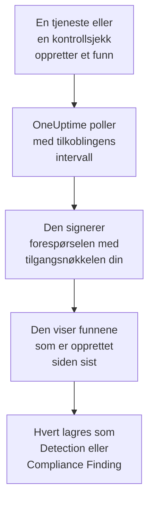

# AWS Security Hub

Importer funn fra [AWS Security Hub](https://aws.amazon.com/security-hub/) til sikkerhetshendelsene i OneUptime: funn fra GuardDuty, Inspector, Macie og IAM Access Analyzer, Security Hubs egne kontrollsjekker og funn fra partnerprodukter. Der søker du i dem ved siden av logger, sporinger og metrikker, korrelerer dem med alle andre kilder og varsler vakten om dem som betyr noe. OneUptime leser dem med en tilgangsnøkkel du selv oppretter, som bare får utføre én skrivebeskyttet handling, og endrer ingenting i AWS. Det er ingen agent, EventBridge-regel eller S3-eksport å sette opp.

:::cards
- [Sett opp tilkoblingen](#sett-opp-tilkoblingen): En IAM-policy, en tilgangsnøkkel og skjemaet for tilkoblingen.
- [Hva som importeres](#hva-som-importeres): Hvordan hvert funn blir en sikkerhetshendelse.
- [Slik fungerer polling](#slik-fungerer-polling): Vinduet hver poll leser, og hvorfor det overlapper det forrige med 30 minutter.
- [Feilsøking](#feilsøking): Hva hver feil betyr, og hva du skal endre.
:::

## Slik fungerer det



Hvert minutt poller OneUptime hver aktiverte tilkobling der pollintervallet er gått. En poll kaller Security Hubs `GetFindings` i regionen din, signert med [Signature Version 4](https://docs.aws.amazon.com/IAM/latest/UserGuide/reference_sigv-create-signed-request.html), for funnene som er opprettet siden forrige poll. Den lagrer hvert som en [OCSF](https://schema.ocsf.io/)-hendelse: en kontrollsjekk som et Compliance Finding (klasse `2003`), og alle andre funn som et Detection Finding (klasse `2004`). Deteksjonsregler, monitorer og dashbord behandler det deretter som en sikkerhetshendelse fra en hvilken som helst annen kilde.

## Før du begynner

- I OneUptime rollen Project Owner, Project Admin eller Security Admin. Security Member og Security Viewer kan se tilkoblinger og kjøringshistorikken deres, men ikke endre dem.
- En AWS-konto med Security Hub aktivert i regionen du kobler til. Security Hub er regionalt: en tilkobling leser funnene én konto har i én region.
- For å lese funnene til alle kontoer og regioner gjennom én tilkobling: Security Hubs delegerte administratorkonto, i hjemmeregionen sin, med [aggregering på tvers av regioner](https://docs.aws.amazon.com/securityhub/latest/userguide/finding-aggregation.html) slått på. **Security Hub → Settings → Regions** viser hjemmeregionen.
- Utgående HTTPS fra OneUptime-appen og -workerne til `securityhub.<region>.amazonaws.com`, eller `securityhub.<region>.amazonaws.com.cn` i Kina, og en riktig klokke på vertene deres: AWS avviser en forespørsel som er signert med mer enn 5 minutters avvik.

## Sett opp tilkoblingen

Tilkoblingen signerer forespørslene sine med en IAM-tilgangsnøkkel. Identiteten til nøkkelen trenger én handling, `securityhub:GetFindings`, og ingenting annet: tilkoblingen endrer aldri et funn.

:::steps
### Tillat lesing av funn

Åpne **Policies → Create policy** i [IAM-konsollen](https://console.aws.amazon.com/iam/), velg **JSON**, og lim inn denne policyen. Gi den et navn, for eksempel `OneUptimeSecurityHubRead`:

```json
{
  "Version": "2012-10-17",
  "Statement": [
    {
      "Effect": "Allow",
      "Action": "securityhub:GetFindings",
      "Resource": "*"
    }
  ]
}
```

`GetFindings` kan ikke begrenses til en ressurs, så `Resource` forblir `*`. Den administrerte policyen `AWSSecurityHubReadOnlyAccess` fungerer også, men tillater mer.

### Opprett en tilgangsnøkkel

1. Åpne **Users → Create user**, gi brukeren et navn, for eksempel `oneuptime-security-hub`, la konsolltilgang være av, og knytt til policyen. For andre kontoers funn gjør du dette i den delegerte administratorkontoen.
2. Åpne brukeren, deretter **Security credentials → Access keys → Create access key**, og velg **Third-party service**.
3. Kopier **Tilgangsnøkkel-ID** og **Hemmelig tilgangsnøkkel**. AWS viser hemmeligheten bare én gang.

### Legg til tilkoblingen i OneUptime

Åpne **Produkter → Security Events → Tilkoblinger** (`/dashboard/{projectId}/security-events/connections`), klikk på **Legg til tilkobling**, velg **AWS Security Hub**, og klikk på **Neste**. Fyll inn innstillingene i tabellen nedenfor, klikk på **Neste**, og lim inn hemmeligheten i **Hemmelig tilgangsnøkkel**.

### Test den før du lagrer

Klikk på **Test disse innstillingene** under **Test før du lagrer**. Testen signerer en forespørsel med verdiene i skjemaet og lagrer ingenting, så en feil nøkkel eller en manglende tillatelse viser seg før tilkoblingen finnes. Klikk deretter på **Neste**, gi tilkoblingen et **Navn**, og opprett den.
:::

| Innstilling | Hva du skal skrive inn |
| --- | --- |
| **Region** | Koden for regionen, for eksempel `us-east-1`, `eu-central-1` eller `us-gov-west-1`: for andre kontoers funn hjemmeregionen til administratorkontoen. |
| **Tilgangsnøkkel-ID** | ID-en til nøkkelen: 16 til 128 bokstaver eller sifre, vanligvis 20 som starter med `AKIA`, eller `ASIA` for midlertidig legitimasjon. |
| **Hemmelig tilgangsnøkkel** | Hemmeligheten til nøkkelen. Den krypteres, returneres aldri av API-et og vises aldri igjen. Erstatt den med **Oppdater påloggingsinformasjon** på tilkoblingen. |
| **Session token** | Bare for midlertidig legitimasjon, som trenger det: en `ASIA`-nøkkel avvises uten det, og en `AKIA`-nøkkel avvises med det. |

Midlertidig legitimasjon fra `aws sts assume-role` eller `aws sts get-session-token` utløper, for en antatt rolle etter høyst 12 timer, og pollingen stopper til du limer inn ny med **Oppdater påloggingsinformasjon**. En langvarig nøkkel med denne smale policyen, rotert etter din egen tidsplan, fortsetter å polle uten tilsyn. For å bytte fra midlertidig legitimasjon til en langvarig nøkkel skriver du inn den nye nøkkelen i **Oppdater påloggingsinformasjon** og slår på **Remove the stored Session token**.

Trinnet **Henting** har også en valgfri **Beskrivelse**, **Henteintervall (minutter)**, et heltall fra `1` til `1440` som starter på `5`, og **Aktivert**, som starter slått på.

## Hva som importeres

Hvert funn blir én hendelse med leverandøren `Amazon Web Services` og produktet `AWS Security Hub`. Et funn med et `Compliance`-objekt, en kontrollsjekk mot en standard som AWS Foundational Security Best Practices eller CIS, blir et Compliance Finding (OCSF-klasse `2003`). Alle andre funn blir et Detection Finding (OCSF-klasse `2004`).

| Funnfelt | OneUptime-kolonne |
| --- | --- |
| `Id`, en ARN for funn som AWS oppretter | Hendelses-UID, som også duplikater fjernes etter |
| `CreatedAt`, ellers `UpdatedAt`, ellers `FirstObservedAt` | Tidspunktet for hendelsen |
| `Title` | Regelnavn |
| `GeneratorId`, for eksempel GuardDuty-funntypen eller ID-en til kontrollen | Regel-ID |
| `Title`, ellers `Description` | Melding |
| `Severity.Label`, ellers et bånd av `Severity.Normalized` | Alvorlighetsgrad |
| `Workflow.Status`: `NEW`, `NOTIFIED`, `RESOLVED` eller `SUPPRESSED`, ellers den eldre `WorkflowState` | Status |
| `Types` under `TTPs/`: `TTPs/Initial Access/...` blir `TA0001` | MITRE ATT&CK-taktikker og -teknikker |
| IAM-brukeren for en tilgangsnøkkel- eller brukerressurs, `Network.SourceIpV4` eller `SourceIpV6`, `Process.Name` eller `Process.Path` | Aktørens bruker, IP og prosess |
| Instans-ID-en for en `AwsEc2Instance`-ressurs, `Network.DestinationIpV4` eller `DestinationIpV6`, `Network.DestinationPort`, den første `Resources[].Id` | Målets vert, IP, port og ressurs |
| Disse, hver `Resources[].Id`, `AwsAccountId`, domenene i nettverket, navn på skadevare og verdier fra trusseletterretning | Observables |
| Hele funnet, flatet ut til nøkler med punktum, for eksempel `Compliance.Status` og `Remediation.Recommendation.Url` | `attributes` |

Når et funn ikke har noen `Severity.Label`, avgjør `Severity.Normalized`: `0` er Informational, `1` til `39` Low, `40` til `69` Medium, `70` til `89` High og `90` til `100` Critical. Et funn som Security Hub oppdaterer senere, med en ny `Workflow.Status` eller en kontroll som nå består, beholder `Id`-en sin, så det importeres ikke på nytt: hendelsen beholder funnet slik det var ved importen.

## Slik fungerer polling

Hver poll viser funnene som er opprettet i vinduet, de eldste først, 100 per side, og følger `NextToken` til den har lest hele vinduet:

```text
POST https://securityhub.{region}.amazonaws.com/findings
    {"Filters": {"CreatedAt": [{"Start": "{window start}", "End": "{window end}"}]},
     "SortCriteria": [{"Field": "CreatedAt", "SortOrder": "asc"}],
     "MaxResults": 100}
```

- **Opprettelsestidspunktet er markøren.** Funn vises etter `CreatedAt`, aldri etter `FirstObservedAt`. GuardDuty oppretter et funn når den har sett nok aktivitet, og en kontrollsjekk når Security Hub kontrollerer ressursen første gang, timer eller dager etter at aktiviteten begynte. En markør på observasjonstidspunktet ville hoppet over dem.
- **Den første pollen ser 24 timer tilbake**, slik at en ny tilkobling viser de nylige funnene sine med en gang.
- **Hver senere poll starter 30 minutter før den lagrede markøren.** `CreatedAt` settes av tjenesten som fant problemet, og funnet når Security Hub senere: GuardDuty sender nye funn innen fem minutter, og en mislykket levering via EventBridge prøves på nytt i opptil 24 timer. Overlappingen leser slike funn ved neste poll. Et funn som kommer mer enn 30 minutter etter sin `CreatedAt`, kan havne bak markøren: importer tidsrommet for å hente det.
- **En poll leser høyst 24 timer forbi markøren.** En tilkobling der markøren har kommet på etterskudd, tar igjen i en rekke vinduer på 24 timer, og **Helse** viser **Catching up**.
- **Duplikater fjernes etter funnets `Id`** i prosjektet, slik at overlappingen, et gjentatt vindu og en import aldri lagrer et funn to ganger.

### Når et vindu inneholder mer enn én poll kan lese

En poll sender høyst 20 forespørsler med 100 funn: 2 000 funn. Når et vindu inneholder flere, er kjøringen **Delvis**, med en advarsel som:

```text
Stopped after 20 findings requests (the per-run request limit) before the window was fully read. The last finding read was created at 2026-09-14T08:12:44.000Z.
```

Funn leses de eldste først, så OneUptime flytter markøren til opprettelsestidspunktet for det sist leste funnet, og den neste pollen starter der, uten overlappingen på 30 minutter, med samme vinduslengde. En travel konto tar igjen rundt 2 000 funn per poll i stedet for å lese de samme på nytt. Overlappingen kommer tilbake når markøren har flyttet seg 30 minutter forbi det punktet.

Når en kjøring ikke kommer forbi den lagrede markøren i det hele tatt, for eksempel fordi de 30 minuttene med overlapping alene inneholder mer enn 2 000 funn, gjør OneUptime i stedet vinduet kortere:

1. **Snevre inn.** Den neste pollen leser et vindu som er halvparten så langt, fra det samme startpunktet, og fortsetter å halvere til et vindu leses helt, ned til ett minutt. Kjøringens advarsel sier det: `This window holds more records than one poll can read; the next poll reads a {n} minute window from the same starting point.`
2. **Vokse igjen.** Når et vindu er lest helt, er det neste igjen dobbelt så langt, opptil 24 timer.
3. **Gå forbi ett enkelt minutt.** Hvis selv ett minutt inneholder mer enn en poll kan lese, går pollingen forbi det, slik at nyere funn fortsetter å komme, og overlappingen til senere poller når ikke lenger tilbake til det. Kjøringen forblir **Delvis**, og **Siste feil** lyder `More records were created in the one minute from {cursor} to {end} than one poll can read. Polling moved past this minute so newer records keep arriving; use Import this time range in Diagnostics on this minute to recover what one run can read.` Importer det minuttet med **Import this time range** for å hente det én kjøring kan lese.

En kjøring som mislykkes helt, med en feil fra AWS, beholder markøren og vinduslengden, og den neste pollen leser det samme vinduet på nytt. Det eneste unntaket er en forespørsel som fikk tidsavbrudd: markøren blir stående, men det neste vinduet er halvparten så langt, fordi et vindu som er for tungt til å bli besvart i tide, ville fått tidsavbrudd ved hvert forsøk. Å endre **Henteintervall (minutter)** endrer ingenting av dette: det avgjør hvor ofte en poll starter, ikke hvor vinduet begynner.

### Kjør, forhåndsvis og importer ved behov

Klikk på **Diagnostikk** på en tilkobling for å se de siste kjøringene og arbeide med den manuelt. Alle som kan endre tilkoblingen, kan starte disse handlingene; alle som kan se den, kan lese historikken.

- **Kjør nå** starter en poll med en gang, med den vanlige markøren, også når tilkoblingen ikke er **Aktivert**.
- **Preview findings** leser et tidsrom på opptil 7 dager og importerer ingenting.
- **Import this time range** importerer et tidsrom på opptil 7 dager, etter at du har bekreftet, uten å flytte markøren. Funn som allerede er importert, hoppes over.
- **Copy diagnostics** på en kjøring kopierer rapporten for brukerstøtte. Den inneholder aldri legitimasjon.

## Test tilkoblingen

**Test tilkoblingen** på raden til en tilkobling og **Test disse innstillingene** i skjemaet kjører i API-prosessen, ikke i en bakgrunnsworker, slik at en test også svarer når det er workerne som er problemet. Den kjører disse kontrollene i rekkefølge:

| Kontroll | Hva den kontrollerer |
| --- | --- |
| **Konfigurasjon** | Hver innstilling er til stede og riktig formatert. Ingenting kontaktes når dette mislykkes. |
| **Authenticate with AWS** | AWS godtar en signert `GetFindings`-forespørsel for ett funn som er opprettet de siste 24 timene. AWS kontrollerer signaturen før IAM-policyen, så et avslag fra policyen består likevel denne kontrollen: nøkkelen er riktig. |
| **Read findings** | Security Hub besvarer den forespørselen: identiteten kan kalle `securityhub:GetFindings`, og Security Hub er aktivert i regionen. |
| **Findings available to import** | Hvor mange funn som er opprettet de siste 24 timene og de siste 7 dagene, én side på 100 for hver, så `100+` betyr flere. Ingen på 7 dager er en advarsel, ikke en feil. |
| **Background workers**, **Poll scheduler**, **Security event storage** | OneUptimes egen side: en prosess tar jobbene fra Worker-køen, poll-jobben kjører hvert minutt, og lageret for sikkerhetshendelser svarer. |
| **Scheduled polling** | For en lagret tilkobling: polling er slått på, ingen kjøring sitter fast og venter på en worker, og poller kjører i tide. |

Hver forespørsel i en test har en frist på 20 sekunder. En test importerer aldri noe og flytter aldri markøren, og hver kontroll som mislykkes, sier hva du skal endre.

## Feilsøking

**Siste feil** for tilkoblingen lagrer hele feilmeldingen, med legitimasjon maskert, bak et prefiks som navngir trinnet som mislyktes. Når en tilkobling har en feil, velger du **Vis feil** i kolonnen **Handlinger** for å lese den, og **Kopier feil** i dialogen for å kopiere den. Hver melding starter med `AWS Security Hub findings request`; les det som følger.

:::details Last Error sier `failed (HTTP 401)` eller `failed (HTTP 403)`
AWS avviste forespørselen. Meldingen siterer feilkoden fra AWS, eller AWS' egne ord når det ikke ble sendt noen kode:

- `AccessDeniedException`, eller `is not authorized to perform`: nøkkelen er riktig, men identiteten kan ikke kalle `securityhub:GetFindings`. Knytt til policyen fra [Sett opp tilkoblingen](#sett-opp-tilkoblingen). En permissions boundary eller en service control policy kan også nekte den.
- `InvalidAccessException`, eller `is not subscribed to AWS Security Hub`: Security Hub er ikke aktivert for denne kontoen i denne **Region**, eller kontoen er ikke administratoren der.
- `InvalidSignatureException` eller `SignatureDoesNotMatch`, eller `The request signature we calculated does not match`: **Hemmelig tilgangsnøkkel** hører ikke til **Tilgangsnøkkel-ID**. Opprett en ny tilgangsnøkkel, og lagre den med **Oppdater påloggingsinformasjon**.
- `UnrecognizedClientException` eller `InvalidClientTokenId`, eller `The security token included in the request is invalid`: AWS kjenner ikke **Tilgangsnøkkel-ID**. Den er skrevet feil, slettet, deaktivert eller fra en annen partisjon, eller det er en midlertidig nøkkel uten sitt **Session token**.
- `ExpiredTokenException`, eller `The security token included in the request is expired`: den midlertidige legitimasjonen er utløpt. Utsted ny, eller bytt til en langvarig nøkkel.
- `RequestTimeTooSkewed` eller `RequestExpired`, eller `Signature expired`: klokken på OneUptime-vertene går mer enn 5 minutter feil. Rett opp NTP på app- og workervertene.
- Ingen kode i det hele tatt: AWS sa ikke om det var nøkkelen eller policyen som avviste den. Kontroller nøkkelen først, deretter policyen.
:::

:::details Last Error sier `failed (HTTP ...)` med en annen status
- `HTTP 404`: ingen Security Hub-endepunkt svarte i denne **Region**. Sammenlign den med regionmenyen i AWS-konsollen: `us-east-1`, ikke `us-east1` eller `N. Virginia`.
- `HTTP 429`: kontoen traff grensen til Security Hub, 3 `GetFindings`-forespørsler i sekundet i en region. Den neste pollen prøver igjen. Hvis det fortsetter, ser du etter et annet verktøy eller en annen tilkobling som leser samme konto og region.
- `HTTP 5xx`: Security Hub hadde et problem på sin side. Den neste pollen prøver igjen.
- `HTTP 400`: Security Hub avviste spørringen, som OneUptime bygger, ikke innstillingene dine. Send meldingen til OneUptimes brukerstøtte.
:::

:::details Last Error sier `returned`, `timed out` eller `Could not reach data source`
- `returned a non-JSON body` eller `returned an unrecognized response shape`: noe annet enn Security Hub svarte, for eksempel påloggingssiden til en proxy eller en gateway som skriver om svar. Det rapporteres i stedet for å bli tatt som et tomt vindu, slik at markøren aldri flytter seg forbi funn som ingen har lest.
- `timed out after 60 seconds with no response`, eller `failed: Could not reach data source`: forespørselen fikk ikke noe svar. Endepunktene til Security Hub er offentlige, så kontroller DNS, brannmurer og proxyer mellom OneUptime-appen og -workerne og `securityhub.<region>.amazonaws.com`.
:::

:::details Last Polled er Never og Last Error er tom
Ingen poll er fullført for denne tilkoblingen. Kjør **Test tilkoblingen**: kontrollene **Background workers** og **Poll scheduler** navngir årsaken. På en selvdriftet installasjon er den vanlige årsaken `DISABLE_QUEUE_WORKERS=true` på appen, uten en separat worker-utrulling som tar jobbene: sett den til `false`, eller kjør worker-utrullingen (Helm: `worker.enabled: true`).
:::

:::details En kjøring er Partial
- `Stopped after 20 findings requests`: vinduet inneholdt mer enn de 2 000 funnene én kjøring leser. Ingenting går tapt: den neste pollen starter etter det sist leste funnet. En tilkobling som forblir **Delvis** poll etter poll, er i ferd med å ta igjen et etterslep, og **Sist hentet** og **Siste importerte hendelse** fortsetter å gå fremover. Hvis den aldri tar igjen, oppretter kontoen mer enn 2 000 funn per pollintervall: gjør **Henteintervall (minutter)** kortere.
- `More records were created in the one minute from ... than one poll can read`: pollingen gikk forbi det minuttet. Importer det med **Import this time range** i **Diagnostikk**. En import leser like mye som en poll.
:::

:::details Testen lykkes, men ingenting importeres
Les **Findings available to import** i rapporten fra testen. `0` de siste 7 dagene betyr at Security Hub ikke har opprettet noe funn i denne kontoen og regionen: kontroller at GuardDuty, Inspector eller en sikkerhetsstandard er slått på der. For å se funnene til andre kontoer og regioner kobler du til administratorkontoen i hjemmeregionen.
:::

:::details Et funn i Security Hub-konsollen kom aldri frem
Sammenlign `CreatedAt` med `ProcessedAt`, når Security Hub mottok det. Et funn som kom mer enn 30 minutter etter sin `CreatedAt`, kan havne bak markøren: importer `CreatedAt` med **Import this time range**.
:::

## Hva du får

- **Søk.** Filtrer funn etter alvorlighetsgrad, status, regel, konto, ressurs eller en hvilken som helst observable i utforskeren for sikkerhetshendelser, ved siden av alle andre kilder.
- **Korrelasjon.** Brukerne, instansene, IP-ene, ressurs-ARN-ene og konto-ID-ene i hvert funn indekseres som observables, så ett søk finner alt som nevner dem.
- **Deteksjonsregler.** Sigma-regler som kjører etter en tidsplan over sikkerhetshendelsene dine, og åpner varsler som varsler vakten.
- **Monitorer.** Monitorer for sikkerhetshendelser teller samsvarende hendelser, for eksempel nye kritiske GuardDuty-funn eller mislykkede kontroller, og åpner hendelser eller varsler over en terskel.

Sikkerhetshendelser faktureres som resten av telemetrien din, per innhentet GB. Se [Priser](https://oneuptime.com/pricing).

## Neste trinn

:::cards
- [Sikkerhetshendelser](/docs/telemetry/security-events): Søk, korreler og varsle på det du importerer.
- [Okta System Log](/docs/integrations/okta): Importer også påloggingene fra identitetsleverandøren din.
- [Roller](/docs/permissions/reference#roller): Hva Security-rollene kan se og endre.
- [Oversikt over integrasjoner](/docs/integrations/index): De andre verktøyene du kan koble til.
:::
