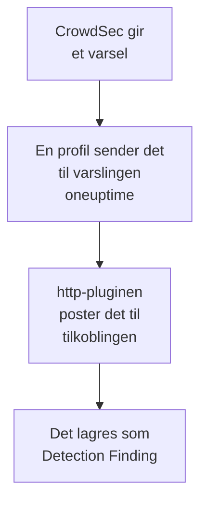

# CrowdSec

Motta varslene fra [CrowdSec](https://www.crowdsec.net/) i sikkerhetshendelsene i OneUptime etter hvert som CrowdSec utløser dem, og blokker adressene på blokkeringslisten til prosjektet ditt med CrowdSec. CrowdSecs egen varslingsplugin sender hvert varsel til en CrowdSec-tilkobling, som åpner saker fra deteksjonene til CrowdSec. Når du slår på blokkering, utestenger OneUptime hver adresse du blokkerer, gjennom Local API-et til CrowdSec, og hver bouncer som leser det, blokkerer adressen.

:::cards
- [Sett opp tilkoblingen](#sett-opp-tilkoblingen): En tilkobling, og varslingen som sender varslene fra CrowdSec til den.
- [Hva som mottas](#hva-som-mottas): Hvordan hvert CrowdSec-varsel blir en sikkerhetshendelse.
- [Blokker adresser med CrowdSec](#blokker-adresser-med-crowdsec): Utesteng adressene på blokkeringslisten din i CrowdSec.
- [Les CrowdSecs blokkeringslister](#les-crowdsecs-blokkeringslister): Listene CrowdSec Console leverer, som en feed med trusselsinformasjon.
- [Feilsøking](#feilsøking): Hva hver feil betyr, og hva du skal endre.
:::

## Slik fungerer det



Local API-et til CrowdSec gir hvert varsel som en profil sender til en varsling, videre til pluginen for den varslingen. Varslingen til tilkoblingen bruker `http`-pluginen til CrowdSec: Den poster varselet, i CrowdSecs eget JSON, til inntaket av sikkerhetshendelser med inntaksnøkkelen din og navngir tilkoblingen. OneUptime lagrer det som en [OCSF](https://schema.ocsf.io/)-hendelse av typen Detection Finding (klasse `2004`), holder det opp mot deteksjonsreglene dine og åpner en sak fra hver av CrowdSecs egne deteksjoner som når tilkoblingens nivå for **Åpne saker fra**. Ingenting polles: Et varsel kommer frem sekunder etter at CrowdSec utløser det.

## Før du begynner

- I OneUptime rollen Prosjekteier, Prosjektadministrator eller Sikkerhetsadministrator. Sikkerhetsmedlem og Sikkerhetsleser kan se tilkoblinger, men ikke endre dem.
- CrowdSec 1.5 eller nyere, med Local API-et og `http`-varslingspluginen som følger med. Denne siden er skrevet ut fra CrowdSec v1.8.2.
- Utgående HTTPS fra verten som kjører Local API-et til CrowdSec, til OneUptime-instansen din.
- For også å blokkere adresser: et Local API som OneUptime kan nå, og en maskin for OneUptime (se [Blokker adresser med CrowdSec](#blokker-adresser-med-crowdsec)).

## Sett opp tilkoblingen

:::steps
### Legg til tilkoblingen i OneUptime

Åpne **Produkter → Sikkerhetshendelser → Tilkoblinger** (`/dashboard/{projectId}/security-events/connections`), klikk på **Legg til tilkobling**, velg **CrowdSec**, og klikk på **Neste**. For bare å motta varsler lar du alle innstillingene i tabellen nedenfor stå tomme; for også å blokkere adresser fyller du dem ut.

### Test den før du lagrer

Klikk på **Test disse innstillingene** under **Test før du lagrer**. Uten et Local API angitt sier testen det og kontakter ingenting; med et Local API angitt når testen det, logger på som maskinen og lagrer ingenting. Klikk deretter på **Neste**, gi tilkoblingen et **Navn** i trinnet **Varsler**, velg verdien for **Åpne saker fra**, og opprett den.

### Lagre varslingen på CrowdSec-verten

Når tilkoblingen opprettes, åpnes **Send varsler** for den, som du senere åpner igjen fra raden til tilkoblingen. Velg en nøkkel under **Velg en inntaksnøkkel**, og lagre så varslingen som vises, med nøkkelen og tilkoblingen din allerede fylt ut, på verten som kjører Local API-et til CrowdSec:

```yaml title="/etc/crowdsec/notifications/oneuptime.yaml"
type: http
name: oneuptime

# info or quieter: at debug, CrowdSec logs each request's headers.
log_level: info

format: |
  {{.|toJson}}

url: https://oneuptime.com/security-events/v1/ingest?connection=YOUR_CONNECTION_ID&format=crowdsec
method: POST
headers:
  Content-Type: application/json
  x-oneuptime-token: YOUR_INGESTION_TOKEN
```

### Send varslene fra profilene dine til den

Legg i `/etc/crowdsec/profiles.yaml` til `oneuptime` i `notifications` for hver profil som OneUptime skal motta varslene fra, og last deretter inn CrowdSec på nytt:

```yaml title="/etc/crowdsec/profiles.yaml"
notifications:
  - oneuptime
```

```bash
sudo systemctl reload crowdsec
```

### Send et testvarsel

```bash
sudo cscli notifications test oneuptime
```

**Send varsler** viser når det kommer frem, og **Vis varsler** åpner det i sikkerhetshendelsene. Det er en hendelse med alvorlighetsgraden Informational og åpner ingen sak.
:::

| Innstilling | Hva du skal skrive inn |
| --- | --- |
| **Local API-URL** | Bare for å blokkere adresser: der OneUptime når Local API-et til CrowdSec, for eksempel `https://crowdsec.example.com:8080`. Bruk `https` overalt der tilkoblingen krysser et nettverk. |
| **Maskin-ID** | Bare for å blokkere adresser: maskinen OneUptime logger på som, lagt til på CrowdSec-verten med `sudo cscli machines add oneuptime --auto -f -`. |
| **Blokker adresser med CrowdSec** | Slått av på en ny tilkobling. Slått på utestenger den adressene og områdene på blokkeringslisten din i CrowdSec, og krever de tre andre innstillingene (se [Blokker adresser med CrowdSec](#blokker-adresser-med-crowdsec)). |
| **Maskinpassord** | Bare for å blokkere adresser: passordet `cscli` skrev ut for maskinen. Det krypteres, returneres aldri av API-et og vises aldri igjen. Erstatt det med **Oppdater påloggingsinformasjon** på tilkoblingen. |

Trinnet **Varsler** har også en valgfri **Beskrivelse**, og **Aktivert**, som starter slått på. En tilkobling som ikke er aktivert, beholder varslene den mottar, som hendelser, og åpner ingen sak fra dem.

I en container legges varslingen i mappen som er montert på `/etc/crowdsec/notifications/`, og en omstart av containeren leser den inn. En Kubernetes-installasjon angir den i Helm-verdiene sine under `config.notifications`, med `profiles.yaml` ved siden av under `config`.

## Hva som mottas

Hvert varsel CrowdSec sender, blir én hendelse av typen Detection Finding (OCSF-klasse `2004`), med leverandør og produkt `CrowdSec`:

| CrowdSec-felt | OneUptime-kolonne |
| --- | --- |
| `uuid`, eller en hash for et varsel uten | Hendelses-UID, som også duplikater fjernes etter |
| `stop_at`, eller `start_at` | Tidspunktet for hendelsen |
| `scenario` | Regel-ID og regelnavnet: tittelen på scenarioet i CrowdSec Hub, eller navnet |
| `source.ip`, eller `source.value` for et `Ip`-varsel | Aktørens IP |
| `target_fqdn` eller `target_host` for varselet eller hendelsene i det, ellers `machine` som hendelsene nevner | Målvert |
| `target_user`, `target_uri` | Målbruker og -ressurs |
| `type` for den første beslutningen | Status: `Blocked` for en utestengning, `Challenge` for en captcha, `Logged` uten beslutning eller i simuleringsmodus |
| Atferden til scenarioet | Alvorlighetsgrad, og MITRE ATT&CK-taktikkene og -teknikkene |
| Alt annet, for eksempel `source.cn`, `source.as_name` og `events_count` | `attributes`: feltene i varselet flatet ut til nøkler med punktum, de 10 første hendelsene i sin helhet, og OneUptimes tolkning under `crowdsec.` |

Et CrowdSec-varsel har ingen egen alvorlighetsgrad, så OneUptime tar den fra det scenarioet oppdager, slik CrowdSec Hub merker det (`ssh:bruteforce`, `http:exploit`):

| Atferd | Alvorlighetsgrad |
| --- | --- |
| Et exploit, for eksempel en CVE eller det AppSec-komponenten blokkerte, eller det en angriper gjør etter å ha kommet inn | High |
| Brute force, tjenestenekt, svindel, en umulig pålogging, eller atferd OneUptime ikke kan plassere | Medium |
| Skanninger, sonderinger, crawling, roboter, spam og endringer i skyrevisjon | Low |
| CrowdSecs egne testscenarioer | Informational |

Med **Åpne saker fra** på **Høy og høyere** åpner CrowdSecs exploits saker, og de daglige utestengningene av skannere og passordgjettere forblir hendelser for deteksjonsreglene dine. Bare CrowdSecs egne deteksjoner åpner saker. En beslutning noen har lagt til med `cscli` eller i CrowdSecs Console, en adresse på en CrowdSec-blokkeringsliste, testvarselet og OneUptimes egne utestengninger som kommer tilbake, er Informational og åpner ingen. Et varsel som sendes to ganger, slik `cscli notifications reinject` gjør, lagres én gang.

## Blokker adresser med CrowdSec

Slå på **Blokker adresser med CrowdSec** på en tilkobling, og adressene og områdene på [blokkeringslisten](/docs/telemetry/security-cases#blokkeringsliste) til prosjektet ditt utestenges i CrowdSec. Hver bouncer som leser Local API-et, for eksempel brannmur-, nginx- og Traefik-bouncerne, blokkerer dem der den kjører, slik den blokkerer CrowdSecs egne utestengninger. Blokkeringer går gjennom de samme godkjenningene og de samme grensene for automatisk respons og oppheves med den samme **Opphev** som alle andre steder blokkeringslisten din håndheves.

Bryteren er slått av på en ny tilkobling. Slik slår du den på:

1. Legg til en maskin for OneUptime på CrowdSec-verten; kommandoen skriver ut passordet:

   ```bash
   sudo cscli machines add oneuptime --auto -f -
   ```

2. La OneUptime nå Local API-et, som lytter på `127.0.0.1:8080` med mindre noe annet er angitt: Sett `api.server.listen_uri` i `config.yaml` til CrowdSec, server det over TLS eller bak en `https`-proxy, og slipp OneUptimes adresser gjennom brannmuren din.
3. Rediger tilkoblingen, fyll ut **Local API-URL** og **Maskin-ID**, legg passordet i **Maskinpassord**, slå på **Blokker adresser med CrowdSec**, og lagre. **Test tilkoblingen** sjekker deretter at maskinen logger på og leser OneUptimes utestengninger, uten å endre noe.

Slik opprettes en utestengning, og slik slutter den:

- Hver blokkering er én utestengningsbeslutning, opprettet slik `cscli decisions add` oppretter en, under scenarioet `oneuptime/blocklist`. CrowdSec beholder den som en manuell beslutning, så den deles aldri med Central API-et til CrowdSec med mindre du deler manuelle beslutninger. OneUptime leser og fjerner bare sine egne utestengninger, aldri en som en person eller CrowdSec har opprettet.
- En blokkering med en slutt er en utestengning til nøyaktig den slutten, og CrowdSec opphever den da selv, enten OneUptime kan nå det eller ikke. En blokkering til den oppheves, er en utestengning på 7 dager, som fornyes når det er 3 dager eller mindre igjen, så en utestengning OneUptime ikke lenger holder ved like, slutter innen en uke.
- **Opphev** fjerner utestengningen ved neste gjennomgang, innen ett minutt. En utestengning som er fjernet i CrowdSec, med `cscli decisions delete` eller en flush, opprettes på nytt ved neste gjennomgang så lenge blokkeringen varer.
- En adresse eller et område på en av CrowdSecs tillatelseslister utestenges aldri: Blokkeringen viser den som ikke håndhevet der, med navnet på tillatelseslisten, og en utestengning som allerede er opprettet, fjernes så snart en tillatelsesliste inneholder adressen.
- Prosjektets egne adresser, for eksempel **Klarerte proxyer**, lastbalanserere og edge-nettverk, blokkeres aldri noe sted, heller ikke i CrowdSec.
- CrowdSec utestenger bare: En utfordring brukes ikke der, og et domene, en URL eller en fil sendes ikke til CrowdSec.

Når Local API-et ikke kan nås, endres ingenting i CrowdSec: Utestengningene CrowdSec har, blir værende og slutter når de slutter. **Håndhevet hos** på **Blokkeringsliste** sier når CrowdSec sist hadde hver blokkering, og OneUptime prøver igjen etter 1 minutt og venter deretter dobbelt så lenge hver gang, opptil 30 minutter. En ny blokkering venter til den kan opprettes.

## Les CrowdSecs blokkeringslister

CrowdSec Console leverer blokkeringslistene organisasjonen din abonnerer på, som en Raw IP List-integrasjon: én adresse per linje, bak et brukernavn og et passord. En [feed med trusselsinformasjon](/docs/telemetry/threat-intelligence) leser dem og sammenligner hendelsene dine med dem:

1. Opprett en Raw IP List-integrasjon i CrowdSec Console, med IP-aggregering slått av: OneUptime sammenligner adresser, ikke områder. Kopier endepunktet, brukernavnet og passordet.
2. Åpne **Produkter → Sikkerhetshendelser → Deteksjoner → Trusselsinformasjon** i OneUptime, klikk på **Opprett Feed med trusselsinformasjon**, og velg **Liste over indikatorer**.
3. Lim inn endepunktet som **Liste-URL**, velg **Brukernavn og passord** under **Pålogging**, og lim inn begge. På CrowdSecs Community-plan, som tillater én nedlasting per dag, setter du **Henteintervall (minutter)** til `1440`.

Listene tilhører CrowdSec: Du kan bruke dem i dine egne verktøy, men ikke gi dem videre. OneUptime tilbyr ingen egen liste.

## Test tilkoblingen

**Test tilkoblingen** på raden til en tilkobling og **Test disse innstillingene** i skjemaet kjører i API-prosessen, ikke i en bakgrunnsworker. De kjører disse kontrollene i rekkefølge:

| Kontroll | Hva den kontrollerer |
| --- | --- |
| **Konfigurasjon** | Innstillingene er enten alle tomme eller alle angitt, og riktig formatert. Ingenting kontaktes når dette mislykkes. |
| **Reach CrowdSec's Local API** | `GET /health` svarer. Uten et Local API angitt sier kontrollen at tilkoblingen bare mottar varsler, og de tre neste kjøres ikke. |
| **Sign in to the Local API** | `POST /v1/watchers/login` godtar maskinen og passordet. |
| **Read CrowdSec's allowlists** | `GET /v1/allowlists` svarer, og hvor mange adresser og områder listene inneholder. Et Local API eldre enn 1.6.8, som ikke har noen, består. |
| **Block with CrowdSec** | Bare med **Blokker adresser med CrowdSec** slått på: Maskinen kan lese OneUptimes utestengninger tilbake, og hvor mange som er i kraft. Kontrollen endrer ingenting. |
| **Background workers**, **Security event storage** | OneUptimes egen side: en prosess tar jobbene fra Worker-køen, som lagrer det CrowdSec sender, og lageret for sikkerhetshendelser svarer. |
| **Alerts received** | For en lagret tilkobling: når det siste varselet kom frem. Ingen ennå er en advarsel, med en forklaring på hvordan du sender et testvarsel. |

En test utestenger eller fjerner aldri noe. **Kopier rapport** kopierer sjekklisten som JSON, uten passordet eller tokener.

## Feilsøking

**Helse** for tilkoblingen viser **Venter på varsler** til det første varselet kommer frem, deretter **Mottar varsler**, uansett hvor lang tid det neste tar; **Saker satt på pause** betyr at tilkoblingen ikke er aktivert. CrowdSec skriver det pluginen svarte, i sin egen logg, `/var/log/crowdsec.log`, som `HTTP server returned non 200 status code`.

:::details Ingen varsler kommer frem
- Kjør `sudo cscli notifications list`: `oneuptime` må stå på listen og være aktiv i en profil. En varsling som ingen profil nevner, sender ingenting.
- `401`: Inntaksnøkkelen i `x-oneuptime-token` mangler, er feil eller utløpt, og `422`: Den er slått av. Velg en nøkkel i **Send varsler**, og kopier varslingen på nytt.
- `400`: Adressen nevner ingen CrowdSec-tilkobling i dette prosjektet. Kopier adressen fra **Send varsler** for tilkoblingen: Den slutter på ID-en til tilkoblingen.
- Ingenting i det hele tatt i loggen: CrowdSec-verten kan ikke nå OneUptime-instansen din. Sjekk utgående HTTPS fra den, og proxyen.
:::

:::details Test tilkoblingen mislykkes ved Reach CrowdSec's Local API
`CrowdSec Local API health check could not be completed` betyr at ingenting svarte: Local API-et lytter på `127.0.0.1` som standard, så OneUptime kan ikke nå det før `api.server.listen_uri` og brannmuren din tillater det. En advarsel om at det svarer over `http`, betyr at passordet til maskinen krysser nettverket ukryptert: Server Local API-et over TLS, eller sett en `https`-proxy foran det.
:::

:::details Test tilkoblingen mislykkes ved Sign in to the Local API
`CrowdSec Local API login failed (HTTP 401)` slutter med hva du skal gjøre: Sjekk maskin-ID-en og passordet med `sudo cscli machines list`, valider en maskin som ikke er validert ennå, med `sudo cscli machines validate oneuptime`, eller legg til en maskin som logger på med et passord. Lagre et nytt passord med **Oppdater påloggingsinformasjon**.
:::

:::details En blokkering håndheves ikke i CrowdSec
Hold musepekeren over **Håndhevet hos** for blokkeringen: Den nevner en tillatelsesliste som inneholder adressen, en utfordring CrowdSec ikke bruker, eller feilen fra Local API-et. Så lenge Local API-et ikke kan nås, fortsetter OneUptime å prøve, og utestengningene CrowdSec allerede har, forblir i kraft.
:::

:::details CrowdSec sender varslene sine, men ingen lagres
Det CrowdSec sender, lagres av bakgrunnsworkerne: På en selvdriftet installasjon med `DISABLE_QUEUE_WORKERS=true` på appen og uten en separat worker-utrulling tas varslene imot og lagres aldri. **Test tilkoblingen** viser det som en kontroll **Background workers** som har mislyktes. Sett den til `false`, eller kjør worker-utrullingen (Helm: `worker.enabled: true`).
:::

## Neste trinn

:::cards
- [Sikkerhetshendelser](/docs/telemetry/security-events): Søk, korreler og varsle på det CrowdSec sender.
- [Sikkerhetssaker](/docs/telemetry/security-cases): Arbeid med sakene CrowdSecs deteksjoner åpner, og blokker fra dem.
- [Trusseletterretning](/docs/telemetry/threat-intelligence): Sammenlign hendelsene dine med CrowdSecs blokkeringslister.
- [Oversikt over integrasjoner](/docs/integrations/index): De andre verktøyene du kan koble til.
:::
