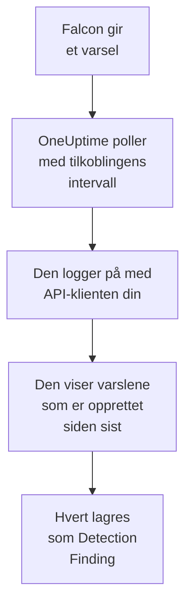

# CrowdStrike Falcon

Importer varsler fra [CrowdStrike Falcon](https://www.crowdstrike.com/platform/), fra deteksjoner på endepunkter, identiteter og i skyen, til sikkerhetshendelsene i OneUptime. Der søker du i dem ved siden av logger, sporinger og metrikker, korrelerer dem med alle andre kilder og varsler vakten om dem som betyr noe. OneUptime leser dem gjennom Falcon Alerts API med en API-klient som du oppretter, og skriver aldri til Falcon.

:::cards
- [Sett opp tilkoblingen](#sett-opp-tilkoblingen): En API-klient med ett omfang og skjemaet for tilkoblingen.
- [Hva som importeres](#hva-som-importeres): Hvordan hvert Falcon-varsel blir en sikkerhetshendelse.
- [Slik fungerer polling](#slik-fungerer-polling): Vinduet hver poll leser, og hva en travel CID gjør med det.
- [Feilsøking](#feilsøking): Hva hver feil betyr, og hva du skal endre.
:::

## Slik fungerer det



Hvert minutt poller OneUptime hver aktiverte tilkobling der pollintervallet har gått. En poll logger på Falcon-skyen din med ID-en og hemmeligheten til API-klienten, ber Alerts API om varslene som er opprettet siden forrige poll, og lagrer hvert som en [OCSF](https://schema.ocsf.io/)-hendelse av typen Detection Finding (klasse `2004`). Deteksjonsregler, monitorer og dashbord behandler den deretter som en sikkerhetshendelse fra en hvilken som helst annen kilde.

## Før du begynner

- I OneUptime rollen Project Owner, Project Admin eller Security Admin. Security Member og Security Viewer kan se tilkoblinger og kjøringshistorikken deres, men ikke endre dem.
- En Falcon-kunde-ID (CID) og en bruker av Falcon-konsollen som kan administrere API-klienter: rollen Falcon Administrator, eller en egendefinert rolle med tillatelsen API clients and keys.
- Utgående HTTPS fra OneUptime-appen og -workerne til API-verten for Falcon-skyen din, oppført under **Falcon cloud** nedenfor.

## Sett opp tilkoblingen

:::steps
### Opprett en API-klient

1. Åpne **Support and resources → API clients and keys** i Falcon-konsollen, og velg **Create API client**.
2. Gi den et navn, for eksempel `OneUptime security events`. Slå på **Alerts → Read** under **API scopes**, og la alle andre omfang være slått av: tilkoblingen skriver aldri til Falcon.
3. Opprett klienten. Falcon viser klient-ID-en, hemmeligheten og basis-URL-en én gang. Kopier alle tre nå: hemmeligheten kan tilbakestilles senere, men vises aldri igjen.

### Finn Falcon-skyen din

Basis-URL-en Falcon viste, forteller deg hvilken sky CID-en din ligger i. Siden **API clients and keys** viser den også, ved siden av hver klient. En klient fra én sky avvises av de andre.

| Basis-URL som Falcon viser | Falcon-sky |
| --- | --- |
| `https://api.crowdstrike.com` | US-1 |
| `https://api.us-2.crowdstrike.com` | US-2 |
| `https://api.eu-1.crowdstrike.com` | EU-1 |
| `https://api.laggar.gcw.crowdstrike.com` | US-GOV-1 |

### Legg til tilkoblingen i OneUptime

Åpne **Produkter → Security Events → Tilkoblinger** (`/dashboard/{projectId}/security-events/connections`), klikk på **Legg til tilkobling**, velg **CrowdStrike Falcon**, og klikk på **Neste**. Fyll ut innstillingene i tabellen nedenfor, klikk på **Neste**, og lim inn hemmeligheten i **Klienthemmelighet**.

### Test den før du lagrer

Klikk på **Test disse innstillingene** under **Test før du lagrer**. Testen logger på og leser varsler med verdiene i skjemaet, og lagrer ingenting, så feil sky eller et manglende omfang viser seg før tilkoblingen finnes. Klikk deretter på **Neste**, gi tilkoblingen et **Navn**, og opprett den.
:::

| Innstilling | Hva du skal skrive inn |
| --- | --- |
| **Klient-ID** | ID-en til API-klienten, slik Falcon viste den da du opprettet klienten. |
| **Falcon cloud** | Skyen CID-en din ligger i: **US-1 (api.crowdstrike.com)**, **US-2 (api.us-2.crowdstrike.com)**, **EU-1 (api.eu-1.crowdstrike.com)** eller **US-GOV-1 (api.laggar.gcw.crowdstrike.com)**. Hver forespørsel går til API-verten for den skyen. |
| **Klienthemmelighet** | Hemmeligheten til API-klienten. Den krypteres, returneres aldri av API-et og vises aldri igjen. Erstatt den med **Oppdater påloggingsinformasjon** på tilkoblingen. |

Trinnet **Henting** har også en valgfri **Beskrivelse**, **Henteintervall (minutter)**, et heltall fra `1` til `1440` som starter på `5`, og **Aktivert**, som starter slått på. En tilkobling som ikke er aktivert, kan fortsatt testes og polles manuelt.

## Hva som importeres

Tilkoblingen leser Falcons varsler: det Falcon-konsollen viser under **Endpoint security → Endpoint detections** og **Next-Gen SIEM → Alerts**, fra hvert produkt som gir dem. Hvert varsel blir én hendelse av typen Detection Finding (OCSF-klasse `2004`), med leverandøren `CrowdStrike` og produktet `Falcon`:

| Falcon-felt | OneUptime-kolonne |
| --- | --- |
| `composite_id` | Hendelses-UID, som også duplikater fjernes etter |
| `created_timestamp` | Tidspunktet for hendelsen |
| `display_name`, eller `name` | Regelnavn |
| `pattern_id` | Regel-ID |
| `description`, eller regelnavnet | Melding |
| `severity_name`, eller `severity` fra 0 til 100 | Alvorlighetsgrad |
| `status`, for eksempel `new`, `in_progress` eller `closed` | Status |
| `tactic_id`, `technique_id` | MITRE ATT&CK-taktikker og -teknikker |
| `device.hostname`, `device.local_ip`, `user_name`, `filename` eller `cmdline` | Aktørens vert, IP, bruker og prosess |
| `filename`, `filepath` og `cmdline`; `parent_details.filename`, `parent_details.filepath` og `parent_details.cmdline` | Prosessens navn, bane og kommandolinje; navn, bane og kommandolinje for den overordnede prosessen |
| `device.hostname`, `device.local_ip`, `device.external_ip`, `user_name`, `sha256` | Observables |
| Alt annet, for eksempel `device.platform_name`, `falcon_host_link`, `product` og `timestamp` | `attributes`, flatet ut til nøkler med punktum |

Tidspunktet for hendelsen er med vilje når Falcon opprettet varselet: tidspunktet for atferden bak det, `timestamp`, blir i `attributes.timestamp`.

## Slik fungerer polling

- **Opprettelsestidspunktet er markøren.** Varsler vises etter `created_timestamp`, aldri etter tidspunktet for atferden bak dem. Falcon kan gi et varsel lenge etter aktiviteten det beskriver, og en markør på aktivitetstidspunktet ville hoppet over hvert slikt varsel.
- **Den første pollen ser 24 timer tilbake**, slik at en ny tilkobling viser de nylige varslene sine med en gang.
- **Hver senere poll starter 1 minutt før den lagrede markøren**, slik at et varsel som er opprettet på grensen mellom to vinduer, aldri går tapt.
- **En poll leser høyst 24 timer forbi markøren.** En tilkobling der markøren har kommet på etterskudd, tar igjen i en rekke vinduer på 24 timer.
- **Duplikater fjernes etter `composite_id`** i prosjektet, slik at overlappingen og et gjentatt vindu aldri lagrer et varsel to ganger.
- **Hvert vindu koster** én tokenforespørsel, som beholdes i tokenets levetid, og deretter én varselspørring og én henting av varsler per 1 000 varsler, hver med sitt eget tidsavbrudd.

### Når et vindu inneholder mer enn én poll kan lese

En poll sender høyst 20 forespørsler. Med én tokenforespørsel og to forespørsler for hver 1 000 varsler leser den høyst 9 000 varsler. Når et vindu inneholder flere, er kjøringen **Delvis**, med en advarsel som:

```text
Stopped after 19 requests before reading the whole window. Alerts are read oldest first; every alert created before 2026-09-14T08:12:44.995Z was read.
```

Varselspørringen er sortert etter `created_timestamp`, de eldste først, så OneUptime flytter markøren til opprettelsestidspunktet for det siste varselet som ble lest, og den neste pollen starter der med samme vinduslengde, fra forskyvning `0`. En travel CID tar dermed igjen omtrent 9 000 varsler per poll i stedet for å lese de samme på nytt. Varsler som er opprettet på samme tidspunkt, leses to ganger, og duplikatkontrollen fjerner den andre kopien.

Falcons varselspørring kan ikke bla forbi 10 000 resultater (`limit` pluss `offset`). Forespørselsgrensen stopper en kjøring ved 9 000 varsler, før det taket. Hvis taket noen gang stopper en lesing, håndteres det på samme måte: kjøringen er **Delvis**, markøren flyttes til det siste varselet som ble lest, og den neste spørringen starter igjen fra forskyvning `0`.

Når en kjøring ikke kommer forbi den lagrede markøren i det hele tatt, for eksempel fordi mer enn 9 000 varsler deler overlappingsminuttet, gjør OneUptime i stedet vinduet kortere:

1. **Snevre inn.** Den neste pollen leser et vindu som er halvparten så langt, fra det samme startpunktet, og fortsetter å halvere til et vindu leses helt, ned til ett minutt. Kjøringens advarsel sier det: `This window holds more records than one poll can read; the next poll reads a {n} minute window from the same starting point.`
2. **Vokse igjen.** Når et vindu er lest helt, er det neste igjen dobbelt så langt, opptil 24 timer.
3. **Gå forbi ett enkelt minutt.** Hvis selv ett minutt inneholder mer enn en poll kan lese, går pollingen forbi det, slik at nyere varsler fortsetter å komme. Kjøringen forblir **Delvis**, og **Siste feil** lyder `More records were created in the one minute from {cursor} to {end} than one poll can read. Polling moved past this minute so newer records keep arriving; use Import this time range in Diagnostics on this minute to recover what one run can read.` Importer det minuttet med **Import this time range** for å hente det én kjøring kan lese.

En kjøring som mislykkes helt, med en feil fra Falcon, beholder markøren og vinduslengden, og den neste pollen leser det samme vinduet på nytt. Det eneste unntaket er en forespørsel som fikk tidsavbrudd: markøren blir, men det neste vinduet er halvparten så langt, fordi et vindu som er for tungt til å bli besvart i tide, ville fått tidsavbrudd ved hvert forsøk. Å endre **Henteintervall (minutter)** endrer ingenting av dette: det avgjør hvor ofte en poll starter, ikke hvor vinduet begynner.

### Kjør, forhåndsvis og importer ved behov

Klikk på **Diagnostikk** på en tilkobling for å se de siste kjøringene og arbeide med den manuelt. Alle som kan endre tilkoblingen, kan starte disse handlingene; alle som kan se den, kan lese historikken.

- **Kjør nå** starter en poll med en gang, med den vanlige markøren, også når tilkoblingen ikke er **Aktivert**.
- **Preview alerts** leser et tidsrom på opptil 7 dager og importerer ingenting.
- **Import this time range** importerer et tidsrom på opptil 7 dager, etter at du har bekreftet, uten å flytte markøren. Varsler som allerede er importert, hoppes over.
- **Copy diagnostics** på en kjøring kopierer rapporten for brukerstøtte. Den inneholder aldri legitimasjon.

## Test tilkoblingen

**Test tilkoblingen** på raden til en tilkobling og **Test disse innstillingene** i skjemaet kjører i API-prosessen, ikke i en bakgrunnsworker, slik at en test også svarer når det er workerne som er problemet. Den kjører disse kontrollene i rekkefølge:

| Kontroll | Hva den kontrollerer |
| --- | --- |
| **Konfigurasjon** | **Klient-ID**, **Falcon cloud** og **Klienthemmelighet** er til stede og riktig formatert. Ingenting kontaktes når dette mislykkes. |
| **Authenticate with CrowdStrike Falcon** | `POST /oauth2/token` med ID-en og hemmeligheten til API-klienten, på verten for skyen din, returnerer et token. |
| **Read alerts from the Falcon Alerts API** | En varselspørring etter ett varsel (`limit=1`) over de siste 24 timene godtas, noe som beviser omfanget **Alerts → Read**. |
| **Alerts available to import** | Hvor mange varsler som er opprettet de siste 24 timene og de siste 7 dagene. Ingen på 7 dager er en advarsel, ikke en feil: polling importerer nye varsler etter hvert som Falcon oppretter dem. |
| **Background workers**, **Poll scheduler**, **Security event storage** | OneUptimes egen side: en prosess tar jobbene fra Worker-køen, poll-jobben kjører hvert minutt, og lageret for sikkerhetshendelser svarer. |
| **Scheduled polling** | For en lagret tilkobling: polling er slått på, ingen kjøring sitter fast og venter på en worker, og poller kjører i tide. |

Hver forespørsel i en test har en frist på 20 sekunder. En test importerer aldri noe og flytter aldri markøren, og hver kontroll som mislykkes, sier hva du skal endre. **Kopier rapport** kopierer sjekklisten som JSON, uten legitimasjon eller tokener.

## Feilsøking

**Siste feil** for tilkoblingen, og hver kontroll som mislykkes, lagrer hele feilmeldingen, med legitimasjon maskert, bak et prefiks som navngir trinnet som mislyktes. Når en tilkobling har en feil, velger du **Vis feil** i kolonnen **Handlinger** for å lese den, og **Kopier feil** i dialogboksen for å kopiere den. Les prefikset først.

:::details Last Error starter med `CrowdStrike Falcon token request`
- `CrowdStrike Falcon token request failed (HTTP 401)` eller `(HTTP 403)`: Falcon avviste ID-en og hemmeligheten til API-klienten, før Alerts API ble kontaktet. Kontroller at **Falcon cloud** er skyen til CID-en din, siden en klient fra en annen sky avvises her, at **Klient-ID** er klientens, og at **Klienthemmelighet** er hemmeligheten som ble utstedt med den. Hvis hemmeligheten er borte, tilbakestiller du den i Falcon-konsollen og lagrer den med **Oppdater påloggingsinformasjon**.
- `CrowdStrike Falcon token request returned ...`: Falcon svarte med noe ubrukelig, et innhold som ikke er JSON, eller uten `access_token`. Det er vanligvis en proxy eller gateway imellom, ikke legitimasjonen.
:::

:::details Last Error starter med `CrowdStrike Falcon alerts`
- `CrowdStrike Falcon alerts query failed (HTTP 403)`: tokenet ble godtatt, men API-klienten har ikke omfanget **Alerts → Read**. Slå det på for klienten under **API clients and keys**, og lagre. Det gjelder for det neste tokenet, så test igjen etter et minutt.
- `CrowdStrike Falcon alerts query failed (HTTP 401)`: Alerts API avviste tokenet, noe som nesten alltid betyr at **Falcon cloud** ikke er skyen som utstedte klienten.
- `CrowdStrike Falcon alerts query failed (HTTP 429)` eller `CrowdStrike Falcon alerts fetch failed (HTTP 429)`: Falcon begrenser hastigheten for denne API-klienten. HTTP-klienten i OneUptime beholder ikke svarhoder ved en feil, så meldingen slutter vanligvis med `the X-RateLimit-RetryAfter header was not available` i stedet for å sitere den. Planlagte poller prøver igjen av seg selv. Hvis det fortsetter, gir du OneUptime en egen API-klient i stedet for en som deles med andre verktøy.
- `CrowdStrike Falcon alerts query failed (HTTP 400)`: Falcon avviste spørringen. Tilkoblingen sender et fast FQL-filter på `created_timestamp`, så kopier rapporten og send den til OneUptimes brukerstøtte.
- `CrowdStrike Falcon alerts query returned ...` eller `CrowdStrike Falcon alerts fetch returned ...`: Falcon svarte `200`, med et innhold som ikke er JSON, eller som ikke har en form tilkoblingen kjenner. Det rapporteres i stedet for å bli tatt som et tomt vindu, slik at markøren aldri går forbi varsler som ingen har lest.
- `CrowdStrike Falcon alerts fetch failed (HTTP ...)`: varslene ble vist, men hentingen av dem mislyktes, av de samme grunnene som spørringen. En `403` her betyr at omfanget ble fjernet mellom de to kallene.
:::

:::details Last Error sier at forespørselen ikke kunne fullføres
`CrowdStrike Falcon token request could not be completed`, `CrowdStrike Falcon alerts query could not be completed` og `CrowdStrike Falcon alerts fetch could not be completed` betyr at ingenting kom tilbake: et tidsavbrudd, en DNS-feil eller blokkert utgående trafikk. Sjekk utgående HTTPS fra OneUptime-appen og -workerne til API-verten for skyen din, for eksempel `api.crowdstrike.com`.
:::

:::details Last Error navngir en ukjent sky
`CrowdStrike Falcon cloud "..." is not one of us-1, us-2, eu-1, us-gov-1` betyr at den lagrede skyen ikke er en som tilkoblingen kjenner. Rediger tilkoblingen, og velg en sky fra listen.
:::

:::details En kjøring er Partial
- `Stopped after 19 requests before reading the whole window`: vinduet inneholdt mer enn de 9 000 varslene én kjøring leser. Ingenting går tapt: den neste pollen starter etter det siste varselet som ble lest. En tilkobling som forblir **Delvis** poll etter poll, tar igjen et etterslep, og **Sist hentet** og **Siste importerte hendelse** fortsetter å flytte seg fremover. Tallet kan ligge litt over 19 når tokenet ble fornyet under kjøringen.
- `Falcon returned alerts out of created_timestamp order, so this run cannot name a point to resume from.`: spørringen ignorerte rekkefølgen fra eldst til nyest, så kjøringen kan ikke flytte markøren til det siste varselet sitt, og den neste pollen leser i stedet et kortere vindu. Hvis det fortsetter, sender du kjøringens rapport til OneUptimes brukerstøtte.
- `More records were created in the one minute from ... than one poll can read`: pollingen gikk forbi det minuttet. Importer det med **Import this time range** i **Diagnostikk**. En import leser like mye som en poll.
:::

:::details Last Polled er Never og Last Error er tom
Ingen poll har kjørt, så ingenting har nådd Falcon. **Test tilkoblingen** viser det som en kontroll **Background workers** eller **Poll scheduler** som har mislyktes. På en selvdriftet installasjon er den vanlige årsaken `DISABLE_QUEUE_WORKERS=true` på appen, uten en separat worker-utrulling som tar jobbene: sett den til `false`, eller kjør worker-utrullingen (Helm: `worker.enabled: true`).
:::

:::details Testen lykkes, men ingen hendelser vises
Les **Alerts available to import**: en advarsel der betyr at Falcon ikke har opprettet noen varsler de siste 7 dagene, så det er ingenting å importere ennå. Ellers åpner du **Diagnostikk**, sjekker vinduet og tallene for den siste pollen og bruker **View events in this time range** på en kjøring for å åpne tidsrommet for varslene den importerte.
:::

## Hva du får

- **Søk.** Filtrer Falcon-varsler etter alvorlighetsgrad, status, MITRE-taktikk, vert, bruker eller en hvilken som helst observable i utforskeren for sikkerhetshendelser, ved siden av loggene og metrikkene for den verten.
- **Korrelasjon.** Vertsnavnene, IP-ene, brukerne og filhashene i hvert varsel indekseres som observables, så ett søk finner alt som nevner en vert, på tvers av alle kilder.
- **Deteksjonsregler.** Sigma-regler som kjører etter en tidsplan over sikkerhetshendelsene dine, og åpner varsler som varsler vakten.
- **Monitorer.** Monitorer for sikkerhetshendelser teller samsvarende hendelser, og åpner hendelser eller varsler over en terskel.

Sikkerhetshendelser faktureres som resten av telemetrien din, per innhentet GB. Se [Priser](https://oneuptime.com/pricing).

## Neste trinn

:::cards
- [Sikkerhetshendelser](/docs/telemetry/security-events): Søk, korreler og varsle på det du importerer.
- [Microsoft Defender XDR](/docs/integrations/microsoft-defender-xdr): Importer også varslene fra Microsofts Defender-arbeidsbelastninger.
- [Roller](/docs/permissions/reference#roller): Hva Security-rollene kan se og endre.
- [Oversikt over integrasjoner](/docs/integrations/index): De andre verktøyene du kan koble til.
:::
