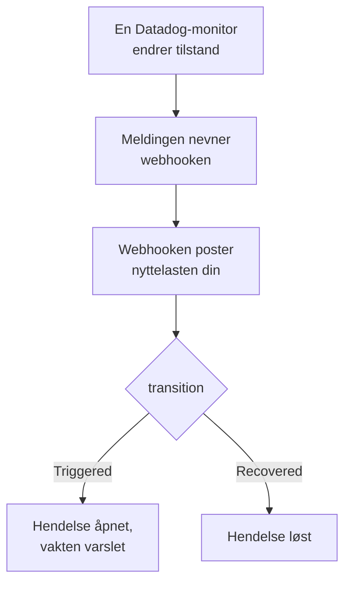

# Datadog

Send varsler fra [Datadog](https://www.datadoghq.com)-monitorer til OneUptime, slik at hvert varsel blir en hendelse som varsler vaktteamet ditt og løses når Datadog-monitoren er gjenopprettet. Datadog sender varslene sine gjennom sin [Webhooks-integrasjon](https://docs.datadoghq.com/integrations/webhooks/), så det er ingenting å installere på noen av sidene.

:::cards
- [Velg hvordan OneUptime mottar varsler](#velg-hvordan-oneuptime-mottar-varsler): En Incoming Request-monitor eller en egen arbeidsflyt.
- [Motta varsler med en monitor](#motta-varsler-med-en-monitor): Én hendelse per varsel, løst ved gjenoppretting.
- [Konfigurer Datadog](#konfigurer-datadog): En webhook og monitorene som varsler den.
- [Feilsøking](#feilsøking): Når varsler ikke kommer frem, eller hendelser blir stående åpne.
:::

## Slik fungerer det



En Datadog-monitor varsler webhookene som meldingen nevner, når den endrer tilstand: når den utløses, advarer, gjenopprettes eller mangler data. JSON-innholdet i webhooken skriver du selv, ut fra Datadogs [malvariabler](https://docs.datadoghq.com/integrations/webhooks/#usage), så denne veiledningen gir deg et som navngir hvert varsel og sier hva som skjedde med det.

## Før du begynner

- En Datadog-konto der du kan konfigurere integrasjoner og redigere monitorer.
- I OneUptime retten til å opprette monitorer, eller arbeidsflyter hvis du velger den veien.

## Velg hvordan OneUptime mottar varsler

Sett opp OneUptime først: det gir deg URL-en som Datadog sender til.

| Vei | Bruk den når |
| --- | --- |
| En Incoming Request-monitor (anbefalt) | Du vil at hvert varsel skal bli en hendelse som varsler vakten og løses når Datadog-monitoren er gjenopprettet. Det er ingenting å bygge. |
| En arbeidsflyt med en Webhook-trigger | Du trenger din egen logikk: filtrere varsler, omforme dem eller kalle andre systemer først. En arbeidsflyt erklærer en hendelse for hvert varsel den får, og løser den ikke ved gjenoppretting. |

Begge får den samme JSON-en fra den samme webhooken, så du kan begynne med den ene og bytte senere ved å endre én URL i Datadog.

## Motta varsler med en monitor

En [Incoming Request-monitor](/docs/monitor/incoming-request-monitor) gir deg en URL, og kriteriene dens avgjør hva hvert varsel gjør.

:::steps
### Opprett monitoren

Gå til **Monitorer**, og klikk på **Opprett monitor**. Velg **Incoming Request** under **Monitortype**, gi den navnet `Datadog`, og klikk på **Neste**.

### Erklær en hendelse for hvert varsel

Åpne det første kriteriet i trinnet **Kriterier**, det som markerer monitoren som frakoblet. Sett filteret til **Forespørselstekst**, **Inneholder**, `"transition":"Triggered"`. Dette kriteriet erklærer allerede en hendelse når filteret samsvarer. Fyll ut hendelsen:

- **Hendelsestittel**: `{{requestBody.title}}`.
- **Hendelsesbeskrivelse**, under **Beskrivelse**: `{{requestBody.body}}`, deretter `Datadog: {{requestBody.link}}` på en egen linje.
- **Alvorlighetsgrad**: hendelsesalvorlighetsgraden disse varslene skal ha.
- **Vaktretningslinjer**, under **Vakt**: retningslinjene som skal varsles.
- **Løs hendelse automatisk**, under **Flere felt**: la den være slått på, slik den starter. Uten den ignoreres gjenopprettinger, og hendelser blir stående åpne.

### Åpne én hendelse per varsel

Åpne **Innstillinger** i det samme kriteriet, og slå på **Group incidents and alerts by a payload field**. Fyll den ut som nedenfor, slik at hvert varsel får sin egen hendelse, og gjenopprettingen løser den:

| Felt | Verdi |
| --- | --- |
| **Open a separate incident for each…** | `requestBody.alert_key` |
| **Field that signals recovery** | `requestBody.transition` |
| **Value that means recovered** | `Recovered` |

### Få monitoren tilkoblet igjen

Åpne det andre kriteriet, det som markerer monitoren som tilkoblet, og sett filteret til **Forespørselstekst**, **Inneholder**, `"transition":"Recovered"`.

### Kopier URL-en

Klikk på **Opprett monitor**. Monitorens side **Oversikt** viser **Heartbeat URL**. Kopier den til Datadog:

```text
https://oneuptime.com/heartbeat/<secret key>
```

En selvdriftet installasjon har sin egen vert i stedet for `oneuptime.com`.
:::

Nyttelasten nedenfor setter `alert_key` til Datadog-monitorens ID og taggene til gruppen som varslet, slik at hver gruppe i en multi-alert-monitor får sin egen hendelse, og gjenopprettingen til den gruppen løser den. En monitor som utløses på nytt eller varsler på nytt mens hendelsen er åpen, åpner ikke en hendelse til. Se [Motta varsler fra et annet system](/docs/monitor/incoming-request-monitor#motta-varsler-fra-et-annet-system) for hva hver innstilling gjør.

> [!NOTE]
> En varsling **Warn** eller **No Data** åpner ingen hendelse med disse filtrene. For også å bli varslet ved advarsler klikker du på **Legg til kriterier**, gir det nye kriteriet filteret **Forespørselstekst**, **Inneholder**, `"transition":"Warn"`, en hendelse med sin egen **Alvorlighetsgrad** og de samme grupperingsinnstillingene, og drar det deretter over det første kriteriet. Kriterier kontrolleres ovenfra, og det første som samsvarer, bestemmer.

## Konfigurer Datadog

:::steps
### Legg til webhooken

Åpne [flisen for Webhooks-integrasjonen](https://app.datadoghq.com/integrations/webhooks) i Datadog, og installer den hvis den ikke er installert ennå. Legg til en webhook med disse innstillingene, og lagre den deretter:

- **Name**: `oneuptime`. Monitorer nevner webhooken med dette navnet, som `@webhook-oneuptime`.
- **URL**: URL-en du kopierte fra OneUptime.
- **Payload**:

  ```json
  {
    "alert_key": "$ALERT_ID $ALERT_SCOPE",
    "transition": "$ALERT_TRANSITION",
    "title": "$EVENT_TITLE",
    "body": "$TEXT_ONLY_MSG",
    "host": "$HOSTNAME",
    "priority": "$PRIORITY",
    "link": "$LINK"
  }
  ```

### Nevn webhooken i monitorene dine

Legg til `@webhook-oneuptime` i monitorens varslingsmelding i hver Datadog-monitor som skal varsle gjennom OneUptime, og lagre monitoren. Datadog sender da varslene og gjenopprettingene fra den monitoren til OneUptime.
:::

| Variabel | Hva Datadog setter i den |
| --- | --- |
| `$ALERT_ID` | ID-en til Datadog-monitoren som varslet. |
| `$ALERT_SCOPE` | Taggene til gruppen som varslet, som `host:web-1`. |
| `$ALERT_TRANSITION` | Hva som skjedde: `Triggered`, `Re-Triggered`, `Warn`, `Recovered`, `No Data` eller `Renotify`, blant andre. |
| `$EVENT_TITLE` | Tittelen på hendelsen, som `[Triggered] High CPU`. |
| `$TEXT_ONLY_MSG` | Monitorens melding, uten Markdown. |
| `$LINK` | En lenke til hendelsen i Datadog. |

## Test det

Send OneUptime et varsel, slik Datadog ville gjort:

```bash
curl -X POST "https://oneuptime.com/heartbeat/<secret key>" \
  -H "Content-Type: application/json" \
  -d '{
    "alert_key": "1234 host:web-1",
    "transition": "Triggered",
    "title": "[Triggered] High CPU",
    "body": "CPU is above 90% on web-1.",
    "host": "web-1",
    "priority": "normal",
    "link": "https://app.datadoghq.com/event/event?id=1"
  }'
```

En hendelse åpnes med tittelen `[Triggered] High CPU`. Send den samme forespørselen med `transition` satt til `Recovered`, og hendelsen løses.

Test deretter fra Datadog: åpne en monitor som nevner webhooken, klikk på **Test Notifications**, og send varslingen **Alert**. Sjekk tidslinjen til OneUptime-monitoren for å se at den kom frem.

## Motta varsler med en arbeidsflyt

Bruk en [arbeidsflyt](/docs/workflows/index) når du trenger egne trinn mellom Datadog og hendelsen.

:::steps
### Opprett arbeidsflyten

Gå til **Arbeidsflyter**, klikk på **Opprett arbeidsflyt** og deretter på **Start fra bunnen**. Gi den navnet `Datadog alerts`, og klikk på **Opprett arbeidsflyt**.

### Legg til Webhook-triggeren

Klikk på den stiplede blokken **Velg hva som starter denne arbeidsflyten**, og velg **Webhook**. Klikk på triggeren, deretter på **Kopier URL**, og bruk den URL-en i webhooken i Datadog.

### Kontroller at monitoren er utløst

Klikk på **Legg til komponent**, legg til en blokk **If / Else**, og koble triggerens punkt **Out** til den. Sett **Value to check** til `{{local.components.webhook-1.returnValues.request-body.transition}}`, **Comparison** til **is equal to** og **Compare with** til `Triggered`.

### Erklær hendelsen

Legg til en blokk **Create One Incident**, og koble siden **Yes** av blokken **If / Else** til den. Velg en mal under **Incident Template** som setter alvorlighetsgraden og vaktretningslinjene som skal varsles (se [Hendelsesmaler](/docs/incidents/settings#hendelsesmaler)). Angi under **JSON Object** hva som kommer fra Datadog:

```json
{
  "title": "{{local.components.webhook-1.returnValues.request-body.title}}",
  "description": "{{local.components.webhook-1.returnValues.request-body.body}}\nDatadog: {{local.components.webhook-1.returnValues.request-body.link}}"
}
```

Uten en mal må **JSON Object** også inneholde `incidentSeverityId`, ID-en til en av prosjektets hendelsesalvorlighetsgrader.

### Slå på arbeidsflyten

Slå på **Aktivert** øverst i **Bygger**. En arbeidsflyt som er slått av, svarer Datadog med `400`.
:::

Hver varsling `Triggered` erklærer en ny hendelse. En gjenoppretting tar siden **No** av blokken **If / Else**, der ingenting er koblet til, så kjøringen slutter der. Bruk monitoren for én hendelse per varsel som løses ved gjenoppretting.

## Feilsøking

:::details Ingenting kommer frem til OneUptime
- Kontroller at meldingen til Datadog-monitoren nevner `@webhook-oneuptime`, stavet slik webhooken heter.
- Monitoren svarer `200` med en gang, før den kontrollerer noe, også ved en feil hemmelig nøkkel. Sjekk monitorens tidslinje for å se om varsler kommer frem.
- En arbeidsflyt som er slått av, svarer `400`. Slå på **Aktivert** øverst i **Bygger** for den.
:::

:::details Hendelser opprettes, men løses aldri
- Datadog-monitoren må også varsle webhooken om gjenopprettingene sine. En melding som nevner webhooken bare for varsler, inne i en betingelse, sender ingen gjenoppretting.
- Hendelsen i kriteriet trenger **Løs hendelse automatisk**, under **Flere felt**.
- **Value that means recovered** må være nøyaktig `Recovered`. Sammenligningen skiller mellom store og små bokstaver.
- `alert_key` i gjenopprettingen må være varselets: behold `$ALERT_ID $ALERT_SCOPE` slik det står i nyttelasten.
:::

:::details Et felt viser navnet på en variabel, eller ingenting
Datadog fyller bare ut variablene som gjelder for hendelsen. Send en testvarsling, og se deretter hva som kom frem: i monitorens tidslinje, eller for en arbeidsflyt i **Logger → Kjøringer**.
:::

:::details Alle varslene fra en monitor slås sammen til én hendelse
Hver gruppe trenger sin egen `alert_key`. Kontroller at nyttelasten bygger den fra både `$ALERT_ID` og `$ALERT_SCOPE`, og at grupperingsbanen er `requestBody.alert_key`.
:::

## Sikkerhet

- **Behandle URL-en som et passord.** Alle som har den, kan åpne hendelser. Hvis den lekker, tilbakestiller du den: **Tilbakestill hemmelig nøkkel for innkommende forespørsel** på monitorens side **Innstillinger**, eller **Tilbakestill URL** i arbeidsflytens **Webhook**-trigger. Oppdater deretter webhookens **URL** i Datadog.
- **Selvdriftet?** Datadog sender webhooks fra internett, så OneUptime-instansen din må kunne nås derfra over HTTPS.

## Neste trinn

:::cards
- [Innkommende forespørsel-overvåking](/docs/monitor/incoming-request-monitor): Hver innstilling for monitoren som mottar varslene dine.
- [Prometheus Alertmanager](/docs/integrations/prometheus-alertmanager): Det samme oppsettet, for Alertmanager.
- [Eskaleringsregler](/docs/on-call/escalation-rules): Bestem hvem en vaktretningslinje varsler, og når.
- [Oversikt over integrasjoner](/docs/integrations/index): De andre verktøyene du kan koble til.
:::
